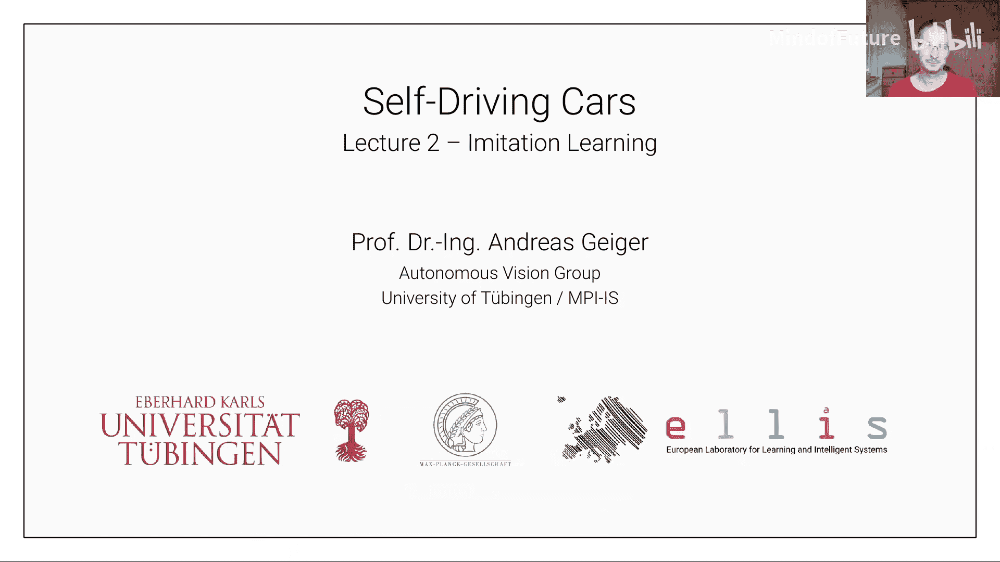
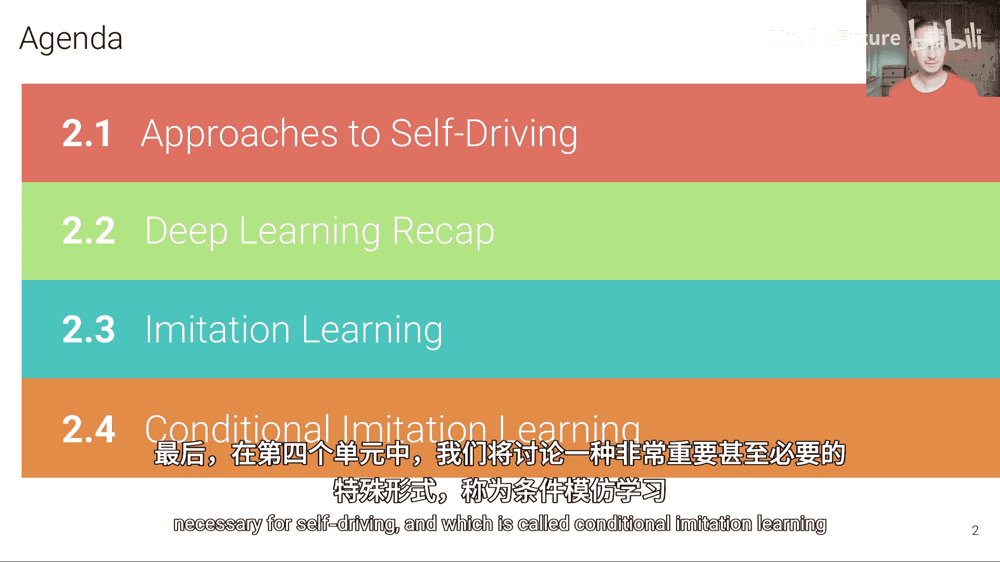
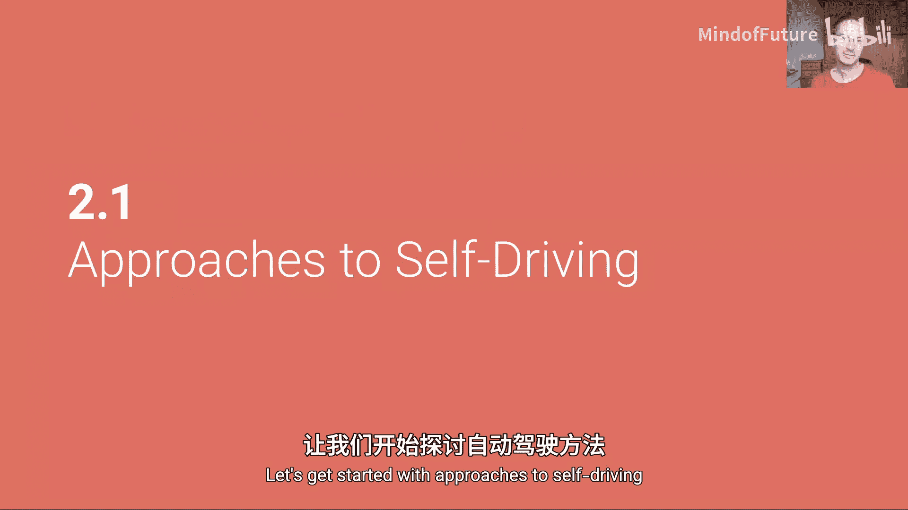
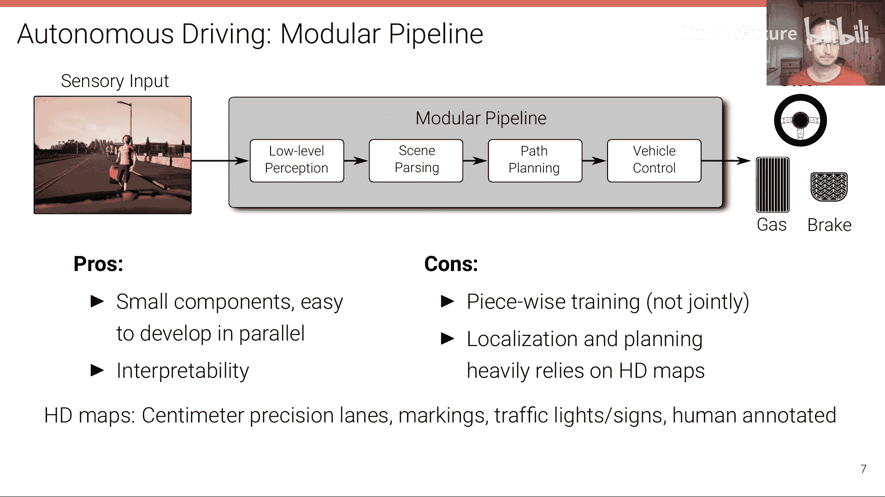
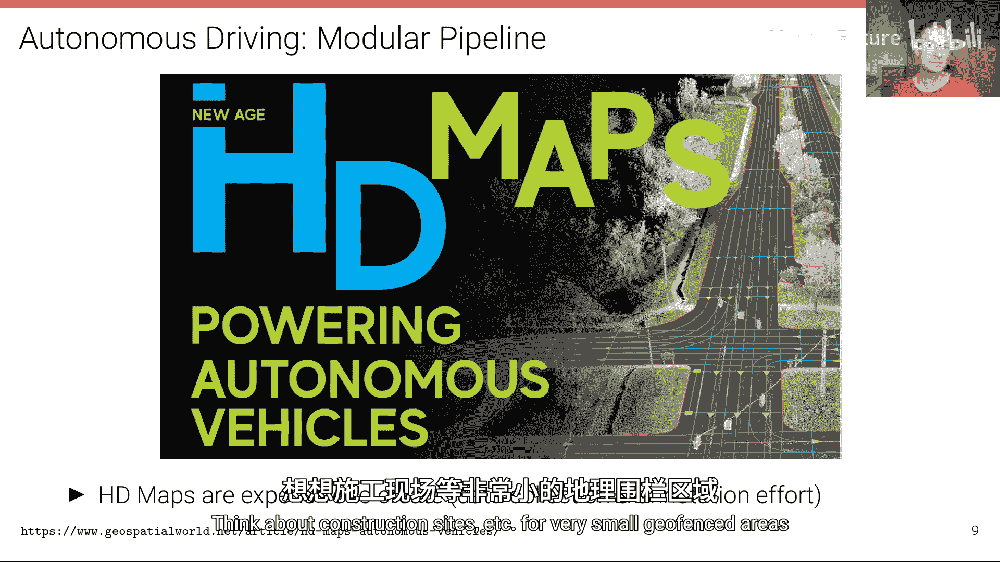
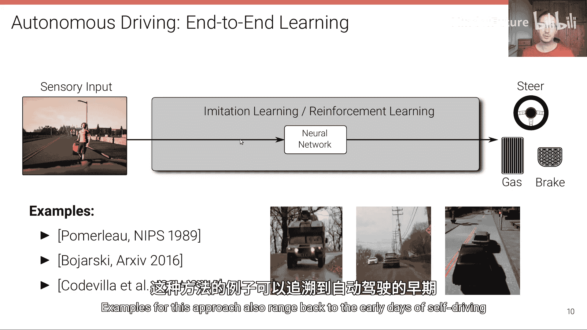
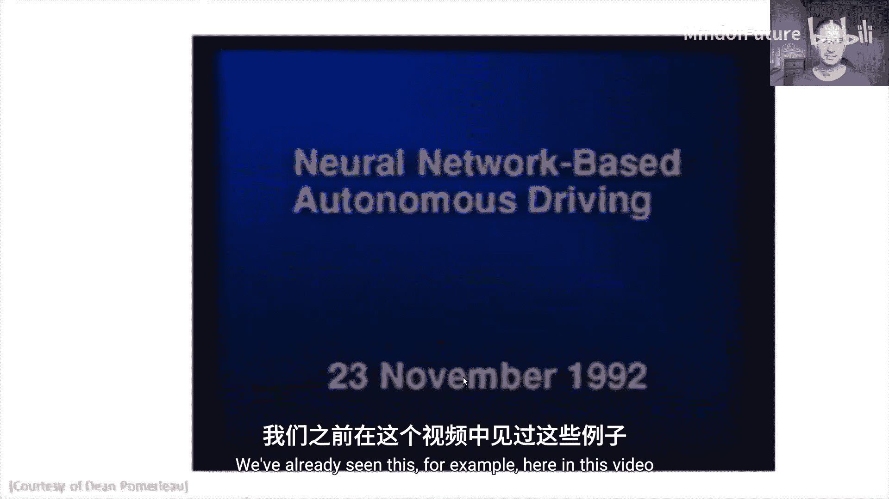
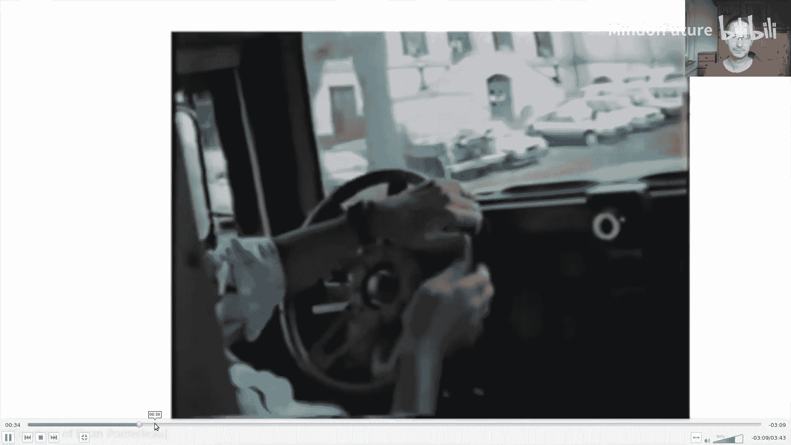
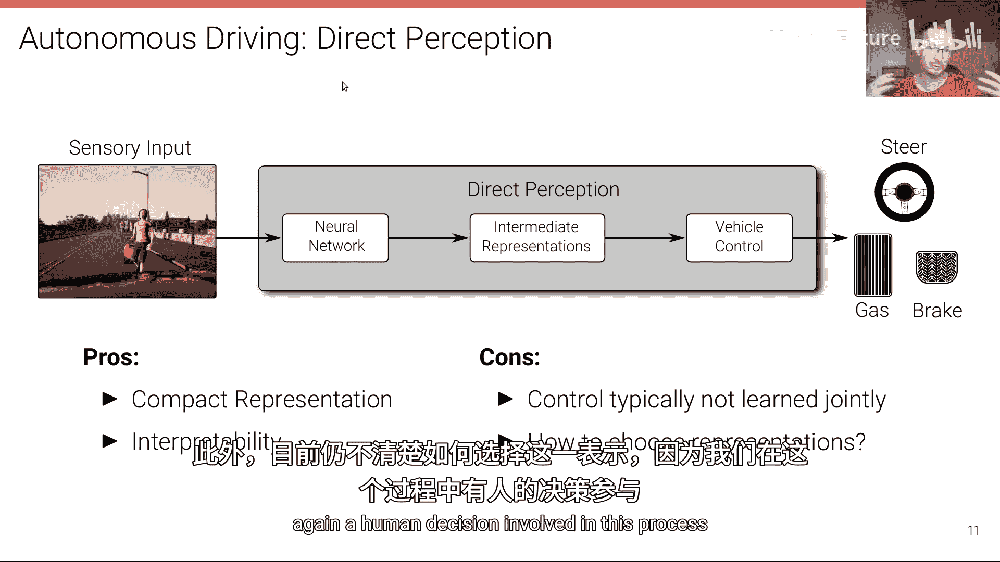

# 【图宾根大学】自动驾驶汽车课程 ML4340 p04 P04 Lecture 2.1 (Imitation Learning - Approaches to Self-Driving) -BV16FP2ePEYc_p4-

Welcome to Self drivingiv Car Lec number2。In this lecture。

 we're going to see the first agents driving on their own。

And we'll start with so called end to end learning approaches， in particular。

 we'll focus on imitation learning。Imitation learning is maybe the most simple and also the most promising approach to self driving。

 but at the same time， the least deployed approach at the moment。

Why is that。Let's figure out together in this lecture。

The lecture is structured into four units in a first unit。

 well have an overview of the different approaches to self driving。In the second unit。

 we'll have a deep learning recap， as deep learning is really essential to many of the。

Approaches that we are going to see and cover in this lecture。In the third unit， will then。

Be introducing imutation learning。And then finally， in the fourth unit， a special form that is。

Very important or even necessary for self driving， and which is called conditional imutation learning。

Let's get started with approaches to self driving。

A autonomous driving stack can be seen as a function that takes a。High dimensional sensory input。

 such as an RGB image or an RGB video or a sequence of Liar。

 laser scans or radar or ultrasonic measurements， are all combined。

And takes this high dimensional input and produces a low dimensional output。

 basically just two dimensional， which is the steering command left or right。

And the longitudinal control， which is giving gas or bra。Now。

 the goal is to find a mapping function that does this mapping from this high dimensional input space to this low dimensional output space vary robustly and reliably。

There's free dominating paradigms to self driving。One is the model of pipeline。Second。

 the end to end learning approaches where also imitation learning falls under this category。

And finally， direct perception。Let's have a look at the differences between these different paradigms to self driving。

Let's start with the modelular pipeline。As the name suggests。

 the modelular pipeline decomposes the entire self driving stack into independent components。

 as illustrated here。And it's one of the dominating paradigms that is used in， for example。

 the approaches that have been successful at the DARPA challengesll。

 but also at the industry leaders， Waymo， Uber， Tesla and Sus。Here。

 I have illustrated one particular example for a model of pipeline， but， of course， in practice。

 these pipelines are much larger and more complex， but just to walk you through this。

Model of pipeline， I will show you at this concrete example how these individual modules would work together。

Let's start with the first module。The first module is is responsible for low level perception。

 For example， the vehicle has to localize itself。 It has to detect vehicles and buildings and lane dividers and lane markings。

Here's an example of localization， and here's an example for object detection。In the second stage。

 all this perceived information must be consolidated into one robust scene representation。

 and that's what is called scene parsing here。Here on the left you can see an example where vehicle tracks。

 vanishing points and lane markings and scene labels are integrated into one single representation from which a consistent scene representation that relates all the other traffic participants to the agent here in black to the observer。

Is demonstrated。Having a robustist。Scene parse， a robust representation of the environment。

A path planning module can take this information。Can take the map information and the perceived information。

 typicallyypically the map information for a self driving car。

Is represented in terms of so called HD maps， which are are very high precision high definition maps that contain a lot of details like individual lane markings or that specify the position of traffic lights。

Pth planning then takes all this information。Deensed information and the map information and plans a path both at a global level。

 as illustrated here， as well as a local lane level shown here on the right。

And these are all things that we're going to talk about in more detail during this lecture。

Once a path has planned， the path is then。Exeed。And it's executed via a vehicle controller。

Where the vehicle is controlled such that it keeps its distance and speed close to the trajectory that has been determined by the path planning stage。

The advantage of a model or pipeline is that。It's relatively easy to develop in parallel because there's many small components。

 and it's quite interpretpreable because all of these components have been designed by humans。

 So the interfaces are well known。 They have been specified， in fact。However， on the other side。

It typically doesn't allow for joint end to end training。 What does that mean。Well， in order， like。

 let's assume each of these components has some parameters。 Now。

 all of these parameters are trained on data that's different than the actual self driving task。

 For example， the perception module。One component of the perception model might be an object detector。

 and an object detector is trained for predicting bounding boxes with respect to a bounding box loss on a data set with a lot of images containing bounding boxes。

Now， of course， predicting bounding boxes very well doesn't mean the vehicle can drive safely and efficiently to its goal。

And that's the discrepancy here。 While these modules have been trained independently from the actual downstream task。

 what we actually care about is the self driving performance。And then furthermore。

 localization and planning in current state of the art。

 self driving systems and prototypes heavily relies on these HD maps that involve a lot of human labor to create and to maintain up to date。

Here's an example。This is taken from a paper from Uba and Tvidi。

That illustrates why an auxiliary loss function， like。

Object detection might not be the ideal choice when we actually care about self driving。

If you look at these images， then you can see the importance of each of these objects for the self driving task as it has been determined by human annotators in this experiment。

And as you can see， not all of these bonding boxes are equally important， for example。

 the bonding boxes of these cars that are parked behind the divider and that don't interact with the ego vehicle are not relevant for the self driving task。

Yet the object detection algorithm is task to detect them precisely because the loss function。

Desires to detect them precisely。 The loss function does know that these cars are not important。

 If you train an object detector， you simply want the model to do very well on all the cars that have been annotated。

So it tries to be also very accurate on cars that are not relevant for the driving task and therefore wastes capacity on irrelevant tasks。

 while maybe doing worse than it could do on what it actually is relevant for the driving task。

Here is an example of an HD map where you can see the individual lanes that have been traced partially automatic。

 but partially also by humans in a very time consuming process with all the traffic lights， etc。

These HD maps are very expensive to create， and they can only be created and maintained up to date。

 Think about construction sites， etc。For very small geo fenceenced areas。

An alternative approach to the modelular pipeline is enter end learning In end end learning。

 we are considering this mapping from sensory input to the low dimensional steering and gas and brake commands as a monolithic function。

That is typically represented using a neural network。

And this neural network then can be trained using different algorithms。

The two most important algorithms are imitation learning and reinforcement learning。

 which we'll learn about in this lecture。Examples for this approach also range back。

To the early days of self driving， we've already seen this， for example， here in this video。

That learns to steer by watching a person drive。

Once every two seconds。Alalvin digitizes a video image of the roadtahan。

And records the person's steering direction。This is the Alvin vehicle from the 80s。

And theres several modern recarnations。 So， for example， here in this video。

NviDdia is driving a car based on the same algorithms just using modern。

 more modern computers and more modern neural network architectures。

The advantages of inter training or inter end learning are that， well， they are end to end。

 which means we are optimizing for what we actually care about， the driving task。And。

At least for imutation learning， annotations are relatively cheap because you just have to attach a。

Camera。To the car and also sensors to the steering wheel and to the act curators。 And then you。

 you have to drive around and you automatically collect data。The disadvantages， however。

 are that these models do not generalize as well as the model of pipelines yet。

And they also lack interpretability。And then there is a hybrid between these two approaches called direct perception。

 where we are having sort of a modelular pipeline， but still end to endtrainable。

 where we particularly specify an intermediate representation， for example， a semantic segmentation。

 and there is a first neural network that takes the input image and produces this intermediate representation。

And then there is a second neural network or a classical vehicle controller that takes this representation and produces the vehicle control。

There are several examples of this type of approaches in the literature。

 Here's one of the earlier ones for highway driving， where you can see the different。

So called affordances that are predicted as an representation。 In this case。

 intermediate representation is not a semantic segmentation。

 but this is a small set low dimensional signal of how far am I to the next car on my lane。

 How far am I to my next car on the left lane， How far am I to the next car on the right lane。

And how far am I to the left and to the right lane markings， etc， and based on this。

 the vehicle controller then steers the vehicle。The advantages of direct perception are that the representation intermediate representation can be quite compact and also very interpreable。

But on the other hand， it's not always easy to learn the vehicle controller jointly。

 and it's also not clear how this representation should be chosen as now we have again a human decision involved in this process。

