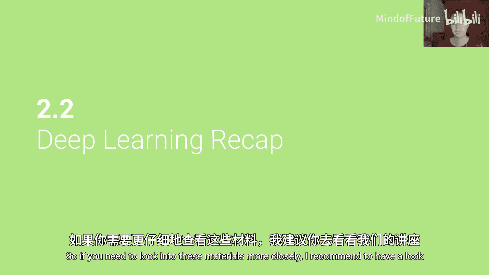
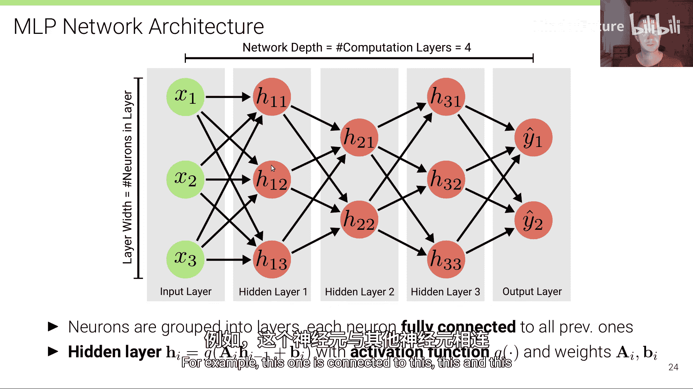
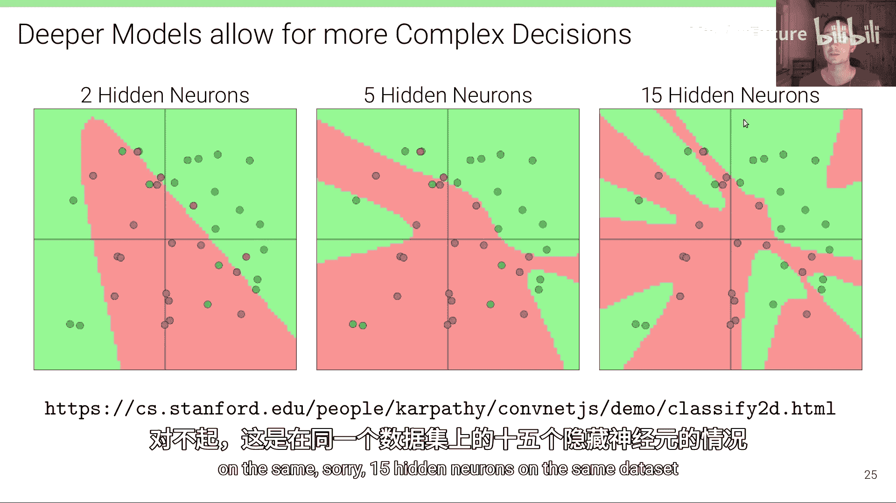
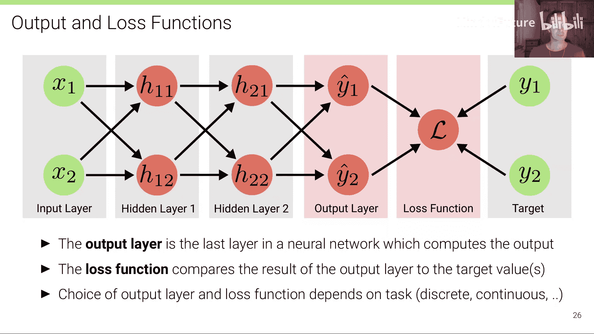
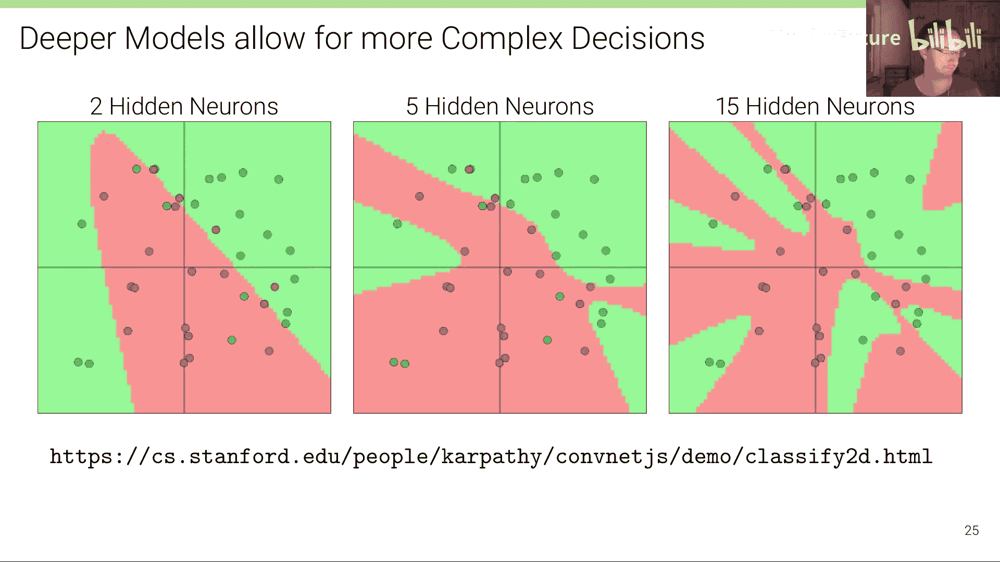
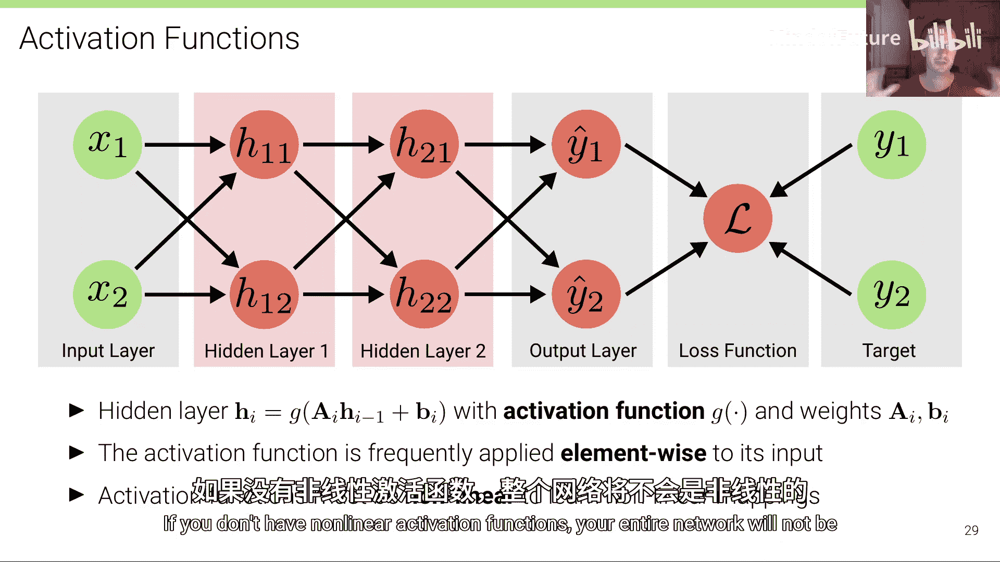
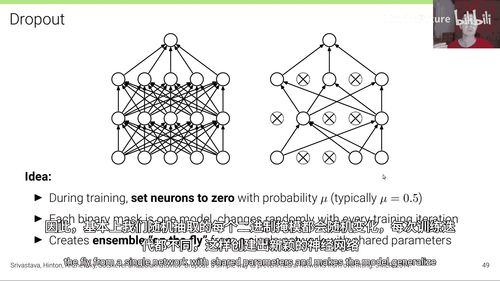
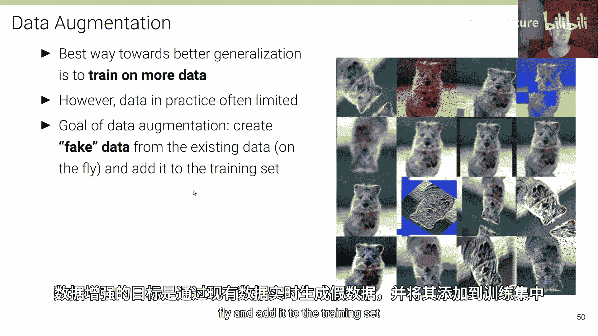

# 【图宾根大学】自动驾驶汽车课程 ML4340 p05 P05 Lecture 2.2 (Imitation Learning - Deep Learning Recap) -BV16FP2ePEYc_p5-

Deep learning is really essential for many of the algorithms that we discuss in this class。

And while deep learning is a prerequisite for this course。

 I thought it would be a good idea to do a little recap。

This recap is basically a summary of the first seven lectures of our deep learning lecture at the University of Triubingham。

Heavily condensed into。4 these lights or so。And we are going to be rather quick。

 So if you need to look into these materials more closely， I recommend to have a look at our lecture。

Let's start with one of the most important problems in machine learning。

 which is supervised learning。As is the case also， for example。

 in the case of imitation learning where we have a。

Permettriized model F with parameters W that takes an input X and predicts an output Y。

 The input could be an image。 The output could be the vehicle control。

Theres two tasks associated with supervised learning。The learning task。

 which is on estimating the parameters W from a training set that comprises a pairs of x and y。

And then the inference task， given the particular。W， given the trained model。

How can we make novel predictions。Let's start by looking at the linear classification problem again。

嗯。The simplest linear classifier is a logistic agressor。

 and the mathematical formulation is shown here。What we do is we take the input X。

 and we pass it through a linearity through an aff fine transformation。 We multiplied with w。

And add the bias W 0。And then we pass the result。Which is a scalar。Through a。Logistic function。

 a sigmoid function， a sigmoid non linearity， which has this form here。And which。

Squezees the range of values to the interval0 and 1， which is then the probability for the class。

 for the predicted class。The decision boundary is at the location where the argument。

Of the sigmoid function is equal to 0。In our words aware， W transpose x plus W0 equals 0。

 as indicated here on the right。And we would decide for class 1 if w transpose x is bigger than minus w0 and for class 0。

 otherwise， as illustrated on the right。Which problems can be solved with this simple classifier？

Here is the first problem。 The problem is a logical R， which you can see tabulated here on the left。

And in graphical form here on the right。We have a two dimensional input。 And if any of the two。

Values is one。 Then the output is one here in green， class 1， and otherwise。Only at the location，0，0。

The output is class 0。Now， we can represent。This。Classification problem。

We can find a classifier that separates this two。Setets of points， exactly。As such here。

 where we put a line between the red and the green points that clearly separates all the red from all the green points。

And the mathematical form of this equation is shown here at the top。Similarly。

 we can define the end the logical end operator Now， these three points here are red。

 and only where both x1 and x2 are 1， the output is class 1， otherwise its red or class 0。

And similar to before， we can define a linear seerator。Expressed for this formula here。

That separates the red from the green points。We can also define the Nant operator。

 which is the not end operator simply by reversing that decision。Now， the question is。

 what happens for the X R over a。The XR operator is shown here。If。Eithver x1 or x2 are 1。

 and the other is 0。Then we predict class 1， otherwise we predict class 0。In this case。

 it becomes more complicated。There is no single decision boundary that can classify these two classes。

 this data set correctly。Never this， nor this。So what can we do？

A solution to this problem is to lift the features。

 the two dimensional feature space to a higher dimensional feature space。Consider， for example。

 this feature space here where we don't only have x1 and x2。

 but also the product of the two x1 times x 2， which is illustrated here on the right。 Now。

 we have a three dimensional。feature space。And you can see that this point here on the right has now been lifted to the top because only for x1 times x2。

 the third。featureeature is one。Now， in this case。In this three dimensional feature space。

 we can actually find a linear separator， a linear hyperplane。That separates these two。

Classes from each other as illustrated here。In other words。

 nonlinear features allow linear classifiers to solve nonlinear classification problems。

We have changed the representation。 We've changed the feature space， and therefore。

 a linear classifier is able to solve a problem that it wasn't able to solve before。

Here's another example。 This data set here on the left cannot not。Be linearly separated。

 But if we represent this data set using polar coordinates。With radius are an angle theta。

Then we can clearly find a linear decision boundary between the points。

But how to choose the transformation， How should we actually。Chaanged the representation。

This can be very hard in practice if one wanted to do this manually， yet。

Doing this manually was the dominant approach until the 200s。 In vision and speech。

 people designed manual feature spaces。In deep learning or representation learning， however。

 we want to learn these representations， we want to learn these transformations from the data itself。

Which is， of course， much more convenient。So let's look at our X or problem again。

 you can see here on the bottom right。In order to classify this data set correctly。

 what we can do is we can have a decision boundary here， which is the R operator。

 and we can have a decision boundary here， which is the N operator。And we can combine these too。

To obtain the X or operation。Or in formulas， the x are。Of x1 and x 2 is。

The end operation of the R operation and the N operation of the two arguments。

By simply combining these free operations， we obtain the X or operation。

This can also be written as a program of logistic regressors。

Here is the expression from the previous slide again。

And we can write this as a program because each of these components is something that we know already。

 We have already looked at the specific formula on the previous slides， if I go back。For example。

 here was the formula for the end operator and so on。

And so the program of logistic request looks like this。We transform x with the R operator。

 and obtain a hidden。Feature value， H1。We transform x with the n operator and obtain a different hidden feature H 2。

 We concatenate these two into a vector H and transform this with the n operator to obtain the prediction。

And this can be written as this computation graph here on the right， where green node are inputs。

Orange notes are parameters。And red notes are intermediate node or output nodes。

Note that H is a nonlinear feature of x。 H of x is a nonlinear feature of x。

Because of this nonlinearity， sigma here。And we call H of x a hidden layer。This can be generalized。

 and the generalization is called multi layer perceptron， or in short， M LP。

 M LP are feet forward neural networks。Which do not have any feedback on like recurrent neural networks。

They compose several nonlinear functions。For example， F of x can be expressed as。

Y head of H3 H2 H1 of x。Simply stacking these hidden features until we arrive at the output。

The data specifies only the behavior of the output layer， therefore， the name hidden。

Each layer I comprises multiple neurons， J， which are implemented as aine transformations。

 a transpose x plus B， followed by a nonlinear activation function， for example， the sigmoid。

Or more general， we just write G for the activation function here because it could be an a different activation function。

 and we will see some activation function soon。Each neuron in each layer is fully connected to all neurons of the previous layer in an MLP。

And the over length of the chain is the depth of the model。Is called the depth of the model。

 therefore is called deep learning。 the more hidden layers we have， the deeper our model。

Here's an example。With one input layer。And then three hidden layers， and one output layer。

We say that this network， because it has three hidden layers and one output layer。

 has a depth of four。The input layer is not counted。On the other hand， the width is。

How many neurons we have in each layer。Here you can see again， that the neurons。

Are grouped into layers， and each neuron is fully connected to all previous ones。 For example。

 this one is connected to this， this and this。

Deeper models allow for more complex decisions。Here is an example which I took from Andre Carpati's great website。

 which has a live demo where you can classify data and many do many other interesting things。

And you can see the decision boundary of a neural network with two hidden layers， five hidden layers。

And 15 hidden。Layers on the same。嗯。Sorry， 15 hidden neurons on the same data set。

嗯。So both the depth as well as the V， of course， determine how complex the decisions can be。

Let's talk about the components of a multilayer perceptron。

The output layer is the last layer in a neural network which computes the output shown here in red。

After the output， we have a loss function that compares the output of the neural network with some desired target values in green here on the very right。

The choice of the output layers and the loss function depends on the task。 For example。

 if we want to predict something discrete。Say an image category or something continuous like a steering angle of a vehicle。

Let's talk about the output layer。For classification problems。

 we typically use a sigmoid or a soft max linearity for multi class classification problems。

To obtain probability values here。For regression problems。

 we can directly return the value after the last layer because it's continuous。So。

 we don't apply any。ANo linearity after the last A transformation。

The loss function is also different for classification problems。

 the loss function that is derived from the maximum likelihood principle is the cross entropy loss。

 or in the binary classification case， the binary cross entropy。For regressionggressant problems。

 we can use the standard L1 or L2， the Eucclean loss。There's many other options， of course。

Each of these hidden layers has an activation function。So a hidden layer。

 remember from the previous slide。Has a linear transformation plus a non nonlinear transformation G。

 which is called the activation function G。The activation function is most often applied in an element wise fashion to its inputs。

 So it's really an function that operates on scalrs only。

Actation functions must be nonlinear to learn nonlinear mappings overall through the network。

If you don't have nonlinear activation functions， your entire network will not be nonlinear。

Here are some examples of activation functions， the already known sigmoid on the top left and the popular relo。

 which is also very efficient to compute。And doesn't saturate in terms of gradients on the right hand side。

On the bottom left。There's many of。That people are using， depending on the problem。

 often the choices， empirical and different activation functions have to be tried。

One thing that's in particular important for processing images。

 as in the case of self driving are convolutional neural networks。

The problem with multi layer perceptrons is that they don't scale to high dimensional inputs。

If you have a megapixs image， then you would have a very large number of connections and weights。

 which are very hard to learn and require a lot of memory to store。Confidence therefore。

 as illustrated here， represent data in three dimensions。

So the input is represented in terms of the width and height of the image in this case。

 and the third dimension is the depth for the number of feature channels or feature maps。

Confnets interleave discrete convolutions and non linearities。 We have a convolution and a linearity。

 as well as pooling operations to make the。Output of the of this layer of the next layer smaller to make to reduce the spatial dimensions。

The key ideas of convolutional neural networks are to exploit only sparse interactions。

 to heavily use a parameter sharing and to learn equi representations。

 which means that if I shift the input， then the output of the convolutional layer。

 the features are also translated。 which is a desirable property。

 the very useful inductive bias for images， because if I want to detect objects。

 then I want to detect them in the same way， no matter where they appear in the image， as an example。

Let's look at this a little bit more closely， here's in comparison of fully connected versus convolutional layers。

On the left， you can see the fully connected layer where the input in this case is also an image。

And on the right， you can see the convolutional counterpart。

And you can already see that the fully connected layer has much more weights because every input。

Every W H and C N plus one for the bias。Is connected to every output。

So to every element of the output of that layer， therefore we have the product of this with W times H plus the number of output channels C out。

In contrast。A convolutional layer has much fewer weights。Here。

 we only connect locally for this output the。Elements of the kernel that are centered at the same location。

 So if we assume a free by free kernel， then instead of connecting all the inputs。

 we are connecting just three by free times the number of channels。To this output。 And of course。

 we also have an bias plus one here。And we use the same weights for all locations。

 We applied this filter to all the locations of the output， but we're using the same weights。

 That's why the weights do not get replicated。 So we get a reduction in terms of weights here。

 and also in terms of weights here， W and H simply drop。

But we do this for each output channel separately， so we still have C out here。

And this is what's called weight sharing and what's responsible for the parameter reduction and for making these models very efficient and also equilibriumant。

All of these convolution operations are as the fully connected operations followed by a nonlinear activation function like a relo or a sigmoid。

Here is an illustration of how the kernel is swept over the input。

One issue with convolutions is that if we apply convolutions naively。

 then we cannot compute values at the very boundary of the image because the kernel would go outside the image boundaries。

To counter this and to allow the networks to stay within canonical image sizes。

At least during the convolution operation itself to not change the dimensionality of the tensor。

A simple idea here is， or a simple solution to this is to use so called padding。

 where we add an artificial boundary that's just filled with zeroos or is mirroring the last elements of the。

Image， rows and columns。There's different variance of this。And then if we do that， of course。

 then we can calculate and apply this kernel and calculate these elements。

 also at the boundaries of the output tensor。This is the convolution。Oeration。

In addition to the convolution operation。In the case of image classification。

 but also in the case of making decisions based on image inputs for a self driving。

 we want to narrow down the information to one single value。

 so we need to reduce the spatial dimensions。Rather quickly。

 and we do this by interleaving pooling operations with convolutions。 So here we have a convolution。

And then we simply reduce the spatial resolution by averaging or max pooling nearby values。

And a typical pooling operation reduces the input tensor in its spatial dimension by a factor of two。

Often， when reducing the spatial dimension， the number of feature channels increased to retain or to to。

Increase the capacity because we are losing spatial resolution。

 We need to increase the capacity to store all relevant information。

Down sampling also increases the sive field size， versusceptive field is the area in the original input that if changed。

 changed something on the output。If I'm using pool operations。

 I'm pulling down the entire image to one single pixel， then， of course。

 any a change in any of the input pixels changes this one single output。

So heres an example of a pooling operation， this is a simple pooling operation that computes the average or the mean or the minimum over all of these values and enters it here at the cell。

 and then we do the same here and the same here and the same here。

 you can see how the dimension of the input gets reduced。And then。Often。

 convolutional networks at the very end comprise a few fully connected layers after having flattened everything to one pixel spatial dimension。

 basically。Into one vector， then we can just apply a few layers of standard M LP。

In order to arrive at our decision。That's a con。In a nutshell。Let's talk about optimization now。

In order to optimize neural networks， we need to apply gradient based optimization techniques as the loss landscape of neural networks is of course non convex as these models are so highly nonlinear with respect to the parameters。

So we start at a particular point and then we follow the gradient until we reach a local optimum。

They exist multiple local minima， but we will find only one， obviously， through gradient in descent。

But the good news here is that it's known that there is many local minima in deep networks that are good ones。

 so it doesn't matter in which local minimum we fall。Roughly speaking。

 there's a high chance we fall into a good one。And that's the magic why deep learning works so well。

Mathematically， what we want to find is we want to find the optimizer W star is the optimal value。

Which is the argument。 So we want to find the minimizer of the loss function where x calligraphic x here is the data set W are the parameters。

 and we want to minimize that loss function with respect to the parameters W。And here is a simple。

 gradient in descent update loop。Now， of course， in order to apply gradient de。

 we need to compute the gradients of the loss function。

 L with respect to the parameter W disappear appearss here in the gradient update rule。

And the gradient and decent update rule。And we do this using the so called back propagation algorithm。

 which uses dynamic programming， reuses computation in order to efficiently compute the gradients of。

The loss function with respect to all the potentially millions of parameters。Marray， quickly。

How it works in a nuts is values are first compute the values or the activations are computed efficiently using the forward pass through the computation graph。

Here's a simple computation graph with some inputs。

 parameters and hidden layers and output layers and a loss layer。

So we simply follow the computation graph in order to compute all the values。

And then we compute the derivatives by back propagating gradients backwards along these  errors and again。

 use dynamic programming to compute all of these。Grads。

 with respect to all of the parameters in Perarl。We need to do one forward and backward pass per data point。

 however， so if we want to compute the loss function， the gradient of the loss function。

And the loss function is， of course， with respect to the entire data setan。

Do loss minimization over the entire data set。Then we need to compute the gradient of the loss function。

F respect to the parameters for each。Data point or data sample X， I， Y， I of the training set。

And this corresponds to maximum likelihood estimation。Okay。

So how does the gradient decent algorithm work？Well， first， we initialize the ways to some。

Random value。 We should do that cleverly。 Theres various techniques that do that right for neural networks。

 such as Javier or hay initialization。And we pick a learning rate atam。

And then for all data points in our training set， we forward propagate X。

The training elements through the network to calculate the corresponding prediction。

 and then we back propagate to obtain the gradients。And then we update the gradients。

Using the gradient update rule， and if the validation error decreases， we go to step 2。

 otherwise we consider this to be converged。The challenge with this， however。

 is that typically there is millions of parameters。So the dimensionality of W is very large。And also。

There' is millions of training points。Often。So computing the sum is very slow。

Becomes extremely expensive to compute。And sometimes even doesn't fit into memory anymore。

So what can we do， The solution to this is called stochastic gradient descent。

And the idea is as follows。 The total loss over the entire training set can be expressed as an expectation。

 right。 So this is one over N n is the size of the training set。 This is。

The sum of all the loss functions where I indicates the training element omitting here for simplicity and for clarity。

 the x and y in the equation。Just directly adding the index to L。And so， this is。Of course。

 the expectation over the。Data distribution of the loss function。

This expectation can be approximated by a smaller subset。Where the cardinality of the subset be。

Is much smaller than the cardinality of the entire training set， which might be millions of images。

 B might be just 64，32。 maybe This is called the mini batch size。And so we approximate。

The expectation here。By a sampling based estimate， where we just sample。The subset B， and we compute。

The average over the， well， this， this here is actually the loss function。

 So here we compute the average over the loss function。But therefore。

 the gradient can also be approximated by this subset， so we can also compute the gradient of this。

 which approximates the gradient。Of that we actually want to compute。

And this is the mini batch gradient。stochastic gradient descent works as follows。

 very similar to before， but now with the mini batch。We initialize the weights。

 They pick a learning rate and a mini batch size。And then we randomly draw mini batches in every iteration of size B from the entire training set。

And for all many batch elements， we forward propagates the input through the network to calculate the prediction。

And then we back propagate to obtain the batch element gradient。Here。

And then we update the gradients。And if the validation error decreases， we go to step 2。

 Otherwise we stop。 Now， this is much faster than before， because， of course。

 here we just did this loop， this inner loop over the B batch elements and not over the entire training set。

There's many variants of stochastic gradient descent。 Some of them use some tricks to work better。

 such as momentum， a nest of momentum， or arms prop， or atom。

 which is one of the most common choices to date due to its robustness that combines momentum and gradient scaling。

It's also important how to set the learning rate。A fixed learning rate is。Typically。

 too slow in the beginning of training and too fast towards the end。Therefore。

 typical learning rate schedules。Temper the learning rate。 They start with a high learning rate。

 and then they reduce the learning rate during the progress of training。

There's different ways of doing that。 For example， one can use an exponential decay。

Or a very traditional method， a very standard way to do that is to just halfen or step down the learning rate every now and when every K iterations。

 let's say， as shown here。And so you can see that with at this learning rate。

 the error doesn't increase decrease anymore。 But then when we change the learning rate。

 then we have this steep decrease in error rate。 And then again here。 So it'。

 it really has an impact to。Tempered the learning rate， appropriately。Regularization。

Regularization is， of course important because we are dealing with a very high capacity model with many parameters。

And as we all know， if we have too few parameters now model。

 we observe underfitting capacities to low。If we have too many parameters on the other hand。

 then we have overfitting。We are fitting the training points in green well。

 but we are not fitting the test points in blue well。The way out here is regularization。

Where we take a model from this third regime that would naturally overfit。

But we bring it to the second regime。By applying a regularizer。Again。

 there's multiple ways of doing that。I'm going to just quickly go over some of them。

 The most common one is early stopping。 Early stopping is a very naive way of avoiding overfitting by monitoring the validation loss。

And stopping training when the validation error starts increasing again。In the beginning。

 it decreases。And then at some point， the training loss continues to decrease。

 but the validation loss starts to increase。But we want to find the point where the validation loss is smallest。

So we take a separate。We split our training set in two parts， a training set and a validation set。

 and we used a validation set to monitor the validation arrow。And this can also be illustrated。

 Here's the parameter space。 in this case， just two parameters。 and here's a。Energy function。

 a loss function in green。 This is the training loss。 And W star would be the ideal parameter set。

According to the training loss， but not according to the validation loss。

 So what happens if we stop early， then we follow this trajectory， maybe start from parameter 0，0。

 and they follow this trajectory， but we don't go all the way down the training landscape。

But we stop here when the validation error starts increasing。Similarly， we can use L2 regularization。

 we can put a regularizer， an L2， an Elan penalty on the parameter W directly。

Simply by putting an o clidean norm on the parameters W and adding this to the loss function。

And this penalty forces the minimum of the regularized loss to be closer to the origin and therefore also acts as a regularizer。

Here's the unregularized training objective where the ideal point， the optimum would be W star。

This is the。These are the iso surfaces of the L2 regularizer。And the。

Regularized optimum W Tilde is a compromise between0 and W star。 and in this case， lies here。

Dropboard。Is another regularization technique， which uses the idea of ensembles of having many different networks。

 making prediction and averaging out these predictions。 The idea here is very simple。

 During training， we simply set some of the neurons randomly to 0 with some probability。

So basically each of these binary masks that we randomly draw。

Binary dropout masks that we randomly draw changes randomly with every training iteration and therefore creates a novel neural network on the fly from the same neural network。

And therefore avoids co adaptation of the weights of the neural network。

And creates ensembles on the fly from a single network with share parameters and makes the model generalize better at test time。

And also very important when training neural networks。

 and as you will see also very important for the coding challenges that you will do in the context of this lecture。

It's data augmentation。The best way towards better generalnalization is to train on more data。

 It's all about data， data， data， data。Data is all you need。

But data sets in practice are often limited。Even if you have a simulator。

 it's often hard to create infinite amount of data。And reality， even more so。

And the goal of data augmentation is to create fake data from existing data on the fly。

And add it to the training set， and we do this by just pertuurrbing the data slightly， for example。

 by some aine transformations or adding noise or changing a little bit the color of the inputs or dropping out certain regions of the input。

Importantly， the new data must also preserve the semantics。If I want to predict a particular animal。

 then of course， the animal should be recognizable in the input image to a human。

 it should not turn into a different animal。For example， if I have a character。

 a letter6 and I turn it upside down， it becomes a nine。

 So that is an augmentation that I shouldn't do。But even very simple operations like translation or adding per pixel noise often already greatly improve generalization。

 and that's something you should always consider。In the case of self driving。

 what's also very helpful is to change the perspective of the camera。

 which is also cheap to do in simulation。And there is good libraries that you can use that will give you augmented data from your data directly。

