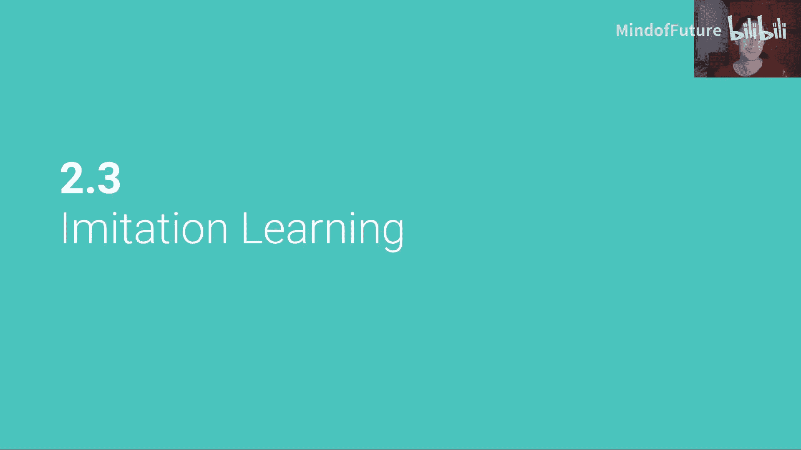
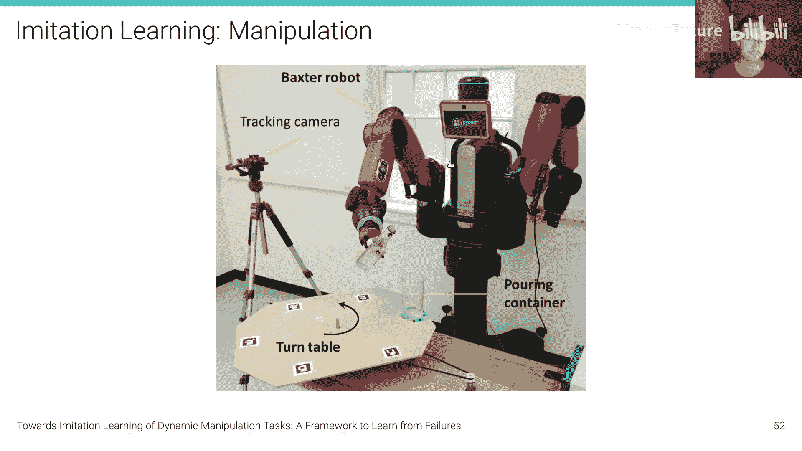
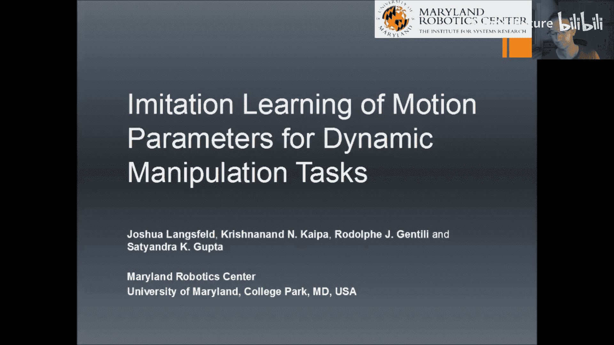
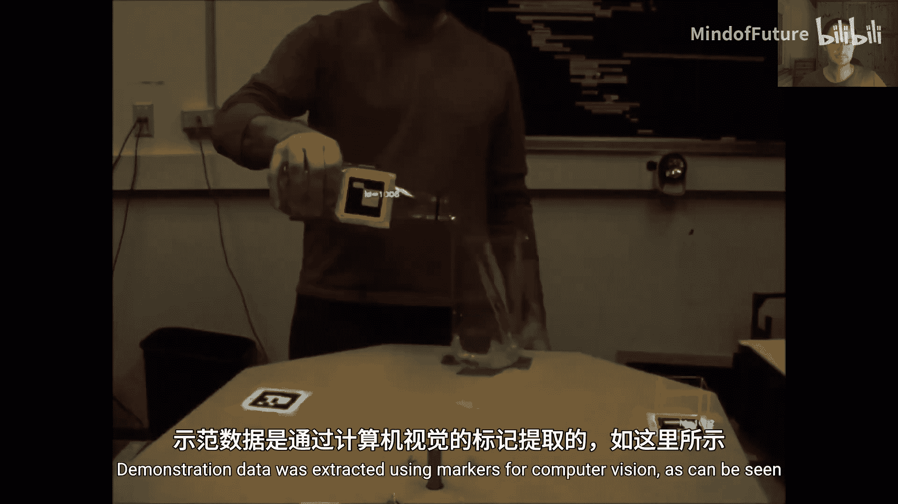
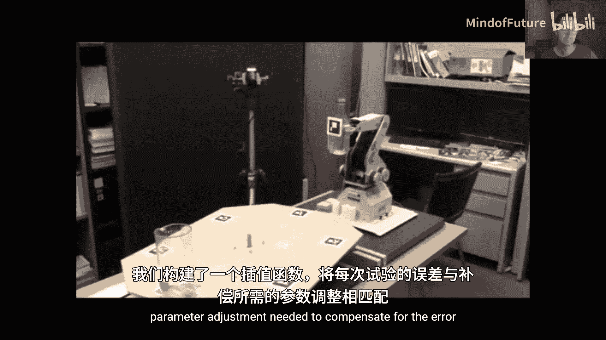
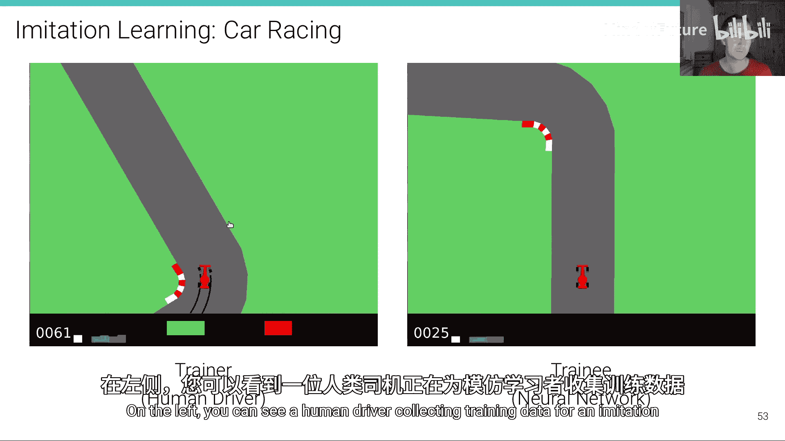
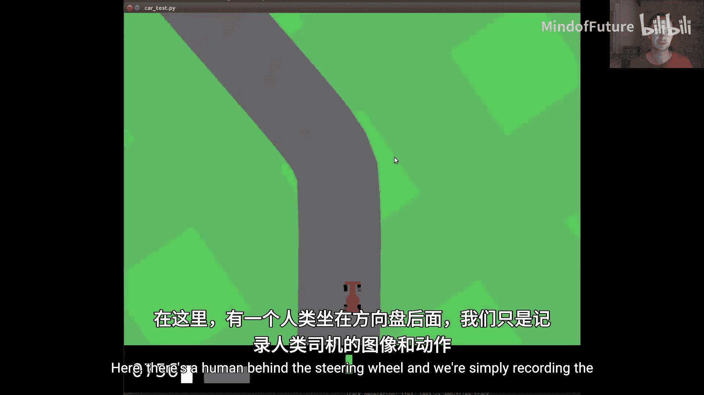
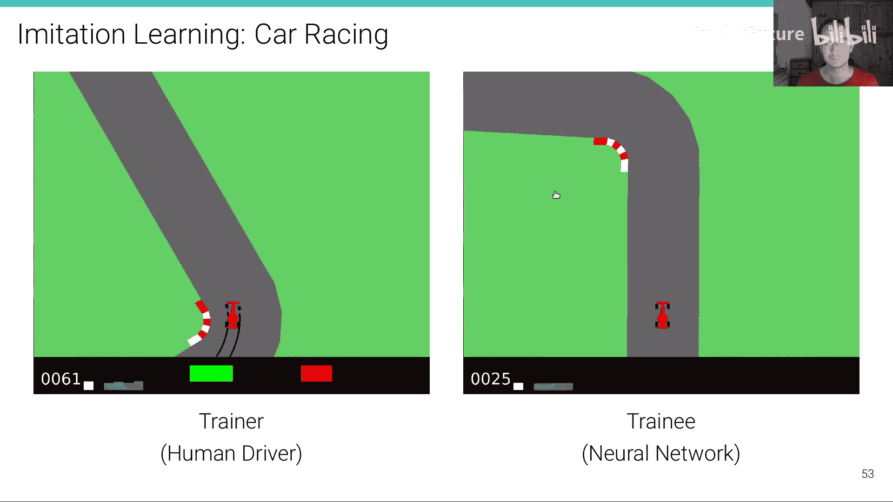
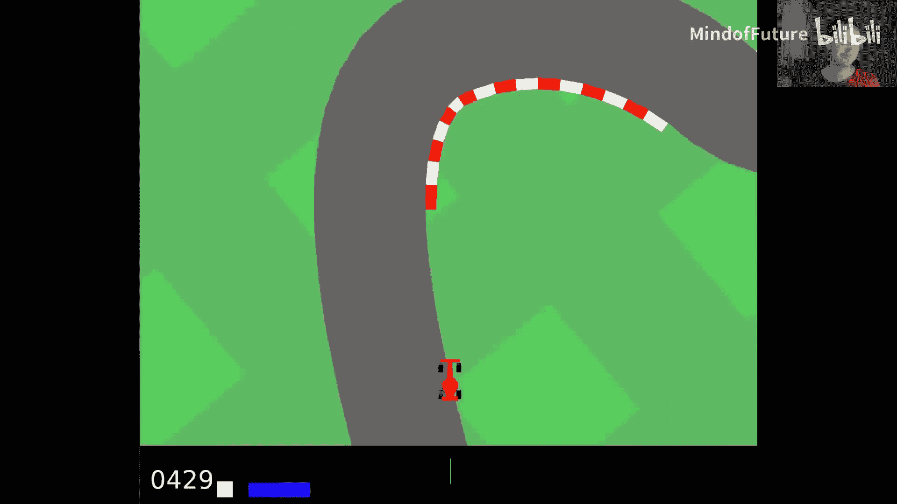
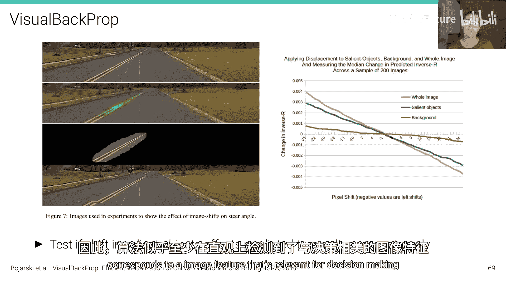

# 【图宾根大学】自动驾驶汽车课程 ML4340 p06 P06 Lecture 2.3 (Imitation Learning - Imitation Learning) -BV16FP2ePEYc_p6-

Let's now finally get to the core of this lecture， which is imitation learning。

Let's first see some examples of imitation learning。In this lecture。

 we are mainly focused on self driving， but imitation learning has actually been applied in very different contexts。

 For example， in the context of manipulation。

Robots are rapidly becoming more useful as they begin to manage far more complex and unstructured tasks than traditional industrial chores。

However， manually programming robots to perform dynamic manipulation tasks take significant time and effort。

As an example， consider the dynamic pouring task shown here where liquid needs to be poureded from a bottle into a moving container。

This is representative of similar unstructured tasks carried out in manufacturing environments and is currently challenging for traditional motion planners as full fluid dynamic simulation will be needed in order to pour the correct amount。

In contrast， humans have the ability to rapidly learn the techniques needed to perform the task。

 suggesting the robot can learn by observing human demonstrations。Importantly。

 we realize it is impractical to assume the human can always produce successful demonstrations。

 Therefore， we also learn from how the humans change their behavior after each failure until they succeed。

Demonstration data was extracted using markers for computer vision， as can be seen here。

Using the recorded library of demonstrations， we learn a model of how to achieve the pouring task。

 character by a small set of parameters， given a new task specificification。

 unseen by the demonstrator， our algorithm generates an initial set of trajectory parameters。

 using the train model， and the robot makes an initial attempt。

This initial run resulted in overpouring the target level， beyond the acceptable air amount。

In order to handle these failures， our algorithm determines a parameter change by considering all failed human trials and what parameter changes the demonstrator made in these situations to succeed。

An interppolation function is built that matches the error of each trial to the parameter adjustment needed to compensate for the error。

In this。Here' is another example， this is what we've already looked at in the first lecture。

 which is the OpmiI gym car raising environment where also the coding challenges of this lecture will take place on the left you can see。

A human driver collecting training data for an imitation learner。

Here there is a human behind the steering wheel， and we are simply recording the images。

And the actions of the human driver。

And then we're using this to train in a supervised。Learning setting。

A imutation learning policy that thents to replicate the human driving behavior。

Here's imitation learning in a nutshell。The motivation is， well， hard coding policies。

Often very difficult。 So we rather use a data driven approach。We given demonstrations from an expert。

Or access even to a demonstrator。The goal is to train a policy to mimic that the decisions that the demonstrator has made。

In other words， we're collecting some expert。Driving trajectories and the corresponding images。

So the data set comprises both the input， as well as the steering and the brake and gas command。

And then we try to simply fit a function that maps from the images to the actions and execute and hope that the rubber doesn't collide。

There's multiple variants。TheOne of the most dominating paradigms of variance is behavior cloning。

 which will be covered in this lecture。But there are also inverse optimal control and othervaris。

Let's define the problem formally。The state is typically called S。So we have a set of states。

And little S is an element of the set of states。This is one particular state。

The state may be fully observed or partially observed。 Typically， it's partially observed。

 for example。In a video game， you only observe what's on the screen。

A self driving vehicle for a self driving vehicle， you only observe the images that are taken from。

The vehicle's perspective， you don't observe the full state of the environment。

 You don't know where all the vehicles on the world are。 You just see the pixels in your image。

 which is your state。Or which can be part of your state。 There can be more elements to your state。

 There can be multiple images。 There can be Liar laser scans。 that can be。

And the velocity signal from the speeddometer， etc。This is the state， this is what you observe。

 this is the input to your policy。And then there is the action。A out of the action space。

 calligraphic a。And the actions may be discrete or continuous。For example， they may be， in our case。

 the turning angle or the speed。Or a steering angle on the speed。And then we have the policy pie。

Which is parameterized by some parameters theta and maps from the state space to the action space。

Our goal is to learn the parameters of the policy。We also have the optimal action。Which is。

Which we indicate with a star。 This is the action that the expert demonstrator provides。

A conductducts。Or makes for a particular observation or state S。And we have an optimal policy。

 This is basically the expert， we call it pi star。This is what the expert would decide for every input state as。

So maps to the optimal action A star。Then we have the state dynamics given。

This is basically the simulator， given a particular state at time I and a particular action that the agent conducts at time I。

The simulator of the world transitions into a new state。

The ego vehicle might move because you are accelerating。

 but also other traffic participants might change their location。The sunlight might change。Et ce。

This is basically the simulator and they might be probabilistic。

 That's why we have a state distribution here over potential outcomes。But often。

 we just assume a deterministic function where for a particular state an action pair。

 we are deterministically transitioning。Into a particular new state， S I plus1。

Another important term to remember is a roll out。A rollout of a policy means given a particular starting state to execute the policy sequentially。

So given the particular S 0， we sequentially execute we start from S I。

 and then the policy we assume that the parameters are given in this case， for example。

 they have been trained or they just provided to us， we execute that policy and reach a new state。

 and then we sample。mSorry， we we execute the policy and then obtain the action from that state through the policy。

A policy， remember， maps from a state to action。So given the state I。

 we obtain the action I for that state， given the particular policy。Now， given the state I。

 S I and the action AI。The state dynamics transitions from state SI to state SI plus1。And again。

 that could be either probabilistic or deterministic。And if we now continue this in a loop。

 now we have a new state。 We can pass that state again into the policy， obtain a new action。

And then pass action and state into the state dynamics model into the simulator to obtain the next state。

We obtain a trajectory of state action pass， and this is called rollout。

 we can do this for as many iterations as we like。Until the vehicle hits something。

 basically until the episode is terminated。And finally， we have a loss function。

 We have to measure how good an action is。 And we do this through a loss function L。

Whose arguments are a star， which is the action。The optimal action。

 the action provided by the expert for a particular state and the action that has been。

Conducted by the policy， a。This is the loss of the action A given the optimal action A time。

Using these definitions， we are now ready to define formally。Imation learning。

 And we start with the most general setting， general imation learning setting。

The general Iutation learning setting is illustrated here on the right and the mathematical description。

 the mathematical formulation is shown here。What we want to do in general imutation learning is to find the parameters theta。

By minimizing this expression here。With respect to the parameters theta。What is this expression？

This expression is the expectation。 This is the expectation operator。Of the loss。

That compares the expert decision， the expert action at a particular state to the decision that's made by our policy for a particular state。

Assuming the parameters， the current parameter sets setting theta。

And that expectation is over all states that are reachable by the policy pi theta。

This is the distribution of all states that are reachable by the policy pi of the parameters vita。

Note that in this case， the state distribution P of S given pi theta depends on the roller determined by the current policy P theta。

 so it depends on the parameter theta。If you want to graphically illustrate this。

 we're starting with a particular configuration here。

And then we are all we are iteratively updating the state and the policy。

The simpler variant that's often used in practice。Is called behavior cloning。In behavior， cloning。

We are。Minimizing also an expectation。And the expectation is also of a loss function that compares the。

Action of the expert。To the。Action that the policy。With parameters theta made。

But we do this for state action pairs with the star here indicating that those are sampled from a fixed data set with state action pairs that are provided by the expert demonstrator。

 In this case， the state distribution P star is provided by the expert。

So we have a fixed distribution。From which we derive S and a star。

And so we simply reduce this problem now to a supervised learning problem。

 We don't have this cycle anymore。 We have a fixed data set。

 and we can fit one single policy to that。Data set。This difference between the two paradigms。

It's crucial。The first one is the more general one。

 where the expectation is over all states that can be reached。

 given the policy with the current parameter setting theta。

 So we have this interdependency between states being sampled here inside the expectation。

 but the theta。Needs to be optimized。And here at the bottom， we take simply。

And also here so basically we we need to actively query the expert， of course， because the state。

Can change to a state that we don't know。 So we need to query the expert for that state because we're sampling that state from that policy。

 There can be any state。 But here， we're giving a fixed data set。

 and we can simply do supervised learning and fit a regressor。

Behaviour cloning is nothing else than fitting or are not very。No nonlinear。

 very high capacity regressor to that data set。So it reduces to a supervised learning problem。

So what are the challenges of behavior cloning， obviously this is much simpler。

 we don't need to actively query the expert during training。

 we can just take a fixed data set and do supervised learning that's much easier。

Behavior cloning reasons only about the immediate next step。

Which means and it means that also behavior cloning makes the IID assumption， and this is critical。

The next state assembled from the states observed during the expert demonstration。 Therefore。

 the next state assembled independently from the action predicted by the current policy。

We're always assuming that we are following the expert。Demonstrator。But actually。

 we're training a policy that's imperfect。 So what if our policy makes a mistake？

If we roll out our policy and it doesn't exactly follow the expert。

 even though it has been trained to follow the expert。Training a model。Models are never perfect。

 so a trained model will never do exactly what the expert did。Well， in this case。

 we enter a new state that we haven't observed before。

 it's not part of this fixed pre collecteded data set。

And these new states that we enter are not sampled from the expert distribution anymore。Where。

We are observing a distribution shift， in other words。And what happens then is that we drift away。

 We enter even more exotic states。Because our model doesn't know what to do。

 And so it cannot recover。 And eventually， this leads to catastrophic fail in the worst case。

What can we do to overcome this train test distribution mismatch。

One of the most popular techniques to overcome that is called dagger data aggregation。

 and it's a technique that also all has some quite nice theoretical properties has been proposed by Rosdll AI startss 2011。

The idea here is to do something in between these two。

This one here is very costly because we need to always be able to query the expert during training at any step of training。

But this one here doesn't verver because we assume IID data， which is not case。So what Deger does。

 it starts with a fixed data set that's。Recorded that's provided by some expert。

 And we train a policy。 And then we we conduct rollouts based on a trained policy。

Which leads to a new data set。And then we query the expert for that new data set。

So we query the export not only once， but we query the export also here。

And we aggregate that data set with the original data and train the policy again。

And we roll out again。And we get new on policy data that we label with the expert and then aggregate to the original data set。

 So we do this aggregation， not inside the training loop。

 but we do it once in a while for a few steps， but still we have to train again。

 we have to query the expert for this on policy data。In other words。

 we iteratively build a set of inputs that the final policy is likely to encounter based on previous experience。

And we query the expert for the aggregate data set。This works reasonably well for manipulation tasks。

 as we've seen in the video。But we observed that it doesn't work so well for self driving。

 And one problem of this is that it easily overfits to the main mode of demonstrations。

 and self driving has a very biased。Data set structure。

 a lot of the scenarios in self driving are driving straight on a road。

 which is not very interesting。If a model can drive straight very well。

 That doesn't mean it gets very far。 It also needs to handle the curves and the turns， which are。

muchuch harder， and O。Less frequently。And because of this imbalanced data set。

 this method actually doesn't benefit as much or bring as much benefit。

As it does in other applications。So what we proposed in a paper that we had published in CBPR 2020 is to augment Dagger via a critical state subsling and a replay buffer。

 and we found that only the combination of these two actually brings the benefit that then also helps this technique to apply to self drivingriving scenarios。

The key idea here is to first sample critical states from the collected on policy data。

 we subs sampleample the on policy data。 We don't use all the data。

 but we choose selectively which data we want to aggregate。Based on the utility。

 the data provides to the learned policy in terms of the expected driving behavior。

And there are certain criterions that we use in order to determine the samplingling。Now。

 if we do this alone and directly add this to the data sets。

 then the change in the data is too arupt。 These states are too different from the standard data set that we have。

They are too challenging， and mixing them doesn't work well。

So what we had to do in order to make this work is to add a replay buffer that progressively focuses on the high uncertainty regions of the policy state distribution。

By。Progressively adding that data and not adding that data all at once。

 but basically replaying also older data once in a while。Good， so let's look at some examples。

 some practical applications and implementations of imitation learning。

One example we've already seen， Alvin， an autonomous land vehicle in a neural network。

 seminal work from the 80s。Published at N's Nps at the time，1988。

It was a very simple neural network with just three layers， or even two layers。嗯。

With only 36000 parameters。Which mapped a small resolution road image to a discretized turned radius or directions。

It was trained on simulated road images。Much like we train neural networks these days as well。

And it was tested on un paths， line city streets and interstate highways。

I was able to drive 90 consecutive miles at up to 70 miles per hour。

 This was really a seminal demonstration。 I'm not going to show you the video again。

 You have seen it already。More recently。Nvidia， so these people that have done this original album demonstration。

 some of them have moved to Nvidia。 So Nvidia has demonstrated pilot net。

 which is a modern reincarnation of this。嗯。Model。Pilot net end to end learning for self driving cars。

And in pilotlotNe， a real vehicle was also instrumented with cameras， in this case。

 free cameras for data augmentation， providing more data that can be used to avoid this IID assumption breaking so you can also instead of using dagger。

 you can also just try to obtain more camera angles to augment your data set to get into states where haven't been before。

 but of course you have to correct your trajectory accordingly。

So you need to adjust for the shift and the rotation and then provide this adjust its steering command based on which camera you' are using as an input to an neural network that's updated with this loss function。

 with this error signal。Also， the network architecture has evolved， it's much more complex。

Inspired by Alexnet， the conversion network with now 250000 parameters。

And five convolutional layers and three fully connected layers。So let's have a look at the video。

🎼Oh yeah。 good。 The universal sign for Oto。🎼绕口。🎼可の。Okay。Great。😊，Now。

 because we have a monolithic approach to self driving with one single neural network。

 it's hard to understand what's going on。 And， of course。

 it would be nice to visualize a little bit what's going on。 And there's various。

Great in based visualization techniques， but also the people that did this work that I've just shown proposed a visualization technique to highlight what's going on inside the neural network。

And what they did is they tried to find salient image regions that lead to high activations。

And the way this works， here's the network again， is to forward pass。The input。

 this is for a particular input image。So you can see the forward pass here at the this is the highest resolution。

 you see the feature activations and then they become down they are downscaled because of the pooling operations in the convolal networks。

 so the resolution decreases。And then they are averaged and scaled up again with pointwise multiplications。

 and this is what happens here。 And so you get back to the original resolution and by multiplying all of these you see。

Which areas of the original image LED to a likely to a particular decision。 So for example， here。

 in this case， the network clearly focused on the lane boundaries or the road markings。

So here are some examples of the result of this visual back propbi。

 where you can see how it highlights lane markings， cars and road boundaries。

In order to understand if these highlighted areas actually lead to a influence the action。

What they did in this paper is they cut out the region that was highlighted。

 so this is the region that was found by the visual back prop algorithm。

And they put a mask around this region， and then they test it what happens if this region gets translated to the left or right。

 which should of course， have an influence on the action。

And what happens if the mask is inverted so that only the background is considered and the background is translated？

And that what they found is that if the background is translated。

 that has a much smaller influence on。The steering angle compared to if the highlighted region is shifted。

 So it seems like the algorithm has at least intuitively detected something that corresponds to a。

Image feature that's relevant for decision making。

