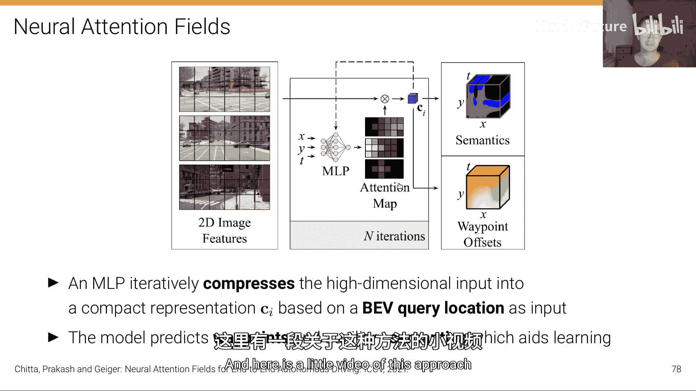
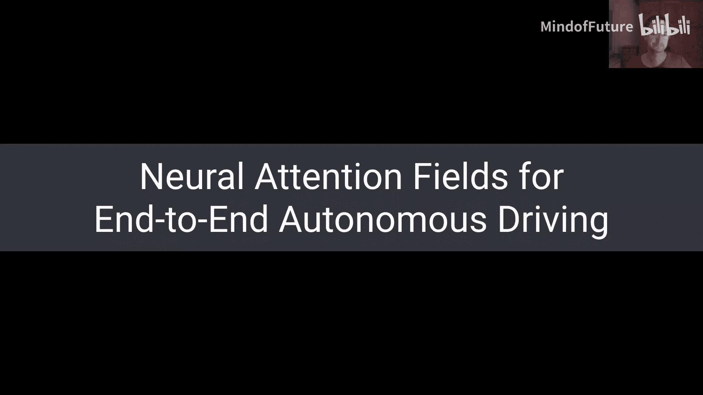
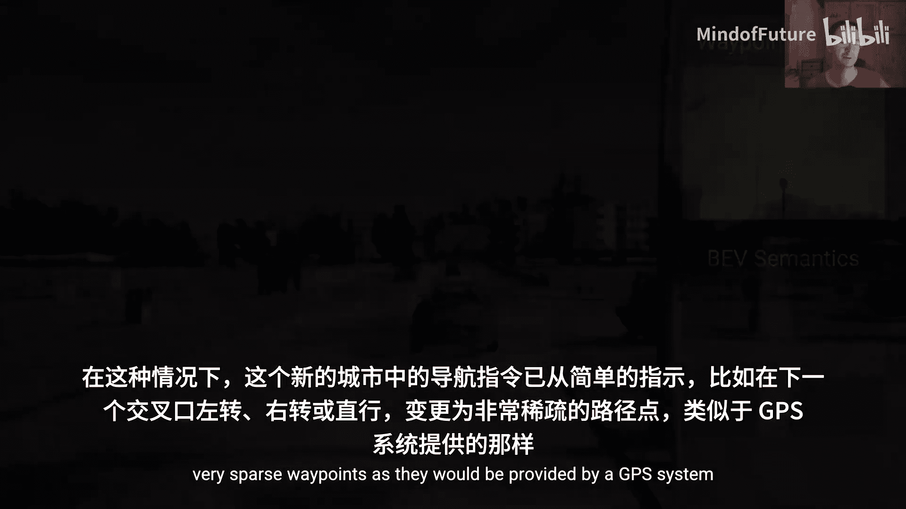
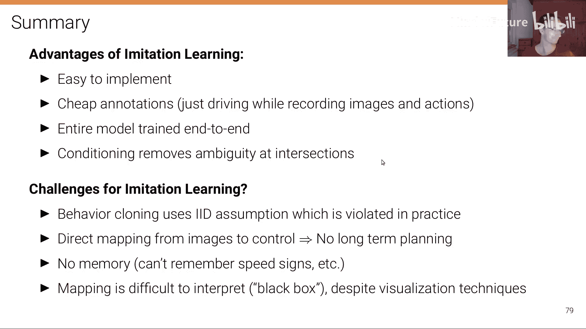

# 【图宾根大学】自动驾驶汽车课程 ML4340 p07 P07 Lecture 2.4 (Imitation Learning - Conditional Imitation Learning) -BV16FP2ePEYc_p7-

There is some scenarios that are relevant for self driving where imitation learning is not enough。

 and this is where conditional imitation learning enters the stage。Consider an intersection。

At our intersection， there is multiple valid possibilities， multiple valid actions。

 multiple valid trajectories that an agent could take。In this case。

 it's impossible for an agent to uniquely settle on one particular action。

Without any additional input information about where to go。

 and this is the high level idea behind conditional imutation learning is very simple in addition to the state。

 we provide as an input to the agent， a conditional signal that tells the agent what should happen at the next intersection。

For example， at the next intersection go straight or at the next intersection go left。

 or at the next intersection， take a right turn。And using this additional conditioning signal。

 the action becomes unique。Now imutation learning works again。

 and this is the case in particular in urban scenarios where things like lane changes or turns play a role。

Here's a schematic overview of conditional Iutation learning。Here we have the policy。

 this is a figure from the paper where this is called a controller。

So what we do is we condition this controller or policy on both the observation。

 this is what was our state as and the navigational command C。

 which could be either at the next intersection go left。Or go right， or。Keep straight。

And then based on these two inputs， the controller can then issue an action。

That then changes the state of the environment via the state distribution such that a new state。

Ofcur that is then input to the controller again。This high level navigation command is relatively cheap to obtain。

 because。Modern GPS navigation systems already provided。 They tell us already what to do。

 This is also an input signal that we， as human drivers need， Of course。

 if we are unfamiliar with a particular。City。So we can use a standards。Nive consumer GPS。

 it doesn't need to have any H maps。 Traditional maps are fine。That tell the vehicle to turn left。

 right or go straight at the next intersection。 And this completely removes the task ambiguity。

 which has been introduced by the environment。🤧う。So in this case here， the observation is called O。

 this is the current image and the action is a， which is the steering angle and the acceleration。

AndThis has for the first time been implemented in this work here at IRA 2018 called Intern Driving via conditional Imutation learninging。

Let's compare naive behavioral cloning and conditional imutation learning。

 which is also behavior cloning， but it's called conditional imation learning。Okay。

 so on the left we have behavior cloning。There we have a training set。

 which is a data set of action and state pairs provided by the export Destrator for end frames。

And the objective is to minimize a loss function where we minimize the difference between the expert action and。

The action returned by the policy for that corresponding state。

And the assumption here is that is there exists a function F。

That if input an input siI is given to that function returns a particular action A。

 which is often violated in practice。For example， at intersections where for a particular state。

 multiple actions are valid。In conditional im learning in contrast。

 the training set is augmented by this additional。Navigational control command。

 so the data set is now composed of triplets for each frame we have the expert action。

 the expert state， and the corresponding navigational command from the GPS。

And the objective also changes is now the input of the policy is both S and C。

In contrast to here on the left。And the assumption here is。That there exists a function that maps。

S and C to a， which is a much， much better assumption because this is。Much more uniquely defined。

 defining the state。The original paper from Icra 18 describes two network architectures。

Doesn't make a big difference， but they are slightly different， so I want to explain both briefly。

The first architecture here on the left has an image encoder。

Some measurements that are encoded with some shallow MLP and the navigational command。

 these measurements are typically just things like the speed。That are provided。

And they are then concatenated， and there is another network here that predicts the action。

On the right hand side， we have the situation where only the image and the measurements are concateninated。

And then the command selects between three different specialized sub networks that then return the action based on which sub network was activated。

Through this discreet， conditional command。Yeah， the measurements here M in this paper were just considering the speed of the vehicle。

 which is a useful input to the system。 If only a single image is provided because otherwise the。嗯。

The algorithm。Wouldn't know。If the decision making algorithm wouldn't know if the vehicle is standing still or if it's driving。

 So providing this， if only a single image is taken as an input is important。

What they also did in this paper is to introduce noise for data augmentation。

 so what they did is they added noise to the steering wheel。

 they injected noise to the steering wheel， and they had the expert。

 the human demonstrator drive back。But that is very tiring。

 And they could do this only for a few minutes and collect data that way。

 But it already helps in resolving that problem of behaviour cloning， which。

Conditional Iutation learning is doing a little bit。So here you can see how the noise is injected。

And then you can see how the human steers into the other direction and counters the noise to get the vehicle back on the road and the blue one is then the resulting。

Over late。A signal。Great。😊，Okay， so let's look at some results and we are going to look at the socal Kala simulator。

 which is a great simulation environment that's a little bit more sophisticated than the Oiaium environment we are using in the exercise as it is full 3 d and to some degree photorealistic。

In earlier works from 2018 to2019， the simulator comprised two towns。

 a training town and a testing town。Li。Training town was used for training the agents and then the agents were deployed in a test town。

 which is a different town， so it tested generalization abilities of the agents。

The more modern version of the callla simulator now contains up to 10 towns。

 and it even has an online leaderboard where people can submit their algorithms， their agents。

Similar to， like you will submit your agents to participate in our lecture leader board。

So you can submit your agents to the online website which evaluates your agent on an held out unseen test on for fair comparison amongst different methods。

So let's have a look at the simulator。🎼，🎼，So what's really nice about the simulator is that it's fully open source。

It's available to everyone。It runs on a traditional consumer GPU。

And it provides many assets and environments and also different sensor modalities can。

Have a Liar sensor， you can have our RGB camera， you can have multiple RGB cameras and so on。

So the state of the art approach on this。Data set on this simulator in 2019 was called Slars。

 exploring the limitations of behavior cloning for autonomous driving and ICCV 2019 paper。

And the architecture was very similar to previous ones。

 but and also was using the navigational command， of course， as an input。

 But what it did in order to overcome the so called。AColy confusion problem。

 which is that in driving when doing imitation learning for self driving。

Often the true cause of the action is confused with the wrong cause， for example。

 when the vehicle is standing still and the traffic light turns green。

The vehicle doesn't recognize or doesn't consider the traffic light turning green as a reason for starting because the correlation between standing still in the previous frame and standing still very likely in the next frame is very high。

And so the vehicle will keep standing still。So there's various measures of overcoming this problem。

 one is to in addition to getting the speed as input to also try to predict the speed with the policy that can somehow to some degree alleviate the causalal confusion problem a little bit。

One work that's relatively new and from our research group takes this idea of conditional imutation learning one step further and combines it with implicit representations。

And attention。Attention is important because。The input to a self driving system is very high dimensional。

There could be。Many frames per second and multiple images at very high resolution。

 So you need to very efficiently narrow down what's important for the actual driving situation I'm currently in。

 And that's what we're trying to do with this model here。 I'm not going to go into much detail。

But I'm going to tell you that we have a multi layer perceptron that can be queried with a particular location and that iteratively compresses the high dimensional input into a compact representation C。

Based on attention。 So you can see these attention maps that are querying the inputs based on what at the current iteration the model believes is important for making the next decision。

And the model predicts both the waypoint offsets densely and semantics， which adds learning。

In bird's eye view in in a physical bird's eye view perspective。

 so we found this to be also useful to predict things not in image space but in bird's eye view space where vehicle control actually takes place。

And here we are predicting the waypoints or the waypoints offsets from which the waypoints can be derived and on top of this we have then a more classical controller that steers the vehicle based on the predicted waypoints and this is one of the state of the art approaches of doing imitation learning these days。

 we're actually not imitating the action anymore， but we're imitating the trajectory。

 we're trying to imitate the trajectory and then we're using traditional controllers because they just work quite well for self-driving so we don't have to learn them。

And here is a little video of this approach。

So this is already the new color environment， you can see。Much more realistic assets， larger cities。

 multi lanes streetss。Difficult traffic light situations。

 And this is our agent that has been trained using end to end learning。

To drive and it's driving here based on its learned policy。And on the right。

 you can see these intermediate representations that it predicts the birds I have used semantics。

Which is quite coarse， but sufficient for driving and the waypoints， this little red。

Dot indicates the point two seconds into the future， and you can see the trajectory to that point。

 these blue points are in this case， the navigational command。

navigation occasionalal command in this new city has been changed from a simple at the next intersection go left right or straight to very sparse waypoints as they would be provided by a GPS system。

 so it's more realistic。

Okay。So let's summarize this lecture。The advantages of imutation learning for self driving are that imutation learning is easy to implement。

Annotations are cheap because we just need to drive around while recording images and actions。

And the entire model can be trained end to end。Not for all quantities that we are interested。

 like minimizing Di or optimizing time to arrival， but at least for being close to some expert。

Trajecty or expert driver。Using conditional imutation learning。

 we can remove the ambiguity at intersections and also drive successfully throughout intersections。

But there are some challenges for imutation learning that remain。

 Behavial cloning uses the II assumption， as we have seen， which is violated in practice。

Direct mapping from images to control。Doesn't really allow for long term planning。

 at least in the most basic form of its implementation。And also in standard models。

 there is not really memory， so there's no way of remembering speed science， etc， really。

Unless you explicitly incorporate memory into your model。

And then also the mapping that is learned is difficult to interpret。

 So we really need good visualization techniques to better understand what our model is doing。

 or as in the case of the last model that I've shown， incorporate things like attention where。

Introspection is built into the model automatically。That's all for today。Thanks。

