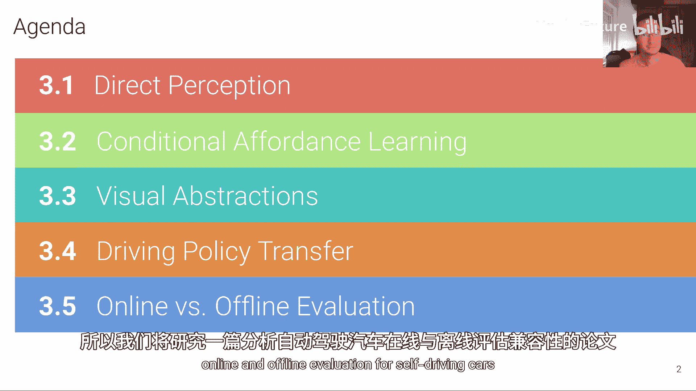
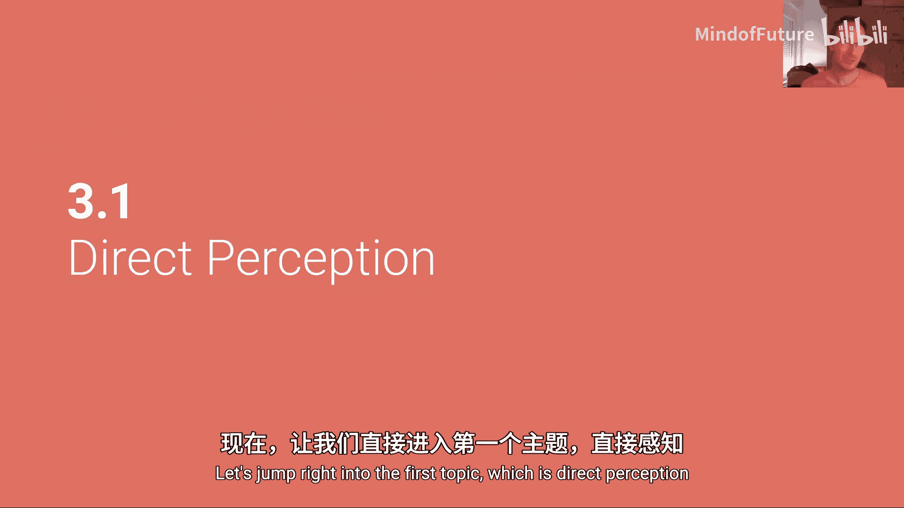
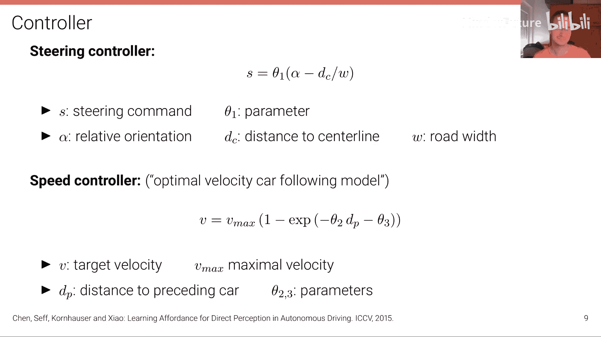
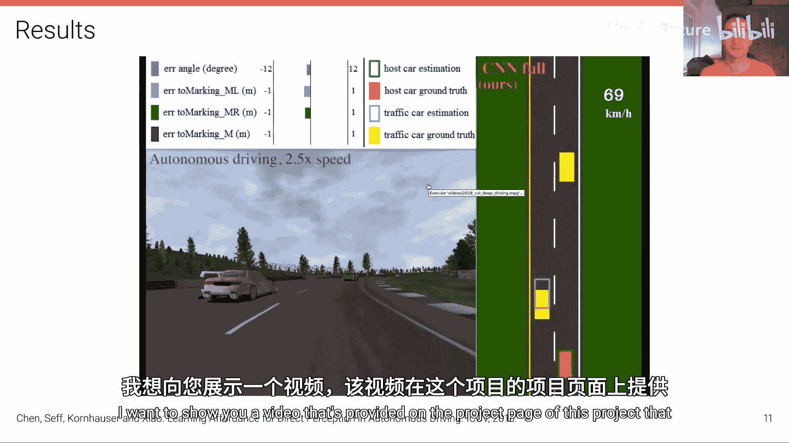
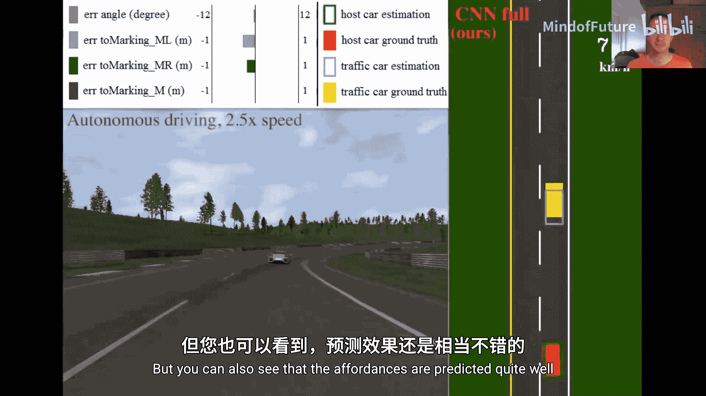
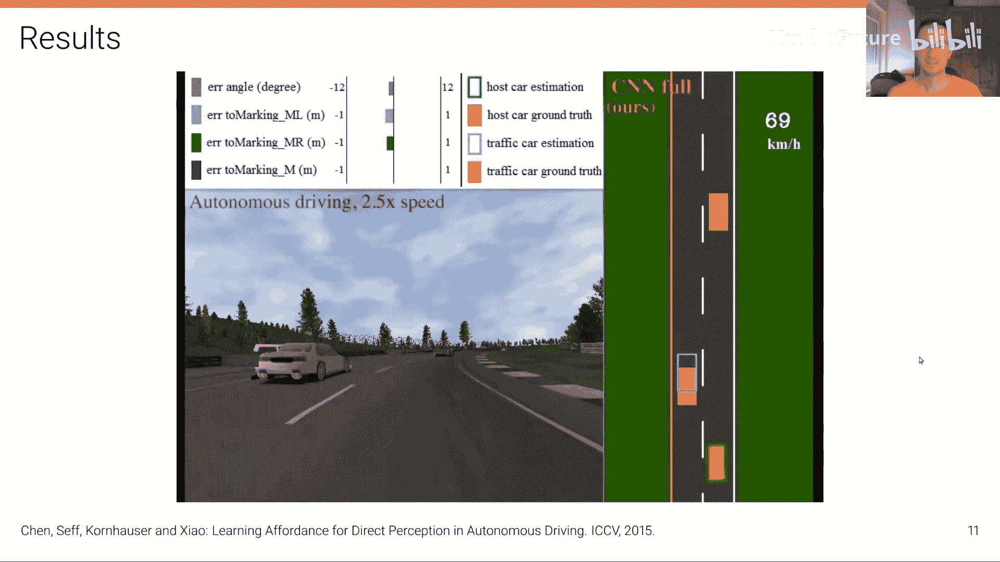
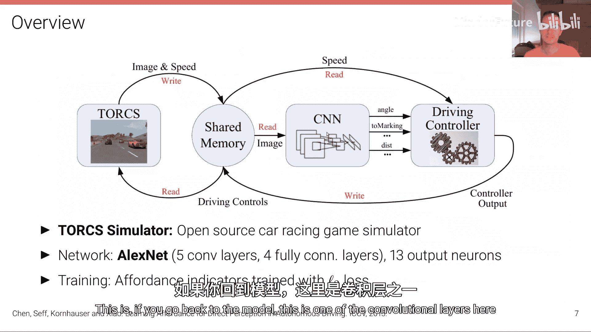

# 【图宾根大学】自动驾驶汽车课程 ML4340 p08 P08 Lecture 3.1 (Direct Perception - Direct Perception) -BV16FP2ePEYc_p8-

Welcome to Self drivingiv Cars， lecturec number3。This lecture is on direct perception。

 and it's structured into five units。In the first unit in this unit。

 we're going to introduce the concept of direct perception。In the second unit。

 we're going to have a look at a conditional variant like we had looked at conditional imitation learning。

 We're going to look at a conditional variant of this model that allows inner city driving。

We're also going to have a look at what these intermediate representations that direct perception uses should look like and how we can efficiently annotate data in order to obtain very expressive intermediate representations。

In the fourth unit， we're going to have a look at how not only perception can be decoupled from planning and control。

 but how also planning can be decoupled from the controller。In order to， for example。

 transfer a driving policy that is trained in simulation to operate robustly in the real world。

And then finally， we're going to cover a topic that's important， of course。

 whenever we want to evaluate self driving agents， which is about metrics and about evaluation of self driving agents。

The ideal evaluation is on where we run the agent on line and measure its performance。

 But often that's not practical。 And therefore， a variety of offline evaluation metrics have been proposed。

But these metrics do not always reflect the online performance well。

 And so we're going to look into a paper that has analyzed the。

AComatibility between online and offline evaluation for。Self driving cause。

Let's jump right into the first topic， which is direct perception。

We have seen two approaches to self driving so far。One is the modelular pipeline。

 which we're going to talk about more in the second half of this lecture。

 The modelular pipeline is composed of different modules。 For example， low level perception。

 scene passing， path planning。And vehicle control。And the advantage of a model a pipeline。

 as it is mostly used in industry。Is well that its modelular can be developed by many different large teams independently。

 one team per module。 Also， these modules are interpretpreable because they have been human designed。

 So the interfaces， For example， this interface here between low level perception and scene parsing could be semantic segmentation。

 for instance。Is a human designed interface， so we can inspect。The model， how it performs。

We can analyze why the car has made a mistake， for example， why it has。

Not stopped at a traffic light or why it has hit the kb of the road。However。

 modelular pipelines also come with disadvantages。Designing these modules requires a lot of expert decisions。

 and these expert decisions might often be wrong， and there is no easy way of recovering from that。

 so it's no easy way of introducing learning here。At least learning them the system end to end。

 So systems are typically trained in a piecewise fashion。

 While we trained a semantic segmentation model independently of the downstream task performance of driving。

And of course， having a perception module that's trained independently of the downstream task is suboptimal because this module training this module requires additional loss functions。

That might have nothing to do with downstream task performance。However。

 these modelular pipelines are typically so complex that training them end to end。

 training the entire systems end to end with these very sparse training signals。As they occur。

 for example， in the context of reinforcement learning。Is very challenging。On the other hand。

 we have end to end learning approaches where there is a monolithic machine learning model。

 for example， a neural network that takes the sensory input and maps that directly to the。

Con commands of the vehicle。For example， steering and gas and brake。And these models are very simple。

 so it can train， can be trained with classical。Training algorithms such as imitation learning and reinforcement learning。

 which we're gonna look at into。More in the next lecture。And therefore。

 they are very simple and end to end trainable。 so they can be trained directly for the。

Task that we are interested in。On the other hand， these models typically don't generalize very well。

And they are very data hungry。 They require huge amounts of data for setting all these parameters in order for the vehicle to operate robustly。

 And also， they are less interpretable because they are a monolithic system now。

 and there is no interfaces。 There is no auxiliary。Features that have been hand and hand engineered。

 So we， it's very hard to inspect these models。 It's as hard as inspecting neural networks to understand why a vehicle did a mistake。

These are the two approaches that we have looked at so far。But there's another one。

And that is a hybrid between these two approaches at the very end of the spectrum。

 the modelular pipeline on one end and the imitation learning pipeline on the other end。

And is hybrid， called direct perception。Is modelular。

 but much less modelular than the model up pipeline。

 So it introduces just an intermediate representation where there is a neural network that maps from the sensory input to this often low dimensional intermediate representation。

And then we have a vehicle control and it takes that intermediate representation as input and predicts the low level control commands of the vehicle。

So we have a still relatively simple system now， and but we have effectively decoupled perception from planning and control。

And that's。Is potentially beneficial both for having models that are more interpretable。

 but also models that generalize better because the vehicle controller hasn't been learned jointly with the model。

And the another advantage is that it also allows to exploit both classical controllers like。

PID controllers or finite state machines。As well as learn controllers， because we have。

The vehicle control has its independent module， it's not trained as part of the entire neural network。

 but it's an independent module so we can replace it with any controller that we know works well for cars。

Okay， so let's look at a particular。A model that has implemented this paradigm。

 And we're going to look at this paper here called Learning Afordance for direct perception in autonomous driving from Geneddal in 2015。

The goal of this paper was to implement a direct perception controller for highway driving and to test that in simulation。

The idea is to predict a set of affordances。Affordwardance is a terminology from the psychology literature。

That describes the attributes of the environment which limit the space of possible actions。

This is a high level definition of the term affordances。In other words。

 you could also think of what are the sufficient statistics of the state。

 What are the sufficient statistics of the observation in order to。Make。A。Decis for the。

 for the agent。Right。And in this case， in this particular paper。

 they have designed 13 particular affordances that are illustrated here on this slide in order to implement highway driving on a highway with three lanes in this case。

The first affordance is the angle。Relative to the road， obviously。

 you need to know the angle relative to the road in order to steer the vehicle。And then。

 there is two different。States that the system can be in。

 There is a state where the vehicle is on a lane marking here at the right two cases。

 This is the unmarking state here。 There is a system that detects if the vehicle is on the lane marking or if it's between the lane markings。

So if the vehicle is on the lane markings， youre。The system returns these affordances here if the vehicle is within two lane markings。

 it returns these affordances。So what are these affordances。

 well there's always two types of affordances， one is with respect to the distance to the lane markings。

 and the other is the distance to the preceding vehicles。For example。If the vehicle is。

In the in lane state， if it's between two lane markings。嗯。The model measures， or predicts。

The distance to the left lane marking and to the lane marking to the very far left of the other lane。

And then to the right lane marking， and to the。Right， lane marking of the next。

Lane of the adjacent lane。It also measures the distance to the preceding vehicle in the current lane。

 the distance to the preceding vehicle。In。The left lane and the distance to the preceding vehicle in the right lane in order to decide how fast to go。

 when to slow down and when to overtake。If the vehicle is on the lane marking。

These are the states that illustrated here in subfigure D and E。Then。

The model predicts the distance to the left lane marking。

 the distance to the lane marking that the vehicle is currently driving on。

And the distance to the light， to the right lane marking。And similarly to before。

 it measures the distance to the preceding vehicle in the left lane。

And the preceding vehicle in the right lane， that's。Adjacent to the lane marking。

 the lanes that are adjacent to the lane marking。Vehicles driving on the lanes adjacent to the lane marking that the ego vehicle in red is on。

Okay。So we have overall 13 affordances， but not all of them are relevant at the same time。

 depends on which state the vehicle lives in。 If the vehicle changes from the middle lane to the left lane。

 then it's in this state， in this on lane marking state。

 and then only these affordances are relevant。 If the vehicle is on a particular lane。

 then these affordances are relevant。And the angle with respect。

 the relative angle with respect to the road is always relevant， of course， for steering。Okay。

 so this is an overview of the system。As I say figure that I took from the paper。

The system is implemented， and。Trained and evaluated in the tors simulator。

 which is a open source racing race car environment。Which allows for testing highway driving。

And there is a shared memory where the simulator communicates with it stores the image and the speed to the shared memory。

 and it accesses the driving controls and then simulates the next step in the。Race， game environment。

The network that they used in that paper， a paper from 2015， is a simple RLXnet architecture。

With five convolutional layers and four fully connected layers。And， of course。

13 output neurons in this case， one for each of the affordances to be predicted。

And then training is very simple。 It's simple supervised learning where the affordances are supervisly trained with a standard L2 loss。

And the ground truth is provided by the simulation。Because we are working with a simulator here。

 we can run in an ancient through that environment。

 and we can record a lot of data from that simulator for both the input image and the speed。

 but also for all these affordances that we want to extract from the simulator。

And then there is a driving controller， which we're going to talk about。

 And next that takes these 13 affordances。And provides the control for the vehicle that's then put to the shared memory。

From which the simulator reads in order to compute the next state of the simulation。Here on the left。

 these are again two figures from the paper。 On the left。

 we see the complete list of affordance indicators of this model， which we have already talked about。

There is affordances that are relevant only to the in lane state and affordances that are relevant to the un marking state。

And on the right， we can see a high level description of the controller logic。

While the vehicle is in autonomous driving mode。The con deperception model。Outputs affordance。

 the affordance indicators。And he also checks the availability of both the left and the right lanes。

And then there is a simple state machine implemented here that says， well。

 if we are approaching the preceding car。In the same lane。

 And if there exists a left lane and it's available and the lane change is allowed。

 then change to the left lane。Otherwise， if a right lane exists and it's available and the lane change is allowed。

 then change to the right lane， otherwise slow down。Because there is no place we can。

 no lane we can change to。In normal driving， the centre line is the centre line of the current lane。

And during a lane change， the centre line is the center line of the objective lane。

Where we'd like to transition to。And given this， we compute the steering command， the desired speed。

And the acceleration brake command， based on the desired speed。

So a very simple hand engineered controller， as you will see， it， it leads to a very。

Abrupt driving behavior。 But in this simple simulation， it can work。

 And it shows nicely how a learned perception model。

That outputs these low level affordances can lead to successful driving， even when using such a。

Histic controller。Let's have a little bit more， a little bit a closer look at the controller that is implemented。

 It's actually very simple equations。 The first is the steering controller that we're going to look at。

S here is the searing command。 This is what is directly given to the simulation。

 This is the command that we give to the vehicle。And there's a parameter， Theta 1。

And it's a very simple linear controller that takes us input to relative orientation。

What we've seen before is this relative angle here， with respect to the。Tangent of the road。

And it tries to make that small。 It's a linear controller。

 It tries to make the relative orientation small， So it steers proportional to the relative angle。

In addition， this steering controller also considers the distance of the vehicle to the centre line。

 There's an additional term here that depends also on the road width。That。

Tells the vehicle to steal more if the vehicle is fervoor from the centre line。

 sayss a combination in the end of the relative orientation。

And distance to the center line that's used here for steering the vehicle。The speed controller is。

Also called the optimal velocity car following model。 and the equation is as follows。

 the target velocity。That this input to the simulator for the e vehicle is set to V max。

 which is the maximal velocity times this term here。

And the term comprises1 minus the exponential of this linear expression here with the two parameters that can be tuned theta 2 and theta 3。

And DP is the distance to the preceding car。The car that we are following。

 the car that is an our lane in front of us。And if you， for example。

 if the car that's proceeding to us is very far away。 If this value is very large。

 then we obtain a very。Large negative value inside the argument of his exponential。

 which means that the exponential is close to 0。 So we go with。Close to maximal the allowed velocity。

In contrast， if the preceding car is very close， if this term is very small。

 then this term here becomes larger， and we are decelerating until reach zero velocity。 For example。

 if the car in front of us has slow down has come to a full stop。 Then， of course。

 we want to also stop in order to not crash into that vehicle。

This very simple model has been evaluated in the torquex simulator。

 You can see some of the environments that are provided by the torquex simulator here。

I want to show you a video that's provided on the project page of this。

Project。That shows how。The vehicle is， is driving on that in that environment。

 You can see that its approaching the preceding vehicle determines that there is a。

The left lane is free， so it is safe to transition to the left lane。 but in this case here。

 there is free vehicles in front， so it doesn't transition。

 The controller doesn't make the decision to transition to the left。

You can also see that it this simple controller， this hand design controller leads to very appropriate driving maneuvers。

 which would probably not lead to very comfortable driving。

 but you can also see that the affordances are predicted。

Quite well。And you can see the prediction here。Or if there little box。

The offers have also tried to analyze what the perception network does。

And they used standard network visualization techniques for doing so。

What we can see here on the left are the average top 100 images that activate a particular neuron in the first fully connected layer。

So if we go back to the model， we look at the first fully connected layer。

 We pick one particular neuron。 Each image corresponds to one of the neurons。And we average。

The 100 images that activate that neuro and most。 And we can see that different states emerge。

 There is a certain clustering happening here。 For example， here。

 you can see an empty road While here there is a vehicle in front of us。

 and we are more towards centreed towards the right of the road compared to here。 Well。

 this might correspond to a lane change maneuvver。And here you can see vehicles that are even closer to us on the left and on the right of the e vehicle。

 So you can see that the model has actually learned。

To cluster similar states of the racing environment。On the right。

 we can see the maximal response of the fourth convolutional layer。This is。

 if you go back to the model。This is one of the convolutional layers here。

 one of the last convolutional layers in the CNN。

Which give us a feature map。And so what has been visualized here is for each of these input images is the maximal response。

In that fourth convolutional layer across all of the。Locations in that feature map。And of course。

 because of all of the down scaling in that Alexnet architecture。

 this feature map has a lower resolution compared to the original input image。

And you can see that both in simulation and also in the real world， actually。

 where this model has been applied to， the model focuses on relevant aspects of the scenes。

 such as othervo cars or also lane markings here at the bottom。

So these are some post hoc visualizations that you can do to better understand the behavior of your neural network also in the case of direct perception。

 where the neural network is only relevant to map the inputs to these low level affordance indicators。

