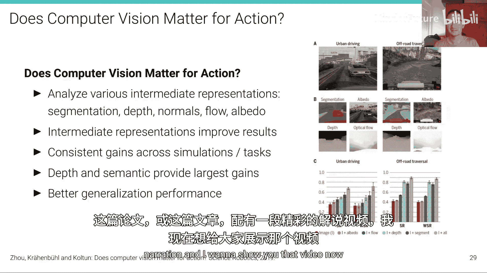
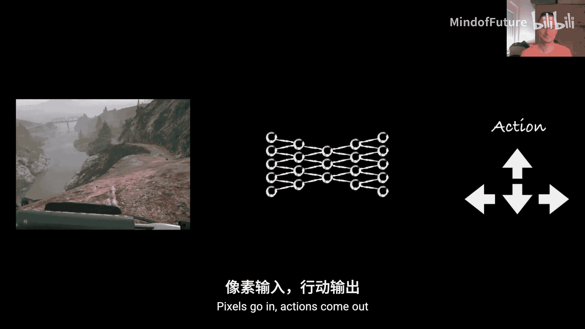
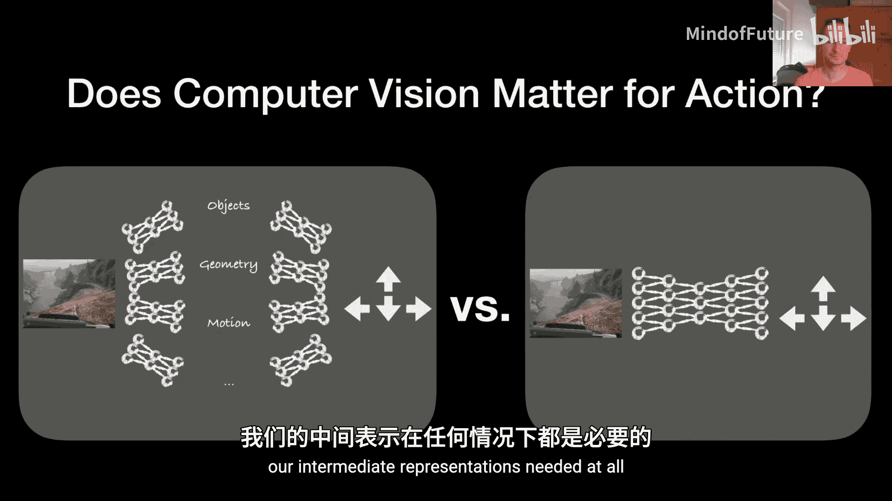
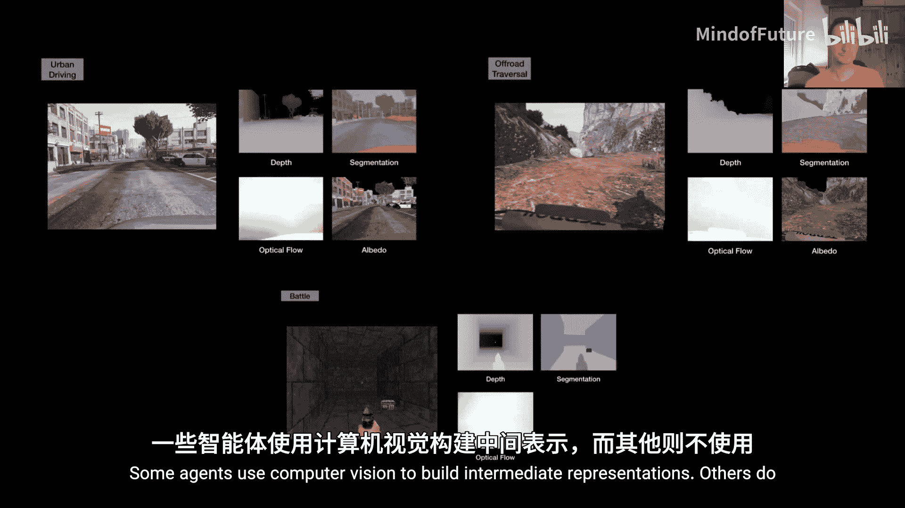
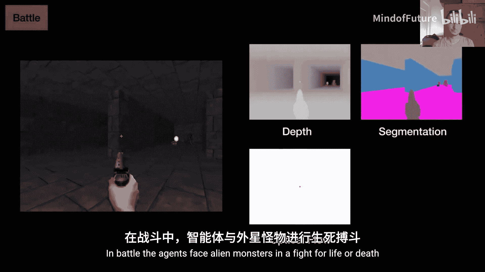
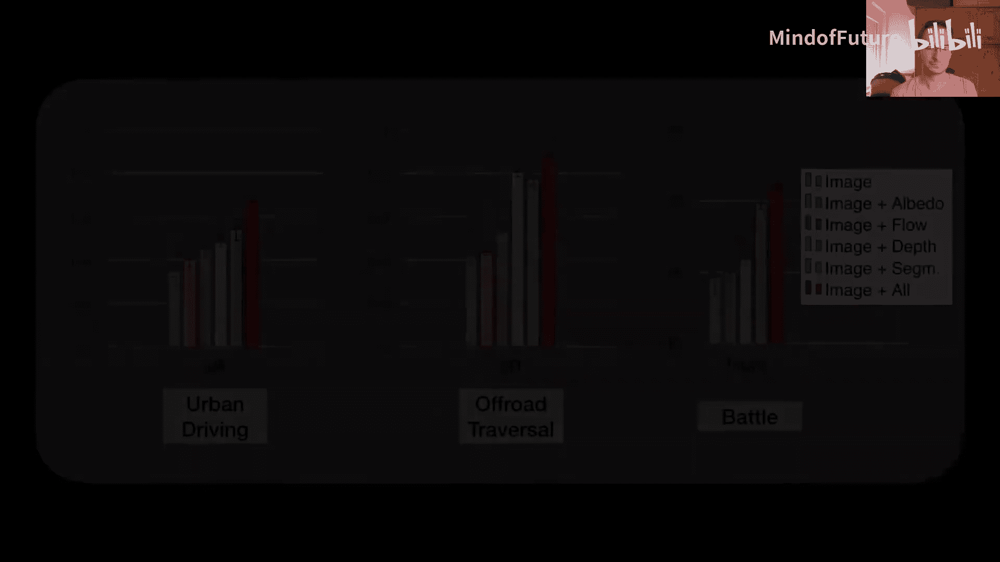
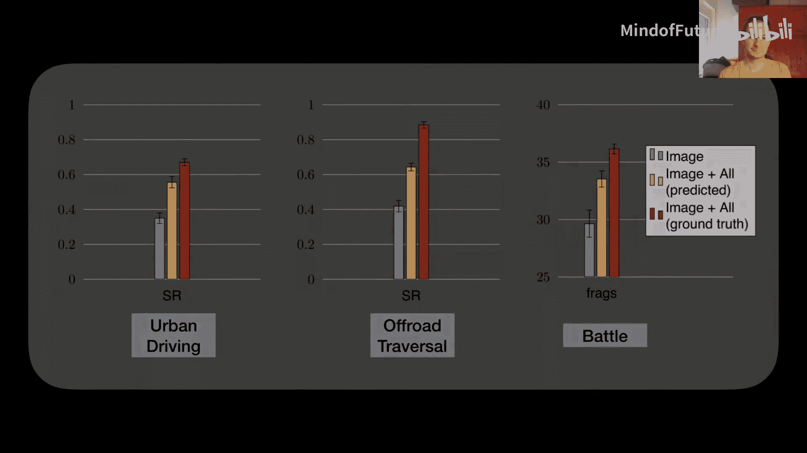
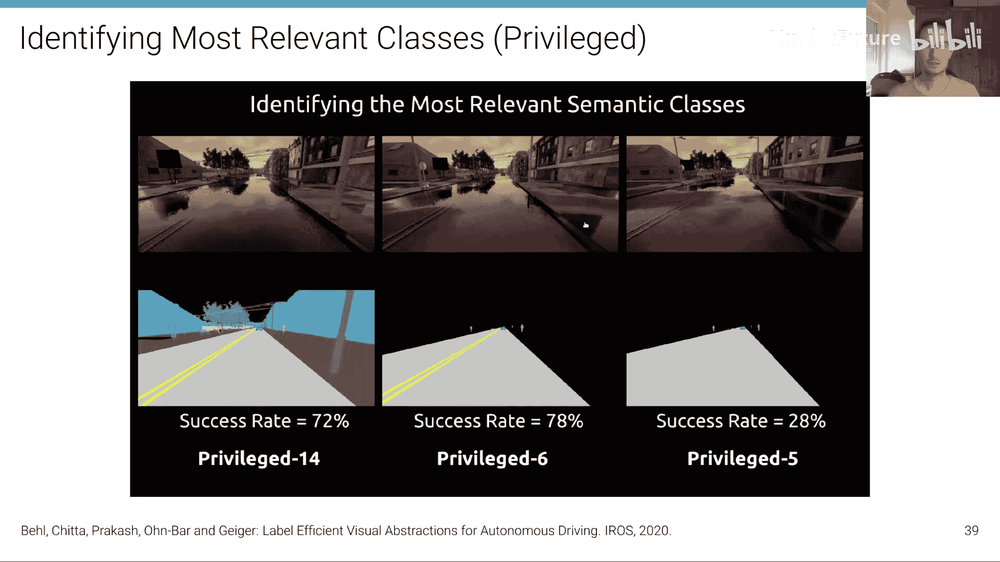
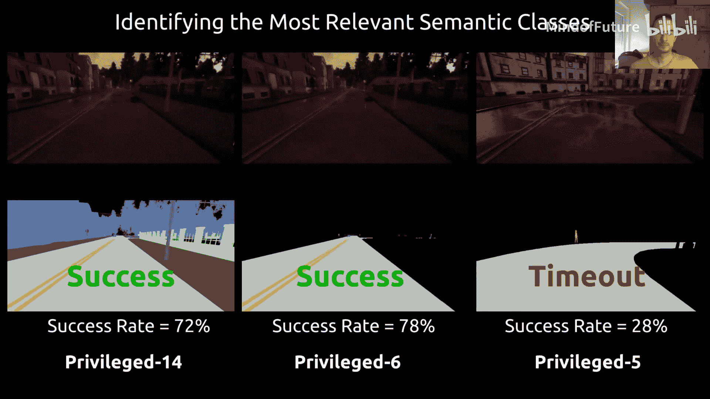
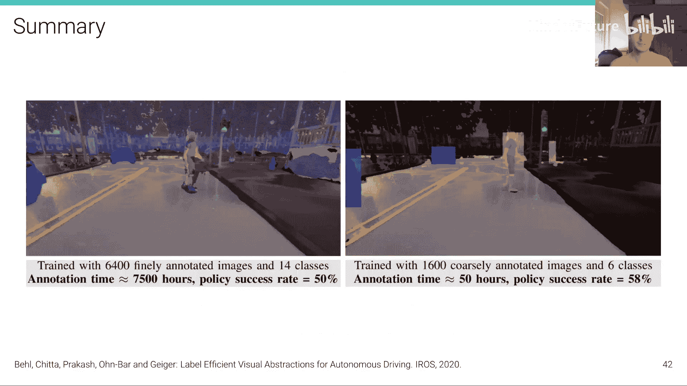

# 【图宾根大学】自动驾驶汽车课程 ML4340 p10 P10 Lecture 3.3 (Direct Perception - Visual Abstractions) -BV16FP2ePEYc_p10-

We've seen that intermediate representations are useful to decouple perception on the one side from planning and control on the other side。

However， the question of course， is how should we choose these intermediate representations precisely？

And the models that we have looked at so far were using hand engineered low dimensional affordances。

Where， of course， also human error goes into the design of these avoidances and these representations。

And so the question is， can we use some more generic intermediate representations as well， such as。

Mononiccular depth estimation or stereo of estimation， or semantic segmentation。

Standard computer vision tasks in order to improve。A robustbutness of self drivingriv agents。

And if we use those representations， how can we。Efficiently。Learn the perception stack。

 How much data， How much annotated data do we need in order to learn。

These models that predict these representations robustly。

This is something we're going to look at in this unit。In 2019， Sidel wrote an article。

That asked the question， does computer vision matter for action in science robotics。

What they did in this article is they analyzed various intermediate representations。

 including semantic segmentation， depthestimation， normal prediction， optical flow estimation。

 or albedo。Prediction。Of respect to their ability。To lead to robust driving behavior。

And they found that intermediate representations。Often improve results and generalization。

 and they found consistent gains across different simulations and tasks。And。

In the case of self driving， they found that depth and semantic provide the largest gains in particular。

That provides large gains in off road driving， where the geometry matters a lot and semantic segmentation。

Is a useful queue for inner city driving where semantic classes can be more easily discerned than off road。

And this paper here， this article comes with a nice video with a very dramatic narration。

 and I wna show you that video now。

🎼Our planet is teeming with intelligent life。 Biological creatures sense the world and move through it to survive and reproduce。

 And soon， they may be joined by artificial creatures， robots designed to see， move and act。😊。

🎼How should such robots be constructed， Researchers have explored two approaches。

🎼1 uses structured intermediate representations to link perception and action。

 These intermediate representations are produced by computer vision algorithms that perform object detection。

 semantic segmentation or three dimensional layout estimation。

 The intermediate representations produced by such algorithms are then used as a basis for action。

🎼This approach to building intelligent systems has thrived in the fertile plains and the soaring towers of academia。

🎼Yet it is threatened by a powerful newcomer。😡，🎼Vigorous species is invading from the distant lands of new rips。

 This species couples perception and control directly with no intermediate representations。

 Pels go in。

🎼Actions come out。🎼The new species poses a threat to all the inhabitants of the fertile planes。

 If actions can be produced directly， what is the role of computer vision。

🎼Are intermediate representations needed at all？

🎼We study this question by training agents in simulated environments。

 Some agents use computer vision to build intermediate representations。 Others do not。

🎼In urban driving， our agents need to move through busy city streets to reach their goal。😡。

🎼On off road trails， the agents ride on rough mountain roads。

 where a wrong turn can mean an untimely end by plunging off a cliff。🎼In battle。

 the agents face alien monsters in a fight for life or death。😡。

We find that agents that use computer vision are hardier。 They drive better。

 survive longer on mountain trails and emerge victorious in battle。

🎼Even when their vision is imperfect， agents that use intermediate representations are stronger。

🎼Here we can see agents that use computer vision to drive through city streets。🎼And here。

 they ride on mountain trails。Okay。So the question， of course， is what is a good visual abstraction。

And in the previous。Work has already been hinted to that for city driving。

 semantic segmentation might be a good choice。It's maybe not sufficient statistics of everything。

 but it comprises many of the aspects of the state that are informative for what we want to do。

So what does a good visual abstraction characterize？Well， first of all it has to be invariant。

 it has to hide irrelevant variations from the policy that's illustrated here on the right。

 in this case for an indoor scene。If we look at these two images in pixel space。

They are quite different。The pixels are actually completely different from each other If we would do a pixel to pixel comparison of these two images。

 And therefore， it's very hard to train a policy with such inputs。On the right。

 we can see the corresponding representation space where a semantic segmentation has been used as intermediate representation。

 and we can see now that the train and the test distributions overlap in this feature space much more strongly compared to the original pixelle space。

As the irrelevant， irrelevant。Formetric variations in the original images have been abstracted away。

 And if we look just at the semantic segmentation， these two images look almost the same。

Another property that we might want from a good visual abstraction。

 a good intermediate representation is that it is universal。

 it should be applicable to a wide range of scenarios。

 should basically solve all of our tasks that we might encounter in， let's say。

 the callla simulator or real world self driving。It should be a sufficient statistics of the state。

It should also be data efficient， of course， it should not require too much memory and computation in order to being produced。

And it should be label efficient。 It should require comparably little manual effort。

In order to generate the annotations that are required for training the perception sector predicts the intermediate representation。

And that's an aspect that we have been looking into in recent work。

We have chosen semantic segmentation， as it has been found in this work to encode task relevant knowledge。

 for example， that the road is drivable and prior knowledge about， for example。

 grouping of relevant or related pixels。And it can be processed with standard 2 deconvolutional policy networks。

 which makes it easy to deploy。However， the disadvantage of semantic segmentation is its labeling time。

For example， for labeling。A single image。From the cityscapes data set。

 which provides annotations for some of the images。

The annotators required 90 minutes just to label a single image。 So this becomes very quickly。

 very expensive if you want to annotate thousands or even millions of images。And therefore。

 it's important that we have a visual abstraction that's label efficient。

And so this is what we looked into in this work called label Eff visual abstracttractions for autonomous driving that appeared in I 2020。

The questions that we ask are， what is the trade off between annotation time and driving performance？

Can selecting specific semantic classes even ease policy learning？

A visual abstractions strain with few images competitive。Is fine grainined annotation， as done。

 for example， in this cityscape semantic segmentation benchmark。Actually， important。

And are visual abstractions able to reduce training variance， which is a common problem that。呃。

That appears when training end to end driving models。Here's the model that we consider。

 It's a standard visual abstraction model， where an input image。

The state or observation S is converted using a neural network。A visual abstraction network。

 A with parameters p psi。Into a visual abstraction。

And that visual abstraction is then further converted using a control policy pi。

With parameters theta into。A control command by also conditioning on the。navigational command。

 the high level GPS， navigational command and the input velocity outputs the final action。Now。

 in this case， we considered both a and pi as neural networks。

And the first neural network is the visual abstraction network that maps the input。

 state or observation， the image S to the representation R。

 and the second is the control policy that takes R， C and the velocity and maps that to the action A。

 And of course， if we combine both。If we compute pi of a of the input observation or state S。

We obtain the action A by composing these two functions。In order to train these two models。

 we need labeled data。And we need， in particular， in our images。Annotative with semantic labels。

And we call that set R。In order to train the representation， the visual abstraction network A。

And this。Data set is comp composed of input images and semantic ground truth label maps R。

We further need an A images annotated with expert actions to create the action data set A。

That is or the action data set a that comprises the pairs of the input image。And。

The corresponding control command is measured by the sensors that measure the steering。

Weheel angle are the acceleration commands that are provided by the driver。Now， of course。

 it's much cheaper to get the。Labels for the action dataset set compared to the labels for the semantic dataset set。

 So we assume that there is much more。呃。Data points available for the action data set compared to the representation data set。

Training then works as follows。 we train the visualual abstraction network A。

Using the semantic data set，The small， semantic annotated data set R。

 and then we apply this network to obtain the control data set。

 We can apply this network to all the inputs that we have seen while driving around。

And we combine this with all the measurements that have been taken by the vehicle。

 These are the control， the ground truth control signals， the steering wheel angle。

 and the acceleration a。So through this conversion， we generate this big data set now with maybe。

Hundred0 or millions of data points in order to train the control policy using that large control data set。

So we have a small data set to train the abstraction network and a large data set to train the policy。

The model that we use is the conditional imitation learning model S La S， the state of the art of。

2019。Which uses。As input the visual abstraction， R， in this case， not the image。

 but now we input R into this policy。The navigational command。

As also in the original model and the vehicle velocity as input。

 So a single image together with the vehicle velocity is a pretty good。

 sufficient statistics of the state actually， so you don't need to have all the previous frames。

Turns out that if you have just one frame and the velocity。

 you can do a lot of the things that you want to do in inner city driving。

And the output is then the action or control A and also the velocity。

 which is used also by clls as a regularizer to avoid。嗯。

Some of the causally confusion problems that occur。

And then we optimize a standard im mutation learning loss， where we minimize the discrepancy between。

The predicted action and the ground reflection and the predictive velocity and the true velocity。

This is now demonstrating the visual abstractions that we use。嗯。

The first thing that we consider isd privileged segmentation。Which is the ground truth segmentation。

 We work with a similulator so we can also provide the ground truth segmentation as input to the model in order to verify that this is actually not like it's kind of an upper bound for our analysis。

 like the model like the policy can never perform better。

Where it shouldn't perform better with a predicted semantic segmentation that is faulty compared to the ground roof of semantic segmentation。

 So we have this as an upper bound。 But it turns out that we can come pretty close to that upper bound。

 actually， and that other aspects， such as the number of labels and the chosen classes and the way we represent the labels are more important。

So in this case， we use 14 different semantic classes that you can see here with different colors。

 for example， lane markings or the road。Or pedestrians and cars and traffic lights， and buildings。

 and so forth。We also consider a reduced set of semantic labels。

 in this case only six classes are shown that we deem to be relevant。For self driving。 and also。

In experiments have turned out to be most relevant for self driving。

So the six classes that we have here are the roads and the lane markings and the other vehicles。

 pedestrians and traffic lights。Of course， in practice。

 we don't have access to like when we run our agent。

 we don't have access to the ground truth of semantic segmentation。 So we need to。

Live with inferreed segmentation。 segmentation that's inferred by our perception。

 by our visual abstraction module。And what you can see here is semantic segmentation results for the same image as before now the semantic segmentation model has been trained with 14 classes。

 and it's a state of the art semantic segmentation model at a time。

 which uses a receual network and a feature pyramid network with a segmentation hat。

We do the same analysis also for a reduced set of semantic classes。

 in this case the seation model was trained only on six classes， two stuff classes。

 and four object classes。And。Again， we use the same network。

 we can see the results differ from the results before。And then we also design a hybrid。That de is。嗯。

Two stuff classes。It uses a segmentation model for the two stuffed classes， road and lane marking。

But an object detector that only predicts the bonding boxes， not any more pixel pre size。

Instant segmentations， but predicts or semantic segmentations， but only predicts the bounding boxes。

Of the four object classes， vehicle pedestrian。And red or green traffic lights。

 And this is illustrated here。 This is an output of the actual。

Semantic segmentation and object detection model overlay。The advantage， of course， when reducing the。

Number of semantic classes and simplifying the representation is that also the annotations become easier。

 The annotation time reduces。 And at the same time。

 the hope is that the model can focus on what's actually relevant。

 It doesn't waste any capacity on the irrelevant。Aspects of the scene and puts all of its energy into predicting what's actually relevant for driving。

We evaluated on the Kala 004， no crash benchmark but random start and end locations and as metric we use again。

 the percentage of successfully completed episodes or ind the success rate。And we consider。

Different levels of difficulty， empty scenarios， scenarios with regular traffic density and quite dense traffic scenarios。

In order to identify the most relevant classes， we are bladeed from the original set of 14 classes。

Different classes。Step by step。 And the results that I'm going to show you now are for 14 classes。

 which comprise road， lane marking， vehicle， pedestrian， green light， red light， sidewalk。

 building fence， pole， vegetation， wall， traffic sign and other。27 classes where building fence。

 pole， vegetation wall， traffic sign and ever have been removed as they have。

Be deemed to be less relevant for the driving task。

And then we have a case where we only consider six classes where also the sidewalk。

Cllaass has been removed。And we have another case with five classes where now also the markings have been removed。

So here are the results。We can see different plots for the different levels of difficulty， empty。

 regular and dense， and the right plot here is for the overall performance across all the levels of difficulties。

On the bottom， you can see like on the x axis you can see the number of classes that are considered。

 and on the Y axis， the success rate that has been obtained。

And the success rate is further divided into well successful episodes， which are the green plot。

Higher， the higher， the better。 And then。Ins successfuluccessful scenarios where which。

 which happened either due to time out because the vehicle stopped and didn't reach the goal in time or because the vehicle was colliding here in red。

So the best would be if the entire plot here would be green。

And what we can see is that when we move from 14 to6 classes。

 we do not hurt performance significantly。On the contrary， in some cases。

 we even improve the performance can be shown here as can be seen here in the empty scenarios and also in the dense scenarios and the regular scenarios。

However， we see a drastic performance drop when the lane markings are removed。

 which indicates that the lane markings are actually relevant to driving。

 so we shouldn't remove them from the representation。Here's a video。

That compares the different cases for the privileged。 This is， again。

 this is results for the privileged situation where the ground truth of semantic segmentation has been used。

You can see here how the performance drops from a success rate of 78 to 28 when removing the lane markings。

 But these two models perform similar， or actually the model with less semantic glasses。

Performs better than the model with more semantic classes。

 because it doesn't distract the policy as much。

What we can see here now is。A comparison of 6 versuss 14 classes， where we compare also the infer。

 the results with the infer。Semantic segmentations in red to the privileged ground truth of semantic segmentations in green。

And what we can see again is that there is a performance drop when using the inferred segmentations。

 but it's relatively small， so we go from， let's say， 67 to 59% success rate。But of course。

 in practice， we don't have the ground truth segmentations available。 So we have to work with。

 we have to live with the inferred segmentations。What you can also see is that the six class representation consistently improves upon the 14 class representation。

In all of these plots， the six， the results that are obtained with the six class representations are actually better than the results when using 14 classes。

And therefore， for the next experiments that I'm want to show you。

 we always consider the six class representation。Here is the comparison of the effect of using a hybrid representation that's comprised of bonding boxes and semantic segmentation only for the stuff categories like road and lane markings。

And we can see that the performance of the hybrid representation matches the standards segmentation performance。

 and in the case of difficult scenarios， even slightly improves。However。

 the annotation time of the standard version is significantly higher because much more of the objects have been have to be delineated pixel accurately。

 have to be annotated pixel accurately while with bounding boxes。

 drawing a bounding boxes much easier and therefore takes less time so we can reduce the annotation time without hering the overall performance from 300 seconds to 20 seconds in this case。

In summary， this is a summary slide from that paper that illustrates all of the results on one slide basically。

If we train a。D perception model。A visual abstraction model with 6046400 finely annotated images and 14 classes。

 The annotation time is 7500 hours， and the policy success rate is 50% cent。In comparison。

 if we train with only 1600 coarsely annotated images。This is the hybrid representation。

Using only six semantic classes。 So we have a course， course of representation。

 We have less semantic classes， and we have less annotated images。

Then the policy success rate is 58%， but the annotation time reduces to only 50 hours。

What this means is that it's important how to choose the visual representation。

 the visual abstraction layer。And annotating more images is not always needed if the classes are chosen wisely and the representation is chosen wisely。

