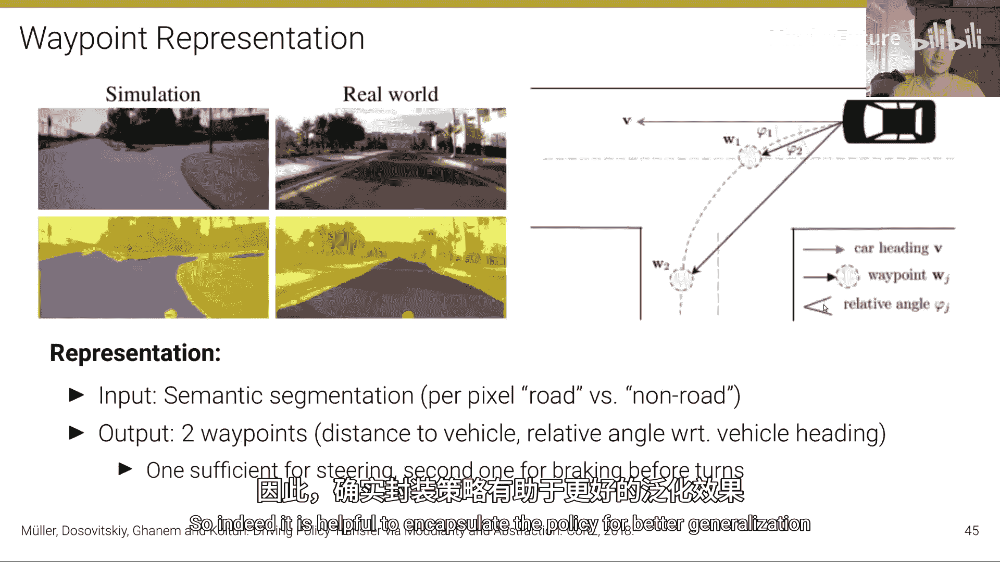
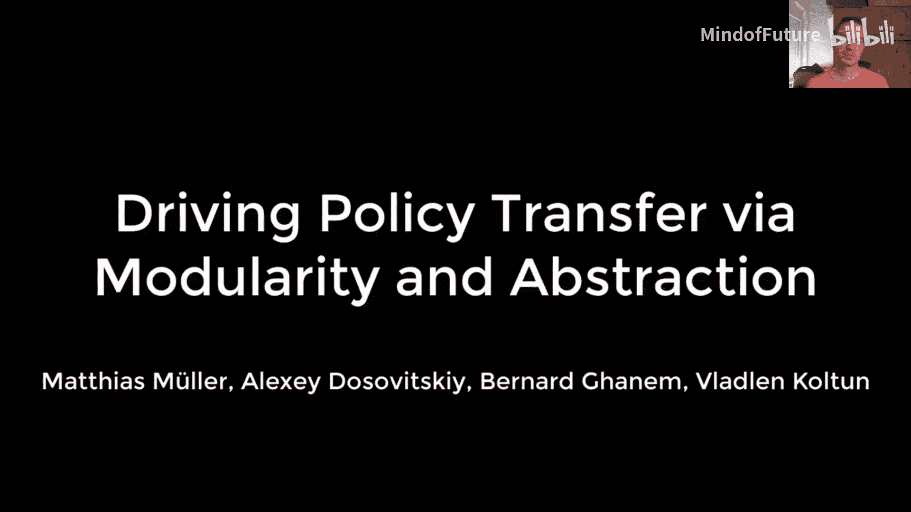
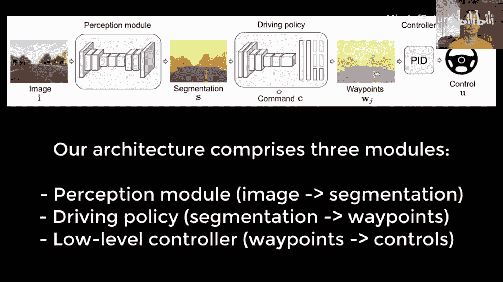

# 【图宾根大学】自动驾驶汽车课程 ML4340 p11 P11 Lecture 3.4 (Direct Perception - Driving Policy Transfer) -BV16FP2ePEYc_p11-

We've seen how intermediate representations are useful for decoupling perception from planning and control。

In order to make policy learning easier。But of course， also， not all hardware is equivalent。

 And if you wan to transfer a driving policy from a vehicle that。

Is learned in the simulator to a vehicle that's operating in the real world。

It might also be useful to decouple control from planning further。

 And this is what is proposed here or investigated here in this paper called drivingiv policy Transfer via modularity and abstractstruction that has been presented at call 2018。

The problem that is considered in this paper is that driving policy learned in simulation often do not transfer well to the real world。

 and therefore the paper makes an additional step from the direct perception idea towards a modelular pipeline。

The idea is to encapsulate the driving policy， the learned driving policy here。 Still。

 both the driving policy and the perception module are learned。 are neural networks that are learned。

 but to encapsulate that driving policy such that it is not directly exposed to raw perceptual input are also not to low level control。

In this case， the input is semantic segmentation and the output of that policy is not directly the control。

 but are a set of waypoints that are fed to a controller that is then producing the control command and the idea of producing waypoints is something that has been picked up by many research groups in the following as it makes the learning problem in general more simple。

 so this is a powerful idea。So here you can see the overall approach to input is an image。

 There is a perception module that produces a semantic segmentation in this case。

 as an intermediate representation。And then there's a driving policy conditioned on the high level GPS navigation command that predicts the waypoints that are then input to a PID controller that produces the lower level control command for the vehicle。

And now this approached and allows for transferring the driving policy here in the center without retraining of fine tuning because the only thing that has to be replaced for applying that policy to a new vehicle is the controller。

 so we have to adapt the controller which typically doesn't have too many parameters and for many vehicles we know what a good controller looks like。

 controllers operate in our vehicles all day we have ESP and automatic braking and so on which all utilize low level controllers in our vehicles。

 so this is something that we understand pretty well these days。And the driving policy here。

 because it doesn't directly output the acceleration and steering command。

 but just the waypoints is now decoupled。From the actual control command。

Through this waypoint representation， it's also decoupled from the input image through the semantic segmentation。

Such that for a new scenario， just the perception module and the controller can be replaced。

 but the driving policy that does the actual driving stays the same。The representation that's used。

 as mentioned already， is the semantic segmentation as an input， and the output are two waypoint。

The first waypoint and the second waypoint。One waypoint would be sufficient for steering and the second one is used for braking before turns。

 and then there's a PD controller that tries to follow the lane or the road based on these waypoints。

Here are the central results of that paper。And what that paper compares to is。Different variants。

 this is an ablation study， a so called ablation study where different variants of the model are compared to。

 for example， a model that goes directly from input images to control or a model that goes from images to waypoints。

And then a model that goes from semantic segmentation directly to control。

 And then the full pipeline， as shown before， that goes from。

Image to semantic segmentation and from semantic segmentation to waypoints and from waypoints to control。

The driving policy that has been used is the standard conditional imitation learning policy。

 the branched version from the original CL paper， as we've discussed。In the previous lecture。

And the controller is implemented as a PID controller for both lateral and longitudinal control。

 Lateral is basically steering and longitudinal is acceleration and breaking。

And the results of this study here reveal that in particular， for generalization。

 which are the green and the golden bars here， this is generalization to new town and generalization to new town and new weather conditions that haven't been seen during training。

The approach that uses this completely encapsulated policy。

This modular and abstracted policy performs best。 So indeed， it is helpful to encapsulate the policy。

For better generalization。

And this project also comes with a nice video that I want to show you now。

Driving policy transfer via a modularity and abstraction。

In this work， we train a driving policy in simulation and then deploy it in the physical world without any fine tuning。

The vehicle drives based on a segmentation map and high level command。

 such as turn left at the next intersection。As a result。

 our driving policy is not only able to follow the lane。

 but is also able to take various turns based on input by a high level planner or operator。

What is more， our driving policy generalizes to various previously unseen environments。

We address the problem of transfer via modularity and abstraction。

 combining the benefits of deep learning and classic modular pipelines for autonomous driving。

Our architecture comprises three modules， perception module， driving policy and low level controller。

We first validate the system in the carla simulator。We train the driving policy in Carla 101。

 weather 1， as expected， our driving policy learned to drive very well in this setting。

Note that the segmentation network was trained on cityscapes and purchases noisy segmentation in Carla。

This is by design to allow the driving policy to generalize and learn robustness to noise。

We test the drive in Bose in Carla， Town 2， weatherath  too。

 a visually very different setup and show good generalization performance。

We then deploy our system on a robotic vehicle in diverse， real world urban environments。

Our tests include different environments and weather conditions。

These include overcast weather with dry roads in Europe。But also。

 winter weather with wet and snowy roads。

We also evaluate our model on a different continent in a very different environment in sunny weather。

Despite very different textures in the background， very different lighting conditions and different road width。

 our driving policy generalize as well。We show that the learned policy is able to take various turns and successfully complete several routes of about 1 km。

Please refer to the paper for further details。