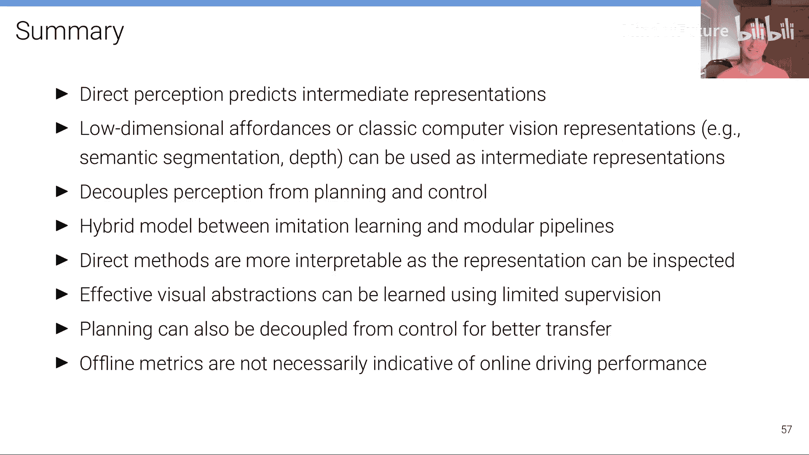

# 【图宾根大学】自动驾驶汽车课程 ML4340 p12 P12 Lecture 3.5 (Direct Perception - Online vs. Offline Evaluation) -BV16FP2ePEYc_p12-

This last unit we' discuss。Evoluation of self drivingriv agents。In particular。

 we're going to have a look at online versus so calledled offline evaluations。

And we're going to discuss the results that are presented in this paper from quote Viilla。

On offline evaluation of vision based driving models。In an ideal world， we would， of course。

 evaluate purely online。 That means using a real vehicle in the loop。

 in the loop with respect to the real world environment or dis simulator environment that we want to evaluate the vehicle in。

 But， of course， in the real world， that's quite expensive and also dangerous。

 It's expensive to operate a fleet of hundreds of thousands of cars， just for testing。

 and it's dangerous to make mistakes。The online setting is illustrated here at the bottom。

 where we have。The environment that generates an observation that's input to the， to the。

Agent to the model， the model makes a prediction or an action， actually。 And then this influences。

 again the environment。 And so we have this loop。 And based on the model driving in the real world。

 we can measure， how successful it is， How often and how fast does it reach its goal。

 How many infractctionions， does it incur， et cetera。But because that's expensive and dangerous。

People have often in， in research papers often report offline evaluation metrics。

 Offline evaluation metrics can be。Computed based on pre recorded validation data sets and are therefore cheap and easy。

 This is illustrated here on the top where we have a pre recorded data set。

The data set gives us an observation that we input to our model。

 but it also has the ground truth action， and we can simply measure the。

Errow between the prediction of the model。 let's say the steering angle should be -10 degree or plus 10 degree。

And the ground truth steeringarrow for that particular data point。

 And we use that as performance measure of our model。But of course， the question is。

 how predictive is offline evaluation？A。For the online task that we actually care about， B。

And so this paper provides here an empirical study using conditional imitation learning agents on Kla trained with a。

M S E loss on the steering angle。 So it's a standard conditional imutation learning setup。

 but that doesn't matter。 It's just。Any agent that is now evaluated in both online and offline scenarios in order to measure correlations。

The online metrics that are considered are the success rate。

 which is the percentage of routes successfully completed。The average completion。

 which is the average fraction of distance to the goalll covered。Until for example。

 an infraction occurs and the kilometers per infraction。

 which is the average driven distance between two inffractions。As a little remark。

 the current ka metrics are improved。There's， for example。

 the infraction score and the driving score that's measured by the current。

Today's Carla leader boards in 2021。But those are not， of course， considered in this work from 2018。

 but I would expect that they would likely lead to similar conclusions。

The offline metrics that are considered here， these are the proxies for the online metrics that people often use are the following。

For example， a simple in this paper here they only consider a steering angle。

 you could also consider of course acceleration， but this article here is only investigating the difference between online and offline metrics with respect to the steering angle。

 so a is either the true or a head is the predicted steering angle。

And the metrics that they consider the offline matrix is the squared error。 So how does the。嗯。True。

 searing angle A。Deaviiate from the predicted steer angle in terms of its square。The absolute error。

In terms of the L1 loss。The speed weighted absolute error where the absolute error is weighted by the speed。

 assuming that at higher speeds errors cause more harm。

The cumulative speed weighted absolute error where this is cumulated over time。

 over a certain time interval。The quantized classification arrow， where the。The action。

 the steering angle is first quantized into a set of discrete bins。

 and then this quant this quantized classificationarrow is measured。And also。

 to threshold it a relative error。Indicated here at the bottom。So these are some of the。

offffline metrics that people often use。And so what they found in this paper is that online metrics themselves are mostly well correlated with high correlation scores。

So for example， here is a success rate with respect to average completion， where 45 different models。

Vinging data set size， augmentation techniques， architectures， etc have been compared。

 so each of these models is a data point on this plot。嗯。

And the performance is the performance that's measured here is the generationization performance to town 2 and new v conditions。

The radioius of these circles indicates the training iteration these models have been stopped after different training iterations in order to get more data points。

 So you can see the。Quality of the model。As its radius or then the duration as its radius。

What we can see from these plots is that the success rate correlates well with average completion and also with the kilometers per infraction。

 but somehow a per infraction correlates less well with average completion。However。

 if we compare online with the offline metrics， we see that。All metrics are not very well correlated。

 For example， here， we have success rate versus steering mean squared  error。

 success rate versus steering absolute  error or success rate versus speed weighted  error。

And the correlations scores are plotted on top of these figures。

What we can see is that the absolute steering arrow improves over the mean squared arrow。

 So the absolute arrow is a better。Proxy for the success rate。

But it's still not super well correlated， and the speed weighting is actually not important。

We also see that the cumulative error， here the cumulative error with respect to the success rate。

 does not improve the correlation and these quantized versions， which are a little bit more robust。

Perform best， but are still not as well correlated as the online metrics with respect to themselves。

In order to understand this better， why the online metrics and the offline metrics are not very well correlated。

They also made a case study in this article。where they looked at a particular maneuvers of performed by two models。

 you can see the ground truth curve is the blue one and Model1 is red and Model 2 is green。

And the first model was trained using just a single camera， no data augmentation， and L2 loss。

 The second model was trained with free cameras。 was using data augmentation。And L1 loss。

 which is more robust。So it's a better model。What we can see from this plot here and also from the zm in here of one of these turns that can see the turns are where the ground truth is peak。

So this is one of the turns zoomed in。What we can see is that both models are quite noisy。

 but Model 1， the red one occasionally predicts very large errors。So despite that model on average。

 being not much worse。Terms of the offline metrics。For example。

 the average deviation and steering angle。It occasionally does these very large  errors。

Which leads the vehicle to deviate from the road， and to。Crash into another object， for example。

 or cause another infraction that lead to an insuccessful route completion。So this is the course。

 the reason why online， or this is skip some insights into why online and offline metrics are not fully compatible and when evaluating agents。

Offline metrics can give you a hint about the performance of the agent， but you should always。

 in the end， also evaluate the agent in an online setting。

 just like the current call leader board is doing， for example， where people can submit their agents。

And the agent is then evaluated by the server on a held out city with held out weather conditions。

 and because it's a simulator。Online evaluation is possible。

So here is another figure from the paper that illustrates this case study where we can see that Model 1 crashes in every trial。

 but Model2 can drive successfully and this illustrates the difficulty of using offline metrics for predicting online behavior。

This is the end of this lecture。In summary。What we've seen today is that direct perception predicts intermediate representations。

And low dimensional affordances or classic computer vision representations such as semantic segmentation or depth can be used as intermediate representations。

These intermediate representations decouple perception from planning and control and therefore often lead to more robust driving behavior and better generalization。

And they are a hybrid model between imitation learning and modeler pipelines。

AndD methods are more interpretable as the representation can be inspected。

And we've seen that effective visual abstractions can be learned using quite limited supervision。

We've also seen that also planning can be decoupled from the control itself for better policy transfer。

 for example， to new cars or from simulation to the real world。

And we've also seen that offline metrics are not necessarily indicative of online driving performance。

 so you need to be careful when interpreting offline metrics。That's all for today。

 Thanks for listening。

