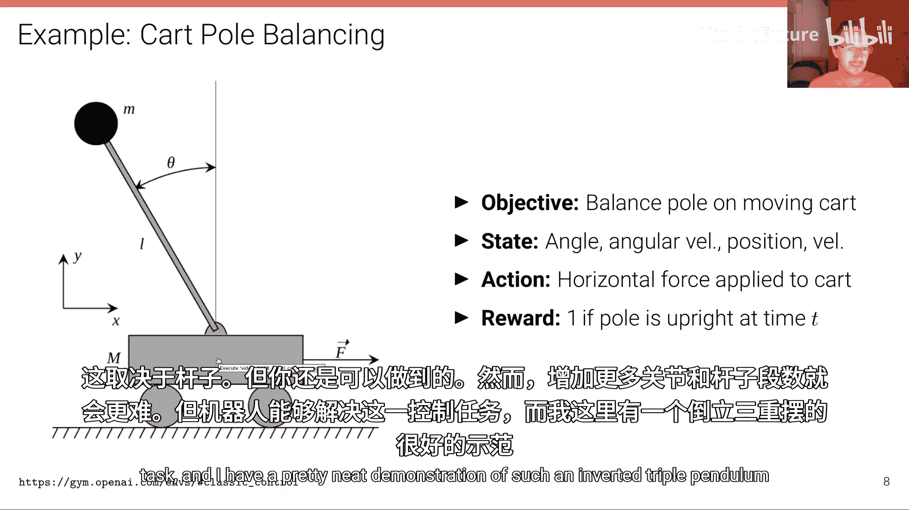
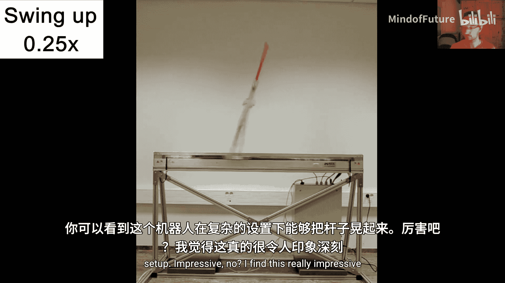
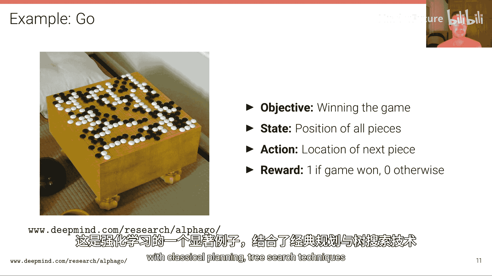
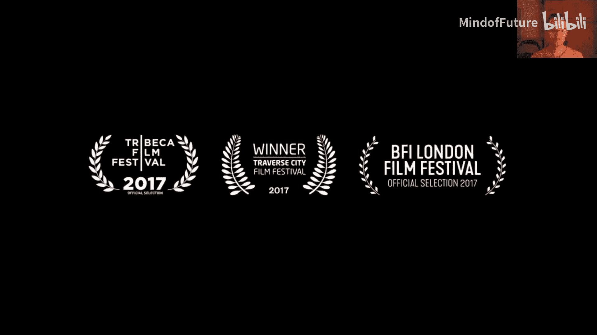
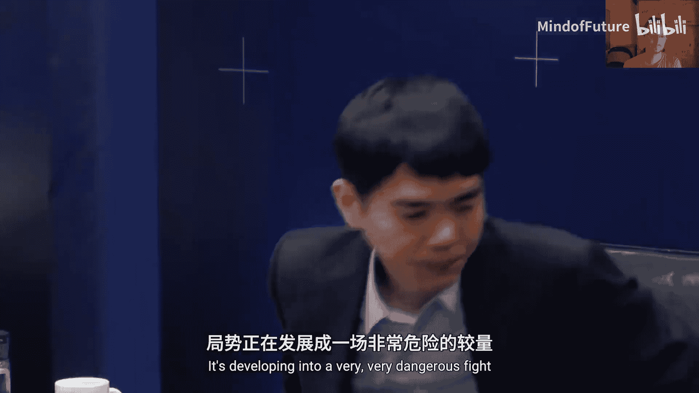
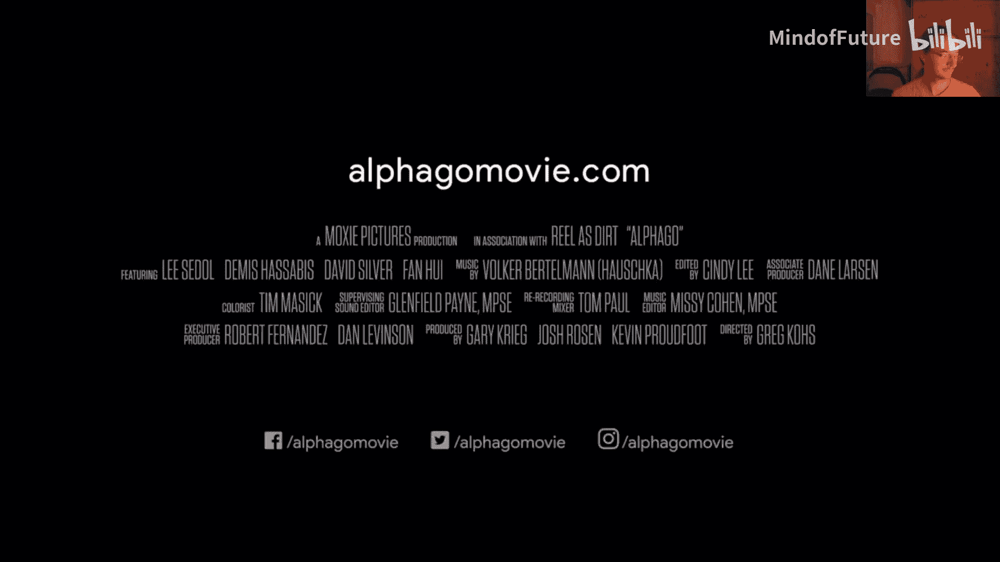
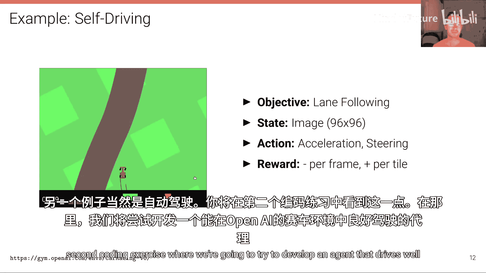
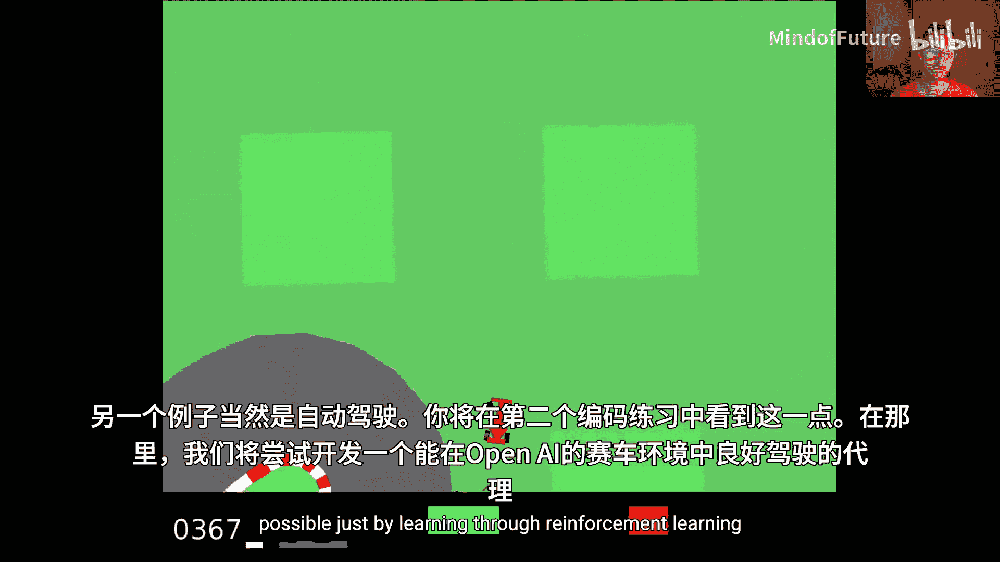
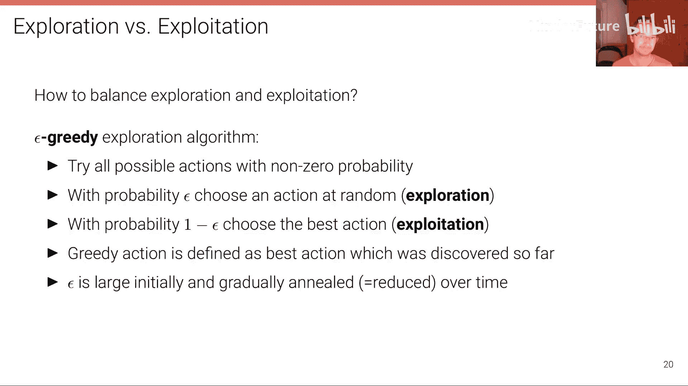

# 【图宾根大学】自动驾驶汽车课程 ML4340 p13 P13 Lecture 4.1 (Reinforcement Learning - Markov Decision Processes) -BV16FP2ePEYc_p13-

Hello and welcome to Self drivingiv Car Le number four on reinforcement learninging。

In lecture number two and lecture number3， we have seen how end to end self driving models can be learned using imitation by imitating an expert's behavior or by trying to predict。

Expert affordances。In this lecture， we're going to talk about another technique。

A very popular technique in robotics called reinforcement learning。

 which allows for learning robot policies without such expert demonstrations。

This lecture is structured into four units。 in the first unit， we're going。

Define the reinforcement learning problem formally through the。

Framework of Markov decision processes。In the second unit。

 we're going to have a look at the Belman equation。And how this leads to one of the most fundamental。

Algorithms for reinforcement learning， which is called Q learning。And then finally。

 in unit number three， we are going to have a look at a deep neural network based version of Q learning that's called deep Q learning。

 as well as its variance。Let's get started with Markov decision processes。So far。

 we've considered supervised learning。Imitation learning was a supervised learning problem。

 It required lots of expert demonstrations， and we are basically trying to mimic an expert。Now。

 the disadvantage of this is of course that first of all。

 we have to have access to these expert demonstrations。

 but also these loss functions are actually not the loss functions that we want to optimize ideally。

They are auxiliary loss functions。 They just tell us we want to be close to the expert。

 and they have a very short term effect。For example。

 in imitation learning we have a per frame loss on the action， we don't look into the future。

 we don't anticipate what happens in the future， only implicitly we do that by following by trying to mimicking the expert。

And also in direct perception， we've seen that we put per frame loss functions on the avoidance indicators。

Now what we're going to consider in this lecture is different here we're not going to try to mimic an expert。

Instead， we're going to try to learn models based on the loss that we actually care about through exploration and exploitation and interaction with the environment。

And these loss functions are very different from the standard loss functions like the L1 loss on the steering angle that we've considered for mutation learning。

 These loss functions are much more general。 It's a much more general framework。For example。

 a loss function could include that we want to minimize the time to the target location。

 which is something that we want to do in self driving or the number of collisions。

Or the risk that we take while driving or that we want to maximize the comfort， etcter。

 So very general definitions of what we want to achieve。

 and we can formalize self driving in terms of such general loss functions in the framework of reinforcement learning。

In machine learning textbooks， reinforcement learning。

Or learning is typically categorized into three different categories。

The first category we've seen already， this is the classical machine learning framework is's called supervised learning。

 but we have a data set。Of X， Y， data label pairs。 And the goal is to learn a mapping from x to y。

Examples of this include image classification。Regression， imutation learning， affordance learning。

 and so on。In contrast， in unsupervised learning， we are only provided with a data set。

 and the goal is to discover structure underlying the data Exles include clustering。

 dimensionality reduction， feature learning and so forth and this type of approach has also been used in the context of self driving。

 For example， when learning world models of the environment using a simple reconstruction loss and image reconstruction loss in order to learn a good compression of the high dimensional state。

And then finally， we have reinforcement learning， which is what we're going to talk about in this lecture。

Where in contrast to the first two。Learning types。An ancient。Interacts with its environment。

And the environment provides numeric reward signals to the agent。

 and the goal is to learn the agent should learn how to take actions in order to maximize the reward that's provided by the environment。

And examples of this are to learn manipulation tasks。With robot arms learning to grasp objects。

 for example， or control tasks， as we're going to see。Today。

Reinforcement learning can be formulated or illustrated with a simple diagram。

We have an agent that operates in an environment， the agent could be a self driving car that operates in a real world environment or in a simulated environment like Kala。

The agent observes the En state ST at time T。This is indicated here by this error。

 The environment provides or exposes its state or exposes partially its state to the agent。

 typicallyyp you don't have the full image of the environment， you don't have the full state。

 but you just see parts of the environment。 For example， a car might just take pictures。

 so you don't get the 3D state of the environment。 you just have a 2D projection。

 maybe just of a certain area of the environment， not the full world that the agent operates in。

 It's just a projection of a very small part of the environment。

 So the state is not complete typically。And then the agent sends its action8 at time t to the environment。

It based on the current state， tries to make the optimal action for that state， for that observation。

 The car observes an image and tries to。Turn the steering wheel appropriately。

 according to what it sees。And then the environment returns two things to the agent。

 it returns the reward。Computive reward details the agent how good that action was， for example。

 if the self driving car has reached its goal， it tells the car this was good。

Or if the car has run over a pedestrian tells the car， this was not good。

 Or if it ran into a a traffic light， tells the car this wasn't good。 You produced a crash。

 It wasn't good。So the environment returns the reward。 It judges the action A T。

 and that's what we call R T。 It's a numerical number。

 It's just a simple number and can be either positive or negative。

And the agent wants to maximize the reward， wants to have as much much reward as possible and minimize。

The negative reward。The second thing that the environment returns is the next state。 The environment。

 given the action from the agent and， of course， also the action of all the other。

U agentsgens in the scene that are， for example， simulated in a simulator like Kala。

The environment transitions to the next state。For example， if the agent moves forward。

 the environment provides the image at the next camera location back to the agent。

 that's the observation S T plus1。So the goal in reinforcement learning is to select actions to maximize the total future reward。

The environment provides a reward， and we want to have as much positive reward as possible。However。

 the actions may have very long term consequences。 For example， in self driving。

 we might have a reward only when reaching the goal。 This might happen after one minute of driving。

 after 30 minutes of driving， after two hours of driving。

And we might not have a lot of rewards until we get there。

This makes the learning problem really hard， reinforcement learning is a really hard problem。Also。

 the reward might be delayed and not instantaneous。

The environment may not immediately give you the reward despite you made a good action。

It may be better to sacrifice immediate reward to gain more long term reward for the agent。

 therefore。And there is some examples， and this illustrates how how difficult that problem is。

 The agent needs to decide in the short term， it needs to decide for the next action。

 and it may need to decide for a suboptimal action in order to get a really high reward in the long run。

And an example included， for instance， financial investments， which may take months to mature。

Or consider， for example， a rescue helicopter that needs to rescue a person but that is running low on fuel。

And needs to be refueled。 So refueling takes time。But it might prevent a crash in a few hours ahead。

Or maybe a very prototyp example is a chess game where sacrificing a particular chess piece。

 which in the short term。Leves you with less pieces on on the board。

 but in the long term might help you win the game。So this makes the problem really hard。 Now。

 let's look at some concrete examples to get a better idea of how different reinforcement learning problems might look like。

 And one of the simplest the so called。Moving cart pole balancing problem where we have a cart here。

That can move left or right， and we can provide a。Force to that cart in order to move it to the left or to the right。

And the goal of this， the objective here is to balance the pole on that moving cart。

 so we want to have that pole upright， and it might be that in the beginning the pole is actually facingas down。

 so we have to lift it up。The state is the angle of that pole， there is a joint here。

 so this is the angle here。And also the angle of velocity， so the first derivative of the angle。

And then the position of the cart。In x direction。And also， the velocity of Nacarte。

So we have a four dimensional state space， a very simple state space compared to self driving or other things。

And also， in this case， it's actually fully observed。

 It's not like himself driving what I mentioned before。

 where we have just a picture that doesn't see everything。 but here we see everything。

 We have just these four values。Now， the action is to。

Applied this horizontal force to the cart such that the pole is upright， but the reward。

 as you can see here already， is very sparse。 The reward is one If the pole is upright at time T。

And it's zero otherwise。So if the pole is facing down。The system has to experience。

The agent has to experiment with the environment in order to see actually observe the first reward。

 which makes the problem very hard。And this problem can be made even harder。

Like this pole balancing problem can be solved by humans。 It's hard。

 You can try it yourself putting a pole in your hand， trying to balance it。 It's hard。

 Depends on the pole。But you can do it。But。Adding more joints and adding more pole segments makes it even harder。

But robots can solve this control task， and I have a pretty neat。

Demonstration of such a inverted triple pendulum here。

 can see how Robert is able to swing their pole up。Despite of this， despite this complicated setup。

Impressive， no， I find this very impressive。Another example is robot locomotion。This is a。

Example taken from the robot school environment from the Omei gym where also our self driving。

Takes place。This is just another environment in Omeai gym。The objective here is we're given a robot。

That comprises several bones and joints， like the articulated structure of the robot。

 And you can see there is different robots here。And the objective is to make the robot move forward。

And the state is the position and angle of all of the joints。

 And the action is the torques that we can apply on the joints。

  similar to the car pole balancing problem from before。 But now。

 a much more complicated articulated robot。 And we want the robot， we want to learn。How to move。

The robotbber doesn't know anything about how to move。 So we want to learn how to move。

 and the reward is one if the robot is up of the agent is upright and moving forward。And it's zero。

 otherwise。So here are some examples of what these robots have learned using reinforcement learning。

So they have actually learned they have come up with a strategy for being upright。

 not falling down and at the same time， moving forward as quickly as possible。

You can see interesting behaviors emerging And some of these behaviors are actually similar to behaviors。

That also， real creatures have learned。Another example Atari games。

Here's the gym Ra environment also from OMI gym。And it provides a whole bunch of Atari games。

 which you can see here。They directly come with a reward because they have a game state。

 they have a score， you can see your score inside that game， you can retrieve your score from there。

 and that's something you can use as a reward to try to learn each of these games。

The objective is therefore to maximize the game score S the reward。

And the state is simply the raw pixels of the screen， 210 times 160 pixels。

 and for some of these games it's really easy to learn using reinforcement learning and the games that have really complicated behavior and require very long term planning are much harder to learn。

The actions are the standard actions you have on a keyboard left， right， up down。

 and the reward is if the score increases。Or decreases at time T。

And that's what you want to maximize the game score。

And probably youll have all heard of Alphago and the successors。

And this is also a prominent example of reinforcement learning in this case。

 combined with classical planning tree search techniques。

Go is the world's oldest continuously played board game。

 it is one of the simplest and also most abstract。🎼Beating a professional player at go is a longstanding challenge of artificial intelligence。

🎼Everything we've ever tried in AI just falls over when you try the Game of Go。

 the number of possible configurations of the board is more than the number of atoms in the universe。

🎼Alphago found a way to learn how to play out So far。

 Alphago has beaten every challenge we've given it。

 but we won't know its true strength until we play somebody who is at the top of the world like Lisa Sadom。

Not like no other is about to get underway in South Korea they all is to go what Roger Feer is to tennis just the very thought of a machine playing a human is inherently intriguing the places in Madhouse welcome to the deep mind challenge War Washington can these at all find Algo's weakness whoa in fact weakness。

The game kind of turned on his axis。🎼That is not a confident base。developing into a very。

 very dangerous fight hold the phone Re has left the room in the end it is about pride I think went wrong these ideas that are driving alphago are going to drive our future This is it folks。

There's even a movie now about Alphago。As the objective is simple， winning the game。

 it's fully observed。 The state space is simple， but it's extremely large because of the many situations that can occur。

And so it's the state is just the position of all the pieces and the action is the location of the next piece。

 the definition of the environment is super easy。The reward is one。

 If the game is one and 0 otherwise， very long term reward， extremely long term reward。

 which makes it hot。And another example， self driving， of course。 And you're gonna see this in the。

Second coding exercise， where we're gonna try to develop an agent that drives well in the。

Op me I a car racing environment and tries to pass as many great tiles as possible。

 just by learning through reinforcement learning。

And this is one of the agents here driving。Here， in this case， the objective is la following。

 and the state is also the image， 96 times 96 pixels actions are acceleration and steering。

 and the reward is minus or negative if。We continue to next frame。 So with every frame。

 we got a negative reward。And we get a positive reward for every great tile that we pass。

 So we want to pass。 In other words， we want to pass as many great tiles as possible in as little time as possible。

So here's again the reinforcement learning loop that we've seen before。

 how can we mathematically formalize the RL problem？

We do this using the so called mark of decision process。Themark of decision process， short MDP。

Defins a tuple， S ARP and Gamma。What are these five components of this tuupple。

S is the set of all possible states， for example， in the game of go。

 the set of all possible the combination of all possible pieces on the game。

A is the set of possible actions。And R。Is the distribution of the current reward given the state action power。

 So given the state action power。The environment， as we already。mentionedioned。Returns a reward。

And because that could be stochastic， we're going to consider the most general case here。

We are having a distribution。 It could be deterministic， given a state and action。

 it could just be a function of maps to R， but it could also be a distribution。

 There could be uncertainty in it。whichhich is often the case， for example。

 when we have games or uncertain observations due to noise in the measurements。

Where things are uncertain， so the distribution， we consider distribution of the reward given a state action power。

Then P， the fourth element of this tuple is the distribution against stochastic because it could be stochastic。

The distribution over the next state given the state action pair。 So it's P of S T plus 1。

 given S T and A T。 This is how the environment transitions to the next state。

And gamma is the so called discount factor， which determines the value of future rewards。

It down weights the value of future rewards， because the agent can only look ahead so many steps。

 And so we， we can't typically， it doesn't make sense to consider the reward at like 1 million years into the future as high as the reward。

Say one minute into the future。 And this is what this discount factor is responsible for。

And we're going to talk about this in much more detail in the next unit。

Almost all reinforcement learning problems can be formalized as markov decision processes。

 That's why they provide this powerful mathematical framework in which we are going to operate in。

They are called Markov decision processes because they obey the Markov property。

The Markov property says that the current state is completely characterized。Not。

 the current state completely characterizes the state of the world。

So what this means is that a state S is mark of if and only if P of S plus 1 given S。

Equals p of S plus 1， given as1 to ST。In other words。

Current state depends only on the previous state。And if the previous state is given。

All the states that come before the previous states don't matter anymore。

 This is the mark of property。And you may be familiar with this already through。For example。

 the hidden mark of models or the Kman filter， etc。

So here are some statements that are equivalent about this。 For example。

 the future is independent of the past， given the present。

Or the state captures all relevant information from the history。Once the state is known。

 the history may be thrown away。And the state。S T is the sufficient statistics of the future。

 We don't need to know the previous states。Now let's come back to the reinforcement learning loop。

 which we have already seen， which is shown here on the right and let's now look at this loop in the context of the Markov decision process that we have introduced。

We start at time t equals0。At time t equals 0， the first time step。In the first time step。

 the environment samples the initial state from the state distribution P of S0。

So we get the first state。Then for t equals 0 until we are done。Until the end of our simulation。

The agent selects an action A。Or until the end of the rollout is sometimes also called a rollout。

 it's a rollout of the policy of the policy in the environment interacting with the environment。

So 4 t equals 0 until done， the agent selects an action A。

And then the environment samples the reward R T given。The state and the action。 and also。

 the next state。And the agent receives the reward and the next state and selects the next action。

And so forth。How。Do we actually select an action now。Well。

We know already the mechanism to selecting an action。 It's called a policy。

We have seen policies in the context of imitation learning。

And we're going to look at policies here in the context of reinforcement learning again。

A policy pi is a function from state space to action space that specifies what action to take in each state。

Given any state， this function tells us what action we should take and the policy is what we want to learn。

 It's typically a neural network parameterized with some parameters or it's a look up table。

 if it's a discrete state and action space。A policy， therefore。

 fully defines the behaviour of an agent。And there may be there are deteristic policies where we have a direct mapping。

 it's a function that maps from S to a， and there are stochastic policies that are modeling the uncertainty that are giving us back a distribution。

And we denote this as pi of a given S， which is a distribution P of A T equals a， given S T equals S。

As a little remark。MDP policies depend only on the current state， as you can see here。

 and not the entire history。However， the current state may of course include past observations。

That's just a matter of how we define the state。 We can define the state。As a buffer of frames。

 for example， buffer of the last 10 frames of images that we have observed as an agent。

 And that's perfectly fine in this formalism。It's just a definition of。

It's just a matter of how we define the state。Now， how can we learn a policy？

We've seen already one way to do so。 It's called imitation learning。

 We learn a policy directly using supervised learning from expert demonstrations。

In reinforcement learning， however。We assume that there is no expert demonstrations given。

 and instead， we learn a policy through trial and error。 The agents discover itself。

 which actions maximize the expected future reward。

 That's the quantity we want to maximize In expectation。 how much reward we get in the future。

 We want to take the action that maximizes this。The agent interacts with the environment and obtains a reward and the agent discovers good actions and improves its policy pi。

 based on the rewards that are given to the agent through this trial and error game。

So how do we discover good actions？Well， we need to explore the state action space。

And this is also what makes R L often unsafe and hard to execute in the real world。

And there's a whole research branch on how to make RL safe， but of course， if we are in a simulator。

 if we're simulating self driving in Kaa， that's much easier because we are not posing any safety risk and we can also simulate and explore unsafe scenarios。

Because we need to explore the state action space， we know nothing， we don't have an expert。

That we could try to imitate。We combine two tasks here。

These are the two fundamental tasks of reinforcement learning。The first task is called exploration。

The goal of exploration is to try a novel action A in a state S， and then we observe the reward Rt。

We don't know if that action is a good one or a bad one， but we don't care。

 We just want to see what happens。That's why it's called exploration。

Exploration Dick discovers more information about the environment。

 but sacrifices the total reward given during that。Episode。Because we are trying an action。

 and in most cases， this action will actually not be a good action。However。

 through experiencing experiencing new states we might potentially find an action at some point that's really good。

 and so we can learn from that and try to execute that action more frequently in the future。

 So exploration is in particularly useful in the beginning when we know nothing about the environment we need to explore we don't have really any other choice。

 We need to explore in order to find useful actions。

An example in gameplay is to play a novel experimental move。We don't know what's happening。

 we're trying it out and we'll see where this leads to。

The other fundamental task in ourL is called exploitation。In exploitation。

We use a previously discovered good action， an action we know was a good action。And of course。

 by using an action which we know is good for a particular state， by exploiting this information。

 we are maximizing the reward because we know it's a good action。But at the same time。

We sacrifice unexplored areas。 if we only exploit， if we found a few actions that are good。

But we haven't considered a huge part of the state space where maybe even higher rewards can be obtained。

 We are in a loop where we're just exploring that space that we have already that we know already。

 And we get only this small reward in a sense， And so the gameplay example here is to play the move you believe is best。

Which means in practice， there is a trade off between these two。

 you need to trade off exploration and exploitation。

 It's important to explore and exploit simultaneously。 In the beginning。

 you want to start with exploration。And the better your agent becomes。

 you w to go more towards exploitation because you， you're operating in a better regime already。

But how to balance exploration and exploitation？There is the so calledled Epsilon greedy algorithm that does exactly that。

The Epsilon greedy exploration algorithm。Trice all possible actions with non zero probability in particular。

With probability Epsilon， it chooses an action at random， complete random。And that's exploration。

And with probability 1 minus epsilon， we choose the best action。 That's exploitation。

And the greedy action is defined as the best action， which was discovered so far。

 right So the best action is the greedy action， in a sense。

 you are looking at all possible actions for for a state。

 you're looking at your current policy and you are maximizing that in order to exploit with one minus epsilon probability。

 you are doing that exploitation move and with epsilon probability， you do the exploit move。

And as already mentioned， in the beginning， where you know nothing about the environment。

 you have to explore。 and therefore， the epsilon schedule。

Is such that in the beginning you choose a large epsilon and then gradually anneil it。

 you gradually reduce it， make it smaller over time so that you go from exploration to exploitation when your policy becomes better and better。

 you want to exploit more， you want to exploit the areas of the state space that are good they give you high reward because maybe you find some even better reward if you explore in those high highly valuable regions and not explore randomly everywhere。

