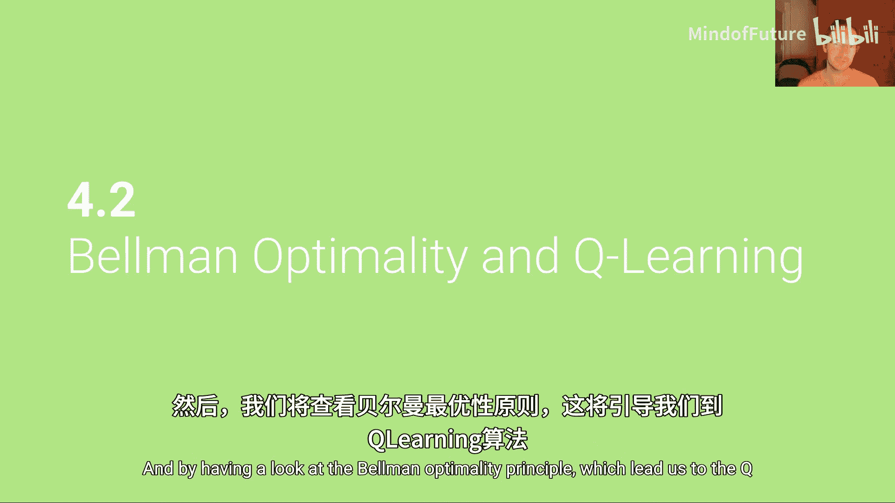
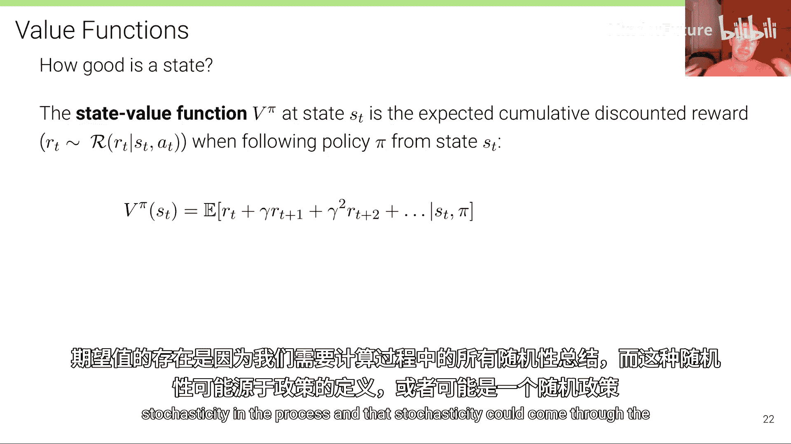
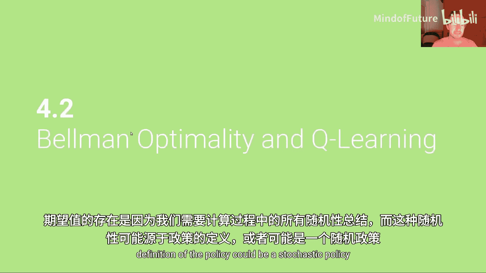
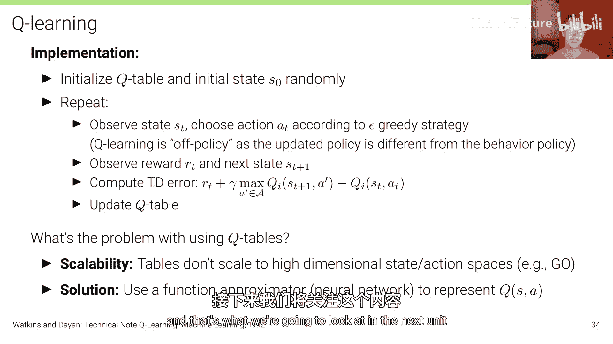

# 【图宾根大学】自动驾驶汽车课程 ML4340 p14 P14 Lecture 4.2 (Reinforcement Learning - Bellman Optimality and Q-Learning) -BV16FP2ePEYc_p14-

We will now look at our first reinforcement learning algorithm， which is called Q learning。

 and which is maybe the most fundamental reinforcement learning algorithm and maybe the most used reinforcement learning algorithm。

We're going to start by having a look at value functions。

How to specify and how to evaluate future reward。And by having a look at the Belman Opity principle。

 which lead us to the Q learning algorithm。

Value functions define the value of a state in order to learn。

In order to learn using reinforcement learning， we have to know how good a state is。

And we know how good a state is only through the future rewards that we can expect when starting to act based on that current state that we are in。

So how good is a state。The first quantity that we are going to learn is the state value function V。

The state value function， V。Superscript pie for the policy。This is a quantity that's。

Defined specifically for a fixed policy pie。So the state value function v pi at state S T is the expected cumulative discount reward。

When following that policy from state ST。And that's illustrated here at the bottom。

 So given a particular policy， let's assume we have trained an agent。This is our policy。

The policy tells us which action to take in any state that we could be in。

And given the particular starting state， S T。V pi of S T is defined as the expectation。

Over the sequence of future rewards with the discount factor Gaa here。Multiplied to the rewards。

Where the exponent。Is increased by one with every time step into the future。

 So we have gamma to the power of0 times R T plus gamma to the power of one times R T plus 1。Plus。

 gamma to the power of2。Times R T plus 2， and so forth。Until a fixed time horizon that we consider。

 or in theory we can consider the limit until infinity。But， of course， in practice。

 we have always to consider a fixed time horizon。Why is there an expectation？The first question。Well。

 the expectation is here because we have to compute。

A summary over all the stochasticity in the process and that stochasticity could come from the。

Definition of the policy could be a stochastic policy。 Let me go back。

Here， so it could be either the or it could be also a stochastic policy。 So we have answer。

 we have stochasticity there。 and this expert x。Apectation goes over this。But also。

The reward distribution and the state transition distribution may be stochastic。

 so there's also stochasticity in there， and that's all captured by this expectation。Okay。

 that's why we have this expectation here。And why do we。

Increase this gamma by one with every time step。 Well， that's exactly the discount property。

 because we want to not consider a reward that's given to us maybe 1 million time steps into the future as high as a reward that's more close to us。

 That's nearer。That's maybe just like， one minute away。

Because we can't effectively search for that longtime horizon so we have to prioritize term a shorter term reward and we do this by specifying the value of gamma which is a hypoparameter。

 that is between0 and 1， typically it's very close to 1。

But the exact specification of value gamma specifies how far into the future we are looking at when we are seeking to compute the reward。

なです。Equation can be simplified， of course， into this expression。

 where we have the expectation over all the sum of all case big or equal to 0。Times。

Ge on to the power of Kay。Times R TK。When starting。

 this is the conditional starting in SD for a fixed policy pi。

 we're conditioning on the start location and the policy pi。Again， this discount factor， gamma。

 which is between0 and 1， typically close to one， is the value of the future rewards at the current time。

Anyway it weigh immediate reward higher than very far away reward。So for example。

 if gamma would be 0。5。Which is a low gamma， but just to illustrate。

Then we would weigh the current rewards with a factor of one。

 but the next time step already just with a factor of one half。

 and then the next time step with a factor of one quarter and so forth。

 So we would very quickly decrease the weight that we assign a reward that's provided to us by the environment。

As we go and look into the future。So Gamma really determines the agent's far and short sideedness and it's important that we have this control。

 for example we can use this control to avoid infinite returns。

 let's assume we have a cyclic mark of process where we can revisit the same state over and over again so we could obtain infinite reward but of course our agent can't interact with the environment infinitely。

 so this is also mathematically important to have the stopping criteria。

Another quantity that we're going to introduce is so called action value function。

The action value function determines how good a state action power is。

 It's very similar and related to the state value function。So what's the difference。

 the action value function Q pi at state S T and action A T。

 So it's also conditioned on the action now。Is the expected cumulative discounted reward when taking action A in state ST and then following the policy Pi。

This is the same expression that you've seen before， except that we also condition on A now。Right。

 so we are。We are not。Computing the expectation， we are not averaging overall。Actions at time step T。

 But we are assuming we are given a concrete action8 that we have taken。

 and we want to know the value。Given the policy and the state ST and the action。80。

Says this additional conditioning。 and of course， the discount factor plays the same role here。

It is the value of the future rewards。Given that we consider this roll out。

 this rollout of the actions in that environment， starting from time step T。

Now the optimal state value function， we star， we often use this star to indicate that something is optimal。

 so we're going to use it here as well。The optimal state value function v star of ST is the best。

V pi， the best state value function。 v pi over all policies pi。

Weep pie is what we had to find before。And V star is simply the maximum of v pi over all possible policies。

 That's， of course， a very huge space that we are looking at here。 But mathematically。

 it's easy to define。So this is the optimal state value function and intuitively tells us the。

 the maximal。Value that we can obtain。 the maximal cumulative。

Discounted future reward that we can obtain if we would have。By a miracle， by an oracle。

 the optimal policy。And the optimal action value function Q star of ST80， similarly。

 is the best Q pi。Of S80 over all policies pi。So similarly， as before we have Q pi。

 which we had defined on the slide before， and now Q star is the maximum of all the policies of cube pi。

So it's the best policy that we can achieve。And it gives us the maximal value that we can achieve if we start at state S T。

 and we have already conducted action 80。In other words。

 the optimal value function specify the best possible performance in the Markov decision process。

However， unfortunately， searching of all possible policies pi is， in most cases。

 computational intractable， except for very simple cases and we're going to look at。An illustration。

 a very simple case。In a few slides where we can actually see the optimal policy， but in most cases。

 is impossible。So it's a theoretical concept。What we'd like to achieve。However。

 let's assume for a second that Q star would be known。Let's assume Q star would be known。

 in that case， what would be the optimal policy？What would be the optimal policy Pi？

Can you imagine that。There's a bur。Interlinked relationship between。The optimal。

Action value function and the optimal policy。Do you see that。It's this。

If we know the optimal action value function Q star， then we have already the optimal policy。

 because we just need to find。The maximizer of that action value function with respect to all possible actions。

The action is an input。 It's an argument to this function。

And if we search over all the possible arguments and find that action that maximizes Q star。

 we have the optimal action that we should take in state ST。So if we would know Q star。

 we would have access to the optimal policy already。Unfortunately。We don't。

Searching over all possible policies is intractable in most cases and therefore determining Qstar in the first place is hard in general。

At least for most interesting problems。But to get a better understanding。

 let's have a look at a very simple example now where the optimal policy is easy to compute or even to see by just looking at the problem of the naked eye。

And this is the problem that we're considering。It's a simple grid world。Where we have this grit here。

 and our agent can be in any of these locations of these discrete locations。

 And the goal is to reach one of these terminal states indicated with a star。

In the least number of possible moves and the possible moves are going left， going right。

 going up or going down。And。A penalty。A negative reward is given for every transition we make。

 so we want to be as quick as possible going to the terminal states indicated by the star。

A random policy in this case， would give a random probability to each of the four possible actions when being located in each of these grid cells。

That would be just a random choice。But how would the optimal policy look like？

I give you 5 seconds to think about it。It's not very hard here because we in our brains。

 we have a very good spatial planner。We know how to get from A to B efficiently。

So how does the optimal policy look like， it looks like this。If we would be located here。

Then the only reasonable thing to do is to go up because this is the only action we should take。

 It's the only action where with one single move， we can get to terminal state。

 And so that's the optimal action。On the other hand， if we would be located here。

 then there is two possible actions that are optimal， we can even go up。And then right。

 Now we can go right and then up。Because both of these take us to a terminal state in two moves。

 but we can't go left because we need more moves to go to any of these two terminal states。

And so forth。So this is the optimal， in this case， discrete policy for this particular MDP。Now。

 this was a simple example， but in general， it's not so easy。 As mentioned。

 we can't just search over all possible policies or even just look at the map and。Use our。

Very good Pa planner inside our brains。 So how can we solve for the optimal policy and practice。

And this is where the Belman Opity equation comes into the game。

The Bellllman Opity equation is named after Richard Ernest Belman。

 who introduced dynamic programming in 1953。This is。Mr。 Bellowmon， here， on the right。

And almost any problem which can be solved using optimal control theory can be solved via the appropriate Belelman equation。

So the Belman equation， and in particular， the Belman optimality equation is really important。

And also， optimal control theory is kind of a field。

Came earlier than than the hypeened reinforcement learning。 and many of the。

Terms that we know in reinforcement learning have an analogy in optimal control theory。

 so they are very interlinked these two。And so。Well， in 1950， it was all called control theory。

But let's， let's go back now and let's see what the Belman optimality equation。Saas。

The Belmon Opity equation。Well there exists one for the Q function and one for the V function。

 but we are going to consider the action value function Q because as we've seen。

 this is a very useful function， a very useful quantity to have because if we have it。

 then we already have the optimal policy， so we are going to look at Q。Qstar。

So the Belman Opity equation or short POE decomposes Q style。As follows。Q star。

Is defined as the expectation of over the。Future cumulative rewards， This is the equation。

 The first row is the equation that we've seen already。

And what the Belman optimality equation now does it is it。Translates。This expression here。Which。

 which looks into all future time steps into a recursive formulation that。

Only looks in one time step into the future。 As you can see here， we don't have。T plus 2 T plus 3。

 and so1， so forth in that equation。 But we just have R T and S T plus 1。

 So we have a recursive formalism because we have Q star of S T 80 equals something an expectation。

Where inside that expectation， we have Q star of S plus 1。

That that is where the the recursive formulation lies。

So the recursive formulation of this Q function。The bellman optimality equation comprises two parts。

 The first part is the current reward。 This is the same as we had here on the top。

 And the second is the discounted optimal action value of。The successor。

 and this is Gamma Max accused our with respect to all possible actions。

 So were maximizing over all possible actions。 We are trying to find。The optimal。

Value into the future right we are querying the same function into the future。

 so we don't have to write down the indices into the future。

 we don't have to compute that reward because that reward that discounted reward is already inside the optimal Q function if we only had already the optimal Q function。

It's specified for the optimal Q function so we can just use it and reformulate it recursively。

So this is just a summary of this。And because we have already assumed here that we know Q star。

 we don't need to compute this into the future。So we can define it recursively。Right。So。

 this is this。And this becomes this。Now， the problem is， of course， we don't have Q star still。

 So what can we do， We want to determine Q star。 How can we solve the Belllman optimality equation。

 Unfortunately， the B Oe is non nonlinear because of this max operator。

 So there is no closed form solution。But luckily， several iterative methods have been proposed。

Most prominently， Q learning。And that's what we're gonna have a look at。

After we finish quickly looking at the Belmont Opity equation and proving why it's actually true。

So here we went very quickly from here to here， but why is this equality actually correct？

Let's look at this in a little bit more detail。 Why can we transform this expression here that looks into all future time steps。

Through。Why can we express this as this recursive formulation。

So here is the definition of the Q star function， the optimal action value function again。

 which is just the expectation of the future cumulative rewards given that we are at state S and we have taken action A。

Now， what we can do is we can write this， as we've already seen in this more compact form。第三。Overall。

 k bigger equal to 0。Of gamma to the power of K times R T K。And conditioned under state action。Now。

 what we can do is we can pull the first。Element here outside， the first element where k equals 0。

 We have gamma to the power of 0， which is  one。 So this goes away。And we have R T。

 so we can just pull this out。 So we have R T plus something。

And what we've also done is for this plus something we have pulled out gamma。Such that now。

 this some here。The index still starts from 0， but now here we have added a plus  one。

So that the sum starts one element later， and the gamma is still to the power of k。

 which is effectively one less now。Right。um。Because we have pulled that gamma out here。Now。

 if we inspect this closely， what we can see is that this expression here is exactly the optimal。

State value function v star of S T plus1。We haven't specified the action。

 We haven't conditioned on the action A T plus 1。 we have only conditioned on the action AT。

That's why it's not the optimal action value function。 It's the optimal state value function。

 This is the expected。This is the future cumulative report board。In。For the optimal policy， right。

Because we are considering here the optimal action value function。

So we can we can simply replace this。And now， of course， the optimal action value function。

Is simply the optimal。Sorry， the optimal state value function is simply the optimal action value function if maximized over the action space a。

Right。Because we have assumed here that this is optimal。

Where the action that we take must be the optimal action。

 so it must be the one that maximizes Q star。And now we see this recursive formulation that comes out of this proof。

This is exactly the POE that we have introduced before。On the slide here。Okay。Good。No。

Why is it useful to solve the BOE？A greedy policy which chooses the action that maximizes the optimal action value function Q star or the optimal state value function V star takes into account the rewardword consequences of all possible future behavior。

 That's what we know now， right。So via a Q star and V star。

 the optimal expected long term return or reward is turned into a quantity that's locally and immediately available for each state or state action pair。

 that's why it's so useful。Locally now we can determine the best possible action we have seen this before。

 if we know QstarR， we know the optimal action to take， the policy is implicit in Q star。

And we know this now we don't have to do this rollouts anymore。

 but we have learned how to do the optimal action without having to look into the future because it's encoded in Q star。

So for V star， we still need a one step a ahead search。In order to yield the optimal action。

 But the Q star effectively cashes the results of all one step ahead searches。

 And that's why we look into Q star。Here， because it's more immediately related to the optimal policy。

As shown on a few slides before。Now。How do we get Q star still， we haven't answered that question。

 And this is where Q learning comes into play。And it's a very simple algorithm。

Q learning basically iteratively solves for Q star， this is the。Equation from before。

This is the Belman Opity equation for the optimal action value function Q star。

You can see the recursive。W this is formulated here。And so Q learning iterative resultss for Qstar。

 Q star is a function of ST and 80 so we to if this is ST and80 if these are discrete state and action spaces。

 then this is just a table， for example right， so we want to solve for that table。

 the elements of that table， and we do that by constructing an update sequence， Q1， Q2， Q3。

 Q4 and so far。Using learning rate Al， and we do it like this。Q I plus1 is set to1 minus alpha Q I。

 the previous。Q function at S T80。Plus， alpha。Times what's inside here， times R T。

 the the current reward plus gamma。Maximum overall actions Q I S T plus1。

 the expected future reward given the current state of the current estimate of the Q function。

And the current state and action we are in。So in other words， we're having an。

 you can think of this as having an age and running around in an environment and。

Doing updates to this big table iteratively for a very long time until we have found the optimal。

Table， Qstar。And this is the update rule that we are going to use。

 It can be rewritten in the following form。IfWe pull Q I out and then we have Q I。

 the old value here on the left plus alpha， this is the learning rate。Times。The target value。

 Rt plus the expected future reward， given the current state， the current estimate of Qi。

Minus the current prediction。Q， I of S T80。Given the current estimate of Q I。

And this is called the temporal differencearrow， because what we are doing here effectively is we are updating Q。

By going a little bit closer to the target， by using。

 by exploiting the reward at the current time and what we expect about the future rewards。

And moving a little bit away from Q I into the direction of this target。

So we're doing a temporal difference。 Our a temporal here refers to the。Iteration time steps。

And the interesting thing about this is， and we're not going to show it here in this lecture。

 but there is proofs that demonstrate that under certain conditions。Q I will converge to Q star。

If we just iterate long enough。So it's a really useful algorithm because we can actually。

 if we annel the learning rate in the wide way， we can。Figure out Q star。

 We can get this final table Q star that we're interested in that gives us the optimal policy that we are interested in。

The policy， however， applies is only learned implicitly via this Q table。

 so we still have to extract the optimal policy then afterwards from the Q star table。

The implementation is very simple because this equation is so simple。

We initialized the Q table and the initial state as 0 randomly。And then repeat。Observing a state S T。

 we choose an action 80 according to the Epsilon greedy strategy。

 which we have introduced in the previous unit。Note that Q learning is an off policy algorithm。

 It's called of policy as the updated policy， the policy that we're updating。

 this Q Is is different from the behavior policy because we are using the Epsilon greedy algorithm。

 we want to also explore， not just explore because we are learning it。

And that's why it's called an off policy learning algorithm。

Then we observe the reward Rt and the next state as T plus 1， and we compute the TD arrow。S。

P the equations on the previous slide。And then we simply update the Q table。

And we repeat and repeat and repeat again。Now this is very nice， it's a very simple algorithm。

 but what's the problem of using these cubed tables？Well， the problem is simply that not all。

Problems that we might be interested in fit into this paradigm。

 Not all problems might have discrete state action spaces。So the problem is really about scalability。

 table stone scale to high dimensional state action spaces。 Think， for example， of go。

 where we have this like extremely large action space with more state space with more than like。

Most states than atoms in the universe。As mentioned in the video before。

So we can't create a table that has more rows than the atoms in the universe。

 even for the seemingly simple environment of go。And， of course， this is also true for self driving。

 where we have an image with many pixels， which can take many different values， the。

Possible observation space is really huge。The solution here is to use a function approximator。

 for example， neural network instead， to represent Q of S to not represent it through a table。

 but through a functionroximator like a neural network， that takes us input。

 the state and the action， think for example， about a convolutional neural network that takes us input。

 the image that the self driving car observes。And the action。And we can then maximize。

 We can try to optimize for that action at test time。And that's what we're going to look at。

In the next unit。