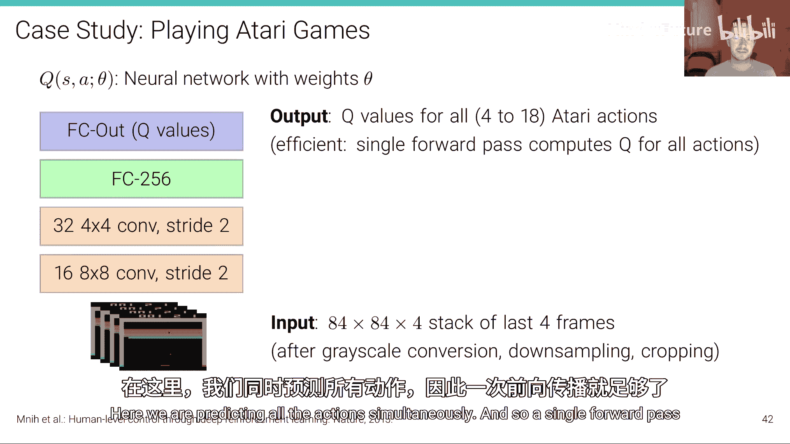
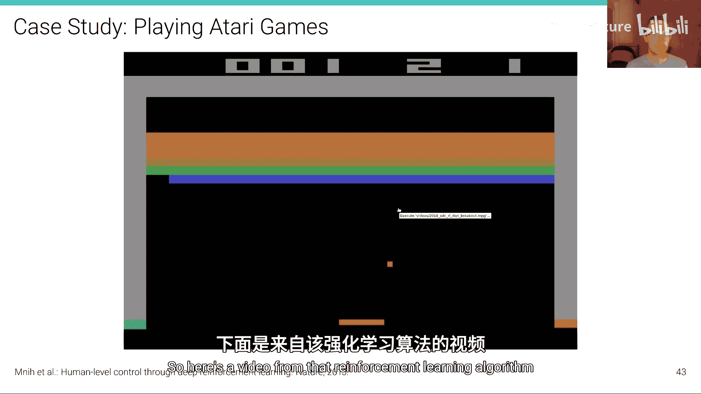
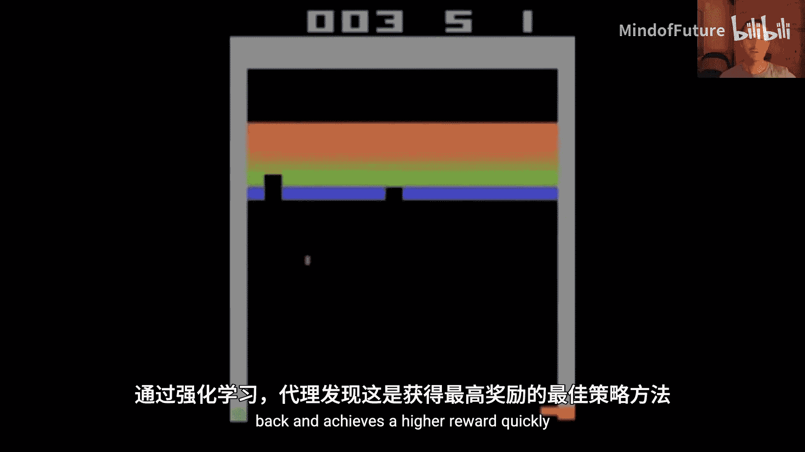
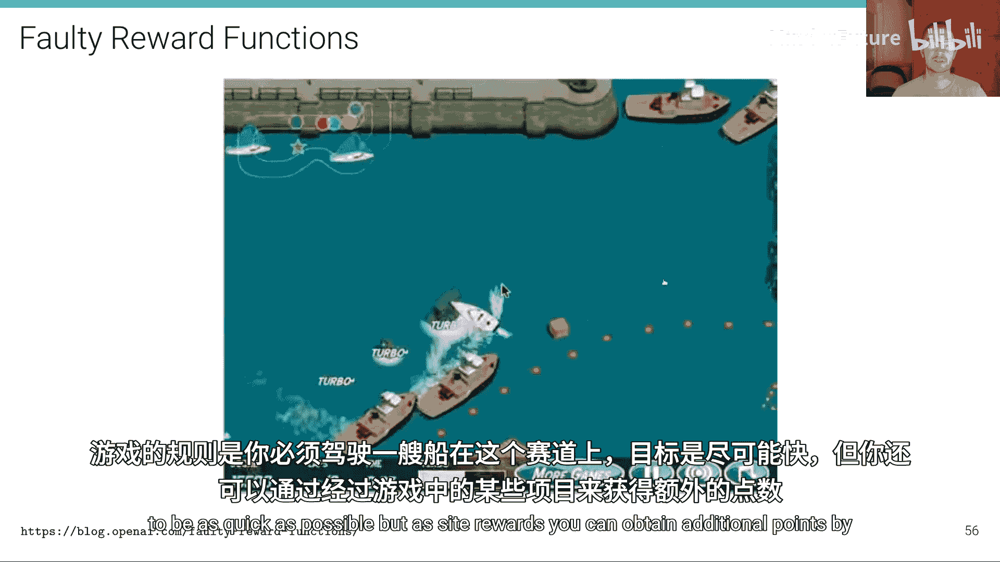
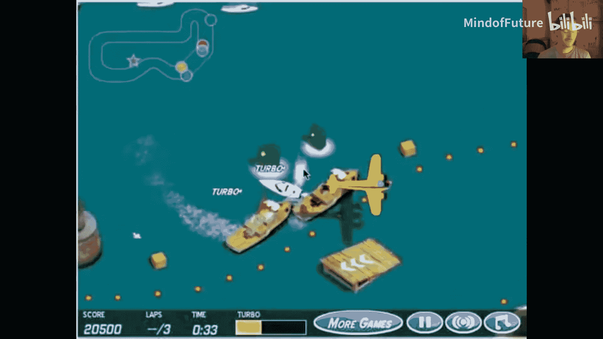
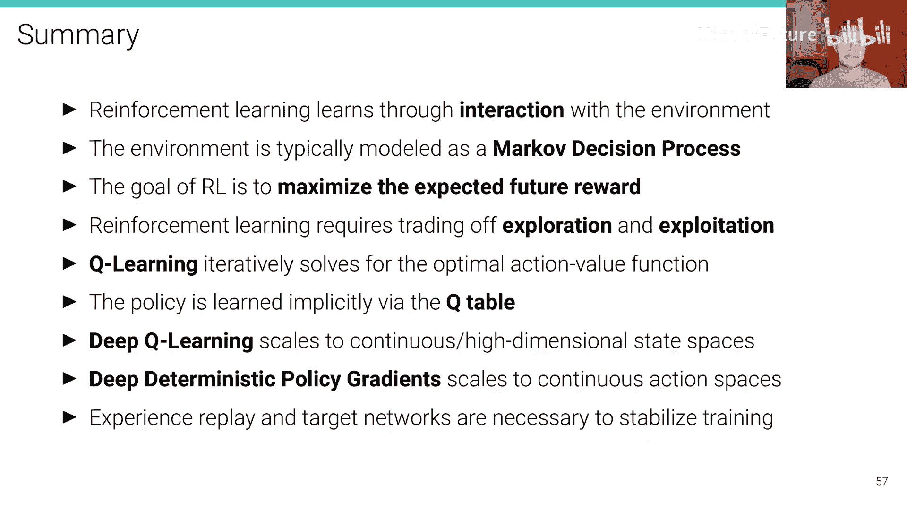

# 【图宾根大学】自动驾驶汽车课程 ML4340 p15 P15 Lecture 4.3 (Reinforcement Learning - Deep Q-Learning) -BV16FP2ePEYc_p15-

We've seen Q learning in the last unit。And we saw that Q learning is a reinforcement learning algorithm that handles simple state spaces。

State spaces that are discrete and low dimensional。But it can't handle high dimensional state spaces。

 such as the game of go， for example， where there is just too many possible states to enumerate too many elements to be put in a table。

 And this is where deep Q learning comes into play。In deep Q learning。

We alleviate this problem by instead of using a Q table。

 were using a deep neural network with Fs Theta as a function approximator to estimate Q。

And this is illustrated here， mathematically。The Q function。

The optimal Q function Q star is approximated through a neural network with parameters Vita that takes us input。

 the state and the action， and outputs the Q value。There is two variants of this。

 The first variant is the one that's illustrated here where we have a neural network。

 This is this box here。That takes a state and an action power。

And that neural network has the parameters theta and outputs the Q value。However。

 this is often impractical， and we're going to see that in the following slides as。

If you remember during。In the Belman Opity equation， we have to maximize over the actions。

 which means that every time we have to do that， we have to search for all possible As。

 we need to solve a complicated optimization problem。

So it's more convenient to have the actions as the different outputs of that neural network。

 If we have a low dimensional discrete action space， that's easy to do。

We are just going to have this state as an input to that neural network now。

And the neural network has multiple outputs。 Let's say we have 10 different actions。

 so it has 10 outputs， 10 dimensional output vector。

Where we have the Q value of each of these actions。As the output of the neural network。

Training the Q network then comprises， of course， a forward pass and a backward pass。

In the forward pass。We are basically computing the loss function as the means square  error in Q values。

 you can see here the equations from the previous unit from the Q learning algorithm where we have the target on the left。

 which is the。Reward at the current time step plus the expected future reward。

 according to the Q function。And then we have the prediction on the right。And we wanna。

Compute minimize the discrepancy between these two。So want to minimize the square arrow。

 and this is the expectation again， over all this schasticity in this process。The backward pass。

Is then the gradient update with respect to the Q function parameters theta。

So we are computing the gradient of that loss， which is the gradient of that expectation。

Which we have defined find here， again， with the target and the prediction。

And we can optimize this objective end to end with stochastic gradient in descent。

But's just following that gradient here， stochically over many batches。Unfortunately。

This leads to a very instable optimization problem， and it doesn't converge in practice。

And we're going to see how we can solve this problem in particular there's two things that are needed to solve this problem。

And that have been described in this paper here by Minal human level control for deep reinforcement learning that appeared in Nature 2015。

The first thing is experience replay， and the second thing is that we don't update the Q networks as fast。

But we include a little delay in these updates okay。So let's talk about experience replay first。

To speed up training， we of course like to use mini batches right we are now in contrast to the table updates before。

 which are simple Now we are updating deep neural networks。 The Q functions are deep neural networks。

 so we have to do a lot of parameter updates。 We have to update with a lot of gradientding updates。

And we can do this in parallel， as we know。As for all neural networks using mini batchching。

So we compute the gradient imper for several batch elements。Now。

 the problem is that learning from consecutive samples。

 because the agent moves consecutively along this。Markov process over time。Is very inefficient。

And the reason for this is the strong correlations between the consecutive samples。Now。

 experience replay counters this by storing the agent's experience experiences at each time step。

And it continually updates a so called replay buffer or replay memory D with these new experiences。

And then during training， we sample from that replay memory。Uniformly。

Which means that now we break the correlation between the samples and improve data efficiency as each sample can be used multiple times。

 we are replaying， that's why it's called a replay buffer。

 we are replaying old experiences and that these older experiences are less correlated。

With what we are currently， what the agent is currently experiencing。

And through this decocorlation process。We're getting a better learning behavior in our algorithm。

In practice， what's typically used is a circular replay buffer of a finite memory size。

So let's assume we have like 100 elements in that buffer。

And then we're adding new elements to that buffer with every iteration。

 and we removing the old elements from that buffer。Over removing random elements from their buffer。

 So there's different variants of this。The second thing that we are changing is that we are now fixing the Q targets in order to make the updates even slower。

So the problem here is the non stationary targets as the policy changes。

With every update to the policy through our gradient decent update step。So do our targets。Right。

Remember。That we want to minimize the difference between these targets and the predictions。

 And we are updating these Q functions。 So also the targets get updated because they are。

Relying on the Q function。This expression depends on the Q function， as well。

And so we're kind of always trying to hunt the target， a moving target， which is difficult。

And this might very easily lead to oscillation or even divergence。

The solution here is to use fixed Qe targets to stabilize training。

And what we're going to do is we're going to use a so called target network queue。

 it's actually the same network。The same Q network。 But with a different set of weights。

 we call these weights theta minus。So we are using that same network with a different weight set to generate the targets。

 And that's illustrated here。 So we have this loss function， which is the expectation over the。

Elements from that replay buffer sampled from that replay buffer。And then inside this square here。

 we have the target on the left and the prediction on the right。

But what you can see has changed here is that in a target， we have a theta minus now。

Which means that we're using a different set of weights。

And the key now is that this target network Q is only updated once in a while。

 only every C steps we are updating the target network。

 and we do this by simply cloning the Q network。So this。

Network here is an old version of this network。And through this process。

 we effectively reduce oscillations of the policy by adding this delay。If you will。

So these are the two。Central components for making。Deep Q learning work， experience。

 replay and fix Q targets。Now let's put it together。

 This is the algorithm for deep Q learning using experience replay with fixed Q targets。

We start by taking an action AT according to the Epsilon greedy policy。

And then we started the transition of the experience in the replay buffer， in the replay memory D。

We then sample a random mini batch of transitions from that replay memory de。

And compute the Q targets using the old parameters。From the previous time steps。

And then we optimize the mean squared arrow between the Q targets。With the old parameters。

And the Q network predictions with the current parameters here on the right。

Using stochastic gradientding descent。Simple as that。So it's a very simple algorithm。And now。

 let's have a look at what this algorithm is capable of doing。

 And this is something that has been demonstrated in this paper here。

 Human level control for deep reinforcement learning。

 that was one of the first papers to demonstrate that deep reinforcement learning can actually be used to address interesting。

Gameplay by learning。Deep policies， these networks are actually not super deep， as we'll see。

But deeper definitely than just a Q table。So here the goal is to play this breakout game。

While we given the score that we want to maximize。And the agent just placed that game in that Atari environment。

 and the objective is to complete that game with the highest score possible。

The neural network for this is very simple。 The input is a 84 by 84 pixel image。 In fact。

 four frames that are stacked together。After grayscale conversion， down sampling and cropping。

These images then undergo。2 convolution layers and two fully connected layers。Out of which。

 the output is。Q values for each of the。4 to 18 actions， depending on the game。

 there is different set of actions。And this is， of course。

 very efficient that as we have a single forward pass now to compute all the actions。

 That's what I was mentioning before。 This is the right figure。

 which is much easier to do than the left one where the action is an input in the network。

And we have to optimize for that action in each step here。

 we are predicting all the action simultaneously。

And so a single forward pass is sufficient。So here's a video from that。

Reinforcement learning algorithm。You can see how this algorithm learns to play。In the beginning。

 it doesn't play very well。But then over time， it becomes better and better at playing this game。

The goal in this game is to。Remove all these colored tiles at the top。

And the agent becomes better and better in catching the ball， bringing the ball back up。

And now something interesting happens。The agent discovers an interesting strategy。

A very useful strategy。Which is this one here。 So through reinforcement learning has discovered that this is actually the best strategy。

To obtain。The highest reward possible by putting the ball through this little hole in the back。

Such that the ball bounces on that。A set of bricks from the back。And。

Achieves the high of reward quickly。

This is something I found pretty intriguing when I saw this for the first time。

 found this pretty cool。Now， deep Q learning。As you might have。

Already thought about suffers from several shortcomings。

And now we're going address some of these shortcomings in the following。Approaches。

The first is that it suffers from long training times。 well， that's。Diffic to improve in deep R。

 because the problem is， we have very sparse rewards。

 yet our deep neural networks require a lot of gradientding updates。

It also uses uniform sampling from the replay buffer。

 which means all transitions are equally important， yet they might not be。

So it would be better to maybe adopt a different sampling strategy。 I'm going to see one。

It uses a very simplistic exploration strategy。It relies on fully observable states。

And the action space is limited to a discrete set of actions。

So theres various improvements over the original algorithm that have been explored in the literature。

And。I'm going to show you some of them。The first we're going to talk about is deep deterministic policy gradientance。

 or DDPG。It's also a very popular algorithm。DDPG addresses the problem of continuous or high dimensional action spaces。

Remember。Just let me go back。We had these two figures here。Where we said。

 we're using that right model here because the left one is difficult， and indeed。

 it is difficult because we need to optimize for the action a。At every iteration。

 when we want to maximize the Q function， while here。

 we directly have access to this and can directly find the maximum from the output of the neural network。

However， if we use that model， we are restricted by the number of possible output neurons that neural network can have so we can model only discrete and low dimensional action spaces。

So how can we。Like overcome this problem。 and go to。

Continuous or high dimensional action spaces without having this problem of。

optimization at every iteration。This is the question here。

So the problem is finding a continuous action requires optimization at every time step。

 as I've just illustrated。And the solution to this is to use two networks， instead of just one。

The first is the actor or the deterministic policy。 Now， we're assuming a deterministic policy。

 it's not the Q function anymore， but we have an explicit policy。Which we call mu here。

 that maps from a state。To an action。And that policy is also a neural network that has parameters。

 Fita mu。And then we have a critique， which models the Q function， which gets us input the state。

And the deterministic action。It is indeed a network that gets us input to state and the action。

 but now the action is a deterinistic action provided by another network that's trained jointly with the Q network with the critique。

The goal is to obtain the actor， of course， but we're using this critique as an auxiliary model in order to obtain the actor network。

The critique takes us input to state and the action from the actor and outputs a Q function for that state action combination。

This is the standard Q network that we have seen before。So we have the actor and the critique。Now。

 how do we train this， the actor network with the rates。

Fam muu estimates the ancient's deterministic policy， muu。And what we want to do is， of course。

 update the Doistic policy mu in the direction that most improves Q。

What does that mean we want to maximize the expected return， the expected reward。

So what we're going to do is we're going to apply the chain rule on the expected reward。

 and this can be shown the policy gradient。This is the gradient of the policy。

So here is the gradient with respect to the parameters of the policy mu。And we have the expectation。

Over。um。Elements from。Do you replay buffer deep。And this is one of these experiences with the state at time T and the action at time T and the reward at time T and the next state that is transition to T plus1 from that replay buffer。

Now， if we have sampled one element from that replay buffer， we can evaluate the Q function。

Where the input to the Q function is the state at time T and the action taken by the policy at state S。

And we can now。Well， we can compute the gradient of this expression。

And we see that we need the chain rule for this。Because the parameters that we are interested in。

 Vita mu appear inside that mu function that appears inside that Q function。

So we're using the chain rule， and this yields the expectation of the Q function with respect to A times the gradient of the mu function with respect to its parameters。

And this is then the gradient that we want to follow。

In order to maximize the expected return into in order to given a Q function to tune the parameters of。

The policy muu。To yield the maximumimal expected return。

The critique we can estimate using the beman optimality principle that we have already seen。

 similar to Q learning。 Again， we are sampling a an experience from the replay buffer。

 But now we want to。Find the gradient with respect to the parameters of the Q network。

And in this case， we're gonna look at the。Temporal difference de means square error between the prediction here on the right and the target on the left。

Where， again， we' are going use。Ws。Versions of the parameters for both， in this case， the。

Policy network mu， and the。Critique network Q for both the action。

 the actor and the critique network。Indicated here by mu minus and Q minus。

 or theta mu minus and theta Q minus。But this， except for this。

 this is the same expression as before， just that we don't maximize over the actions because we have a deterministic prediction of the action through our policy before in the equations before if we go back。

 let me go back to show you the difference。We had the maximization over a prime。

 so we want to maximize that Q function over a prime。

 but now we have the action network that gives us directly the optimal action。

 So we are plugging that red term in here。And。We don't need the maximization over over a because this is directly given by this detertainistic mapping that's why it's called detertaministic policy gradients。

So we don't need to solve this search problem， this maximization over this potentially continuous and high dimensional space a。

Yeah， so this is also to remark here， no maximization over the action required as the step is now learned via mu directly。

Again， for DDP G， we use experience replay and target networks to stabilize training。

The replay memory D stores the experiences。And the target networks are updated using soft target updates in this case。

 where the weights are not directly copied， but slowly adapted。

Which was found to lead to good learning behavior。You can see the update equations here。

 the Q minus is updated。By adding a little bit of the or the feac Q minus is updated by adding a little bit。

 Tau is typically very small close to0， adding a little bit。Of。The new parameters， Theta Q。

For the critique。Plus， a lot of the old parameters fit at Q minus so that this update is very slow and the same for the。

Actor for the policy network。And so this feedta parameter controls a trade off between speed and stability of learning。

 typically need to have it very small in order to be slow in training but to be stable。

Exploration in this model is performed by adding simply noise to the policy mule。 Now。

 we have this detertistic policy so we can simply add some noise。 This case， it's correlated noise。

 according to some correlation model。To that poum。To encourage。Efficient exploration。

Another strategy that's often used in this context is prioritized experience replay。

 And this addresses the problem of。The replay buffer。Sampling all states with equal probability。

 despite some states might be more important than others。

The idea here is to prioritize the experience， to replay important transitions more frequently。

We want to replay what's important for learning more frequently。And this priority， the importance。

 is measured by the magnitude of the temporal difference  error。

So we're going to look again at the target minus the prediction。

 We're going to look at the magnitude of this， and we're replaying。

Instances that have a higher TD error more frequently than instances that have a low TD error。

In the hope of。Minimizing those errors。By replaying them more frequently。

The TDarrow measures how surprising or unexpected a particular experience or transition is。

And this stochastic prioritization scheme avoids overfitting due to the lack of diversity。

And also empirically enabled a speed up factor of， for example。

 two on the Atari benchmarks that we've seen before。Now， I want to show you also one demo。

 a pretty cool demo from the startup wave that used。DDPG。

 the deep deterministic policy gradients with prioritized experience replay。

 So all of what we've just learned。For driving a real vehicle。It's done in a very simple setting。

On a rural road without any traffic or lanemarkings。

 but it's still quite impressive that they have demonstrated with just a few experiences to learn an A R L agent from scratch。

The input is a single monocular image。Coming from this Reno twisty car here。

And the action is the steering， and the speed。And the reward is the distance travelled without the safety driver taking control。

 There's a safety driver in the vehicle that takes control if something goes wrong。But。

In order not for this our algorithm to be trained in the real world without requiring any maps or localization。

Exactly that signal of the safety driver is taken as the reward One drive as far as possible without the safety driver taking control。

 Consider this to be。A success。The neural network is quite simple。

 it's four convolutional layers and two fully connected layers。

 but still it's a deep neural network and it's trained using only 35 training episodes。

So here's a video of how this works in practice。This is the first exploration episode。

 You can see the vehicle is not driving very well。The driver has to take over。

And the reward is not very high。This is the second episode the vehicle already drives a little bit better。

 but the driver still has to take over control pretty frequently。Pretty quickly。

Now it's sped up a little bit。There is four episodes of training。And one evaluation ever thought。

 And the test reward is。10 M。And so， as this continues。The vehicle becomes better and better。

You can see that already after six episodes， the model has learned to。Correct， and keep the vehicle。

On the road。So let's jump a little bit ahead。So you can see now， the driving behavior after。

A few dozens of episodes。 And you can see that it is able to quite。Consistently。

Keep the vehicle in the centre of the lane， independent of the ever situation。And the type of fruit。

Of course， is a very simple scenario， but it still。Quite impressive。

 And it was indeed one of the first demonstrations here， as claimed here of R L。

In the real world of self drivingriving。Now， before we conclude。

 I want to briefly show you some other flavors of deep Ar。 This is a huge field。

 and there are so many approaches in the literature。 So let me just show you a few of them。

A few ideas。The first one is Asynchronousee reinforcement Learn from ICmL 2016。

 The idea here is to execute multiple agents in separate environment。

In separate environment instances。Each agent interacts with its own environment copy and collects experiences。

The agents may use different exploration strategies to maximize experience diversity。

And the experience is not store， but directly used to update a shared global model。

This has been demonstrated to stabilize training in a similar way to experience replay。

By decorrelating samples。So it's another strategy that can be combined with experience replay。

It also leads to a reduction in training time， roughly linear in the number of p agents。Of course。

 you need to have the possibility of simulating agents in parallel。I never。

Technique is called Botpped， Di Quan。Boottbbing is used for efficient exploration。

The idea is to approximate a distribution over Q values via K bootstrapped hats。

 So you can see that there is this。Network with a shared backbone and then Q heads of this neural network。

 each predicting one Q value。We have K of these hats。And at the start of each epoch。

 a single head is selected uniformly at random for that particular episode。After training。

 all heads can be combined in a single ensemble policy。

 and that acts more robustly than just learning a single policy。A single。AQ function。

The next one is doublele Q learning。The idea in doublele Q learning is to decouple the Q function for selecting an evaluation of actions to avoid Q overestimation and also to stabilize training。

So as you can see， a lot of these techniques， a lot of these ideas that have been tried all tackled the。

The difficult problem of training are L。Systems。You can see here how the target。

 this is the target equation from before， has been replaced now。

Instead of maximizing over the the action， the Q function with respect to the action。

We are now evaluating the Q function with parameters， theta minus。

But were taking the action that maximizes the Q function for the parameterss theta。

These are two different sets of parameters。 We have an online network with We' Vita。

 which is used to determine the greedy policy。Here， In this expression。

And we have a target network with weights theta minus。

 which is used to determine the corresponding action volume。

And it has also been demonstrated empirically that this improves performance on Atari benchmarks。

 And there's some more analysis in this Tria I paper。

Another idea is to add recurency to a deep Q network to handle partial observability of states。

As we've seen。The input。Its only a set of images， and we might not observe the state fully unless we can track back to the very first frame。

Because this image isn't revealing the entire state potentially。

 And so the idea here is to include a recurrent network， a LSTM， for example。

 to replace the fully connected layer with such a recurrent layer that can potentially memorize。

Observations memorize date observations from very early on。It's a very simple idea。

So this is all what I wanted to show you， there is much more work as I already mentioned。

 but one thing I wanted to also show you and there is this nice blog post on this phenomenon is that it's really important how to choose the rewardword function。

As we mentioned in the beginning， we have a very general framework with our L now。

And we don't need expert demonstrations。 We just need to define the rewards。

 but we need to define the rewards and。It's often not easy to define rewards because we cannot make them up out of thin air。

 We need to define them in a sensible manner。 And， of course， for self driving。

 there are some things that are natural， like comfort and efficiency and safety。

But it's not always clear what the rewards should actually be and if we forgot。

 maybe an important reward and how to weigh the different rewards in particular。

And this is also illustrated by this game that has been tried by the Open AI team with their reinforcement learning algorithm。

 and they discovered a very interesting behavior。The game is such that you have to steer a boat over this course here。

 and the goal is to be as quick as possible。 but as sight rewards。

 you can obtain additional points by running over certain items in that game。

However， the reward function was discovered to be faulty。

 and this was discovered by the RL algorithm。 The RL algorithm found a strategy to win the game or to obtain the maximal achievable of reward by not being the fastest in the game。

 but by consistently gaining rewards that appear during the during the game。

 These are these green boxes that you can see here。By continuously accumulating those rewards。

 the oval reward could be higher than actually completing the lap。

So it's important to choose the reward function well。

Let me summarize we've seen that reinforcement learning learns through interaction with the environment。

We've seen that the environment is typically modeled as a markov decision process。

 and the goal of our L is to maximize the expected future reward。

Reinforcement learning requires trading off exploration and exploitation。

Q learning iterative resource for the optimal action value function and is one of the most basic and fundamental reinforcement learning algorithms。

 but limited in its capabilities。The policy is learned implicitly via a Q table。Now。

 deep Q learning addresses one of these limitations。

 which is scaling to continuous or high dimensional state spaces。

And deep deterministic policy gradient scales to continuous action spaces。

We've also seen that experience replay and target networks are really important to stabilize training。

Thanks。