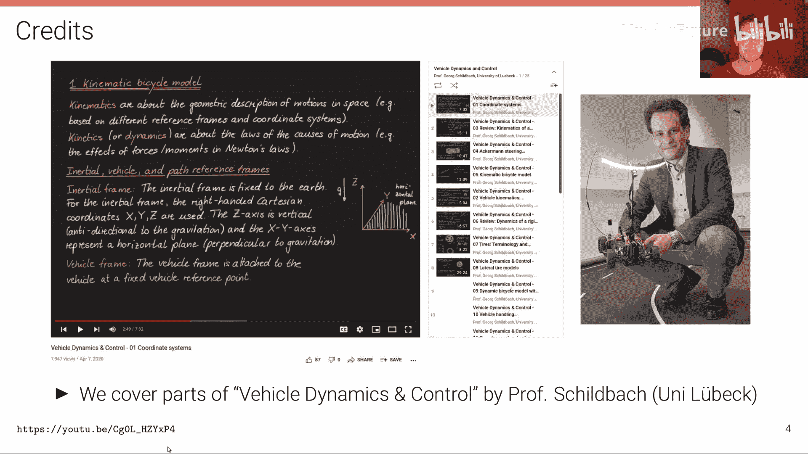
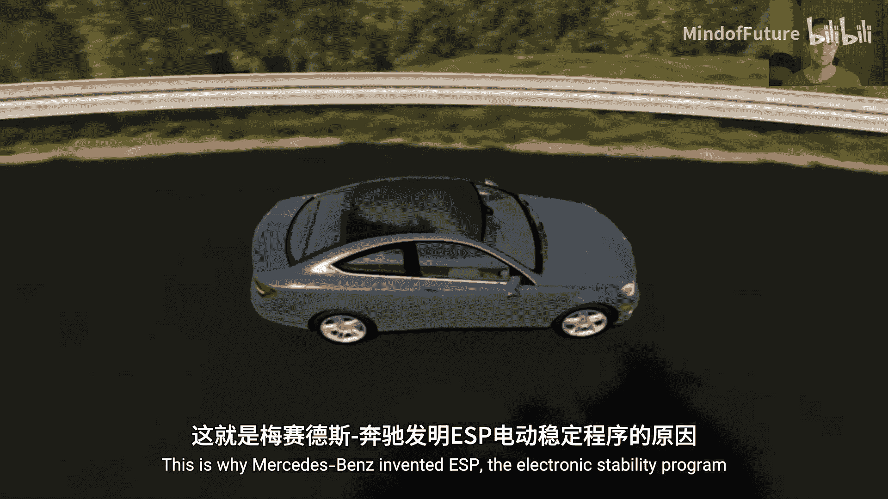
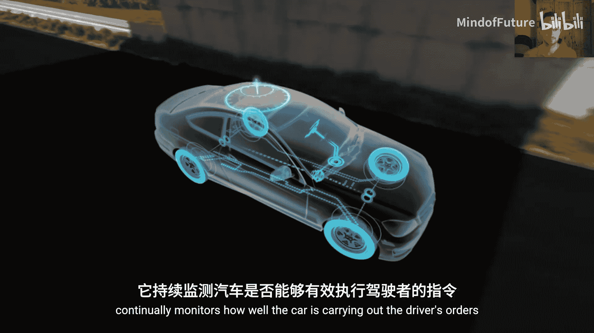
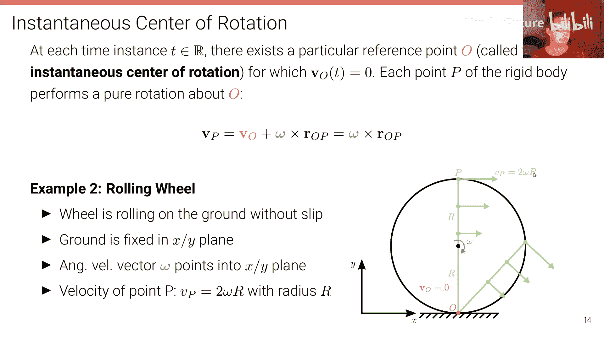

# 【图宾根大学】自动驾驶汽车课程 ML4340 p16 P16 Lecture 5.1 (Vehicle Dynamics - Introduction) -BV16FP2ePEYc_p16-

Hello and welcome back to self driving cars lecture number 5 on vehicle D。

We've seen that it is indeed possible to control a vehicle by mapping directly from images to the vehicle control。

But in practice， it's often better to actually have a separate controller that controls the vehicle。

 and we can design such a controller particularly well if we understand our system well。

So we need to understand the vehicle kinematics and the vehicle dynamics。

 and that is what this lecture is about。It's a lot about。Geometry。

 but also about physics and mechanical engineering。This lecture is divided into four units。First。

 we're gonna introduce and motivate the。Problem of why we want to better understand vehicle dynamics。

And introduce some basic。Geometric and physical concepts。In the second unit。

 we're going to have a look at the most basic vehicle model。

 which is called the kinematic bicycle model。That doesn't model forces， but pure kinematics。

 it's a pure geometric model。It's the simpler model， the most simple model， basically。

But then we're also going to look at。Tirers。And how tires actually change this behavior。

 that it is not sufficient。In particular， at higher speeds to just consider。The kinematic model。

 but we have to actually model also dynamics。 We have to model forces and friction， and slip。

And this is what brings us then to。The dynamic bicycle model which we willll cover in the fourth unit。

So let's get started with the introduction。And before we start。

 I want to give a big shout out to the lecture from Professor Schilpar at University at Lubeck。

Called vehicle dynamic and control， which we cover in parts and which is an excellent lecture。

 So if you want to understand more about the concepts in this lecture。

I recommend to you that you have a look at this lecture which is linked here at the bottom in the foot line。

As already mentioned。In order to control a vehicle， we need knowledge of the vehicle dynamics。 And。

 in fact， today's cars。Do have a lot of sophisticated controller in there。 For example。

 there is EP that controls the four wheels of the car independently。

 and these systems are built based on our understanding of the vehicle dynamics。

 So here's a little video that illustrates this。

As you drive， many forces act upon your vehicle。 You probably feel some of them in every day driving。

 like when you lean toward the side in a corner。When you turn the steering wheel。

 your car doesn't just move to one side， it actually rotates about a vertical axis。

Under some conditions， the car might rotate too much or not enough。

 Like when you swerve to avoid an obstacle， take a curve too fast or encounter a slippery road。

 This is why Mercedes Benz invented EP。 the electronic stability program。 EP's network of sensors。

 one of the most advanced in the industry continually monitors how well the car is carrying out the driver's orders。

 EP compares your steering inputs to the speed of each wheel and the car's rotation。

 within milliseconds。 E SP can sense if the car is not following your intended course。

 When you quickly steer to avoid an obstacle。 The car wants to continue straight ahead。

 EP breaks the inside rear wheel。 This creates a rotational force that helps the car steer where you tell it to as you recover the rear of the car can spin out。

 EP breaks the outside front wheel to help rotate the car back on course。 If necessary， EP can also。

the engine's power to help restore control more quickly When the laws of physics meet human nature。

 ESP helps keep you on course and in control。

So I have to say at this point that。Neither my lecture nor my research is sponsored by Dimler。

 but I just found this to be a very。Illusstrative video of ESP。 And in fact， today。

 ESP is in any vehicle that you buy， and it's fundamental for vehicle stability for safe driving today。

So this is a good motivator for why we want to better understand vehicle dynamics because we want to get control over the vehicle。

Control is actually a topic of the or the main topic of the next lecture。

 but this lecture here focuses first on understanding more precisely how the vehicle behaves。

And now let's go to some very basic and fundamental concepts。

 which we build up sequentially in order to understand vehicle kinematics and vehicle dynamics。

The first terms that we are going to define is kinematics and kinetics。

Kineinematics comes from the Greek origin motion or moving。

And describes the motion of points and bodies。It considers in particular deposition， the velocity。

 the acceleration， and Ohio higher order derivatives。And examples of。

Kinematic motion include the motion of celestial bodies， particle systems， a robotic arm。

 for example， or a human skeleton。And here on the right， you can see an illustration how。

 for example， position， velocity and acceleration are related， as we all know。

 they are related by being the respective time derivative of each other。

The velocity is the time derivative of the position。

 The acceleration is the time derivative of the velocity。So if we add a little。

 if we go a little step in the direction of the velocity， velocity times time。

 we go to the next location on the trajectory。Kinetics， on the other hand， describes the causes。

The underlying causes of motion。For example， the effects of forces and movement。

And it captures things like Newton's law， for example， F equals M times a。

 the force equals the mass of an object times its acceleration。Very fundamental physical laws here。

 And both of these are gonna play a fundamental role in this lecture。 We're first gonna。

Derive the kinematic bicycle model that doesn't consider forces。

And then we're going to derive a more realistic model that does consider forces and that considers kinetics。

 and that's called the dynamic bicyclee model。Another concept that we have to introduce is constraints on our configuration space。

 and constraints on our configuration space are called hoomic constraints。

Hlanomic constraints are constraints on the configuration。So consider， for example。

 a particle that moves freely in three dimensions， X， Y，C， three dimensional space。

The coordinate system of this three dimensional space is shown here。We can now of course。

 constrain that particle。Such that it only moves in the X。

 Y plane by setting the C coordinate of that particle to 0。As shown here。If we do so。This partagon。

Can only move in the X， Y plane， only in the plane that's spanned by the X and Y vector。

Because we can only modify the x and y location， while we have clped the C location to 0。

And we can express this condition。As a function of。The configuration of the particle。

Being equal to 0， where in this very simple case， that function。Corresponds F of X， Y。

 C should actually be corresponds to C。Of course， there could be more complicated systems for homomic constraints。

 but here we keep it simple。 a more complicated system would be， for example， a robotic arm。

Where we are constraining the robotic arm by constraining both the hand of the robotic arm。

 the end effect to be fixed。And the。Attachment of the robotic arm to be also fixed。

 such that the robotic arm can move， but the hand and the attachments stay fixed。

So this is another example。So constraints of that particular form that we've just introduced of the form F of x。

 Yc equals 0 are called hoomic constraints。They constrain the configuration space。In this case here。

 we have constrained it to be on the X Y plane。However， the system can move freely in that space。

There's no constraints。The system can move freely in that space， in that constrained space。

Which means that the controllable degrees of freedom。Equals the total degrees of freedom。

 In this case， too， we can control that particle。 We can move it。

 We can apply forces to it in the x and Y direction。

And we can move it to any location in the X Y plane。On the other hand。

 so called non hoomic constraints are constraints on the velocity。Assume， for example， a vehicle。

 as we consider in this lecture。That is parameterized for a very simple model。 In this case。

 this vehicle is parameterized。 It's a 2D vehicle is kind of a bird's eye view on the vehicle。

 It's parameterized by the X Y location of that vehicle in that two dimensional coordinate system。

Where we set the origin of the vehicle to be the center of the rear axis in this case。

And in addition。By the。Orientation of that vehicle，si。

op Psi is the angle between the forward direction of that vehicle and the x axis of that coordinate system。

So we have a three dimensional configuration space here， xy and the orientation of the vehicle。

 where xy is element of r2 and the orientation of the vehicle is of course， element of0 to 2 pi。Now。

Given such a model。The 2D vehicle velocity can be described by。The velocity in x direction。

 or in other words， the first time derivative， the dot here indicates the time derivative。

In x direction equals the velocity， This is the length of this vector basically here。

 So the velocity of the vehicle in this direction times the cosine of P psi。

This is if we follow that vehicle in this direction， how much we change x if we follow the vehicle。

Similarly。We can also consider the。AY component of the velocity vector。

 which is simply the velocity times design of Psi。So this vector here is simply this vector here。

Basic trigonometry。Now， if we solve the second equation for v and plug it into the first expression。

Such that we only obtain one expression in the end， we obtain this expression here。

The time derivative of x times ssine of Psi minus the time derivative of y times cosine of Psi equals 0。

And that's a constraint on the velocity because it contains the time derivative of x and the time derivative of y。

 which is the velocity。The important thing to note here is that this constraint is a non hoomic constraint because it cannot be expressed。

In the form F of x， Y m psi， or in other words， F of the configuration space equal to 0。

As in the previous examples with the hoomic constraints。

 that's the difference between the non hoomic and the hoomic constraints。 The hoomic constraints。

 are constraints on the configuration space and non hoomic constraints。

 are constraints on the velocity。What does that mean that means that this vehicle actually cannot freely move into any direction as it would be the case for the particle。

That we learned about in the previous slide， which is a hoomic constraint。

 But here for this non hoomic constraint， we constrain the direction where this vehicle can go。

 For example， it cannot slide sidewards。 We can only move forward and rotate the vehicle。

 but we cannot slide immediately sides。 We cannot dos， sideways parking here。

So we constrain the velocity space， but not the configuration space。And in this case。

 also the controllable degrees of freedom is less than the total degrees of freedom。

 so we have two degrees of freedom that we can control， which is the velocity。

 the one dimensional velocity， not the velocity vector， but the velocity。And the heading。

So we can control these two in order to drive the vehicle。

But we cant directly control the configuration。Yet。

 despite not being able to control the configuration directly。

 we can reach any possible point in configuration space eventually。

And this is illustrated here on the right。 So this is what we mean hereby。

 we constrain the velocity space， but not the configuration space。

So through a particular parking maneuver， we can from this location， arrive at this location here。

By moving forward and backward and forward and backward， etc。

But we can't go from here directly to here because is constrained。

 this motion is forbidden through this non hoomic constraint on the velocities。In summary。

Summarizing hoomic versus non hoomic systems。A hoomic system constrains the configuration space。

Which means that we can freely move in any direction within that constrained space。

 and the controllable degrees of freedom is equal to the total degrees of freedom。

And this constraint can be described by a function on the configuration equal to 0。

An example for this is a 3D particle that's constrained to the X Y plane。In contrast。

 a non hoomic system constrains the velocity space。It cannot freely move in any direction。

And the controllable degrees of freedom are less than the total degrees of freedom。For example。

 in the car， we can only control two degrees of freedom。But the。

A totaltal degrees of freedom of freedom。And therefore。

 these constraints cannot be described in such a form。

An example for this is the car with this velocity constraint。

It's important to note that a robot can be subject to both hoomic and non hoomic constraints。

 and the car is a good example for this because a car is a rigid body in 3D。

And will come to what rigid body means。It's a body that moves as a whole in 3D。

So effectively it has six degrees of freedom， which is the 3D location in 3D space and the orientation。

Along each of the free canonical orientation axis。 So we have 6 degrees of freedom in 3 d space of such a rigid body。

 But because cars typically drive on the ground on a ground plain。

 it's sufficient to consider them as we have considered them before here in this case here。

From a birdsey view。And so we can use free hoomic constraints to keep the car on the ground。

 What does this mean while we constrain， as in the particle case。

 we constrain the C coordinate to be 0。And in addition。

 we also constrain the roll angle and the pitch angle of the vehicle to be0 while we don't constrain the ya angle or the heading angle of the vehicle。

So we have， we are left with the heading angle and the X， Y location， as in。This example here。

So we have constrained that through free hoomic constraints。

 but then we can add one additional non hoomic constraint to prevent sideway sliding and to make sure the vehicle actually the model that we build of this vehicle moves like a real vehicle would do and is constrained as a real vehicle would be constrained。

So I have two examples to illustrate this fer。 This is a robot that looks like a vehicle。

 but it's actually more sophisticated than that because it can conduct any motion through its special arrangement of wheels and because it can。

嗯。Power each of these wheels independently。So that's pretty cool hu， So this is a。Hlanomic system。

But then here on the right， we see a non hoomic system that is constrained by these。

Additional non hoomic constraint， I guess you have all experienced situations like that。So， I。

I think you're getting that point。It goes on for a little longer， but。

I'm going to save you from that。Okay， so having understood what type of systems exist。

 let's talk about coordinate systems now because we need these coordinate systems to define the vehicle motion later on。

In terms of coordinate systems， we consider three different coordinate systems。

The first is the so called inertial frame。 This is the world coordinate system that's illustrated here。

This inertial frame is fixed to the earth。With the vertical C axis， with a vertical C axis。And X。

 Y being the horizontal plane， which means the C axis points into the opposite direction of the gravity vector G。

And y and X are autogonal to the C axis because it's a proper frame， according。Auttographic right。

Ogonal coordinate system。And so we have a right handed coordinate system in this particular case here。

The vehicle frame shown here in orange is attached to the vehicle。

And it's fixed at a reference point on that vehicle， let's say， the rear axle in the center。

 but it could be another point as well。Where X V points towards the front， Y。

 V points towards the side， and C V points to the top of the vehicle。

 according to the definition of the Io 8，8，5，5。And then we have the horizontal frame illustrated here in black。

Which has the origin。At the same point at the vehicle reference point as the vehicle frame。

So they fall together these two origins。But the x and the y axis。A projections of the。

X v and the y v axis。 So the x is x is a projection of the x v axis。

 and the y axis is a projection of the y V axis。Onto the horizontal plane， On the horizontal plane。

 which is spanned by the x and y vector of the inertial frame。

So what we effectively do is we remove the。Any， any possible rotation outside of that X Y plane and make that coordinate system to lie in the X Y plane。

Let's move on to kinematics。And let's first consider kinematics of a point。

 We already mentioned kinematics is about de position and velocities and acceleration and also a little bit more。

So let's look at the kinematics of a single 3D point。

3 dimensional space where we have the inertial frame here specified by X， Y， C。

And the location of that 3 d point P。Is specified by the vector RP P。

And we can specify a trajectory of that 3D point by specifying that vector R P。

At any time instance T。And that is a three dimensional vector X， Y， C of T H。

That are the three dimensional coordinates of that 3D point。Now， obviously。

 the velocity of that point。Is。The first time derivative of this vector。

And the acceleration is the second time derivative of this。Location vector R PM。嗯。

Let's now look at the kinematics of a rigid body， we've looked at the kinematics of a point。

 let's look at the kinematics of a rigid body。A rigid body。 What is a rigid body。

 A rigid body refers to collection of infinitely many infinitefinity merelyly small mass points。

 which are rigidly connected。That means their relative position remains unchanged over time。

The relative position of any two points on that rigidched body， for example， C and P。

Remains unchanged。 I can rotate， and I can translate that rigid body。But the relative distance。

 for example， between these points， remains unchanged。

The motion of a rich body can be compactly described by the motion of an arbitrary reference point。

Which we call C here。Of that body， plus， the relative motion of all other points P with respect to C。

 So there is another point on that rigid body here， illustrated by this curve。

Relative to that point C。 So we can specify that point C and the motion of that point and the motion of all other points relative to that point in order to describe the motion of the rigid body。

Again， C is the reference point fixed to the rigid body。 P is an arbitrary point on the rigid body。

The location of C is RC。And the location of that。Poin P on that rigidie body。

 with free spec to C is RCp。The angle of velocity of that rigid body is indicated here by a vector。

The angle of velocity vector describes how that rigid body rotates。

And it is described in a way such that the length of that vector， omega specifies。

The magnitude of the orientation， the angles， how much the how much this rigid body rotates。

And the direction of that vector omega is the axis of rotation。

So the rigidched body rotates around that axis omega。And the rotation is。For the。

 the magnitude of that or of that rotation。Is the length of that vector omega。Okay。

 so this because we have this relative relationship of this point P with respect to C。

 we can describe， of course， the location of p as Rrc this vector here plus Rrcp， this vector here。

 and this describes the location of that point P， which we denote as Rp。

 this would be this vector here which is not shown。Similarly， we can also describe the velocity。

 the velocity of any point on that rigid body is the velocity。Of the reference point C。Plus。

A rotational component。 So there's always a linear component and a rotational component when we describe the motion。

The velocity of a Richard body。And so the rotational component is simply the。

Angel of velocity vector omega。Cross product。Rotation at the relative vector from C to P。

Due to rigidity， the points on P can only rotate with respect to C， remember that。The points。

 the relative position of these points remains unchanged over time。

 which means the points can only rotate about C。Therefore， the rigid body has six degrees of freedom。

 free for the location and free for the orientation of that rigid body。At each time， instance T。

There exists one particular reference point，04。That's called to instantaneous center of rotation。

 for which the velocity here。Of that point，0 is 0。And each point P of the rigid body performs a pure rotation。

About that。Reference point O， which is called the instantaneous center of rotation。

Which means that the velocity of。Any point。Which is described by the translational part and the rotational component。

Only comprises the。Rotational component。So the first example that we consider here is a turning wheel。

In the first example， this wheel is completely lifted off the ground。

Which means it doesn't touch the ground。It can move freely。The re doesn't move。Into the x or y。

 which should be y in the x or y direction， but it， it is fixed。

And it rotates around that instantaneous center of rotation o。

The angular velocity vector omega in this case。Points into the X， Y plane here also the。

Rotation is defined based on a right handed coordinate system where the pump points into the direction of the vector and we rotate according to a right handed motion then。

So that's why in this case， this。An of velocity vector， omega points into the X Y plane。Now。

 the velocity of any point on that turning wheel。Here， not in 3D anymore。

 but simply in in 2D can be described as。The angle of velocity， now this is not a vector anymore。

 but this is just a scalar times the radius。So the more we go outside here， the larger the velocity。

 the faster the motion。 if we are very close to the center， to the instantaneous center rotation。

The velocity vector becomes close to0 if we are at the center of rotation。

 the velocity vector is 0 and it increases linearly。As you can see by this expression here。

 increases linear with the radius。 So this vector here is longer than this vector here and is longer than this velocity vector here because we have Vp equals。

嗯。Angular rotation。Times the radius。Let's consider a second example， which is a rolling wheel。

 in this case， the wheel is rolling on the ground without any slip。

The ground is illustrated here at the bottom。 So you can imagine that now this point in the center of the wheel moves towards the right because the wheel is rolling on the ground。

The ground is fixed in the X， Y planes， so the ground can' move。So， the wheel must move。

And the anglengular velocity vector， the omega points again into the X Y plane。In this case。

 the velocity of a point P here。Is twice。The value of omega。The angle of velocity。Times R。

 and the instantaneous center of rotation， the location where。

There is a pure rotation around that location and where there is no translational velocity。

Is that point。 But， of course， that's only true at that particular time instance T。

 if we move a little bit。If we go a little bit ahead into the future， then that point will also move。

 In particular， in this case， the point will move along the wheel and the ground as the wheel moves to the right。

Now because all of these points are rotating around not the center of the wheel anymore。

 but around this contact point of the wheel with the ground。These vectors here change。

 and the velocity is twice。Omega R。

