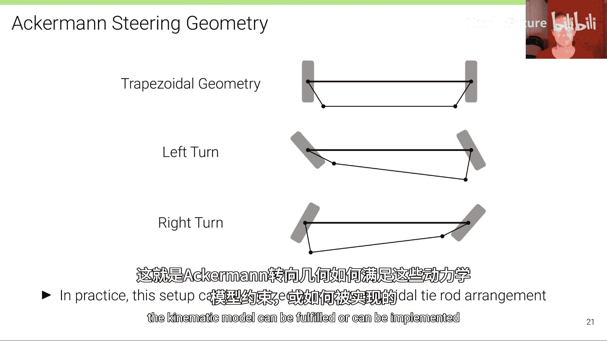

# 【图宾根大学】自动驾驶汽车课程 ML4340 p17 P17 Lecture 5.2 (Vehicle Dynamics - Kinematic Bicycle Model) -BV16FP2ePEYc_p17-

We're now ready to define the kinematic bicycle model， which is。

Maybey be the most prominent and most simple。Vehicle models。

And it makes amongst many simplifying assumptions， the assumption that there is no wheel slip。

So the wheels are always。Moving。Like they would not slip on the ground。 There is no sliding。

 wheels can move sideways， but the orientation of the wheels is always in the direction。

 in the velocity direction of of the wheels。So this is a model that。Can be only applied to。Let's say。

 slow。Parking motion。Or to situations where you know that there is no sliding effect。

 but at high speeds， these models are less reliable。

But they are very simple， and so let's look at them。

We've said that a vehicle is is considered as a rigidched body because all the points on the vehicle move。

Don't move relative to each other。And so we consider the motion of such a vehicle as a rigid body around a rotation center。

If we move that vehicle around that rotation center， if we rotate it around that rotation center。

 then we see that all the points that are。On that rigid body move likewise around the rotation centre。

 and they describe different circular trajectories of different ra。

What we also observe is that the velocity vectors。Of these points are tangential to the circular trajectories。

 which means that they are autogonal to the line that connects the rotation center and these points。

 And this is expressed here。The oagonality is expressed here， Fruit is little。Squas。Now。

 the first assumption that we do with the kinematic bicycle model and that's why it's called a bicycle model is that we approximate the four wheels of the vehicle with just two imaginary wheels。

And in many situations。InMany situations where we're interested in modeling the motion of a vehicle。

 This is actually sufficient。 It's not sufficient if we want to control each wheel independently。

 like in the case of EP， as we've seen earlier， but。In a more general modeling sense。

 it can be sufficient。 And that's why we are focusing here on this model。

 the kinematic bicyclee model that approximates four wheels with two imaginary wheels。

 as illustrated here。So this is the kinematic bicycle model in its most simple form， but of course。

We describe some of the quantities more precisely。The first thing to note it here is that we make some very strong assumptions now。

The first assumption that we make is that we only consider plane motion in the XY plane。

 so there's no roll or pitch of the vehicle models， there's only the heading angle。

Illustrated here by Psi。That reaches the direction of the vehicle。

 this red this black line connecting the rear and the front wheel of the bicycle。

With respect to the x axis of the coordinate system。 and that's the angle here that we call psi。

So the only model is planar 2D motion。The other assumption that we make is that we model only low speeds because we assume there is no wheel slip。

 which means that the orientation of these wheels is inter direction of the velocity。

Of the point at the center of the wheel。Indicated here by the velocity of the front wheel。

 V F and the velocity of the back wheel V are with the direction of these velocity vectors indicated by these two black vectors that face into the same direction as the wheels。

Now of course， in practice， we do have slip。Wheels don't move into the direction that they are facing。

They can deviate quite strongly if you think about drifting manoeuverres。

But we are not considering this for the kinematic bicycle model。 we're going to consider that later。

Okay。So let's look at the other quantities here， again we have the rotation center around which these three points here。

 the rear center of the rear wheel， the center of the front wheel a and the center of gravity of the vehicle are rotating。

And through this assumption of no wheel slip， we also know that the velocity of that。U。

The rear wheel and the front wheel is into the direction of the wheels。

 which means that the wheels are actually also autogonal。Two。

 the lines connecting the rotation center and the center of the wheels。

Similar to how the velocity of the front wheel and the velocity of the rear wheel are autogonal to these lines。

However， what we also observe is that the vehicle itself。Can indeed have a slip angle。

 a vehicle slip angle， and that is something that we note here by beta。

The vehicle heading is this angle here， it's psi， we already mentioned it。

 it's the angle of the orientation of that vehicle。

 the line connecting B and A with respect to the X axis。

But the velocity of the vehicle at the center of gravity。

 the velocity vector does not point in this case， into the direction。That the vehicle is facing。

But actually， this point moves into a different direction that's described by the vector autogonal to the vector。

Or to the line that's connecting the scent of gravity and the rotation center。

Through the considerations that we made before， the rotation of a rigid body around a rotation center。

Now of course， here we have。A very strong steering situation。

 which means that the turning radius is very small。

 And so the lip angle of the vehicle is rather large。

 But if you consider situations where a driving may be on a highway or a driving straight on a parking lot。

 Then， of course， the radius is much larger。And the slip angle becomes much smaller to the point where you might actually drive just straight。

Where the radius tends to infinity and a slip angle towards serum。

So this is the slip angle of the vehicle， this is important to note there is no wheel slip。

 but there is vehicle slip indeed。Because the vehicle velocity does not point into the direction of the vehicle。

What else do we have。Well， we have actually the orientation of the front and the backveal。

 and that's called the front steering angle and the back steering angle， Delta F and Delta R。

And those two steering angles are measured with respect to the orientation of the vehicle。

 as you see here。 So we have this vector Dlta R and this vector Dlta f。

Which measures the orientation of the front wheel velocity vector， or alternatively。

 the wheel orientation with respect to。The vehicle。Orientation。In addition， we have LR and LF。

 which is the distance of the point B to the point c and the distance of c to a。

 and we call the sum of these two， the wheel base capital L。

 which is the distance between the rear and the front wheel。

And we call the sum of the heading angle psi and the slip angle beta， the coarse angle。

 which is basically the orientation of this velocity vector。In which direction。

 the vehicle that's represented by the centre of gravity is moving at a particular point in time。

 And， of course， we have to sum up Psi and Beta in order to arrive at。The orientation of that vector。

That's the kinematic bicycle model， and now we're going to use all of this in order to derive some useful equations。

In order to derive how the vehicle moves。🤧嗯。So what does this mean。

 what do we need to derive actually， while we want to derive the em motion equations？We want to know。

How the vehicle moves and rotates over time。 So what we want to know is the time derivative of the location of the vehicle。

The location with respect to the inertia frame。We wan to know the time derivative derivative of the location of the vehicle。

 and we w to know the time derivative of the。Heading angle of the vehicle。

Which is also called the angle of velocity。So we basically want to derive the velocities。

And we want to derive those with respect to the quantities that we already know。

And time derivatives we're going to always indicate informs with a dot。On top of。A symbol。

 So x dot means。D X free to D T。Now， the first two equations here are simple What is the。

Time derivative。What is the velocity。Of the vehicle。Well。We know the velocity of the vehicle。

 which is V。And we also know the。As illustrated here， they cause angle psi plus beta。So， the。

Ave of the vehicle。Is simply v times cosine of the coarse angle。And the y component of the velocity。

 So this is the x component of the velocity。 The y component of the velocity is V。

 the velocity times sine of the coarse angle。So that's simple。

 But what is actually the expression for the time derivative of the heading angle。

Or the angleular velocity in other words。Well， that becomes a little bit more complicated。

And we're not going to show in this lecture the proof for this。

 so we're going to leave this as an exercise。Because it's a simple extension of a proof that I'm going to show you for a simpler example。

 which is the case that we are more familiar with， a vehicle that's only able to steer the front wheel and not the rear wheel。

Steing the rear wheel。Is something that can be quite useful。

 but it's not implemented in many vehicles。Most of the vehicles that we are familiar with can only steer the front wheel。

 while it would be useful to steer all the wheels。 You could do much more dynamic manoeeuvers。

 and there is indeed also commercial vehicles available on the market that can steer the rear wheel a little bit in order to avoid drift。

 etc ce。But it's hard to implement in practice and so most of the vehicles that we know that we are familiar with can only steer the front wheel。

So this is the case that we're going to consider now。

 and we're going to call the front steering angle because we have just one real steering angle now。

 Delta simply not Delta f， but just delta。And the rear steering angle is 0。Now， in this case。

 the motion equations for the location of the vehicle stay the same as before。But the。

Anular velocity。Simplifies。And we're going to derive this expression here。So how can we do that？Well。

 we do this through a simple trigonometry。 There's nothing more needed than very simple trigonometry rules。

So the first thing that we consider is this red triangle here。

And we note that the front steering angle。The front wheel steering angle， Delta。

Not only appears here， but because this vector is autogonal to this line。

And this line is autogonal to this line。This angle also appears here inside the triangle。

And what that means is that we can now express。This relationship here。

 because of the autoagonality here， as the tangs of Delta。Equals the wheel base。

Divided by what we call our prime here。This is the turning radius， and we call the radius。

The distance of the rotation center to the rear wheel are prime。So， the tangs of。

Delta equals the wheel base divided by R prime。So， we can。

Rearrange this to1 over R prime equals tangent of Dlta over the wheel base。

We can also consider another relationship。First， we observed that similarly to before。

 this angle beta here not only appears here。But it reappears through autoagonality。

 It reappears also here inside that red triangle。And so the tangent of beta now is LR。

 this distance here divided by R prime again。And so because we have already derived what one over our prime is we can plugged that into this expression here so we get tangent of beta is LR times tangent of delta over the wheel base。

 and you can see that now we have derived our first equation。

We can also consider another relationship here， which is the cosine of beta。

 which is r prime divided by R。Rearranging this expression， solving for1 over R。

 we get cosine of beta over our prime。And I'll plugging in one over our prime here。No。

 that's not what we do， so we get this relationship here。And now we consider the angleular velocity。

 finally， which is indicated here by this blue。Circular arrow here。

 which is the rotation around the rotation center。 So the angle of velocity in blue。

Is simply v divided by R， as we've seen on the previous unit。

 the velocity is simply the angular velocity times the radius。 So this velocity here， the vector。

 the length of this vector is simply the radius times the。Speeder with which this。

Lever here rotates around the rotation center。The father we are away the。Loucher that velocity is。

So we see we have the the angle of velocity equals to the velocity at that point， divided by。Li。

Rotation， the radius， the turn radius arm。Now we have just derived what1 over R is。

 so we can plug that in here， so we have v cosine beta。Over our prime。

 and now we plug in one over our prime。 and so we get。V times cosine of beta。Over。

The wheel base times the tangent of deelta， and that's exactly the expression that we wanted to derive。

So what have we derived now， we have derived motion equations that relate the input quantities of our system。

 which is the velocity that we apply in our system， actually we only apply the acceleration。

 but that leads to the velocity。In this simple。Moodeern。And the front steering wheel angle deelta。

 this is the second input， so we have these two inputs here。And we relate this to the。

Translational velocity of the vehicle and the angular velocity of the vehicle。

Through these equations and then of course， if we integrate now。

 we can follow the trajectory of the vehicle if we integrate this expression。

We can even simplify this fur， actually。Now， this is the same schematic on the left as before。

 but what we consider is。That the slip angle beta and the steering angle delta are small。

 So what happens in that case。First of all， when does this occur。

 well that clearly occurs when we are driving roughly straight。

 so only in then in those situations this is a reasonable approximation。

 but let's see what happens in this case， but first of all。

 the beta here because it's small can be neglected。And the cosine of beta。Is in approximation。

 constant one。D tangs of Delta， if Delta is small。Is proportional to Delta。

 If you consider the tangan function。You will see that it's roughly linear at its origin。

 So you can consider this to be a constant to be a linear expression to be equal to deelta。

So what this means is that these expressions here simplify in the following way。

 so we don't need beta anymore because beta is0 or close to0 and it falls away here。

 and the cosine becomes1。And the tangent。Of Delta simply becomes Delta itself。

So this is the simplified expression。 and here we can see again the tangan and the cosine function where you can see that。

In the vicinity of Siro， the Tangans， approximately。Close is approximately equal to its argument。

 and the cosine is approximately1。We can also derive a time discretized version of this model where instead of the temporal derivative here。

The time derivative， we consider discrete time steps， T T plus 1， T plus 2。And in this case。

 the location of the vehicle at time step T plus1， this is how you would simulate it on a computer。

For arbitrary small time steps。Is the old location。Plus。AA little。

 little bit into the direction of the velocity vector and similarly for the heading angle。

So we consider it the bicycle model， but there's one thing that we have to talk about a little bit more in detail。

That concerns this approximation that we have made for the bicycle model。

 and that's the Akaman steering geometry。The problem with the bicycle model is that if you now calculate if you use the steering steering angle for the front wheel。

 if you would use that for both wheels，Then you would necessarily obtain slip。 And that's why。

In real vehicles， the front steering angle of the left wheel and the right wheel are never the same。

And that's also the reason why there is a so called differential on the rear axle that makes the vehicle the two wheels move in different speed。

So in practice， the left and the right wheel steering angles are not equal if there is no wheel slip。

And this is， particularly。Prominent， if we make a sharp turn if this rotation center is close to the vehicle。

And you can see this already here， these two lines that connect the line that connects the left front wheel and the rotation center。

And the line that connects the right front wheel and the rotation centre are not coinciding。

 which means。That the orientation of these two wheels must be different because the wheel orientation in the case of the kinematic bicyclee model。

 must be equal to the velocity vector that's autogonal to the lines connecting the rotation center and the wheel centers。

So Delta L and Delta R are different。And the combination of admissible steering angles in this kinematic model is called the acheman steering geometry。

If the angles are small。Then the left right steering wheel angles can be approximately。

Computed as follows， Delta L is simply dtent。Of L divided by R plus0。5 times the track。

 this socal track B， which is the distance between the two rear wheels。

And Delta R is the tangent of L over r minus0。5 times B， which can， in turn， B for a small。嗯。

Ans approximately S L over R minus 0。5 b。In practice。

 the setup can be realized using a Trabitoidal Trod arrangement as illustrated here， of course。

The actual setup that's used in real vehicles is even a little bit more complicated than that。

 but it illustrates the matter of fact well。So you have this Troidt。Arrangement here， Dis side。

That's used to steer the two wheels。And if you now move this arrangement a little bit to the right。

 you see that the left wheel turns much more into the left direction than the right wheel。

And if you move it to the left， the opposite happens。

 the left wheel steers less into the right direction than the right wheel。

 And this is how the ackerman steering geometry thatfulfils these constraints。Of the kinematic model。

Can be fulfilled。Or can be implemented。

