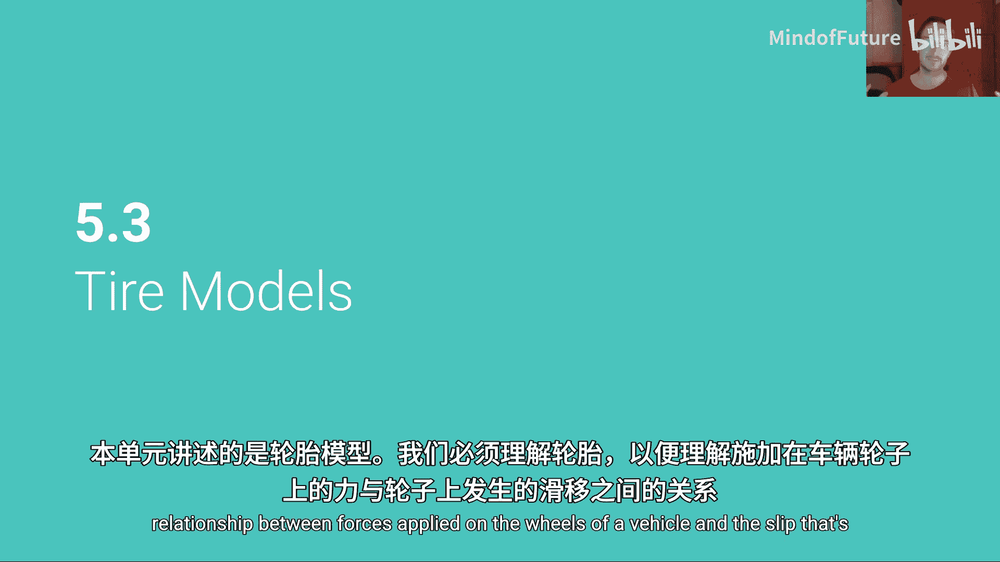
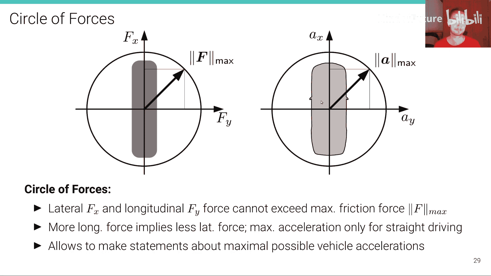

# 【图宾根大学】自动驾驶汽车课程 ML4340 p18 P18 Lecture 5.3 (Vehicle Dynamics - Tire Models) -BV16FP2ePEYc_p18-

This unit is on tire models。We must understand tires in order to understand the relationship between forces applied on the wheels of a vehicle。

And the slip that's happening at the wheels。

Let me motivate this by showing you this little video here。あ。

So I hope it's evident from this video that this vehicle here is clearly not following the kinematic bicycle model。

 so the kinematic bicycle model is not enough。Which assumption of the kinematic bicycle model is violated in this case？

Well， clearly， the wheels are slipping。There is a slip angle at each wheel。

 And because we didn't assume we assumed no slip for the kinematic bicycle model。

 The kinematic bicycle model is strongly violated here。Of course， this is an extreme case。

 but in reality， wheels are always sliding a little bit。 We are never。

 they are never following perfectly the kinematic bicycle model。 And so this， of course， depends on。

 on the terrain。 This depends on the。Type of ground， if it's ice or if it's grass or if it's asphalt。

But there's always some slip， and so we need to go beyond the kinematic bicycle model that we learned about so far。

In order to go beyond and in order to understand what slip is and the relationship between slip and forces。

 we need to understand tires better。Here's an example of attire。

That is made of rubber with pressurized air inside。

And that's based on the air pressure and the weight of the vehicle。

In touch with the ground on a so called contact patch on this area here that is defining the contact between the wheelal and the ground。

And then what we can do now is we can apply some force。To the axle of this wheel。

 which means that the wheel starts moving forward。But what happens is that because there is no perfect contact off the wheel with the ground。

Because there's always a little bit of slight。The wheel rotation。

Will not be exactly This the wheel rotation speed will not be exactly this equivalent to the speed the vehicle is moving forward。

 and the discrepancy between these two is called slip。

So we're going to use tire models to describe the lateral and longitudinal forces applied at the tires。

 and there exist many tire models at various levels of complexity going down to the molecule level。

But we are going to use a very simple qualitative description here。

Which is called the T block model and that illustrates the basic phenomenon。The basic。The major。

 the qualitative behaviour of the curves of the forest curves quitete well， I think。

The question we are trying to answer here is why do tires slip and how exactly do they slip and how does this relate to the force applied at the tires。

So we're going to consider the T block model。Why is it called tread block model。

 It's called like that because we are considering a tire at the macroscopic level that's composed of many little tread blocks here。

 You can see here each of these is a little。pieceie of rubber， basically。

 that's attached to the tire。So you can see only the bottom part of the tire here。 And in this case。

 you can see five of these dread blocks。 and you can see already from this figure that the tread blocks don't look the same。

 but only this dread block here is in its。Canonical position in its canonical shape。

But these ones here are deformed versions of this one。Now， why are they deforming， Well。

 as soon as theve is driven externally， as soon as we apply a force。

A circumferential force to that will， this tb starts deforming。And slipping。

So we apply a force to that wheel。 think of。Applying a force here， starting from a。A vehicle。

A wheelel that has velocity serum。And what that means is that in order to move the vehicle forward because the vehicle has a mass。

 we need to apply a force relative to the ground。And so this force must be transported through these trap blocks。

And what happens now is that as soon as a t block enters。The contact patch。

The area where the tire is in contact with the ground。

This force is builted up by deforming this tread block。

 and the more the tread block moves to the back， the larger the force is。

So this is indicated here by this diagram。The more I'm moving。Along this contact area。

 the dread block gets deformed。And then once the t block leaves that contact area。

 it snaps back into its original。Position， so it， it looks like this again after it has left the contact area here。

 basically。And this is already the reason for a slip。

You can see that these t blocks deform in order to。

Transport the mass at the de force in order to apply the force to the ground。And so。

 the speed of that。Will。At in this area here is not the same as it would be if it would be in perfect contact with the ground because this force is transported through these trap blocks and they are deforming。

So you have basically a slip。Through this phenomenon。The tile dread blocks are here to the ground。

 they deform and slip。When losing contact。 So there is this slip happening because they deform and then they slip。

 And so the speed of the wheel and the ground are not the same。Now， this is called static friction。

 or is it called static friction， because the tread blocks， while they deform。

 they are always in contact with the ground， They are not sliding on the ground。However。

 when the driving force of the wheel increases。And the static friction is exceeded。

 There is a maximum to that friction， and that depends on the molecular properties of the material the tire is made of and the material of the ground。

 if it's asphalt or ice， etc cetera。So as soon as this maximal force。嗯。

The static friction is exceeded。 We are moving into the sliding friction area where these tread blocks are start to slip earlier。

 They don't slip at the very end when they snatch back into their original position。

 but they are all losing already contact with the ground here， maybe。

 because that force is too strong。 And that's what we call sliding friction。

And so that means that in the first part of this diagram。

Treread blocks are still in touch with the ground。 So we have the same behavior as here。

 But then at this point。They are starting to slide。

And as the sliding friction is smaller than the static friction。

This decrease is the transmitting driving force， so that's what we want to avoid basically。

If the tired red blocks start sliding at the very beginning， for example。

 if you start at a red light and you apply too much force onto the wheel。

You will not be able to move quickly because you are immediately in the sliding friction area。

Or the same happens if you break your vehicle very appropriateruply at high speed。

 than youre also in the sliding friction area。So in that case。

 if the tired red block starts slid at the beginning， only the sliding friction can be applied。

The sliding friction is lower than the。Static friction。 So that's something you want to avoid。

 And that's also what modern bra systems， such as the anti lock brake system。 A B， S is doing。

 They are starting to。As soon as they realize there is too much slip。

 they are starting to release the brake from the wheel in order to be able to still maneuver the vehicle and we come to that why we can't maneuver the vehicle otherwisewise。

But in general， we won't avoid lighting friction also because it's just lower than static frictions。

 So if we wouldn't have A B S， we couldn't break S strongly。

We couldn't come to a halt as quickly as we could with such a system。Okay。

 so this is another curve that plots the force。That can be applied on the vehicle with respect to this slippage S。

Where the slippage is the difference between the surface speed of the wheel and the vehicle speed。

And it's a relative。numberumber。 So what this means is that if the the wheel would be in perfect contact of the ground and there would be no slip。

 this slip slippage S would be 0 because then the surface speed of the wheel and the vehicle speed would be identical。

And that happens， for example， when you're driving at a constant velocity and you're not accelerating or decelerating and there's no forces applied on the vehicle。

Like， let's say you drive at slow speeds。Where there is no， no other forces acting on on the vehicle。

And you don't act on， on the axle。 You don't apply any force。Now， what we can see in this diagram。

 So this is what this curve looks like。 What we can see here also is that the force F grows linearly in the beginning with this slippage as。

And this is the area where this。Tired red blocks are deforming， but still in touch with the ground。

But then at some point， when we reach static friction。When the slippage gets too large。

This leads to a reduction of F。 So we are in the sliding friction。I'm part of this plot。

And the sliding friction again is smaller than aesthetic static friction。

 so we always want to avoid that， for example， through systems like A B S。Now。

 how does this curve F of S change for slippery terrain when we have low friction？

I give you a second to think about this question。What do you think。How would it change？Well。

 the start of the curve。Doesn't change。It doesn't change as the elasticity of the blocks doesn't change。

 It's still the same。Tired that were looking at the same rubber material and the treads deform in the same way。

However。The maximum force that can be applied is reduced due to the decreased static friction。

 because maybe the ground is not as felt any， but it ice now。

 And so we can't apply the same maximum force any。 And so the tread block starts sliding earlier。

Due to a decrease in friction， and this is illustrated by this curve here。So qualitatively。

 both curves look similar。And in the beginning， both ourinia， but then。嗯。

With the lowerff friction curve， the maximum force that can be applied， is less。

 and so we started sliding also earlier。Now， this was for the longitudinal。

Force and the longitudinal slippage， but we can do the same analysis for the lateral force and actually the diagram here looks。

Very similar。 So in this case， we look at the force， which you call Fy lateral。

Sideways to the vehicle to theveal。And the diagram force with face back to slip slippage looks similar。

 We have a linear part in the beginning。 and then when we reach the max force。

 we go on to sliding friction， which also we want to avoid we want to avoid sliding sideways as well。

So the lateral force of y is analogous to the longitudinal force， but blocks move laterally now。

And the lateral force for small slippage values， S and small。嗯。Wheels light angles， alpha。

Is given by this expression， Fy equals。A constant that's called the cornering stiffness。Times alpha。

 which is the sliding angle of that wheel， which is just the angle between the forward facing direction of the wheel and the actual velocity direction that。

This wheel is moving into。We're not going to derive this formula here。

 Just take it for granteding now that this is the case。 And so in approximation。

 we have fy equals C times alpha， which also makes sense。 if you look at this diagram。

 and if alpha would be 0， then you。Actually， following the kinematic bicycle model。 So the。

There is no slip angle at this wheel， and the wheel velocity is in the same direction as the orientation of the wheel。

 But if alpha is large， then we have a large slip angle， and the velocity of the wheel is。

Lateral or has has a large lateral component。 And so we are sliding sideways。

There's another interesting phenomenon that is worth talking about。

 which is this so called circle of forces。The circle of forces tells us that the lateral force。

That can be applied on a wheel。 and the longitudal force。That can be applied on the wheel。

Are not independent because they cannot exceed a maximum friction force， F max。

So we have this circle and all of the forces that we can apply to that。Well lie inside that circle。

 We can't apply stronger forces。And this means that more longitudinal force implies less lateral force。

 or the maximal acceleration can only be applied for straight driving。Consider， for example。

 you want to make a full stop starting at a velocity of 50 kilometersm power and you're hitting the brake really hard。

 So your you' start sliding in the longitudinal direction。

 What this means is you now can't steer anymore。 The vehicle becomes completely。

You can't maneuver anymore， you can't steer anymore。And so this is bad， of course， right。

 So what you should do is if you w to avoid an obstacle and you can't actually avoid the obstacle just by breaking because you're too fast。

 you shouldn't break as much， but you should swerve around that obstacle。 you should。

 What you learn in this。ImDiv seminars is that。You hit the brake heart in the beginning。

 but then you loose it again in order to swerve around the object in order to avoid making contact with the object。

 And， of course， this is also the motivation behind the anti lock breaking system。

 It just avoids you going into this sliding phase of the。Curve。

And so you are still able to maneuver your vehicle despite hitting the brake fully。

So this doesn't only allow us to make statements about the forces applied to the wheels。

 but similar statements can be made to the accelerations that can be applied to the entire vehicle because of course the vehicle is on four wheels and if this applies to all four wheels then you have a similar behavior of the acceleration of the vehicle and this is what I was just referring to。

 if you want to make come to a full stop you can't accelerate sideways anymore。

 so you always have to trade off these two， similarly if you have a strong sidewind。

 but you have already exceeded the acceleration in X direction in longitudinal direction then you will be more strongly affected by that sidewin compared to if are not accelerating。

