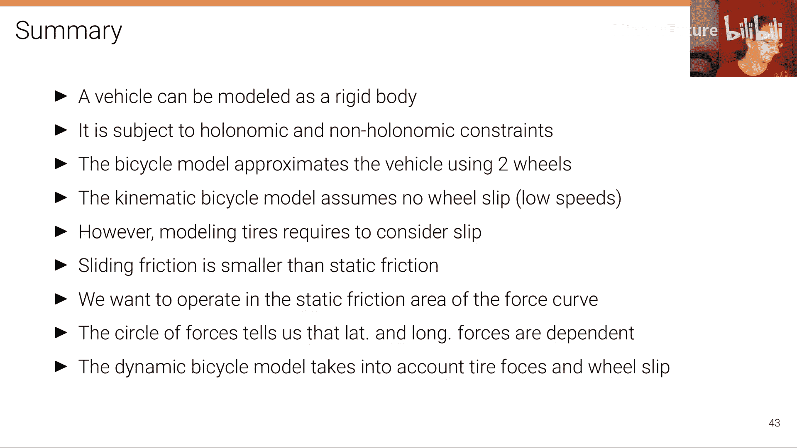

# 【图宾根大学】自动驾驶汽车课程 ML4340 p19 P19 Lecture 5.4 (Vehicle Dynamics - Dynamic Bicycle Model) -BV16FP2ePEYc_p19-

We're now ready to define the dynamic bicycle model。

 and in this lecture we are only going to look at the most basic form of this dynamic bicycle model that considers lateral wheel slip。

Before we start， let's first look at the dynamics of a point and then of a rigid body。

Let's first look at a single 3D point with Ma M in a 3D space。

 and let's look at the translatory motion of that point。Let arm this vector here。

 with the dashed line。Theote the location of that 3D point。And let VP at time T denote its velocity。

And AP at time T it's acceleration。The linear momentum of P is defined as P at time team。

Equals the mass of that point times。The velocity at time team。And now by Newton's second law。

 this is where dynamics comes into the play。We have the time derivative of the linear momentum。

Of that point， the time T equals the mass times。The acceleration at time T。

And that equals the net forces that act on that point mass P， which is similar sum。

 which is equal to the sum of all forces acting on that point mass P， and that's illustrated here。

So the sum of all forces， in other words， the net force acting on that point mass。P。

Is equal to M times a。 And that's Newton's second law。 very famous law in physics。Now。

 let's consider the transly motion of a rigid body instead。

 So we consider this rigid body here on the right， illustrated in black。

With a the rich body here has a mass M。And now let R again denote the position， but in this case。

 the position of descent of gravity C of that rigidretched body， B。

And let V C denote the velocity and AC the acceleration at the center of gravity of that rigid body。

The linear momentum of B is defined as Pb of T equals m times the velocity。

At the center of gravity of T， similar to before， now with respect to the center of gravity。

The centre of gravity of a rigid body behaves like a point mass with mass M。

 And as of all forces act on that point， on that center of gravity point。

Which means that the time derivative of the linear momentum of that rigid body is equal to m times the acceleration。

At the centre of gravity。Which is equal to all the net forces that act on that rigid body B。

Which is the sum of all forces acting on the Richard bodybee。Now this is for translatory motion。

However， in the case of the rigid body， because it's not a point， but it has an extent。

And it has a mass distribution。So it's not all the mass is centerd on a very small point。

 like in the in the point case， but it's it's really an object。

We have to consider also the rotary motion。The rottatoryory motion of that rigid body。

So for the rotary motion， also the geometric shape of the richy body B and the spatial distribution of its mass is important。

And let's illustrate it here on the right。Let row denote the body mass density function。

Where you can consider this little incremental mass element here to be a little tiny element of that rigid body。

And we find this as the。Mass at that point， over a little spatial extent， like this blue box here。

So the overall mass of that rich body is， of course。

 the integral over the rigid body of that density function， which we simply。

Substitute through this shorthand notation D M， This is Li。Incremental。Mass of the rigid body。

Now we define a quantity that's called the inertia tensor of B。

 and that is defined as this matrix here。Where its entries are defined as the moments of inertia。

As here。And the moments of deviation here on the right hand side。

And that's just the definition that we have to take for granted for now。

 but it becomes useful on the next slide。So it's a definition based on the body density mass。

Distribution。Let's consider now theary rotatory motion of a rigidched body。

Let omega be the vector of angular velocities。So omega is a vector， omega x， omega y， omega c。

 and it's illustrated in orange here。Again， we have the rigid body with the scent of gravity。

 and now we have this。Vectctor of angular velocities where the rigid body retains around that vector。

And the amount of other velocity。The rotational velocity is equal to the magnitude of that vector。

 That's how you could imagine that。The Angular momentum。

Elsie of the rigidched body is now simply given by the product of the inertia tensor from before。

Times that。Anng of velocity vector omega。And so we have a free by free matrix multiplied with a free vector。

 which is again， a three dimensional vector， and that's illustrated by this red vector here。

 which is the vector for the angular momentum L C。Now。Similar to the linear motion。

 Now for the rotary motion， we can apply the angular momentum principle。

 And that tells us that the time derivative of the angular momentum is equal to the。

Ineria tensor times the angular acceleration。Which is equal to the net moments of all forces acting on the rigid body B。

Which is equal to the sum of all moments acting on B with respect to the scent of gravity。

 as illustrated here on the right。And that means。Well， what is the moment。

 the moment is simply the product of the lever arm length times the force that is applied in that direction here on the rigid body。

So in this case， if we apply these free forces， we have to multiply this force with this。

Length here and this force here with this length and this force with this length。

 And then we get the free moments that we have to sum up to obtain the net moment。

 And that is simply the time derivative of the anglo momentum Elsie。Okay。Now in some cases。

 things simplify， and that's also what we consider here。 we consider a much simpler case。

So if we consider a canonical coordinate system， for example。

 if the body frame is chosen such that the principal axis system for the rigid body。嗯。嗯。

Which is the symmetry axis， so the body frame is equal to the principal axis or the symmetry axis。

The inertia tensor is diagonal and two examples are illustrated here on the right where。

In the first case。This。Cubboid is aligned with the。Body frame。

And so we have this much simpler inertia tensor here， which is diagonal。And similarly。

 for the this wheel like。Richard Barter here on。On the lower part of the figure。

For the plane motion of a rigidched body in the X Y plane， as we consider the vehicle to live in。L。嗯。

Anngeular velocity in x and y direction are， of course，0， and so are also the moments。And therefore。

 the angular momentum becomes a simple scalar quantity。 So we have。The Angular momentum as a scalar。

Equal to the inertia times。So this is this moment of inertia here， I see。Times。

The angle of velocity around the C axis。At time T。And the Angular momentum principle yields then also the scalar equation。

 I see times。Amiga dot。Es the sum of all moments。That。Okay。So with this。

 let's now go back to our vehicle model。 Let's go back to our bicycle model。

 and let's define the dynamic bicycle model that considers forces。And we'll slip。Again。

 we consider a model where we have a front steering angle， Delta。

 but we don't have a back steering angle， which means that the back wheel is aligned with the vehicle orientation。

For this very simple version of the dynamic bicycle model。

 which is probably the simplest version that we can define。We make several strong assumptions。

The first assumption is。As we made already before， that the vehicle's motion is restricted to the X。

 Y plane。 We are looking at the vehicle from above bird's eye view。

 and we are just modeling it in the X， Y plane。Further， the vehicle is considered as a rigid body。

Only lateral tyre forces are applied， generated by a linear tire model。

 so we don't model here longitudinaltyre forces， just the lateraltyre forces。

And we also assume a small steering angle， Delta。Such that sine of Delta is approximately deelta and tangin of deelta is approximately Delta。

And cosine of Delta is approximately one。And we also assume a constant longitudinal velocity V X for the simple model。

 So the velocity V X doesn't change。 It's constant。So given all these assumptions。

 let's now go ahead and define。The equations， let's try to define the equations。

For simulating a vehicle。By considering also the forces applied to the。Tires。

The first thing we're going to consider is the lateral dynamics， the linear dynamics。And this is。

 as we've seen before。😊，Through Newton's second law M。A Y， this is in in in this direction here。

 in the lateral direction is equal to the sum of all forces that act。On that vehicle。

 And in this case， we have forces。Fruit is two tires。

 because this is where thety the vehicle touches the ground。So we have the rear wheel plus。The force。

 the front force at the rear wheel， plus the force at the front wheel， which is。

We have the sum of these two here。But the front force here is。Defit lateral to that wheel。

 and that wheel has a steering angle， which is not the case for the back wheel。

 but for the front wheel。 So we need to multiply this with cosine Delta。

 But because assume that Delta is small。This can be approximated with one。

 So we still get F R plus F F in this simple approximation。So， MA Y。Is equal to F R plus FF。

Similarly， the acceleration can also be defined as the time derivative of the velocity of the vehicle in y direction。

And in this case， because the vehicle is also rotating。The richched body is rotating with a。嗯。

Angular velocity omega。 We also need to consider the so called centripeal acceleration。

 which is omega times V X。For this acceleration in this direction here。

 because the vehicle is not going straight， but it's rotating。So if we now combine these two。

 if we plug this one into here， we get this expression M times。

The time derivative of the velocity of the vehicle in y in lateral direction plus。Li。

Angular velocity。Of the vehicle times the velocity in x direction equals FR plus FF applied at these tires。

This is the first fundamental equation that we have derived for the dynamic bicycle model。The second。

Equation that we are going to derive is for the odd dynamics。 This is the rotational component。 Here。

 we have looked at the translational component。 Now， we' are going to look at the rotation。And here。

😊，We have the relationship from before that now in this。Two dimensional projection。

The moment of inertia times the。Anngr， acceleration。

Equals the sum of all moments of the forces that apply。On the vehicle。 and in this case。

One of these moments is this is generated through this force here times this lever arm， which is L R。

 So we have minus L R F R because that force xs。In the opposite direction of that。嗯。

Angel of velocity of vector in orange here。And we have plus。L F。

 this lever arm times the force acting on the front wheel。

And here we have a plus because this is acting in the same direction as the velocity。

 the angle of velocity。Offf the vehicle。Now， of course again。

 we have to consider cosine Dlta because we assume delta to be small。Ignoed his term。 And so we get。

I see times Oomega dot equals minus L R， F R plus L F， F， F。

 the second fundamental equation that we have derived for the dynamic bicycle model。

Now let's look at the entire forces again。From the previous unit。

 we know that in the beginning of of the curve。That we have considered， the forces are linear。And so。

 they are linear。They are linear as they are the product of a cornering stiffness factor。

 Cr R for the rear wheel and alpha R， and because we here we have defined the forces in the opposite direction as before opposite in this case。

 the same direction as the velocity that we consider。嗯。We have to apply a minus sign here。

 so that's why we have a minus here。So FR is proportional to the cornering stiffness and alpha R。

But we have this minus here。 So F R equals minus Cr R times alpha R， which is T。Rear wheel。

 slip angle。Now， this is approximately minus Cr R tangs of alpha R for small alpha Rs。

And so we can replace this expression by。V be， Y， the velocity at this real wheel in y direction。

 divided by the velocity in x direction。And similarly， for a front wheel。😊，And we have minus Cf。

 the cornering stiffness of the front wheel times alpha F the。Slip angle of the front wheel。

 How much the velocity direction of the at the front wheel a。

Deaviiates from the orientation of the front wheel。And so again。

 if we plug in the tangs of alpha f as an approximation， we get V Eta over Vsi。Now。

 what are these velocities， Well， at the rear wheel it's simple。

Because the rear wheel is facing into the direction of the vehicle。 We have simply for we B， Y。

 We have the velocity for we B X。 We have the velocity in x direction and for we B， Y。

 we have the velocity in y direction。 This is the translational component。

 And then we also have to consider the rotational component with， which is the。嗯。嗯。

Anglo accelerate the angular velocity。Of that vehicle times the lever arm L R。

 and we have a negative sign here。And because we are moving in the opposite direction with this velocity compared to this one here。

And similarly， for the front wheel， if you consider the coordinate system X and y。

 which is not shown here， but is similar to this one here， then this vector here。

 this velocity vector project onto this。Coornate system is simply V X。

 and also V V A Y is V Y plus in this case， because we are on the opposite side now。The lever arm。

 L F。Time omega。So we have also the translation and the rotation component here。

For that velocity in y direction， this is this vector here。Now， of course。

 we are not interested in these two， but we' are interested in V A Eta and V asi。

 And so we can transform。V， A X and V， A Y into this coordinate system that is actually shown here and that we're interested in through a simple。

Transformation that just depends。 this is a rotation here。

 So you can see that just depends on the front steering angle delelta。

And now we again make our simplifications through assuming that this frontstein angle delta is small。

 So cosine is approximately 1 and sine is approximately delta。Okay。

So now we can apply this expression into here。And this expression into here。

 And so we get a closed expression for the force at the rear wheel and the force at the front wheel。

 And this is what we get。Just plugging in these equations。 And what we do here for the front wheel。

 in addition， is we assume。That the velocity in this direction is much larger than the velocity in this direction。

 which is typically the case。 And also because the front steering angle delta is small。

Then this term basically becomes negligible compared to this term so we can ignore it。

 And so this this term here simplifies a little bit。Okay。

And now what we are going to do is we are going to take these two Fr and FF。

 and we are going to plug them into the formulas that we have the fundamental formulas for the dynamic bicycle model that we have derived before for the ya dynamics and for the lateral dynamics。

 where on the right hand side we have Fr and FF here and also here we have F R and FF here。

And if we do so。We got these two expressions。嗯。Yeah， that's。

There's nothing more to it than just plug it in and to simplify or to highlight that these are indeed the expressions from before I have put these brackets under the equations and denoted them by F R and F F at the respective places。

Now， this is the simple， the most simple form of the dynamic bicycle model。 And we can rewrite this。

 actually into a。Niceer form。Which we call a state space representation， where the state。

Is the velocity of the vehicle in right direction。And the。

Heading angle of the vehicle and the angle of velocity of the vehicle。

And so by rewriting the expressions from before in this format。

 we have now a relationship that relates the timely derivative of the state vector。

To the state vector itself。Plus， a vector times the input。

 which in this case is simply the steering angle delta of the vehicle。

AndNow we can simulate the vehicle。 We know how the velocity in right direction changes and also how the heading angle changes and the angler velocity changes。

If we apply a steering if we apply a sequence of steering wheel angles。嗯。For example。

 in a time discretized version of this model。And this state space representation can also be augmented by the global position。

 But then this becomes a nonlinear state space model。 So it's not as nice anymore more。

 So this is the nicest form， I would say， but it's in the local vehicle frame， coordinates。W。

 that's it。So in summary， what have we learned today。

 we have learned that a vehicle can be modeled as a rigid body。😊。

It's subject to hoomic and non hoomic constraints。And we have also learned that the bicycle model approximates the vehicle using two wheels。

We've seen that the kinematic bicycle model assumes snow wheel slip。

 so it's only a good model for low speeds。However， modeling ties requires to consider slip。

As we've seen in a drifting example of the race car。

We've also seen that sliding friction is smaller than static friction。

 so we should always make sure that we enter the static part of the curve in the linear part。

So we want to operate in the static friction area of the false co。

We've also seen that the circle of forces tells us that the lateral and the longitudinal forces are dependent。

And if we apply a very strong lateral force， for example。

 we can't apply a longitudinal force anymore and vice versa。And then finally， in the last units。

 we've seen the dynamic bicycle model， which also takes into account tire forces and wheel slip to some degree。

Thanks。😊。

