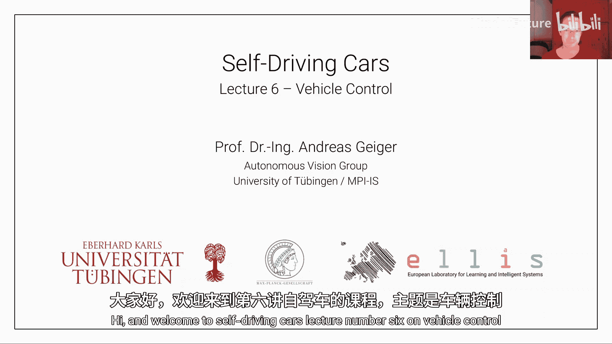
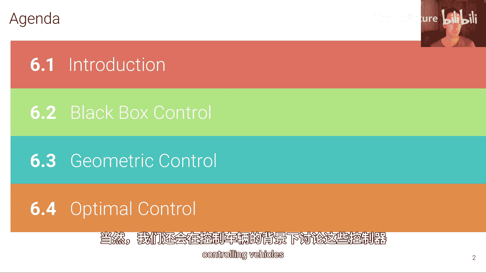
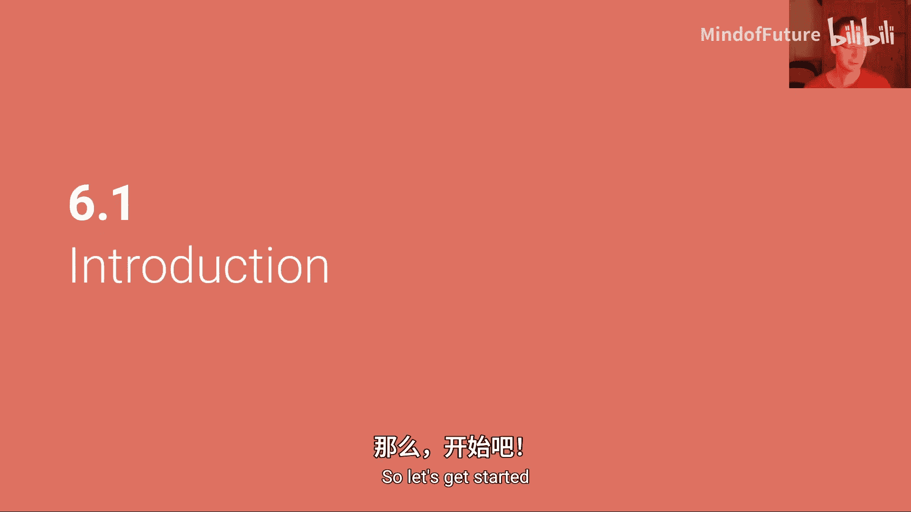
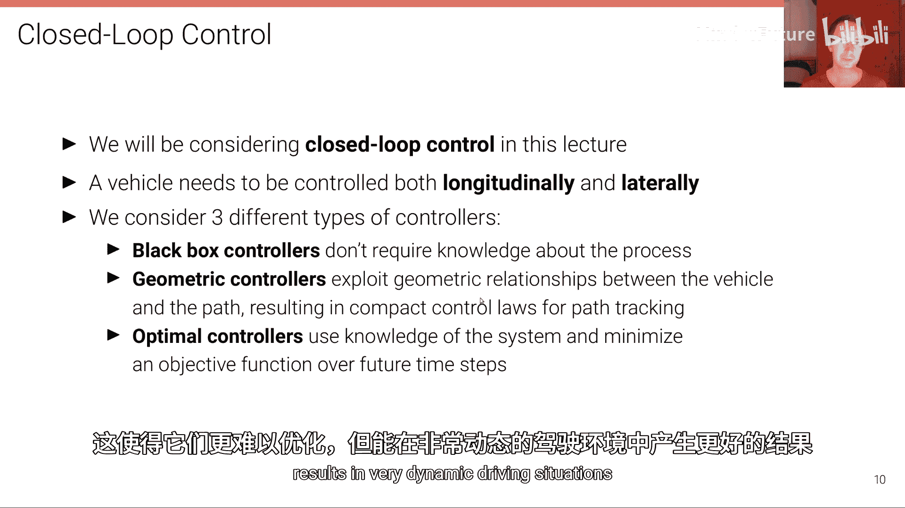
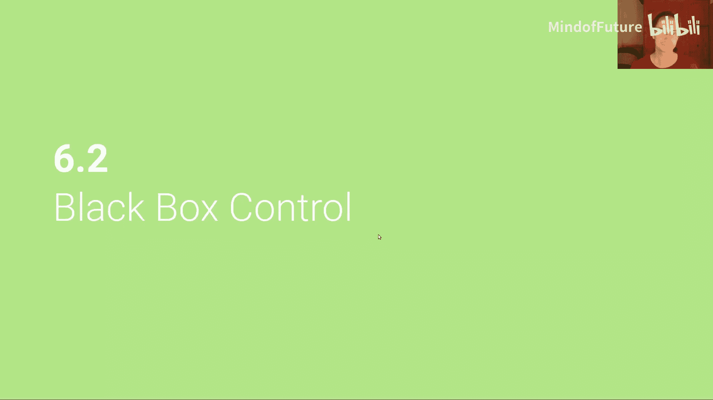

# 【图宾根大学】自动驾驶汽车课程 ML4340 p20 P20 Lecture 6.1 (Vehicle Control - Introduction) -BV16FP2ePEYc_p20-

Hi and welcome to Self driving Car Lec number6 on vehicle control。

This lecture is structured into four units。First， we'll introduce the control problem and motivate why we need control。

And then we're going to look at three different types of controllers。

 and for each we give several examples。And then， of course。

 we're going to look at these controllers in the context of。Controlling vehicles。

So let's get started。

This is a slide we have already seen before。We've seen multiple approaches to self driving and the modelular pipeline。

 as well as the direct perception approach， both feature a vehicle control module that takes as input。

 a desired path plan or some lower level affordances。And outputs the commands for the vehicle。

 the steering wheel angle。And the commands for gas and brake。

So self driving cars need vehicle control， but actually also modern driver assistance systems require vehicle control。

 and we have seen such an example already in the last lecture。

The electronic stability program controls even each wheel independently in order to increase。

Muverability of the vehicle and lower the risk of accidents in highly dynamic situations。

So sophisticated controllers are already in your car today。

And here's a little history of driver assistance system that use such control systems already in 1926。

 a server braking was used in cars， and then from 1951 on already server steering has been invented。

Thenhan in 1958， cruise control。Which。Controls the speed of your vehicle to a desired set point。

And then in 1978， the anti lock B system or short ABS。

 which we have talked about in the last lecture。As well as a traction control system ASR in 1986。

Then in 1995， the just mentioned electronic stability program ESP。And in 200s。

 adaptive cruise control。Some of the cars today have adaptive cruise control。

 They use cameras and radar or Li in order to detect the distance to the vehicle in front。

 and so they can lower the speed， make lower the set point。

Automatically and don't just follow a given set point in terms of kilometers per hour。

 but adaptively come to a full stop， for example， if there is a traffic jam or in front of a traffic light。

Then in 2002， another driver assistance system that has been developed is the emergency brake assist that's now in many vehicles today as well。

 and then lane keep assist。As well as automatic parking and of course。

 all of these systems require both precise knowledge of the vehicle， but also control of the vehicle。

Theres two different type of controllers。 The first type is called an open loop controller。

It's called an open loop controller because it doesn't feature a loop such as a closed loop controller that we are going to see next。

Here's a diagram of an open loop controller。And we're going to use always the same variables to refer to the same。

Names to the same quantities in such a process。The input to such an open loop controller here in orange is aver reference variable or set point R of T。

 where T is the time index here， so at every point in time。

During the period where we want to control deprocess in green， we're specifying a set point， R of T。

 a reference R of T that could be， for example， a target speed that we want to achieve in our cruise control system。

The controller then outputs some correcting variables that are the input to the process。

And these correcting variables are calculated in such a way by the controller such that the controlled variable y reaches the reference value R。

As quickly as possible。Now the process。Is， of course， also exposed to disturbances。

 which we call C of T。So these are environmental effects that we may or may not be able to predict。

Typically， we are not able to predict all of the disturbances。

 That's why close loop control is hard to do in practice。

And that's also what is here on the first bullet point， closed loop control， open loop control。

 sorry， so open loop control is hard to do in practice。

Open loop control requires precise knowledge of the plant or the process。

And all the inference factors。There is no feedback about the control variable。

 so the controller doesn't know what the current state of that control variable is。

And he cannot handle unknown disturbances， and therefore， easily leads to drift。In reality。

There's almost always disturbances that we don't know。 So we need a so called closed loop controller。

And this is the diagram of a closed loop controller。Let me switch back and forth。

So what you can see is that the only thing that has changed is that now we have a sensor that takes measurements of the process and outputs these measurements to the input。

To the control them。More specifically。The reference variable R of T is added。

And the measurement is subtracted。 And the result of this， we call the  error。

And so what the controller now has to do is a much easier task ask than before。

 because it just has to bring this arrow down to 0。

 We want to make this measurement to become the same as the reference variable。

 But now we know the measurement because we do have this explicit feedback loop in order to minimize the error E of T between the reference and the measurement。

And so the controller outputs a correcting variable to the process。Such that over time。

 the error decreases。And this is called a closed loop control because we have a closed feedback loop。

In this diagram here。Now controllers are old and this is maybe one of the most famous and maybe also the first example of a control system。

And it's called a centrifugal governor that can be used to control， for example， a steam engine。

And how that works is nicely explained in this little video that I'm going to show you。

 so this is a analog controller， it's not a digital controller that we are going to look at later。

 but it's an analog controller。A centrifugal governor is a device used for controlling the speed at which a machine operates by regulating the admission of working fluid。

Invented by James Watt in 1788， the governor became a fundamental component in many of the machines that drove the industrial revolution。

Most commonly fitted on steam engines。 power is supplied to the governor via a belt and flywel connection with the engine's output shaft。

 causing the governor to spin as the engine runs。The governor operates the throttle valve。

 supplying steam to the cylinders as it spins with greater speed。

 The centrifual force acting on the fly balls causes them to move outwards and upwards against gravity。

 pulling the lever arms with them。😊，As the lever arms flex， they pull down on a vertical shaft。

 lowering it into the throttle valve and reducing the gap through which the steam is fed。

If the governor spins fast enough， the shaft cuts off the steam intake completely。

The utilization of a governor became crucial in the operation of large engines and machinery during the industrial revolution and long since if an engine is allowed to run too vigorously。

 It runs the risk of shaking itself apart。 Furthermore。

 in large factories were a multitude of identical machines were configured to run off of a single engine as the power looms in a textile mill。

 a constant， steady and stable speed had to be maintained at all times。

 or the work produced would be irregular。 There are numerous examples of centrifugal governors to be found in the museum。

 designed to be fitted to steam engines and water turbines， though differing in size and complexity。

 each one is an equally crucial component of its machine。

So a great and very visual example of a controller， in this case， for example for steam engines。

So what were going to consider in this lecture is closed loop control because this is the only control that makes sense for vehicles。

A vehicle needs to be controlled both longitudinally， as well as laterally。

And we'll consider three different types of controllers。

The first type that we will be considering is called a black box controller。A black box controller。

Is the most generic form of a。Close look controller。

 as it doesn't require any knowledge about the process， it's basically。

The process is a black box to the controller， and the only thing that the controller tries to do is to minimize this error that we've seen before。

The second type of controller that we will look at is a so called geometric controller。

In contrast to black box controllers， geometric controllers， in this case。

 specifically designed for vehicles， exploit knowledge about the vehicle。

 They exploit geometric relationships between the vehicle。

And the path resulting in compact controller for path tracking。And in this context。

 we'll revisit our well known bicycle model again。And then finally。

 we'll have a look at optimal controllers。Optimal controllers also make use of the system。

But maybe even in a more explicit fashion。By minimizing an objective function over future time steps。

They are having a potentially longer look ahead。 They are harder to optimize。

 but have a longer look ahead and can。Lad to better results in very dynamic driving situations。

