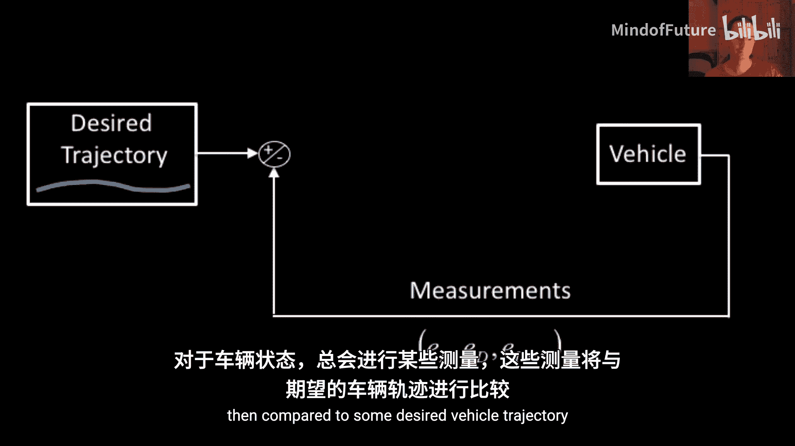
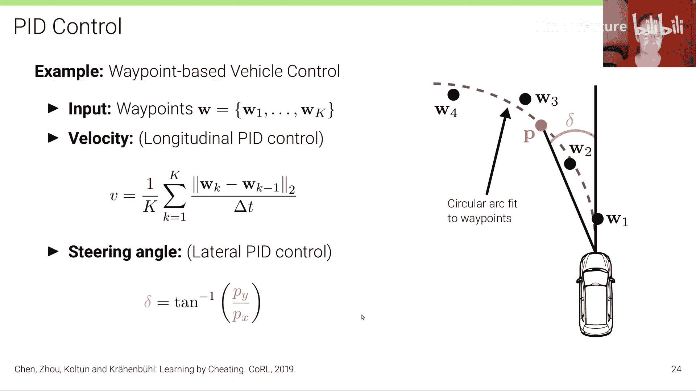
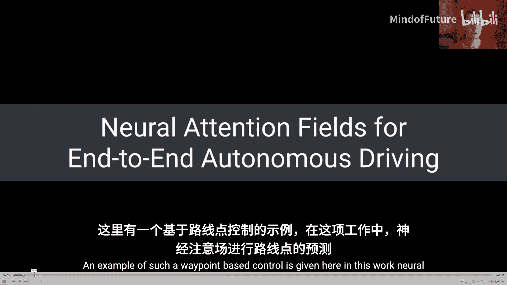

# 【图宾根大学】自动驾驶汽车课程 ML4340 p21 P21 Lecture 6.2 (Vehicle Control - Black Box Control) -BV16FP2ePEYc_p21-

Let's now have a look at our first category of controllers， black box controllers。

Black box controllers， as already mentioned， are called black box controllers because they don't assume knowledge about the process。

 and thus they are versatile and can be applied to any process potentially。

The most simple form of a black box controller is called a B bangang controller。

A bang bang controller is also called a hysteresis controller。It's often applied， for example。

 in household thermostats。And it's called a bang bangang controller because it switches abruptly between two states。

The mathematical formulation for this controller is simple。

Remember again that we are defining this orange box from the diagram before。

Which as an input has the arrow。And as an output， the correcting variable U。

So we need to define a mapping from E to U if we want to define a controller。

So how does a bang bang controller work now？Well， it's rather simple。

 So the most simple form of this is simply this case。Distinction here。Where。You。Is defined as U1。

 which is a parameter of this controller。 If the error is above a threshold。

And it's defined as U too， another parameter of this controller。Otherwise。

So this controller in its most simple form has。3 parameters， U1 U2 and tau。And if you think。

 for example， of a thermostat。It will turn the heating on if the temperature falls below a certain value。

 If E T falls below a certain threshold， it will go into。

Will add the correct or will output the correcting variable U1。Which might be turned the heating on。

And otherwise， it might output the variable u2， which。Mes turn the heating off。

So this was the most simple controller。 But as you can imagine， it wouldn't work very well for。

Cars for controlling cars， it would lead to a very sick sggy behaviour if you would implement that。

 and wouldn't be very comfortable。 And we are going to see an example of this also in a later video。

So we need something better。And there's something better。Is called a PID controller。

 which is also a black box controller。PID controllers are the most common controllers in industrial applications。

In probably 95% of all cases where you need a controller。

 A PID controller is used because of its simplicity and。Because of its broad application range。

So what is a PID controller， again， we have to define the orange box。The rest of the diagram， as。

 as before。Comprises the process and the sensor。The P I D controller。

Also doesn't require knowledge about the planned or process to be controlled。

 and it comprises in contrast to the B bang control， it comprises three elements。

 it comprises a proportional element。That。Outputs a value。

 a correcting value that's proportional to the error。

So there is no thresholdholding happening here anymore， but it's the arrow itself that's output。

Times a。Prameter of the PID controller， the proportional gain K P。

So in contrast to the bang bang controller， if you have a P controller。

 if you just have the P element， you're applying a proportional control。

 which means that the correcting variable is proportional to the error。

 It's not a binary decision between two variables。Between two parameters of a B Ben controller。

 but it's proportional to the error， so it can lead to a smoother control behavior。

And there's two other elements in a PAD controller。

 one is the integral element that integrates the arrow。Over all previous time steps。

And multiplly that with a integral gain K。And then finally， there is a differential。

That computes the derivative。Of the arrow， with respect to time。

So this is the time derivative and similarly， multiplies that with a。嗯。Different gain， Kd。

So theres another parameter of this PID controller， the PID controller has three parameters， K P。

 K I and KD， and it computes the error， the integral of the error over all previous time steps and the derivative of the error。

At the current time step。And it multiplies those quantities with the respective parameters。

 And then it sums it all up。And this is the output。 U。

 this is the correcting variable that's handed over to the process。Again。

 similar to before we have the reference variable R that we want to attain the correcting variable U that's output。

By the controller， the controlled variable y that we want to make similar to R。

 and then we have the sensor。And the error that's the difference between R and y。

The mathematical formulation of the PID controller is given in this simple formula here。

 as already discussed the。A correction variable is simply the sum of this free element。

The proportional element。The integral element and differential element with the corresponding parameters。

Why do we need three elements？ Well， all of these free elements have a different purpose。

The most important element， obviously， is the proportional element。

The proportional element makes sure that we are actually controlling the process。

 that the error is minimized， proportional with the gain KP。However。

 using the proportional element alone。Does often not work very well in practice and will see an example very soon。

Using the proportional element alone leads to overshooting and oscillation typically。

Because as we are reducing the error， as soon as we。Pass the zero error level。

We're going into the other direction。The controller has no idea that we have already approached0。

 so it continues and increases the  error with a negative sign。I increases steer。Yeah， basically。

 with a negative sign。 So the error is unsigned， right， It's， it's this this here minus this。

So we are changing the sign simply。Therefore， a D element， a differential element is important。

 and that's what's called a PD control， a proportional differential control if you just have these two elements。

Adding a D element to the proportional control alleviates this problem by introducing a damping behavior。

And therefore， avoiding overshooting or oscillation。And， then， finally。

The full P D controller comprises also。This integral element。Which corrects。

 which is able to correct recital errors by integrating past error measurements。

So here's an example of a。Proportal controller。And then a proportional differential controller。First。

 let's look at a proportional controller。What do we have here， Let's first understand the system。

That I used in order to create these plots。The control variable is simply。Deposition， So y of T。

 we call equal to x of T， which is the the position of a system。 sayy you're in a car。

And you want to move that car forward， and we are measuring longitudinal position of that car along a path along the road。

 for example。Now， in order to move that car， we can directly modify the position。

But we can only apply。Forces to the tires， which means we can only apply acceleration effectively to the vehicle in order to manipulate the position of the car。

So the correcting variable， the input to the process， the vehicle in this case， is the acceleration。

And we say u of T， which is the correcting variable。Let's remember this diagram again。

 U of T is the input of the process， y of t is the output， y of T is the position。

 and u of T is the acceleration。Where the acceleration is， of course。

The second time derivative of the position。So this is our system， it's a very simple system。

 it's basically just a double integrator that takes the value U， integrates it twice and outputs y。

And this is what I have implemented here。Now let's assume this card that we want to move forward。

We want to move forward by 1 m。And the car is currently at position zero。

And this is shown here by the reference。AVue plotted over time in blue for the first 20 time steps。

 the vehicle is supposed to be at 0， and it is at 0。 So the arrow is 0。But then。At time step 20。

 we asked the vehicle to move to。A position one to move 1 m forward。

And so we have the step function here in blue。This is the reference value over time。Now， of course。

 this car can immediately jump to1 meter， so it needs to apply acceleration in order to move forward。

And what has happened here is we have implemented a proportional control。

 So the proportional gain is 0。05。 in this case， it's a small proportional gain。

And the differential gain is 0， which means the differential part is turned off。

 and there's also no integral element here。Now what happens in this case？Well。

 the result of the simulation is the red dotted curve。Ideally。

 the red dotted curve would be identical to the blue curve。But it is not。

What happens instead is that， well first， correctly， the vehicle starts accelerating。

But the controller， because it's just a proportional controller。

 doesn't realize at this point yet that we have actually reduced the error to 0。

Because it's missing the differential element that indicates this。And so it continues and overshoots。

 And only here it realizes， oh， we went too far and it starts decelrating， but because of the。

Mass and inertia of the system， deceleration is。As slow as acceleration。

 And so we need all the way until the vehicle has moved forward by 2 m in order to come to a full stop。

Now what happens here is that we accelerate in the opposite direction。

 but they are overshooting again until we come to a full stop now in this case。

 again at position0 where we have actually started。And you can see where this is going。

 We are oscillating heavily in this case， we are always overshooting。The actual target value。

 the reference value that we want to achieve。So this is obviously not a very good controller。

 apart from that it wouldn't lead to very comfortable driving。On the right。

 you can see what happens if we take the same controller。It's still a proportional controller。

But we increase the proportional gain parameter。From 0。05。To 0。5。

And what happens in this case is that the oscillation becomes faster， becomes quicker。

But we still have the oscillating behavior， and we never actually reach a steady state where we reach this。

Reference value。 and maintain it。So hopefully this illustrates the problem of just using a proportional controller。

Now what happens if we add a differential element， now we have a PD controller。In this case。

Behavior of this oscillating function is dampened。So we don't overshoot as much to start with because we already know here that we are closer to the target value。

 so we don't overshoot as much， and so with every swing we are overshooting less until we have reached the target value in close proximity。

In this case， we've fus a differential element with a differential gain factor of 0。1。

If we now increase that differential gain factor from 0。1 to 0。5。

The dampening effect becomes even stronger， and we can see that we can， in this particular case。

 for this very simple system， of course。Even avoid overshooting entirely and reach。

Reference value quickly without overshooting and maintaining that value until that reference value is changed again。

So I hope this could illustrate the importance of adding a differential element。

 at least to the proportional controller。 if you have such a system that is such a double integrator。

 which is。Not something unreasonable because if you want to do ACC， adaptive cruise control。

 or just cruise control， you have to implement such a system。Now the question of course。

 is how can we select select these parameters in an optimal way。

 how can we select these gain factors in an optimal way？

As PD controllers are often used to control black box processes。

 we need heuristics and there have been various heuristics proposed to set the parameters of a PAD controller and the most common one is called Sler nichels。

Based on the inventors of this heuristic。The algorithm， the heuristic， is very simple。

We first set the。Integral and the differential will gain factors to 0， such that be。Observe。

 first of all， chest。AThe system in a closed loop。 So we have to take observations of the system in order to execute this algorithm。

But we observe first what happens with just a proportional controller。

So using this proportional controller， we are increasing the proportional gain starting from zero until the so called ultimate gain。

KP equals K U is attained。Where the system oscillates。

 so the definition of the ultimate gain is that the system must oscillate。

And so we increase the proportional gain until we see oscillating behavior。

And then we measure the oscillation period。At that ultimate gain factor K U for the proportional controller。

And once we have measured the oscillation period， we are simply setting the proportional the integral and the differential factors。

 as given through this formula that has been holistically derived through computer simulations。

So these heuristics have been derived empirically。Using computer simulations。

 And while they provide a good starting point。In practice。

 often manual fine tuning of these is required。 It's often the case that these are not the ideal settings for your controller and you still need to slightly adapt them for your particular problem in order for your controller to exhibit optimal behavior。

But at least it's a starting point。Okay， so let's look at some con more concrete examples of how a Pa D controller could be used in the context of controlling a vehicle。

 Let's first have a look at。Longitudinal vehicle control， which means。

Controlling the speed of the vehicle。Here， v of T is the target velocity at time t that we want to control。

 so this is the variable y。🤧嗯。One or in this case， actually， this is the target velocity。

 So this is variable R。 this is the reference。So the question is how to set this reference value。

And this formally I've seen before， actually already， I think in lecture2。It's。

A formula that basically says， well， I'm setting this to the maximal velocity。

 that is a parameter of my formula。And I multiplied this with one minus exponential of this expression here。

Which。Lowers the speed。So this is between0 and 1， so it lowers the speed。

Depending on how close we are to the preceding vehicle。If we come closer to the preceding vehicle。

 if this distance to the preceding car is。0， let's say。

 then this expression here will become close to 1， and the target velocity will reduce to0。

So this is how you could imagine a simple ACC adaptive cruise control system would be implemented。

Now， in the context of this control closed loop diagram here on the right。

 what would the different variables correspond to and note that also here we have for simplicity just removed the sensor block and assume that directly the。

Output of the process， the vehicle。Vellocity is measured。

So what are the different quantities in this concrete example。

 well the reference variable we already talked about R of T equals to the target velocity。

The correcting variable is the gas and the brake pedal setting。

Which effectively influences the acceleration of the vehicle and the controlled variable。

AY of T is the current velocity。And now the error is， of course。

The difference between the reference variable， the target velocity v and the current velocity Y。

 and note that this error doesn't contain any square or any norm。 it is a signed error， because。

 of course， the controller has to know design sign。 It has to know in which direction to control。

Another example is lateral vehicle control。One way of formulating lateral vehicle control is to specify a so called cross check error。

 In this case， the cross check error is defined by the distance between the scent of gravity of the vehicle。

And the closest point on the path that the vehicle shall follow。And what we want to set now。

Is not the vehicle speed。But the steering angle of the vehicle。

 which we called Delta before and in this concrete case， it's， of course。

 the input to our system U of T， the correcting variable is the steering angle。

So let's look at all the variables again for this lateral vehicle control example。

 the reference variable R of t in this case is0 because what we want is that the output here which in this case is defined as the cross check error。

 the controlled variable is the cross check error we want this cross check error to become0。

 so the reference is 0。The correcting variable U is the steering angle delta。

The controlled variable y is the cross check error， which we want to minimize。

 and the  error is 0 minus y of T， which is。The negative crosst  error。

To get a better understanding of the behavior of a PID controller。

I want to show you this little video here。Yeah。

🎼The technology being developed for driverless vehicles is pretty incredible in the near future。

 there will be robotic cars traveling on normal roads with the safety and efficiency of the best human drivers。

 These autonomous vehicles use various sensors to be able to localize themselves in any environment。

 they are also then able to construct a detailed plan to get from their current location to any desired destination。

 this video will provide an introduction to how these autonomous vehicles are then able to follow their desired trajectories。

 getting a vehicle to follow a tra may seem simple to those who have driven before。

 But is it let's take a deeper look at this in a lab setting if we want to follow a line but we are too far to the left。

 we turn to the right and vice versa， but how much do we turn if the steering wheels turn a fixed amount to the left or to the right。

 the approach is called bang bang control for controlling a car。

 this doesn't actually work that well。 The response is very jerky and uncomfortable for the passengers。

 Fortunately， we don't have to steer like this in a car since there is a range of angles a steering wheel can take。

 One way to set the steering wheel angle is to use what is called proportional control rather than turn the wheel a fixed amount。

😊，🎼Proportal control steers harder， the further away we are from the desired trajectory。

 We take a measurement called the crosstrack error to define how far away from the desired trajectory the vehicle is。

 Therefore， the steering angle we use is this crosstrack error multiplied by a scaling factor called the proportional gain。

 The range of values the proportional gain can take drastically alters the performance of the vehicle。

 As you can see from this overlay。 The performance gets better as the gain increases， but at a cost。

 if you start too far away from the desired trajectory with a high gain。

 a system can spin out of control。 with the best gains。

 proportional control returns better results than bang bang control。

 but it still doesn't work that well。 with proportional control。

 the car can be crooked when it reaches the center line。

 The result of this is that the controller will repeatedly overshoot the actual desired trajectory and not actually following to correct this overshooting problem。

 we need to consider additional error measurements and use them to update our steering command。

 A good candidate for an extra measurement is to look at the crosstrack error rate。

 or in other words， how fast we are moving in a perpendicular direction with respect to the desired trajectory。

 If we are perfectly following the。🎼Our cross track error rate will be 0 and control theory。

 This is what is called a derivative term。 This rate term can then be multiplied by its own gain and added to the proportional term to construct an updated controller。

 Now that we have two terms， we have two gains that must be tuned simultaneously。 conceptualually。

 we can think that increasing the proportional gain will increase the pull that the vehicle feels towards the desired trajectory。

 Inc the derivative gain increases the resistance。 the car will feel against moving too quickly towards the line。

 fixing the proportional gain， if the derivative gain is too low。

 the system will be what is called underdamped and it will still oscillate。

 if the derivative gain is too high， the system will be what is called overdamped and will take a long time to correct for offsets。

 properly choosing the derivative gain allows the car to approach the desired trajectory quickly with a crosst error rate close to0。

 This is called being critically damped。 Despite the success so far for a complete controller were not done yet。

 Enronment factors or mechanical defects can change the vehicle's nominal behavior。

 and thus the performance of the controller。 For example， if there is a heavy cross。

🎼The vehicle will drift unless the driver counteract this wind force with a corrective steering command Here is an example we can easily demonstrate imagine our vehicle is driving along and hits a pile of rocks。

 which knocks its front end out of alignment and therefore a zero steering command no longer keeps the vehicle driving straight as you can see with the controller that has been described so far the vehicle experiences a buildup of a lane offset or a steady state error one way to address this problem is to add yet another term called an integral term this third measurement sums up the crosstrack error to give an indication if we are spending more time on one side of the trajectory or the other you can see that if we sum up the crosstrack errors。

 we obviously spend more time on one side of the trajectory。

 the integral term we propose is then exactly this sum multiplied by a gain Now three gains will need to be tuned all at once。

 which can be quite difficult to do by hand if the gain is too large。

 the controller can go unstable because normal controller fluctuations will be exaggerated if the gain is too small。

 it can take too long to respond to these dynamic changes When the gain is just right。

 the controller will be able to quickly correct for the frontend misalignment and return to its nominal performance。

The combination of these three terms is then what is referred to in control theory as PID control There are other more advanced controllers that can be used for self-driving cars。

 but they will all look similar to the one we have described in this video There will always be some measurements made about the state of the vehicle which are then compared to some desired vehicle trajectory to construct a steering angle that ultimately controls the car Hopefully this gives some insight into the control strategies that can help make self-driving cars possible。

Okay。To conclude this unit， I want to show you one more example of a PD controller that is used in practice。

 and we， our research group is using that one as well on some of our agents driving in the KaA assimulator。

This is。A paper not from our group， but a paper called Learning by Cheing from Q 2019 where we have implemented such a PID controller that's controlling based on waypoints that are output by a driving policy。

So it's a waypoint based vehicle control。 Imagine the input， the image is fed to a neural network。

 and the neural network outputs waypoints， as we have discussed in the imitation learning lecture。

And let's call these waypoints in bird's eye view。So these are two dimensional。

 let's call them W1 to WK。The example with four waypoints is illustrated here。

 this is the output of the perception stack。We can， based on these waypoints， define two controllers。

 the first is on velocity。The longitudinal P I D controller。What we can do is。

We can measure the integral。Or the expected velocity when following these waypoints。

And based on that expected velocity。um。Or sets the velocity or the reference velocity based on that expected velocity。

 which means that。If you're。Perception stack predicts the waypoints closer to you。

 The vehicle should go slower compared to if it predicts the the waypoint far away， which means that。

1 or two or three seconds into the future， which is the definition of the next waypoint。

 you have to be further away， so you have to go at a higher speed。

So what we' are doing here is effectively taking thee。Distance between adjacent way pines。

The L2 distance and the wide by。The time step in between and then take the average in order to arrive at the target velocity that we set as the reference for the longitudinal P D controller。

Similarly a steering controller， a lateral PAD controller can be implemented。In this case， an arc。

 a circular arc is fit to these far way points。And a point at a certain look ahead distance is selected on that arc as the point where we want to steer towards。

 And then the steering angle can be set by measuring the。

Anle between the vehicle heading and the direction towards that。Look ahead point P on that arc。

An example of such a waypoint based control is given here in this。

Work neural attention fields where also waypoints are predicted。

In this visualization not all of the waypoints are visualized only the trajectory in red to the through all of the four waypoints is visualized as well as the furest waypoint。

 but you can see that the waypoints are predicted closer to the vehicle indicated here by this triangle。

This is the camera。If the vehicle shall stop and if the vehicle shall drive。

 then the waypoints are predicted further into the future。

 because the semantic meaning of these waypoints is。Where the vehicle should be。

At a specific time into the future， for example， one second into the future for the first waypoint。

Two seconds into the future for the second way point。

 three seconds into the future for the third wave point and so forth。

