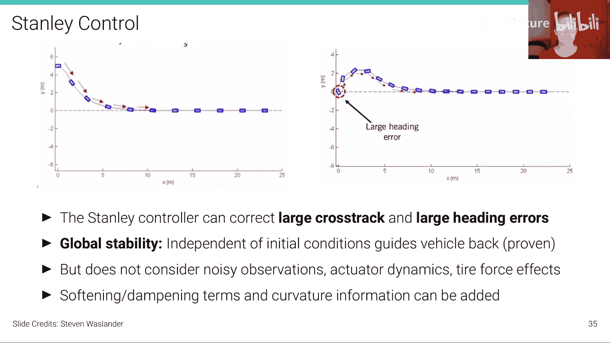

# 【图宾根大学】自动驾驶汽车课程 ML4340 p22 P22 Lecture 6.3 (Vehicle Control - Geometric Control) -BV16FP2ePEYc_p22-

Okay。We've seen blackboard controllers that don't make any assumptions。

They don't require any knowledge of the underlying。Process to be controlled。However， in practice。

 often， we have such knowledge available。 Remember the last lecture。

 lecture number 5 on vehicle dynamics， where we have built。Relatively precise。

Kinematic and dynamic bicycle models for。Moodeling the behavior of cars。So， of course。

 we should use that knowledge in order to build better controllers and。In this unit。

 we're going to talk about geometry controllers。That are one type of controllers that make use of that knowledge。

Let's first talk about pure pursuit controllers。The goal of a pure pursuit controller。

Which is the name for one specific type of controller， of vehicle controller。

 So now we are specific to vehicles。The goal of a pure Purd controller is to track a target point。

He unread at a certain look ahead distance。 D， this is this dashed line here。

In order to follow a path in red。In this case， in the case of a pure pursuit controller。

 the look ahead distance is defined as the distance between the target point。And the。

Center of the rear axle， the centre between the two rear wheels。

So given the current state of the vehicle。Given knowledge of the location of the centre of the rear wheels。

And given the look ahead distance。We can calculate the target point on the path that we want to follow。

So we want to track that target point， we want to steer the vehicle。

 we want to adjust the steering angle of that vehicle delta。

 such that the vehicle comes closer to that target point。In other words。

 we want to exploit the geometric relationships here。

Between the vehicle and the path to follow in order to。Minimize the cross track arrow。

 which is the arrow between。The target point。And the vehicle。So this is the lateral arrow。

In this case， defined by this line here。So how can we do this。

 We want to minimize the crosst arrow E。And we want to do so by following a circular trajectory。

 Remember again from the kinematic bicycle model that the rigid body。

 the vehicle follows a circular trajectory around。An instantaneous centre of rotation。

This black dot here。So we want to define a circular trajectory such that when we follow that circular trajectory。

The rear wheel will。Coincside or come closer to the target point。And， of course， over time once be。

Simulate this model。 The target point will move as the vehicle will move。

 but eventually well get closer and closer。 We want to steer such that we get closer and closer to that path。

So we can see the circular trajectory here in gray。

That is the circle that's formed around the rotation center in black。

And so we have this line here connecting the target point and the rotation centre。

And the length of that line is are the radius of that gray circle。And the length of。

The line connecting the rear wheel with the rotation center is also R。

 because both the rear wheel and the target point lie on that circle that we have formed such that it passes through the rear wheel and the target point。

Now the question is， how can we set the steering angle？The steering angle。

Is determined by the angle alpha。So we want to derive a relationship。That relates alpha to Delta。

 What is alpha Al is the angle between the vehicle heading direction， this line here。

And the look ahead direction。The dash dash line here。And we can calculate alpha。 This is our input。

 This is our measurement， because we have defined that target point at a certain look ahead distance along that path。

So we can measure alpha。 and the question now is， how should we adjust Delta such that the vehicle moves along that circular trajectory。

If we know alpha。In other words， what does the function delta of alpha look like？Right。

One thing to note here is that this angle delta does not only appear here as the steering angle。

 but similar to the kinematic bicycle model that we are。Drawing here。This angle also appears here。

Because we have a right and autogonal。Angle here。And also this angle alpha here。

Leads to and this autogonal angle here leads to the fact that this angle here is pi half minus alpha because this is autogonal。

 so it's pi half。And so this must be pi half minus alpha if this is alpha。Now， because。

This line and this line have a length of R。So they have the same length。And because the。

Inner angles of this triangle must sum up to 180 degrees or pi。

And because we have pi half minus alpha here。And so do we have pi half minus alpha here。

 Because these two are half the same length。We know that this angle here must be2 alpha。

So we can also define this angle between these。These two lines。

 the line connecting the rotation center and the target point and the line connecting the rotation center and the rear wheel。

Okay， and then， of course， we have L whichD。Distance between the rear and the front wheel。

 the base of the vehicle。Nao。I think we have defined find all the quantities on this slide， yes。Good。

 so we can continue。Okay， remember， we want to define a relationship that relates alpha to Delta。

 given any alpha we want to know what Delta is， So let's derive that relationship now。

The first thing that we're going to do is we're going to apply the law of science。

The law of science tells us that this distant D， they look at distant D。Divided by sine of 2 alpha。

Must be equal。To this distance are。Divided by the sine of pi half minus alpha。

This is the law of science。Now， through。Similar。Tgonomic considerations。

 we also know that sine of 2 alpha is equal to 2 sine alpha cosine alpha。

And sine of pi half minus alpha is similar cosine of alpha。I is simply cosine of alpha。

So we get D over2 times sine alpha cosine alpha equals to r over cosine alpha。And so now we can。

Remove cosine alpha from this equation。And we can。Rightrite one over R。

 which is actually the curvature of this circle， of this trajectory here。

 of this gray trajectory here。 So this is the curvature cupa。1 over R。

Equals2 sine alpha divided by D。So we simply have this expression。2 sine alpha divided by D。

 if we divide 1 over R。This is the curvature of this gray trajectory。

This is the first quantity that we had to derive here。Now。

 the steering angle is calculated as tangent of delta。Equals L over R。

 similar to the expression that we have already seen in the lecture on the kinematic bicycle model。

Tangent of delta is equal to L over R。And because we have just defined what one overar is。

 we can plug in 2 sine alpha over d here， so we get tangent of delta is 2 L sine alpha over d。

Or in other words， delta， the steering angle is the aoust tangent of 2 l sine alpha over d。Now。

 if we assume。That。A steering angle is small than。The tangent is approximately linear， so we can say。

 well， the steering angle delta is approximately。2 L sine alpha divided by the。Dear here。

Is the look ahead distance。And that is a parameter of our system。

And it's important to note that this look ahead distance should be based on the vehicle speed。

If the vehicle speed is high， we want to have a larger look ahead distance because we don't want to make very appropriate steering manoeuvers。

So in practice， D is often chosen as。A constant K， This is a parameter times the velocity of the vehicle。

Now。In terms of the crosst arrow。What do we obtain， We want to now see how。

 So here we have derived basically this relationship that we were interested in before。

Delta of alpha。 So we know how to compute now Delta from alpha with this approximation or without。

But what we wanted to do actually is we want to minimize the cross check error。

 so how does this relate to the cross check error？In terms of the cross track arrow。

 we obtain the following expression。So we're looking at this triangle now here， the blue1。

 sine of alpha equals E。Overdue。嗯。And from the previous slide。

 we know that the steering angle is defined through this expression here。

Because the steering angle is defined through this expression here。

And because Es sine alpha over because sine alpha equals e over d， we can plug that into here。

 and so we get the steering angle to become equal to the asangan of 2 L E over D square or。

If we make that low angle approximation， we obtain a steering angle as 2 L over d squared times the cross track arrow E。

What does that mean？Well， it means that the pure Pre controller acts as a proportional controller with respect to the crosst error。

Because we have Delta equals a proportionality constant times。The crosstarrow him。So indeed。

 we derived a proportional controller for the crosst error。

Where the proportionality constant depends on L and D and D is often based on the vehicle speed。

 as mentioned before。Now， a slight modification of the idea of pure pursuit control is called Stanley control。

 and it was successfully used by the Stanford Racing team to win the Dpa Gr Challenge。

The control law used by Stanley combines an expression that is very similar to the one that we've seen before。

 it's the as tanggan of。A constant of proportionality。

Or a parameter times the crosst arrow over the velocity。

But it also includes another term that's directly trying to minimize the headingarrow。

 and in contrast to the pure pursuit controller， it has the reference not at the rear axle。

 but at the front axle。 So it measures cross checkarrow with respect to the front axle。

And in contrast to the pure pursuit controller， it doesn't have any look ahead。

 It just tries to find the closest point on the path。For。

A the front wheel or with respect to the front wheel。

 and that's the target point it use for computing the control law for the steering angle。

So it's a controller that uses the front axle， has no look ahead。

 and combines heading and crosstarrow all into one steering law。

And it has some very nice properties that can be theoreticalically shown， for example。

 it can be shown that the crosst arrow converges exponentially。To0。

 independently of the actual velocity v。And this one thing that has to be mentioned here， of course。

 is that this controller also just works for compably small velocities with our disturbances because it doesn't model。

Tyre forces， for example， so it's still a relatively simple control law。

 but it can be extended there's various extensions of this control law。And for low speeds。

 it's a very good control law。Let's have a look at how this works concretely。

 let's have a look at a case study。So here we want to follow that red path shown on the top。

And the target point is， again， the closest point to the front。Will。Off the path。

So let's assume the vehicle is in that state。 And obviously。

 we need to steer to the left to reach the path。Now because we have a large cross track error。

This term here will become large， so what that means is the steering wheel will turn left。

The front wheel will turn left。And that's independent of the fact that actually the vehicle orientation is almost parallel to the path。

So this term here might be 0。But this term here is large because we are far from the path of the steering angle。

Becomes large。Now， once we steer into this direction。

 we might at some point reach this position here， facing directly towards the path or almost directly towards the path。

Now， in this case， as the heading changes， the heading correction。Precisely。

 this term here counteracts the crosst error， correction。So we still have a crosst arrow。

 which means the crosst arrow tells our vehicle we should steer left。

 but at the same time now we have a strong steering angle， a strong heading arrow。

Indicated by this blue angle， psi here。And so this heading correction tells our model。 No， no。

 we shouldn't overte。 We should steer back。 And so。In this particular case。

 both of them balance out and the vehicle steers straight forward to move towards the target point。

Now， as the vehicle moves closer to the target point。

 the crosst error decreases and the importance of the heading correction。

Outweighs the importance of the crosstic error。 So the vehicle starts steering towards the right as it comes closer to the path。

 and that's illustrated here。And so， it will eventually。

Come closer and closer to the path and reach the path smoothly。In summary。

 the Stanley controller can correct large crosst and large heading errors。

 and two concrete examples are illustrated here。On this slide from Stephen Wasslander。

Where in the first example， we have a large cross track error。

 but the heading of the vehicle is actually correct， but because we have a large cross track error。

 the vehicle steers to the right until it smoothly reaches the desired path in blue。On the right。

 we see an example where the crosstarrow is actually0 initially。

But we have a very large heading arrow。 And because of this large heading arrow。

 the vehicle starts moving into along this trajectory here until it also reaches the desired target path。

A nice thing， a nice property about the Stanley control can be proven is global stability。

Independent of the initial conditions。We are assured that this control law guides the vehicle back to the target path。

However， the model doesn't consider noisy observations or actuator dynamics or typho effects。

And there's various extensions of this model that improve it， for example。

 what people typically do is they include softening or dampening terms to improve stability。

And also add curvature information to improve the Stanley control law。

🤧嗯。So finally， I want to show you a little clip of the Stanley vehicle navigating during the DARPA Grand challenge。

In this case， along a steep and small。Puff。😔，Through the mountains。

 where the vehicle behind the Stanley vehicle is just the vehicle。

That's controlling and making sure everything is going All right。

 But the car itself is driven autonomously。 And as you can see， it drives pretty slowly。

And it's using the Stanley controller to。Move along this path。

