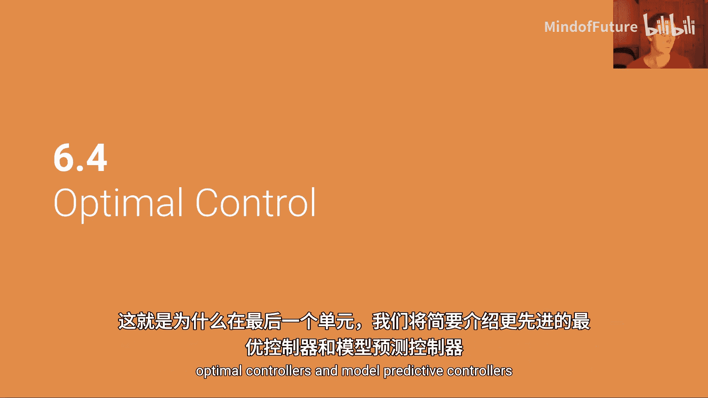
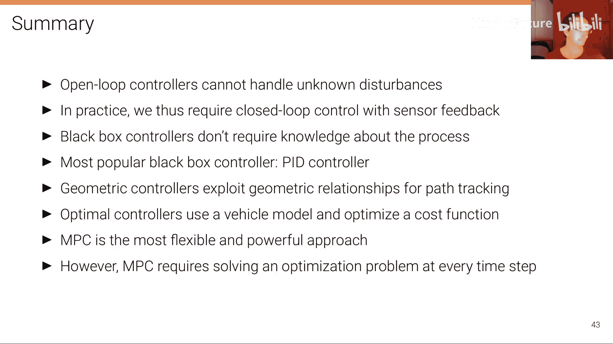

# 【图宾根大学】自动驾驶汽车课程 ML4340 p23 P23 Lecture 6.4 (Vehicle Control - Optimal Control) -BV16FP2ePEYc_p23-

One problem。That's common to all the controllers that we've seen so far is that they cant。

Look for a very large time into the future。However。

 due to the high speeds with which we want to maneuver a vehicle。And due to the mass of the vehicle。

 it's often required。In particular， at high speeds。

 to look well ahead into the future and to anticipate。Upcoming。

Interects or other vehicles or curves early on， and so these controllers can't deal with such situations。

 and that's why in the last unit we're going to briefly cover also more advanced optimal controllers and model predictive controllers。

Both optimal controllers and model predictive controllers make use of。Underlying dynamics。

 So we need also for those controllers， we need a model， and we are going to exploit it even more。

Compared to the geometric control approaches that we have seen before。

Let's recap the dynamic bicycle model as an example。

This is the equation for the dynamic bicycle model that we have seen in the last lecture with state X that comprises the。

Lateral velocity。Anular， not a heading and the angleular velocity in its state。

And which is a simple differential equation where the first order time derivative of the state is expressed as a linear system of the state plus a vector times the input。

 which in this case is simply the front steering angle delta。So we have very simple linear。

Different equation here。Which means we can write this。😊，System here， in the following form。

 in the following linear system， x dot the time derivative of the state x equals a。

 This is this matrix here。Times the state x， this vector here。Plus， a vector B。

This is this vector here。Times the scalar input， the steering angle， delta。Where x。

Is comprising the lateral velocity。And the heading angle and the angle of velocity。Now。

 given such an equation。The so called linear quadratic regulator or L QR。

 which is one of the most common forms of optimal controllers。

Given this continuous linear time system， with some boundary condition。

 initial condition x of 0 equals x in it。And a quadratic cost functional。Defined as J equals12。

Times to integral over to time into the future。In this case， infinitely into the future。

And here we define a cost term， where Q is a diagonal weight matrix that assigns a cost to particular states in the future。

 so it's a very expressive model we can define costs into the future through this model。

And we can also define a costs on the steering angle。 for for example。

 we could say we want the steering angle to be not too large。For all time steps into the future。

 So this is effectively modeling a rollout of all。Dymics model。

The interesting thing is that in this particular simple form。

 if we can state our system in that particular simple form， the feedback control。Delta。

 that minimizes J。And of these constraints。Is given by this expression here。Where K。

Equals this expression， and P is the solution to a rikadi equation。

But we're not going to go into details here。 The only thing that's important to note is that we have a closed form solution。

But we only have a closed form solution due to the specific way we formulated this。

 because we have formulated this as a quadratic cost functional。 And also here。

 we have just a continuous time linear system。 So these are pretty strong assumptions we are making。

And they are not always realistic。 Often， we want to be much more flexible in our modelling。

And this is what brings us to model predictive control。

While the optimal LQR controller that we've seen before。Has a closed form solution。

 Model predictive control generalizes this idea。But giving up on the closed form solution， requiring。

Test time optimization， requiring that we optimize a function during the execution of our controller。

 So it becomes more computationally expensive， but at the same time， we gain modeling flexibility。

So model predictive control generalizes LQR2 nonlinearar cost function and dynamics。

 which is great because we can then， for example， consider straight roads leading into turns。

 nonlinearities， but also we can go from that simple definition of that dynamic bicycle model to the global definition in terms of global coordinates of the vehicle which we are almost always also interested in。

 which then suddenly becomes a nonlinearar。Equation。

Just by changing from this local coordinate definition into a global coordinate definition。

 as we've discussed in。The lecture on the dynamic bicycle model at the very end this makes this system nonlinear。

 and so the LQR is not applicable anymore because it's only applicable to linear systems。

But model predictive control can handle this。 This is the most expressive controller。

 and it's used widely now， given that compute becomes cheaper and cheaper。

 and many of the systems that we want to control can accommodate a lot of compute。

So it's applicable and it is very flexible also。For example。

 it's flexible in allowing for receding windows。 We don't need to model into all all the way until infinity into the future。

 but we can model for a fixed time window into the future， and we can give different weights。

 different importance to different。Time steps。 So we could say， well。

 what happens in the immediate future is more important when I reduce the error there compared to looking further into the future。

 where maybe also our measurements， our perception is more uncertain about。

And then we can incorporate arbitrary constraints， whatever can be optimized， we can incorporate。

However， as already mentioned， it more expensive。 We require now a nonlinear optimization at every iteration。

At which we execute our controller。Controllers are typically executed at very high rates in order to control a system。

 you have to execute a controller maybe 1000 times per second。

 which means you need to solve a nonlinear optimization system 1000 times per second。But。

 it's doable。Formerally， model predictive control can be formalized。Using these equations here。

 we are the goal is to minimize。A sum of cost functions with respect to， let's say。

 the input steering angles from。The current time step1 to T times into the future。

 where at each time step， we have a potentially different cost function。

And that depends on the state。Of the vehicle into the future。 Well。

 the vehicle starts at some initial condition， and we have a dynamic model such as the dynamic bicycle model that allows us to simulate our vehicle for T。

 for capital T time steps into the future by iteratively executing this。

So you can think of this in in terms of a big computation graph， an unrolled computation graph。

 your unroll this optimization。嗯。Into the future， and then you optimize this parameters delta。

And we can also accommodate arbitrary constraints。So we unroll the dynamic model t times and then apply linear optimization to find the parameters。

 similar to how we unroll recurrent neural networks in deep learning and optimize the parameters of the neural network。

Finally， let's look at a concrete example to illustrate why model predictive control is important in particular if we consider high speed driving。

At the top， you can see an example for a classical PID or path tracking controller。Let's assume。

This is the situation the vehicle moves along that road that makes a right turn here， a pretty sharp。

 right turn， actually。And we want to follow。 We want to track this point here， that's。

Aled with the centre line of the road at a certain distance in front of the vehicle。

 And let's assume initially， the vehicle drives at 50 km power。

Because we are following that point and theres no restrictions on the road we might accelerate。

So we go at 60 km power now。And because we're still going straight and we're just looking locally at our environment。

 we accelerate further to 70 kilometers power。So still， as everything is fine。

 We don't know that there is a right turn here。But now。Once we have accelerated。To 70 kmre power。

 we see that now very suddenly， very abruptly this。Target point on the par， on the target path。

Moves to the right， but we are too fast。 We can't break as quickly any more。 So we are continuing。

 were decelerrating。 We're trying to track that point。 but there is no way we can do that。

 And so we are decelerrating， but still we are crashing into the other side of the road。In contrast。

 a model predictive controller unrolls the model for T time steps。

 as long as we tell it to unroll the model。And it knows the entire trajectory into the future。

 as long as。We have， let's say， a map， or we have observations of the environment into the future。

And so we know already at this point that we have to decelerate in the future。

 which means that we can already start decelerating now。

 we are following this trajectory and at every time step model predictive control recalculates for recalculates its T future time steps。

 So here at this point we have calculated these time steps。

 Now here we are calculating these time steps and one further time step that's not shown here。

But because we are calculating into the future， we are rolling out our vehicle model。 We can follow。

Theoretically， anyway， we can hypothese the trajectory into the future。

And so we know already that at this point， we need to decelerate in order to actually make that right turn here。

 So we're decelelerating to 30 kilometers hour to 20 kilometers hour。

 and then we're making the right turn。But， that's the difference between。

Plf tracking and model predictive control， when considering high speed driving。And situations where。

A long look ahead is required。In summary， in this lecture。

We've seen that open loop controllers cannot handle unknown disturbances In practice。

 we therefore require closed loop controllers with sensory feedback。

We've also seen that black box controllers don't require knowledge about the process。

And that the most popular black box controller is the P I D controller。

We've seen that geometric controllers exploit geometric relationships for path tracking。

And optimal controllers。Use a vehicle model and optimize a global cost function。

Amongst all MPC is the most flexible and powerful approach， however。

 MPC requires solving an optimization problem at every time step。

