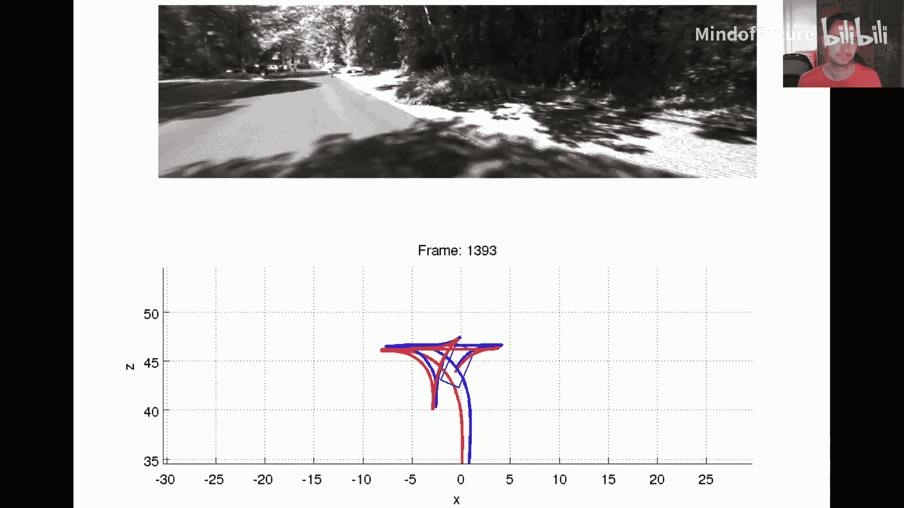
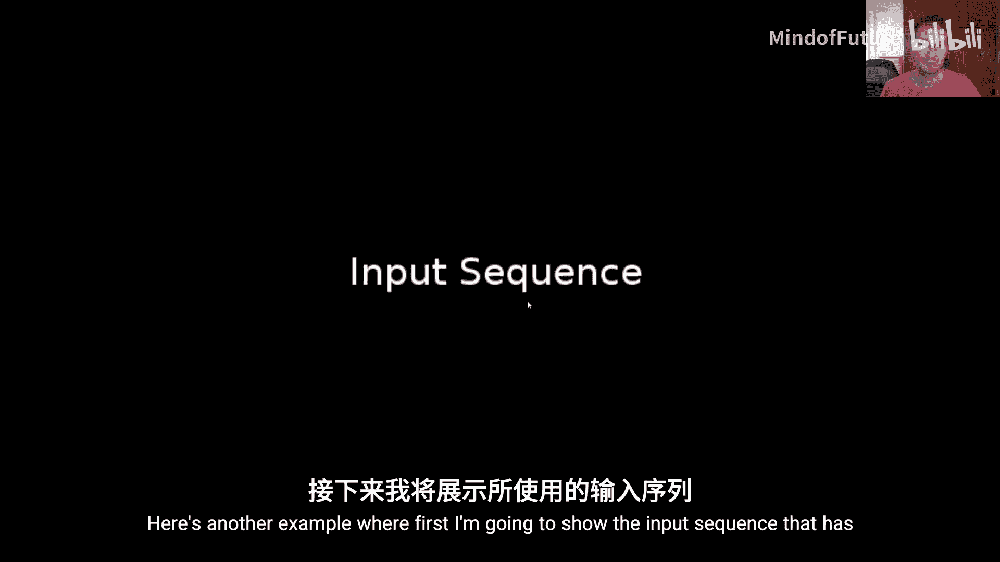
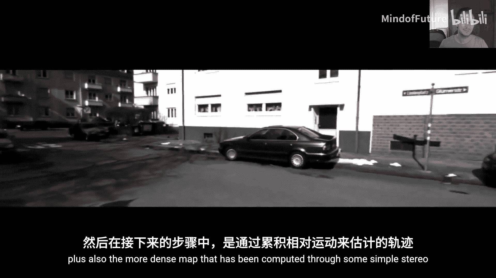
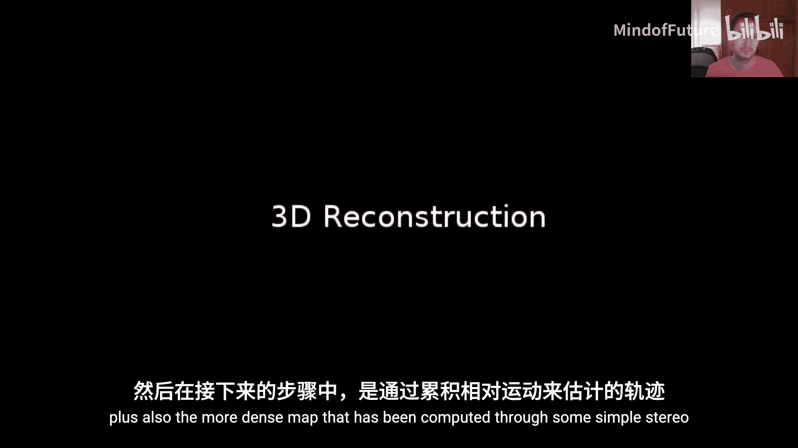
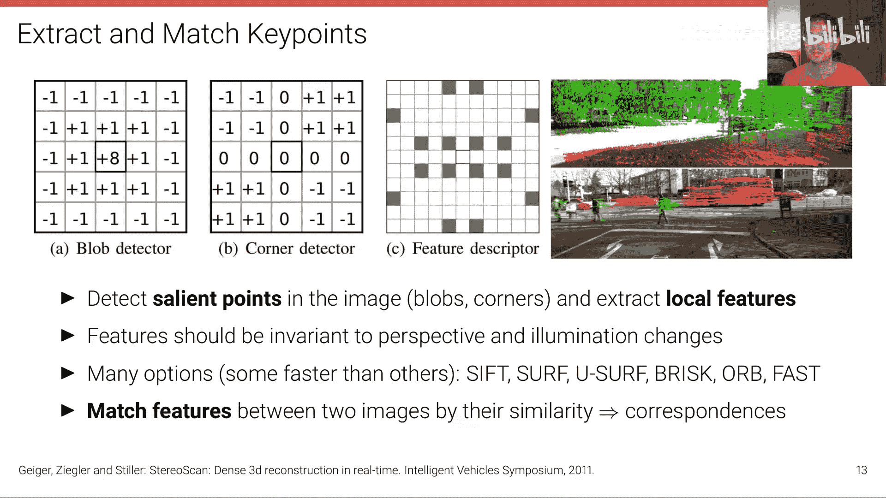
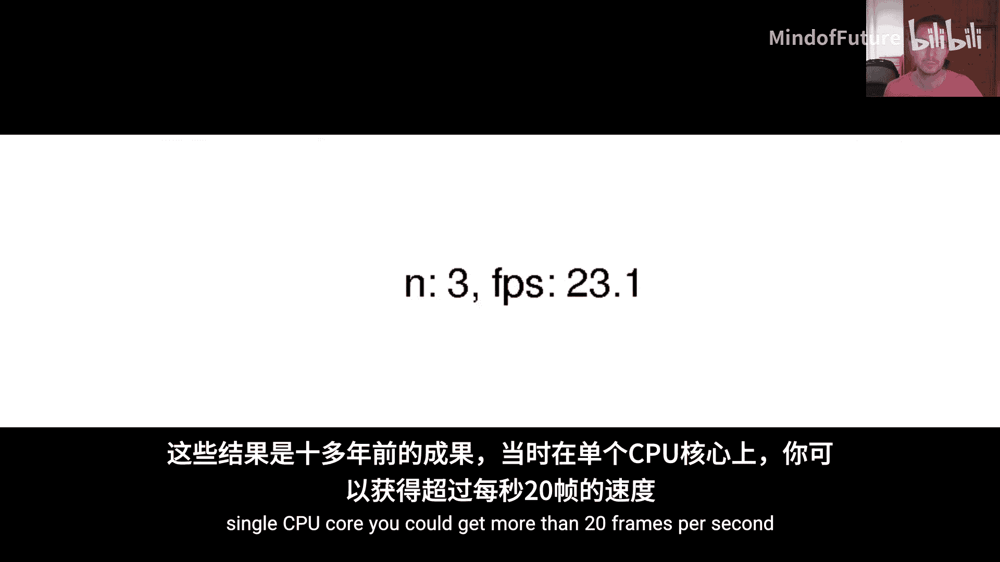
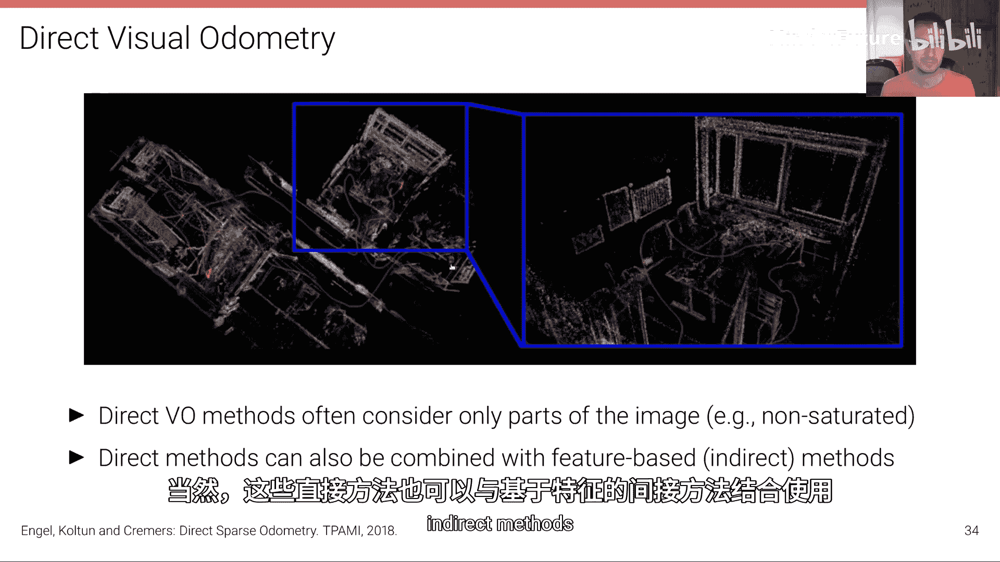
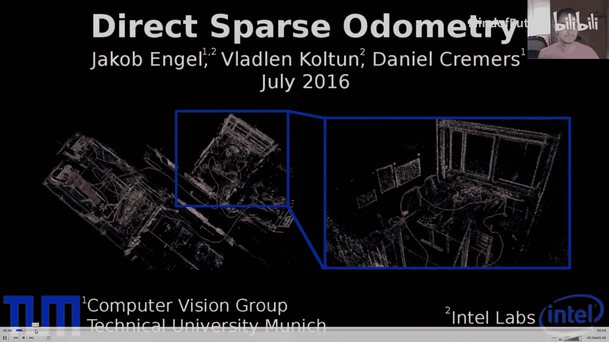
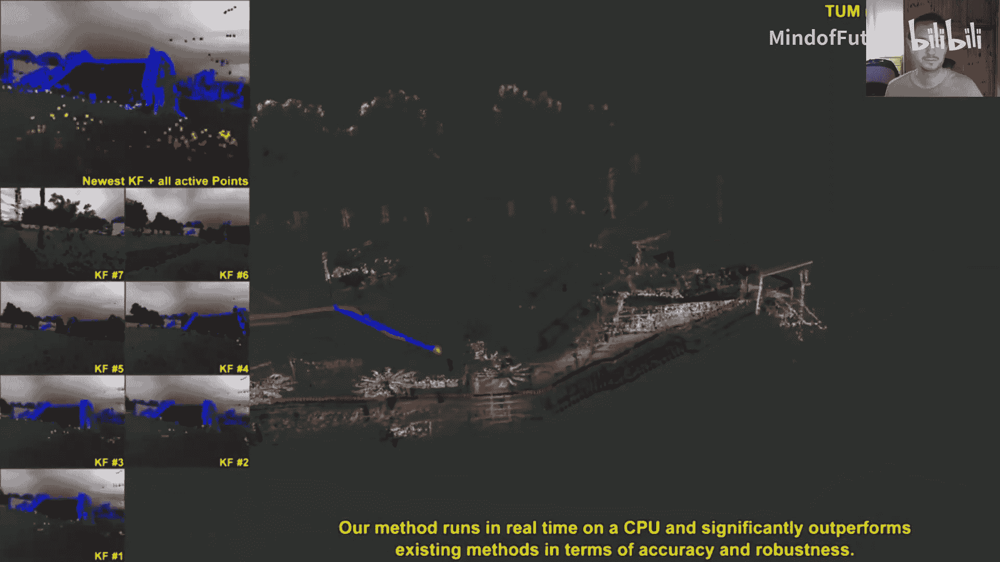

# 【图宾根大学】自动驾驶汽车课程 ML4340 p24 P24 Lecture 7.1 (Odometry, SLAM and Localization - Visual Odometry) -BV16FP2ePEYc_p24-

Hi and welcome to Self drivingiv Car lecture number7 on Oometry， SM and localization。

We already made it halfway through this course。Now， in the remaining six lectures。

 what we're going to do is we're going to have a closer look at the classic modelular pipeline。

 and in particular， we are going to have a look at the individual modules that the modelular pipeline is composed of。

 For example， low level perception and scene parsing。Which is the content of the next few lectures。

As well as path planning and decision making， which is the content of lecture 12。And of course。

 the vehicle control， which we have already discussed in the previous two lectures。Now。

 in this lecture， we're going to focus on ego motion estimation and localization。

Self driving cars operate in a dynamic environment and hence。

 of course must be aware of their ego motion， which is their own motion。

 and also the motion of the other traffic participants。

The focus of this class is on estimating the own motion， the so called ego motion。And theres。

3ree different types of。Motion estimates that we're going to consider。

 The first is called visual orometry。Visual oometry refers to the estimation of relative egomotion from images。

Here's an example。On left， you can see the vehicle at time T。

 and on the right you can see the vehicle at time T plus1。Which has。

From time T to time T plus1 undergone a rigid body transformation with rotation R and translation T。

 So this is a six degree of freedom， rigid body transformation here。

And I highlighted in red the parts that we want to estimate。

 So in this particular case of visualometry， what we typically want to estimate is the rigid body transformation or the six parameters。

That relate the current。Oose with respect to the V the previous post。

And that's why it's called relative egomotion estimation， because we are not。

Locating or localizing the vehicle with respect to a global reference， such as a map。But， we are。

Localizing it with respect to a previous pose， previous time instance。

The other category that we're going to have a look at is called SM or simultaneous localization and mapping。

 where the goal is to build a map and simultaneously localize in that map。

We're going to see that these two tasks have to be tackled jointly。And as you can see here。

 everything is red。 So the map in this case is。As an example。Is comprising free landmarks。

 So we want to estimate the location of these landmarks and the pose of the vehicle。

 and we want to do both jointly。So that afterwards we have localized inside that map。

But we also have produced a map that can be used for localization later on when we drive in the same region another time。

And this is the problem of localization， given a map， for example， a map that's provided。

By a mapping company such as a high definition map that's often used in autonomous vehicles or a map that's automatically computed through slam algorithms by。

Driving in that area before and mapping that area。So given such a map。

 we want to find the global pose of the vehicle。How the vehicle is located with respect to that given map。

 and these maps can be quite large。 They can be hundreds or thousands of kilometers。

 So this localization problem can also be quite hot。Okay。

 this is illustrated here on the right where you can see the vehicle in red because we want to estimate the pose。

But the landmarks in black because we don't optimize the landmarks in this case。Now。

 all of these are useful things to do。For example， estimating the。

Ego motion relative to the previous frame is important to integrate the trajectory over a longer time horizon and in order to measure how well。

 for example， our dynamics model predicts and in order to be able to control the vehicle。 Of course。

 we need to know how we are driving。Localization with respect to a map is also important because we might。

Add useful information to that map， such as the location of the traffic lights that might， in turn。

 facilitate。Thete of the traffic lights。Or we might put other things in there。

 such as lane markings that help us keep the lane or the number of lanes and all these kind of meta information can be useful。

So in practice， all of these things are needed for self driving。And this is the roadmap for today。

In the first unit， we are going to cover visualometry in a second unit slam。

 and then finally localization。So let's start with visualometry。This is the picture from before。

And we're going to go a little bit more general now。

 we're first going to have a look at autoometry in general， which is not necessarily visual。

 doesn't mean it needs to be estimated from image sensors can also be using other sensors。

 but the problem is we want to estimate the change in ego position over time through some sensors that are available to us。

 and often there's multiple sensors。And we want to combine those。Odoometry has a Greek word origin。

 comes from otters， which means route and metron， which means measure。

 so we want to measure the route that the vehicle has been taken。In the example above。

 the car undergoes a rigid body motion between the two frames。

Aometry yields relative motion estimates， not a global position with respect to a map。Therefore。

 it's sensitive to error accumulation over time。It's only precise locally。

If you take these relative motion estimates and you accumulate many of them over time。

 you will get drift and we're going to see such drift situations later on and how they can be addressed using loop closing techniques in SlamM。

 but if you just consider the oomeory problem you will always have drift because you're integrating the position over time through relative measurements。

 so over time the error will grow larger and larger。It's not a good technique to estimate the。

Global position。Over very long time horizons。 But it's good at estimating the local relative motions。

 And that's often what's important for self driving。

 because we want to know locally how we are moving。

Adoometry information can be obtained using a variety of sensors。

So here are two examples that are not visual。The first isveal ortry。

Wheel or dormtry systems use wheel encoders to measure wheel rotation。

 You can see such an encoder here。This is， I chose this picture because it's very visual。

 and you can see it。 actually。 This is one of the first prototypes of the Google self driving vehicle。

But， of course， in。Modern vehicles， self driving vehicles。

 these sensors are integrated inside the vehicle and。A very inaccurate version of this is， of course。

 available to all of us in our cars today， if you。Get into your car。

 You see the kilometers that you have been driving since you have bought the car and so。

This is also the same principle just that these type of sensors for self driving vehicles should be much more precise。

 of course。Another type of autoometry sensor is called an inertia measurement unit you can see a very expensive one that's often used in self-driving vehicles here on the right。

 but you do have such I am used also in your smartphone for example to determine if you take a picture upright or in landscape mode。

 these acceleration sensors are used or if you pick up your smartphone。

 the display goes on and so on。Iner measurement units measure a body's force through accelerometers that are built into these module and complicated algorithms that。

Track and update this information。Through filtering。Accelerometers， of course。

 only estimate acceleration。Typically， linear acceleration and also anglengular acceleration。

 And in order to obtain the pose from the acceleration， we need to integrate twice。

Which means that also noise is integrated twice。 and this means we can't use only。

IM U data in order to arrive at precise pose estimates。

 That's why often IM uses are combined with other type of sensors， such as visual sensors or。

GPS sensors。And finally， we have visualory algorithms that use camera images。

 which we focus on today。Multiple systems are often combined to complement each other， for example。

 if you drive into a tunnel， the image becomes dark， it's hard to match features。

 and so it's important for this short period of time that another sensor takes over and so that's why you're fusing that information typically for example。

 VIO is visual inertial oometry that means we combining visual oometry。With。

An inertal measurement unit， and often inertial measurement units are combined with GPS or with wheel dormtry。

 etc in practice to make this more robust。Here's an example of visualometry。

 Visualometry is concerned with tracking the camera the camera pose。

 the position and orientation of the camera。With respect to the environment from images。And。

If you can track the camera pose and the camera is calibrated。

 you know the relative pose of the camera with respect to the vehicle coordinate system。

 So you also know the。Vehicle motion through knowing the camera motion。

Visual Dtry considers typically a limited set of recent frames for real time performance。

In most of the cases， which ladoometry considers just registering the current frame with respect to the previous frame。

 estimating the。relativeative motion between two images。

And this also leads to errors that accumulate over time。Another remark I have is that。

Visual dormomeies， while focusing。Mostly on the motion estimate， the relative motion estimates。

 they typically also have to build a local sparse map。And this is a byproduct。

 it's not the focus of these techniques。But it's a byproduct that means they are used in order to estimate the motion。

 And we will gonna see that。They are typically not as accurate。

 They are not very dense compared to slam algorithms or dense mapping algorithms。

 but they are needed to estimate pose。Now here's an example where in the background you can see a 3D reconstruction of the scene。

 and this is not。The sparse local map that is the byproduct of the V visualitory algorithm。

It's a much more dense map that's obtained through stereo reconstruction to illustrate what the scene looks like。

But what is actually the output of the visualitory algorithm is this。Red trajectory。

 And you can see these little triangles here， which are the camera poses。

 Each of these triangles corresponds to one frame。And you can see how the vehicle has been driving along this road。

 And then over this bridge here。 And this has all been determined through just image measurements。

 This entire motion has been determined through。Image measurements。

And then by knowing the pose of each individual camera。At each frame， we can then， of course。

 combine all the local reconstructions that we get from stereo into a very nice global reconstruction。

 as you can see here。So we can use thedoomeory information to locally map the environment as well。

Here's an example of how visual Doittry works in practice， you can see。As a comparison here in red。

 this is the。Posose of a very accurate GPS inertial measurement unit。

 as you have seen on the previous light， and in blue the estimate from the algorithm。

You can see how the algorithm。Accumulates。The relative motion estimates into a global。eng。

Position on the map relative to the first post estimate。

 you can see how it tracks this parking manoeuverre here quite reliably。

 just from the image measurements， given this image sequence above。

Here's another example where first， I'm gonna show the input sequence that has been used， and then。

In the following the。Djecty that has been estimated for。

Accumulating the relative motions that have been computed through visualometry。

 plus also the more dense map that has been computed through some simple stereo matching algorithm。

So there hasn't been any。G， P or any light are involved here。

 It's just a image sequence that has been integrated。Into this local environment。Okay。

 so let's look at these methods in a little bit more detail now。

And we're going to look at two methods。 The first type of method is called indirect visualometry。

And it's called indirect because we have an indirection step here。

 which is a feature detection and extraction and matching step。

The input images from the input sequence are passed through a feature detector that detects。

Salient points in the images and tries to match their salient points between。Respective frames。

 typically adjacent frames。In order to get so called image correspondences。

 and then we have an algorithm that minimizes the re projection error of these correspondences back into the image。

And at the same time， also returns some sparse map。 And so through this we get de motion。

 the relative motion estimate。That's called an indirect visual autoometry method because it's going through this feature matching step。

Sometimes it is also called a feature based visual dormittry method。In contrast。Direct methods。

 omit this。Intermediate step and go directly from the input image sequence to the relative camera。嗯。

Prameterters and the map。By minimizing instead of reproion errors of this sparse feature correspondences。

The photometric  error， they are trying to warp one image into another by estimating now as a map per pixel depth and then computing the photo consistency between the warped images。

 trying to align two images to consecutive images of such a motion or of such an image sequence in order to find the optimal motion。

Both of these approaches have advantages and disadvantages， and we are going to come to this。

A little bit later， in this unit。Let's first start with the indirect。

 the classical indirect visualometry approach。As already mentioned。

 the first step is for each image we need to find distinct。

 salient points in the images that can be matched to the previous frame where we also try to find those points。

And we do this by。Looking for salient points in the image， for example， blobs。

 here is a5 by a simple5 by 5 filter that we could sweep over the images in order to find。

Blops in that image， and this is a checkerboard filter with which we could find corners in that image。

And then we can take pixel intensities or gradients and combine them into a feature vector to describe these corners and blobs。

And。By then matching the feature deed the value of these vectors。

With respect to these feature vectors that have been extracted in the previous frame。

 we can get correspondences as illustrated here through these little arrows。So this。

The starting point of these  errors are the location in the previous frame。

 and then the end point of the dot is the location in the current frame。 And this is for a。

Scenario where the vehicle is moving， the e vehicle。

And this is for a scenario where the ego vehicle is still， but other objects are moving。

Now this feature should be invariant to perspective and illumination changes。

 and there is many options somehow faster than others， for example， sift， surf，buur， brisk， orb fast。

 or just something very simple as here in this paper is often sufficient for self driving。

 We typically don't need to be as invariant as in general computer vision because the two frames that we are comparing are taking very close in time。

And so this means that not that much much has changed。 Of course。

 we wantan to be a little bit invariant to perspective and illumination changes。

 but we don't have to， for example， be invariant to 180 degree rotation。

 turning the picture upside down that typically， hopefully doesn't happen in driving as often。

Between two frames。So we can use some simpler features that work quite well in real time。

And then we match these features between two images by their similarity。

 similarity of the feature vectors。 So we might build a K D tree in the first。Fra。Of this。

Lectctor space that these feature descriptors live in。

And then we are matching the current frame against that one。 and that works， quite。

Efficiently in practice for at least simple descriptors like this here。 So here in this case。

 very simple5 by5 kernels for finding features。Plus something that's called non maximum suppression in order to just retain the most salient ones。

And then using the gradients at very specific sparse locations of such a feature descriptor and stacking those into a vector and then finding the closest match in the previous frame。

And you get something like this。

So these are results from already more than 10 years ago and already back then on a single CPU core you could get。

More than 20 frames per second。

And theres as you can see there's a lot of image features matched here。

 so this is modern than enough to estimate the visual oometry。

 which effectively comprises only six parameters， the six parameters of the rigid body transform。

 so there's a lot of measurements that we can derive very quickly。So this is the first step。

And feature based methods。Now， the next step is how do we actually arrive at the relative motion estimate from these feature correspondences that we have extracted。

And in order to understand this， we first need to look at the image formation process。

 And what I did is I took some slides of the computer vision lectures number two and number 3 and condensed them quite compactly for this class here in order to get a quick。

Recap or a quick introduction into how。Image formation works because we need to know this in order to understand how these visual dormit algorithms work。

Okay， ready， so let's start with image formation。In a nutshell。

We first need to talk about the basic elements， and these are typically points， for example。

 2D points can be written in so called in homomogeneous coordinates by just stacking the two coordinates。

This is a simple 2D vector that describes 2D points， for example， a pixel in an image。And similarly。

 we can describe 3D points with a 3D vector。And that's clear。

But we can also describe them using so called homogeneous coordinates。And with a genius coordinates。

 we always augment the dimensionality by one， so a 2D point。

 a pixel becomes a 3D vector and a 3D point becomes a 4D vector。

And we do this such that we like these points here， they are from a space P2。

 which is called a projective space。And the reason is that we consider all homogeneous vectors that differ only by scale to be equivalent。

 They are defining an equivalent class。That means that homogeneous vectors are defined only up to scale。

So why do we artificially blow up from two dimensions to three dimensions？ Well。

 this makes our life later on easier。 We can then define， for example。

 the image projection process that's inherently nonlinear as a linear function as a linear mapping。

 And so we can。Use simple linear algebra to define a lot of these mappings that we need to define。

And we can also derive the apolo geometry much easier with this definition。

So this is in homogeneous coordinates of a point and we can describe the same point in homogeneous coordinates。

 but how exactly can we convert between these two representations？Oh。

 and note that homogeneous coordinates we always in this class denote。

As in a computeruter vision class with a tilda above the symbol to denote that these are homogeneous coordinates。

An immunogeneous vector X is converted to a homogeneous vector。X tilde。Just a tilda missing him。

As follows。So x tilde。Is little X tilda， little Y tilde， little W tilda。And that is x， Y1。

 So we simply add one dimension and we put the element 1 in there。

And this is also what's called a augmented vector if the last element of an homogeneous vector is one we call that a augmented vector。

And that's the simple conversion from an in homogeneous vector to a homogeneous vector。

To convert in the opposite direction， we simply have to divide by the last element W tilde。

Let's assume we have a homogeneous vector。That is arbitrary where W tilde is not equal to1。

We can define divide this vector by1 over W tilde such that the last element becomes one。

And so now we have obtained the so called augmented vector。

 and we can read of the inhogeneous part here by just looking at the first two elements。

 which is x tilde over W tilde and y tilde over W tilde。 that corresponds to x。

So this is how we can go。We can translate between homogeneous and inhogeneous vectors by simply adding a one at the end。

Or by dividing by the last element。Okay。Now heres a graphical illustration of this relationship。

 where you can see the homogeneous vector in three dimensional space。

And here you can see the homogeneous coordinate system。

 And then the augmented vector is the vector where we intersect the line that connects the。

Qued an at center。And the point with the plane that's located at W tilde equals 1。

And you can already。See that from this illustration。

 this is somehow related to perspective projection。

We have already something that looks very similar to how an a 3D point gets projected into a 2D image plane。

So how does prospective projection exactly work。Let's look at this picture here。

Perspective projection of a 3D point X C。To pixel coordinates。We call the screen coordinates XS。

In the 2D image plane。First， we have to note that light ray are always。Lar。

 so we have a raid that passes through the camera center， and the。

3D point and that intersects the image plane at at Pel X S， and the goal is now， of course。

 to estimate that location in bluehi X S from the 3D point relative to the camera coordinate system。

The convention is to。Have the principal axis。Which is the C axis。Which aligns with the C axis。

Which is autoagonal to of the image plane。So the principal axis is the axis that is。

Going through the image plane autoagonally。 And so we align this coordinate system here。

 such that the C axis aligns with that axis。This is a convention。And the why。

Cordnate is not shown here for clarity， so we look at the image plane from the side。

This is where we take the measurements here。For simplicity， but of course。

 in the Y direction this works exactly the same way it would look something like this。Now。

 the question is， how can we derive the location of the 2D pixel from the 3D coordinate and camera coordinate system？

And。Where for this， we simply have to look at equal triangles here， so we have one triangle。

 which is this big triangle here， and then one triangle， which is this small triangle here。

And so we can see that xs， which is this distance here。The x component of the 2D pixel。

Over the focal length， which is the distance between the camera center and the image plane。

Is equal to。This distance， the x coordinate of the 3D point in camera coordinates。Over。

The C coordinate of the 3D point， the distance of the 3D point in camera coordinates。

So in other words， in perspective projection， 3D points and camera coordinates are mapped to the image plane by dividing them by their C component and multiplying with the focal length if we take the focal length here on the other side。

 we see that we need to take the X coordinate divide by the C coordinate and multiply with the focal length。

And we have to do this。 We can do this both for the x coordinate and for the y coordinate of the 3D point to get the x location and the y location on the image plane of that pixel。

Now。One thing to note here， the elegance of having。

Hmogeneous coordinates is that if we write this in terms of homogeneous coordinates。

 this nonlinear equation here。This is nonlinear because we divide by a C。

 suddenly becomes a linear expression。And this is illustrated here on the right。

Where we take now an augmented vector that's。X， Y， C 1。Multiplied with this matrix here。

And this gives us the homogeneous vector。 this is a three dimensional vector。

And you can see that if we do that， for example， here in the first row， we get F times little x。

And here on the last row， we get one times little C。

So we have as the last element of the homogeneous vector， we have C， and as the first element。

 we have f times little x。And so if we convert this vector， then into the。

In homogeneous form and divide by the last element， we get exactly this expression。A little remark。

 the unit for the focal length is typically chosen in pixel because we convert metric 3D points into pixels。

 so here we have something that's in meters and here we have something that's in meters。

And the output should be something that's in pixels。

 that's why the unit for F is typically chosen as pixels。Okay。

 so we see perspective projection can be written very simply like this。As has been derived here。

 but we can have an even simpler linear form if we use homogeneous coordinates because those implicitly do the division by C for us。

Now。What we've assumed so far is that the center of the image coordinate system is at the point where the principal axis intersects the image plane。

But normally we work with positive pixel coordinates where the image coordinate system is at the corner of the image。

 and so typically a principal point offset C Y and C X is added so that we can move the image coordinate system to the corner。

Off the image plane。And how does this look like when we look at the perspective projection model。

 well， we simply have to add C X and C Y， which is this so called principle point to the equation。

And the another thing we have added here is the so called Q parameter。

That determines theq of the image， but typically this term is0。However。

 now we have defined the full pinhole perspective projection model。

 and we can also write this in terms of the homogeneous form， the linear form here on the right。

Where are the elements now in red。This3 by free sub matrix of the so called3 by4 projection matrix。

This red part of the projection matrix is called decalibration matrix K。

And the parameters of the calibration matrix K are called the camera intrinsics。

As opposed to the extrinsic parameters which refer to the camera pose， for example。

 with respect to a world coordinate system。These are the intrinsic parameters。

You can see that compared to before， we have。Now different f's for x and y。

 and we have this Q parameter， and we have the principal point。In this case， F and。

 F X and FY are independent， which allows for different pixel aspect ratios。

And the s arises due to the sensor might not be mounted perpendicular to the optical axis。

 so we get a little s in the projection。But often， it's not needed。

Because the manufacturing process is so precise these days。

 and so in practice we often set Fx equal Fy。Have just a single focal length。And the sd to be0。

But we have to model the principal point because we really want to have positive coordinates。

 positive pixel coordinates， not negative pixel coordinates。Okay。

 so this is what the intrinsics look like。This is the image formation process when we have a 3D point in camera coordinates。

 but we can also chain these transformations。 So， for example， a 3D point might not be。

Represented in camera coordinates， but it might be represented in worldd coordinates here in orange。

But we might know the camera pose with respect to the world coordinates so we can still project that point in world coordinates to the image plan。

How does that work？Well let K again be the calibration matrix， the intrinsics。And our team。

This rigid body transformation between world coordinate system。And camera recording the system。

This is the camera pose or it。These parameters are called extrins。

And we can simply chain these two transformations to project a point in world coordinates to the image。

Cords。And this is illustrated here at the bottom。Again。

 because it's simpler in homogeneous coordinates。🤧咳。

So the point on the screen in homogeneous coordinates is as we have seen， the projection matrix。

 which comprises the calibration matrix and the zero vector。Times。

The augmented vector in camera coordinates， This is the 3D point in camera coordinates。

And the 3D point and camera coordinate itself is just a。Projection。A linear projection。

 a really richy body transform through R and T of the。Augmented vector in world coordinates。

 We can take that vector in world coordinates and convert it into camera coordinates by。嗯。

Multiplying it with R and adding T。 And so we can write it as the simple linear expression here。

And then we can simply chain these transformations and arrive at a single projection matrix so we can pre multiply these two if we want to。

 and arrive at a single matrix that takes a 3D point in world coordinates。

And projects it onto the screen。And， of course， it's going to be homogeneous。

 So in order to derive the actual inhogeneous。Pixel coordinates we need to divide by the last element again。

Okay。That was image formation in a nuts gel。Now let's look at so called Epolo geometrytry。

 which forms the basis for the most simple visual oometry algorithm that tries to estimate。

 given two images the relative motion the camera has undergone between these two images。And again。

 we are going to assume that the cameras has been calibrated beforehand， whiches。

True for most visual dormittry systems。So the intrinsic camera parameters are known。

The goal now is to recover。The camera。Po。And we can also recover the3D structure for that。

 from image correspondences。And the required relationships to do that are described by the two view Appolar geometry。

And if you want to know more about this than what we can cover here in this unit。

 I recommend you to have a look at our computer vision class。

The Iippolar geometry is illustrated here on the right。

Let R and T again denote the relative posts between these two images that have been captured。

So between these two prospective cameras。And we want to estimate R and T。A 3D point。In the setup。

Is projected to pixel。X1 in image1。And to P X 2 in image 2 by simply intersecting the line。

 connecting the 3D points and the origin of the cameras with the image plane。

The 3D point and the two camera centers span the so called apipolo plane here in orange。

And the correspondence of pixel X1。An image X2 must lie on the so called apipolar plane。Apolar line。

 sorry， L2 in image 2。This is the line。That is formed by intersecting the Apopoar plane with the image plane。

 There is this line here。 and similarly， the opposite direction。For this point here。

 the correspondence must lie on this line L1。And then further all。

 Epipo lines pass through the corresponding apipo。 There's one apo in the first image。

 There's one apo in the second image。If the images are rectified。

 they if cameras facing in the same direction， then these a poles are at infinity。

 but in this particular case， they are even inside the image domain。

And all of the Apopo lines must pass through that Apoolle。

That is basically the intersection of the line that connects the camera centers and。The image plane。

To illustrate this， I， I made a little animation here。

 and you can see what happens if I move the 3D point。If a fruit moved to 3D point。

 then the Apopolar plane changes。And so do the projections of the 3D point in the image。

And also the aippo line， but you can see that the aippos E1 and E2。

 they stay the same for both of these situations。嗯。😊，Okay。

 so this describes the two of U apolo geometry。Now one fundamental property of the Apolar geometry is the so called Apopolar constraint。

 which we' are not going to derive here， it's derived in a computer vision lecture。

 but I'm just going to give it to you。The Apopolllar constrained。

Is given as this formula where we take a homogeneous point on the image plane。

On this image plane of the second camera， multiply that with the so called essential matrix E。

This is a free by free matrix。 It's a homogeneous matrix because we can only estimate it up to scale。

 and because this is a homogeneous equation， the scale doesn't matter。And then。

 we multiply that with。The corresponding point， the same point。

 the corresponding pixel in the other image。So here， if we take that point， then。

The correspondence would be this point here。And。The product of these three must be equal to0。

 This is the apopolar constraint that describes the apopolar geometry。

This constraint must hold true for all correspondences。X1 and x2。For all， if you want。

 for all of the points along the Apolar， corresponding apopolar lines。

 this constraint will say they are0。We don't know yet if these， like where these points exactly are。

 we don't know the 3D point， but if they are potential correspondences， they must be0。Okay。Now， the。

嗯。Essential matrix。Is further decomposed into a translational part。

 The symbol here is indicating the conversion of the translation vector into aq symmetric free by free matrix that represents the translation vector。

 And here we have the free by free rotation matrix。

And so what that means is that we can recover rotation and translation by first determining the essential matrix E from n image correspondences。

And then decomposing E into R and T， and that's how we get thedoometry information that we seek。

So let's do the first step， we can recover the essential matrix E from n image correspondences forming n homogeneous equations in the nine elements of E。

Right， so if we look at this equation， we can just write down this expression here。

As one line of a linear system。 And so we got a linear system where we have a lot of these。

Constraints， depending on how many image correspondences we have。But， because this。嗯。

Equation here is only defined up to scale。 We need to constrain the scale， and we can do this。

By using single value decomposition。As E is this essential matrix is a homogeneous matrix。

 we use single value decomposition to constrain the scale and we are not going to exercise it here in this lecture again。

 I refer to the computer vision lectures， the early ones to see how this exactly works。

 it just will tell you that you can use SVD to get the solution。

Note that some terms here are products of two image measurements。For example， here。

 we have y 1 and y 2。And hence， amplify measurement noise asymmetrically compared to， for example。

 entries where we have just one measurement。And therefore。

 the so called normalized8 point algorithm that uses SVD in order to arrive at a solution of E。

First whitens the observations to have zero mean and unit variance before calculating and back transforming then at the end。

 the matrix that's recovered by S V D accordingly。 So we normalize and deormalize in order to。

Be a cope of this。Asymmetries， yeah。But that's just a detail。

The main key point here is that we use SVD in order to recover E。From a set of linear equations。

That arm。That we have derived from this Apopolar constraint。

 given correspondences that we have determined beforehand。As we have seen。Now from E。

 we can recover the direction T of the translation vector T。

 and I use this head here to indicate that we can only recover the direction。

There is an inherent scale ambiguity that we can recover from just a monocularar sequence of images。

And so we can only recover the direction。So if we。If we look at the essential matrix here and we multiply on the left side。

 the direction vector T， and we look at this triple product here。Like brightly。

 we can show that this must be0 because we have a triple product where two vectors are facing in the same direction here。

嗯。And so。And so therefore E is singular and we obtain T here again as the left singular vector in this case associated with a singular value zero。

In practice， the singular value will not be exactly0 due to measurement noise。

 And so we can choose the smallest one。 The other two singular values are roughly equal。

 So typically one is much smaller than the others， and we can choose that。Okay。

The rotation matrix R can also be calculated。But it's a little bit more complicated。

 And so I would refer to the textbook from Cliky if you w to know how to do this。Again， the remark。

 the essential matrix has 5 degrees of freedom， free for the rotation and two for the translation。嗯。

And in other words， what it means is that the global scale cannot be determined using just monocular visual orometry。

If we're just giving a monocular。Image sequence， we cannot determine absolute scale。

 That's just impossible。 That's not observable。And that's why here we also have two。Restrict。

The scale to a fixed， assumed value in order to arrive at a solution。

Now we can further improve on the algebraic estimate of R and T that we have just derived。

And we can do this through。Non nonlinear optimization。

Lets pi denote the projection of the 3D point X I。Onto the 2D image plane。While the。

Extrinsic parameters， R and T and the intrinsic parameters that I haven't written down explicitly here。

And let。X 1， I and X 2， I denote the 2 D feature correspondences in the first and second frame。

So Xi is a 3 d point and x1i and x2i are the 2 d。Pickix little correspondences and images。Now。

 what we can do is we can minimize the so called reproion arrow， we can project the 3D points。

Of all the correspondences into both images。 and we can optimize this with respect to the emotion and also optionally。

 the 3D location。And this is illustrated here。So we want to find the optimal values for R and T and if we also want to optimize and have the time budget for doing so。

 we can also optimize the 3D points x。By。Solving such a very small bundle adjustment problem where we are minimizing this expression with respect to RT and optionally X。

And what is this expressionion here？Well， it's the sum of all correspondences。

Where we're trying to minimize the re projection errors， that means。

The measured correspondence in the first image with respect to the predicted correspondence and the measured correspondence in the second image。

Move respect to the prediction。And you can see that for this prediction here。

 we're using the same function except that。In one occasion， in the first camera。

 we project the3D point。With an extrinsic parameter set of this is the identity matrix and the zero translation vector。

 because this point is assumed to be in the coordinate system of the first camera so we don't need to apply any extrinsic transformation。

But for the second camera， we first transform the 3D point。

Using the extrins that transform it from the first coordinate system to the second coordinate system。

And then we apply the intrinsics to camera calibration matrix。

In order to project it to the image plane。And that's the difference here。

And we are optimizing this expression for R T in particular。But we can also optimize it for x。

 which then adds to the time that we need for this optimization， but improves results for one。

Optimizing reproion errors as opposed to the Alegbriic solution from before。

Often leads to better results， but we need to initialize the parameters。

 so we need the algebraic solution in the first place。

The reason for this is that this better adheres to the actual noise statistics that we have when we。

Take pictures because here， for example， we have used an L2 norm。

 and that corresponds to assuming that these pixel coordinates。This correspondences。嗯。

Are subject to Gaussian noise in the image plane， which is a relatively good assumption for all that are not outliers。

 but that are correct。While the algebrabriic solution has a much different noise assumption that is not so realistic。

Triangleulation can be used to initialize x， so given R and T from the Alic solution。

 we can shoot race and find the 3D points。In order to initialize x for this optimization。And we can。

 of course， get a speed up by that not。Including this x in this optimization。

 but if there's errors through the Alic solution， then we can also not fix them。

Outliers must be considered if there is a wrong correspondence that will， of course。

 heavily impact the results because it's included here with a square norm as well， like the inliers。

 the outliers are。Also integrated。 And so they must be removed to not affect the estimate and there is various techniques。

 You can use robust loss functions here that are not squared。

 and what is typically used is so called ransack random sampling consensus where you estimate you do a first estimate of this using a minimal set of correspondences that are needed。

To estimate the parameters。And for example， in the case of the eight point algorithm。

 it's four correspondences。And then。You do this many， many times。

 and you check all the other points if they follow that model that you have estimated。

 and then you take the one that tests the most votes where most of the points agree and then。

You include all of the inlias and do a final optimization step。Again。

 also for non nonlinear optimization， the length of the translation vector cannot be determined。

So the length of the translation vector is unknown， but this ambiguity can be resolved， for example。

 if you have stereo images and you know the calibration， you know the baseline。

 then you can recover this information as well， or if you use V autoometry as we've seen in the beginning。

 we can combine wheelometry with this visual orometry in order to resolve scale ambiguity。Now。

 how does this look like I try to illustrate it here。

 we can use an off the shelf not nearly least square solveivr like Lienberg Markwood to optimize this expression here。

And in this particular case。I've tried to optimize only R and T。And you can see。That's， in this case。

 here。I've chosen the image measurements to all lie a little bit on the right hand side。

Of the projections。And so in order to minimize these reproion errors here in red。

What I have to do is I have to move the camera a little bit to the left。

 such that these errors get reduced。Now this is optimizing only R and T if we would only also be able to optimize the 3D points。

 then also these。Could could be。Reduced D3 projection errors。Again， if a stereo camera is available。

 we can optimize with respect to all four images so we can get even more robust estimates。

 and we can。Also estimate the global scale， the length of the translation vector or the scale of the scene。

Which is。Equivalent to each other。AndFurthermore， stereo measurements allow for instantaneous triangulation。

 So here， if you have stereo images in the first frame， you can。

Find correspondences between the left and the right camera。 And through this， you know。

 the depth of the point so you can。Directly triangleulates the 3D points just from a single frame and then register the second stereo pair with respect to the first。

Paer through these triangle related 3 d points。So it makes things simpler。

 but it requires two cameras。Now， this was。Indirect visual dormtry where we optimize reproion errors of features。

For direct visual ometry， we skip that step。We avoid handcrafted key point detection。

 description and matching， and instead。Directly align two images with respect to each other based on all the pixels in the image。

The nice thing about this is that we can also use pixels that are not very descriptive for this process。

 so potentially we have more information。Now， of course， in order to do so。

 we need depth and the depth can come from sensors like。RGBD connect camera that's， of course。

 not applicable to self driving because it doesn't work outdoors， but it could come from Lidar。

 for instance， or a stereo sensor。Or from multiview streium。

The idea is very simple and illustrated here。If we know。

 so here's one camera in orange and another camera in red。If we know the per pixelix depth。

So here's the image intensities， I1 and per pixel depth。 This is the depth map， D1。

Then we can simulate an image from an arbitrary viewpoint。

And we can optimize for that viewpoint such that that simulated image。

Agrees that the pixels of the simulated image agreeve with the pixels。That we actually observe。

So we optimize R and T and D is as long as。Simulated image does not yet fully agree with the actual observation of the second image。

And you can see here this point on the first image plane x 1。The corresponds to this dash ray here。

Falls onto that。3D point x here。And if we know the depth， then， of course， we。

 we know that 3D point from that 2 d pixel coordinate。

 And so we can project that point into the other image。 And so we can warp that intensity here。

 or we can warp what is actually done in practice the intensity from here back into this image to minimize the。

So called photometric arrow in this image。With respect to。The extrinsic parameters。The post。

That this camera。Has undergone with respect， to that camera。In other words， ideally。

 image I2 war this image warped into the first camera's image plane is equal to the first image plane。

And mathematically， this can be described compactly。As here on the bottom。

 we are optimizing for R and T and。D1。By finding the amen here of this expression。

Where we sum over all the pixels in the image domain here。

And we compare the intensity or RGB value or image gradients。off。The first image at that pixel X。

And the second image。At the projection of the 3D point。Onto the second image plane。And。Therefore。

 this projection function in this case must know not only the well， the first image。Point x。

So this x is actually one of the points here on the image plane。But also。

 the Richard transform the extrinsics of the camera and the depth of that point in order to make this transformation happen。

AndSo then once we have done this transformation， we can query the。

Intensity of that pixel in the second image， and we can warp it into the first image。

 and then we can try to minimize the difference between the two。Again。

 with respect to R T and the depth map of the first image。Now， here's an example of how this works。嗯。

What you can see here is a method that's called direct sparse ortry。Came out in 2018。

 It' is one of the most popular methods。 It's also one that has been heavily optimized。

 So it runs in real time。And in contrast to using all pixels in the image。

 where some pixels might be saturated and really non informative。

 it uses only parts of the image the non saturated regions。

 That's why this map still looks somewhat sparse。But it's sufficient to get a robust estimate of theometry。

And then， of course， these direct methods can also be combined with feature based indirect methods。

Let's look at these results。

So you can see here how the camera is moving。And it's reconstructing。This。Aang。

And the furthered camera moves， the lighter the reconstruction becomes。

And while it looks like these are。Point features。 These are actually not point features。

 but these are features that are used in a photometric alignment process。 It's just that。

Not the entire image is needed to get a robust estimate。 Actually。

 sometimes it can even be harmful to include pixels that are not informative because you integrate noise。

And you can see how long that method is able to track the camera。

And what they demo here in this particular video is that。The final。Results。

Like the final pose is actually quite close to the initial pose。

 You can see that these bicycles are reconstructed twice now， because。

This autoomeory algorithm doesn't know that this is the same location。

But this has been done here on purpose to demonstrate that even after several minutes of recording。

 we， we can arrive at something that's quite close。 So the drift。

 the error accumulation of this method is rather low for a visualitory method。

Some remarks comparing indirect versus direct methods。

Direct methods often lead to more accurate results as they exploit the full image， however。

 satisfying real time requirements requires efficient implementations。Furthermoremore。

They suffer from local minima and require adequate initialization。

Feature based methods are typically faster， but in general， less accurate。This is because。Often。

 only few reliable feature correspondences can be found。However。

 they are more robust to initialization and less prone to local minima。And therefore。

 both techniques are often combined， for example， feature based methods can be used to initialize the pose that is then fine tuned using a direct method。

