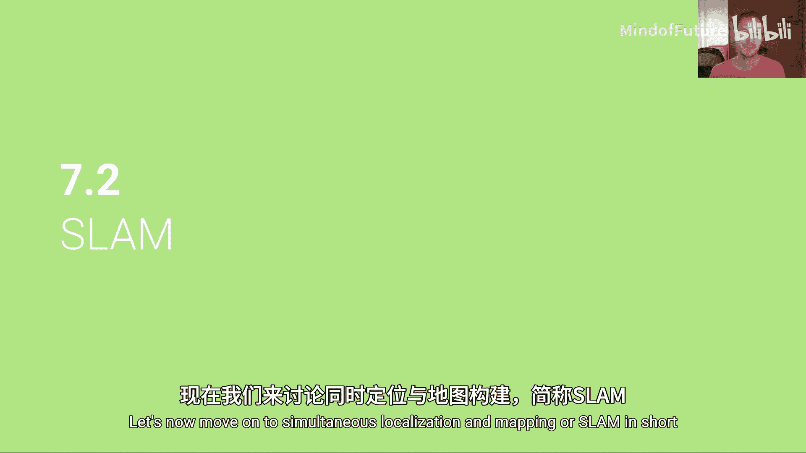
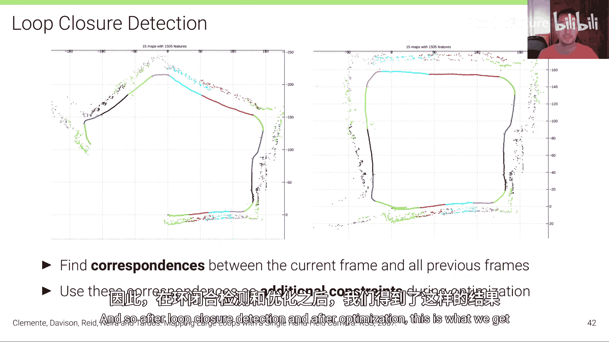
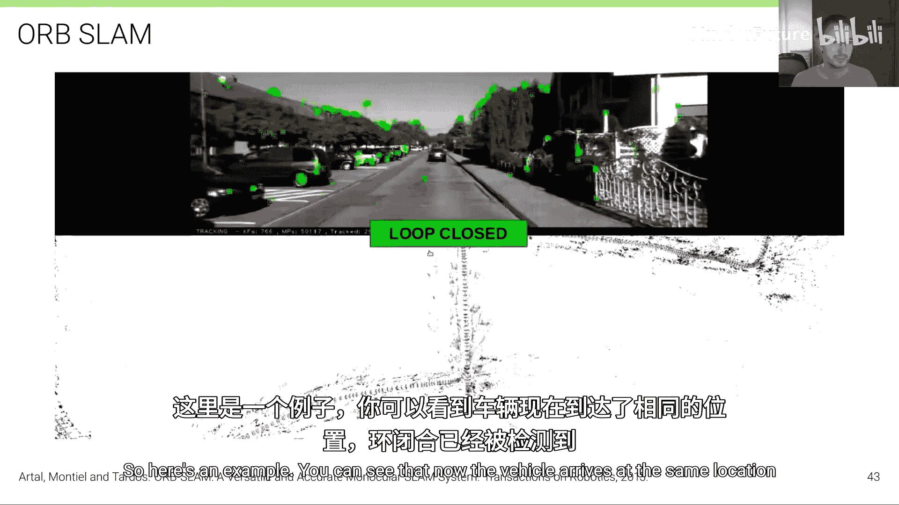
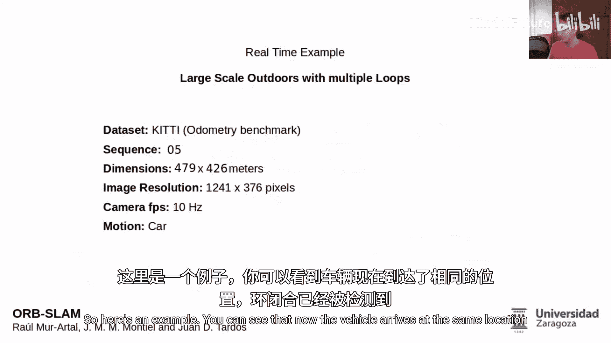
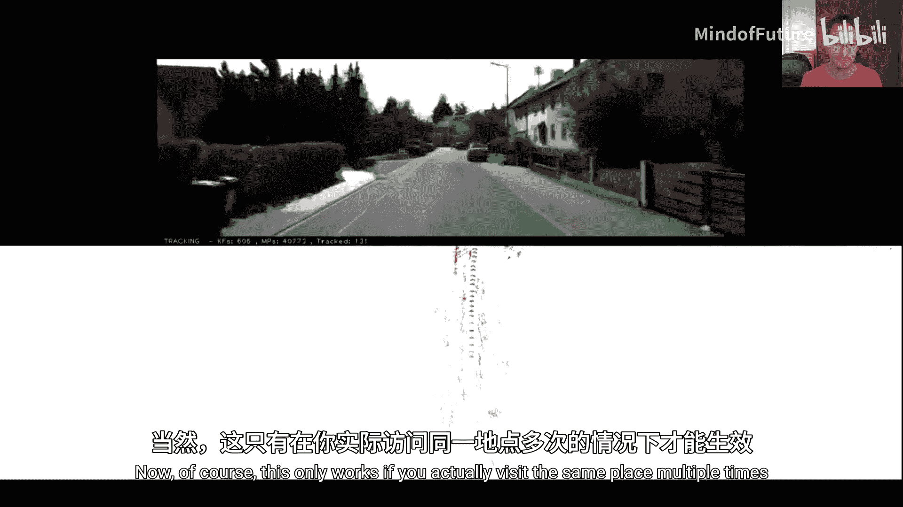
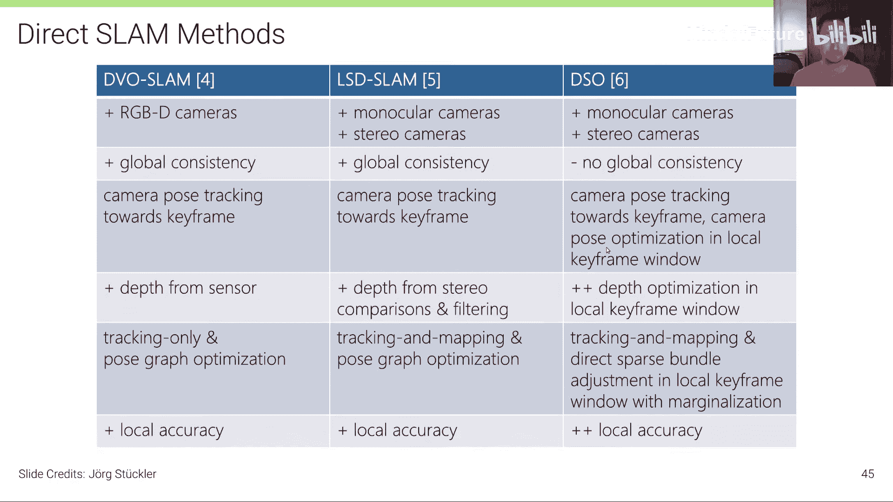

# 【图宾根大学】自动驾驶汽车课程 ML4340 p25 P25 Lecture 7.2 (Odometry, SLAM and Localization - SLAM) -BV16FP2ePEYc_p25-

Let's now move on to simultaneous localization and mapping， or S， in short。

So far， we considered primarily the optimization of two adjacent frames in time。

 and there was no specific focus on a globally consistent and accurate map。

The map was only obtained as a byproduct in order to help us estimate。Motion， relative motion。Now。

 in this unit， we are going to consider optimization over larger windows。 Ily。

 the entire history that means all of the frames that we have recorded so far。

And we optimize both poses and the map。 That could be， for example。

 the 3D feature locations in indirect slam。It's important to note that s is a chicken and egg problem。

 Accrid localization requires accurateid mapping and vice versa。And therefore。

 joint optimization of deposit poses and the map is necessary。Another key feature of Slam。

 apart from optimizing over much larger windows。Is to correct。

 be able to correct accumulation errors via so called loop closure detection。And therefore。

 the resulting map becomes more globally consistent and can be used for localization purposes。

They exist as in visual dormtry， indirect or feature based slam and direct slam methods。

And there is many flavors。There's filtering based aslam methods like EKF s that while considering the entire history only update the current posts。

 these are online algorithms， or bundle adjustment or windowed bundle adjustment algorithms that try to make the entire history and all of the posts is coherent and update all of the postss also。

Previous poses。In this unit here we will only cover feature based slam via a bundle adjustment。

 but towards the end of the unit I I will give you some pointers to our S algorithms。

That you can have a look at， if you like。So let's look at feature based La。

 The goal is to optimize re projection errors。That is the distance between the observed features in the image。

And the projected 3D points into the image plane with respect to the camera parameters and the 3D point cloud。

And you can see an example of such a 3D point cloud and camera pose here for an indoor scene on the right。

And on the left， this is a self driving situation from the Kidie data set。

Where you can see the recovered trajectory in green and the 3D landmarks， the 3D features in black。

Which formed the map。So let's define this process formally。

 and the process is called bundle adjustment in computer vision。

 so that's very related to this bundle adjustment type slam。

Let's pi denote the set of all the N cameras， and we're going to use that notation to also refer to the intrinsic and extrinsic parameters。

When we speak of pi， it's not just the projection function。

 but we also refer to the parameters themselves。Let further。X W。

 they the set of 3D points in world coordinates。And let X， S the node the。

Corresponding image screen observations in all eye cameras。Now， of course。

 not every 3D point is observed in every camera image， but。

We must observe at least some of the 3D points in multiple images in order to solve our。Slam problem。

Bundle adjustment then minimizes the reprojection error of all observations。

This equation is very similar to the equation before， where we have optimized。

Where we have performed a bundle adjustment over two views for visualittry。

 but except in this case here now， we optimize over more views， so we have n camera views。

And we have P。Of features P landmarks。And we minimize the difference of the observation and the corresponding projection。

 This is the point in world coordinate。 This is the point。This。

 the correspondence in screen coordinate。And we minimize that with respect to all the cameras。

That includes the。In particular the extrinsic parameters。

 but you can also optimize or fine tune the intrinsic parameters。As well as the 3D feature locations。

Here in this equation， WIP indicates。If a point P is observed in image I。And pi eye of。

The worlds points the landmark。Is the 3D to 2D projection。

Of that 3D landmark onto the 2D image plane， according to the。Camera model。

Where we have an extrinsic part that transforms from world coordinate。To camera coordinate。

As well as an intrinsic transformation that goes onto a screen or pixel coordinates。So it said again。

 as before chaining two transformations。Pluging this into here。Okay。

 and this is the illustration for this similar to before， except that now we do have a。TheRepresent。

As a like the 3D points， the landmarks are represented in some world coordinate system that could coincide with one of the camera systems。

 but it doesn't have to。And we are estimating now the pose of all the cameras。 Now。

 two cameras are shown here， but， of course， there's much more。

 and there's also much more than just free landmarks。 But to keep this illustration simple。

 I've just chosen。2 cameras and three landmarks， still。To illustrate this。

So during bundle adjustment， we optimize。The camera。Prameterters， as well as。

The 3D landmarks jointly。One thing to note is that luckily。

 the optimization process is not as hard as it seems in the first glance。Because。

The hesian that's required for computing。For updating our No nonlinear optimizer。While it's large。

 it's typically very sparse and the reason is that。

There's no constraints connecting landmarks with respect to each other or poses with respect to each other。

So we can rearrange that hessian to be very sparse。These are the pose dimensions in this example。

 these are the landmark dimensions， and you can see while poses are connected to many landmarks。

They are connected not to each other。And landmarks are also not connected to each other。

Leading to this very sparse matrix。🤧。And this leads to tremendous computational benefits when using Sprse optimizes。

Now， the final thing I like to talk about is loop closure detection。Lop closure detection is about。

Correcting the drift， the accumulation of error over time， as we have discussed before。

 for visualometry。And we can do that by。The fact that if we revisit the same place here。

 the green place is the same place。Again， while traversing the environment。

 we can try to match features not only with respect to previous frames。

 but also with respect to like frames。🤧Sorry。Fras very far into the past。So we can try to like。

 let's say this is the current frame。We can try to match features to all previous frames。

 and we might find that there is features here that are very similar。

And if we found such a loop closure， we can add these additional correspondences as additional constraints during optimization。

 And so after loop closure detection。And after optimization， this is what we get。

So here's an example。

🤧。🤧嗯。They can seede that now the vehicle arrives at the same location and the loop closure has been detected。

And now， including these constraints into the optimization snaps these two parts of the map together and makes it more consistent。

 Now， of course， this only works if you actually。Visit the same place multiple times。

So this is a central aspect of S。So here on the last two slides。

 these are from your extra slides I just wanted to illustrate to you that there is a whole variety of indirect La methods and also direct La methods I'm not going to go through these tables in detail but just to show you some references。

And these differ。In the type， some of them are online， some of them are。

Are using a bundle adjustment， and some use monochclocular cameras， some use stereo， RGBD。Et cetera。

