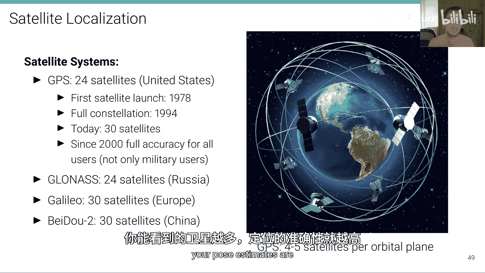
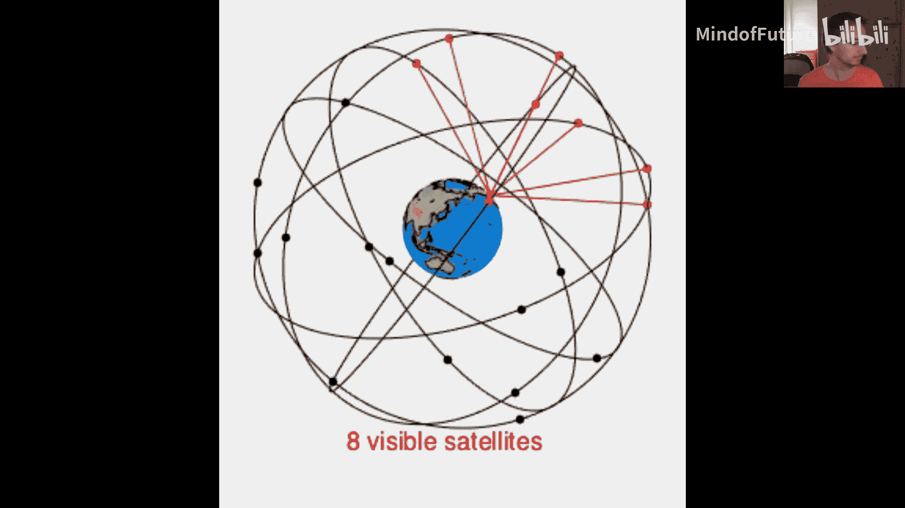
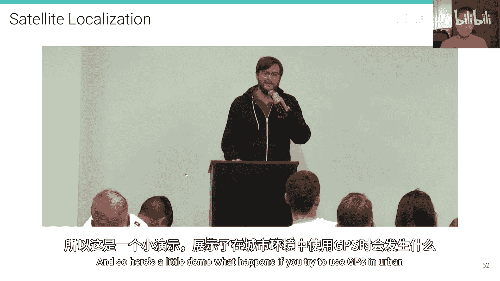
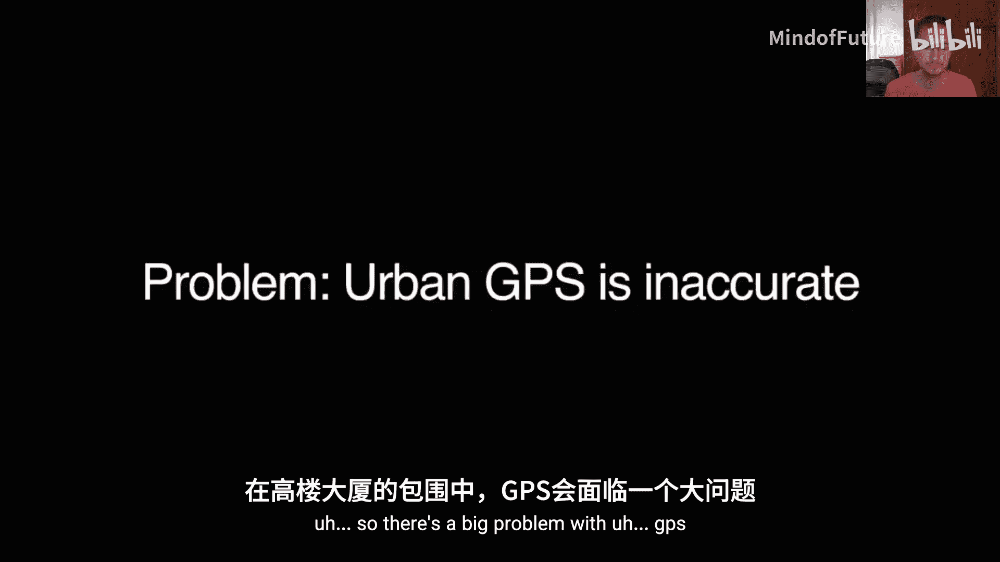
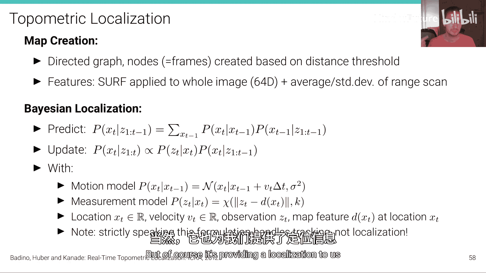
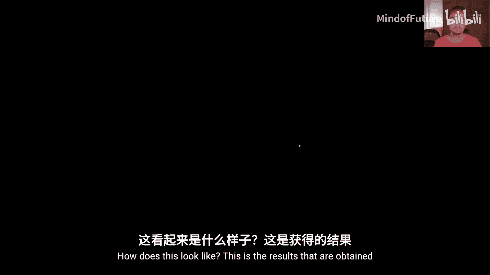
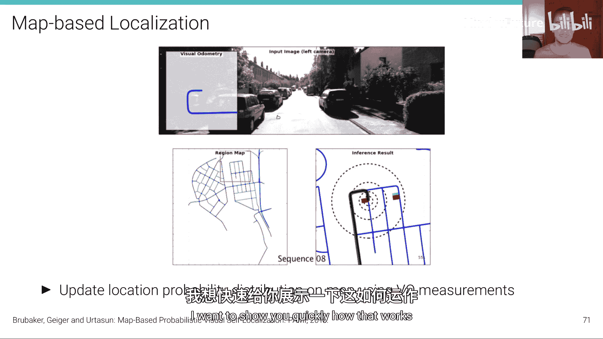
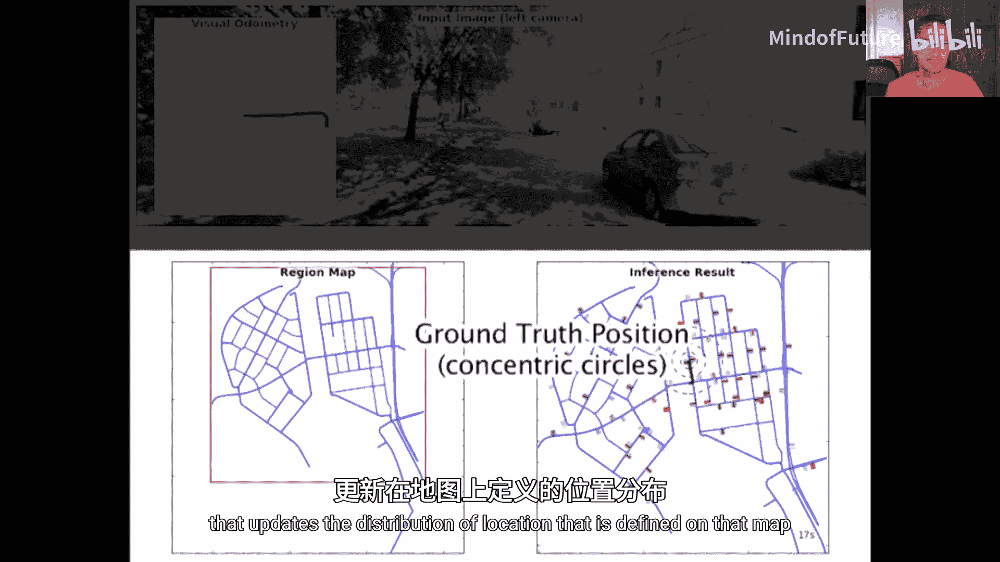
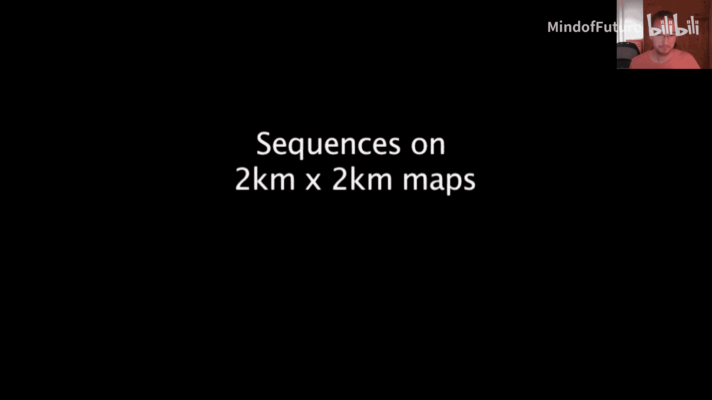
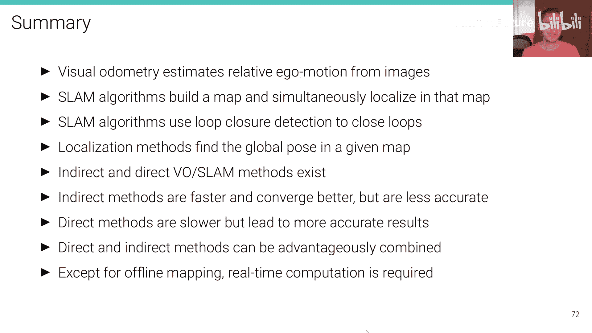

# 【图宾根大学】自动驾驶汽车课程 ML4340 p26 P26 Lecture 7.3 (Odometry, SLAM and Localization - Localization) -BV16FP2ePEYc_p26-

Let's now talk about local lacation。Why do we want to localize the vehicle。Well。

 in order for example， to control the vehicle with respect to a path we require knowledge about the position of the vehicle clearly。

Sometimes local knowledge is sufficient， such as when， for example。

 driving on a highway and we just need to laterally control the vehicle。

 but often the global location is required， for example， in the context of path planning algorithms。

That we'll have a look at in lecture number 12。Or also when we want to determine relevant elements that have been marked a priori in the map。

 such as street signs or lane markings， and we want to take advantage of this knowledge。

For our self driving calm。There's different approaches to localization。Of course。

 we can use satellites， but these require infrastructure。

 and there is some downsides to satellites which we'll come to。And then there's visual localization。

 which uses visual maps。This could be either at the image level。 So quite coarse。

Then we talk about topmetric localization。Or there's learning based localization approaches and feature based localization approaches as well。

 similar to the feature based slamM methods we were talking about before。

And then there's also map based localization。 We can use a raw road map as extracted， for example。

 from Google Maps or OpenStreet Maap。Plus。Relative motion estimates from visualometry to localize in that road map as well。

And we're going to talk about all of these approaches in this unit。

Let's start with satellite localization。This is something we are all familiar with。

The first satellite systems for localization have been deployed by the United States in 1978。

 starting with 24 satellites。And the system is called GPS。By now， we have 30 satellites in orbit。

And since 2000 full accuracy。Is available to all users， not just to military users。By today。

 there is also other nations that have launched satellites into orbit。 For example。

 Russia has 24 satellites and system is called Gs。In Europe。

 we have the system Galileo with 30 satellites， and China has the system Beidu too with 30 satellites。

And modern GPS receivers can take advantage of all of these。The more satellites you can see。

 the more accurate you poses and the more available your post estimates are。

So here's an example where you can see that， of course， not all of the satellites are visible。

 visibility depends on the local neighborhood that you are driving in if you have a skyscraper next to you。

 you can see many satellites， but even if you would be on a very open field。

 you can only see some of the satellites and not all of the satellites。

As they are orbiting earth and they are occluded by Earth itself。

And so it's important to see as many satellites as possible to localize as accurately as possible。

The principle of localization for satellites is called trilateeration。

The goal is to determine the location of the。Devvicice or the vehicle by measuring distances to satellites at known locations using the geometry of circles and spheres。

So we know where the satellites are and we can measure distances to the satellites in order to triangulate our own position。

The distance to each satellite is measured here as the time delay between the send signal or a coat in practice and the received coat。

 The receiver has to know the coat， and it does。And as you can imagine， small。

Drepancies in the time measurement have a tremendous impact on the location because we're talking at really small time delays here。

Satellites are equipped with an onboard atomic clock， and given one satellite。

 we only know which sphere we are on because we know the distance to that satellite。

 given two satellites， we already know which circle we are on and given three satellites。

 we know the exact location。In practice， a fourth satellite is needed for time synchronization。

 so minimum you need at minimum four satellites to be visible in order to use such a system。

The system can be further improved through so called differential GPS。

 where there's a set of ground stations at a fixed location。

 very precisely determined fixed location。And you also use the GPS signal from those locations to correct for atmospheric effects。

 for example。And this is what。For example， the red box。

 the GPS combined inertal measurement unit that I've shown before， can do。

 it can connect to such local ground stations。So how does localization work well。

 we have to measure time delay and the way this works is that the signal the satellite generates a signal here in blue that is received at a certain time delay due to the distance of the satellite。

And as the signal travels with the speed of light。So this is a very short time delay。And then， our。

A measurement device， the receiver knows that signal， and it adds an artificial delay。

Such a phase delay here until these two signals match。 and through that。

 it can calculate the distance。To the satellite。Now we're going to do this with respect to all the satellites that are visible to us to the receiver。

And here's a 2D illustration of what happens then。 So let's assume the first satellite is measured at this distance。

 So we know we are on that circle。The second satellite is measured at this distance。

 so now we have narrowed down the location to these two points here。

And then if we measure a third distance， then we know exactly where we are。And in three dimensions。

 this looks something like this。One important thing to note here is that it depends very much on the constellation of the satellites with respect to you and with respect to each other。

AVance in the estimate， can heavily。Depend on this。

So the precision with which you estimate your location is affected by this。Here's an example。

 where we have。2 satellites。But， of course， youre not。

 you're not 100% sure about the distance to the satellite because of measurement noise。 And so you。

 the only thing you know is that you are within these two circles here， the two grey circles。 So you。

 you don't know that you are here at this exact location。

 but you know they are somewhere here in this green region。

 because you're within this uncertainty bounds。Now， if the satellites are located like this。

 this is a nice situation because we have still confined the uncertainty region to a relatively small area。

 But if the satellites would be located like this， then you can see that this green region is much larger。

 and this is what。In。Satellite navigation systems is called geometric delusionution of precision or G do。

 It's a value that can be calculated and tells you how accurate your post estimate is。

So dispose estimates， the quality of dispose estimates ranges in the order of1 to5 meters。

 and it can be reduced by using additional accumulation through inertial infusion with inertial measurement unit measurements。

 as well as differential GPS。Up to a few centimeters in very idealistic conditions。However。

 so this ones all very nice， right， but there's some problems with satellite localization。

The first is availability。Satellites are， for example。

 they are not visible in tunnels or narrow city streets because there is too much shadowing。

 too much occlusion。And their availability also depends on national organizations or interests。

The accuracycccur here。Depends it is in the order of a few meters for raw GPS and in the order of a few centimeters to me for differential GPS depending on where you are in very open conditions and if you combine this with an inertial measurement unit。

 you can get precision up to a few centimeters， but this is happening very rarely。

 maybe you can use this on open sea but not for driving。Also。

 we are receiving only the location of the device， not the rotation。 So there's no full pose。

Meeaasured unless we combine， with this information with， for example。Information from an IM U。

The frequency is also a problem。 The frequency is max 5 to 10 Hz， so we don't get。

Location estimates more frequent than that than that， which is of course， needed if we want to。

 for example， control a vehicle， then this has to happen at maybe 500 or 1000 Hz。

 So the measurements that we are receiving are two spars temporal。To directly do that。

And then there is atmospheric variations which lead to errors in the time measurements。

 but this can be partially corrected by differential GPS using signals from nearby base stations。

However。The GPS requires communication and initialization。

 and it requires these base stations to be built in the first place and depends on the availability of them。

 So there's a lot of factors that need to be satisfied here as well。And then finally。

 there is something called multipath effects， which is。

If you are driving in a narrow city street and there is a building next to you。

 then the signal from the satellite might reach you directly。

 but it might also reach you through a reflection on the facade of that building。

And that means that the time that you measure is actually wrong because it's not the direct connection。

 the direct line of sight to the satellite that you're measuring。

 but this indirection through the building facade。And so through this。

 through this you get errors in your estimate， which have to be filtered。

 but sometimes it's really hard for the system to filter these errors if there is too many of these multipath effects going on and then the signal can jump around。

And this is illustrated here in this little presentation or demo from Danny Iand。

 who is an engineer at Uber。Uber the company that。Pro a car sharing or the taxi service， of course。

 needs also very accurate localization of their vehicles。

 and so here's little demo what happens if you try to use GPS in urban environments。

So there's a big problem with。

GPS， when you're surrounded by tall buildings， the reflections and multipath fading。

 basically the signals。Go all over the place。 So in this example of leaving UbriQ。

 as soon as you get outside， the GPS goes like 100 meter air， you know， across a whole city block。So。

Yes， okay。 so this illustrates a little bit how。How difficult it can be to use GP or if one would rely on GPS alone for self driving。

 that wouldn't be a good idea。 It doesn't work。That's why we need other techniques for localizing。

 and one is visual localization。Which we will talk about now。The main idea here is。

To record a map or database of known locations with associated features。

The map could be a collection of freedie landmarks， with。

Feature vectors that describe the appearance of the landmarks。The features can be extracted。

 for example， from images or laser scans。As part of the map building， for example。

 in the context of slam。Mapping should of course be conducted under similar conditions as during localization。

To minimize domain shift with respect to the sensor setup or environmental conditions。

 So you'd like to use a map。 First of all， you want to map what is of interest to you at test time。

 and then you want to map using the same sensors。At localization time。

 we' then try to retrieve features extracted from the current input。Image or scan。

And we want to retrieve those again in the database to localize。

We can localize only at the image level。That is what well call topmetric localization。

 or we can refine the pose more precisely。To yield an exact pose 60 post estimate using triangulation or geometric pose estimation。

There's many challenges。Involved in the localization problem。 the first is， of course。

 that the map can be quite big， so we need to very efficiently。In real time， retrieve。

The correct information within a very large database。 and that's challenging。

 and we'll talk about this later。But another challenge is also that if you use， for example。

 image sensors。The appearance。And also the geometry of the scene can change dramatically。So。

 here's some examples from。The Oxford Robbo Car data set。

This is a data set that has been created by one car。

 driving always the same routes over the course of one or multiple years even。

And you can see that here in red， sometimes the geometry can change。 For example， the tree。

 they lose their leaves in the winter。But also， the appearance can change dramatically in this case。

 where you have sunlight coming from the front or you have。

Cudy day where the weather is more the light is more diffuse than you have shadows。

 If there is sunlight or at night， the scene looks completely different。 Now。

 if you want to localize a day image versus a night image， then， of course。

 you need to take into account these appearance changes as well。

The first technique that we will look into is calledtometric localization。

And this is a image level localization technique， which means that we only localize with respect to a frame ID。

 we don't retrieve the 60 posts， just a frame index。

This is something that has been proposed by a team from CMU。um。

In a paper called Real Time Topometric localization at Ira。2012。The setup is as follows。

We record a sequence with cameras， Liar and GPSS ground truth are used。

And then we want to localize a new image。From a different day or season with respect to the recorded sequence。

 we want to retrieve the image from the recorded sequence that's most similar to the。

Image that we currently observe。And it's called topmetric because it combines metric and topological localization metric in the sense that we optimize the poet with respect to feature correspondences。

 which we don't do here。 We only optimize for the image， but we use features and topological。

Because we estimate the observer location qualitatively from a set of finite locations。

 So it's kind of in between metric and。T logic。So what we do effectively is we describe the entire image with a global feature vector and then try to find that feature vector in the database。

So we only localize with respect to a particular node in that。Graph where each node in that graph is。

A frame。 And don't get the full 60 posts。For map creation。嗯。The offers of this project。

Im considered the map as a directed graph when node are individual frames in that graph。

And they are created based on a distance fresh also that。Like if the vehicle stands till。

 no additional nodes in the graph are created， which are unnecessary。

And then the features that are used are standard serve descriptors， but in this case。

 not applied to local features， but to the whole image。

 yielding a 64 dimensional feature descriptor for the entire image。

And then they used a Bayesian localization approach， this is a standard filtering。

 the standard filtering equations that I show here， which will go into more detail in later lectures。

 but it's a very standard formalism for updating state distributions。

So it can be understood as follows what we want to model is the distribution over the location。

 over the graph nodes where each node is a frame。In the map。And we do this by predicting， well。

 by taking the。A distribution， let's say we are at time T。

 Then we take the distribution over the locations at time T -1。

And then we multiply this with a motion model。Which models the distribution of the location at time T with respect to t minus1。

And then this is the prediction step， and then the update step takes that。

Probability here and multiplies that with the observation probability at time T in order to arrive at the posterior。

Wwhich is here on the left， and then the posterior is again the same expression as this one here for the next time step。

 and so we can iteratively update these filter equations here。So this is a very common。Framework。

 it's also， for example， the framework that the Kaman filter uses。

 but in this case it's on discrete locations。 so it's a discrete filter， a discrete Baian filter。

So far， about filters more in the next lectures。In this particular case。

 what they used as a motion model is a very simple constant velocity motion model。

 So we take the previous position and then we。At some constant velocity and time time difference in order to get the distribution with respect to the new position。

And then there's a measurement model that。Relates the。

Observation CT T with respect to the map features D of X T。Now， strictly speaking。

 this formulation handles tracking， its ego tracking。

But it can be understood as frame level localization。

 of course right so the question is what is localization here in this case you need to start at a particular point in time and you need to know the starting position in order to track yourself through the route。

But some localization techniques that we'll also talk about later， they don't make this assumption。

There you really localize with respect to a map without any a priorri assumption。 But， of course。

 if you know where you are， where you're starting， then localization becomes much easier because it's effectively tracking。

 And this is what。I mean， with this remark here， we are effectively talking about a tracking maia。

But of course， it's providing a localization to us。

How does this look like？

The results that are obtained。And you can see。For both the left and the right image。

 you see the input images and at the top and the images from the database that have been retrieved from the database at the bottom。

And you can see that。The appearance is quite different。On these two days。

 but the images have been retrieved correctly。Again， this is frame level localization。

 We don't have the exact 3D posts， which just retrieve the frame I D。Now， the next。

Part of this unit is on learning based localization。

 We can' also use neuralll networks to try to directly regress to the post。

 And that is what has been done in Postnet from ICCV 2015。In Postnet。

 what they did is they used as an input， an IGB image。

And they try to directly regress the 6 degrees of freedom of the camera pose。

 That is the 3D camera position and the 3D camera rotation， in this case。

 represented by a quaternian。And they used a 23 layer deep confinant for this based on the Googlenet architecture。

 which was popular at the time。It turns out that such an approach is or can be quite robust。

 more robust， at least to correspondence， outliers and errors compared to feature based methods。

But it's， in general， hard to get very accurate results。 So it's， in general， less accurate。

So here can see the loss function and an example at the bottom where the green are the training poses。

 the reds are the predicted poses and the blue are， the ground roof poses。 And you can see that。

The red and the blue don't perfectly coincide， but they roughly match。

And this is also visible here where the outline of the building has been。

Reprojected onto the images used for localization。 And you can see that the poses are not perfectly aligned。

 There is a slight discrepancy。But it's able to recognize which place。It's looking at。Okay。

Now the next。Looccalization technique that we are going to look at is feature based localization。

 and that's very similar to the s methods that we talked about already。In feature based localization。

The goal is to first create a database a。Map using， for example， S techniques。

Where each of these points。Is associated with a feature vector。

That'd say a sift or a deep descriptum。And then we also extract these descriptors from the current query image。

 and then we match these descriptors to the database descriptors。And once we found matches。

 we can do something that's called geometric verification。 There's gonna be a lot of。

Ioneous matches because we are not querying just a single the most recent image here。

 like in visual oometry， but we are querying an entire map。

 so querying millions and billions of feature vectors and there will be some feature vectors that look similar。

 but that are at completely different places。So it's important to verify which of these correspondences are actually correct。

And then we can only using the correct correspondences。

Looccalized with respect to that map that has been created。So let's go through this step by step。

The first step is， of course， mapping。 So we wanna。

Obtain a sparse freely reconstruction based on sparsRS feature correspondences and we can use the sM techniques that we've discussed in the second unit for doing so。

Then we associate each 3D point with a local image descriptor。Like a soyft or ser descriptor。

And these descriptors are simply the descriptors that are extracted。For these 3D points。

 when they are projected back into some of the images right？So like when you run this s algorithm。

 typically you already have these features because you need them already there to establish correspondences。

 so you just need to start them。It can also be an advantage to use semantic features to first convert the appearance into semantics because you can get a little bit。

More invariant to， for example， the appearance variations that we've seen before day versus night。

 winter versus summer， etc。 So this turns out to be also helpful to design these features well。

Now once you have extracted features。For both the map and your query image， you need to find。

The features from the query image in the map。And， of course， it would be very wasteful to。

Brute forest go through all the。Features in the map。 So what is happening typically is。

 is using a very efficient。Search algorithm， for example。We can use an approximate search algorithm。

Like a K D tree or an inverted in index that finds these features much more efficiently because of the data structure that it's using。

 and there is good software packages available for this。

That are open source and that you can use like flan and Fce and so on。

And so this allows you to retrieve the nearest neighbors only approximately but relatively quickly。

Now， the next thing you need to do is you need to localize with respect to the retrieved feature correspondences。

In contrast to。This s problem before where you have。Retri 2 D to 2D correspondences here。

 We have 3 D to 2D correspondences， right we have。The features in the image and the corresponding points in the map。

 So we need to now find the rigid body transformation such that。This image。

When projecting the 3 d points， the corresponding one into the image。

 then the reproion arrow to this。2 D observations is minimized。Yam。

So we have a 2D to 3D correspondence as input。And now we need to compute poses R and T such that。

This projection here。The protection error is minimized and there's very efficient methods for doing so。

For example， the P and a P method which is a closed form solution to this problem。

 and even if you would optimize for this， you can get very efficient solutions because it's a simple optimization problem。

Sorry。Now， one big problem here is that because we have so big maps。

Such big maps and because there's so many features in the maps。

And also because we have to use approximate search algorithms for efficiency。

 a lot of the correspondences。That we're going to find are actually going to be wrong。 In some cases。

 more than 50%， more than 80% of the correspondences are going to be wrong。

 so we can't directly use this algorithm here。But what we need to do is we need to geometrically verify which of the correspondences are correct and which are wrong。

So the problem is wrong feature matches corrupt the post estimation results。

 and the solution to this is to solve a minimal problem many times and return the best solution。

So instead of taking all the maybe thousand feature correspondences。

 we just take free because three is the minimal set to estimate the。6ix post parameters。Why is that？

 Well， for each correspondence， we have an x and a y coordinate。 So we have three times 2。

 which is six observations， and we have six unknowns so。These free observations are enough。

And so we randomly sample these。From the features that we found in the image and fit this model。

 which is very fast，2 microseconds。And then we we we find we search for all the other correspondences how well they are matching with their respective。

How well the other landmarks aligned with the respective 2D correspondences？And we can count how。

 how often they align very well。 And then we take the solution。That。

Where the majority of the others align， and then we consider this this set where we consider all of the ones that project precisely onto the 2D observations as the inlays。

 and we can do a final optimization step of those only。And then we have rejected all the outliers。

 all the ones that are incorrect。And that's what Runza is doing。

So here's a pseudo algorithm of forenssack。Which says。

 while the probability of a missing correct model， So there's some probability considerations you can do here。

 how often you'll have to load this loop。We estimate the model from just three random。Features。

Because there the minimal set。And then we estimate the support。

 which is the number of inliers by projecting all the others and see how well those match。

And if we have a new best model， then we perform a local optimization。And update the best model。

 and then we return the model with the most inlias in the end。

So it's a very effective way of rejecting outlis。And this。

Is responsible for making these methods work really。

 These methods really face the problem of having sometimes more than 80% outliers。But。

 but using such techniques， you can still make it work。Okay， and finally。

I want to briefly talk about map based localization。 Just one slide。

 More details are in this paper here。The idea of map based localization is to update a location probability distribution that is defined on a map。

 a roadm， a simple roadmap that can be downloaded for free from OpenStreetMap。

And we update this using visual orory measurements。

 So whenever like we start with a uniform distribution and whenever we take a turn。

 there's some information coming in。So we know that at all the locations where no turn can happen。

 the probability of the location must be reduced。But at locations where the particular turn， like。

 let's say， a right turn can happen， the probability increases。And over time。

We localize using this technique。 We can localize within maybe 30 or 40 seconds in very large maps without knowing anything about our initial location。

 So it's not a tracking method。 It really is a is a full localization method。

I want to show you quickly how that works。

So the input is just a map and a monocular video sequence from which we compute visual dormtry。

 And this is used as the observations in a probabilistic filter that updates the distribution of location。

On that that is defined on that map。

And so here you can see in the beginning， the probability is quite uniform。

Because we haven't made a lot of。Informative measurements yet。 But now we're taking a right turn。

 And so we know already now that we have to be somewhere right after right turn。

And then after the second turn， the particular constellation of。

Relative poses is so unique that we have already localized in this little map here。

The nice thing about this is， of course， that you don't need to map the environment a priorri。

 but you can just use a roadmap， you need to know just roughly where you are。

 and then you can localize in that roadmap。But， of course。

 you don't know the exact six degree of freedom pose。

 You just know where you are along that road map。It also works for larger scenes。

So here' has results on really large maps and even there and even on scenarios like this where there's basically just highway driving。

 localization happens pretty quickly。Now there's a lot of uncertainty here。In longitudinal direction。

 because highway driving is fast and so it's uncertain。 But now once we take a turn。

 it's getting reduced。Here's another example。Where。

 localization happens after 30 or 40 seconds of driving time。To summarize。Today。

 we have seen that visual oometry is a class of algorithms for estimating relative egomotion from images。

We've also seen that S algorithms build a map and simultaneously localize in that map。Further。

 a key feature of many slam algorithms。Is to use loop closure detection to close loops and generate a more consistent map。

Looccalization methods。Then use can use these maps to find the global pose in in such maps。

 But there is different localization methods， some use。Maps some use road maps， some use GPS， etc ce。

We've also seen that indirect and direct visual or autoometry or s algorithms can be distinguished。

Indirect methods are faster and converge better， but are， in general less accurate。In contrast。

 direct methods are slower， but lead to more accurate results。

And direct and indirect methods can be advantageously combined。Except for offline mapping。

 real time computation is really crucial because the information about the ego motion or the location has to be available immediately。

For the following decision making。Steps of the pipeline in a self driving vehicle。

That's all far today。

Thank you。