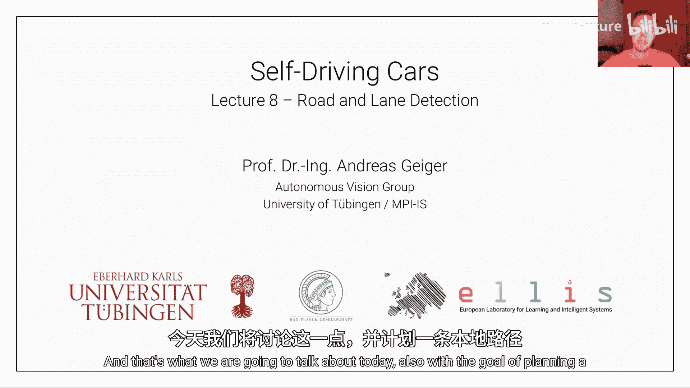
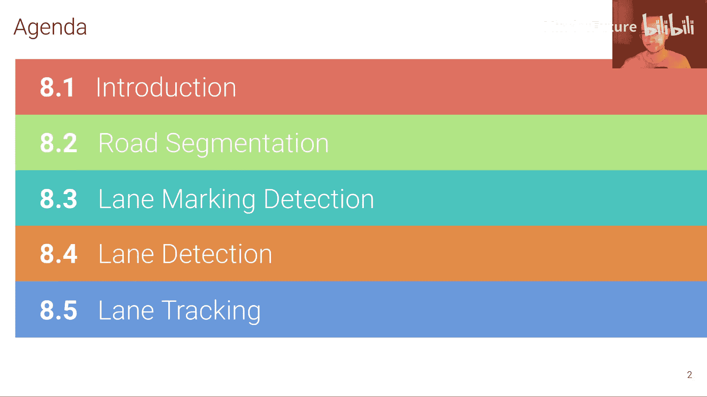
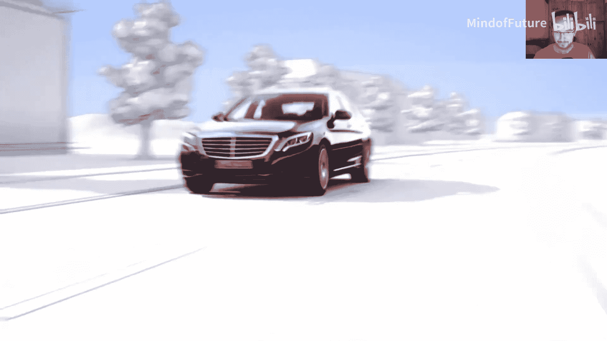
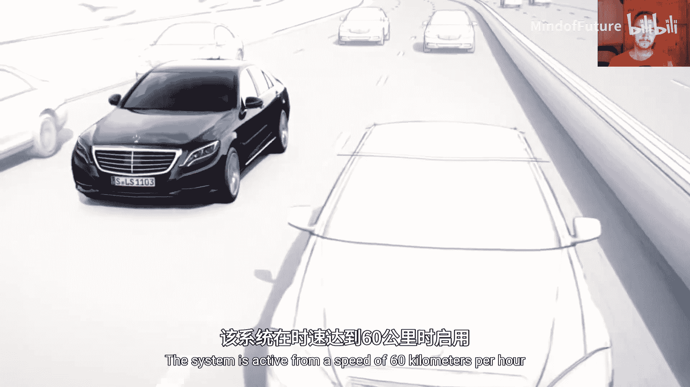
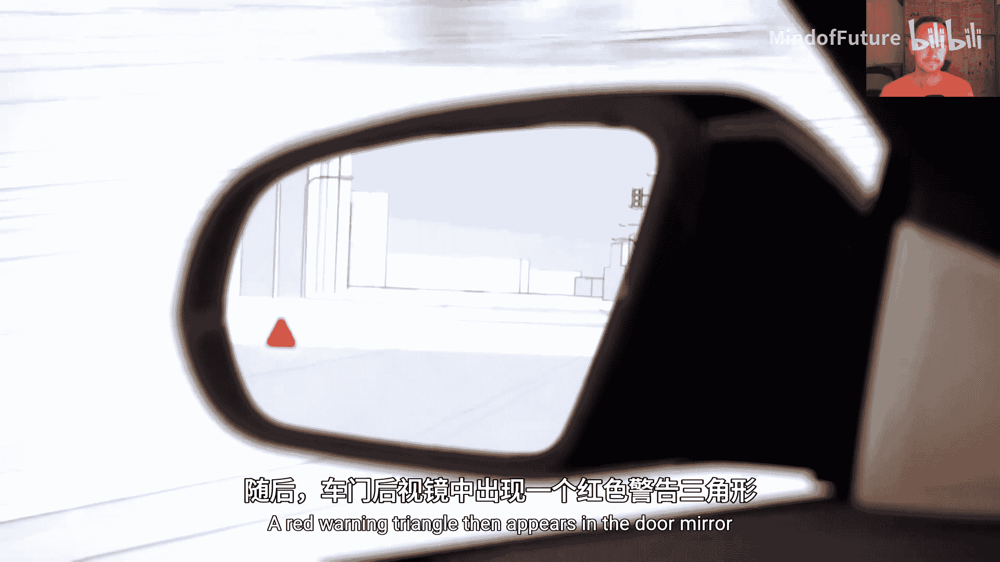
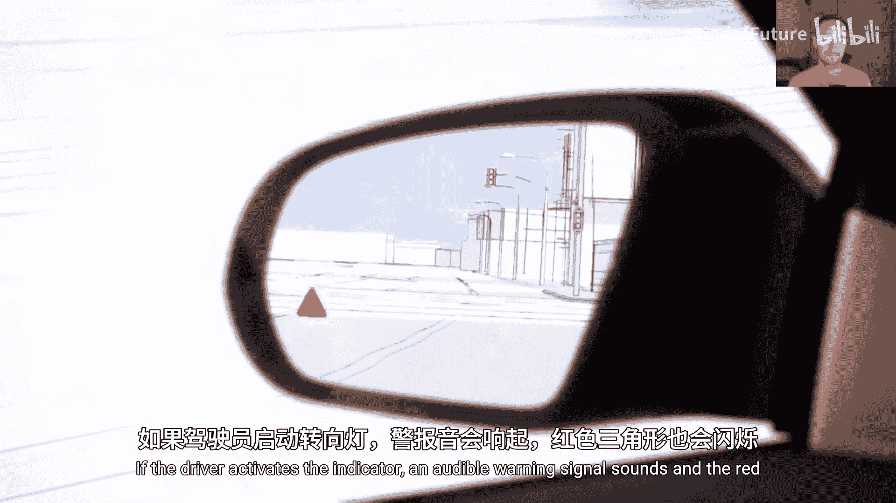
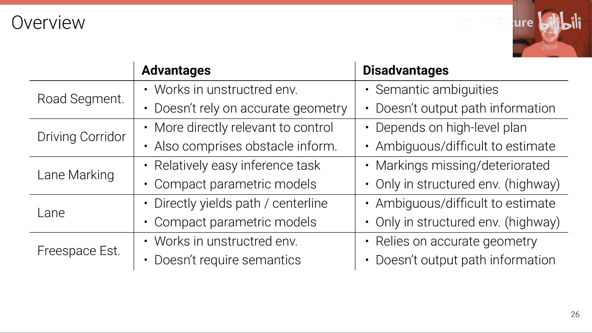

# 【图宾根大学】自动驾驶汽车课程 ML4340 p27 P27 Lecture 8.1 (Road and Lane Detection - Introduction) -BV16FP2ePEYc_p27-

Hey， and welcome to self driving cars lecture number 8 on road and lane detection。

Last time we've seen how we can build maps and also utilize maps for localization in order to。

 for example， plan the path of a vehicle。But of course。

 there is a lot of information available locally that can be sensed through the sensors of the vehicle。

 and that's what we are going to talk about today， also with the goal of planning a local path。

This lecture is。Subdivided into five units。 first we're going to introduce and motivate the problem of road and lane detection。

Then in the second unit， we are going to be talking about road segmentation， semantic segmentation。

In the third unit， we will talk about lane marking detection and then about lane detection。

 which is summarizing lane markings into a coherent lane estimate that we can use for controlling the vehicle。

And then finally， we're going to see a simple algorithm。

In a simple setting for the lane tracking problem， how we can integrate the lane detection estimates over time。

So let's get started。

嗯。Road and lane detection algorithms are actually already available in many cars today。

State of the art commercial systems include， for example， lane departure burning。

Which are systems that warn the driver when leaving the current lane。

Maybe you've seen this in your car just a little symbol that's flushing orange if you're driving outside your current lane。

The next level that's also available in consumer cars today in driver assistance systems today。

Is lane keeping support where the driver is assisted with minimal steering interventions。

So when you leave your lane， then the car gently nuches your back。

 but it's very easy to override the。Steing command from the car。

 just a little assist that's given to you。And then finally。

 there's lane keeping and lane departure protection。

 which are systems that keep the car in the current lane autonomously。So these are systems that。

 for example， when you are riding in a traffic jam， they can automatically steer the vehicle for you。

So here's a little video that demonstrates this in the case of。The example of a Mereddespenense。

The active lane keeping assist prevents the driver from leaving the lane unintentionally in a range of situations。

 even in slight bends。

Targeted intervention via ESP breaks the opposite wheels to ensure that the vehicle does not drive over solid liness。

At the same time， a warning is displayed on the instrument cluster。If open lane markings are crossed。

 the steering wheel vibrates as a cu to steer in the opposite direction。

 this haptic warning is also provided before the breaking intervention。In a new development。

 the system can also react if adjacent lanes marked with open lines are occupied。

 and there is a risk of collision if the vehicle changes lanes。

The system is active from a speed of 60 kilometers per hour。

The camera identifies the road markings。While radar sensors monitor the traffic around the car。

Traffic behind the vehicle is monitored by a radar sensor in order to warn of overtaking traffic。

The long range radar is directed at oncoming traffic。

The short range radar keeps a lookout when the vehicle changes lanes。

If the radar system reports that the adjacent lane is occupied。

 ESP initiates a one sided braking intervention that can move the vehicle out of the danger zone。

At speeds above 30 kilometers per hour， the active blind spot assist offers additional protection。

The radar sensors of the electronic blind spot check recognize when cars or motorcycles move into the critical area of the blind spot。

 A red warning triangle then appears in the door mirror。

If the driver activates the indicator， an audible warning signal sounds and the red triangle flashes。

If the driver starts to change lanes regardless， the one sided braking intervention can prevent a collision at the last minute or reduce the severity of the impact。

So these are some examples of the systems that we have already in many of the cars today。Now。

 let's look a bit more closely into the topic of road and lane detection。

 and that's first considered the different representations。That are out there。

 I tried to categorize them。So for roaddent lane detection。

The goal is to navigate with our detailed global maps。

By sensing the drivable area in the vicinity of the car。

And there is multiple queuees available for this。 There's geometric queuees。 for example。

 this area here is elevated compared to the road。There is semantic information。For example。

 the road is。Typically， sort of a grayish colour of a certain texture。And there's men made cues。

 like the lane markings that are。Made in order to support the driver。

 and so they can also support the driver assisting system。As well as the self driving car， of course。

Now， the input that we have available to our disposition is clear we have the images。

This is the main input。 and that's what we're going to talk about today。

 and there's also Liar and radar when it comes to sensing geometric cues。

 but today we'll focus mostly on the image based cues。

Now there's multiple possible output representations and。I tried to cluster them a little bit。

 So the first one。We'll call road segmentation， and this is a semantic cu。 Here。

 The goal is to classify each pixel in the image as being either row or a non road pixel。

And I have drawn this， in this case manually here to highlight how this could look like in an ideal world。

 where you can see that all the road pixels are highlighted in red。

Road segmentation is a purely semantic queue。 It tells us where is a vehicle allowed to drive。

 and it can be computed using semantic segmentation algorithms。 for example， deep neural networks。

 and we'll see some of these。In the next units。Semantic segmentation or road segmentation does not consider reachability。

 It really does a per pixel classification。 It doesn't consider the geometry and that maybe these pixels here are harder to reach for us from this position where we are at。

Compared to maybe these pixels here。And there is no information in in naive road segmentation。

 There is no information about the lanes。can see that the entire road area has been highlighted in red and we don't make a distinction between these three different lanes that we have here。

Another output representation is a driving corridor。A driving quarry door。

Estimates or driving corridor prediction estimates the corridor ahead within which the vehicle is supposed to drive。

 and it's also a per pixel estimate We have a basically a pixel mask here that we estimate。

It may or may not consider obstacles。 In this case。

 we consider obstacles and the areas that are not part of the driving corridor because they are。

Interssected by some other obstacle like this car here are markeded in a difference。

Coour with a different label。And there are multiple possible driving corridors。

 and the relevant one depends on the high level plan。 So， for example， in this case。

 there is this driving corridor that takes us to the opposite side of the intersection。

But theres also this driving corridor that is feasible where we would move。

 We would take a left turn。Another output representation is lane markings。Line markings。

Are used in order to help the driver， and so they also can be used by the driver assistance system or the self driving car。

Roads are often subdivided into lanes。Through these lane markings， and they are often white。

And here you can see a possible example for such an output where all of the lane markings have been represented by some parametric curves like splinees。

Now the goal for lane marking detection then is， of course， to detect the lane markings first of all。

And sometimes also the road curs are included in this process。

 you can see that here there is no lane marking， but there's a curp。

 so we want to detect the curp as well。And once these pixels have been detected。

 we want to fit a pmetric model like a spline to these pixels that have been detected as。

Belonging to the curb or the lane marking。Now， this works well for highways。

 but it doesn't work so well in cities as lane markings are often not visible or reliable。

 You can see this here。They are interrupted。Sometimes they are entirely missing or they are olude。

And so it's hard to do lane marking detection in our city。

 And that's also the reason why often these driver assistance systems。

That do lane departure warning or lane departure support。

 they get switched off in such inner city situations。Another representation is the lane itself。

The goal of lane detection is to recognize the lane。

The lane detection algorithms group two lane markings。

 so we can see the left lane marking of our ego lane here and the right lane marking into a single lane。

So we're grouping them together now we have the knowledge that these two lane markings。

 these two parametric curves。They are belonging together to form a single lane。 And through this， we。

 of course， also have information about the width of the lane。For example。

 if our vehicle can actually pass。And the center line。AndThat's in the middle of these two。

 which we might want to use for a navigation。And also here。

 the navigation relevant lane depends on the high level plan。

 so we would also have two lanes in this case。Or maybe even three， right。

 so there could be one that's going straight， one that's going left and one that's going right。

And then finally， we have also free space estimation。In the free space estimation。

 we want to estimate locations in the image that can be reached without collision。

It's a purely geometric cu。We ask which places can be directly reached。

And it's computed using some geometric information that can come from laser measurements from the lightar。

 or it can come from stereo information， where we have， for example。

 here detected that this part here is elevated compared to the road level and so we are stopping our prediction here。

So you you can like this is just one way of doing it。

 but you can imagine that there is this center point here。

And we are traversing this image in a star shape。 So we are traversing it in in many lines。

 A few of them have been drawn here in black。And we're traversing only as long as we see free space。

 And then if there is some geometry that's。In our way。If we have this elevated area here。

 then we stop。But， of course， we need to know the geometry very well in order to do so。

And we're going to see an algorithm like this in the next lecture。

So free space estimation algorithms typically don't require appearance information， for example。

 lane marking detection or rot texture， recognition， like in the case of semantic segmentation。

 but of course， they could benefit from this。 They could be combined。

 but the most basic form of free space estimation is typically based on some very simple depth map input that can come from Lidar or from stereo。

And then an algorithm that follows lines and detects the first point where。

The geometry doesn't fit the row geometry model that we have estimated。Now。

 all of these representations that I've shown are in the 2D image domain。But， as we've seen。

And as is clear， of course， the vehicle is not driving in the image domain。

 It's driving in the 3D physical world。And in self driving， that can be。

Reasonably well approximated by a bird's eye view。So estimating quantities in the 2D image domain is not directly useful to our control task。

 for example。And therefore， we should map these representations into 3D or。

Maybey be just into the bird's eye view， as shown here。

In which the vehicle is actually controlled and where distances。Have a meaning。

Where we can measure distances in meters， for example。

 distances to other vehicles like the distance from here to here。

Now this is exactly the same scene as before。This is the same intersection as this one here。

 just viewed from above。And you can see that it has changed dramatically。It's。

If I wouldn't tell you that this is the same intersection。

You would probably not know that it's the same intersection。

 So it looks dramatically different and that。Already reveals a little bit that。

Performing this mapping。嗯。Is not trivial or is leading to some uncertainty。However。

 this mapping is possible， given an estimate of the road surface， we fit a plane to the road surface。

 for example， which is also needed in this case a free space estimation where we want to。

Estimate if an area is traversible or not。 So if you fit a plane or some some other more complicated parametric model to the road。

 based on， for example， a depth map， a 3D measurement of the scene。

Then we can use that plane to warp the observations from the image。

 the lane markings from the image into bird's eye view。

And this is also something we're going to talk about today。Now， before beam start with the first。

Unit， I wna。Give you a little bit on intuition of how hard that problem can be。As a human driver。

 it doesn't seem extremely hard because we're solving this problem every day。

But it can be quite hard And to give you a little bit of an understanding where this comes from。

I've collected a few images while driving around with。

 this was still during my PhD time while driving with the。Experimental vehicle。

Which was called anyway。In cultural and collecting data。This is data from the Kidie data set。And。

I've just picked a few images that demonstrate how challenging it can be。So here's an example。

 this is a drivable road we are allowed to drive on that road。

 and you can see in this example that for example， when we consider road segmentation。

Even the ground truth annotations are not fully unambiguous。For example。

 it's not clear if this is part of the road or if this is part of the road or if there should be a sidewalk or not。

And then if we would run a free space estimation algorithm。

That estimates free space based on a geometry。Well。

 then it would estimate free space in these areas here。

 but is the sidewalk actually drivable everywhere， it's not so clear。

so it depends on some height threshold， and it might be very brittle to tunene that threshold。Also。

 lane boundary detection will fail here。 There's neither lane markings nor strong geometric curves in this image。

Here's an easy example。This is more similar to highway driving。So for example。

 road segmentation would be easy to do here， of course we need to take into account that maybe in these regions where we have shadows。

 the road looks darker than in the lit areas。But this is something that。

Segmentation algorithms can handle。Lane boundaries and the driving corridor are clearly defined here and relatively easy to detect。

But for example， if you consider free space estimation。The question would already be。

 is this area here traversible or not？In terms of free space。

 it's probably traversible because it's above it's about the same height as the road。

But it's a grass region。 so the semantic meaning is different， and it has a lot of structure to it。

 So it's clearly not supposed for driving。Here's another example。

Here you can see a road construction。Site where。New markings have been colored in yellow。

And the old marking the white ones are still visible。And that the question， of course。

 is which lane marking counts here and which ones are the relevant ones。There's also lane markings。

There's also markings， for example， for the bicycle way。That are not relevant to our own lane。

And there's markings here for。Pedestrian area as well， which are not part of our own lane。Also。

 what we can see here is that lane markings can often be hard to detect due to visibility。

 maybe because of the sun that's facing us and that's causing reflections on the road。

Or because they are damaged or missing， or just based on the perspective that we look at the lane marking。

 they become very small and maybe less than one pixel in the image。Here's another example。

 That's really hard。We can see that lane markings are missing。

 actually the markings that we observe are markings thats relevant that are relevant for other traffic participants。

 but not for us， like for the pedestrians and for the bicyclists。

And there is quite relevant information for us。 But this information is part of the signage here。

 For example， this blue sign is indicating。Where we， where we should go。And also。

 here has an example where， of course， free space。 if you would calculate the geometric Q free space estimation。

 you would probably estimate the sidewalk here as drivable。

 despite it being a sidewalk where you shouldn't drive。

Navigation and parking lots is not possible based on lane markings alone。 They are very unstructured。

And also， the accessibility， for example， of this driveway here of this entry way depends on the height of this curb。

 So depending on this height， this might be traverible or not。

And the curbs can really be of arbitrary height。If the curvebs are low。

 it's often harder to detect them robustly。 So how can we robustly detect the curvebs。

Then here is an example where there is no lane markings at all。 World streets often unmarked。

 La detection is very difficult。And also in this case。

 you can see that detection of road science is highly relevant。

Despite the science might be small here， for example。

 we can see that this is a street we we are not supposed to drive into。 so we have to make a turn。

And sometimes it's also difficult to detect if a car is parked or not。 This car here， is it parked。

 iss it not parked， This， of course， affects the driving corridor that we would calculate。

 because if we are dealing with a parked car， we have to swerve around that parked car。

 we can't wait until it's going away。Here's another example， this is from the KIT campus。

And we can see that often we are dealing with very unstructured environments。

Which are really hard to capture parametricly。And there are some scene elements like these white blocks here that resemble lane markings。

 but are actually not lane markings。And there are some areas like this one here that are not designated for driving。

Yet they are not clearly marked， in this case。There's only these poles that separate this nondrivable area from the drivable area。

Here's another example where we have an intersection。And the lane markings are missing。

And there's railroad tracks that can be very easily confused with lane markings。

 depending on how the sun is shining on them and how they reflect。

So we have a very structured scene on one hand， but at the same time it's very unstructured。

 and we need really holistic reasoning or prior information from a map in order to disambiguate this situation。

This is another example of a construction area of navigation based solely on lane markings is not a good idea。

 as we can see here。So we need to take into account also all the elements。

All the markings provided by the construction side， and they are often badly marked。

 and the elements that are used are very different。

So here we have the construction signage here that changes the street layout and the lanes that we want to drive on are partially obstructed。

 so we have to deal with occlusion as well。Another example where we have no lane markings。

 but there is implicitly two lanes。 We can actually pass this other vehicle。But then。

At this point here， both lanes， these two lanes narrow down into one lane based on very subtle queuees。

So we require really a combination of structured planning and reactive control to negotiate the driving situation with potential oncoming traffic。

This is another example。There's many examples I could show you， I will stop in a second。

 but this is another example where lane markings can have very different semantics here they are used to indicate areas。

 the markings are used to indicate areas where we shouldn't park。😊。

And also the allowed driving directions here are not always easy to infi。

And there might be heavy occlusions caused by other。

Traffic participants or parked vehicles or buildings。So just to illustrate you。

 I've shown you here some some of the hard cases to give you an idea of why this algorithms that we're going to talk about today will not work everywhere and why in practice we need multiple algorithms for different situations。

So this is an overview of these five different categories I've sketched。

With their advantages and disadvantages all in one slide， and， of course， is incomplete。

 But I hope this gives you a little bit of picture。So we have road segmentation。

 semantic segmentation。Which has the advantage that it works in unstructured environments。

And doesn't rely on a geometry estimates。But suffers from semantic ambiguities。

 we've seen this with the sidewalk。And doesn't output path information directly。

 We just get a pixel mask as output。Then we have driving corridor estimation。

 which is more directly relevant to control， but still only a pixel mask。

And it can also comprise obstacle information， which is good。It depends on a high level blend。

 so we need to condition this representation based on where we want to go。

And it can also be quite ambiguous and difficult to estimate。Then we have lane markings。

Which are relatively easy to detect if they are well marked。

And we can represent them using compact parametric models。However。

 markings are often missing or deteriorated。And they are really reliable only in very structured environments。

 like on a highway。Then we have lanes， which directly yields a path or center line that we can use for control。

Can also be represented using very compact prometric models。

But they are often also ambiguous and difficult to estimate。And they are also only。

Reliably available in structured environments。And finally， we have free space estimation。

 which is the geometric using geometric cues to estimate reachable pixels。

And so this works in unstructured environments like an off road driving， etc。

 and it doesn't require semantics， so in that sense it's robust。

 but of course it depends on the quality of the geometry that you use as input。

So it relies on the quality of the geometry， and it doesn't directly output a path of information。

 so it's just like where you can go but not directly telling you which path you should follow。

Okay。