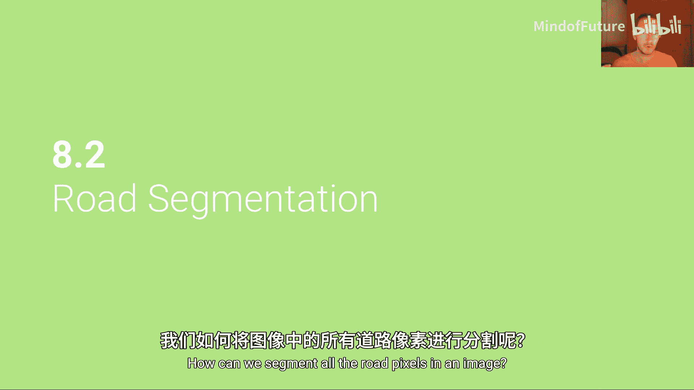
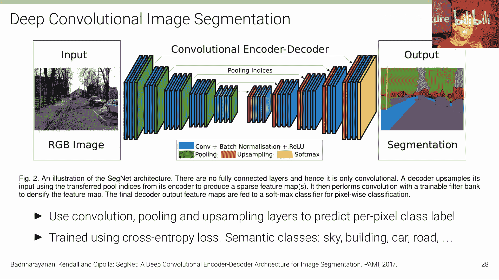
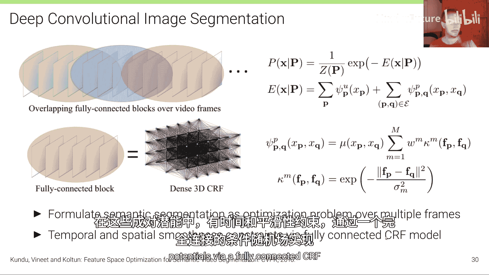
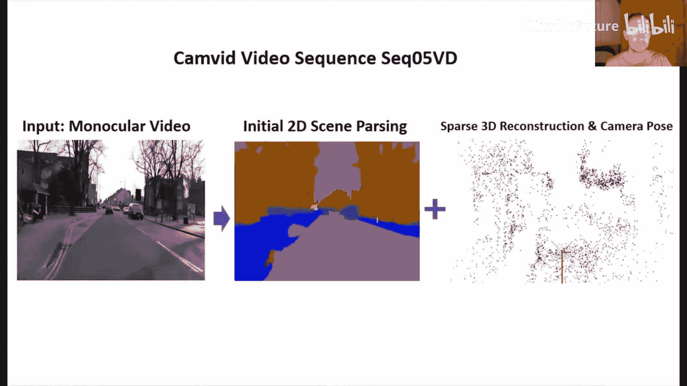
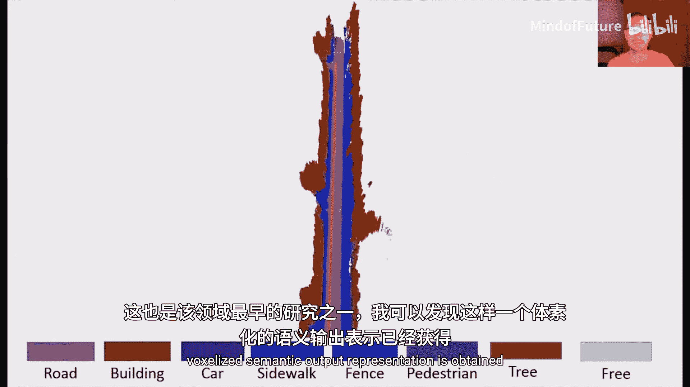
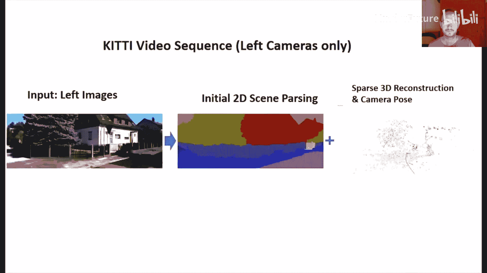

# 【图宾根大学】自动驾驶汽车课程 ML4340 p28 P28 Lecture 8.2 (Road and Lane Detection - Road Segmentation) -BV16FP2ePEYc_p28-

Let's now have a look at some of these methods in a little bit more detail。

 and let's start with road segmentation。How can we segment？All the road pixels in an image。

The answer to this question today is to use deep convolutional neural networks for image segmentation。

Where the task is given an RGB input image。To predict for every pixel in that input image。

A semantic class label。And that semantic class label could be， for example。

 sky here in gray or trees of vegetation in。Yellow or buildings in red。Or sidewalk in blue， or。

Rode in purple。And so you can see that for every pixel we have a classification problem to solve。

How can we solve this？We've already seen convolutional neural networks。

Convolutional neural networks are basically the left part of this image here。

 where we take the input， and we apply。Or we interleave convolution layers with pooling layers to successively shrink the spatial resolution of the input of the feature maps。

Down to a。A single value。 And this is used， for example， for image classification。

Now what's added in semantic segmentation algorithms and for example。

 in this one of the very first works segment， the conference paper appeared two years earlier than this。

What's added here is to have。A。A deconvolutional part， a decoder， so this is called the encodeder。

 which shrinks the spatial resolution。Now we have a decoder that then successively increases the spatial resolution again until we reach the original resolution。

So it's sometimes also called a U net because it has this U shape or an hourglass network。

 and often it has not only convolution pooling and up sampling layers。Convolution is in blue here。

 pooling is green。 red is up sampling。But it also has skip connections for information from。

The encodeder layers at the respective resolution are directly channeled forward to the respective resolution of the decoder layers。

There is many different variants of these type of networks， but in a nutshell。

 they are kind of working all the same as indicated here on this picture。And to train these networks。

To train the parameters， to obtain the parameters of these networks。

 what we do is we use standard empirical risk minimization。 We define a loss function。

We have labeled images。 we have a data set with input output pairs。

And then we can define a loss for every pixel now， a classification loss。And that's， of course。

 a standard cross entropy loss for every pixel。Of each image that we have in our training set。

And we can train this model。Such that the model tries to predict the correct semantic class label。

 according to what the annotators。Have annotated。

Now here's an example， this is from the original paper。You can play also the video。

 You can see what the algorithm produces。You can also see it is not working super well。

 but you can already get the gist of where the road should be and where the cars are， etc。

This is one of the very first bookss。For semantic segmentation。Of course。Since in the last six years。

 the performance of these approaches has。Improved quite dramatically。

And I will show you also some newer results。So here's an example that's only。A few months。

 a few years later than the original segment paper that combines the semantic segmentation with a conditional random field。

Not going into the details， but the idea is basically to make the semantic segmentation coherent in space and time。

 where we have a dense。Densely connected C， R F that spends both space and time。

 And we have the unary potentials here in that CR R F that。I basically determining。

While this is basically for every pixel， which semantic class that pixels should be labeled with。

 and then we have these pairvis connections which tell us well if they are close in space and time。

 then they should probably be the same。Class label。

So semantics segmentation is formulated as an optimization problem over multiple frames。

And there is temporal and spatial smoothness constraints here in these pairwise potentials。

V a fully connected CRf。

And the results of this， despite these works from 2016， are quite amazing。

You can see they are very clean compared to what I've shown you before。And。They are also。

 in many cases。This is on a cityscape state。Quite correct。You can also see the ambiguity here。

Like this area， is's really hard to distinguish for both the humans and the machine。

If it should be a road or if it should be sidewalk or something else。You can， of course。

 also apply the idea of semantic segmentation in 3D directly by。

Pasing the input images through a semantic segmentation network， for example， and at the same time。

 computing。A local map using slam techniques and then fusing this information into a semantic3D map。

And this has been done in this work here， for example。

It's also one of the earliest works in this area。Where can see that。

Such a velized semantic output representation is obtained。

不。Okay， and finally， what I want to show you also is that of course it's also possible to define the semantic class labels specific to the self driving problem。

So， for example， here， the segmentation with respect to the road is not only with respect to the road in general。

 but it's with respect to the particular lanes。 So here。

 a semantic segmentation model has been trained to not just distinguish road from the rest， but to。

Separate the road into the Eagle lane in green， and the。A pearl lane here in orange。

 as well as the opposite lane in yellow。And you can see that。The algorithm does a reasonable job。Yin。

Distinguishing these。These different lanes here。