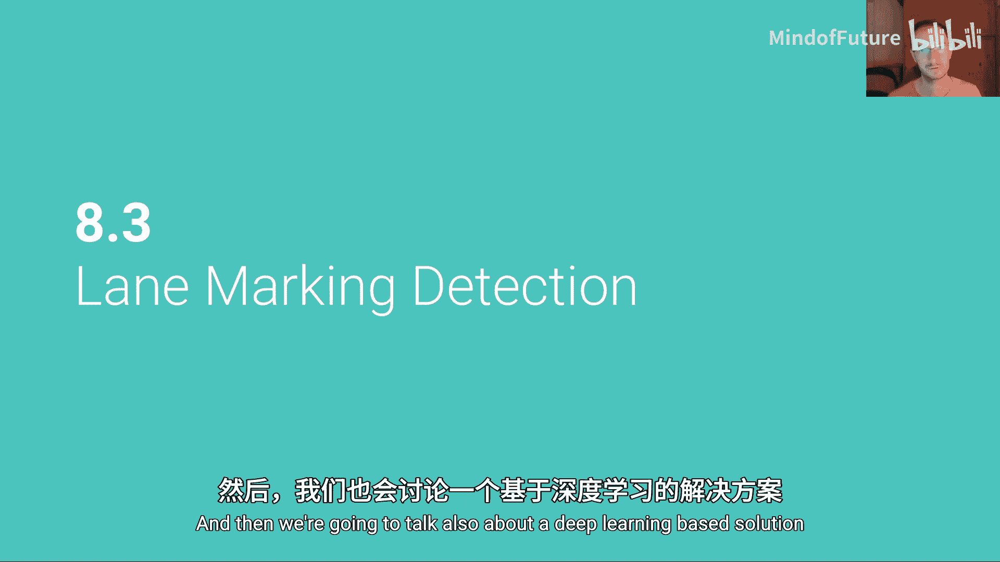
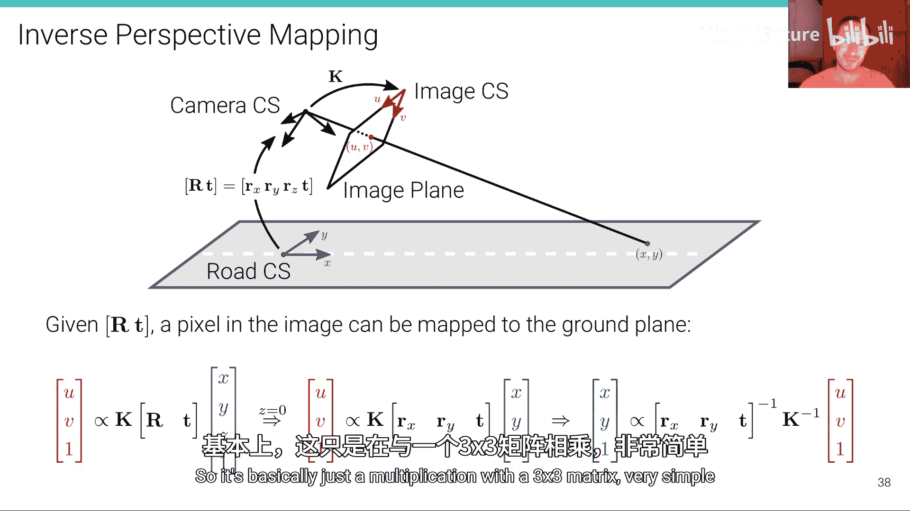
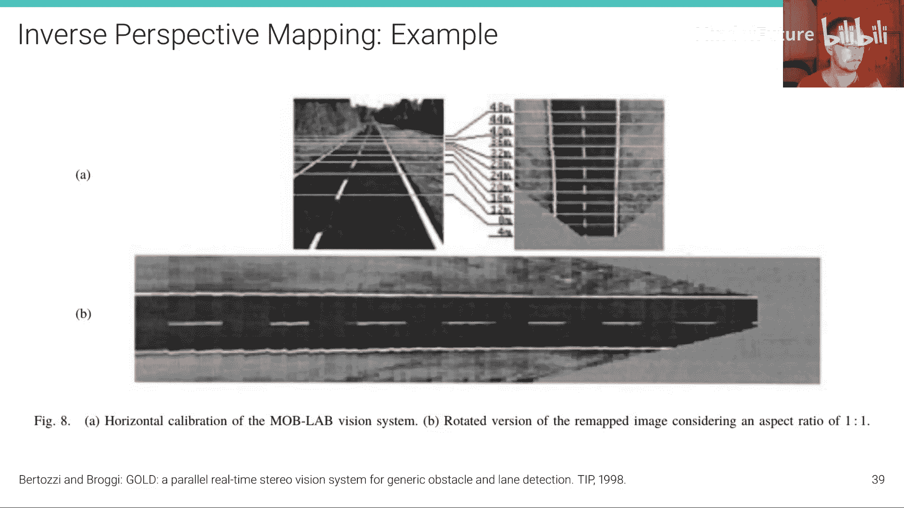
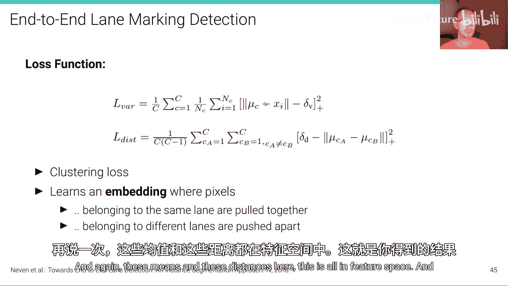

# 【图宾根大学】自动驾驶汽车课程 ML4340 p29 P29 Lecture 8.3 (Road and Lane Detection - Lane Marking Detection) -BV16FP2ePEYc_p29-

Now， how can we detect delay markings？We're going see a very simple algorithm， first。

And then we' are going to talk also about a deep learning based solution。

Let's start with the very simple algorithm。By looking at this image。

 we see that the lanes or the lane markings are typically bright。

And they are easy to distinguish from the dark background that they are painted on。

And that means we can compute the gradientding of this image， and we can find。

The contour of display markings。As strong gradient responses， for example。

 we can filter that image horizontally。With this horizontal kernel，-1，0 plus 1。And then。

 if we look at the。Graient image。 in this case， what is illustrated here is the。Absolute。

Gradient image。Then we get something like this。Alternatives to using these very simple。

Great in filters would be to use steerable filters or specific templates。 If you know。

 the width of these lane markings and。The geometry of the road。 then you can make use of this。

As well as learn features， of course。Now， let's stay simple and look at the simple gradient image。

What we can do is we can go along each image row。Here's one example in red， and find large gradients。

Now， this is the absolute。Value of the gradient as already mentioned， but we know the sign of this。

 And what we can see is that there is always two peaks here next to each other。

 If we have a lane marking because。There is a strong gradient at the left side of the lane marking。

 and there's a strong gradient at the right side of the lane marking。

And so we can use this information to filter out layers。We can filter the outlas， for example。

 by about， if a depth map is available， we can filter the points that are not on the ground plane。

 We can fit。A freey plane to the depth map in front of the vehicle and assume this is the road。

 And then we get rid of all this background noise here from the trees。

And we can remove isolated points like this one here， for which there is no opposite gradient。

In its immediate vicinity。Like in this case， here。So it cannot be a lane marking。

 It's some outlier here。Now， here's the result of this very simple process。

 which for this simple image works maybe surprisingly well。 and we can see in green。

 the detected left boundary of the lane marking and in red。

 the detected right boundary of the lane marking。 and we can also see some outliers that are left。

We can further reject false positives using some heuristics， like detecting nonst markings。

Or by robust fitting using。Random sampling consensus。嗯。

What is also important to note from this picture here is that not all lane markings have been detected。

In particular， the one here at the very left。Which is seen at a very slanted angle due to the prospective distortion。

We were not able to identify。As you can see， the gradients are very faint。It's hard。

To distinguish the white colour from the grey road surface。

 And so it was below the threshold that was used here to detect the lane markings。

If you have such a threshold based approach， then of course， as a trade off。

Depending on how how you tune that threshold， you either detect。

Like all the lane markings that you want to detect， but you get a lot of false positives。

Or you're not detecting all the lane markings。Now， as already mentioned。

 what we are actually interested in is not the lane markings in the image domain。

 but in the bird's eye view。So how can we map the。Lane marking that we have detected in the image domain。

Remember again that this is basically pixels that we have detected here。

How can we map them into bird's eye？Vi。And the process for doing so is called inverse perspective mapping。

 and it's illustrated here。Inverse perspective mapping maps each pixel on the image plane。

This is recangle here is indicating the image plane。To the respective ground plane point。 So。

 for example， this pixel U V on the image plane would be projected onto this pixel X。

 Y on the ground plane。Where U V is represented in the image coordinate system。

And this point here on the ground plane is represented in the road coordinate system。IPM。

 inverse perspective， mapping is only possible if even the per pixel depth is known because then we can unproject that into 3D or。

If we have a model for the ground， such as a plane。That is， for example， estimated from。The depth。

The other components of this figure here are the。Transformation R and T。

 the rigid body transformation between the road coordinate system and the camera coordinate system。

 Often the road coordinate system is placed directly below the camera coordinate system。

 so it's uniquely defined。And we have K， which is the calibration matrix or the intrinsics。

That map a pointing camera coordinates to the image plane。And so in other words。

 we have the full transformation defined。 Now， we can take a point in。

Road coordinate system and map that into camera coordinate system and then into the image coordinate system。

This is the chain of transformations that we are following。Now， how can we obtain the ground plane？

In other words， how do we get the extrinsics， the rigid body transform are？

Transforms the road coordinate system into the camera coordinate system or a point in road coordinate system into the camera coordinate system。

And one solution to this is very simple。 We just assume a fixed plane that has been determined。

Apriary。Because we know that the camera is not moving on the vehicle and it's always fixed with respect to the vehicle。

 and so it's approximately fixed also with respect to the ground。If we are not driving in overly。

 hilly terrain。Now， of course， this is not a very good model because the vehicle will。No。

 it will pitch。If you're accelerating or if you're breaking。I will go like this。

And so if you assume a fixed plane， then of course， if the vehicle goes like this。

 this assumption is not true。So what's better in practice is to estimate the road plane and you can estimate the road plane by。

 for example， stereo or lidDar measurements。And if I have stereo or lighter， I have a 3D point cloud。

 and I can。Maybe be using a semantic segmentation algorithm or just assuming that what is in front of me directly in front of me。

 like。This area here is actually belong to the road。 I can unfit a plane to these 30 points。

 and the definefiance my。Ground plane。So this is something that's that's commonly done。And then this。

 of course。A little bit more sophistication to it。 So you want to track this。

ARo plain estimate over time and be robust to outliers and so on。Now， this is how you get R T right。

 by fitting a plane to a 3D point cloud。The 3D point cloud is specified in camera coordinate system。

 so if you fit that plane to the 3D point cloud， you get this rigid body transform。Okay。Now。

 let's assume this has already happened， so we know R and T already。Given R& T。

Then a pixel in the image can be mapped to the ground plain as follows。Here on the left。

 what we can see is the standard equation from the pinhole camera model。

From the image formation lecture that we had a few lectures ago。Where we take a 3 d point， X， Y， C。

In road coordinates， here only two a are shown， but there's the third axis also。

 which is not relevant， but we have a C coordinate。So we have a point X， Y， C in road coordinates。

 and we we look at the augmented vector here with the one at the end。And so， we multiplied this with。

R and T。The extrinsics。 And then with the intrinsics k。 and we arrive at。Li。😔。

Pixel coordinates in homogeneous representation。 So we need to divide by the last element to actually arrive at the in homogeneous representation。

 right。Now， because we assume the road to be flat。We assume this point here to be。At x， Y。

 but c equal to 0。 So there's this point must lie on that road plane。Or in other words。

 c equals to 0。Which means this equation here simplifies。Sea goes away， and so does the。

Third column of the rotation matrix， R C。Our x is the first column。 Our y is the second column。

And this basically， this is the basis that spans the。Coordinate system。

But c is not relevant anymore because we have removed it， we assumed that c is equal to 0。

And so this is the equation that remains。And now what you can already see is that now we have a homogeneous 3 d vector on the left and a homogeneous 3 D vector on the right。

 and we have a free by free matrix K and a free by free matrix。Our team。

And so because this is not all well defined and it's free by free。Marices， we can invert them。So。

 we can。P。Like k on the other side， so we get K inverse and we can put Rt on the other side so we get Rt inverse。

 and then this is the final equation that we get。It's basically a homoography。

Defined for the multiplication of R T inverse with K inverse。

And if we multiply the homogeneous vector Uv1 with that homoography。

And then we divide by the last element。 We get the inhogeneous version of。

Point in the road coordinate system so we can read of X and Y directly。

So it's basically just a multiplication with a free by free matrix， very simple。

And here's an example。 This is from a very old paper。From Batsian Brogi， gold，1998。

And you can see how this looks like。 you can see also that points that are far away they get。

Quite heavily distorted。 So you have a lot of uncertainty in these regions， while in the close range。

The measurements are more precise。And if there would be a car here。

 it would be also heavily distorted because it doesn't respect the plane assumption。

But in this particular scene， it's an empty road。So you can see how this empty road gets transformed quite nicely into the bird's eye perspective。

Here we have examples where also vehicles are present。And you can see。

That this vehicle here gets heavily distorted in the bird's eye view。

But now we have a bird's eye view representation。 And if we have detected the lane markings。

 then we can find them in a bird's eye view。And so， we have them in there。

Format that we want in the format that's useful for us。 That's useful for controlling the vehicle。

Still。We have done this conversion， but still， we are having just pixels， right。

 The conversion here from image to bird's eye view is still giving us an image。

 It's just a set of pixels。 Some of them are white。Which means they belong to the lane markings。

 and some of them are black， which means they don't belong to the lane markings。

But it's just a set of pixels。 So it's not。Extremely useful， yet to control。

Because it's just a set of pixels。 And instead， what we want is a set of permetric curves that we can use。

For controlling the vehicle， to define our path that we want to track may be using a pure pursued controller。

So how can we go from pixels to curves？Lmemarking detection alone is not sufficient。

As it only returns a set of pixels in image or road plane space。

Roadplan space means birds eye a few space。In order to be useful for navigation。

 we need to transform this into more semantically meaningful parametric model and often low dimensional parametric models like lines or polynomials or PC curves the sps are used for this purpose。

As a little remark。This is a multi model fitting problem。

We have basically one model per lane marking。But we typically have multiple lane markings in the image。

 so we need to estimate a model for each of these lane markings。🤧嗯。

So we can't assume there's just one model。 We have to also determine how many lane markings we have。

And that's called a multi model fitting problem。And furthermore outlis must be handled。Of course。

 the model must be robust to nice。Now， here's an example of one such algorithm。

 and that's also a pretty old algorithm， but one that has been used。Quieed intensely at the time。

In this case， the lane markings have been detected and transformed into bird's eye view。

 as we just discussed。 And then a permetric spline is fit to these lane markings using a ransack procedure by randomly sampling points。

On consecutive segments。And fitting a sp to these points and then evaluating how well that sp overlaps with the as lane markings identified pixels。

So here on the top， you can see such as sp， which is determined through some control points。

And is through these then fit to the lane markings。 And then there's a scoring function here。

So we're not going to go into detail， but there is a scoring function that tells how well that spline fits。

To。嗯。Observations， which are our detected pixels。And then， there's some post processing。

That removes some outliers and makes things more smooth and and coherent。And here are some results。

 you can see how this very simple algorithm works。It doesn't work super well。

But it works to some degree。 So you could try to steer your vehicle based on this。

 but you can see that it fails at intersections and then also it's very hard。

To detect lane markings that are。At the very left or the very right of the road， reliably。So。

 I would probably not。Rely on that vehicle。 I will probably keep my wheels on the steering wheel。 if。

 if this would be the input。wo。My lane keeping system。 But as already mentioned。

 inner city driving is hard， and even the most sophisticated systems today。

 they have often trouble inner city， and therefore they are only reliably turned on on highways。嗯。

Now， this was a very simple algorithm。Can we do better using deep learning。

And how can we detect multiple lanes with deep learning？Now we could say， well。

 we know semantic segmentation algorithm so we can take such an algorithm and map an input image to lane markings。

Or to lanes directly。嗯。But the problem with this is that we。Have to detect multiple lane markings。

 typicallyyically， like we have the lanes。The like the lane markings on the left of your ego lane and the lane markings on the right of your ego lane。

 and you want to separate those。 It's not sufficient to just detect them as lane markings because if you want to fit a parametric model。

 you need to know which is which。And so the standard cross entropy loss that's used for segmentation。

 for semantic segmentation or road segmentation。Is not enough here。So what is the solution to this？

One solution to this。To the so called instant segmentation problem。That has been used。

In instant segmentation algorithms and generic instant segmentation algorithms before。

 but has been adapted here to the problem of lane recognition。

Is to not predict the class label directly， but instead to predict per pixel features。

And then cluster those features in feature space。How does this work？Here's the input image。

We have a shared encoder that produces a feature embedding。 You can see this is sort of a unit。

 We have an encoder， and we have a decoder here。We have actually two decoders to take this encoded information。

The first decoder produces per pixelel feature embeddings。Illustrated with this colourful plot here。

 but really desire， like maybe 64 dimensional feature of as per pixel。And then here at the bottom。

 we have a segmentation branch that does a binary lane segmentation。

 So this is what we can do with standard semantic segmentation using a cross entropy loss。

And then what we do is we， basically。Mked the pixel embeddings with the binary lane segmentation such that we only consider pixels that are foreground that are on lane markings。

And now we train that model such that。Different lane markings like the left lane marking and the right lane marking are far away in this embedding space。

 such that when we apply a clustering algorithm on feature space。

 This is clustering in feature space。 In this case， it's visualized as a two dimensional space。

 Often， it's a higher dimensional space。 But just for visualization purpose here。

 we see a two dimensional representation of the feature space。

We can see that there's clearly four clusters here。

And these four clusters correspond to these four lane markings。

There is four different colors here in the final output。And once we have clustered them。

Then we know the individual instances。And note that this doesn't depend on the number of lane markings。

 It's flexible。 We don't need to know how many lanes or lane markings are there。

 because the model determines this。After inferring the features through the clustering mechanism。Now。

 how is this learned， This is not learned using standard cross entropy， Well the。

Binary lane segmentation is learned through standard cross entropy， but this part here is not。

So how is it learned。The equation that I took from the paper， if you are interested in more details。

 you can look in into the paper， but at a very high level。

 this is a clustering loss that comprises two components。

The first component is so we're trying to learn and embedding the first component tells us。

That pixels belonging to the same lane should be pulled together。

 and the second component tells us that pixels belonging to different lanes should be pushed away from each other。

Again， we assume ground truth instance segmentation is available。

 but we are not trying to directly predict the instance labels because we don't know how many instances we have。

 The labels are meaningless。But instead， we used this ground truth。

To define these loss functions where， for example， here in the first case。

We are trying to minimize the distance of the features。 this is the features here。

Of a particular pixel to its mean。The mean of that cluster that it corresponds to。

And here at the bottom， we're trying to now here we we have a minus in front。

 So we're trying to maximize this。 We're trying to maximize the distance between the。

Means of the different clusters。This is the second objective。 And again， these means and。

 and these distances here it is all in future space。

And this is the result that you get。 So you get for these examples here quite nicely detected lane markings。

 And because we are using a much more sophisticated， deep neural network based approach。

 we are getting those lane markings also quite robustly for。

Lanes that are further away at the boundary of the image are where we actually don't have any markings。

 but。The algorithm just learns that there should be markings， And if there is a。

A lane marking happening once in a while that sufficient for the algorithm， to。

 recognise the entire lane boundary。Now， in this work here， this has dis segmentation， was also chis。

诶。Intermediate results。 And it was used。As input to a fitting process where then a spline was fitted to each of these individual lanes。

 But that's now very simple procedure because we have already segmentation。

 So we just need to take all of these pixels and fit。This pmetric model to it。

And this is what you can see here in the bottom row。

