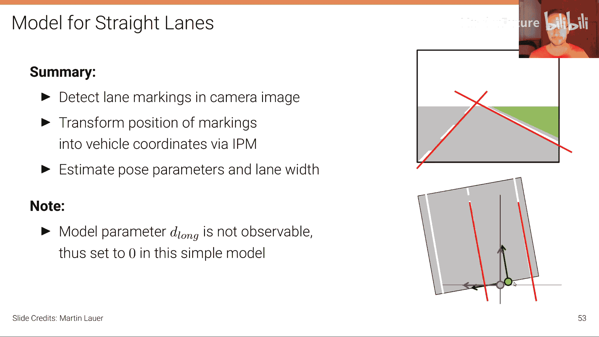

# 【图宾根大学】自动驾驶汽车课程 ML4340 p30 P30 Lecture 8.4 (Road and Lane Detection - Lane Detection) -BV16FP2ePEYc_p30-

In the previous unit， we saw how we can detect lane markings。And how we can map them from。

Image space into root。Into the road plain， into bird's eye view space。However。

 detecting individual road or lane markings is not sufficient for steering a vehicle。

What we have to do is we have to aggregate them into a single lane such that we， for example。

 can follow the center line。And that's what were going to discuss in this unit on lane detection。

In this unit。For the purpose of。Illustration， we are going to consider a very simple model。

 which is basically a linear road model。 Of course， such a model does not apply everywhere。

 but it would apply， for example， to driving straight on a highway。

So， here's the model。The model for straight lanes。It is a geometric model。

And models the highway scenario。Where the own lane is delimited on the left side。

 on the right side by lane markings respectively。The question is now。

 can we fit a single model for this entire lane？This area here。

We start by specifying the parameters that we model。The first parameter。

 the first unknown that we model is de with。Depending on the road。

 we might have some prior knowledge about the La width， but in general。The la width can vary。

 so we have to estimate a single value for the la width as well， when we estimate。

The position within the lane。And we call that parameter B。And it's a positive， real number。Okay。

The next parameter is the lateral vehicle offset with respect to the center line and recall that。

Dilateral distance， tea lat。So here is the coordinate system。Of the road coordinate system。

And here is the vehicle coordinate system in blue。And so we have Dla as this distance the displacement between these two coordinate systems in horizontal direction。

Or in lateral direction。Otogonal。To the vehicle sideways。Similarly。

 we have the longitudinal position， which is this distance here。

So this describe these two together they describe the position of this coordinate system with respect to the road coordinate system。

And then in addition， in this simple bird's eye view model。

 we also have the your angle of the vehicle similar to the angle in the bicycle model that we have discussed。

Which we call also psi here。And which is a value between。Minus pi and plus pi。So in this case， here。

 Psi is relatively small。This means that the entire state that we want to estimate。

Can be described by4。Variables。P de Lain width。The long and the lu。

 which are the position of the vehicle with respect to the road coordinate system。

And then the ya angle psi of that vehicle。Okay。So now we want to estimate those parameters。

The La width and the。Poose of the vehicle by simply observing measurements from the lane markings。

 That's our goal。How can we do that？Let's first have a look at the transformations between the two coordinate systems。

We have the road coordinate system in green and the vehicle coordinate system in blue。

Based on the definitions on the previous slide， it is clear that we can map a point in vehicle coordinate systems。

 Let's say we consider this point on the lane marking。

With respect to the vehicle coordinate systems and we call that X vehicle and Y vehicle here in blue。

We can transform that point into the road coordinate system。

 such that it is represented with respect to the road coordinate system。

Using the simple 2D rigid body transform。Which is comprising a rotation matrix。

That's based simply on the ya angle of the vehicle。And the longitudinal and lateral displacement。

Of that vehicle with respect to the road coordinate system。In other words。

We multiply with a matrix and as a vector in order to get that point on the road。

From vehicle coordinate system to map that point into road coordinate system。Now， similarly。

 we can go the opposite direction。 We can subtract that vector on the left side， and we can。

Multiply with the inverse of that matrix， which has happened here。

 and so we can take a point in road coordinate system and map it into the vehicle coordinate system。

And this is the equation here at the bottom。Now in the road coordinate system。

 we we can describe the location of the lane markings right。

 So if we consider the road coordinate system， the lane markings are the lines that are shown here in red。

And they are very to simply， they are very simple to describe in the road coordinate system。

For example， the X coordinate is simply some real number， the path length。In x direction。

Because this。嗯。Ls are vertical。And the y coordinate is either plus or plus be would be here。

 plus be or minus be。 so we have the La width B。And so we go plus be to arrive here and minus be to arrive here。

And this is the Y coordinate。And then the x coordinate is simply a real number L。What you call。

The path length for， the location along that。Plf in X direction。

So this is how we can describe any of the red points。Which are the lane markings。

Now we can take this definition here。Of the lane markings。

And plugged that into the previous equation to transform them into the vehicle coordinate system。

And this is what has happened here。It's the same matrix transformation as before。

 except that we replaced x road and y road with L and plus minus B2 here。

Now we have mapped the points。They rate lane marking points from the road coordinate system into the vehicle coordinate system。

Okay。Now here this is the equation repeated from the last slide。

What we can now do with this equation is we have two equations here effectively， right？And so we can。

 by mathematically rearranging them。Basically， what we do is we solve for L minus d long and then p because it appears on both sides。

 we plug it into the every equation。So we get a single equation where we eliminate L。

And if we additionally assume that the heading angle psi is close to0。

 we end up with a very simple expression。Simply by eliminating L and assuming the heading angle to be small。

We get the expression that y vehicle equals minus the heading angle times x vehicle。Plus。

 minus B half minus D lat。Now I'm not going to show the de here in the lecture for time reasons。

 but we're going to discuss this in more depth in the exercise。

What is important to note now is that now we have a relationship。

Between y and x in the vehicle coordinate system。Well we have the parameters that we want to estimate。

Here in black。For example， the heading angle。The Lin width and the。

Laterral vehicle position with respect to the road coordinate system。

Which means that we can now use observations to estimate those parameters。

 psi B and Dt from observations X Y。And that's what we do。

This results in a simple regression problem that we can solve independently per frame if we have enough observation。

 if we have at least a few observations。On the left and on the right， lane marking。

Given NL points on left marking， which you call X IL and Y IL。And given N R points on the right。

Lane marking， which we call X J R and Y JR。We。Solve the following minimization problem。

We want to estimate the quantities B， D lat and Psi。

 and the star indicates that this is the solution already to the optimization problem。

And the optimization problem simply tells us which we want to minimize。

These sum of some squared arrow terms。Where the square arrow is simply。

Measuring the square distance between the。嗯。The Y coordinate of the measured lane markings in the vehicle coordinate system。

I'm using the blue color here consistently in these slides to denote the vehicle coordinate system。

So we're comparing the y coordinate of the lane markings。

 the vehicle coordinate system to the prediction by our model if we pass the x coordinate to our model。

This is our model here， right。And we make a prediction for why。

Through this model with the parameter Psi B and diat。And of course。

 we can do that both for the left and the right lane markings。 And so we get two different。

Errow terms here。There may be different number of points detected on the left lane marking than detected on the right lane marking。

 but that's not a problem。We just add these error terms as many observations as we have。Now。

 as you can see we have a squared error term and insight that error term all the parameters appear linearly in that expression E。

 Psi B and D lat appear all linearly。Which means that we have a closed form solution to this。

A linear least grass problem。And the solution is。Specified here at the bottom。

And we get this solution we get then thes solutionution B and Dlut and psi by solving this。

Simple linear system。So it's a standard least  squareer system。So in summary。We。

 what have we done or what do we have to do in order to estimate the name。First。

 we have to detect the lane markings in the camera image and transform their position into the vehicle coordinate system。

 for example， using the inverse perspective mapping。And this was discussed in the previous unit。

In this unit， we have done seen。How we can take this。

Measurements in bird's eye view in the vehicle coordinate system and estimated post parameters。

 in this case， B D la and p Psi。It's important to note， maybe you have realized。

That the model parameter D long is not observable。 It actually falls out of this equation。

 When we do this transformation here， when we do this elimination of L， then D long also vanishes。

And so this means it's not observable。 And in fact， if you think a little bit about it。

You can realize yourself that this is true， and there is many delongs for which we could estimate the position。

 the relative position delus and the heading angle such that the lane markings would project correctly into the image。

Because we don't know the longitudinal position of the lane markings with respect to a global reference system。

 respect to the road reference system， which just know that there is a lane marking。

 So delong is not observable， therefore， in this simple model。Here on the right， we have simply set。

Dlong to0。And estimated the vehicle position， such that。

And we assume D long is 0 and only estimate Dlut and B and。The heading。sam。

