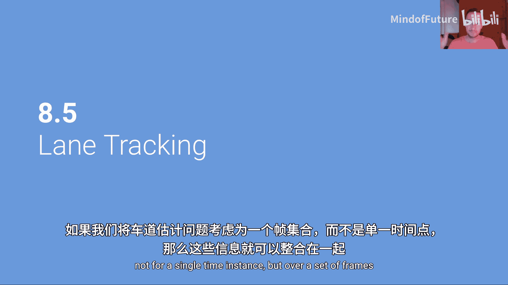
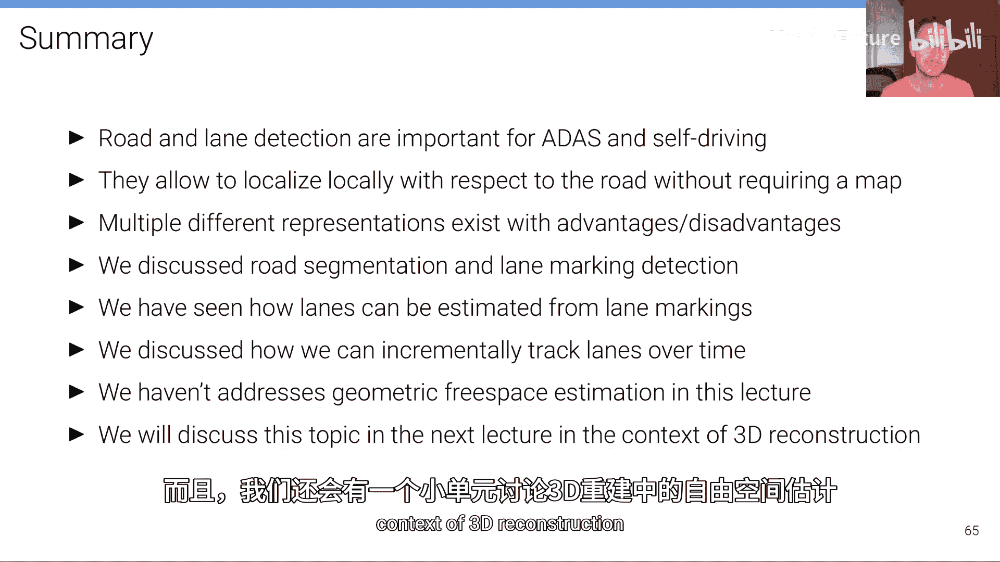

# 【图宾根大学】自动驾驶汽车课程 ML4340 p31 P31 Lecture 8.5 (Road and Lane Detection - Lane Tracking) -BV16FP2ePEYc_p31-

We've seen how we can detect lane markings and how we can aggregate that lane marking information into lane estimates。

But in the previous unit， what we did is we estimated the lane based on。

The observations from a single frame。And the problem with this is， of course。

 it's not very robust because we ignore all the measurements from the previous frames that might potentially be valuable for the current estimate。

And also we've seen that we can't estimate the longitudinal position along the lane。

And this brings us to lane tracking in lane tracking。

 we want to formulate the estimation problem not for a single frame。

 but for multiple frames we want to estimate in some way optimally with respect to observations from multiple frames。

With the hope of getting a better estimate。Exploiting information from the past。

 Exploiting also maybe the a model of how the vehicle moves and。

Measurements like visual or dormitory to tell us something about how the vehicle has moved。

 So all of this can be now integrated if they consider the。Lane estimation problem。

 not for a single time instance， but over。

A set of frames。Again， we are going to consider the model for straight lanes。

 and this localization problem is called incremental localization because we are trying to incrementally estimate the parameters。

Of delay over time。This is illustrated here on the left。

 we can see again in green as before the road coordinate system。

 and now we have the vehicle coordinate system at time T in blue and at time T plus1 in purple。

The rigid body motion that translates the。Well， a point from the vehicle coordinate system in time T to a point in vehicle coordinate system at time T plus1。

Is given by the translation vector M。And the。Relative change in the heading fire。

You can see here in gray this is the。 This is a copy of this coordinate system to better see how the heading has changed。

 and this is the change in heading Phi。 Remember that the heading we called Psi。And now对。

The change in heading， we call fire。So these are three parameters。

 two for the translation and one for the change in heading in order to transform the vehicle coordinate system at time T into the vehicle coordinate system at。

Time T plus1。Or a point in in that vehicle coordinate system into that vehicle coordinate system。

We are going to use again， the same state vector as in the previous unit。

 We want to estimate the lane width。And the longitudinal and lateral position of the vehicle。

 But now over time。As well as the heading of the vehicle over time。

The first thing that we can do is define these so called state transition equations。

 and they tell us how the state transitions。Over time。So here's what this looks like。

 if we go from time T to time t plus 1， then we have to， well， we have to start at time。

This is basically in， in， in， in road coordinates， right， So we， we start at。With the parameters。

De position of the vehicle at time T。And then， we add。うん。We add to that。嗯。

A translation vector that's now transformed by。The rotation matrix that corresponds to the heading of the vehicle at time T。

this coordinate system here is not necessarily aligned with the road coordinate system。

 so we have to。Consider that。Translation vector here。

 we have to transform that first into the road coordinate system so that it is a translation vector and road coordinate system。

 and then we can add it。And so we obtain the position of the vehicle in time T at time T plus1。Again。

 if we make the assumption that the heading angles are small。

 we can replace the cosine with a 1 and we can replace the sign with its argument。

And so we get a simplified expression here， and we do this， as you will see。

With the purpose of having a linear equation in the end。But， of course， if youll。

One if you can use a nonlinear estimator， you don't need to make that approximation。 And again。

 that approximation only holds， of course， if we have small heading angle in practice。

 like we're driving on the highway in most cases， the heading angle will be very small。

So this is the transition for the proposition of the vehicle from time t to time t plus one。

 and similarly， we can write down mathematically the change in heading， which is simply。

Taking the heading at the previous time step and adding the relative change in heading Phi。

 And so we obtain the new heading psi T plus one。And for the width of the lane。

 we assume that it's not going to change over time。 so it's constant。

And also we have Bt plus 1 equals Bt。This is the state transition equation。

That tells us how we move from state at time T to state at time T plus 1。

 And in this particular case， because we have made this assumption here。

 we can write this down as a very simple， linear form。Which is given here。

Where we have the state at time T plus one equals a matrix。Times the state at time T。

And another vector。This matrix is the state transition matrix， and this vector is the input vector。

And if I multiply those quantities and add them， then I， I obtain exactly these equations here。

So we can see that the state transition equation is a linear equation。

And so we can use very simple linear state estimators for this problem。Now。

 the other thing we have to consider are the observations， of course， right。Similar to before。

 we assume that we have NL points observed on the left lane marking in the vehicle coordinate system。

 this is already transformed into the per'si view。And they are called X， Y， L， Y， I L。

And we have NR points on the right marking observed， which are called X， Y， X， J， R and Y J R。Now。

 why？L and Y R。Are given to us， but they can also be determined from the state and X。

 as we've seen in the previous unit。These equations that you see here are simply the equations。

That we've seen in the previous unit this equation here， where we've seen that given x and the state。

 we can also estimate y。So we have an estimate of why。And we have the observations of why。

 and we try to minimize the difference between these two， but not for a single frame now。

 but for multiple frames。Or by trekking over multiple frames。Okay， so how does this look like here。

 you can recognize the equation again from before。 So we have P， for example， here。

And then we have minus t lats and minus Psi x1 L。And in the first， in the upper part of this matrix。

 we have plus be because we are looking at the left lane markings。And then at the bottom。

 we have-1 half because we are looking， minus B half， because we are looking at。

The right lane markings。And we can also see here that the observation。

Matrix or the observation system。The observation equation。Is a linear equation。Predictions for Y are。

Given by a product of a matrix with the state vector。

We can we can make predictions about why based on a matrix multiplied with the state vector。

And this is also illustrated here， so for example， for a particular X location。

We have the observations X Y， so we take one observation X now。The model。

 given the parameters of the model， can make a prediction for where on this y axis of that vehicle coordinate system。

This。Lane marking would be located， and this is simply the intersection of this line that we see here in purple with the lane markings in red。

And that's described mathematically here。Okay。So now we have both。

 we have a linear state transition model and a linear observation model。

So the entire state space representation that combines both the state transition and the observation can be simply described as two linear equations。

The state at time， Tless one equals。诶。Times to state at time T plus the。Inputs back to。

And then given the state at time。T plus1， we we get the observation at time。 T plus1 by again。

 multiplying that state with a different matrix， see。So we have for this estimation problem。

 we have a linear dynamic model。We have a linear measurement model。

And if we now assume gaussian noise， we can estimate this optimally。And in closed form。

 using one of the most famous state estimation algorithms that you probably have heard about before。

Which is called the Kaman filter。I'm not going go into the details of the Kaman filter。

In this lecture， but I'm just going to tell you that the common filter can solve。Such simple。

 gausute and linear systems。Cautution linear state space representations。Effectively。And optimumum。

But the reason why we can do that is， of course， that they are linear and we assume gausian noise。

 so this works only for very simple models， and now you can see why we made all these simplifying assumptions such that we can actually apply the simple state estimation algorithm。

So how does this work in practice？😊，Well， in the first stage of this algorithm。

 we need to detect the road road markings and the image， of course。

 And then we need to apply the inverse perspective mapping to transform the detected road markings into the。

Vehicle coordinate system， the birds I view that we always visualize here。

Then we have a prediction step so we can， for example， determine how the vehicle is moving。

Sa using visual ometry， we can transition the vehicle forward。

And this gives us information now about the lateral position with respect to the lane。

But this will not be optimal。 So you can see here that we have transitioned from blue to。Purple。

But the observations that would correspond to this purple coordinate system are offset to the actual lane markings。

While we observe the lane markings here in red。That's why。In this Kaman filter。

 we have the innovation step that then integrates the prediction from our motion model。

With the actual measurements and corrects the state。

Based on both the prediction and the measurements through these Kel and filter update equations right so we do a prediction and then we correct with the current measurement。

So we update the state with respect to the observed markings。 And that's shown here in。Brown。

 so now we have changed the。Prediction， the prediction doesn't make any use of observations yet。

 We just forward propagate with a noisy visual oomeory measurement。 And so that's not perfect。

 We have error accumulation， and so on。But now we observe the lane markings。

 And so we can can correct for this offset。 We don't know much about the lateral position， right。

But we can the longitudinal position， but we can correct the lateral position and the heading because we have a lot of information about these。

 And so after correction， you can see that the。Coordinate system at time T plus one， right。

 So this is both the below purple 1 and the brown 1 are at time T plus 1。

 The first one is to prediction。 The second one is the final correction with the observations。

Now this final correction， a time T plus one is better aligned with the La markings because it utilizes the observations。

 It utilizes the。Observation model for this correction step。Okay。

This is how a Kaman filter can be used to track the lane parameters over time through observations of the markings。

Of course， straight roads are not sufficient to model old driving scenarios。

So another model that we might want to consider is a circular lane。

If you have a circle and you let the radius go towards infinity。

 then you even obtain as a special case， the straight road， right。

 so we can by specifying the the radius or， the curvature， which is one over the radius。

We can transition between a very sharp turn and a straight road。

 So it's a more flexible model than the straight lane model。

What does this geometric model look like while we have the lane width again？

But now we also have the signedine radius or the curvature， which is one over the radius。S。

A parameter as a state。As an element in our state vector。We have the lateral vehicle offset。

In this case， with respect to。Some like the， the path that's defined by the radius。The circular path。

And we have the longitudinal position along the circular trajectory。And then we have， of course。

 also the yaw angle with respect to that trajectory。

And so the state vector is augmented by one variable here now。

And this model cannot be represented using linear equations anymore。

 so it becomes nonlinear and therefore requires more sophisticated state filtering techniques such as the extended commonman filter or the unscented common filter or the particle filter。

 Maybe you've heard about this also。Now， even circular trajectories are not enough。For example。

 if we。Move from a straight road segment to a circular segment， which seems plausible。

At first glance， what happens is that the curvature。Increases。With a step function。

The straight line has a curvage of 0 or a radius of infinity。

And then as we transition from here to there。This curvature jumps to the actual curvature of the circle。

And what that means is that also the acceleration jumps。You will see this in the exercise。

This is also the reason why， for example， roller coasters are not built like this。

 They are not built with。Straight line and circular segments， because it would。

Lad to a very large so called jerk， which is the。The time derivative of the acceleration。

 So would be a very unpleasant and actually unhealthy ride experience if you do that。

 because at this point， you。You observe a sudden jerk on your body。And so what's better is to。

 of course， slowly transition from the curvature of the straight line of the straight lane to that circular trajectory here so that we。

We go from 0 and linearly transition to that。Circular， curvature。

Because then we don't have this jump in acceleration。

Or this infinite jerk that is induced on the body。And that's why in practice。

 when road designers design roads， they always use the so called chloroid model。

 That is exactly this model that can transition between。

A straight line segment and a circular road segment。 And for example， this is needed when。

exiting a highway， for example。 And youre， you're going from a straight line。

 but you have to turn into at a relatively high speed。 So the higher the speeds。

 the more relevant it is to minimize Di。So you're transitioning slowly to the target curvature。

And it is illustrated here， where can see that the curvature slowly increases until we have reached the curvature of the circle compared to directly。

Jumping towards the circle curvature。And that's called a clite。Mathematicically， what is a clified？

Here is。The pure form of a cloid drawn as an。As a trajectory。A chloroid is a curve。

Hohos curvature linearly depends on the arc length。This means one over the radius。

 where the radius is defined with respect to the arc length。

 This is the position along that path or here along that path here。

Which is the curvature of the arc length。It's just a linear expression with respect to the arc length。

 the position along that path。This is the expression that defines a clphooid。

What does this mean well？This means that for example， the ya angle。

 which is the integral of the curva term。From0 to L。Becomes a quadratic equation。

 because now we are integrating this expression。 It becomes a quadratic equation with respect to the path length。

Or the arc length。And now， if we want to obtain the position we have to integrate again。

 We have to integrate this expression here， again。For x。

 we have to integrate the cosine of the yaw angle。 for y we have to integrate the sine of the yaw angle。

Now， if we assume small angles again， then the cosine can be approximated by one and the sine by its argument。

Well。The heading。The yaw angle is given by this quadratic expression here。

And that means that we obtain a third out polynomial。For the X coordinate。

 because we assume small angles， we assume highway driving， let's say。We simply get L。

But for the why。Coornate we obtain a third order polynomial expression because we have to integrate that gooddra here。

So it's clearly a nonlinear。Expression， but we can still solve the tracking problem by using nonlinear state estimators such as the。

Extended Kman filter， for example。And this has been done in this seminal paper by self dry pioneer and stigmans from the Buunddesve uni in Munich。

 we have seen already some of his results in the history part of this lecture。

So we are not going to go much into detail。 It's very technical and mathematical。

 but Id like to highlight this paper here is called recursive 3D Road and Relative egostate recognition。

 one of the seminal papers for state estimation for self driving vehicles。

It uses a visual recursive state estimation。And a chloroid model but applied not in the simple 2D case。

 but actually in 3D。So it models the horizontal and the vertical rot curvature， as we can see here。

 through chlors。It considers a dynamic bicycle motion model。

And it uses a projection based measurement model instead of inverse perspective mapping。

 so it doesn't assume that the measurements are inverse prospective mapped into the bird's eye view。

Because。We are also modeling the。Vertical road curvature。

 So we have to integrate this measurement model。 Also， this more complex measurement model。 also。

 we have to。Consider all of these curvatures when projecting points from 3 d to 2D。

 but that can be now integrated because we don't。Want to restrict ourselves to a linear state estimator。

 So if we can use any nonlinear equations， then we can， of course。

 also integrate the pinhole projection into this process。In summary， today。

We've seen that road and lane detection are important topics for advanced driver assistance systems and self driving in general。

We've seen that they allow to localize locally with respect to the road without requiring a global map。

There's multiple different representations。With their individual advantages and disadvantage advantages。

We discussed road segmentation and lane marking detection in the beginning。

And we've also seen how lanes can be estimated from lane markings。

 How lane marking information can be integrated into。Whole lane estimates。

We discussed how we can incrementally track lanes over time。

But we haven't addressed the geometric free space estimation part that was also discussed or introduced early in this lecture in the overview。

And we haven't discussed that yet because we haven't discussed freely reconstruction。

 and this will be the topic of the next lecture。 And so we'll also have a little unit that discusses free space estimation。

In the context of 3D reconstruction。

Thanks。