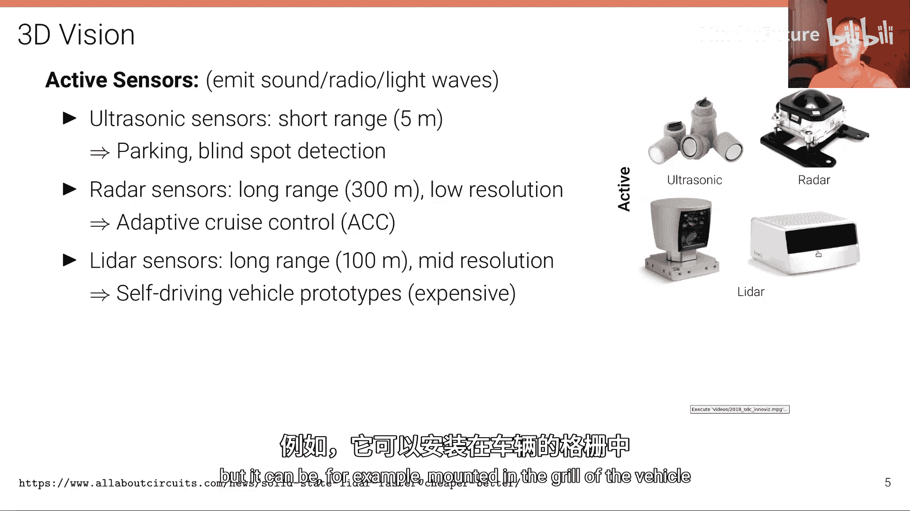
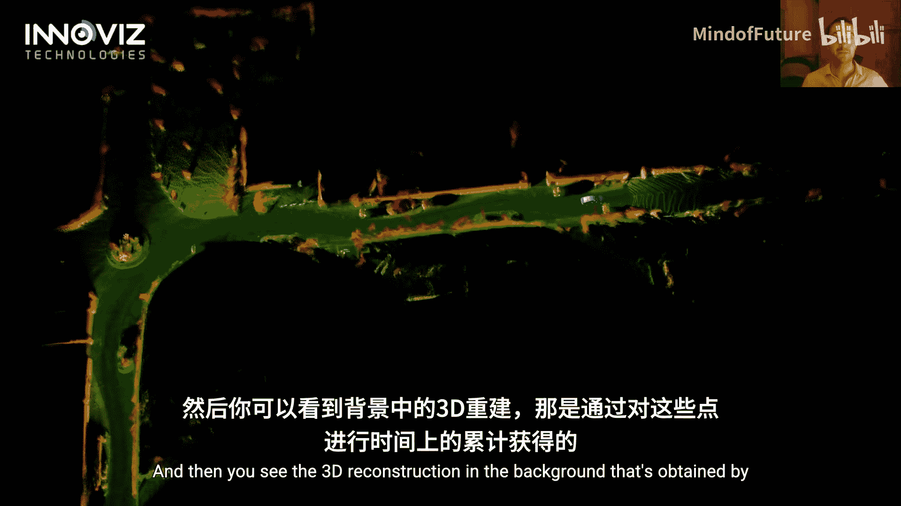
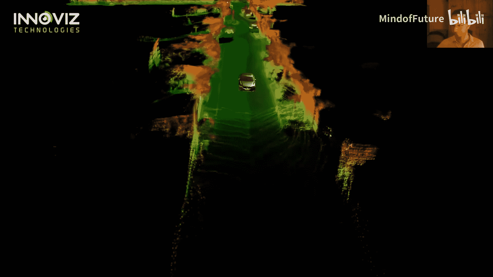
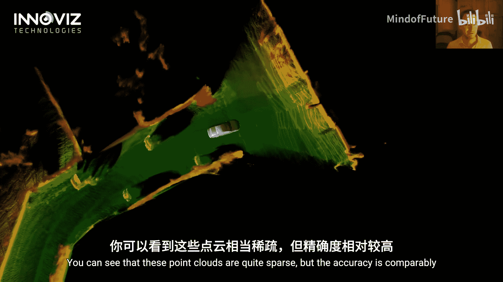
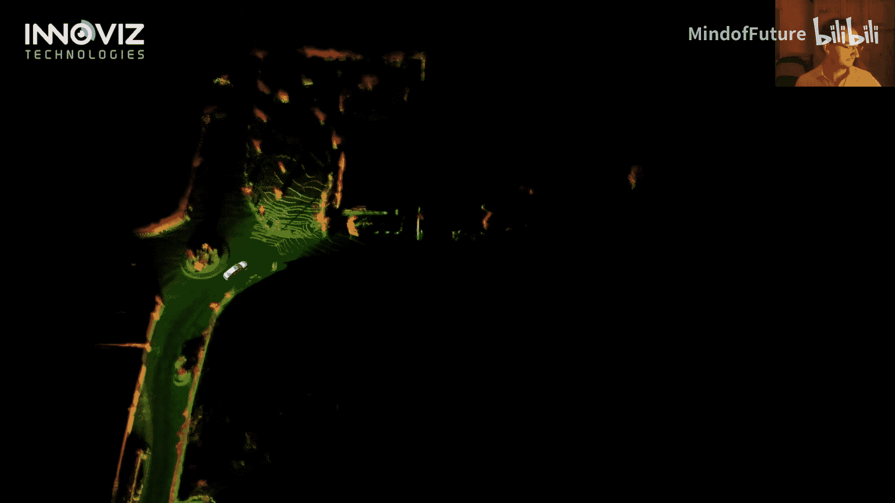

# 【图宾根大学】自动驾驶汽车课程 ML4340 p32 P32 Lecture 9.1 (Reconstruction and Motion - Stereo Matching) -BV16FP2ePEYc_p32-

Hi， and welcome to self driving cars lecture number 9。 this time on 3D reconstruction。

And motion estimation， which are two fundamental tasks for self driving cars。For example。

 in the context of navigation。This lecture is divided into four units。In the first unit。

 we will be covering stereo matching， which is the process of taking two images captured at the same time。

And converting them into a disparity or depth map into a 3D reconstruction。In the second unit。

 we will be talking about free space estimation， which takes such a 3D reconstruction as input and produces a free space estimate that's more directly useful for the self driving or navigation task。

And we will also cover the so called Stel representation。

Which is a representation that's popular in self driving。And finally， in unit3 and4， we will be。

Moving towards motion estimation first in the 2D image domain， that's what we call optical flow。

And then finally， in full 3D physical world space， and that's what's called 3D Scflow。

For those of you who have already attended our computer vision lecture。

Some of the content of the stereo matching and the optical flow unit。Are already familiar to you。

So they serve as a recap for， for those of you who have attended our computer vision class。

But most of the content of the free space and the Sflow lecture should be new to everybody。

So let's get started with stereo matching。Before we dive into stereo matching。

 let's first motivate 3D perception for self driving。

Why do self driving vehicles need to perceive their environment in three dimensions？Well。

It's quite obvious that precise knowledge of the environment's geometry is crucial for safe navigation。

For example。Think about a situation where the vehicle has to swerve around another vehicle in front。

 that's maybe parking。And in order to do so。Reliably， it has to pass it。Quite closely。

 But without hitting it。 And so you need to know the local geometry of your surrounding。Pretty well。

And this is just one example。 There is many more。Self driving vehicles typically combine multiple different 3D sensor types also for redundancy。

 and here are some of them illustrated on this slide。For example。

 on the roof of self driving vehicles， you will often find so calledled lidDar scanners。

That are laser scanners that emit laser。Laser waves and measure the time until the signal bounces back in order to estimate distance to an object。

His high precision laser sensors detect fixed and moving objectss。

There's also radar sensors that use a similar measurement principle， but a different wavelength。

In order to detect vehicles and also measure velocity of objects。Or short range radars。

That have a shorter range in order to detect objects。Directly around the vehicle。And then of course。

 we have cameras， which in contrast to Liar and radars。Are op passive sensors。

 They don't emit anything。And just passively perceive the environment。

And they are typically used to detect and track pedestrians or cyclists。

Or estimate the traffic light state or free space and other features of the surrounding environment。

And if you have a stereo camera， which means you are taking pictures of the same scene from slightly different angles at the same point in time。

 then you can use these cameras also to estimate 3D。

Let's compare these different sensors a little bit to each other。At a high level。

 we can distinguish active from passive sensors。Active sensors， as illustrated here on the right。

 are sensors。That emit sound， radio or light wave。For example。

 ultrasonic senses to emit sound waves and measure the time until the sound bounces speck。

And radar sensors emit radio waves and measure the time until the signal comes back。And lighter。

 they measure light waves。These different sensor types differ not only in the wavelength。

 but also in the range and the resolution。That they perceive， for example， ultrasonic sensors。

 they detect objects at a rather short range up to 5 m maximum。

And they are commonly used for driver assistance applications， for example。

 automated parking or blind spot detection。Radar sensors， on the other hand。

 have a very long detection range up to 300 meters。

But they typically come with a very low resolution， at least compared to an image sensor。

And they are used， for example， for adaptive cruise control ACC in order to maintain the speed of a vehicle such that it adapts。

To the vehicle in front。Now， ultrasonic sensors and radar sensors are already in many vehicles today。

 but Liar sensors are mostly used in self driving vehicle prototypes， as they are quite expensive。

However， they offer both a low long range， a long detection range up to 100 or 150 meters。

And they have a medium resolution。 They don't have a super high resolution like image sensors。

 There's no4K lighter。 And， for example， this。Its one of the most popular lidar for self driving the vodine HDL 60 form。

 It has only 64 Liar beams arranged vertically and then its spinning。

 so it has only 64 pixels resolution in vertical direction， if you will。

And then it has a higher resolution in the horizontal direction。

There's also another sensor technology， Lidar sensor technology here on the right。

 This is the Inverse。Lar scanner that is a solid state Liar scanner。

 And this scanner has the advantage that doesn't have any moving parts。

 There is no rotating scanner that can easily be damaged。But it can be， for example， mounted in。

 in the grill of the vehicle。

So here you see an example from the Inno Liar scanner。

 you see the current point cloud here in front that's estimated by that scanner。

 and then you see the 3D reconstruction。In the background that's obtained by accumulating many of these points over time。

You can see that these point clouds are quite sparse， but the accuracy is comparly high。

And so that's why these sensors are。Important sensors for many self driving vehicles。

In contrast to these active sensors here， cameras are passive sensors。 They don't emit any waves。

Here's a stereo camera， setup。第一。Advantage of such senses is that they are very cheap and they have a very high resolution up to 4K or even beyond。

But the disadvantage is that they require additional processing to obtain depth。

Unlike the active sensors， they don't directly perceive depth。

 but they require a stereo matching algorithm in order to convert the RGB images into depth maps。

And the problem with this is that this requires compute。

 but also the accuracy depends on the distance， actually depends quadraically on the distance。

 as we will see。And also on the textureness of the scene， if you look at a white wall， then you can。

Estimate geometry perfectly well with an active sensor。

But a stereo camera doesn't find any features to correlate。

 so it will not be able to perceive depth with such a passive sensor。Now。

 there is some self driving efforts like the one from Tesla that rely purely on cameras。

 And there is a working principle that。Passive sensing should be doable because we humans。

 we drive with just passive sensors， with just our eyes， and we are driving perfectly fine。

And so these passive and cheap sensors should do the trick。Also。

 they have the advantage that they don't interfere with each other because they are not emitting anything unlike。

 for example， lighter scanners that can cross talk with each other。But in practice。

 many of these self driving efforts actually use a combination of these sensors for redundancies。

 if you use multiple very different in nature measurement principles and you combine them。

 if you fuse them， then in theory you can obtain higher robustness， of these systems。Okay。

 so for a stereo for images， of course， you need always a stereo camera。

 you need two images capturing the scene at the same point in time in order to recover 3D and unless you can recover 3D over time by moving the vehicle if you w to。

Capture  freedie from an instantaneous point in time。 you need to take two pictures。

 And that's why these stereo cameras are looking something like this。

 where you have two cameras mounted rigidly on， on a platform like here。Okay。

 so now let's dive into the stereo estimation problem。

 How can we given two images from such a stereo camera captured at the same point in time infer depth。

Here can see the image one image from the Kidie data set。 and this is the image here。

 we see the image from the left camera and here the image from the right camera。

So these are two laterally displaced cameras， just like here。

And if we toggle between these two frames。You will probably see。So that in in the background。

 the pixels， they move less than the pixels in the foreground。

And this is exactly the principle that we're going to use in order to estimate depth。

 we're going to use。On the fact that pixels in the back move less than pixels in front。

 What we do effectively in stereo matching is we estimate the horizontal displacement。

How far pixels move in this case， from 0 to 160 pixels。

 which is the maximal motion of pixels in this particular image。

And this displacement we call disparity。And if we can estimate that displacement per pixel。

Then the result of this we call a disparity map。Which might look something like this。

Where objects close to the camera， the stereo camera。Move。

AOr are largely displaced here illustrated in green or yellow colors， up to 160 pixels。And points。

In the far distance， move only little here in black or dark blue。And in fact。

 it can be shown mathematically and we'll see this later in this unit that the disparity at a pixel is anti proportional to its scene depth。

 which means we can recover a2 and a half D depth map from a disparity map through a mathematical formula。

We call this a2 and a half D depth map because we have only depth for each of these pixels for all the rays that correspond to these pixels。

 and we don't have a full 3 d。Reconstruction yet。But we can of course。

 accumulate multiple of these two and a half D depth maps， fuse them into larger 3D reconstructions。

 for example， using the camera motion estimation from visualdoometry and then simply accumulating all the point clouds。

In summarymar。The task of binocular stereo matching is to construct a dense2 and a2 D disparity map from two images of a static scene。

Or alternatively， from two images。Of a scene captured at the same point in time。

 which means that the scene is aesthetic because you cannot move if it's captured at the same point in time。

The pipeline is as follows， we first calibrate the cameras。

 the stereo cass areric intrinsically and extrinsally。What does that mean， Well。

 intrinsically means estimating the focal length。And this Q factor and the principal point。

 So all the parameters of the calibration matrix。Of these two cameras。And extrinsically means。

Knowing the relative orientation and translation of the left and the right camera with respect to each other。

The second step in this pipeline is to rectify the images， given that calibration。As well see。

 this rectification of the images aligning the image planes with each other makes the implementation of a stereo matching algorithm simpler。

Then we apply a stereo matching algorithm in order to compute a dispar map。

And we can do that for both the left image as a reference image and also for the right image as a reference image。

And if we do that， then we can remove outliers using some consistency and occlusion houristics。

And finally， we can obtain depth from the disparity maps using triangulation。And optionally。

 as we have seen just before， we can construct a 3D model， for example， through volumetric fusion。

Okay。Now， let's look at each of these individual steps of this pipeline in more detail。

 How can we estimate 3D from just two images。And the first thing we have to understand is apipolo geometry。

 which we have already touched upon in lecture 7， but in a different context。In lecture 7。

 we wanted to estimate。Visualometry。So we were searching for correspondences in two images。

Without any constraints。 So for any pixel in the first image。

 any pixel in the second image could be a potential match。 and we were using。

Feature detectors and feature descriptors for that。And given these correspondences。

 we're able to estimate the essential matrix that defines the apopolo geometry。

And then we have seen that this essential matrix can be decomposed into a rotation part and a translation part。

 and that defines our。Extrinsics， our relative motion between these two cameras。

Now in the context of stereo matching， we're using apolar geometry in a different context。Here。

 we already know。The relative motion between the two cameras。As we've already mentioned。

The stereo camera  rig is calibrated， so we know the intrinsic and the extrinsic parameters of that stereoic。

 We know the motion， the relative pose between the left and the right camera。Given that we know this。

 we can construct the apopolo geometry and the apopolo geometry will then help us finding correspondences faster。

In fact， we don't have to search for any pixel in the left image。

 all the pixels in the right image anymore， but we have to search only along a one dimensional line。

 We are reducing the search space from a two dimensional search space to a one dimensional search space and that dramatically。

Increases or improves efficiency of stereo matching， and also the quality of the results。

 because the search space is much smaller， and there's less ambiguities。Okay。Okay。

 so let's look at apolo geometry again， this is a slide that's similar to the slide from lecture7。

We have a 3D point here。That is projected to the left image plane and the right image plane。

We project to the left image plane， by simply multiplying。

So this point here is represented in the camera coordinate system。Of the left camera here。

 this is the reference camera。So we simply multiply with the calibration matrix。And we obtain。

A homogeneous vector that we can normalize。Divide by the last element。To get the augmented vector。

 where then the first two elements of the augmented vector correspond to the pixel coordinates。

Similarly， we can project that point into the right image。

But we first have to transform that point into the camera coordinate system of the right camera。

What we' have seen already is that the image correspondences are then related by this expression。

This is the Apipolar constraint where we have the essential matrix。

 This is a homogeneous free by free matrix， and we have a point。

We have a homogeneous vector from the second camera multiplied with that times a homogeneous correspondence in the first image。

Where these homogenous factors here are the。R directions。

Of the pixel in the first and the second image respectively。

 And we obtain this through un projection through multiplying these。

Augmented vectors with the inverse of the calibration matrix to undo the effect of the calibration。

 to undo the effect of the focal length and the。Princciple point。 Alright， so we first undo the。

Calibration matrix， and then we can apply this expression here。So the correspondence of pixel。

X1 is located on the Apolar line L2， as we can see here from this diagram。

The reason for this is that。X1， x2。And x。All lie on the Apolar plane that is spanned by X and the camera centers of the first and the second camera。

So we have this apipolar plane， this triangle here in orange。

And where the triangle intersects with the left and the right image plane。

 this is what we call the apopolar line。 And obviously， through geometry。This point here。

Not the 3D pointer corresponds to their pixel here， which must lie along that line。

Must be located on that Apopolar line in the other image。 And vice versa， for example， this。

Pixel here。That corresponds to any 3 d point along this ray here must lie on that apo line。

And the mathematical description of this Apopollla alliance is given through。

A multiplication of the of the essential matrix with the homogeneous form of these correspondences。

And we can also see that the Apopolar lines intersect at the Apools。

 We have an apopole in the left image and in the right image here。

 And if we choose a different 3D point， we can see that the Apopo lines change， but the Apopola。

 the Apopole remains the same because all the Apopo lines， no matter。

Which correspondence and which 3D point we look at。All apopo lines。Are intersecting at the Ipole。

Thepo is the intersection of the line that connects the camera centers with the image planes。

So this is the geometric setting， this is the apolar geometry。Now。

 how does this help stereo matching？Well。Maybe you've already guessed。How this can help。

And it helps in the following way。Let's consider this point here in this pixel here in the left image。

 We know that the free point that corresponds to that pixel must lie on that ray。

That passes through that pixel， and the camera origin。Or the camera center。

And through apipo geometry， we now know that this。This line here or this ray here projects onto that Apopolar line L 2 in the a image。

Therefore， if we want to find a correspondence for that point， we don't have to search。

Through the entire。Image domain。 We don't have to look at every pixel in that image。

 but we only have to consider pixels that are located on that Apopolar line。

And that dramatically reduces the search space， and makes the。Search problem simpler。Consider for。

 for example， a relatively lower resolution BCA image。Where if we consider a horizontal line。

 we have 640 pixels to search instead of roughly 300000 hyposes。Which is 640 times 480。

So we have a factor of 480 less to search through。Now， this is something， of course。

 that we should exploit， and stereo matching algorithms all exploit this property。Now， this is nice。

 We have reduced the search space from 2D to 1D， made the problem much， much simpler。But still。

 one problem is that this line here might be arbitrary。 It might not be horizontal。

 And if we want to search through pixels effectively。

 we don't want to search through arbitrary lines， because this makes our life hard。

 It would be much simpler if we can just search by accumulating the column counter， for example。

 by accumulating the x position and sweeping a。A window。Over horizontal lines rather than computing。

 which pixels to search for if the Apopoar lines are arbitrary。

And this is what image rectification does。 It simplifies。The apolar geometry forest to apply。

The stereo matching algorithm， much more efficiently。The idea is the following。

 What if both cameras face exactly the same direction， which means that。

Principple access are aligned。And the image planes are co planar。If the image planes are co planar。

If they're in the same plane。What happens to the APpi poles？Well， the Apopos in this case。

 they intersect the image plane。At infinity。Think about。

A like two cameras facing the same seam point。 And then you rotate them such that the image planes become coplaner。

 Then the api poles will move outwards to infinity。

And that also means that the Apolar lines now become parallell to each other。

So we can construct a setting where。The search has to only consider points along the along horizontal scan lines along the same image row。

 correspond a correspondence for this point， for example， here， must lie on。Well。

 on this apopolar line， which is horizontal。 So we have to just search horizontally。

 We don't have to search in a diagonal fashion。But we have to search horizontally。

 and so this simplifies the implementation。And also increases efficiency。

The problem with this is that in practice， it's nearly impossible to perfectly align two camera sensors by trying to align the hardware exactly。

But， luckily。Even if the hardware is not perfectly aligned， it's not pixel aligned。We can still。

AMake up for the remaining arrow。By aligning the images virtually。And that's really nice。

So what if the images are not exactly in the required setup？Well， there's this trick。😊。

We can reorp the images such that the cameras look virtually into a different direction。

 We can't translate the cameras， but we don't have to translate them。

 We just have to rotate them slightly， and rotation can be implemented through a homography through a image reorp。

We don't need to know。The depth of scene points， we can just reorp the pixels through a homoography。

 And so hence， we can map both image planes to a common plane parallel to the baseline。

 And this process is called rectification。In order to rectify images。

 we must only know the calibration matrix K and the essential matrix E。

And here we see an example of this rectification process where we have the cameras before the rectification or the actual hardware。

 how the hardware looks like。And here we have the cameras。

Or the the virtual setting after rectification， where we have re wared the images such that now in the virtual in this virtual setting corresponding to these re wared images。

The corresponding virtual cameras now face exactly the same direction。

The calibration matrices are the same。 and the scan lines， the apopoar lines are horizontal。

We will not have time in this lecture to go into the details of this rectification process。

 But if you're interested in this， I。Recommend you to have a look at the computer vision lecture。

 number 4， unit1。The only thing that's relevant for this lecture is to know that we can rewa the images such that we get this virtual setting such that the virtual camera。

The virtual image planes are perfectly co planar aligned。

How does this look like in practice here on the top， we see。嗯。To input images。

 these are the original images。 And we see that， for example， for this。

Point here in the left image for this pixel。 If we want to find a correspondence for this pixel。

 we have to search along this slanted。Apri align in the other image。

 So we have to search for all these possibilities。 and this one here would be the correct solution。

 But now in the rectified setup where the images have been warped through homomography。

We can search along this horizontal scan line。Okay， so this was the pre processingcess step。

Given the calibration， we can compute this whoppping function。

And we can just naively apply to all the incoming images as a preprocessing step in order to warp the images into this rectified setting。

 and this is then the input to the stereo matching algorithm。How does stereo matching now work？Well。

 remember again， we have to find correspondences， so we have to search now along the scan lines to find the most similar patch。

So what is should how should we define similarity， Well， we could define， for example。

 a little window around a particular point in the left image。And then search for that window。

 that is。That is most close in appearance to the original window in the left image。

 search for that window in the right image。 So for example。This。

Window here at that particular scan line at image coordinate x1。

In the right image is displaced by disparity D correspondence， So the the image。

Column or or x coordinate one is the one here in white。 This corresponds exactly to this dashed line。

And now， because this image is taken from a slightly different viewpoint。

Location of that same scene point now moves towards the left。In that image。The projected location。

And this is what we call this barium。And so what we do now is we go through the entire scan line and find。

The best window。The window that is most similar to the original window by comparing these two windows for similarity。

We don't have to search in this dark region here because we know that the correspondence cannot lie outside。

Okay， the disparity cannot be negative。 so we， we don't have to search in this region。

 We just have to search towards the left。 and we only have to search along the scan line because。

We know that the correspondence must lie on the Apopolar line。Now。

 what similarity metrics can we use， Well， the first thing that we do is we take these little windows here in the left and the right image。

And we flatten them into a vector， and that's what we call WL and WR here。

So WL and WR have size r to the power of k squared because we're considering a squared window here。

We're taking all of the elements of these little window and stacking them into a big vector。

 And so the vector has dimension K squared。And then one of the simplest metric that we can use is we can simply compute the square difference between these vectors。

And that's called the sum of square differences。So we take。

 if we want to compute sum of square differences at。X， Y， look at this X， Y location here in red。

For a particular disparity value， we compare this vector in the left image at location X， Y。

To the corresponding vector in the right image。At location x minus steam。

Because we're interested in disparityity D， so we displace it by minus t。And why is the same here。

 Because we are looking at the same horizontal scan line， the same image row。

So this is the difference between two vectors， and then we are computing the sum of squares through this L2 squares vectorium。

Another better choice for a similarity metric is the zero normalized cross correlation。

The problem of the summer square differences is that if we have brightness changes， for example。

 because the scene is not Lamerian。Or the shutter time or the gain of the camera is not exactly identical。

Then， we will。This will lead to an  error here。 This will lead to a an increase in the sum of square difference for the correct correspondence and the higher likelihood for the wrong correspondence to become the best one。

C or normalizedized crossc considers this by normalizing the。Feature vectors， the pixels first。

So in this case， W bar denotes the mean of W。 And what we do here is we simply compute。

The difference between， well， we subtract the mean of that factor in the， in the left。Image。

And divide by。The variance。And then we do the same for the right image， and also divide。嗯。

By the variance。 And so we get the zero normalized cross correlation。

 which is the product of these two。There's numerous other similarity metrics in the literature。

 If you are curious， I recommend to have a look at the textbook from。Ricksliki。

 computer Vis chapter 12。3。Now， given a particular choice of similarity metric。

The block matching algorithm， which is the simplest algorithm for computing disparity maps。

Is very simple。 We first start by choosing a disparity range。For example， from 0 to big D。

 where big D determines the closest。Point that we can still measure， which has the largest disparity。

And then for all pixels。In the image， we compute the best disparity。

 and this is called the V takes all solution by this this metric。 for example。

 the sum of square differences is minimized。Or the zero normalized trust correlation is maximized。

And we do this for both images。And apply。We can then apply a left right consistency check to remove outliers。

And we'll talk about this a little bit more in the next slides。

Note that not all pixels can be matched， as sum might not be visible in both cameras。

And this is what's called a half occlusion。 For example。

 this area here in the reference image in the left image is not visible at all in the right image because it has left the image。

Doomain。We we simply don't see this green cone here anymore here in the right image and。

This means we can't find any correspondences， of course。Similarly。

 this region here behind that green cone。Becomes invisible in the right image or included in the right image。

 because the the green cone moves in front。 So also for those regions here。

 we can estimate disparity and thats。What manifests here as these black regions。

But you can also see some， some noise。Like these little sparkles that you can see here。

 which are incorrectly estimated， disparity values。

Here's an illustration of this half occlusion problem。In this case， we have the two camera centres。

 the image planes， and we see that there is this object， including this other object。

 and in this region here in this red region here， only the left camera can see this region。

 but the right camera can't。And so we can't estimate correspondences here。

Another problem with block matching is that。The assumptions that we make in block matching are often violated。

Bg matching assumes that all pixels inside the window are displaced by the same disparity value D。

 but that's often not true。This is called def frontoper assumption。It's often invalid。

Here's the first example where this is invalid。 Let's consider this window here。

 which is enlarged here on the right。Here we have alanted surface that's not front of parallel。

 that's not parallel to the camera， to the image plane。And for such a landed surface。

 if we look at it from two different angles。Then this landed surface deforms prospectively when the viewpoint changes。

So I'm toggling now between the first and the second image。

 and I recommend to have a look at this little patch here enlarged on the right， and you can see。

How not all of these pixels。Move with the same disparated de。

Due to this dis perspective deformation effect。And this is， of course。

Leads to problems when using such a window for matching， because now the。Content of that window。

Has changed despite that the window is now located at the correct location。

Another example for this an assumption violation is that the window content can change differently at disparity discontinuities。

 So here we have a stick that's in front of the background。And， of course。

 not all of these pixels are at the same disparity or depth。

 And this is what we can also see here on the right。 if we now a toggle between these two。

 we can see that the foreground remains constant， but the background changes dramatically。

And so if we use that entire window for matching。This will lead to errors。

How does this effect manifest？Here we see the effect of different window sizes。

 and there is really a trade off here。 If we choose a 5 by5 pixel window， a small window。

Then we have a higher matching ambiguity because there is more windows that look just like that window that reference patch in the left image。

 There's more patches in the right image that look like that。

Consider the extreme case where you have only a one by one pixel window。

 which is just the color of a single pixel。There is， of course， many。Pixels。

 there could be many pixels along the same scan line that have the same color。

 but they actually not the correct match。 So we need a little window。

And if we choose that window too small， then we have matching ambiguities and noise in the disparity maps。

 but the boundaries are relatively sharp。In contrast， if you use a large window here on the right。

 one which is 11 by 111 pixels in this case。We obtain smoother results。Not that all this， little。

Noise artifacts are gone。But we also lose detail， and we obtain a so called border bleeding effect。

 exactly because of this problem that we've seen on the previous slides where。

Not all pixels in this matching window move the same way。This is illustrated here。

 so here we can see the disparity map overlaid over the original reference image。

 and we can see that the border now doesn't perfectly align with the object boundary。

And so we get this bleeding effect where the foreground disparity bleeds spatially。Beyond the actual。

Object discontinuity。And here hass another example。嗯。

Because there's so much noise and so many errors in this process。

 What is typically done after computing disparity maps is to remove outliers。

And the most prominent technique for doing so is the so called left right consistency test。

In a left right， consistency test。We compute the disparity map not only for the left camera。

 but we also computed for the right camera。And then we verify if they map to each other if we can obtain a cycle。

 so we take the disparity in the for any pixel in the left image。And then， we move to that。Pixel。

 along the disparity。According to the disparity in the right image。

And check if that disparity that's measured there is actually the same disparity as the one。

In left image。And so if they are the same。Then we keep the pixel otherwise。

 or we keep that value in the disparity map， and otherwise we remove it。Now。

 the only thing that we know so far is the horizontal displacement， the disparity。

But as already mentioned in the beginning， we can convert these disparity values back to depth values。

How can we do this？Well， in this particular case of the rectified setup。It's very easy。

We know that the left and the right ray must intersect as they both lie on the same Apola plane。

We have rectified the images。 We searched along exactly the Epopolar plain。

 so we know they must intersect。Let's consider。A pixel coordinate on the same scan line。

That in the first image is positive and the second image is negative。

And so we have these two cameras here。And we have a positive x coordinate here and a negative x coordinate here。

That corresponds to the same3 d point。Bold x。The disparity is given by the difference of x1 minus x2。

 So we have this minus。X2， which is a negative number。This is the disparity。

 This is the definition of the disparity。Now， how can we compute metric depth C from the disparity team？

Well， we look at these two triangles， the red one and the blue 1。 First， the blue 1。The blue1。

This distance here。Of the blue one here is C minus F。And this distance here is b minus the disparity。

And because these two are equal triangles， this ratio must correspond to the distant C for the red triangle here。

Divided by the base line， which is the distance between the camera centers B。

And now if we rearrange these terms slightly。We can solve， for example， for A C or D。

 If we solve for C， we get F times B， which is the focal length times the baseline divided by D。

And this is exactly what we claimed in the beginning that the disparity and the depth are anti proportional to each other。

If we know the dispar team， we can calculate depth。By computing。

 the focal length times the baseline and this over the disparity volume。As a little remark。

 the depth arrow grows quaetically with。Depth。And this is easy to see through this equation here。

And we'll do this in the exercise。Now， this， of course。

 was just the most basic way of computing a disparity map。 B matching is the most naive algorithm。

 and there is much better things that you can do today。

And I will just very briefly have a look at two of them。 The first is spatial regularization。

The idea of spatial regularization is that instead of using a large window。

 we can use a small window and integrate smoothness constraints by specifying an energy function on a grid and minimizing the energy with respect to the entire disparity map D jointly。

So we're solving an energy minimization problem。Here on the right， you can see a grid。

 each of these nodes corresponds to one pixel。And we have urary factors， data terms。

 which are these little squares that are connected only to each individual pixel。

 and then we have smoothness constraints that are connecting adjacent pixels to each other。

So this notation here means I tilda J means that I and J are neighboring pixels on a four connected grid。

Now， the unary terms are simply our matching costs from before。 So this is， for example。

 the sum of square differences for a particular disparity value at pixel I。

And the pervisverse terms are smoothness constraints between adjacent pixels。 For example。

 we can use a simple pos model that simply tells， well。

 I want to induce a penalty if the disparity of two adjacent pixels is not the same and otherwise。

No penalty。 This is indicated here by this everen bracket that evaluates to one if the expression to evaluate is。

True， and it evaluatevalates to 0 if it's not true。Or an alternative would be to use a truncated L1。

Penalty， which is often used in practice and， of course， much better than a simple pots model。

And at simply measuring the absolute difference between the two disparities at a adjacent sight。

And truncating it if the difference becomes too large。

In order to solve this energy optimization problem， there exist various techniques in the literature。

 for example， believe propagation or graph cuts。 And again。

 if you are curious to learn something about these techniques。

I recommend you to have a look at our computer vision lecture。Another alternative。To using。嗯。

This smoothest constraints。Is to directly learn the stereo matching problem from data In contrast。

 of course， to these simple algorithms that I've shown before。

 now we need huge amounts of data to train this problem。

 but given that more and more data becomes available， these techniques are now like。

Leading in the competitions and leaderboards。The first technique that has been proposed or one of the first techniques that was using deep learning for end to end stereo regression was called disnet。

 which uses a U net like。architecturerchiecture with an encoder and a decoder here。

We have skip connections。And it has also incorporated some ideas from the classical stereo matching literature。

For example， there's this correlation layer here that does something like the cross correlation that we've seen before as a layer in this deep neural network。

It also incorporates a multi scale loss。That pin lies disparity errors。

And it is learned using a curriculum paradigm where first easy examples are given to the network。

 followed by harder and harder examples。In order to train this model。

Real world data that existed at the time wasn't sufficient because you really need a lot of data。

 And so what this team did is they used。Simulators to pre trained a model。On large。

 synthetically generated data sets where。Annotation was cheap because it was coming directly from the simulator。

And despite that this。Data sets weren not very realistic。This pre training became very effective。

 and then only a few examples of of real data were necessary。 For example， in the case of Kity。

 there is only 200 training images with ground truth available。

Because the annotations are expensive to obtain。And then these models were fine tuned on this pretrained starting point。

So here you can see what this looks like， can see that the results of these disparity regression models are quite clean。

 Of course， there are some errors here in the sky where these models also fail and at boundaries this early version of a disparity estimation algorithm often also led to。

Bleeding into the background， and。No sharp discontinuities。 But overall。

 the quality of these methods quite was quite impressive at the time。 And， of course， by now。

 equality S has significantly improved。

