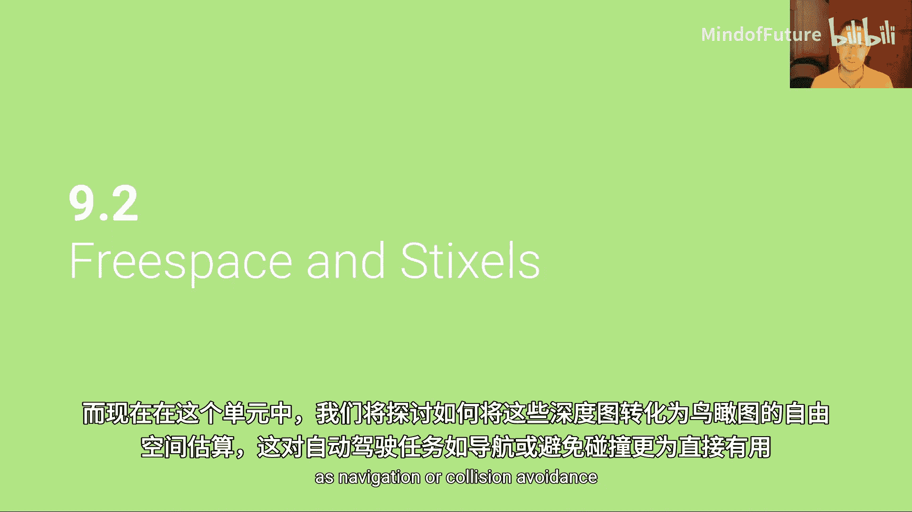
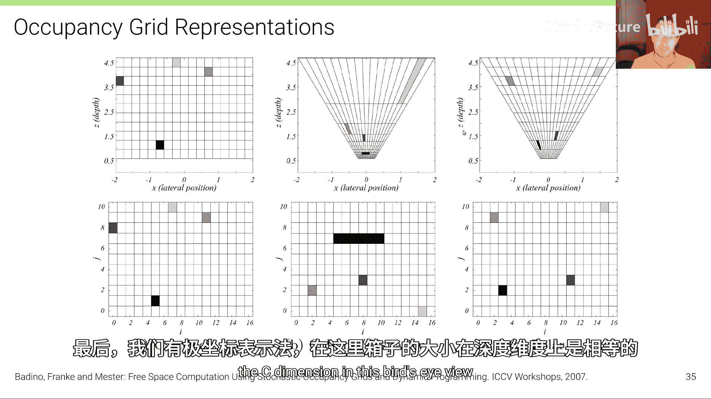
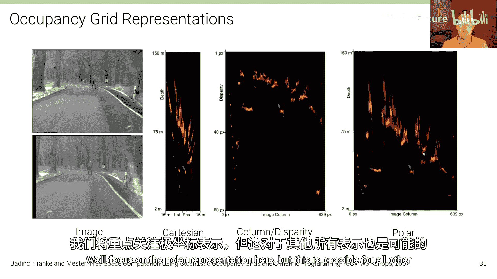
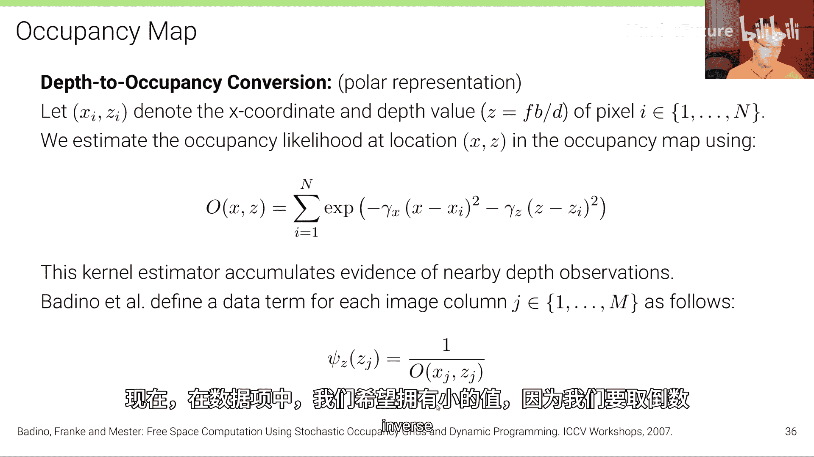
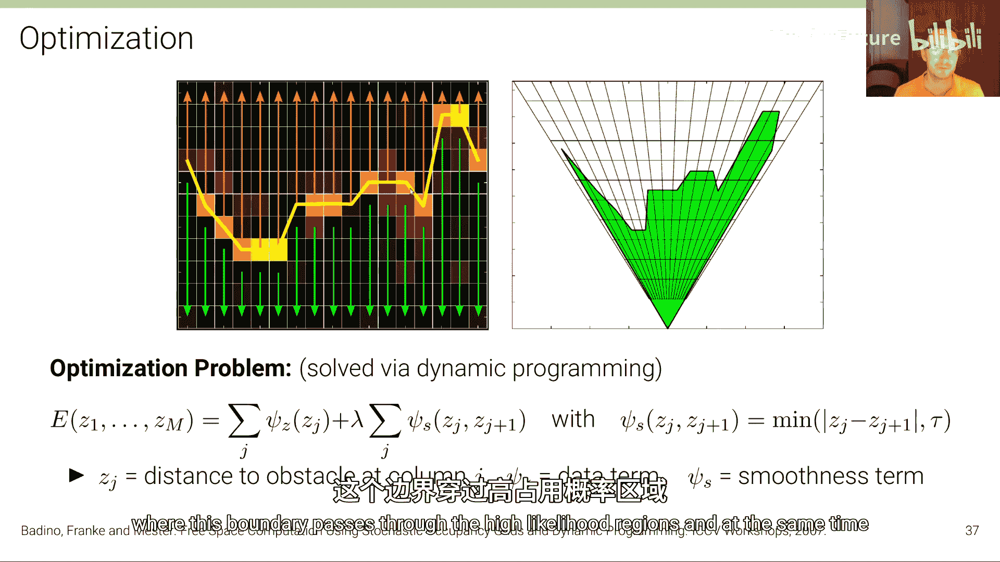
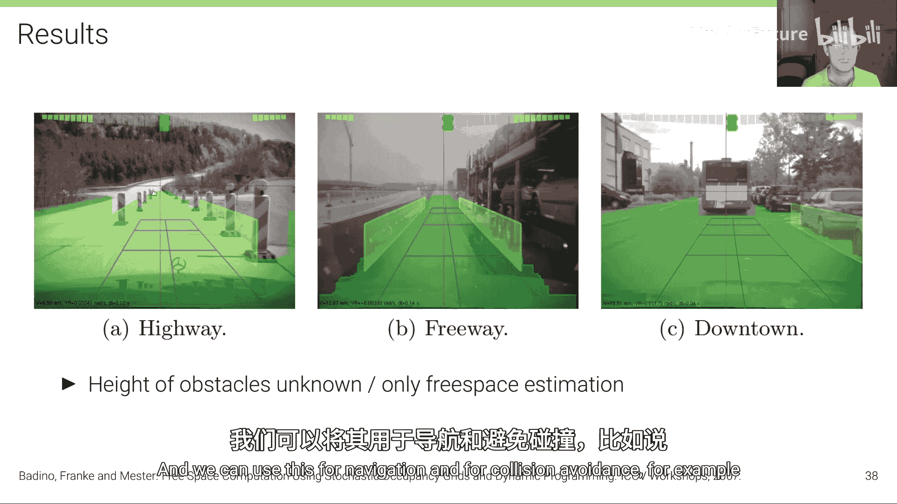

# 【图宾根大学】自动驾驶汽车课程 ML4340 p33 P33 Lecture 9.2 (Reconstruction and Motion - Freespace and Stixels) -BV16FP2ePEYc_p33-

In the previous unit， we've seen how we can estimate disparity maps from just two images captured at the same point in time。

 and we've also seen how these disparity maps can be converted into metric depth maps。

Now in this unit。We will see how we can convert these depth maps into bird's eye view free space estimates that are more directly useful to self driving tasks such as navigation or collision avoidance。

The problem setting is。As follows， the input is a set of depth maps。

 so we have one depth map per frame， and this could be coming from stereo reconstructions。

Or directly from Lidar measurements。And the output is a free space estimate in bird's eye view。

 bird's eye perspective。Which provides crucial information for local path planning or collision avoidance。

 for example。The approach that's followed in this paper that we briefly discuss here from Baino etal。

Is to first integrate multiple disparity maps temporal by aligning them through visual or dormtry。

Such that the resulting。Estimate for dispar map is more robust and less noisy。

And then to convert these depth measurements into bird's eye view occupancy map。And finally。

 to optimize a free space segmentation via energy minimization based on this bird's eye view occupancy likelihood。

The first choice that we have to make is the occupancy grid representation that we want to work with。

 And in this paper， free representations have been considered that are all。

A little bit different in terms of their computational requirements。

The simplest one is the Cartesian。Occupancy grid representation where we have equally sized bins in lateral。

 in x direction and in C in depth direction， this is the bird's eye view that we're seeing here。

And we want to estimate the likelihood or probability of occupancy for each of these cells。

Based on the disparity map。 And from this， we want to derive the free space estimate。

Now here on the right， we can see or in the middle， first of all， we can see。

The columns s disparity representation where we are seeing non equally sized bins because we have discretized base on the image column and the disparity dimension in the image domain。

 which leads to this non equally sized bins that are also all facing towards the。

cameramera coordinate origin。And then finally， we have the polar representation where we have bins that are also following this perspective projection。

 but that are now equally sized in terms of the C dimension in the bird's eye view。

So here are some examples of how this。Bird's eye view occupancy likelihood maps could look like。

And we have an example for the quoteian， the column disparity and the polar representation。

 While you can see in each of these representations。

 this pedestrian here highlighting as a yellow blob that's marked by this。Green arrow here。Now。

 how can we derive such a。Occupancy likelihood map from the disparity maps or the depth maps as input。

We'll focus on the polarlo representation。

Here， but this is possible for all other representations as well。Let X。

 I C I denote the X coordinate。In the image domain， the x image coordinate and the depth value。CfB。

Over disparity of pig's eye。We estimate the occupancy likelihood and location X in the occupancy map。

Using this kernel estimator that accumulates evidence of nearby depth observations。In particular， at。

Location X and C， where x is the image coordinate and C is the depth value。

So this is indexing into this grid here， right？嗯。We are summing over all of the observations。

 Let's say if we have just a single disparity map or a single depth map。

 and this has 300000 possible。Valid。Measurements， then we have a sum of 300000 elements here。

And we have the exponential of。Minus the square difference between。

X coordinate of the grid cell that we。estimatestimate or that we calculate the estimate form and the measurement。

And the square distance between the C dimension of what we query for the cell C dimension and the observation。

And what this simply means is that if there is a lot of observations that are close to that particular x and C coordinate that we are calculating the occupancy likelihood here for。

 then a lot of these exponential terms will have a value close to0 inside the argument of this exponential。

Because his terms is of vanish。And so we will be adding a lot of ones here to do sum。But in contrast。

 if there is。No measurement that's close to this X C coordinate that we query for。

Then all of the observations will lead to small terms that are added here。

 and so the overall likelihood will be small。So it's effectively a kernel estimator that accumulates evidence of nearby depth observations。

Now， based on this Paino， it'll define a data term for each image column J， where we have M columns。

 let's say， 640 columns for a VGA image。By simply taking the inverse of this occupancy likelihood as the data term。

So we want to here in this case， we want to have a large likelihood。 and now here in the data term。

 we want to have a small value because we take the inverse。

And now we can formulate this segmentation into free space and non free space。

As an optimization problem where we say， well， we want to have a。

A boundary between the free space area here in green at the bottom and the non free space area。

 the occluded area here in red， such that this boundary passes through the higher occupancy likelihood region where these are filled based on the disparity maps as shown on the previous slide。

And the same time， this boundary should be rather smooth。 right， There will be a lot of noise。

 As you can see here， there is some cells before and after that also highlight that also are filled with some。

Obstacle information。 And we want to effectively ignore this by finding this boundary between these two regions。

Your green is closer to the camera and red is fer away。 And this is in。The in this case。

 the Xc coordinate， and here we have it in Cartesian coordinates then as an example。

And so what we do in order to overcome this noise is again we solve an optimization problem。

 we are minimizing such an energy similar to the stereo energy that we've seen before。

which is comprising unary data terms， this is simply this expression here where we want to find cells that are smaller。

 cells that have a smaller cost or that have a higher likelihood of occupancy。

And we are also incorporating a smoothness term that considers nearby C values and tries to find a boundary that is smooth。

 using， for example， such a truncated L1 smoothness penalty。

And this energy goes over all of the Z values， this is for each of the image columns here。

 for each of the 640 image columns， we have one of these variables。

And we are minimizing this energy with respect to all of the variables。

 And because this is a1 D graphical model。 It's a chain effectively， we can find the。

Optimmal solution。Using dynamic programming quite efficiently。And then the output of this is such a。

Estimate for the free space， where this boundary passes through the high likelihood regions。

 and at the same time， is enforce to be smooth。

Now let's have a look at the results of this algorithm on some concrete input data so he can see what it looks like。

 You can also see that， for example， at this sidewalk here。Because the sidewalk is quite。

Close to the road in terms of its sea coordinate， the free space algorithm isn't sure。

 So it's including the sidewalk effectively as the free space area。

 despite the fact that there is a cur in between。So distinguishing free space and road just using stereo vision is hard。

But you can also see that it correctly recognizes these vehicles as non free space areas。

What you have also seen is that the height of the obstacles is unknown。

 so we effectively really just estimate the free space。

 and we can use this for navigation and for collision avoidance， for example。

But there are some extensions of this model。 One extensionial is called Stixel world。In this paper。

 also from the same offers， the Stel world。They're estimating multiple of these stickels。

 They call these sticks here， because these are little。

Little pixels that are elongated in the vertical direction。 So the little sticks。

So there is still a compact representation of the environment because you don't have to represent every individual pixel。

 You just have to represent these sticks as variables。

 And so they're formulating this as a segmentation problem where。

I they are trying to segment the image based on the disparity and also based on semantic segmentation as input into the pixels that at the bottom delineate the free space area from the non free space area。

 but also at the top of the objects。Correctly segment the object from the background。

So they effectively estimate multiple。Stixels per image column here。

And this is what an early version of this algorithm。Outputs。

 you can see these sticks here for the car and for the trees in the background。And how it combines。嗯。

Obstacle detection with free space estimation。