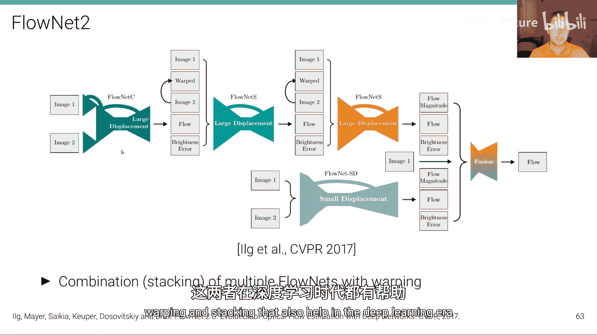
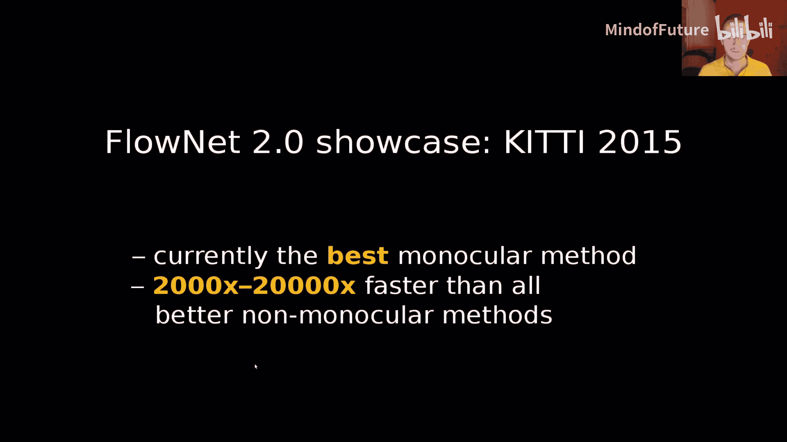

# 【图宾根大学】自动驾驶汽车课程 ML4340 p34 P34 Lecture 9.3 (Reconstruction and Motion - Optical Flow) -BV16FP2ePEYc_p34-

Let's now move from 3D reconstruction to motion estimation and let's start with motion estimation in the 2D image domain。

 which we call optical flow。Optical flow is the apparent motion of objects。

 surfaces and edges in a visual scene caused by the relative motion between an observer and a scene。

And it's useful because knowing the past or current motion allows us to make predictions about the future。

For example， we might predict the location of a vehicle one second into the future by knowing or extrapolating its motion from the past。

However， these predictions when we consider optical flow are in image space， not in 3D space。

Wwhichch we are actually interested in， but for 3D motion estimation， which we call scene flow。

 we need more observations， and so we start with the classical problem of optical flow first。

And then move to Sc flow in unit 4。Here at the top you can see two examples of optical flow fields illustrated by little errors。

 where for some points in the scene in the image， we are displaying the direction and the magnitude of the optical flow of the motion in the image domain。

With these little arrows。 And you can see that here on the left。

The observer is moving towards this point of expansion。And here on the right， the observer is static。

And the crossing traffic is moving from left to right。

 as indicated by these little green arrows here。Well。

 these errors here are only shown for certain locations in practice。

 we want to estimate as for stereo， a dense optical flow field， but that's hard to visualize。 Later。

 we will see a color coded visualization for this。 but here it is visualized only sparsely for these errors。

 but effectively， we have a dense optical flow field。 We just can't see it entirely here。

Let's first compare optical flow to stereo。In stereo， as we've seen in lecture one， in unit 1。

We were given two images at the same time and in optical flow。

 we are dealing with two images at two different time steps。 Typically。

 we have just a single camera that's capturing a video sequence。

 and we' are considering two frames of that sequence。

 and we want to estimate the motion in the image domain between two adjacent frames。

This means that in stereo， we only consider camera motion， while in optical flow。

 we consider both camera and object motion。And therefore， stereo is a one0 estimation problem。

While optical flow is a fool 2D estimation problem， unlike in stereo。

 we can't exploit apolo geometry here。 Fiins may move arbitrarily。

 We don't have anything that we can exploit。So it's a much harder problem。

And theres also biological examples for both of these， for example， monkeys。

 they have ice oriented forwards like we humans have。

 And so they have a large overlapping field of view where they can， which we can use to do stereo。

In contrast squirrels， they have their eyes towards the side。

And so they have a very small overlapping field of view。 They use stereo much less than monkeys do。

 but they have instead a full 360 degrees surround you。

 and they can use optical flow to to detect motion almost everywhere。Around them。

When we consider optical flow， we have to distinguish the optical flow field from the motion field。

So what are these two， The motion field is representing the projection of the actual 3D motion in the physical world。

So for example， if we consider this 3D point here， that moves from here to there in 3D space。

Its projection onto the image plane Little P moves from here to there。

 And that's what's called demotion。The motion field that gives rise to the motion field。

And this is what we are actually interested in。It can be the motion field can be the result of the camera motion or the object motion or both。

Unfortunately， the motion field is something that we don't directly have access to。Instead。

 the optical flow is something that we can measure because it's the2D velocity field that describes the apparent motion in the image。

This is what we see in the image。For example， ifplace pixels for example。

 it is the displacement of pixels that look similar。However。

 the optical flow and the motion field are not necessarily the same。Why is that。

Can you think of situations where they are not the same。

Let's do a little faw experiment to better understand this。

Let's consider a luerian ball rotating in 3D around its up axis。

 the one that I highlight here with my mouse。So it's rotating in 3D around this up axis。

What does the 2D motion field look like in this case？

Remember again that the 2D motion field is the projection of the physical notion of the object onto the image plane。

 which means that we would have some small arrows here at the top moving from left to right and as we go closer to the equator。

 we have larger arrows because the motion， the velocity becomes larger and then we have smaller arrows down here again。

In contrast， what does the 2D optical flow field look like？Well， the ball is lumerian and untextured。

And the light source doesn't change， which means that the image looks always the same。

And that means the optical flow field will be 0 everywhere。So here we have a case。

 a scenario where clearly the motion field is not the same as the optical flow field。

Let's consider another case in this case， we have a stationary ball but now the stationary ball is not lumbian but specular。

 and we have a moving light source that moves around。

 it rotates around that specular ball and changes the position of that specular highlight。

What does the 2D motion field look like。Well， the ball is stationary， so it's zero， clearly。

What does the 2D optical flow field look like instead？Well。

 that is not0 everywhere because we have this specular highlight that's moving along the surface of this ball。

 And so it's creating some apparent motion in the image。 And so we would have some。

 some velocity vector generated through this highlight that's moving at the surface。Of this ball。

So this illustrates the difference between the motion field and the optical flow field。

 And in practice， of course， we are always interested in the motion field。

 but we can only measure the optical flow field。 However。

 scenes are typically quite textured in nature。 And so the two become。

Quite equivalent in most situations of interest。The optical flow field tells us something maybe ambiguous about the3y structure of the world。

 the motion of objects in the viewing area。And the motion of the observer， if there is any。

For example， in this case here above， we have。Motion of the observer， only。

And we have a 3D plane as as a structure here that we observe。And we can see pure translation motion。

Pure rotation motion here in the middle and a combination of translation and rotation leading to these flow fields here。

In contrast to stereo， we can utilize apolo geometry constraints and therefore deal with a much harder 2D estimation problem。

For every point。In the reference image， we need to estimate a full 2D motion vector。

And this is also illustrated by the famous Aperia problem。

Where we look at a small geometric element in this case。

 a line through a small where we look at a geometric element for a small aperture。

 for a small pinhole。And wonder if this。One measurement。

 effectively that we are taking is sufficient to describe the direction into which the line moves。

So it's nice， another nice thought experiment。So here we have the setting。 This is the aperture。

 a little hole that we peek through， and we observe this geometric structure in the back。

And now I move this line and ask you in which direction does the line move？And probably most of you。

Would have told me that this line。Apparently， moves in this direction。

But this is actually an illusion because we don't know anything about how this line moves。

I will now remove the pictureer and show you how the line actually moved。

So it's moving from left to right。 It's not moving diagonally。

So this illustrates the problem of estimating。A emotion just of a single observation。

 which is insufficient。And this is also something that is used in this place to gather attention。

 for example， there's the famous Bob pole illusion。

You' have probably seen this in American barbershops。

 You often have such a pole where you have this coloured。I'm column here， rotating。

But the motion that it creates is actually a translationary one。That moves from top to bottom。

 or bottom to top。🤧Sorry。Okay。So far， the prelude for optical flow。 Now。

 let's look into how we can actually determine optical flow。

 We already know it's a 2D estimation problem and a single。Piece of information。

 a single observation per pixel is not enough because we need at least two。So what can we do？

And the algorithm that we are going to look at is the most seminal one。

 the famous Hnshnk optical flow algorithm published in already in 1981。So40 years ago。

Consider the image I as a function of continuous variables， X， Y and T。

And consider U of Xy and v of Xy as continuous optical flow fields。

So we're modeling everything continuously first， and then we are discretizing it later。

So U and V are continuous flow fields。 They are functions of x and Y。The Hosnk algorithm。

Or the Hongsang formulation is to minimize the following energy functional。

 It's a functional because this energy depends not on variables， but on functions to optimize over。

So it's the double integral over the spatial domain of two terms。

The first term is a quadratic penalty for brightness change。

 and the second term is a quadratic penalty for flow change。In other words。

 the first term is the data term， and the second term is a spatial regularizer。 And so you hear。

 you can already see that。This。A problem of ill postness of requiring two observations per pixels is resolved through this regularizer that typically has to be quite strong。

 so we have to use a strong a large lumpda value here。

For this smoothness regular riser in order for the optical flow field to be estimated correctly。

So this is the additional constraint that we're adding。And the data term is very simple。

It's just a quadratic penalty for brightness change that says well， and considering the intensity。

At location X displaced by optical the optical flow in U direction。

 which is the x direction basically。At location X and y。

 so we just distinguish U V from X Y to have different variable names。

 but U is the optical flow in x direction and V is the optical flow in y direction。

So here we displace the XY coordinate by the optical flow。That is estimated at these locations。

And we consider the next time step and query the intensity here。

And we subtract the intensity at the current time step。

 And if the optical flow is estimated correctly， then we want。

 we we expect that this difference here is pretty small。If the scene is Lamberian and。

There is no other strong effects。That we have to consider。AndSo we want， in other words。

 the brightness to not change。When following the correct optical flow， we want to warp the image。

The images into each other such that they look most similar。It's also related， of course。

 to the direct visual oitory methods that we have discussed earlier。But in this case。

 we are not estimating。Structure and motion and assuming aesthetic scene。

 But here we are really estimating per pixel。Flow。Or in this case， even continuously。Okay。

 so this is， this is the energy functional。 It has a data term。 it has a smoothness regular riser。

 and it's formulated continuously so far。Minimizing this directly that this is the same equation from before。

 minimizing it directly is a hard problem because the energy is highly non convex and has many local optimum。

Why is it convex and has many local optima。It looks quadratic。

 so it seems like a simple thing to solve。Why exactly is this。Non convexity coming from。

 And this local opt are coming from。What do you think。Well， it's not coming from the regular riser。

It's coming from the data term。Because。Well we have a quadratic term here。

The variables that we are estimating U and V， which are these functions。

 these flow fields are appearing as arguments inside the image operator。And of course。

 the image is typically something quite complicated。With a lot of， if you would draw。诶。You know。

 a 3D plot of an image。Based on where the third dimension is the image intensity would have a lot of hills and valleys。

 right。If this U and V flow appears as an argument。

 this means that it it goes through this highly non convex。Image operator。

 And that's where this non convexity comes from。 It doesn't come from the square， which is you know。

A cordtic function is convex。Of course。So what is the solution to this， Well。

 the solution is to linearize the brightness constancy assumption whenever we don't know what to do。

That's already something that no。When I heard my first optical flow class in Carlsros。

That's something that stick to my mind when Hans Heud Nagel， one of the pioneers。

 giving actually rise to this algorithm in early discussions。Told me， whenever。You know。

 scientists and engineers don't don't know any further， which just is make。

 make the assumption that everything is caution and linear and thinks will just become easy。

 So this is， of course， a very strong assumption。But it's a useful assumption to do in this case。

 and so we are linearizing the brightness constancy assumption in order to solve this problem。

And we'll see what we have to do in order for this to work。So how can we linearize。

 Let's consider the first order multivariable Taylor series。This is something that。

You probably still know from many years back。We can write a function。嗯。As a first order。

UIn first order approximation。As this Taylor series where we have removed all the higher order elements。

And so we are representing that function， we are linearizing it around the coordinates AB。So we have。

 we evaluate F at A B， and then we add the derivative with respect to x times x minus a plus the derivative with respect to y times y minus B。

And if you， if we apply this， this formula for the Taylor series。2。😔，This expression here。

They we want a linear rise。Then we obtain this expression here at the bottom。

 This is just a straightforward application of this formula。

And now we can take this expression and plug it back into this function from before。

And so this yields the linearized equation。So if I plug this into here， you can see that the I of X。

 Y T， which appears here with a minus in front and here with a plus in front vanishes。

And what remains is just this term here on the right side。And this is this term here。

So this is the linearized equation and you can directly see that it's linearized because now U and V appear as linear terms inside this quadratic。

🤧うん。Okay。🤧嗯。Now， the next thing that we do is we spatially discretize this equation。

 This is the equation from the previous light， the linearized one。

Which leads leads to the following discretized objective。Instead of this energy functional。

 we have now an energy。With respect to an optical flow， a discretized optical flow field， U and V。

 R D。are basically images。Of flow in U direction and v direction。

 where we have one element per pixel。And so the ins get replaced with sums。

And instead of the function U of X， Y， we have simply an index into this U flow map。U X， Y。

And similar for William。Now， this objective is quadtic in the flow maps UN V and therefore has a unique optimum。

Right。So it's simply just a very， very high dimensional parabola， if you will。

So we can differentiate with respect to a U V and set the gradient to serum in order to recover the solution。

This results in a huge， really huge but sparse， luckily sparse linear system。

 And so we can solve it using standard techniques like gausci or successive over relaxation。However。

 the problem now is that we have made this linearized assumption that we have linearized it and so。

This really only works for small motions where this linearization holds。Now。

 the solution that is adopted in the optical flow community to make it work also for large emotions is to。

Iteratively linearize。To linearize， compute an estimate for the optical flow and then warp the images and then re linearize and could be compute another estimate for the optical flow。

 And so you can。You can overcome this problem of linearity a little bit。

By doing this step iteratively。And the other trick。 So this is this is not overcoming， of course。

 the entire you know， problem of non convexity。第二。Huristic that's often adopted is a cost to fine estimation strategy where the images are down sampled into an image pyramid。

 We started a small resolution， maybe just one10 for1，16th of the original resolution。Because。

 of course， the optical flow will be smaller at a smaller image resolution。

 and we estimate the optical flow there。And we use this optical flow then。To warp the images。

 to pre warp the images at the next。Resolution level。In order to。

Not in order to solve an optical flow field， that is not as large anymore。

So these are some tricks they work to some extent， but like this course define fine estimation。

 for example， typically loses fin structures pretty early on。

W whichch cannot be recovered at a later stage。 So it also comes with problems。

So let's look at some results， as mentioned earlier， we are dealing with a dense。2D vector field。

 which is hard to visualize， at least with errors。And so what we use here for visualization is this beautiful color chart。

Which visualizes。The optical flow and UNV direction。嗯。By encoding the flow direction with the color。

 so you can see that an optical flow in this direction will be colored red。

And in this direction will be color blue。And the flow magnitude is encoded as the sateration or the intensity of the color。

 where no optical flow。The zero optical flow would be white。

 and the more the stronger the optical flow， the stronger the color。And so this is result。

 So here we have a one of the famous Middlebury scenes。One of the earliest benchmarks。

One of the earliest proper benchmarks， I have to say， for optical flow。

You can see these scenes are very textured。And the motion is very small。

So they are really easy compared to self driving scenes。

And this is the optical flow field that has been estimated by the Honsnk algorithm。

And you can see that overall， the optical flow looks reasonable， but it has issues at the boundaries。

 for example。Now， one problem with optical flow computed using Hnsunk is exactly these quadratic penalties that uses。

 and there have been many follow up works。For example。They work by black and Anaadan。

And there's this nice paper sequences of optical flow estimation and their principles by Sunidal。

That describes all the little tricks， and the different。

Penalties that have been introduced and that benefit optical flow estimation。

And they gets these much nicer results here by not making this assumption of quadratic penalties and by using some other tricks。

And here is the corresponding example for a image from the Kidie data set。

 and you can see that it doesn't work quite as well。It's really a hard problem。

 Op flow in self driving， because the motion vectors are typically quite large。 and there's many。

Parts of the scene that have little texture。 So it's a really hard problem。 It's unlike these。

Laboratory settings， these settings， these scenes that have been captured in the laboratory。

 It's really。It's's a really much harder problem， and it's harder than stereo because we have to estimate 2 D flow。

So the state of the art on the Kity leader board today is。ADeep learning based optical flow。

 while early approaches for。In this direction， were still not on par with。Classical techniques。

By now， they have so passed the classical techniques by quite some margin。🤧K。So here's one of the。

 the earliest example of optical flow estimation using deep neural networks and the architecture is basically the same as the dis architecture。

There's an encoder with， convolutional。Layers and。Stried convolutions and a decoder with up convolutions and skip connections。

And they also use a multi scale loss to better propagate。A gradients through that network。

And curriculum learning and train is on large amounts of synthetic data and fine tune on real data。

And then。A more recent reincarnation of the flownet is called flownet2。

 that's a combination basically stacking multiple flownets with warping。 So it's also， again。

 using classical ideas。From the optical flow literature in this case， warpping and stacking。

That also help in the deep learning era。

And so here is a result of this algorithm。For the same picture from Kitty。

 and you can see that while it it still doesn't do a perfect chop。

 it is much less noisy than the classical techniques。So， here is。Some results in the form of a video。

Of course， it's difficult to visualize optical flow。

 but you can see a little bit the structures that are estimated， for example， this vehicle here。

