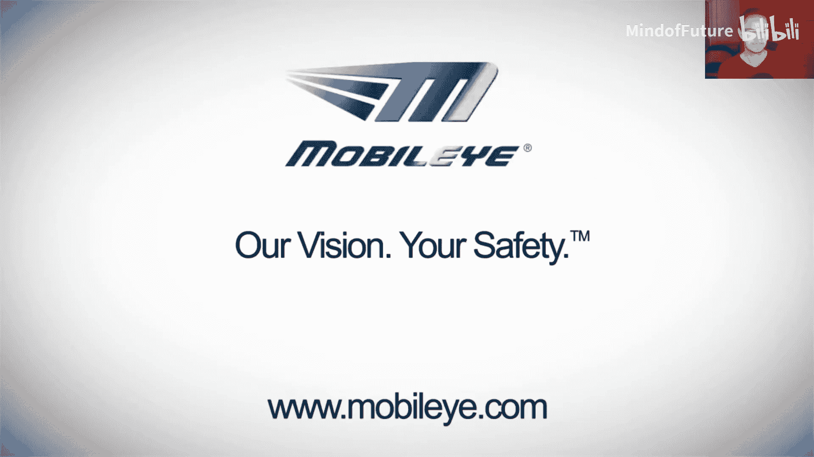
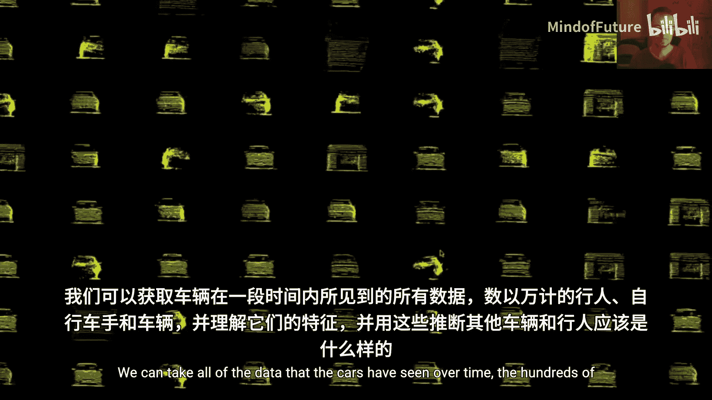
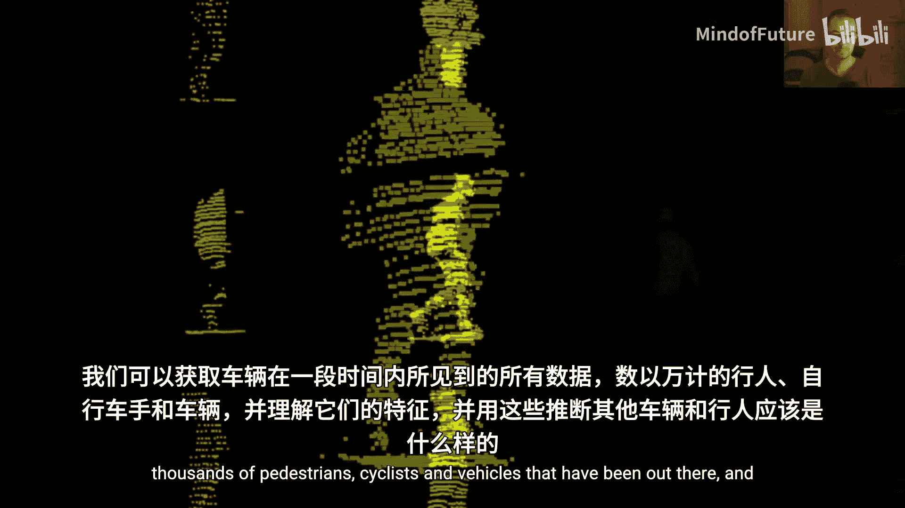

# 【图宾根大学】自动驾驶汽车课程 ML4340 p36 P36 Lecture 10.1 (Object Detection - Introduction) -BV16FP2ePEYc_p36-

Hello and welcome back to selflf driving Car lecture number 10 on object detection。

Last time we've seen how we can reconstruct the3y structure of the scene and estimate motion generically independent of what objects are present in the scene。

Now， in this lecture here， we are going to focus on object detection。

 which is about locating objects in 2D or 3D。And recognizing the object category。

This lecture is structured into five units。We first introduce the object detection problem in unit number one and provide an overview of the challenges that object detectors are facing。

In unit 2， we focus on performance evaluation that is measuring how good an object detector is。

 which is， of course， crucial for determining the object detector that we want to use for a specific problem。

In unit number3 and unit number 4， we will then see some classical and some more advanced deep learning based object detection algorithms。

And these are operating in the 2D image domain。 And then finally， in unit number 5。

 we will focus on 3D object detection from both images and LiDar scans。

So let's start with the introduction unit。This is a slide it took from the computer vision class。

 where we have。Distinguished recognition problems and object detection is a recognition problem。

Into four different problem categories， the first is image classification。

 where the goal is to assign a single class label or image category to an image like this is a street scene。

So that's not super useful yet to self driving。Another。

Task that we've already seen in the context of this lecture is the problem of semantic segmentation where we want to assign a semantic label to every pixel in the image for both objects and stuff。

 for example， w to determine the pixels that comprise the road area。

Then we have object detection where the goal is to localize in terms of a bounding box。

And classify all objects in an image， as illustrated here。And then finally。

 we have the problem of instant segmentation， which is。

The problem of assigning a semantic and an instance label to every pixel。Of an object in the image。

 So effectively combining semantic segmentation and object detection。Now in this lecture。

 we focus on the object detection problem， which is。A very relevant problem for self driving。

And we'll also very briefly see an example of how these object detectors can be in a straightforward fashion extended to instant segmentation algorithms。

Let's motivate the object detection problem a little bit。 and I。嗯。Use two videos here。

 The first is a video from Mo eye that illustrates how mobile eye， which is a company that produces。

Smart cameras for driver assistant systems utilizes object detectors in their products。

Rear end collisions are one of the most common accidents caused by driver inattention。

The mobilized system continuously scans the area in front of your vehicle。

 detecting all types of vehicles in your path， including motorcycles。

The system calculates the relative speed and in critical situations。

Issues both a visual and auditory warning of an impending collision with the vehicle ahead。

The system can provide a warning。upp to 2。7 seconds before impact。

 both during city and highway driving。Mobile I。

And here's another example。 This is from a Ted talk from Chris Imsen。

 who was eight years the lead of the Google self driving effort。The differences between the two。

 Let's spend some time talking about how the car sees the world。So this is our vehicle。

 It starts by understanding where it is in the world by taking a map in its sensor data and aligning the two。

And then we layer on top of that what it sees in the moment。 And so here。

 all the purple boxes you can see are other vehicles on the road。

 And the red thing on the side over there is a cyclist。 And up in the distance。

 if you look really closely， you can see some cones。😊，Then we know where the cars were in the moment。

 But we have to do better than that。 We have to predict what's going to happen。 So here。

 the pickup truck in the top right is about to make a left lane change because the road in front of it is closed。

 And so it needs to needs to get out of the way。 knowing that one pickup truck is great。

 but we really need to know what everybody's thinking。 So it becomes quite a complicated problem。😊。

And then given that， we can figure out how the car should respond in the moment。

 And so what trajectory it should fall， how quickly it should slow down or speed up。

And then that all turns into just following a path， turning the steerring wheel left or right。

 pressing the breaker gas。 It's really just two numbers at the end of the day。

 So how hard can it really be。Back when we started in 2009， this is what our system looked like。

 So you can see our car in the middle， the other boxes on the road driving down the highway。

 The car needs to understand where it is and roughly where the other vehicles are。

 It's really a geometric understanding of the world。

Once we started driving on neighborhoods and city streets。

 the problem becomes a whole new level of difficulty。 You see pedestrians crossing in front of us。

 cars crossing in front of us， going every which way， the traffic lights， crosswalks。

 It's an incredibly complicated problem by comparison。😊，And then once you have that problem solved。

 the vehicle has to be able to deal with construction。

 So here are the cones on the left are forcing it to drive to the right。

 but not just construction in isolation。 Of course。

 it has to deal with other people moving through that construction zones as well。 And， of course。

 if anyone's breaking the rules。 the police are there。

 And the car has to understand that that flashing light on the top of the car means that it's not just a car。

 It's actually a police officer。 Similarlyly， the orange box on the side here。 It's a school bus。

 And we have to treat that differently as well。😊，When we're on the road。

 other people have expectations。 So when a cyclist puts up their arm。

 it means they're expecting the car to yield to them and make room for them to make a lane change。

And when a police officer stood on the road， our vehicle should understand that this means stop。

 And when they signal to go， we should continue。Now。

 the way we accomplish this is by sharing data between the vehicles。

 The first kind of most crude model of this is when one vehicle sees a construction zone。

 having another know about it so it can be in the correct lane to avoid some of the difficulty。

But we actually have much deeper understanding than this。

 We can take all of the data that the cars have seen over time。

 The hundreds and thousands of pedestrian cyclists and vehicles that have been out there and understand what they look like and use that to infer what other vehicles should look like and other pedestrian should look like。

😊。

And then even more importantly， we can take from that a model of how we expect them to move through the world。

 So here， the yellow box is a pedestrian crossing in front of us。 Here， the blue box is a cyclist。

 And we anticipate they're going to nudge out and around the card to the right。😊，Here。

 there's a cyclist coming down the road， and we know they're going to continue to drive down the shape of the road。

 Here， somebody makes a right turn。And in a moment here。

 somebody is going make a u turn in front of us， and we can anticipate that behavior and respond safely。

 Now， that's all well the differences between the two。

 Let's spend some time talking about how the car sees the world。So this is our vehicle。

 It starts by understanding where it is in the world by taking a map in its sensor data and aligning the two。

And then we layer on top of that what。Okay， so I hope this illustrates a little bit the。

Importance of object detection for the self driving problem。

Now let's look at this problem setting a little bit more formally so what is it exactly the input is often an RGB image or a laser range scan and what we want to infer is a set of 2D or 3D bonding boxes with category labels and a confidence value。

 so for example here we have detected a person with that bonding boxes here。

And the category person with a confidence of 94%。So almost all object detectors give you a confidence。

Because the benchmarks and the downstream applications require that they need to know with which confidence something is detected in order to make a decision or to evaluate the algorithm。

 And we will see that later also in the evaluation unit。So effectively。

 what we are doing here is we are trying to figuring out what is where in an image at a coursear bounding box level。

And here's an example for the corresponding 3D scenario where bounding boxes are detected in 3D Lidar point clouds。

One problem with this is that there is very many possible boxes。

 if we consider the coordinates of a bonding box to be continuous numbers。

 then there is infinitely many possible bonding boxes。

 but even if we discretize to discrete integer locations to discrete pixel locations。

 there are still an enormous amount of bonding boxes that are possible。

And also the number of objects is unknown a priorri。

 so we are trying to predict something where we don't even know how many entities we have to predict。

 which makes this problem hard。Let's look at some more challenges of the recognition problem。

The first challenge is there is a very large number of image or object categories in general。

In this Inet paper from Feifei Adal， they estimate about 10，000 to 30000 different categories。

 but luckily in the self driving setting， there is only a few object categories that are occurring really frequently。

 such as pedestrians， cyclists， motorcyclists and vehicles。

Another challenge is intra class variation。 Heres an example with chairs。

 So even for all of these object art chairs， they look quite different at the pixel levels。

 These are completely different input signals to a neural network that has to classify these as chairs。

 And this makes the problem of object recognition hard。Another challenge is view point variation。

 So here is always the same。Lal bulldozer， but from different perspectives， and， of course。Again。

 the input to the neural network looks completely different。

 despite all of them show a the same object at about the same size。Another challenge is illumination。

 Here's an example from with a light from Kiunderrink that illustrates depending on where the light source is located。

 Again， the pixel intensities change dramatically。The input to our recognition model changes dramatically。

 but effectively， the scene hasn't changed。 Not a single pixel has changed here。

 Just the lighting has changed。 And so the intensity values of the pixels have changed。

 but the scene content。It's the same。Another challenge is background clutter。

 so who we have some examples with cats or you can see that it is sometimes really hard to recognize objects if they are not。

Distinct if they are not salient enough in， in the image。Then there is deformation， objects。

 in particular， you know， animals and humans they deform。 and depending on the deformation。

 they look quite different。And then， of course， there' is occlusion， which is happening for for cats。

 but is also happening for cars。 for example， where have multiple cars。Parking in a row。

 And you see only the back of each car。 And so they are heavily olu each other。

One thing that's actually quite crucial for object recognition is context。

 contact context matters a lot， but it can also be used to fool the classifier。

 And so it's a difficult。嗯。situation in the sense that you want to use some context for object classification for object recognition。

 but you don't want to rely too much on the context because otherwise you might hallucinate something that's actually not there。

So here's an example of this。What do you see in these images？

These are images that are heavily down sampleled， but still， we。

 as humans can recognize something here， right， So we might recognize a person with a cell phone here and a car here and a pedestrian here。

And another person here with two shoes here。But actually。

 all of these blobs here are exactly the same blobs inserted at different locations in the image。

 illustrating how much we humans also rely on contextual information to recognize objects。

 So using too much contexts， which is required to recognize objects at higher accuracy。Can。

 at the same time， be also misleading。So we have to trade off him。

And here's another example of how context matters。What do you see in this image。

 Probably most of you see a person maybe talking on the phone with a keyboard and a mouse and a monitor in front。

But that's actually not quite what is in that image。

