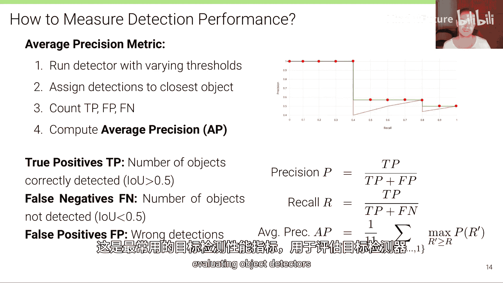

# 【图宾根大学】自动驾驶汽车课程 ML4340 p37 P37 Lecture 10.2 (Object Detection - Performance Evaluation) -BV16FP2ePEYc_p37-

How can we evaluate object detection performance？Let's first consider the case of a single object in the scene。

 such as this stop sign here。The green box is the ground truth bounding box。

 This is the box that's annotated by the human annotator。This is the ground truth label。

And the red box is the box that's predicted by the object detection algorithm。Now。

 how can we associate a score of fitness to this detection？Well。

 what we can consider is the so called IOU， the intersection over union。

 which measures the ratio of the area of overlap of these two boxes。

With respect to the area of the union of these two boxes。And this is illustrated here。

 So given these two boxes，1 is the ground truth。 One is the detection。

 the intersection or the the overlapping part would be this one here。

And the union would be this one here。And if I compute the ratio of these two。

A higher ratio means that the boxes overlap more closely。

And a lower ratio means that they have less overlap。

What we can directly see from this definition is that the highest possible IU score that can be obtained is one。

 which is exactly the case if the boxes， the predicted box and the gr of box are identical。

And the lowest value that we can obtain is 0 where these two。Pixel sets or boxes are disjoined。

And here on the right， we can see some examples， one for a poor fit， a good fit。

 and an excellent fit that is an IOU larger than 0。9。

 which is already indicating that these boxes are almost identical。Now。

 we can consider a particular threshold for this intersection of reunion。And consider this。

As a successful detection， for example， in this case here above。If we consider an IOU threshold of 0。

5， which is commonly used for 2D object detection evaluations。

Then this case here on the left would be considered incorrect。

And these two cases here on the right would be considered correct detections。

Now this is all good for a single object， but how can we fairly measure detection performance in the case of multiple objects？

That's not as easy。As the number of detections depends on the detector thresholds and is detector specific。

Remember that the object detector outputs a set of boxes with associated semantic class labels or object category and also confidence score per box。

And now we can， depending on the threshold that we choose。

 the confidence is that we still allow to be counted as detections for that particular object detector。

 we can vary the amount of bonding boxes that are output of that detector for a particular image。

And so the number of detections depends on this threshold。

 so we should consider a whole range of thresholds。Because none of them will be optimal。

And this is what。This metric， this average precision metric that's used for evaluating。

Multi object detection algorithms。Or results is doing。So how does this metric work？In the first step。

 we run the detective with varying thresholds。 This is where we， we， we basically。um。

Search through a whole range of these thresholds， starting with thresholds where none of the objects no object is returned。

To a where a lot of boxes are returned。And then we assign detections to the closest ground truth bounding box。

 respectively， such that each ground truth object is maximally associated with one detection。

For this process， typically bipartite Bra matching techniques like the Hungarian algorithm are used。

And then in the last step we count or in the third step。

 we count the number of true positives and false positives and false negatives。

Where the two positives are the number of objects that are correctly detected。In other words。

 where the intersection of a union is bigger than 0。5。Defaults negatives。Fn。

It's the number of objects that are not detected。Where the intersection over union is smaller than 0。

5。And the false positives。The wrong detections。 These are the remaining detections that are not assigned to any。

Ground roof objects， because either they are redundant or they are in an area of the image where there is actually no ground truth label。

 There is no object there。And then based on these true positives， false。

 negatives and false positives， we compute this so called average precision。To do so， we compute。

The precision， which is the number of two positives over the number of two positives plus false positives。

And we compute the recall， which is the number of two positives over the number of two positives plus false negatives。

A high precision means。That。嗯。The objects that are detected by the object detection algorithm are actually correct。

And a higher recall means that。Most of the objects that are in the ground roof are actually detected。

 but it doesn't。Take into account if there is any false positives。

So in practice you want both the precision to be high and the recall to be high。

 but there is a trade off， even the object detector returns too many boxes as they will create false positives。

It will create a high recall， but also false positive。 So lower precision。

 or the object detector only returns the most confident boxes， so the precision will be high。

 but then the recall will be low because it returns maybe only the one or two highest confident boxes and ignores some of the objects。

The ground roof objects in the scene。Now the precision and the recall。

Can be computed for any of these detection thresholds that we vary。

 and so we for each of these thresholds that we choose， we now compute a plot。

 and this is this orange line here。 we can compute this plot in this precision recall space here。

 remember again we want to be here。 but of course we have this trade of where we can have high recall and high precision at the same time。

 as mentioned before。And so as we vary the detection threshold。

We move from a point that has high precision and low recall to a point that has high recall and low precision。

And typically， it's hard to have that curve reach this point here。

 because that would mean you would have a perfect detector that always or for that particular detection threshold returns exactly for every image exactly the objects that are present in that image at the correct location with the correct semantic class。

Okay， so by varyying the threshold of the detector， we can plot such a curve like the orange one。

 And as this curve is typically sigyzaggy， as shown here。

 we smooth it out a little bit by taking the maximum。Two boys the right。

So this is the green curve here。 This is this maximum operator we take the precision at a particular recall level and compute the max for all overall recalls that are larger than this recall level that we consider。

And what we then simply do in order to compute one unified metric。

 the so called average precision metric is simply to compute the average。

So you can think of this as computing the integral under that。Keria。So it's one， in this case。

 one over 11 because we have 11 points that we sample on this plot。 these are these red dots here。

And we sum up all these， these red values here in order to compute this。

Think of it as an integral under that curve herem。So it's the average over， this red dots here。

And then this is giving us a number the so called average precision A。

That is independent of a specific detection threshold choice because it considers the entire range of detection thresholds。

And this is Steve。Object detection performance metric that's most commonly used for evaluating object detectors。

