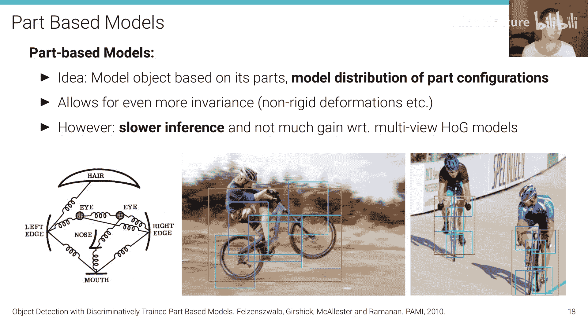

# 【图宾根大学】自动驾驶汽车课程 ML4340 p38 P38 Lecture 10.3 (Object Detection - Sliding Window Object Detection) -BV16FP2ePEYc_p38-

Let's now move to the process of object detection。In this unit， we will start with the most simple。

 the most basic form of object detectors， which are classic sliding window object detection methods before moving to deep learning based methods in unit 4。

Sliding window， object detection works as follows。We run a sliding window of fixed size。

Indicated in green here， over the image。As such。And extract features for each of these windows or crops。

And then， we classify each window。m usingsing a binary classification objective。

 object versus background， for example， pedestrian versus anything else。

 using a standard classification model based on these features that we have extracted from that window。

 so we could use， for example， a support vector machine， a random forest。

 a boosting based technique or a deep neural network for this problem。

In order to recover objects of varying size or distances。Because we have a prospective camera here。

 if a pedestrian appears。At a near distance， it's bigger than if it's appearing at a larger distance far away。

We also have to search across for different aspect ratios and scales of this box。

 so it's becoming a pretty exhaustive search problem that we have to do here。

 and we have to search with stride in order to actually finish this task in feasible time。

So what we did here now is to effectively convert the object detection problem into a classification problem that we know how to solve using machine learning techniques for classification。

The final step is to apply non maximum suppression or clustering。

To retain only one prediction per object。The problem is that if we now slide this window through all possibleusible locations。

 there will be some windows in the vicinity of the actual target object here in red。

That will also respond highly。嗯。In terms of the classification score output by let's say the support vector machine。

Because they are close to the pedestrian。 So they are nearly correct。But， of course。

 we don't want to retain all of these detections。 We want to keep only those the best ones and only one for each of the objects in the scene。

 And this is what non maximumim suppression does。 It's a clustering heuristic that looks at the overlap of bounding boxes and keeps only if there is over a large overlap of bounding boxes。

 and it keeps only the one that has the highest confidence。So it retains only one prediction。

P object from the object detection algorithm。The next question we have to answer now， of course。

 is which feature space should we use on which feature space should the support vector machine classify these little crops。

The simplest we can do is， of course， use the IGB pixel space。

 but as we've already seen in the introduction unit。

 this would be neither viewpoint nor illumination invariant。And so it is not a good choice。

A better choice would be to use a so called histogram of oriented gradients， or in short。Hk。

Which was the de facto standard for more than 10 years of research in object detection。

 It was popularized by this paper here from Dal Etrix。

Called histograms of oriented gradients for human detection。

The idea here is to represent patches with histograms。

whichch are representing gradient angles weighted by the gradient magnitude。

Let's illustrate this with a simple example of this ditchit8 from the Mnines dataset set。

What we do here now for this particular crop is we first compute。

 we differentiate this image here spatially in x and y direction。

 and then we compute the gradient magnitude and the gradient angle。

The gradient magnitude is shown here at the top。 The gradient angle is shown at the bottom where we have pin that gradient angle into eight different orientations。

 So it's a pretty coarse binning of the orientation。For example。

 you can see that here on the left side of the aid we have。

On gradients that that are facing leftwards。 And on the right side。

 we have gradients facing rightward， which are blue compared to these ones， which are red。

And so there's eight different cuts here。Now the next step what we do is we subdivide that image into cells。

 cells are regions， subreache of the image of a certain pixel， width and height， for example。

 in this case， here， 8 by 8 or 6 by6 pixels。And after that， for each of these cells， we multiply the。

While we compute a histogram， where we sum up the weights for each of the angles that are contributing to this histogram。

 So， for example， for this cell here。We。Have contributions from pixels that are oriented in this orange and yellowish direction。

 but we are not accumulating evidence for the green pixels here because they are receiving a weight of 0 as they have a0 gradient magnitude here in this homogeneous region。

If we look at another cell here， the second cell， we see that there's contributions from these orange and yellow pixels here。

But there's also now contributions from this blue。Pixels here。

And so we do this now for all of the cells that we have to find。

The advantage of this compared to using the RGB pixel space directly。So what we do now is。

 of course we take these histograms。And we use them as features。

 which means that we concatenate all of these histograms。 And these are， this is the feature vector。

 So we have a feature vector where the first dimension is well。

 the magnitude of the the first cell of this histogram and the second dimension is the magnitude of the second cell and so on。

 And then the in this case， the9。Element of the。Feature vector would be the magnitude of this histogram cell and so on。

Histogram bin。Now， what is the advantage of this？Histogram vector compared to the original IGB pixel space compared to just stacking all the pixels。

 the raw pixel information into a single feature vector。

The advantages that compared to the RGB raw pixel space。

 this histogram of orient gradient features is invariant to small deformations。

 like we can translate the。Image a little bit， and we can scale and rotate it a little bit。

 and we can also apply little perspective to formations， and it will not adjust。

 It will not alter the gradients too much because they are summary statistics。Of an entire region。

And also because the gradient angles have been bent into this very coarse。

 discretized bin binning representation。And another advantage is also that it is becoming independent of the brightness。

 the absolute brightness。As。We are computing these stograms based only on the gradients and not on the original intensity information。

So these are the two aspects that LED to the success of histogram of orient gradients。

 They are capturing relevant information。 They are capturing the orientation of edges。But， they are。

A little bit flexible。In terms of translation， scale and rotation。

 and they are invariant to brightness changes。 For example。

 if you change the gain or the shutter of your camera。

An extension of this idea of histogram of Orient gradients that became popular。

In 2010 is the so called part based model from Feltonchwel and Gershic Gaal。

 where the idea is to model an object based on its parts。

And then model a distribution of part configurations。 And this idea actually goes back many。

 many years to the 1970s， where this has already been used。

 This is an illustration from one of the seminal papers in the early days。But here。

 this is used in combination with a graphical model and this histogram of oriented features。

The stogram of or in gradient features for each of these parts。Now。

 using a path based model allows for even more invaris because we can allow for some non rigid deformations。

Of the object， by simply。Adjusting the relationship of the different parts and modeling this in terms of the configuration space in terms of the graphical model distribution。

However。😊，These models lead to slower inference because we need to solve this。

We need to solve inference in a graphical model at， at inference time。

And it was found also that they don't lead to a huge gain with respect to well trained multi view ho models compared to simply training a ho model for the entire object。

But do that separately for each different view of the object that we might perceive。

However， for at least for cars which are objects that are relatively easy to detect。

 these algorithms already led to impressive performance。

 this is really non deep learning based inference based on these graphical models。

With simple histogram of oriented gradient features。

 And so here are some results on the Kidie dataset set。 And you can see that it is not super precise。

 but it， it detects quite。Quite some of these objects here。

