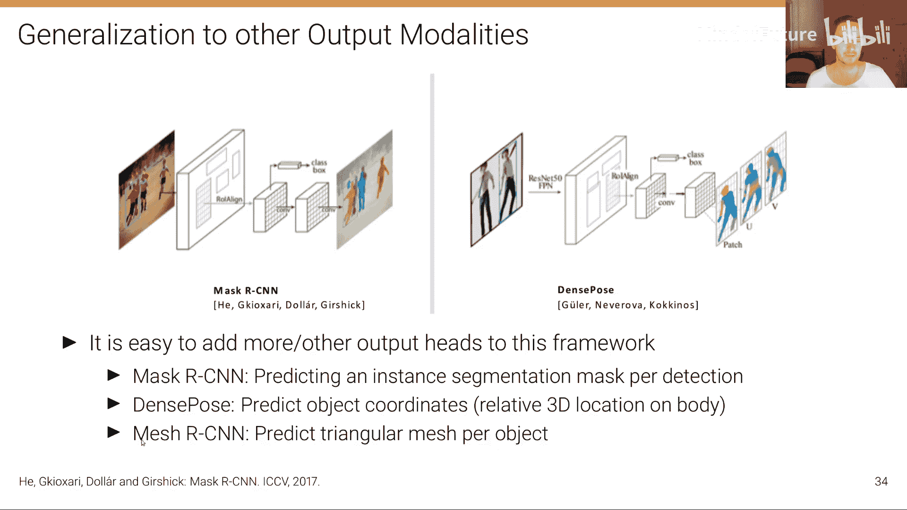
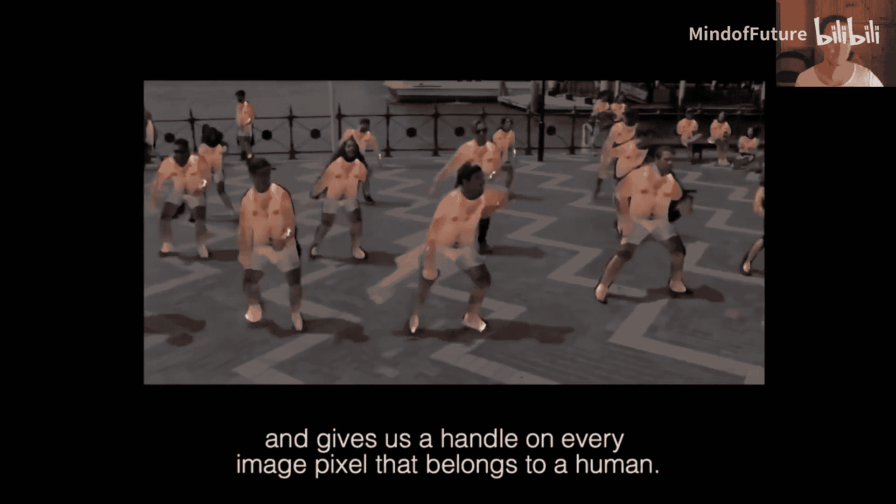
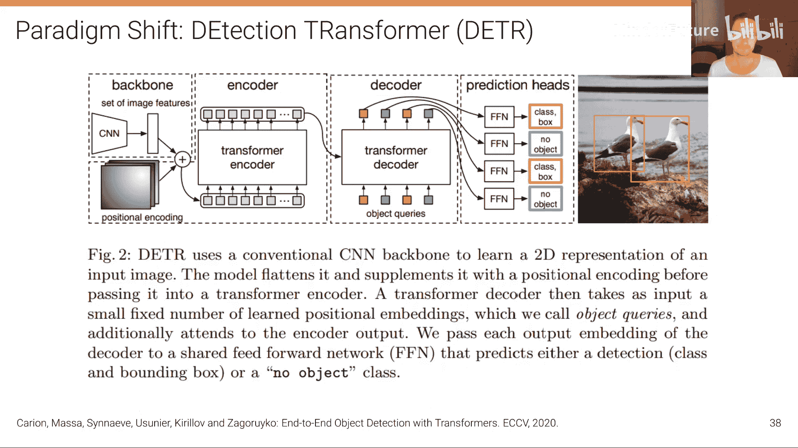

# 【图宾根大学】自动驾驶汽车课程 ML4340 p39 P39 Lecture 10.4 (Object Detection - Region Based CNNs) -BV16FP2ePEYc_p39-

Let's now move on to deep learning based methods， and in particular in this unit we will be focusing on two stage or so called region based convolutional neural networks that are amongst the most powerful deep learning based techniques and the de facto standard nowaday for object detection。

Classical approaches， as we have seen in the previous unit。

 haven't led to major breakthroughs in object recognition。Only for specific non safety。

 critical tasks， such as face detection on a camera， they have seen great success。

At least in terms of applications。Why is that。Well。The first and most difficult。

Problem is that computer vision features are actually very difficult to hand engineer。

They are really hard to design。 We humans just don't know what a good feature should look like。

 It's unclear how a good representation should look like。For more sliding window approaches are。

Typically quite slow in practice because they have to search through this vast space of all possible bonding boxes。

An inference in complicated part based graphical models doesn't。Improve the situation。

 but makes these methods even slower。 The results that I have shown you in the previous units video required about one minute computation time per frame。

And the reason for this is that computation is often not efficiently reduced。

 apart from that complicated inference in graphical models is sometimes needed。

But deep learning luckily has changed this。 And now recognition is a success story as well。

So here's an overview slide that illustrates the progress， right。

Thing that we could do is we could take the input image and pass the RGB pixels directly through a classifier。

 So we have this trainable block， and we have directly the image as the representation。

 But this doesn't work very well， As we' have seen。

 a better solution is to compute gradients and pass those through a classifier。 Now。

 we have some hand crafted features here in yellow and a trained component in green。

And even better is to take the gradients and form histograms and part pass this hand engineered representation through a learned classifier。

Or to do something on top of these histograms。Something like k means or sparse coating or a popular representation that has been used is called flat。

But all of these approaches suffer from the problem that these intermediate representations。

 these intermediate processing layers， have been hand engineered。Without any。嗯。Focus on optimality。

And so the difference in deep learning now， of course， is that we try to learn all those features。

 Now all these boxes are trainable， green boxes here。And we learn all of these low level features。

 These are the early layers in our deep neural network and the mid level features and the high level features。

 which are the later layers。 and even the classified its all one big neural network that is trained end to end。

And this really has led to dramatic improvements in performance。

 while the performance of object detection techniques has plateaued in from 2005 to around 2010。

With the performance on this particular benchmark for the the formidable part based model that we've seen in the previous unit。

Being route， only5。Maan average precision。With the first deep learning based models such as fast R C And N using a very simple backbone like Alex Nut。

 we already got a。A free times improvement in average precision。

And then within two and a half years of development of deep。Neural network baseds detection methods。

 We got another increase in factor free。So there has been tremendous progress within a very short period of time。

This unit here is。Based on slides from Roskoshk， who is one of the main。

People behind the this series of algorithms that I'm going to describe now on object detection with region based deep neural networks。

And so I want a credit rush here for the lights。So let's start。

 how can we detect objects using deep neural networks？

The naive idea is to classify all possible boxes in the image using a classification。

 deep neural network。 But， of course， that's infeasible， as we've seen as there's too many boxes， so。

We can do that， even if the space is discretized。A better idea is to first detect。

A smaller set of candidate bounding boxes that might contain an object。 Not all of them are correct。

 but some of them are。So we are effectively quantizing the space。 and， of course。

 we should we should choose this set of。Maybe 2000 candidate bonding boxes to be overcomplete。

 we should rather include more boxes， but we should make sure that the set of boxes contains all the ground roof boxes。

This is the first stage。And it's a two stage detector because it also has a second stage where we take all of these。

2000 boxes， let's say， and classify them now， myth。A into a set of labels。

 different objects or background category， and also refine the location of the boxes using a deep neural network。

 because we have quantized the we have reduced the number of candidate bonding boxes before now we need to have an opportunity and ability to refine the location to make the output of the detector。

 the output bounding boxes be more precise。So these are the two stages。And therefore。

 this approach is called a proposal based or two stage object detector。

Note that we have split the original object detection problem now into two proxy tasks。

 the task of detecting。A smaller set of candidate bonding boxes， or the task of quantization。

Of bound box space。And the second task of classifying refining these set of candidate bonding boxes。

And it's also illustrated here again， we see that。By approximation with a finite set of bonding boxes。

 we might get an a quantization error that is illustrated here。 So we have this。

This picture here of this dinosaur。And we have this quantized box， which is okay。

 but it's not perfect。So we have this quantization arrow with respect to the true box。

And what we want to do now in this second stage that I have described here is to refine the location of the boxes to predict this delta from the green proposal box to the final prediction here in dashed green。

In order to recover the loss of localization accuracy by regressing the location offset。

And a second stage。And of course， also we remove redundant predictions using non maximum suppression。

Clustering。As we did， also in the。Sliding window based。For this lighting window based techniques。

 because here， there might be multiple proposal boxes that regress to the same object。

 And so we want to keep only the most confident one， only a single。Prediction per ground truth。Now。

 let's look into the details of the first deep learning method for object detection that's called R C and is described。

In this paper， rich feature hierarchies for accurate object detection and semantic segmentation。

Our CNNN stands for Re based convolutional neural network because the idea is very simple we are computing these proposals these regions and then for each of these regions we apply a convolutional neural network classifier。

So we use an off shelf reach detector。AProal algorithm first。 And at the time。

 there were a number of。Algorithms available such as selective search or edge boxes。

 is a very simple， generic algorithm that don't take into account the category of the object。

 So could your horse or rider or。A bicyclist or anything。

 but they are trained for detecting generic objects。And they're doing this okay。

 but they are generating。Typically very imprecise predictions。 so we need to sample much more boxes。

 We need to apply a low threshold on the confidence in order to get a large number of boxes that we can later than classify。

So we run one of these classical techniques here to get a set of boxes。

And then we crop and bore up the original image into a fixed representation and forward propagate this fixed sized。

Representation into a。Through a convolutional neural network。

A standard convolutional neural network to get a feature representation。

 And then we have two output heads， one that classifies that region。For example。

 it classifies this as a horse rider。And one that regresses the offset of the。Bunding box， cos。

To refine them， to fit the ground truth better than the original proposals that are quite coarse and noisy and imprecise。

And what you can see here also is that this yellow region here is indicating the components that require。

Only a per image computation。 So we do this computation only once。

 only once we compute the boxes for that image。 But this area here in green indicates。

The components that require per region computation。 So per region。

 we need to crop and warp and per region， we need to run a continent。

 And here you can already see why this is slow because we need to run a full fledged convolutional network for each of these 2000 proposals that are proposed by the selective search algorithm。

 for example。We can now generalize this representation， this framework here into more general form。

 and we will see that it is useful to understand the innovations on top of the original R CN and algorithm that we've just seen。

So， we look at this。嗯。Read these two regions with per image computation and per region computation。

And in this generalized framework。We have a transformation of the input image here into a featureurized representation first。

And then， we have。A mechanism for object reach proposal detection that are computed from that image。

 We call this R of I。 So we have the features F of I。 This is the feature map。 And here we have the。

Regs that are computed from that image， are a I。And then we have a function that takes。

The features and the regions and computes a featureturized representation of each of these proposal regions。

And then we apply additional processing to each proposed feature。

And we have multiple hats to make task specific predictions。Now， if we look at the RCN。

 this first most simple version of deep learning based two stage object detection。In this framework。

 this is what it would look like。The feature the feature mapping here is simply the identity function。

 So it copies the image as the feature representation。

And for this function here that computes the regions from that image。

 we simply use one out of the box。 classical， traditional non deep learning based algorithms like selective search。

And then this combination function is simply a cropping and warping operation。

 And then this per region computation is a full fledged convolutional network。 then we have two hats。

1，4 the classification and one，4 D bounding box refinement， dereion task。

Now what is the problem with our CNN？Well， the first problem is that we have heavier per region computation。

We need to do 2000 full network evaluations right for each of these proposals。

 we need to run a full Alexnet or Renet。Architecture to make a prediction。 So it's quite slow。

And also， we don't utilize computational or feature sharing because we are doing this really independently。

 We really independently run 2000。Inference processes，2000 inputs through this network。

Another disadvantage is that we have a slow reach and proposal method that adds to the runtime。

 So these here are really classical techniques that don't use deep learning。 They run on the CPU。

 They are quite slow。So this is not ideal if we are targeting。Like frame rate。

 real time object detection。And then we have generic reaching proposal techniques or these classical techniques。

 which have quite limited recall。 Despite choosing a low threshold。

 they are still not predicting all of the。Like a box for all of the ground roof objects。

So the next version of this two stage object detection family is called fast， R CN， fast region。

Convolutional neural network。And。What it does， it has a lighter weight per region computation。

It's effectively an endto untrainable version of as peanut。And it's illustrated here。

In a first step here， what we now do differently is we don't just copy the image as a feature representation。

 but we run the fully convolutional network backbone。In order to produce features。From that image。

 But we do this only once per image。So we are sharing computation here。

We map this input image to a lower resolution spatial feature map。In a second step。

 we apply region of interest pooling。Which convert converts each of these regions here into a fixed dimensional representation。

And then because we have done a lot of this processing already in the per image part here。

 we only require a lightweight multi layer perceptron to process each of these region feature maps。

And then we have a classification hat and a box regression hat as before。

The main difference to before is now that a lot of the computation has been。

Moved from the pure region area in green to the per image area in yellow。

 And this makes the processing much faster。 That's why it's called faststar seen it。

So let's look at these individual， let's look at these individual blocks in a little bit more detail first at this。

FcN block here。This is a standard convolutional network that we use here as a backbone。

 so it could be an AlexNe， a VGG， anet， inception， a densenet。Actually。

 the stronger the recognition backbone， the better features really matter。

 that's also a conclusion from all of these papers， the stronger your backbone。

The stronger your object detection results， no matter what you do on top。

One thing that has been removed from these backbones is the final global pooling。Layer。

 which reduces the spatial dimensions to one， because in in these original architectures。

 we were interested in the per image classification problem。

 but now we want to create a feature map that has a spatial extent。So we are creating an output。

That has spatial dimensions proportional to the input spatial dimensions。For example。

 if we have an input image of size。Withdth times height。

 then the output feature map might have 512 channels。And we might have a feature map of width。

W over 16 and H over 16。 So we're reducing by a factor of 16 in each dimension。

 but we're still keeping。Some spatial resolution。The second。

Block the second innovation of fast aena is this roy pooling operation here。And the idea is now。

 of course， to extract features from this feature map based on these regions that have been detected by the proposal mechanism。

And this is one of the key innovations of this earlier work called SSPNe。

So the idea is is rather simple。 So we have a proposal region here from this proposal detector。

 and we have also the feature map that's indicated in blue here in the background。But， of course。

 this proposal region might not be perfectly aligned with the spatial grid， this low resolution。

Feature map。And so what we do is we snap the ROe to the。Cllosest。

Aligned grid aligned feature sub feature map。We transform an arbitrarily sized proposal into this fixed dimensional representation in other words。

 and then we we apply max pooling here。We compute the feature value as the max over the input cells in order to obtain a fixed size representation。

 In this case， a two by two feature map from this in this case，4 by3。Reach here。

So this is all that's done in the R I pooling。 We're snapping the。

Proposal reaching to the grid of the feature map。 And then we are pooling to a fixed2 by two spatial resolution。

 and that is then fedest input to this lightweight MP。And so the advantage now is， of course。

 that we don't have any heavy per region computation anymore。

 we don't require 2000 full network evaluations anymore。

 but we have offloaded this tear the backbone and we just require this lightweight MLP evaluations per region。

So we're effectively making use of feature sharing and computation sharing。

But we still have this slow reach and proposal method that adds to the runtime。

 and we have a generic reach and proposal technique that has low recall still built into this model。

So the next variant。The next evolution of this family of two stage detectors is called faster R C N。

 Note that this has happened all in in very short period of time。

 You can realize that also all of these extensions are quite simple。 So this has all happened within。

One year or so I remember when Ross gave this talk at a conference and at the conference。

 he presented already the next version， the next innovation of the paper。

 rather than what was actually published at the conference。Yeah， so research is fast today。Okay。

 so what is faster RCN doing differently？Well， what it's doing differently is it's not using this generic。

Reach and proposal mechanism is classical methods， but it uses a learned proposal。

It uses learn proposals。By computing the proposals through a network that shares computation with the whole image network。

 So instead of this arrow here， we have this arrow that goes from this feature map from the features of the backbone。

 It directly regresses deep proposals as well and trains the entire model jointly and to end。

How does this region proposal network look like？This is this part here。

The way that it's implemented in faster R C and N is a simple free by free kernel that's swept over this convolutional feature map。

 This is this feature map here。This is the output of the backbone。

Which scans the feature map looking for interesting objects， generic objects。

 and it defines an anchor box。嗯。And the predictions are with respect to this box。

 not the free by free sliding window。 And the reason why this anchor box is chosen larger than the free by free sliding window is that。

 of course， the features that are stored in this free by free sliding window have a much larger receptive field。

So they see more。 And looking at just this little red region， we can。 we still have information from。

 from， from this area here， for instance， because we have a。

This convolutional backbone that has this that extends the receptive field as common in convolutional networks。

So we are based on these features predicting a bounding box relative to this anchor box。

And for this region proposal network again， we have an object as classifier。

 so it's not an object class。A classifier， but just an objectness classifier。

 we just want to classify， is there something independent of its class。Or is it background。

 and then we have a box withgressor that predicts the offset to the anchor box。So for example。

 in this case， the objectness classifier might result in a high score because we are located at this like centrally。

 at this dinosaur。And the boxgressor predicts the offset of the anchor box to fit this object more precisely。

And here's another example where the objectness score would be lower because we are not centered at the object。

In practice。The offers of faster RCN use multiple anchor boxes to accommodate multiple aspect ratios of objects。

So here we can see three different anchor boxes， one that is quadratic and two that are rectangular。

嗯。In order as a basis for the offset predictions。So we're doing this。

We have basically in this process here。Let me go back。

We have K classification problems and K box regression problems。Per region。

So we have K objectness classifiers and K box requests。

Another innovation that turned out to be quiet。Impactful。Now， like this faster our seen in。U。

Basically has removed the problem of slow region proposal methods that add to the runtime and。

 you know， this generic techniques that have low recall。 So it。

 it is not limited in recall and also runtime has increased dramatically。

 So we have really a method that runs at 10 frames per second or so now。But one， one additional idea。

 one additional trick that has improved performance on top of this。

Is the idea of a feature pyra network。The idea here is that the whole image feature representation here can be improved by making it multi scale。

What does that mean？The goal of feature pyramid networks is to improve scale equivariance。

Remember that a detector needs to classify and localize objects over a wide range of scales。

 for example， this cat here。Might occur。In the vicinity of the camera。

 But it might also occur very far apart。 And so we want to detect this cat independent of its size。

And the feature Per network improves this ability。So what can we do in order to detect objects at different scales。

 at different sizes？Well， the most simple idea that we have already talked about in the last unit is to use a image pyramid to downscale the image。

Different resolutions。 and then run。Exactly the same object detection algorithm at these different resolutions。

 So we compute the features， and then we do predictions。 But of course。

 this is slow because for each image pyramid level， for each of these resolutions。

 we need to run the entire faster asan and algorithm。So this is not ideal。

A second strategy is to simply use the multiscale features like in fast or faster RCnN and leave it all to the features Now this is of course much faster because we just have to run a single network and we take these features at the Ca resolution at the final layer of this backbone and use that for making predictions but this is suboptimal because we can't detect objects at all scales equally well。

The third strategy that we could use is an Eve in network pyramid。

Where we use the internal pyramid and apply or make predictions at every individual feature scale。

 Now， this is also fast， but it's still suboptimal。

And so the idea and the reason for this is that the。Like the first pyramid level。

There has relatively little processing happened until that。

 so we have only high resolution and weak features right。

 and only strong features at the lower levels where more convolutional layers have been have been processed。

 so for the smaller objects， we would have to detect them with just very few layers and for for the objects that are large。

We will detect them with many layers so we can detect those better。

 so we have strong features at low resolution and weak features at high resolution。

And so the idea now to improve this is a simple unit basically。

 and that's called a feature Per network here where。

We have a top down enrichment of high resolution features， which is still fast， but less suboptimal。

And so the idea is is really just a unit where we have an encoder and skip connections。

 and then we have a decoder。And so in this case， we have strong features。

 both at the high resolution and at the low resolution， because。

Both at the high and the lower solution， we are receiving information from all。

Scales all feature scales of this network。 And then we can use those to make predictions。What do。

 what do the results of such a object detector look like？ So here's an example applied to the。

One of the Kity sequences， and you can see， well， it's flickering a little bit because there's no temporal continuity。

 but you can see that。That cars are most often correctly detected。

 but there is also some other objects that are incorrectly classified as cars in this case。

One nice thing that we have already seen in this video just now is that we can also generalize this framework very easily to other output modalities。

It's easy to add more output heads to this framework。 For example， Ma R CNN from 2017。Its。

An instant segmentation mask。Per detection。And a dense pose。And predicts object coordinates。

Which are， in this case， relative freed locations on human bodies。

 If you have a data set where this is annotated， you can also predict it。

And mesh are seen and predicts triang meshes per object。

So let me just show you。This was an amazing result at the time。

 the result of dense posts where in parallel， in real time。

These object coordinates are predicted and then can be converted into human body pose estimates。

And this is illustrated here。So you can see many objects moving in parallel。

And the predictions of this method here。

The nice thing also about our community is that。Nearly all of these state of the art methods are freely available。

 You can download them， and there is good softwareer frameworks available。 For example。

 Facebook research has released Detron and Detron 2。Which implements all of these。

Teciques and also the different output modalities， as you can see here。

So I encourage you if you're curious to try it out yourself。Finally。

 one problem I wna also highlight is the foreground background imbalance that。

Occur when training object detection algorithms。The problem is that the number of positive and negative boxes is heavily imbalanced。

In fact， there is only a few objects typically in image。

 but there is much more negative boxes that we could sample from the background that contain not the object of interest。

So before quantization， when we consider。Continuous manning box coordinates。

 there is an infinite imbalance， but even after quantization。

After selecting a subset of discrete boxes， we still have only 0。01 to 0。

1% foreground boxes compared to all the boxes。In other words， we have 99。

9% cent background boxes and learning a classifier from such imbalance data is very difficult because the classifier。

 if youve ever trained such a classifier will realize that the classifier will simply ignore the minority class because it will obtain nearly 100 per cent a accuracy by predicting everything as background。

Now， how can this problem be improved？Well， one solution is to lose a loss function which pays attention to hard examples and one prominent example here is。

The so called focal loss。That has LED to considerable。

performanceerformance improvements in object detection。

 where you can see here in blew the curve for the cross entropy loss。

Which still assigns significant penalty to well classified examples。And then this modified version。

 it's a very simple modification of this loss function。That。Ntches this curve， further down。So。

 for example， for a value of gamma equals 5， we have this green curve here。

 such that the well classified examples receive less penalty， and the focuses more on the。

Less well classified examples。🤧嗯。Another solution that we've already seen now quite extensively is the idea of a cascade。

 So the， the idea of a proposal based detector where we first。

Select a set of proposals and then in the second stage。The classifier sees more balanced data。

 of course， also helps。 and this can be combined with the idea of focal loss。And then finally。

 we can perform more extreme forms of quantization， which is what single stage detectors do。

 They reduced imbalance。Simply by construction。And I want to briefly highlight these type ofs as detectors as well。

Because。They are really fast。 They are much， much faster。Then， for example。

 the faster RC and N detector， which already is much faster than the classical。嗯。A models from。

The2 thousandss。So the idea of a single stage detector is to predict。The object boxes in a single。

 forward pass。And examples of such single stage detectors are Yolu and asste。

And the idea here really is， given the input image to predict at a very coarse resolution in this case。

7 by 7 only。The class Pro team。And to regress the bounding boxes for each of these。

Cells here from each of these cells here， imperl。Plus。

 a confidence call that directly leads to the final detections。Now， through is extreme quantization。

We can do the entire processing in a single stage， and it's extremely fast。 but in general。

 the performance is worse due to this dramatic subampling of the output space。

And the large quantization arrow is hard to correct in practice， which leads to a lower A P metric。

 typically than the two stage detectors that we've seen before。And then finally， more recently。

 there has been a trend to alternative paradigms。To object detection。

 And one prominent example is called debtor。Which uses a。

A transformformer encode and a transformer decoder。

 So it's a very different way of using deep neural networks。It's inspired by language models that。

Use a lot transformers these days where the input image is passed through a backbone and then tokenized。

And the transformer produces a set of features for these tokens。

And then these features are input to a decoder， and then we learn jointly， not only these features。

 but also a set of object queries that are then decoded into the individual predictions。

