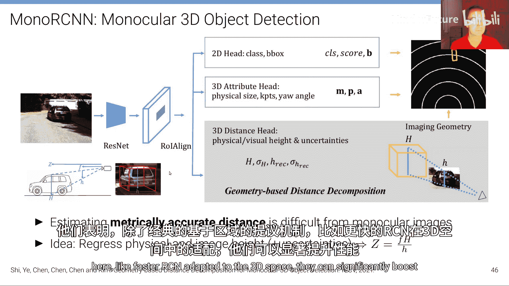
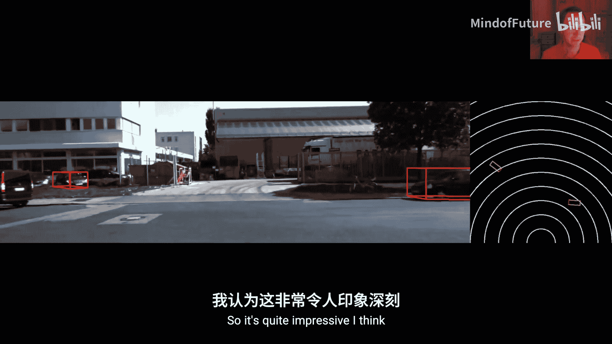
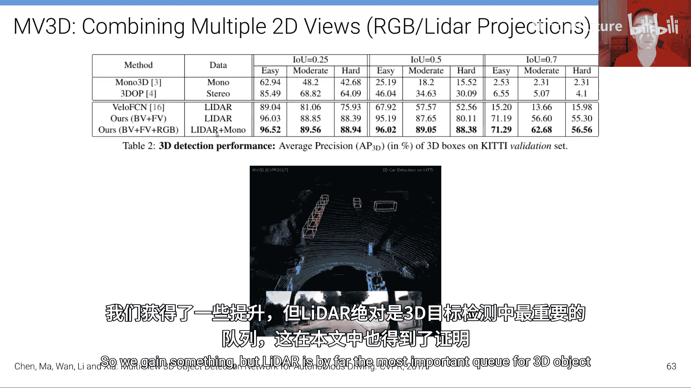
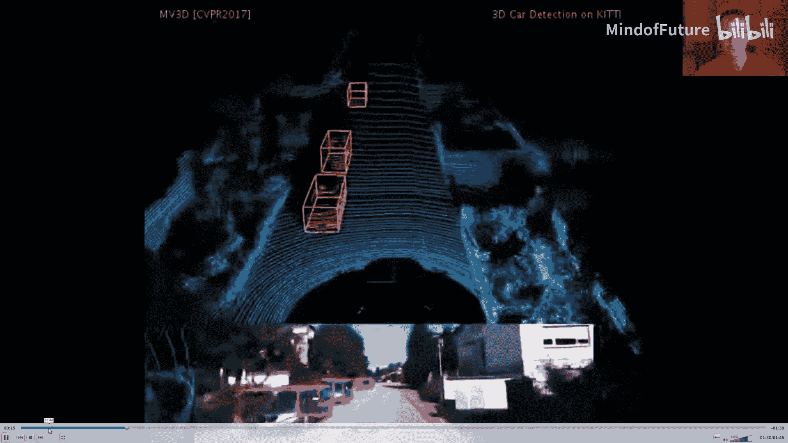
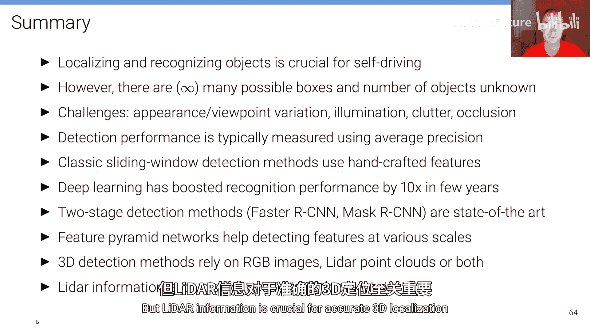

# 【图宾根大学】自动驾驶汽车课程 ML4340 p40 P40 Lecture 10.5 (Object Detection - 3D Object Detection) -BV16FP2ePEYc_p40-

So far， we discussed 2D object detection techniques。

But of course our world is free dimensional and therefore it's important for self driving vehicles to perceive the environment in free dimensional space and to detect objects in free D。

And this brings us to 3D object detection， which we will discuss in this unit。

The goal of 3D object detection is to predict。A free de bounding box for each and every object of interest in the scene。

For example， here on the right， we have this orange 3D box prediction。

And the green box indicates the ground truth for that particular object here。

The performance of 3D object detection algorithms can be evaluated similarly to the 2D case by defining a 3D intersection of a union metric。

And computing average precision based on that 3D intersection of a union， where now the intersection。

For example， is not。Computed with respect to the areas of these 2D boxes as in the 2D case。

 but with respect to the 3D volumes of these two cuubboids。Highlighted here in yellow。

Let's first have a look at the different。Pramatizations of 2D and 3D object detection。In the 2D case。

 the goal was to find a 2D box。Which can be parameterized with values。The X。

 Y location in the image domain， as well as the width and the height of that box。In the 3D case。

The location is a three dimensional coordinate， an X， Y，C coordinate。And the 3D box has a width。

 a height and a length parameter。And in addition， we have free rotation parameters， role。

Pitch and yaw。So of all， we have nine parameters to estimate in the general 3D object detection case。

However， when considering self driving。An assumption that's commonly made is that。Objects。

 vehicles are driving on the road on a plane a road surface。

 And so we can assume a zero roll and zero pitch and remove these two parameters so that we are only estimating the yaw angle。

And reducing this estimation problem to a seven dimensional estimation problem。Still。

3D detection is much harder， there's more parameters and it's much harder problem。

 There's more that can go wrong。And also， the difficulty depends on the input， for example。

 regressing。A 3D box from just a 2D image， from just the projection into the image domain as input is much harder than doing this from a Liar 3D point cloud。

 for example。This is also illustrated here。A 2D box in the image。 this red one here， for example。

 corresponds to a fum。This red thing he is called a fum in three dimensional space。

And the object can be located anywhere inside that Ftum。In general。

 the objects that are visible in the image can be located anywhere in the camera viewing F them。

The means that objects of different scales and distances may look exactly the same。

 If you look at this bunny here。If I have a bunny at a small distance， that's small。

And if I now increase the size of the bunny and put it at a larger distance。

It projects to exactly the same pixel values， to exactly the same image。

 so there's a scale ambiguity here。Now luckily， in the case of self drivingiv。

 this is something we can learn to resolve through machine learning。

Because cars typically tend to be between 4 and 6 ms long， et cetera。

 So there's typical sizes that we observe。 And so by knowing that a car in a physical world has a typical size。

We can still。Get cues about， for example， the distance to a car just by looking at the size of the 2D projection of that car。

Still， the difficulty depends on the input modality and by far the hardest task is to regress 3D boxes from monocular images as illustrated here。

 because this requires very good object size priors。

 and still it's hard in particular at the far range it's very hard to predict de locationation of a 3D box from just a monocular IGB image as illustrated here precisely。

If we have two images， a stereo camera， then this helps to localize the box in 3D space， of course。

 but。If you remember from the reconstructionion lecture。

 we have a quadratic increase in error with distance。

And so it's still not as accurate as if we would have a 3D point cloud from， for example。

 a radar or Liar scanner。In contrast to image sensors， Liar sensors are sparse。

 but provide good3D accuracy also at far range， as shown here， so localization becomes much easier。

However， due to their sparsity， they have a lower resolution。

 so it could be harder to detect small objects like pedestrians。 And we'll see that in a bit。

That's the reason why several methods also try to combine both modalities as they provide complementary cues。

 complementary information。They're trying to combine images and Liar。Let's now look at each of these。

 I will show you examples for each of these。Categories in each of these three categories。

 and we'll start with the image based 3D object detection category， which is the hardest。

To predict 3D bonding boxes， metric 3D bonding boxes from chests a single image。

The first method I'd like to show you is called Monocular 3D Object detectionte for Autonomous driving。

 published in CVPR 2016。And the idea here is to sample candidate 3D boxes on the ground plane。

And remove all the 3D boxes that are in。Non road areas。

So refers to a semantic segmentation of the input image and we the camera at a certain height and inclination angle。

Maybe that has been calibrated beforehand。So we have a virtual ground playing that we can assume。

And then we project this semantic segmentation onto that ground plane。 That's what you can see here。

 We ignore the road area and sample 3D boxes。Of typical sizes of 3D cars。 So we build a 3D car model。

 a model of。That has the size of typical 3D cars， and so we sample these cars in these gray areas here。

Now we have cars at plausible 3D location and with plausible 3D sizes sampled in 3D space。

 but it's a lot of 3D boxes， these are just proposals。

 so we project them into the image plane in order to extract features and what has been done here in this early work was to use the feature based scoring mechanism that's based on features such as semantic class information。

 semantic instance information， the contour and the shape and the context。

So these are simple features that take into account shape and context information as well as。

Very generic prior is about the location of the vehicle。 Tyically。 So if you have a big data set。

 you can， of course。Cate like this heat maps here where vehicles in the bird's eye view and in the image typically occur。

And so based on these features。They re rank these hypotheses。 And then for the top ranking ones。

 they do a final scoring and a2y refinement using a fast R C N。

In the 2D image domain to retain the 3D proposals that are most likely。

So it's basically a technique that that first samples in 3 d and。

Through that sampling process automatically constrains the location and the sizes of the cars to be plausible。

But then thus the classification and detection actually in the 2D image space。

This is a more recent technique is called geometric based distance decomposition for monocular 3D object detection at ICCV 2021。

The idea here is to improve。What is the hardest for monocular 3D object detection to improve localization。

 and the main problem is that regressing depth is really， really hard。

So what they do here is they observe that theres this relationship。Between the distance。

To the object and the actual 3D height of the object and the height in the image domain of the 2D bonding box。

And so that what they do is they regress both the physical。Capital age and the image height。

 plus uncertainties。And then fuses those in an optimal way to yield a better depth estimate。And so。

 they show that。In addition to a classical region based proposal mechanism here。

Like faster RCNN adapted to the 3D space。They can significantly boost performance that way。

And so here are some results from this technique。Now remember that this is all computed just from a monocular。

RGB image， just the image that you see on the left。So it's quite impressive， I think。

Another idea。To use a monochcular image or maybe a stereo pair is to first predict a depth map。

Using a stereo matching algorithm。 or if there's just a monocular image using a monod。

Steonet a mono depthth network。And then back project that depth up into a 3D point cloud。

 which the authors call asu Lidar point cloud。Because then you can apply standard point based light up based 3D detection algorithms。

Directly to this pseudoo lightar point cloud。And what the office of this paper P pseudoliar from visual depthest claim is that this performance is then competitive with Liar based detectors。

 So this。Paper had a big splash in the community because it was believed that3D detection from monocular images is much harder than Liar based detection。

 And so this was really。Astonishing too many。 But then more recently。

 there has been a discussion about this around this topic because。

There's not that much prior knowledge， actually， that that's incorporated into this approach。

 There is no magic happening here。 So why should this work so much better than， I mean。

 going through this depth map than directly regressing。3D boxes from the image。

 And it has been recently found that some of this。Improvements have actually been gained through some。

Quicks in the evaluation and not correspond to actual performance improvements and you。

If you're interested in this discussion， I I。I'm happy to refer you to this paper from Simonmonella Dll at ISV 2021。

But it's another example of how you could utilize just a monocular or stereo image。

In order to first compute a 3D point cloud and then apply a 3D object detection algorithm on that 3D point cloud。

And this brings us directly already to Liar based VD object detection。

 where the input is such a either pseudoo Liar point cloud or real Liar point cloud from a Liar。

Scanum。However。Learning with point clouds。Pos some unique challenges compared to learning from images where we know how to deal with the image domain by using。

 for example， 2D cons。The first challenge is that the learn model must accommodate point clouds of arbitrary size。

So if I subs sampleample the point cloud， if I remove every other point。

 I still want to have a similar result， a similar answer。And， of course。

Different lightar point clouds have different number of points， so。First of all。

 my algorithm must be able to handle this。And， for example， a multi layerer perceptron would not。

 It would assume a fixed input vector to dimension。So that's not a feasible model。

The second challenge is that the learn model needs to be invariant to all n factorial permutations。

 as illustrated here， so if we have this point cloud。It's basically a set， a point cloud is a set。

 so if we have this set as an input， then this represents the same set as this one here。

 it doesn't depend which index each point has in the input representation in the input space of my model。

And so， the model that we built。And the。Revolution that the pointnet fostered or started was to think about these set representations。

 So we want the representation a model that treats both of them exactly the same way。And。

 for example， a max operator would be a function that is invariant to。Pmutations are。

The average or addition operator is invariant。But of course， this alone is not enough。

It's not a neural network， we can't learn any parameters with just that。And finally。

 the learn model should also be invariant to rotations of the point cloud。

 because the object is always the same no matter how I orient it。

 so we should incorporate this as well。And this is really where。

Everything started with a paper called Pointnet， where it tried to apply。

Deep neural networks to point clouds on free tasks。Classification。

 part segmentation and semantic segmentation。In classification。

 the goal is to predict a category label for an entire point cloud and in semantic segmentation we want to predict。

Is semantic class label for each point of their point cloud。So it's not。Directly。

 the 3D detection problem， but it's a。A foundation of many of the 3D detection models that are out there that operate on Liar point clouds。

 And that's why it's important to understand this first。So how does pointnet work。

 here's the architecture of pointNe。Pointnet applies a multi layer perceptron per point。

 These are these little boxes here。They have shared parameters， but they are applied per point。

 So they take a single three dimensional point and project that point into a 64 dimensional feature space。

 and they do this independently for each point。But the parameters of this model is shared。And here。

 in a second stage of this algorithm， they take a 65 dimensional。

Feature vector of that point and transform that into a 1024 dimensional feature vector， again。

 independently per point。After that。Point that does applies a max pooling operation。

 which is where this permutation invariance comes into play。

In order to obtain a global feature vector of the same dimension，1024。

And then a final global MLP to do either classification or taking these global features。

 So this is for the classification task， but if you want to do semantic segmentation。

 you take these features， these global features and concatednate them with some per point local features and pass them through some more pointnet layers in order to predict an output score per。

嗯。A point。In addition， there is this。Input transformation and feature transformation blocks here that you can see here。

Which。Inside these blocks， again， use small little point nets that are called tea net here。

 So these tea nets are something like。You know， this entire blue block here。

 but just replicated in a small block and more shallow。

And they are predicting a transformation in this case， a free by free transform。

 in this case a 64 by 64 transform， so they are predicting enoughine transformation that's applied again independently per point。

And so this helps in in you know， this helps in learning these geometric invariances。For example。

 rotation invariance。Now， this is an interesting model， right。

 it's worth thinking about it a little bit。 Why， why does this actually work。

But training this end to end works quite well， actually。

Despite the fact that here we we do a couple of these processing steps independently per point。

While sharing the features of the network， projecting these points successively into higher dimensional feature spaces。

 and then applying this max's pooling operation to yield a global feature。That's then。Projected。

We're usinging an MLP to a class label。One downside of pointnet is that it doesn't capture local structures and depends on global coordinates。

Right so here every point is a global point coordinate。

And so one follow up innovation from the same group was pointnet plus plus。

Which applies pointedant recursively， as you can see here。Un nested partitions of the point set。 So。

 for example， this。A point here has a receptive field that's indicated by this dashed lines here。

 And this has a receptive field indicated by the dashed lines here。 And so successively。

 it's aggregating stronger features。Fruit is nested partitioning。

And it learns features with increasing contextual scale。

 so you can think of this as a multi scale pointnet。And similarly to pointnet， it has。

A decoder for semantic segmentation or an MLP for classification。Now。

 this ones about object or about。Image point cloud classification and semantic segmentation。

 How can we now use this for 3D detection。And one method I want to show you in this context is called point R C N。

 faster R C N for point clouds。I call this faster Rene N point cloud， this is not the paper title。

 the paper title is 3D object proposal generation and detection from point cloud。

But I call this faster RN for point loads as it's basically doing exactly the same as faster RCNN。

 but for point loads。It has a proposal stage here in blue that generates a set of 3D box proposals。

That is ideally overcomplete。And then it has a 3D box refinement stage where。A。

A 3D box offset is predicted as well as a confidence to yield def 3D detections。

Let's now go over these two stages individually， So this is the first stage， the top part here。

What do we have here， Well， first， we have a backbone here。

This point cloud encodeder and the point cloud decoder。That learns。

Discomative point wise features using a standard point net plus plus。

 So this is just a point net plus plus that gives us per point features。

For each point on this point cloud。And then we have a 3D box proposal regression module here。

That's similar to faster R in and the first stage of this two stage。Faster us in n。

 but for point clouds。And another module that predicts foreground versus background。

And what they use is a combination of regression and classification plus regression losses。

ClWith classification plus regression， I mean they， for example。

 for the spatial coordinate in bird's eye view， they for every point they define a local coordinate system。

Then they discretized that local coordinate space。And first。

 do a classification of the location of the object in which bin it should be。

 And then an additional regression where exactly in that bin。

 And so they this is a common trick that's often done when you know， direct regression。

Is not is not working well because we， we have to deal with， you know， multimodal distributions。

 etc cetera。 So you can use this trick。And this is what they do。

 This is what they call bin based loss。Okay so so they do this 3D box proposal regression and then they pass the top 100 proposals。

 the ones that they are most confident in to the next box refinement stage。

 which is illustrated here， so you can see it takes the point coordinates the semantic features。

 the foreground mask and the 3D region of interests of the proposals as input。

And then in a first stage， it pools all the 3D point features based on the 3D box proposals。

 so simply aggregates all the features inside any of these 3D proposal boxes。

 like the orange one here。And this leads to a set of semantic features and local spatial points。

Then in a second stage， these local spatial point coordinates are transformed。嗯。

Into a local 3D box relative coordinate representation to have them in a canonical coordinate system。

 they are transformed from global to relative to that orange box here and then merged with the semantic features and fed as input to a point cloud encoder that then does the 3D box refinement。

By predicting residuals similar to the second stage in faster RNN， and again。

 it's using a combination of regression and classification plus regression losses。

And this gives the final 3D boxes as output。So here are some results of this method you can see。

ThatThat is able to detect the objects in 3D quite well。And while it's using， of course。

 only point clouds as input。Here it's evaluated on the Kidie data set where。嗯。

Images are available so we can also project the 3D box into the image。

 but the image hasn't been used as an input to the model。

An interesting observation from this table here at the bottom where we see average precision numbers for different IOU thresholds。

Is that。This point， R CNNN method outperforms multimodal methods， often。

So we have some methods here that combine RGB and LiDar。

 and this method is better than those previous ones。Except for pedestrians， which are small。

 So for pedestrians， it's sometimes hard to detect them in lightar point clouds because there's just so few points that lie on these objects。

So if you have an image information that can help you there。But in general。

 Liar is by far the most important。Input modality here。And there's little that you can gain。

 except for very small objects。If you add image information。

 at least if you have an expensive HDL 64 beodine Liar。

An alternative to this point net model that I just showed is to encode points into a voxel representation and then use 3D convolutions。

 and this is what has been followed in this paper Voxelnet and to end learning for point cloud based 3D object detection。

Which also received quite some attention at CPR 2018。

 because it was one of the very few papers from the Apple team。

Apple is as a company typically not known for publishing a lot of their results。

 but this is a paper that they have published。Which obviously came out of their self driving effort。

And so what they did is basically they first partitioned the input space into a set of voxels and then convert the points that fall into these voxels。

Into features for these voxels and then apply 3D convolutions on that voxel space。And then do some。

 they have a basically a single stage detector based on these features。

So they say here this is a region proposal network。

 but actually the region proposal network is proposing directly the 3D box output。

 so it's not a two stage detector， it's a single stage detector。Now this also works， but of course。

 it requires a large amount of memory and compute because you have to work in a large 3D volume。

Another IR is to use a 2D bird eye view representation instead。

 which is much more memory and computation efficient and has been followed， for example in。

Work called Pixar and H Dnet， as shown here。So the idea is to represent LiDarR information and possibly also a roadmap that can be used as auxiliary information to help object detection。

 as has been shown in HDNe。So can surface a strong prior that can boost3d detection performance。

So to represent that in 2D B's eye view。And the way this is done for the lidar is to treat the C dimension as a feature channel to discretize the C space。

 This is the upcordant。Into different bins and use these as the featured channel because then you can use efficient 2D convolutions instead of applying free d convolutions。

And yeah， this is what has been done， for example， in in HD net exploiting HD maps for 3D object detection。

 but it has been also shown that if you supplement this light up on cloud with a map， for example。

 a high definition， an HD map。Where you have localized yourself in that map。

 then this map prior can help you remove implausible or invalidate implausible 3D detections。

From your 3D detector and gain better performance。And now finally， in the final part of this unit。

 I want to show you some works in the area of multimodal fusion or multimodal 3D object detection。

And the first work is called Frustum Point Nes for 3D object detection from RGBD data at CVPR 2018。

The idea here is to generate a 2D object proposals in the RGB image first。

So what they do is they take the LiDA scan， project the Liar points into the image domain。

As shown here and the top， what you can see her color coded is the depth。

And then you can combine this Liar image， the projection with the RGB image and use that with a standard 2D CNNN。

To obtain 2D object proposals， like in faster RCnN。

And what they do then is then they compute the object Frustum corresponding to the proposal 2D bonding boxes as illustrated here。

 and they consider all the 3D points that lie inside that Ftum and predict a 3D bounding box from those points inside that ftum。

So， it's。It's， it's doing a little bit of fusion here in the first object proposal detection step。

 And also， of course， it， it uses this。RGB color to colorize de point clouds。

But then it's really a two stage mechanism where in the first stage in the image domain proposals are generated and then in a 3D domain with a point net。

These proposals are validated。So here's a little bit more details。

 the 3D box prediction problem is split into three stages。In the first stage。

 highlighted in red here。嗯。The method segments。The RGB point cloud。Into object and background。

 it basically tries to extract。The object and remove the clter， as illustrated here at the bottom。

 this is the input， and this is the output。Then in the second stage here。

The points are translated such that the centroid of the point cloud aligns with the 3D box centre。

 because if you learn in this canonical space， then learning 3D detection is， of course， easier。

So we try to learn this alignment jointly end to end。And then in the final step here， step 3。

 the 3D bonding box。A regression happens where we regress the X， Y， C， and。

With height and length and also the your angle。To yield the final 3D bonding box。

Another example for multimodal fusion for fusing RGB image and lighter information is M V3D。

 Multi view 3D object detection network for autonomous driving。Again， it's a work that's。

Based on the popular。Two stage object detection framework where we have a 3D proposal network and a region based fusion network here at the end。

In a first step， this method generates 3D proposals from the Liar bird's eye view。

So we're generating a set of 3D proposals here in this proposal generating step。

And then project them into the Liar bird's eye view， the Liar front view。

This is basically an image corresponding to the RGB image。

But the domain corresponds to the RGB image。But what we see here is the lightar points projected into that image domain。

This is called the Liar frontron view。And we also project this 3D proposal into the RGB image。And so。

 of course， each of these。Input these three different input modalities。

Has a convolutional network to extract features， And then we can apply Roy pooling。

 just like in faster R CNN to extract those features in these。Projectected。Regs here。

And then wefuse thero pulled features from all modalities using thisusion mechanism。Which is。

Iterating between splitting， doing some computation per branch， and then。

Computing a mean pooling here of these modalities。So we have this specific confusion mechanism。

 and at the end， we have a hat。Where we re the class and also the box residuals。 So again。

 it's a classical proposal plus refinement two stage。Pipeline。

And so here we can see some results and again from this table we can see that if we add the monocular image queue to the LiDarR queue。

 we gain something， but it's not quite as dramatic as we might hope for。

 so for example at an intersection intersection over reunion threshold of 0。

5 which is a standard threshold we gain maybe 0。8 percentage points here and 1。

5 percentage points here， so we gain something but LiDar is by far the most important Q for 3D object detection as also found in this paper。

So here are some results。Unfortunately， quality is not great。But I， I guess you get the gist。

That brings me to the end of this lecture。 Let me conclude， in summary。We've seen in this lecture。

 that。Localizing and recognizing objects is crucial for self driving。However， there are。

Many possible boxes。If we consider。Continuous values Then there's even infinitely many possible boxes。

 And also， the number of objects is unknown， which makes this problem hard。Furthermore。

 we have to deal with appearance and viewpoint variations。 illumination changes， clutter。

 occlusion and all these other challenges。We've also seen that detection performance is typically measured using what we call average precision。

And classic sliding window detection methods use handcrafted features， which are suboptimal。

We have seen that deep learning has boosted recognition performance by 10 x in just a few years。

And two stage detection methods like faster R CNN and mask R CNN， or their3D variants。

Are dominating today。We've also seen that feature permit networks help detecting features at various scales。

And finally， in this last unit。We've discussed that 3D detection methods rely either on RGB images。

 lighter point clouds or both。But LiDar information is crucial for accurate 3D localization。

