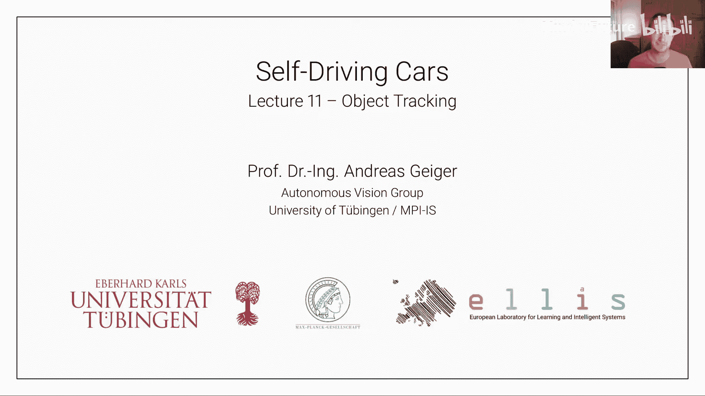
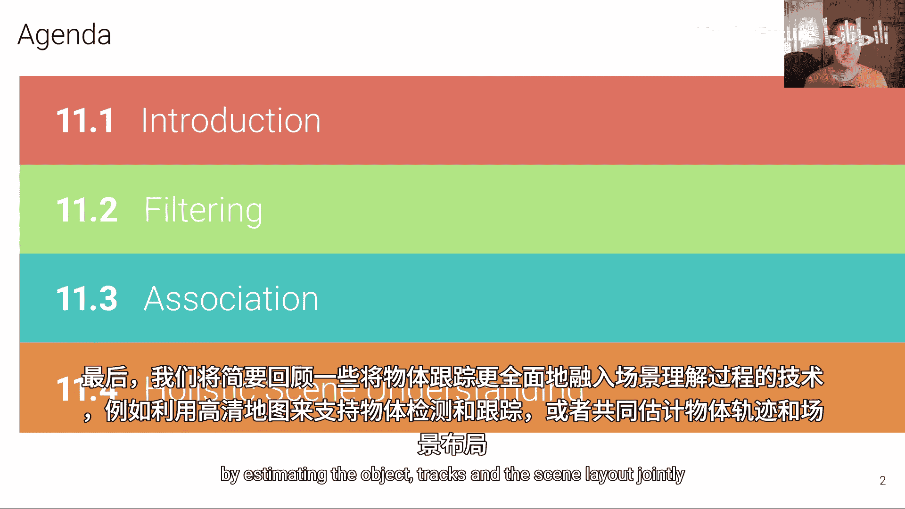
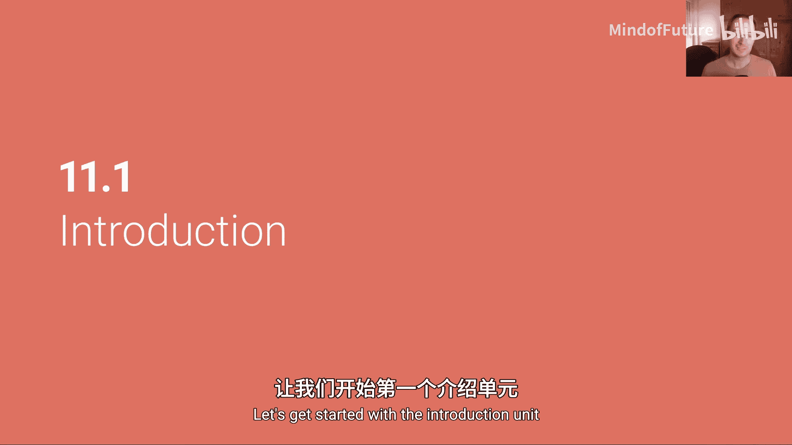
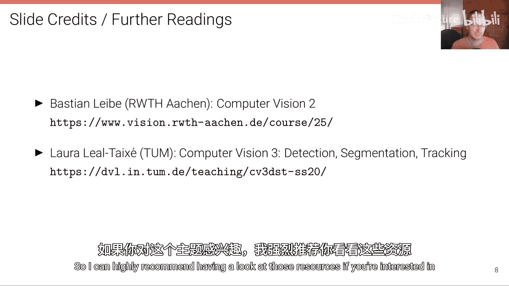

# 【图宾根大学】自动驾驶汽车课程 ML4340 p41 P41 Lecture 11.1 (Object Tracking - Introduction) -BV16FP2ePEYc_p41-

Wele back to self driving Car lecture number 11 on object tracking。In the last unit。

 we learned about various algorithms for object detection。

 both in two dimensional image space and in three dimensional space。But， of course。

 detecting objects independently in each frame is not sufficient to understand what objects。

Are doing where objects are heading。 And so what we need in addition。

 is we need to associate these detections over time， and this is what object tracking is about。

 estimating the state of objects over time and associating new observations in new frames to existing object tracks。

This lecture is structured into four units in the first unit。

 we will introduce the tracking problem more precisely。And see the。

Basic elements of the tracking problem。In the second unit， we'll discuss filtering。

 which is basically referring to state estimation， given multiple observations of an object over time。

 we can find a more precise estimate of the object state than just the location that's given to us by the detector。

 And so we are going to exploit observation models and motion models to find a more precise state。

 and that's what's called filtering and in that context we'll discuss in particular the so called base filter。

 which is a very general framework。In unit3， we'll then move on to the association problem。

 how can we associate detections in a frame to existing object tracks from previous frames？

And then finally， we'll have a short overview of techniques that integrate object tracking more holistically into a scene understanding process。

 for example， by utilizing HD maps to help and support the object detection and tracking problem or by estimating the object tracks and the scene layout jointly。

Let's get started with the In unit。

What is tracking？The goal of tracking is that given noisy object detections， for example。

 represented in terms of 2D or 3D bounding boxes， for each frame of a sequence。

 we want to associate those that belong to the same physical object。Furthermore。

 we want to reject detections that are false alarms。 If we have an object detection。

 it's going to make mistakes， and it will it will predict false positives。 But， of course。

 we don't want to integrate these false positive into our。objectject tracks。

 So we want to have a mechanism to reject those。Similarly。

 we want to have the possibility to initiate and delete object tracks。If I look at an image。

Or if I look at a video sequence， then there might be objects that appear because they enter the scene from behind another object or from the image boundaries。

 and there might be objects that disappear because the object is not visible any longer。

 and therefore we need to have a mechanism to initiate and to delete object tracks。

And then we have to， as already mentioned， estimate the object state。

 the object detection is just a noisy observation， but we are interested in the true object state。

 so how can we estimate that object state more precisely by considering for example an observation or a motion model and integrating this prior knowledge into the estimation process using for example a so-cal base filter。

Now here at the bottom。😊，I have two example videos of object tracking results。

On the left for a pedestrian scene with aesthetic static camera。

And you can see these bounding boxes around the objects that are smoothly tracked。

You can also see that， in some cases。An object appears in the observation area， and the trek starts。

 and then some objects。 Some pedestrians move out of that zone， and the object tracks get deleted。

This is actually。These are videos from one of the earliest and most popular benchmarks for evaluating object trackers called P。

 E T S。And here's another example， very different application， tracking Bs。In a beehive。Okay。

 so let's start by considering the elements of tracking。Treking comprises well。

 two or three elements if you， depending on if you consider detection to be part of tracking。

 but that's what we are going to do here。We're going to consider something that's called tracking by detection where detection is an integral part of the tracking problem。

 so we have free problems， detection， association and filtering。

The detection problem we have already discussed。In the last lecture。

And the question to answer here is， where are candidate objects in each frame？Now。

 different from before， we are not going to consider a single image。

 but we consider a video of 3D point cloud sequence。That's recorded from the sensor。

 and so we run that object detector on each frame of that sequence。If it's an image sequence we。

 if it's a video， we run that object detector on each frame of that video。

There's different types of tracking algorithms there's， for example。

 tracking algorithms that consider a manually selected box around an object and the task in the first frame and the task is for the tracker to track that object as long as possible over the video sequence。

So， that's not the。Paraigme that we consider here， what we consider here is the setting where in each frame we run an object detector。

 and then we have to estimate the state and associate these detections over time。

 And this is kind of the predominant paradigm and the most important type of object tracking or multi object tracking in the case。

 if there is multiple objects in the scene。That's most relevant for self driving。

 and this paradigm is called trekking by detection， as shown here。

The second problem that we have to solve， the second element of tracking is the association problem。

Here we're asking the question which detection corresponds to each object。For example， here we have。

This object predicted one frame into the future。And this is the prediction here in red。

 and we have two observations。 Now we need to figure out which of these observations is actually the same object in order to associate this detection to that object track and to continue estimating the state of that object。

And finally， we have the filtering problem。But the question is what is the most likely object state。

 for example， the location or the size of the object。

 depending on what defines the state or what the user is interested in。

Typically we are interested in location and maybe the size of the bounding box。Remember。

 detections are noisy， detectors are noisy。And so what we're doing here is we're trying to。

Minimize that noise by exploiting the fact that we have multiple observations from the same object。

In contrast to the previous lecture where were considering a single frame。

 object detection a single frame， we have just a single observation per object。

 but now here we have a tracking problem so we are observing the object in multiple frames。

 and we can exploit this to improve the estimate of the object state， for example。

 the object location。And we are doing this by integrating some prior knowledge， some assumptions。

 some inductive biases， for example， by exploiting probabilistic observation and motion models。

 For example， by saying， well， we expect this object to move with a constant velocity。

 And this is something we can integrate using。The base filter that we'll learn about。

So here's an example of this。On the X axis is time。On the y axis is， let's say the object location。

 what we call the state， it's a one dimensional example here。And we have to choose state。In red。

 So this is how the object moves over time。But we don't know this。 This is what we want to estimate。

 The only thing that we have is this noisy measurement indicated here by this little axis。

 It's a bit hard to see。 I hope you can see this little axis here。

So if we would just interpolate these measurements。

 we would get this sixzaggy noisy curve here in dashed lines。

And so what we can do now is we can integrate these assumptions about the motion， for example。

 of the object like constant velocity。And that way， filter this noise and in this case， yield。

 which yields this green estimate。For the state over time， which is it's not perfect。

 it's not exactly the state， but it's better than the noisy measurements alone。This is Steve。

 call idea。Behind filtering。There's two different types of tracking。

The first type is called onlineline tracking and the second type is called offline trackingre。

What are the differences？In online tracking we estimate the current state。

Given the current and the past observations。So here I indicated the current observation or the current state in green and the past states here。

 the past observations in red。So we are estimating the current state based on the past observations and the current observations。

 and that's online because we can do this for the current frame。

 we don't need to know the future in order to process the current frame。In contrast。

 offline trackers estimate all states given all observations， so we need to know the entire sequence。

 we need to know all observations of all frames。This is also why some people call this。

Treking in batch mode， we need to know the entire batch， the sequence is the batch。Now， of course。

With such offline tracking algorithms。Which typically also。

Have lower real time requirements like online tracking。

 you want to know the results in real time because you want to make a decision in real time。

 but in offline tracking， you can run this。offline and then provide the results offline because there's no real time requirements。

So the offline treers， because they can look into the future and they don't have this time。

Constraints they typically can deliver better results， right， looking into the future helps。

But of course， in self driving， that's not possible， so we will focus mostly。Primarily。

On online tracking here in this lecture。I want to mention two great resources if you're interested more in object tracking。

 and these are resources that I have partially also used to create these slides。

 so I want to credit them here as well。The first is a course called Comp Vision 2 from BastM LibA from RVTH Ahan。

And you find a link here where slides are publicly available。

And the second one is a cause called Comp visionion free detection。

 segmentation and tracking from Lo Leal Terre from Tio Munich。

 and she has both slides and also video lectures online。

 so I can highly recommend having a look at those resources if you are interested in this topic。

