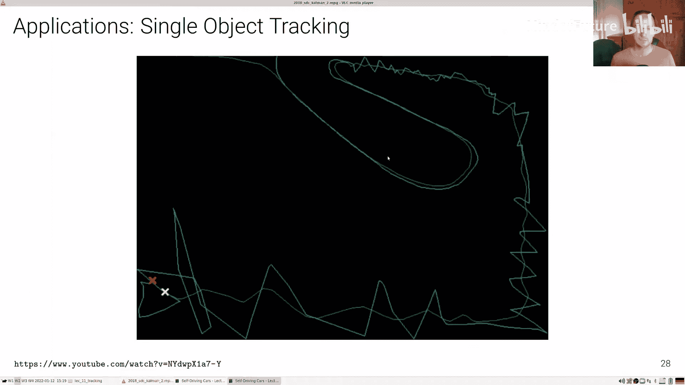
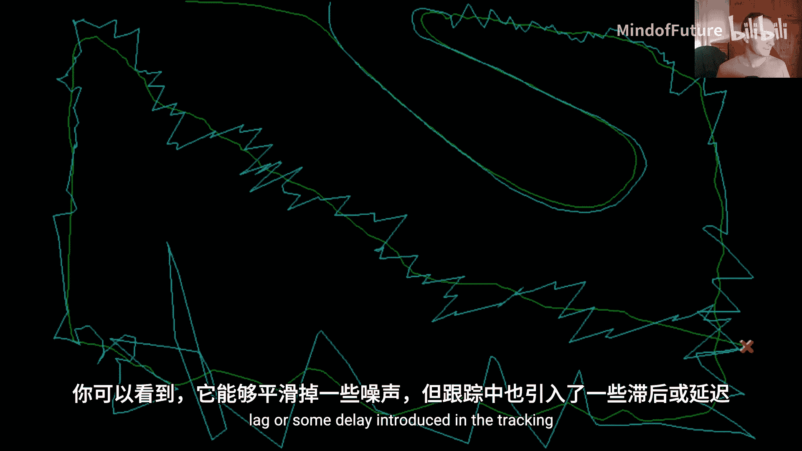
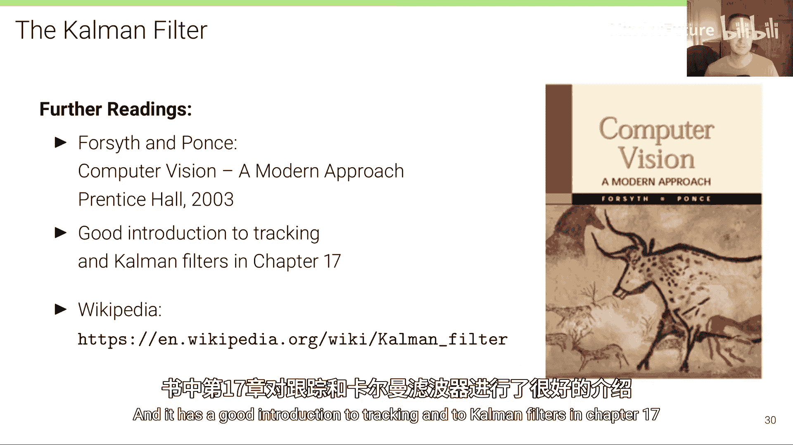

# 【图宾根大学】自动驾驶汽车课程 ML4340 p42 P42 Lecture 11.2 (Object Tracking - Filtering) -BV16FP2ePEYc_p42-

Let's now move on to the filtering or state estimation problem and let's start with a single object that we want to track before moving to multi object tracking in unit free。

Before we start， let's first understand better the difference between state and observation。

The hidden state are the parameters of interest， for example。

 the object location or velocity in 2D or in 3D， or maybe the joint angles of that human body， etc。

The observation in contrast is what we are able to directly observe， this is the measurement。Now。

 the hidden state and the observation are not necessarily the same。 First。

 the observation is typically a noisy version of the true state because our sensors suffer from noise。

 We can't exactly estimate the position。 The object detector result is noisy。

 and we have to accept that。And furthermore， not all。

Aspects of the state might be directly observable。 The state may only be partially observed。

 For example， we may be interested in tracking the velocity of that ball。

 but we are only able to observe the position of that ball。

And that's why the hidden state that we want to track over time。May not be the same。In most cases。

 is not the same as the observation。And that's the reason， of course。

 why we need filtering and state estimation。For now。

 let's assume that we have only a single object which we want to track。

 This is something well assume throughout this entire unit， too。

The moving object of interest is characterized by an underlying state。X， so x bold x。

 we denote here a vector。 This is a state vector。State X gives rise two measurements or observations。

 which we call Y。So for every state corresponding to every state， we have a measurement vector， y。

At each time t， the state changes to xt， changes from xt minus1 to xt。

And we receive a new observation at that time， which is called Y T。In other words。

 we are simply indexing the time dimension using the time index team。Now。

 given a sequence of observations， why？Which we summarize with this capital Y letter here。

 we aim to recover the state， which we summarize with the X letter。So， this is。

The observations across all time instances across all frames。

 and this is the states summarized into a set across all frames。And here at the bottom。

 you can see the graphical model for this process。Wch we'll talk about more in a few slides。

But you can already see that this is corresponding to what we want to solve。We have a。

A hidden sequence of。States。Here with the non filled circles。

 these are the variables that we want to estimate and that are unknown to us。And for example。

 the state at time T depends through some motion model。On this state of at time x at time t -1。

And the measurement that we observe， this is why this note here is。Highlighted in gray。

 this is an observation。Depends on the state at the corresponding time instance。

 so we have a measurement at time t that depends on the state at time t。

 and we have a measurement at time t 1 that depends on the state at time t -1。

 and then the state at time t depends on the state at time t -1 and of course that continues backwards and forwards in time。

 but for simplicity I have just drawn these two time instances here。Okay。Now， this is。

 how this is reflected in the simple  one， the example that we have already seen in this case the。

Measurement would correspond to the dash line。 This is what we called Y。

And the estimated state would be the green line。Now， in tracking。Were dealing with uncertainties。

 uncertainties in the state and in the detections。 and so therefore we often aim for a probabilistic estimate。

 not a point estimate。We want to track。Distributs over time。 for example。

 distributions about the object location over time。

And that's why we'll have a short probability theory recap now to refresh ourselves on probability very briefly only。

And to prepare us for the。So called base filter， which is the general framework that we consider here in this unit。

 and that heavily relies on the so called base formula。So here's the recap。嗯。In probability theory。

 we are considering random variables。 For example， discrete random variables that take values from a label set。

And in this case， the probability that x takes a value C is denoted as p of x equal to C。

And then we have continuous random variables and tracking the most frequently considered continuous state spaces。

 It's not always true。 There's also discrete versions of these filters， but。

In this unit we are considering mostly continuous variables， so that's what's relevant here。

And the probability that x takes a value in a is denoted。As such。In， in， in a subset of。

 of the domain。Now， the distribution over a random variable we write as p of x and a join distribution over two random variables we denote as P of x comma y。

 which is basically a shorthand notation of P of x equals C， etc。Okay。

There's two fundamental properties， two fundamental axioms in probability theory。

 the first is called the sum rule or marginal rule， and the second is called the product rule。

The marginal。Some rule tells us that P of x is equal to the joint distribution if we sum of all the state of y。

Or equivalently， for the continuous case， P of x equals the integral over y of P of x and y。

 the joint distribution。And the product rule is simply telling us that P of x and y。

 the joint distribution equals the conditional distribution P of x given y。Times P of y。

So assume that you have heard about this before。Based on the product rule， P of X。

 Y equals P of x given y times p of y， we have。The following relationships。 So， first of all。

 we have P of X， Y equals to P of x given y P of y。And then， of course。

 we can also reverse the order of these two random variables inside that probability。Distribution。

Which doesn't change anything。 But this means that we can write this conditional or this this product here also in terms of P of y given x。

 the conditional distribution of y given x。Note that here we have x given y， here we have y given x。

Times p of x。And if we now solve this expression in the middle here。

 this equation for P of x given y。 or in other words。

 if we take p of y and put it in the denominator here on the other side。

 then we obtain the famous base rule。P of x given y， the posterior equals P of y given x。

 the likelihood times P of x， the prior over P of y。Similarly。

We can consider the joint distribution of a free random variables P of X， Y C。And we can again。

 swap X and Y here。And we obtain this equation。And we can solve this equation for P of x， Y comma C。

 which is this expression here by putting this in the denominator and we get this expression。Now。

 if we look at this expression， we see that， well here we can replace these two through the product rule with P of x given C and P of C。

And here， in this case， P of y given c times P of c。

We have simply applied the product rule adhere to these two terms。And then we see that P ofC cancels。

And so， we obtain。P of y conditioned on X and C times P of x conditioned on C。

Over P of y conditioned on sea。Why did we do this？We do this because we now see that the rate base rule also applies。

When conditioning on another random variable C。 and this is colored here or highlighted here in red。

 So the only thing that has changed to this formula here is now that we have added an additional。

 additional condition that's the same in all of the terms on the left and the right hand side of this expression。

So we condition on any variable and base rule still applies。Now， we of course。

 did this for a reason we did this because this is a rule that we are going to need in order to derive the base filter。

So keep that in mind。Let's move on to the base filter， now。It's also called recursive Ba estimation。

In recursive patient estimation， we assume that we have only a single object which we want to check。

Further， assume that exactly one noisy observation is available per frame。

 so we don't have an association problem。We want to do probabilistic state inference。

That is we want to estimate distributions。And the recursion Bayesian estimation or base field approach is a probabilistic approach for estimating an unknown probability density function recursively over time using。

Incoming measurements， for example， the detected object locations that come from the object detector。

And a system process model， for example， a constant velocity motion model。

And it involves two alternating steps。 The first step is the prediction step。

Where we predict where the object should be in the next frame based on the previous state。

For example， if the previous state includes the position and the velocity。Based on this。

 we can predict the position in the next state。And it involves a second correction step where we correct the prediction based on the current observation。

The prediction doesn't yet know anything about the current observation。

 so we are integrating that current observation back into the prediction。

You can think of this as building a weighted sum between。

The prediction from the motion model and the actual observation。As a little remark。

 a good motion model is not only necessary here for making a good prediction that we can then easily correct。

But it's also important for association， obviously。

 because if we have a lot of detections and our predictions are very accurate。

 then it's very easy to find the correct detection that corresponds to each prediction in the next frame。

So while we are deriving the common filter here or the the base filter here first。

 the common filter is a special case， but if。As we are deriving the base filter here for a single object。

 of course， once we solve the association problem， we can apply this base filter for all objects that we have associated。

 right。So it， it doesn't mean。That this filter only works for a single object。

 but without association and considering only a single object， the problem becomes easier to look at。

Before defining the base filter formally， let's first look at the assumption。That we're making here。

 It's always important。To think about the assumptions that we are making for certain models that we' are looking at。

So general assumptions that we are making are that the camera is not moving instantly to a new viewpoint。

 It doesn't jump。 We're having some smoothness and that the objects don't disappear and reappear in different places in the scene。

And that there's a gradual change in the pose between the camera and the scene。

 What this means is effectively that things happen smoothly。 Things move smoothly。

And that's why we can exploit the models。The motion models， for example。

There's also certain assumptions on the motion and the observation model that we employ。For example。

 the base filter assumes that the state follows a markov process。

We are actually modeling a hidden Markov process， a hidden Markov model。A carmon filter。

 which is one of the simplest， continuous base filters and has a closed form solution。

Assumes further。A linear and gaussian motion and observation model that seems pretty restrictive。

 And indeed， for many applications， it's too restrictive。And therefore。

 more advanced models have been developed， such as the extended common filter。

Or the encented car filter or the particle filter， which are less restrictive。

Now let's start by defining the base filter formally。Let X T。

Deote the true hidden state of the system at time T。X T is a vector of real numbers of dimension M。

Let further Y T denote some noisy measurement of X T at time T。The base filter assumes that。

The state sequence is an unobserved mark of process and that the observations are the corresponding measurements。

Here you can see the so called graphical model again from the previous slide。

Where the state depends on the previous state， the state at the previous time。

And the observations depend on the state at the corresponding time。

But the state does not depend on the state， does not directly depend on the state。

At earlier time steps。And the observation does not depend on the state or observations at earlier time steps。

 This is the so called mark of property。 And that's why it's called a hidden markov model。

 We have a hidden layer here， which is the。The unknown states that we want to estimate。

And we are obeying the mark of property that I just mentioned。

This means that the probabilistic formulation of this model is very simple。

The joint distribution of all observations， all states and all observations across the entire sequence can be simply factorized into the prior distribution over the state at the beginning of the sequence。

Times。The product over the motion model that transitions from time T -1 to time T。

The product goes over all time steps。As well as the product。

Over the observation model at each of these time steps。

Right so if I am this is a directed graphical model， a Bayesian network。

 and this is the corresponding factorization of that Bayesian network。

The goal now is to perform inference， in other words。

 to estimate x from y in this hidden markov model。How do we do that？

For this recursive state estimation problem， we take advantage of base rule。More precisely。

 we take advantage of exactly the rule， this conditional rule that we just derived。

Let's consider the posterior。The posterior is the probability of X T， all of the states from time。

 no， sorry， The pro The posterior is the probability of state X T given。

All of the observations from time1 to time T。 This is what we want to estimate， right。

 This is the solution to the inference problem， if you will。This distribution because this tells us。

What is the probability of the state time T given all the previous observations and the observation at the current time。

Now we can reformulate this using this conditional form of the base rule。As such here。

 where we condition。On。Y 12 t -1。 So this notation here means I'm taking all the ys。

 This is the set of all the observations from 1 to t -1。 Its kind of matla notation。

And so this is the conditioning variable， which was read in the simple example before。

And then we have the base rule applied here， which is Yt given xt。Times p of xt over p of yt， right？

So this is just the formula from before form。Now， what we observe here is that in the denominator。

 we have a constant because x doesn't appear。 we don't have any random variable。

 These are just observations， so we can absorb this constant into the proportionality symbol here。

Which means that the posterior is proportional to。The observation distribution times the prediction。

This is the first term here。And this is the second term。

 And what you see is that this term is slightly different from this term here。 and why is that so。

 Well， that is because we have made use of the mark of properties that we have assumed。

 We know that the。Variable Y T conditioned on X T。In other words。

 this variable condition on this is independent of all the other previous variables。

 which means that this distribution is equal to the probability of Yt given xt。

 and that's simply the observation model。And then here we have the prediction on the right hand side。

 which is estimating the distribution。Of Xt， given all the previous measurements。

This predictive distribution。On the right can be further decomposed， as follows。

I colored the red here。To illustrate it better。 So this is the one that we want to decompose。

We're going to decompose it as follows。We're first going to consider this predictive distribution as。

The marginal distribution see we're marginalizing here because we have an integral over a random variable。

 the random variable x t minus1 that we have inserted on the left hand side before the conditioning simple here。

From the sum rule， these two expressions here are similar or are the same。

RightSo we haven't changed anything。 We have just marginalized x t minus-1 to yield the predictive distribution。

Now we can apply the product rule again。So we apply the product rule to factorize this distribution into p of xt。

 given x t minus1 and y1 to t minus1 times p of x t minus1 given y1 to t 1。And now again。

 we can make use of the mark of property。 We know that X T given xt minus1。嗯。

And y 1 t -1 is equal to x T given x t -1， because if I know x t -1。

If I want to estimate this predictive distribution here， and if I know x the distribution。

If I know x T -1。Then I don't need to know the previous variables here。In this directed graph。

So this is， again， the mark of property that we have exploited。

So this expression here simplifies to this one here， which， as we see now is simply emotion model。

 It tells us how the current state is distributed given the previous state。

 That's what we call the emotion model。And what we also see is that on the right hand side here appeared the previous posterior distribution。

This is exactly the same expression as we have started with here， except。

That the index T has been replaced with the index T -1。

So it's the posterior for the previous time step。And so now you can see how we end up with this two step procedure where we。

Alternate between prediction and correction。We obtain a recursive state estimation algorithm。

 The prediction step is。This second formula that we have just arrived。Whether he。

Derived the predictive distribution。And the correction step is then。Li。First equation here。

Where we get the posterior at time T from the observation and the prediction。

And so we are alternating these two at every frame with every new observation。

 we are first making a prediction about the state， and then we are integrating that observation in order to get the posterior。

 and then we start again in the next frame。So the filter runs online， we do one update per frame。

Now there are some special cases to this base filter。

 and the most prominent by far is the famous Kman filter。If。

The motion model and the observation model are both linear。And normally distributed。

 we obtain the Kman filter。And so in this case， we're tracking a Gaussian distribution。

 so we're tracking the parameters。Which are the mean vector and the covariance matrix。

The solution for the comm filter is given in closed form as the products and marginals are Gaussian。

So we have assumed that the motion model and the observation model are Gaussian。

And because in these equations here， we only marginalize， and we only compute products。We obtain。

AA Gausian as a result， and it also means that the maximum likelihood solution simply corresponds to a least square fit。

So I'm omitting the formulas here because they are slightly technical。

 but we obtain a closed form solution that's the key message here。So it's very simple。

 simple form less。 but， of course， it makes strong assumptions， it assumes。

The motion model and the observation model are linear and gasian。

The Car filter is the optimal filter in least square sense。But there is nonlinear extensions。

 as mentioned before， for example， the extended Car filter， EKF， or the unscentended Car filter， UF。

And multiple modes， which cannot be handled by the Kamon filter because we are tracking a unmodal Gaussian。

 can be handled by extensions such as the particle filter。

 which computes a sampling based approximation to the state posterior。

So if you expect to have a highly multimodal。Distribution that you want to track。 Then， of course。

 a common filter doesn't do the trick。 You need something more advanced like the particle filter。

 And more recently， learning based motion models， for example， are Ns。Have also been explored。

 so you can learn them jointly。Now， coming back to the common filter。Ting a Gaussian distribution。

 the states represented for a Gaussian distribution， heres a simple example。

We start with this distribution here。This is the distribution of， let's say。

 the location x of that object。The first thing we do is we apply a deterministic driftft。

 which is basically corresponding to the prediction。

And we have a stochastic diffusion because fruitous prediction will become more uncertain。

About the state。 So you see that the variance has increased。

But then we also integrate the new measurements， as you can see that now the variance decreases again and the distribution。

Get closer to the observation。 So we're averaging the effect of the prediction and the observation。

 if you will。Examples for。Motion models。For examples for for motion and observation models are for example。

 in the constant velocity case。A simple setting where a state vector。

Is the position and the velocity， So we have x T equals position at time T and velocity at time T。

And then we can write the motion equation。As xt equals。This matrix times xt minus1。

Which effectively means x T equals。P T -1 plus deelta t times the velocity at times t -1。Plus。

 so this is the deterministic part。 plus this stochastic part。 we have this epsilon here。

 which is sampled from a gausutian distribution with zero mean in this case and。A covariance matrix。

 Sigma M for motion。And similarly， we have an observation。Model， which is given here on the right。

 where in this case， we simply pick out the location from that state vector。 and this is our Y T。

 Corrup it again with some Gaussian noise。WellActually that should be non bold。

 this should be one dimensional in this case because we have one dimensional variable。

 I' will fix that。And similarly， we can define。A example， a 1D example with constant acceleration。

 where now the state vector includes position velocity and acceleration。And its you。

 the state transition happens with this。嗯。Free by free state transition matrix。And again， we have。

Gusian noise for both the state transition for the motion and also for the observation here。

 So these are two cases that can be solved optimally。Through the ka filter。

Because we have a linear model。For the motion model and for the observation model。

And both of them are Gaian。However， there is many cases where this doesn't work in the real world that are nonlinear and that require nonlinear models。

For example， here you can see an example where we have nonlinear dynamics。

The pedestrian is not walking linearly bouncing up and down and also this bouncing ball here。

 If you would use a， for example， a constant acceleration model， then at this point。

 we would predict。In the next frame， the prediction to be of this ball to be here。But actually。

 it bounces back。 And so the prediction would be too far from the true position to yield a meaningful correction in the correction step。

And it would strongly violate the。Linear model。Now， let's look at some results Here。

 We can see the result of tracking a dog。And what you can see is in the background。

 the white square corresponds to the detection， you can see that it's jumping around as it's noisy。

And the smooth version is the red box。That's the output of this Kman filterter here。

So this illustrates， again that the filter is filtering out the noise。

 That's where the name comes from。

And so here's another example。Where the tracker。Is following the observation here in the observation is in red。

 and the trekking result。 the estimate is in white。

 And you can see how it is able to smooth out some of the noise。 but there is also some。

Lck or some delay introduced in the trackingrek。

The common filter has been used in many applications。

 and one of the most famous ones is the moon landing。And there is an interesting quote。

 which I wanted to show you。In this publication here。

 engineers look to common filtering for guidance。The Carman filter was used， for example。

 in the Ranger， mariner and Apollo missions of the 1960s。

 in particular the onboard computer that guided the descent of the Apollo 11 lunar module to the moon had a Carman filter。

According to William Lear， an aerospace engineer， NASA contacted him about nine months before Apollo 11's scheduled launch because their Earth based tracking program wasn't working。

Leah wrote a 21 state kel filter program which went into the Doppler radar system。

 the final check of the program， Leah recalls。Was done the day before Armstrong。

 Aldin and Collins took off。So it's not just us that work close to the deadlines， I guess。

I hope that Armstrong， Aldrin and Collins。Didn't know about this。 Okay。

 so let's finish this unit with some pointers to further readings。

 if you're more interested into the technical details of the common filter， of course。

 Wikipedia as a great resource。 But there's also this book from Forif and Pos called Computer Viion a modern approach。

And it has a good introduction to tracking and to common filters in chapter 17。

