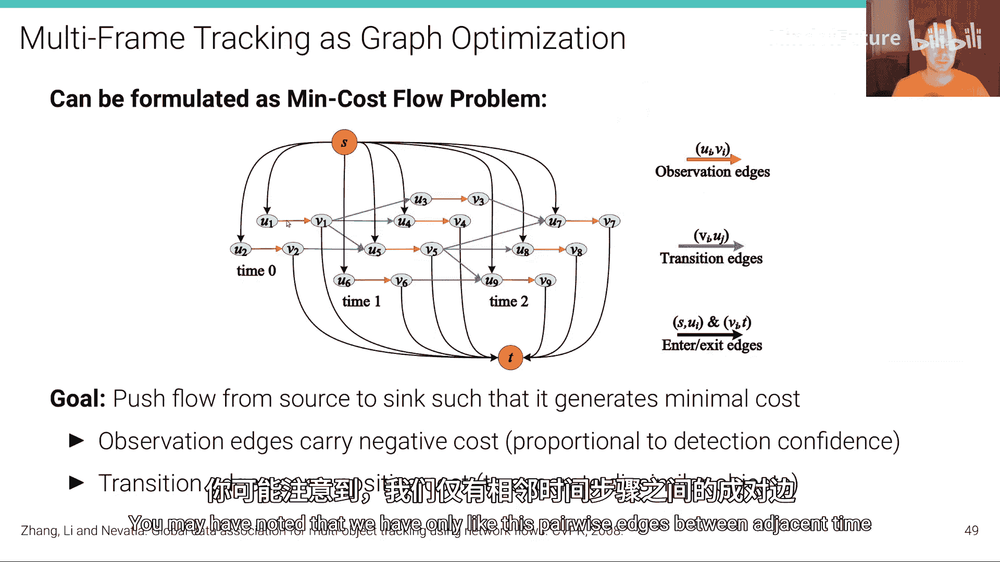
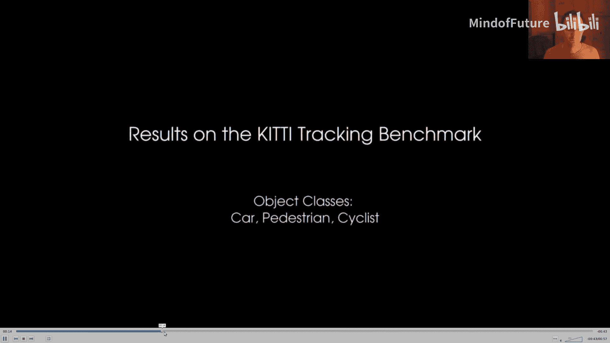

# 【图宾根大学】自动驾驶汽车课程 ML4340 p43 P43 Lecture 11.3 (Object Tracking - Association) -BV16FP2ePEYc_p43-

Let's now consider the associationation problem。So far。

 we considered a single object and one detection per frame。

Which we didn't have to associate because we assume that's the corresponding detection for that object。

 But in self driving， we typically have to track multiple objects at the same time。

And we have many detections in each frame。 So the question arises。

How can we associate these detections of a new frame to existing object tracks from previous frames。

The algorithm for multi object tracking can be in general outlined as follows。In a first step。

 we predict objects from previous frames into the current frame， maybe using the motion model。

And simultaneously， we also detect objects in the current image。Next。

 we associate detections to object tracks， and we initiate and delete tracks if necessary。

 For example， we might need to initiate a track if an object enters the scene。

And then we correct the predictions using the observations， for example， using a base filter。

As we' have discussed previously。Now， how can we measure？For the second step。

 for the association step， that observations in two consecutive frames belong together。

There's multiple things that we can look at， for example。

 we can predict the bounding box via emotion model and measure the overlap with respect to the detections。

Or we can compare hallock color histograms。Or perform normalized cross correlation between the patches。

We can also estimate optical flow and measure the agreement of that。

And compare relative location and size of the bonding box。

 assuming objects don't shrink or grow dramatically between two frames。

And we can compare the orientation of detected objects。For example， we could ask。

An object detector like Fast R inN to also output。The heading of the vehicle。That is being detected。

So this is an overview of some of these very simple association measures like colour histogram。

Bounding box overlap or orientation similarity team。However， we can do better。

And what we can do is we can use deep learning， in particular metric learning。

The idea here is to use convolutional networks to learn an object representation。

F theta of an image patch， I。Here ffita is the neural network with parameters Theta that takes the patch as input and computes a feature vector for that patch。

Now what is a good representation， a good representation maps images of the same object to similar features and images of different objects to different features。

So， for example， in this case， we have a patch that shows this object here。

 and we call this the anchor a。And we have a positive。

Because this is a patch from a different frame showing the same object。

 And we have this negative because this is a different object。

So what we want effectively is we want to learn a ranking。Weam。Feature vectors。Of the same object。

 A And P。Are closer together than feature vectors of different objects， in this case， A and N。

So we want this to be smaller than this。And we can do this using the so called。

And frequently used triplet loss。Which is effectively a hinge loss that builds upon this ranking here and tries to enforce at ranking in a soft way。

So the hichla is defined as the maximum of0 and this entire expression here。

Where the first part of this expression is simply this minus this。 So we're trying to。

Make like the what we just said the。Features of the same objects near close and features of different objects to be far apart。

And then in addition， we have this little margin term M here that ensures that the loss focuses on difficult cases。

What it does effectively is that in the cases where。

The positive is already much closer to the anchor than the negative。

 where this condition is already fulfilled。嗯。Sufficiently。

We don't create a loss or a gradient because we are clipping at0 in this case。

 and so we're making sure that everything that has been already correctly ranked is not considered in the loss function anymore。

 such that the loss can focus on the difficult cases， and that's really important。

It's instructive to actually draw this loss function yourself。

And see how it behaves to better understand it。 I， I could recommend that。

And then there's various techniques on how you can improve training of this triplet loss。

 for example， you typically what is done is using techniques called hard negative mining where not arbitrary patches are sampled in the image。

 but we sample patches that are likely to be hot， for example。

 the black black car is clearly different from the white car， but maybe there's more similar。

 but still different white cars that we want to separate。

 so we want to find those and present dose to the learning algorithm。And more recently。

 there has been a paper by the group of Laura Lealre called The Group Loss for Demetric Learning that also tackles the problem of efficient learning for this triplet loss。

Still， even having found a goods。Association measure。Or learned a good feature representation。

 there is ambiguities and to illustrate difficulties in finding the correct association。

 which is the focus of this unit。I want to show you some of the。Abiguities that are present。

For example， predictions may not be supported by measurements。

And the question in this case is have objects ceased to exist or are they occluded or detection simply fail。

 Here's an example， we have a trajectory， this is the prediction。

 but there is no observation and the question is what happened。Similarly。

 there may be unexpected measurements。Here we have the prediction。None of the detections is close。

 So what should we do， Are these newly visible objects or just detectize。

Should we instantiate new object tracks？More than another cases is that more than one measurement may match a particular prediction。

So here we have this trajectory with the prediction and both of these measurements are actually feasible。

Close to that prediction。 So which of this measurement is correct。And what about the others。

And further， another case that could occur is that。A measurement may match multiple predictions。

So we have two tracks here， and this blue measurement is actually good for both。

 So which object shall the measurement be assigned to。The simplest thing。

That we can do to solve this problem is called nearest Neigh Association。

In nearest neighbor association， we first of all， restrict the measurements to a certain so called gating area around the prediction。

 We say， well， if this is the prediction， then we want to only consider object detections that are nearby because things that are very far we believe are unlikely to correspond to that track。

In green is the gating area here。So all of the detections that are outside of the gating hour have been masked now。

And then we can associate a detection。From the set of detections， calligraphic Y。At time T。

That is closest to the prediction， so for example in this case this would be this detection here。

Mathematicically leaders can be formulated as the argument over all YT。

Minimizing the L2 distance between Y T and Xt。Or alternatively， can be written like this。

Better even is if we have a motion model like， for example， in the common filter。

 we have a Gaussian prediction model， remember。So if you have a Gausian prediction model。

As an example， then we can consider the detection that is most likely under that prediction model。

The one that maximizes the likelihood。Under that prediction model。And this corresponds。嗯。

To the so called Mahaanobis distance。Which is basically the what is in the exponential of the Gausian distribution here with the。

Covariance matrix in the middle。So instead of just taking the closest prediction in L2 sense。

 we can now take the closest prediction in terms of this ellipssooidal non isometric distance。

Based on this covariance matrix。And the nice thing about this Mahalaobs distance is that it can also be used to define the gating area。

 of course， right， so we can use that We can threshold the Mahallaobs distance that's given to us through the prediction model。

Because this is something we have estimated through the Kman filter。

We can use that to threshold the gating area。Now， what's the problem of the simple approach？

 Let's consider a very simple example of two objects， blue and red。That move like this。Of course。

 we don't know that the blue object is the blue object and the red object is the red object。

 So there's like， we can associate this object with this one or this object with this one and。

Vice versa here。Now let the numbers here represent association scores where higher scores means they are more likely to be the same。

 So for example， in terms of distance of following the motion model。

 they are you know these two are more likely to be associated than these two because。They are。

 you know， this one is further apart from the prediction of this object track than this one。

So in this particular case， it's clear that these two should be associated and these two should be associated。

 that's something that nearest Neighb Association would do for us。

But let's consider a more tricky situation now， where we go one step further， one frame further。Now。

 in this case， it's much more ambiguous。For example， considering the location。

 the predicted location as。A similarity measure。And choosing the nearest neighbor here would fail。

 For example， for the red object， we would choose the blue prediction， which has a higher。

Similarity score than the red one。And so in this case。

 we would even consider this detection twice once for the blue track and once for the red track。

And in practice， the situation may be much more severe， much more difficult。

 There is much more detections。 Des are noisy。And the question is when to continue start or kill track。

I hope this illustrates that a simple， nearest neighbor approach is in general， not a good idea。

So how can we go beyond that， And the answer to this is。Bpartite graph matching。

We' are effectively exploiting tools from the graphph theory community in order to help us here。

Given a bipartid graph as illustrated here， a matching is a subset of the edges for which every vertex belongs to exactly one of the edges。

Now let's first digest this sentence。This is a bipartite graph， why？

It's a graph that comprises nodes。And edges。And the edges are only between nodes of different sets。

 We have one set here。Frame T and one set here， frame T plus one。

 And there's only edges between the sets and not within the sets。

 And that's why it's called it bipartite graph。Now， in this particular bipartid graph。

 a matching is one that is a subset of all of these edges。

 for which every vertex belongs to exactly one of the edges。For example。

 a matching is the one that's highlighted here in red。For this matching， for this selection of edges。

For this subset of edges。There's only。Every vertex belongs to exactly one of the edges only。

Now you see already where this is going， probably， right？

Frame to frame tracking can therefore be formulated as bipartheid graph matching。Which。

As by definition of this problem chooses at most one match in each row and column of such a similarity matrix。

While maximizing the score。So here we have exactly the same situation now we have three objects。

These are the tracks。 Here we have the detections in the next frame。

And these are the similarities scores。And， of course。

 we wna associate every of these object tracks to only one detection and vice versa。 In other words。

 there should be only one。嗯。Association made per row and per column as in this example here。And the。

Solution that's highlighted here and right is the one that maximizes the total score。

 and that's what we want to do。 We want to maximize the sum of these numbers。

For such a bipartite graph matching， for example， if we would choose the diagonal。

 which would also be a valid match， we would have a smaller sum than for this particular configuration for this particular association here。

And this particular association actually corresponds to the。

Matching that's illustrated here on the left。The first object is associated with the second detection。

The second object here is associated with the detection， and so forth。So you can see now how this。嗯。

Association problem in trackingrek。Boils down to a bipartite graph matching problem。

Now the question is， of course， how can we solve this bipartite graph matching problem？

And that's what we're going to discuss now。Let's first formally define it。

 Asum N detections in the previous and M detections in the current frame。

 We can then construct a M by N table of matching scores。Before we had a table of three by three。

 now we have a table of five by5。5ive object tracks。5 detections in the current frame。

And the task is to choose a one by one matching that maximizes the sum of scores。

So what is the optimal one by one matching If you look at this table。It's not so obvious， right？

I think you would need to try a little bit and play with these numbers subject to the constraints that we have in order to find the optimal matching even though it's a very simple case。

So let's more formally define the biparttter graph matching problem now。

Given an M by n matrix of association score is S determine a binary M times n matrix C that maximizes the total score。

 So we want to find the arg max。After some over all rows and columns。

Of the elements of these two matrices multiplied together。Subject2。

 to constraint that in each row and in each column of this binary matrix C。

 there is exactly one element，1， and all the others are 0。

And also subject to the constraint that the elements of the binary matrix are actually binary。

This is an interteline programme， or ILP， in short。Which in general is NP hard。

 but luckily in this particular case， it's not。 there is polynomial time algorithms for solving it。

And these constraints here ensure that we can only choose one number from each row and from each column。

 so we want to find a one to one matching。 That's what we discussed here， right so。

We don't want to match this to2。This trackrek to two detections， but just to one。1。

 don't wna match this detection to two tracks， but just to one。Okay。So this is just the definition。

 the setting， the problem setting。The question is， of course， how to solve it。First of all。

 how many different assignments are possible？Well， there is n factorial possible assignments。

 So in the case of 5 by 5， we have。5 factorial， which is 120。For the first object track。

 we can choose 5 object detections。 Once we have made that choice。

 we can choose amongst four remaining ones。 and then for the third one， amongst three and so one。

So 120 is already lot， but in practice we often have to deal with much more detections。

 and so exhaustive search really becomes intractable。

So we need something better than just brute force searching through all of these assignments that are。

Feaible。And the simplest one， the simplest algorithm is called a greedy algorithm。

And it's very simple。 We start with an unmarked matrix。 And then for I equal to one to n。

 we mark the largest value that isn't in a row or column with already marked entries。And that's it。

So let's look at an example。We take this matrix of similarities scores and we find the maximal value in there because we believe that's a good matching。

That's a good association。 So we associate the up track1， V detection 1 in frame。Tim。

And then because we don't want to select any of the elements from that corresponding row and column。

 we strike these out。Now we find the second one， which in this case is 0。94。 we mark that one。

And we removed the row and the column， respectively。

So you can implement this simply by manipulating a matrix it's really easy。And then we。

We find the third match and remove rows and columns， the fourth one。And then this one here remains。

 and this is the greedy solution。And the greedy solution is often O。

 greedy matching is easy to implement， quick to run and finds good solutions。 In this case。

 the ovalult score obtained is 3。77。However。Greedy matching often doesn't yield the optimal solution。

 In this particular case， there's quite some margin。To the optimal solution， which is 4。

26 and illustrated here。This is the optimal solution to this particular instantiation of the problem。

How can we find the optimal solution， As mentioned before， there is luckily algorithms in the graph。

Community。That can solve this for us。Optimally， in polynomial time。

The one of the earliest methods is called the Hungarian method。And he has quadratic complexity。

And a little bit later， Fat Falerson proposed an algorithm of only。ACubic。Time complexity。

And so these algorithms can deliver solutions fast， and that's why they are frequently used。

For frame to frame， trek out bipartite matching。Now。

 we are not going to go into the details of these algorithms。

 They are quite technical and require some knowledge。嗯。From graph theory。

 but I pointed out to you the original paper from Kun called the Hungarian methodod for the assignment problem。

Now， one thing we didn't discuss， right， we assume there is five objects。Tracks and five detections。

 But， of course， typically there will be a different number of tracks and observations。

 and also object tracks may end。There may be not a detection or a start。

 There may not be an existing track too much against。And such an example is shown here。

This is the optimal solution for this particular。Situation where we have four tracks and four detections。

And you can see that for track1 and detection 1， we have a pretty high similarity and also for。

Track 2 and track 4。But for track free， none of the objects is really。

A plausible detection for that object。 yet， of course， our。

Solution to that original problem that we formulated here doesn't care about this。

It just maximizes the score， and so it associates this as the final。嗯。Association here。

This value here， because it adds the ovals， it adds 0。06 to the ovals gone。Now。

 this is not what we want because in this case， it's actually very likely that。😊。

Trek object detection free is not the detection that corresponds to tech free。

 but the rubber track fee probably has ended。And maybe object detection free is starting a new track。

So what what can we do in this case， And there's a simple trick here。

 And the trick is to use exactly the same algorithm as before and the same formulation。

 but to introduce extra nodes that absorb these matches。With a value threshold， in this case。

0 point free。What happens now is that for object track free， we are associating this extra node。

 not this object detection free with a very low score， but we are associating this extra node。

Which means for our solution that the object track free has actually stopped。

 We have associated it into this absorption note， and we can solve this problem with the augmented matrix exactly the same way as before with the Hungarian method。

 for example。And it allows us to end object tracks or to start new object tracks。

Now this was all about frame to frame matching， biparttheite matching is only able to match detections to like in the current frame。

 to object tracks in the previous frame or to detections in the previous frame or to predictions of tracks into the current frame。

But this is not necessarily optimon。So we have seen how we can solve the association problem for two frames。

It's not necessarily optimal for longer sequences。 In particular。

 wrong associations cannot be undone at later frames。 We might commit to something。That's actually。

 it's going to turn out later on， it's not the right thing to do。

So let's now look at the multi frame case， and the setting is tracking by detection as before。

And the goal is to solve for all associations across all frames of a sequence。 And， of course。

 this is， again， the batch mode that in in first place is not interesting for self driving。

 but there is online versions of this algorithm as well。

The seminal idea that was presented in this paper from Shanggial。

 called Global Data Association for Multi Object Tra using network flows is to cast the problem as a mean cost flow network problem。

 So to， again。Like just phrase the problem。Such that it can be applied to existing algorithms in the graph community。

And this is the way they formulated the problem。The idea is to have each detection create two notes。

In the gruff。So， this is。One detection at time0， and this is another detection at time 0 and so on。

And then to connect these two nodes of a detection with an edge that carries a negative cost proportional to the detection confidence。

In addition， we associate these detections to detections in the next frame。

And we associate the first we， we connect the first node of a detection to the source of that graph S and the second to the sink。

And what we are then going to do is we are going to try to push so called flow from the source to the sink such that the。

Along the edges overall is minimized。 and that's why it's called a Min cost flow problem。

And in this case， the observations they carry negative costs。

 so the flow is encouraged to pass through the highly confident observations。

And the transition edges carry positive costs to separate costs to separate dissimilar objects。

And if an edge carries a small positive cost， then it's likely to be traversed because there's maybe another detection coming afterwards that has a negative cost that we want to。

 you know， push the flow through。And as as you may note， by this formulation。

 we can now handle multiple frames shown our three frames hereby can handle much larger sequences。

And we can automatically determine when a track starts and ends。

 because it starts where we have a flow that goes from S to the first detection。

 and it ends where maybe here the second note of of the last detection has a flow to the sink。

Because there is constraints that the flow can always be a 0 and 1。 And if。

 if there is an outgoing flow from that node to this to the sink。

 then there can be no flow to any other nodes。So I'm not going to go very much into detail。

 This is just very generically the formulation of this problem。

 We have the binary flow variables F that can be 0 or1。And there is these costs at each edge。

 So there's a flow variable and a cost variable at each edge。And there is entry costs。

 cost for starting a track。 There's exit costs cost for。Ending a track。

 And there is link costs and detection costs。Detection costs are those。

 These are the negative ones and the link costs are these， which are the positive ones。

And in addition， we have these constraints here， which are the flow conservation constraints。

 which ensure that there is no overlap or overlapping object trajectories。

 This is what I just mentioned。If there is a flow， like the flow that's entering。

So the flow that's entering to a node that can be 0 or1。Plus。

 all the flow that's coming in from previous notes。

Must be the same as the flow that's going through that detection。嗯。

And that must be the same as the flow that that exits from here and the flow that leaves that node。

Towards detections in the next frame。Rightright， so this is the high level intuition。

Of this formulation。The optimal solution of this problem can also be found in polynomial time through an algorithm that's called the successive shortest path algorithm。

Actually， in the original work， Shanghaal didn't use that algorithm。

 but in later works it has been found to be the fastest algorithm for this problem。However。

 we are only able to model pairwise relationships with this algorithm。

You may have noted that we have only like this pairwise edges between adjacent time steps。

 so we can not model any occlusions， or we have to link。

Detections across multiple frames， which becomes computationally expensive。

 and we can only use very simplistic motion models like。

The object is not moving far as like constant located， constant position model。

So these are the disadvantages of this first formulation。

 and another disadvantage that it it has to process in batches。

 but there is online versions that have been proposed。 For example， the one here by Ledel。

So here's an example of what this looks like。

So here you can see the tracking result。The boxes are flickering because we haven't like this is results that have been obtained just through association of raw detections。

 and there hasn't been any filtering applied to these detections。 So that's why they look。嗯。

flickickering。Now， let's。In the end of this unit， look at two advanced more advanced graph based models and also at evaluation of multi object tracking。

So one advanced model has been proposed at Ira，2018。Is training， detection and tracking jointly。

 which is， of course， the good idea， right in the previous model in this flow model here。

 we are typically training first， like we're doing metric learning and we're training the object detectors independently of solving this optimization problem。

 but ideally， you train everything jointly and to end。 And that has been。

Demonstrated to be actually possible in this paper。 I like this paper， quite a lot。

By back propagating through a linear program that solves this task。

 this mean cost flow problem can be solved also by a linear program so they show that you can back propagate through this linear program。

 consider this as a layer in a neural network and so you can back propagate through the detection network as well to update the parameters and end。

And another more recent idea that has achieved state of the art results is actually much simpler。😊。

It's realizing that basically we have a graph based problem here。 And if you have attended。

My computer vision lecture， you have seen that there has been great advances in。

Graph neural networks in the last decade。And so of course， it's natural to ask。

 can we just directly solve this problem using graph neural networks， and it works quite well。So。

 in this case。The input is encoded using convolutional neural networks into features。嗯。

And then his feature encodings are processed with a neural message passing on that graph。And deep。

Problem that's formulated is a simple edge classification problem where edges that are associated to the same track are classified positively。

So very simple。Straightfor to implement with today's frameworks。And easy to train。

 because it's all end to end。Differentfferiable。Now， finally。

 let's talk about how we can evaluate multi object tracking。

And the first step that we have to do when we evaluate multi object tracking is to associate predictions with ground roof tracks。

And that's done similarly to evaluating object detectors using Bpartch graph matching。

So here are four different examples at the bottom you can see the different time steps。

And if we look， for example， at the first situation。We have the ground troy and dashed lines。

And then we have two predictions， red and blue。And we have associated them using bipartttergraph matching。

 So the red one has been associated such that， well。

 these free notes are associated to these ground truth node here。

 and the blue one such that these two blue nodes are associated here。嗯。

But these notes are not associated because they are ever too far from the ground truth。

Indicated here by this grey corridor， or because， like the ever node was a better match。And so if。

 if like a circle is non filled and coloured， it's a false positive。 It's a false。

 positive detection。And if a note is。A node of the ground truth is not filled。

 It's a false negative because it hasn't been detected by any of these。

Tracklets that have been predicted。 Dis tracks， dis trajectories。Yeah。

 and so these are different situations for different。Ground truth and object track predictions。

So the first step is to associate。Predictions using in。Some graph matching technique。

 And that's also the algorithm that's running on the server， for example。

 on on the mod challenge server or on the Kidie evaluation server for evaluation。And then by far。

 the most prominent and oldest metric to evaluate tracking， which is not an easy task is called Mo。

 which is called multiple object tracking accuracyium。And what it does is it produces a number。

That's  one minus this expression here， where T is。

The index over the time dimension over all the frames。

And we're counting the false negatives and the false positives and the I D switches。

 and I D switches if。A gr of trajectory is tracked by one object， and then suddenly by another one。

 So we are switching effectively， the I D。 We are not recovering that this is one single identity。

 but we are finding two different tracks。So these are all things that we don't want。

 So we're counting them as。Eors。 And we are dividing this with respect to the total number of detections。

 which is G T at time T。So a very simple measure， but it has also many flaws。

And a more recent measure that avoids some of these problems is called hota。

 and it's also implemented in the state of the art evaluation frameworks。

 a higher auto metric for evaluating multi object tracking。

That works quite differently from this one here。

So state of the art algorithms are evaluated on benchmarks， well。

Participants can submit their results on held out test data。

They get their evaluation results and get ranked and one of these benchmarks in the self driving domain is called the Kity benchmark。

 and it has also amongst other benchmarks， for example， for stereo and flow， Sc flow or oometry。

Or object detection， it has a benchmark for object tracking。 And so if you're curious。

 you can look at the leader board， which is linked here。

