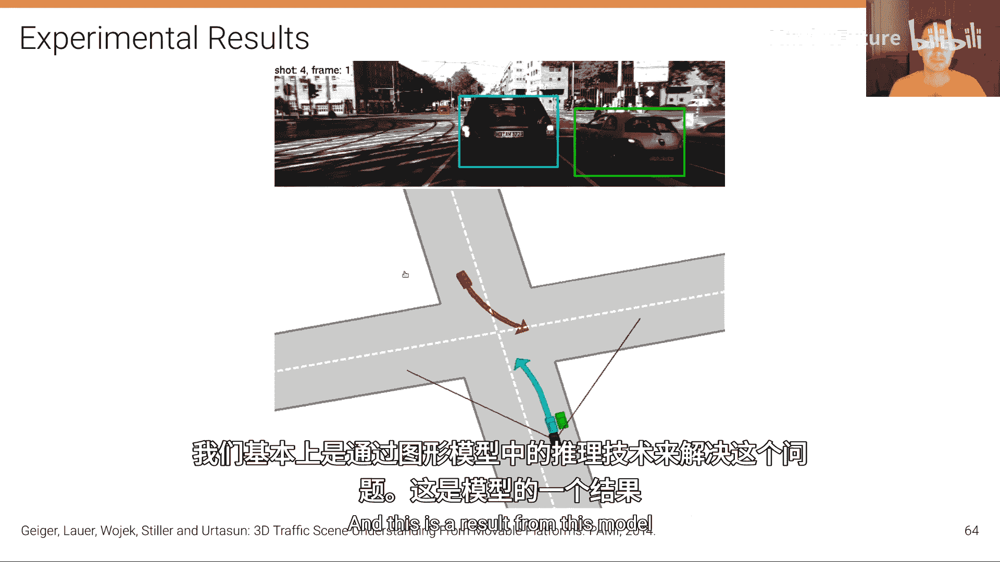
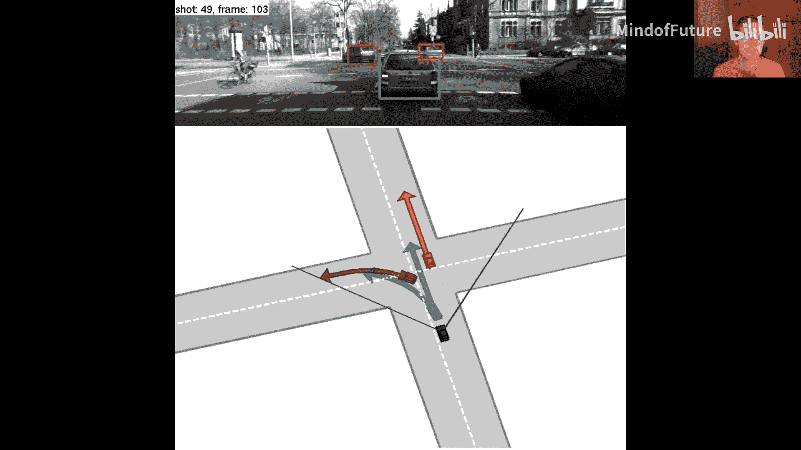
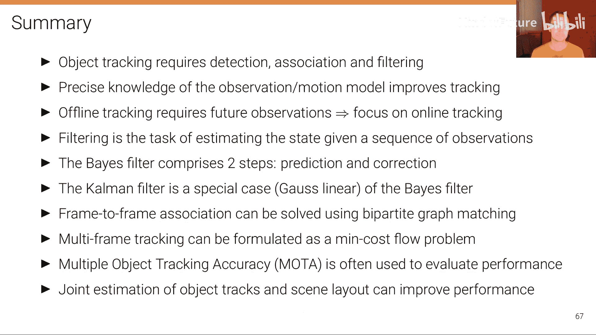

# 【图宾根大学】自动驾驶汽车课程 ML4340 p44 P44 Lecture 11.4 (Object Tracking - Holistic Scene Understanding) -BV16FP2ePEYc_p44-

Finally， in this small final unit of this lecture， I want to demonstrate to you。How tracking can be。

Incorporated in the wider context of。Tasks that have to be solved in self driving perception systems。

 and that's why I called it holistic scene understanding。

To motivate this a little bit。In order to understand。

Traffic scenes is not sufficient to just detect lanes， maybe it's sufficient to detect lanes。

For such highway situations here， where your main task is to do lane keeping。

But if you want to understand a complicated intersection from a lane detector's perspective。

 as illustrated here。That's really impossible。 So you need to。嗯。

Fuse all kinds of cues in order to obtain a complete and holistic understanding。

 such as where the vehicles， where they going。 Of course。

 also where the lanes and the road where the buildings， Where the sky where the vanishing points。

 only if you consider all of these， then you get a holistic understanding of the scene。

 So  fusing multiple queuees leads to more robust estimates and in the work I'm going show you。

 we try to fuse。Information from all of these aspects of the scene and trekking is one of them。

So first， let's， because I'm not going going go into much of the technical details of this work。

 I'm going to show you first a simple example of sensor of fusion with just two measurements。

 Suppose we are given an object detection by two sensors。 let's say camera and Liar。

And let X denote the unknown object location。And let C 1 and C 2 be noisy measurements of the camera and Liar。

 the posterior probability distribution over the object location。Can be computed using base law。

 So P of x given C1 and C 2 these 2。Noisy measurements。

Can be written as P of C1 and C2 given x times P of x over。P C1 and C2。

And this is proportional to P of c1 given x and P of c2 given x and P of x。

If we assume that these two measurements are independent， which often is also not the case。

But this is a way of formulating sense of fusion。 So further assuming a uniform。

An informativeative prior， we obtain。There's expression here because this term here。嗯。

Is dropped if we don't know anything about。The prior de locationation of the object a priorri。

So this is a simple way of fusing information from either different sensors or from different detectors from the same sensor。

 and that's what we're trying to do here now to integrate information from all aspects of the scene。

So the goal is to infer from a short stereo video sequence in this project that。

Wecaled 3D traffic scene understanding from movable platforms。

So we want to infer from short stereo video sequences， so no maps， no lightar here。

The topology and geometry of the scene， semantic information such as the traffic situation。

 the traffic pattern that's currently occurring。 What's the state of the traffic lights Without observing the traffic lights。

 we can figure it out because we see how things are moving。

And generate a probabilistic gene model of urban scenes fusing many different cues。

 And the advantage of this is。That we exploit a lot of we can exploit a lot of prior knowledge。

 We know that intersections typically have a certain geometry。 and therefore it's。

 it's much more likely that objects。Follow certain trajectories。

 And we know for this particular sequence here that this has been captured in Europe。

 So it's right handed traffic and so forth。And so we are we're going to formulate this in a complex probabilistic graphical model。

 which is illustrated here at the high level。So this is a Bayesian network that you can see here。

 and it comprises observations of the scene flow and the occupancy and some semantic labels and vanishing points。

 but also it comprises these tracklets here， which is kind of a hidden mark of model inside that big Bayesian network where we're trying to predict the state of each individual vehicle with respect to the jointly inferred situation to scene。

Right。And so we are， we are basically solving this using inference techniques in graphical models。

 and this is。A result from this model。

You can see the input sequence here。 This is just a monocular sequence。 And at the bottom。

 you can see the situation that is inferred。You can see how likely it is that certain objects move in certain directions。

And you can see how this relates to the overall traffic situation。

 And this is really a challenging problem， because we're just having this。Moonnocular。

Image sequence here and measuring distances is really hard。

 but by observing that vehicles move from left to right to right to left and by putting them into context with a certain traffic situationition。

 we can narrow down this uncertainty。

So this is team。Advantage of holistic modelling。Another way of integrating additional information into the tracking problem is to use maps。

 as has been done in P&P net perception and prediction with tracking in the loop at CVPR 2020。

And the idea here is to use HD maps in combination with LiDar to support the object detector and the tracker and to do joint perception tracking and motion forecasting。

As our trajectory estimation。Of course， once you have tracked objects then and you have a good motion model then becomes much easier for you to forecast the motion of an object into the future。

 and that's directly relevant to the behavior modeling stage that follows the prediction stage。

And the planner stage that has to execute the behaviour plans that have been determined。

And then finally， I want to show you Agoverse， which is a recent data set for 3D tracking and forecasting maps。

We introduce the data set for 3D tracking and forecasting with rich maps。

 and rich maps means HD maps。That is publicly released for autonomous driving。

 and the dataset set contains sequences of Liar measurements。And IGB V。

As well as accurate localization。 So this is a data set that nowadays is frequently used for。

Evaluating tracking and emotion prediction， motion forecasting techniques。

Heres the link to the website with leaderboard and more。That's all for today。In summary。

 we've seen that object tracking requires detection， association and filtering。

And that precise knowledge of the observation。Model or the motion model can improve tracking。Right。

 if we have a motion model like we， we have a constant velocity motion model。

 and that's actually a motion model that's suitable for the observations that we make。 then。

 of course， we can make very precise predictions with that。

Offline tracking requires future observations， so the focus in self driving is， of course。

 on online tracking。Filtering is the task of estimating the state given a sequence of observations。

 and the base filter comprises two steps， prediction and correction。

The Kman filter is a special case。 a gauze linear case of the base filter with a closed form solution。

And frame to frame association can be solved using biparttheid graph matching。

While multi frame tracking can be formulated as a mean cost flow problem。

Multi object tracking accuracy or short motor is often used to evaluate performance and joint estimation of object tracks and scene layout。

Can help robustify things and improve performance。

