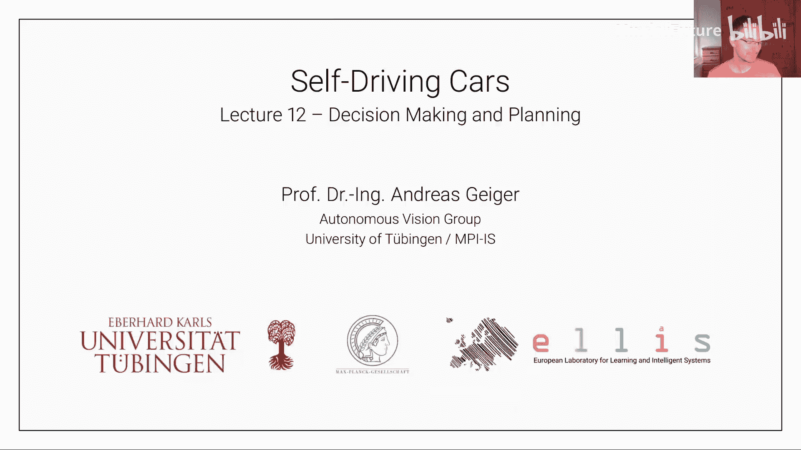
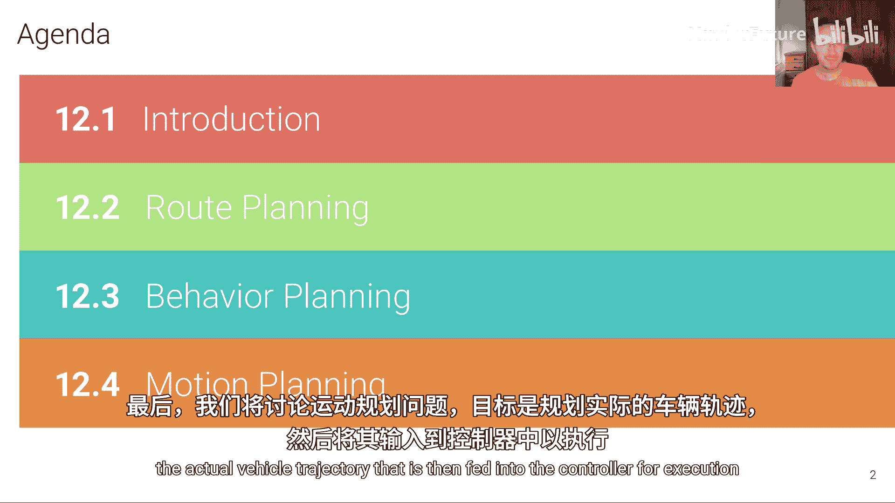
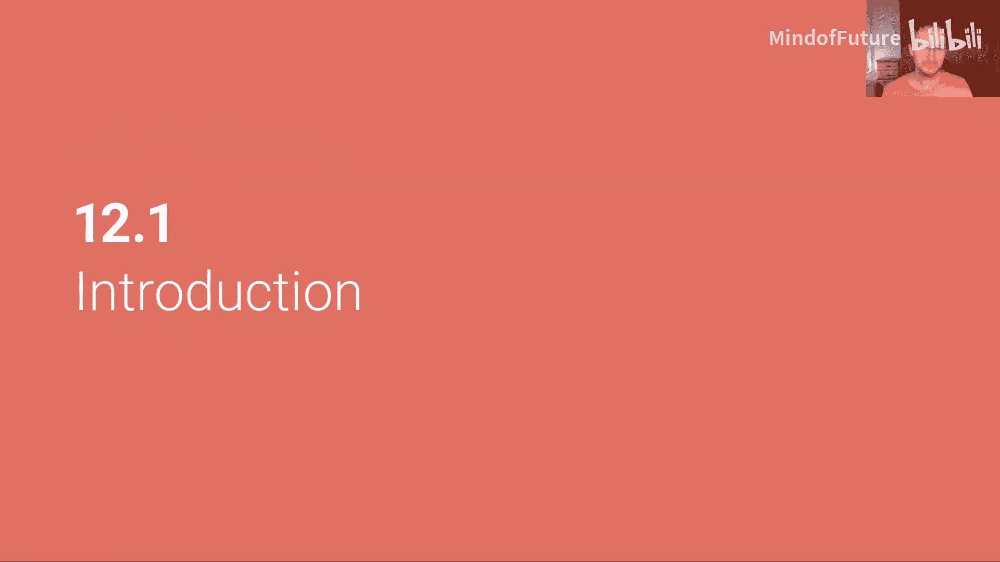
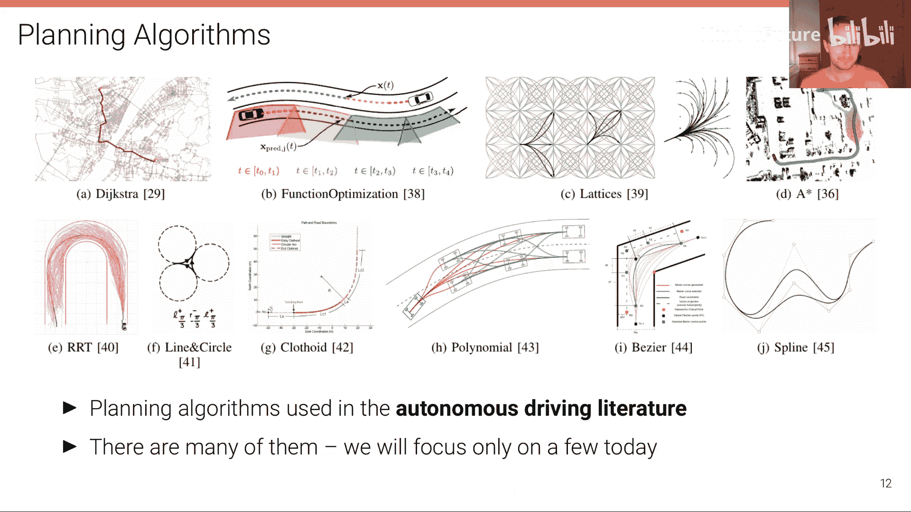
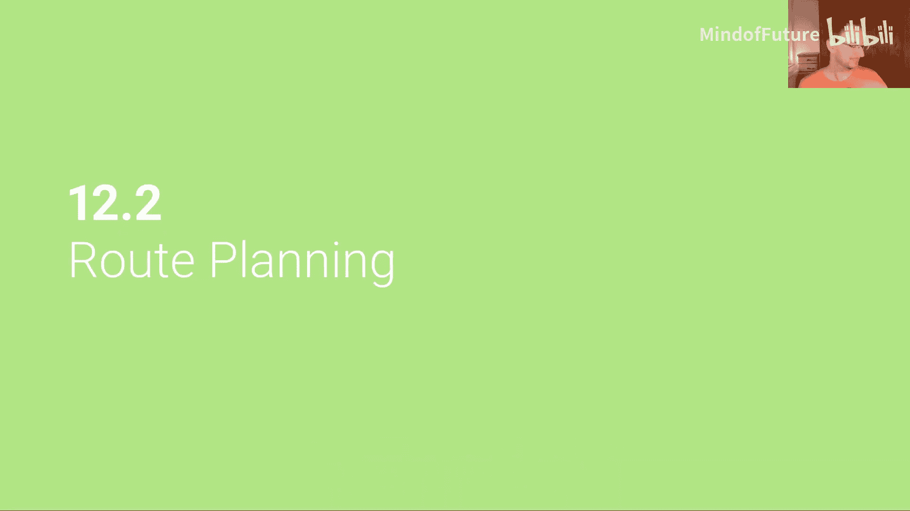

# 【图宾根大学】自动驾驶汽车课程 ML4340 p45 P45 Lecture 12.1 (Decision Making and Planning - Introduction) -BV16FP2ePEYc_p45-

Hi and welcome to Self driving Car lecture number 12 on decision making and planning。

This is the last lecture of this course。And I want to thank you for staying with us for all these 12 lectures。

And today， we're going to discuss the last piece of the self driving。

 the modeler self driving pipeline， which is the decision making and planning component。

This lecture is structured into four units。 First， we will。Introduce the。

Decision making and planning stage and where it is located in the self driving pipeline。

And then we will look at free planning problems。We will look at the route planning problem。

This is the most high level。Problem of these free planning problems。

Where the goal is to find a route like a GPS navigation system finds a route in a city from A to B。

Then in unit number three， we'll look at the behavior planning problem。Why we decompose the。

Different situations that a self driving vehicle might be in。

Into typically a graph based representation。And then finally。

 well look at the motion planning problem。 where the goal is to。Plan the actual vehicle trajectory。

That is then fed into the。

Controller for execution。

So let's start with the introduction。This is a slide that we have seen before。

 This is the slide of the very simplistic， simplified model up pipeline where we have discussed at a very abstract level for different modules。

 the low level perception。The same passing module， the path planning module and the vehicle control module。

In lecture number 5 and 6， we have discussed the vehicle control part in lectures 5 to 11。

 We have discussed the lower level perception and seen passing part。 And now we're going to discuss。

The connection from the perception。To the control， which is the decision making and path planning stage here。

Let's first define the problem。The goal of the decision making and Pla planning stage is to find and follow a path from the current location of the vehicle to the destination。

And of course， while doing so， we want to take the static infrastructure。

And dynamic objects around us into account。The inputs。

To the decision making and path planning stage is the vehicle and environment state as perceived。

Through our perception stack。And the output is the power for trajectory as input to the vehicle controller。

However， as it turns out， driving situations and behaviors can be very complex。

 and therefore it's difficult to model the entire problem of decision making and planning as a single optimization problem。

And so what we typically do instead is we decompose this complex task into a hierarchy of。

Simpler sub problems。But let's first have a look at a few examples of such situations that motivate the need for decomposing this problem into sub problemsblem。

So here's an intersection。What states can a vehicle be in， What situations can a vehicle encounter。

So let's suppose this is the vehicle that we consider。Wen。

Situation the vehicle could be in is just a simple speed tracking task where it tries to follow the lane at a set target speed of 30 miles。

 say。Another situation might be one where it is it has to stop。

 it needs to decelerate in order to come to stop because it arrives at an intersection， right？

There could also be traffic lights at that intersection， and the traffic lights could be red。

 So in that case。The vehicle needs to stay stopped。

And observe the traffic light in order to determine when it may be allowed to start driving again。

And then finally， once the traffic light turns green， it starts driving。

It could also be that there is no traffic lights， but there is just a yield sign at this intersection。

So the vehicle needs to observe the vehicle vehicles and other traffic participants。Surrounding it。

 and yield to。The oncoming traffic。It could also happen that there is an obstacle in front of the vehicle or an emergency situation arises。

 and so the vehicle needs to come to a full stop as quickly as possible。

This is just a small set of all the possible situations that a vehicle could be in。

 and there might be many， many more。And so therefore the idea。

Is to not model the entire block of decision making and planning as a single one。

 but instead to break this planning problem down into a hierarchy of simpler problems as illustrated here。

Where each problem is tailored to its scope and level of abstraction。

And earlier in this hierarchy here on the left， this means we are at a higher level of abstraction。

For example， in this route planning stage， we want to find the approximate route。

From the current location of the vehicle to the destination。For example。

 through such a HD map as illustrated here。And at the lower level， for example， here。

 in the motion planning stage。Were trying to plan at a much more fine granler。

Resolution the trajectory or path of the vehicle in order to perform a certain maneuvver。

And that path for trajecties then fed in 2 D。Local feedback control。Each of these。

Optimization problems that we're going to formulate here。Will have its。

Unique constraints and objective functions as we'll see。

So let's have a little bit more detailed look at this hierarchy。What's happening here？Well。

 let's start from the left from the most abstract， the highest level。First。

 a user specified destination is passed to a route planner。That given。Let's say a HD road mapap。

Then generates。A route through the road network， similar to a GPS navigation system that you have in your vehicle。

 but at the more。Findine grain level because it has an HD map so it knows also lane level information。

 right， so your GPS system typically doesn't know where exactly you are located on the lane。

But if you have a good localization， you know and you have a good map where the lanes are marked。

 you know where you are on the lanes so you can map at the lane level， at lane level precision。

But still， it's relatively cost you're trying to find a few waypoint along this map through the city similar to aid。

Google Maps， like。GPS navigation system。So this route planner then generates some waypoints along this route that the vehicle should follow。

 and these waypoints are passed to a behavior layer。

That reasons about the environment and generates a motion specification。Here on the right。

To progress along the selected route。And in order to do so， of course。

 it needs to observe the environment。 needs to。um。Accessed information from the perception stack。

 for example， information about the averages in the scene， the obstacles or the signage。

And such a behavioral layer is typically implemented using A。A finite state machine。

And then here we have the motion specification， which goes into the motion planner that then solves for a feasible motion。

That is accomplishing the emotion specification from the behavioral layer。And finally。

 this resulting。Per for trajectory is then fed into a local feedback control。

That adjusts the activation variables to correct errors in the executing the reference path。

 so it tries to。At chest steering， frottle and brake。

And it obtains the estimate of the vehicle state in order to perform the local feedback control。

Let's now look into each of these blocks in a little bit more detail。

The first step is route planning。Here we typically represent the road network。

 as you can see here also。As a directed graph。That comprises nodes， and。Edges。

 directed edges with these little arrow。 You see the direction here。

That connect these nodes and that indicate。um。Along which。A path the vehicle is allowed to drive。

Typically， this directed graph is a weighted directed graph where the edge weights correspond to road segment length or travel time。

That can be taken into account by the inference algorithm。

For finding the most efficient route to the destination。This problem is then translated into。

A minimum cost graph network problem that can be solved using standard inference algorithms from the graph literature。

 such as Ttra。Or a star algorithm。And we will look at these algorithms today， as well。

The second step is the behavioral layer。The behavioral layer selects a driving behavior based on the current vehicle or environment state。

For example， add a stop line。It stops。Next， it observes the other traffic participants。

 and finally it traverses the intersection。The behavior layer is often modeled using a finite state machine。

Or FSM in short。Where the transitions are governed by perception。

But it can also be modeled probabilistically， for example。

 using a markov decision process that we've already seen in early lectures。The third stage。

 then is the motion planning stage that takes in the motion specification and produces a power for trajectory。

So the goal of the motion planning stage is to feasible， find a feasible， comfortable。

 safe and fast vehicle path or trajectory based on the motion specification。

The the computation of the exact solution。Is， in most cases， computationally intractable。

 And so therefore。Often， numerical approximations are used。

And typical approaches that we'll briefly discuss。For solving the motion planning problem are variational methods。

 graph search methods， or incremental tree based methods。And then finally。

 we have the local feedback control that takes in the path for trajectory from the motion planning stage and executes it。

And it executes it such that it corrects errors due to the inacries of the vehicle models。

 just as we've seen in the lecture on vehicle control。The emphasis during control is， of course。

 on robustness， stability and comfort。And most of our vehicles already are equipped with sophisticated low level controllers today。

So the content of this lecture today is。These free blocks here， these first three blocks。

 because this one here we have already discussed in lecture 5 and 6。A little disclaimer also。

Here's an overview of some of the planning algorithms that have been used in the autonomous driving literature。

 As you can see， there is many of them， and of course。

 we will have only time to focus on a few the most classical ones today。

So， that's。What will be doing next？

