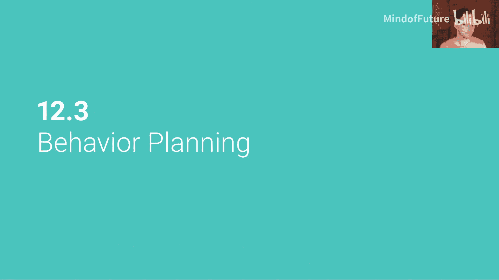
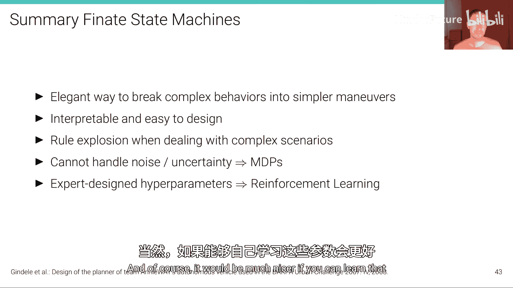
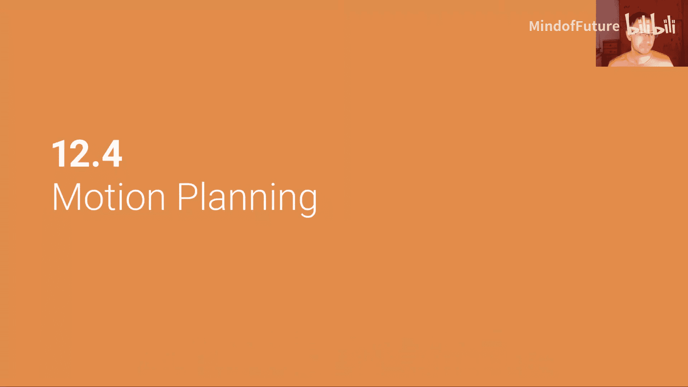

# 【图宾根大学】自动驾驶汽车课程 ML4340 p47 P47 Lecture 12.3 (Decision Making and Planning - Behavior Planning) -BV16FP2ePEYc_p47-

Given a planned route， we now have to follow that route and that process is further split into two subts。

 behavior planning and motion planning。

And now in this unit， we're going to look into the behavior planning stage。To follow a planned route。

 the vehicle must conduct various maneuvvers， as we've seen already in the beginning。

Examples include speed tracking。Car following， stopping， merging， etc ceter。

It is difficult to design a motion or path planner for all maneuvvers jointly。And therefore。

 the behavior planning stage discretizes the behaviors into simpler atomic manoeuvvers。

 each of which can be addressed with a dedicated motion planner on its own。

The behavior layer must take into account traffic rules， static and dynamic objects。

The input to the behavior planner are the high level route plan that we've seen before， for example。

 planned using the A star algorithm。And of course， the perception stack。

And the output of the behavior planning stage are emotion planner constraints such as the driving corridor objects。

In the vicinity of the vehicle， speed limits。The target location， etc ce。

Frequently used models for behavior planning are in the discrete or in the deterministic case。

 define its state machine， FSM and its variance。And in the probabilistic case。

 the Markov decision process， MP are partially observed Markov decision processes。

In this unitity here， we are going to focus just on the deterministic finite state machine。

A finite state machine is defined mathematically by a quintupple。As indicated here。

Where Sigma is the input alphabet。In this case。This example here， alphapha Beta and Gamma。

S is a non empty set of states。In this example here， as 0 and S 1。

F subset of S is the possibly empty set of final states。In this case， there could be S1。

And a 0 element of S is the initial state。 the state that we are starting in。And in addition。

 we have。The so called state transition function Delta that maps from。The a state and a。

Character from the input alphabet to a new state。 For example， if were in state a 0。And we。

Receiving gamma。As an input， then we are transitioning to state as0。So， were not moving。

If were in state at0 and。Observing or a given。The character， alpha， on the other hand。

 Then we are transitioning to state as one。Et cetera。So here has a simple example。

 I'm not sure if you have kids， but if you have kids， you'll probably。Recognize that situation。

So most of the time， your kids are happy and everything is nice。 but over time。

 they get tired in particular。In evening time。And so， they。

Get annoyed much more quickly and they start to cry and they are really feeling unhappy。

 And so they are transitioning into that unhappy state here on the right and they're staying in that unhappy state right？

 So the question is now， of course， how can you move back from that unhappy state to that happy state and well。

Candy is something that。Most often， helps。So so far to a simple non self driving example。

 but let's look also at a self driving example now。

So here's a finite state machine for a simple vehicle behavior。We have three different states。

 the green track speed state。The yellow decelator stop state and the red stop state。

So we're starting in the track speed state where the vehicle is just driving。If the position。

Is not equal to a approaching an intersection or a stop line。

Then we are gonna continue to track the speed。 But if the perception stack observes that we are approaching。

A stop line。Then were transitioning into the yellow decselery to stop state， where we are。We we。

 we're gonna keep that state as long as the velocity is。Non zero。

So we're decelrating as soon as the velocity is equal to 0， and we have reached the。Target location。

 the stop line location。We are transitioning into the stop， into the red stop state。And we're gonna。

Stay in that state。嗯。At least three seconds。 So if the stop time is smaller than three seconds。

 then we're going to stay in that state。 We're not going to start immediately again。

And we're only going to start to track the speed again if we have remained in that state for at least three seconds and there is no further traffic so we can safely move on。

So this is of course， a very simple example， just to illustrate in practice these。

 finite state machines are much more advanced。So what could be potential states here is a fourway intersection and we have these boxes that indicate different states。

 so for example we have one red box here that indicates approaching stop sign。

 then we have the green boxes which are add stop sign and then we have the orange box which is on intersection。

Here's a real example， also very high level still， but a real example from the Dpa challenge from Stanford Jnir's F state machine。

So you can see there is a locate vehicle state once we are located we' are in the drive state。

Then from time to time， we have to cross an intersection。All we have to。

Park or navigate a parking lot。From the cross intersection。

 we can move back into the forward drive state。From the forward drive state。

 we can also move into the U turn state where we do a U turn。And。Well。

 I guess finally complete the mission here。Now， the question is， like。

 how can these simple finite state machines be extended to much more sophisticated maneuvers。

 how to handle multiple scenarios in particular。For example。

 an intersection scenario and the highway driving scenario where the states and the transitions might be quite different。

If we would extend a single FM， this would lead to a explosion of rules。

 So a better thing to do is to use a so called hierarchical state machine， as illustrated here。

 where we have。Meta states， for example， the intersection scenario state and the drive lane scenario state。

 and we can transition between these metata states。

 but we also have states within these metata states， the yellow， red， green ones here。

Where we can if we are inside that state， we can transition within these substates as well。

So the advantages of this is that it's simpler and more efficient。Easier to understand。

 But the disadvantage is that some of the rules might be duplicated because。For example。

 at intersections as well as。On straight roads， we might need to dectillelerate and stop， etc。

Here's an example of such a hierarchical finite state machine in this case。

 also from the DRPA challenge from Kru anyways planner。

 and you can see in this case that there is this drive state here。Where， in this。

State chart in the main level。 You can move from drive to replan to intersection to drive to sew to drive。

 and so forth。And this drive state itself。Has certain subs， for example， drive on lane， lane change。

Drive， turn and so on。So a brief summary。Finite state machines are an elegant way to break complex behaviors into simple maneuvvers。

They are interpretable and easy to design。However， when dealing with complex scenarios。

 we have to avoid rule explosion， which makes it less interpretpreable and harder to understand and more prone to bugs in the code。

And final state machines cannot handle noise or uncertainty。 So if we want to do that。

 then we have to move to probabilistic models such as Markov decision processes。

And also many of these finite state machines that have been deployed， for example。

 in the context of the DARP Urban challenge。Used a lot of expert designed hypo parametersameter。 And。

 of course， it would be much nicer if you can learn them and we could learn them， for example。

 using reinforcement learning。

