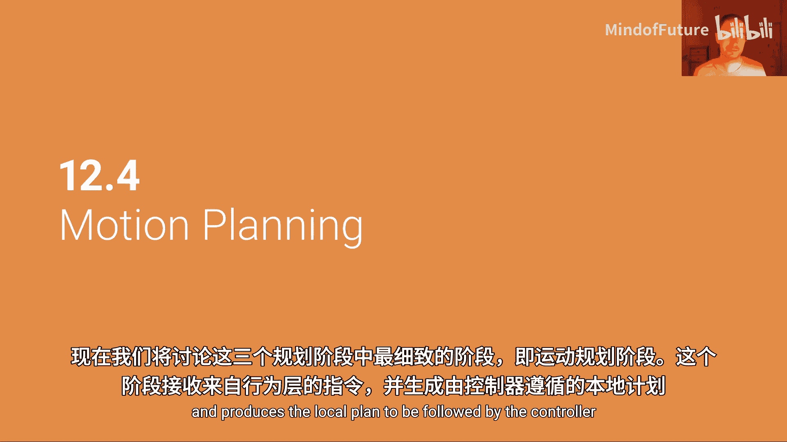
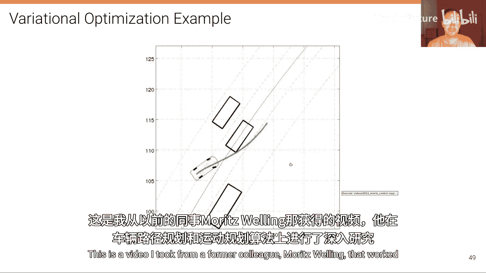
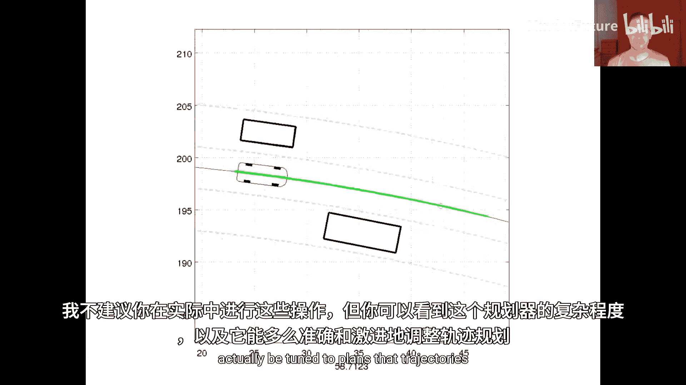
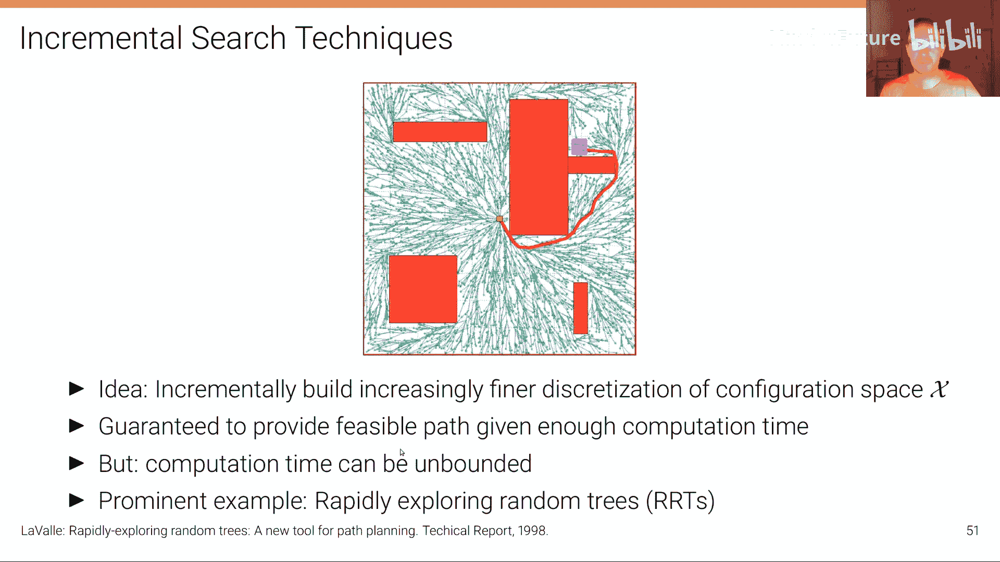
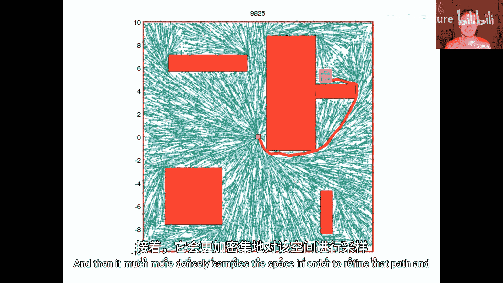
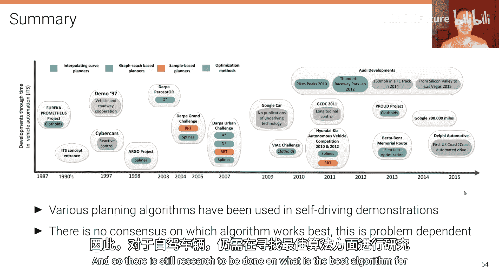

# 【图宾根大学】自动驾驶汽车课程 ML4340 p48 P48 Lecture 12.4 (Decision Making and Planning - Motion Planning) -BV16FP2ePEYc_p48-

Let's now move to the most fine range of these three planning stages。

 which is the motion planning stage that takes us input。

The instructions from the behavioral layer and produces the local plan to be followed by the controller。

The goal of motion planning is to compute a safe and comfortable and feasible trajectory from the vehicle's current configuration to the local goal based on the output of the behavioral layer。

And we really just consider this planning very locally。

 So it's typically planning a few meters ahead。 for example， the centre of the lane。

 planning towards the center of the lane， a few meters ahead of the vehicle。

 or planning to the next stop line or。Parking spot。

The motion planner takes its input static and dynamic obstacles around the vehicle and tries to generate the collision free trajectory。

And there's two fundamental。Types of output representations。

The first output representation that could be predicted by a motion planner is a so called path。

Which we denote here by sigma of L。That maps a scalar from 0 to 1。Which is the path length。

 normalized to one。2， the configuration space x。In other words。

 the path representation does not specify velocity。

It just specifies the path that the vehicle should follow。In contrast。

 the trajectory representation pi of t maps from 0 to capital t。The target time。U。So from0 to t。

 from that interval to the configuration space。In other words。

 the trajectory output representation explicitly considers time。 It explicitly asks our controller。

To move or steer the vehicle such that at any time。Specified here as an argument to that function。

We are close to the corresponding。Configuration that's predicted by that function。While。

 in the case of a path。The controller itself must provide the logic for specifying the correct velocity。

So in this case here， capital T is called the planning horizon。

And calligraphic X is the configuration space of the vehicle， for example。

 the location of the vehicle and the heading of the vehicle in the simplest case。

There's free dominating。Forulations for solving the motion planning problem。

The first type of methods use or variational methods use variational inference techniques。

Then there's graph search methods and incremental search techniques。

And we'll have a brief look at all three of them。Varariational methods。

 as you might know them from math， minimize a functional。

So here we are trying to minimize that functional J that。Itself depends on the functional F of pi。

 where the minimum is sought over all possible trajectories pi。

That's why it's called a functional where minimizing a function of a function。

So we're minimizing that integral from0 to time horizon T。Of that functional F。Of pi。

 where F integrates soft constraints such as constraints about the spatial location。

 not the velocity or jerk。That might be applied， but there is also additional hard constraints that can be formulated。

 such as the minimum turn radius that the vehicle can。Tn。Or in this case， here also， of course。

 the starting location and the goal location。Which where the starting location is。

The location or the configuration of the vehicle at time 0。

 and the goal location is the configuration of the vehicle at。Time， capital team。

This problem is then solved using standard numerical optimization techniques。But in almost all cases。

 this is a difficult， nonlinear。And non convex optimization problem and therefore converges to a local minimum。

In order to avoid this， sometimes this。Optimization problems started from different initialitizations。

嗯。And other techniques are used in order to overcome this。

So here's an illustration of a simple variational function optimization problem without any additional constraints。

 You can see the function here that's optimized。 These are the different iterations。

Here in the background， you can see the soft constraints that are integrated through this functional F。

Such as constraints on this spatial location。 And you can see that， over time， this。

Function here moves towards the minimum of this， this valley here in order to move from the starting location to the go location。

The final iteration is the red one here。Now let's look at a concrete example with a vehicle。

This is a video I took from a former colleague Moritzveing that worked intensively on these type of algorithms for。

Vhicle path planning and motion planning。You can see how this vehicle is。

I wouldn't recommend conducting these manoeuvvers in practice。

 but you can see how sophisticated that planner is and how。

How accuratelyly and aggressively can actually be tuned to。

Planned such trajectories。Okay。An alternative to variational methods is to use graph search methods as the ones that we have discussed before。

 such as Digtra or Astar。But in order to use them， we first have to discretize the configuration space x into a graph comprising vertices and edges as we've seen them before。

And there's various algorithms in the literature for constructing such graphs。

Here's a simple example for a parking maneuvers on the left where the configuration space is discretized。

Based on this。gridriit structure here on the right。

 you can see different lanes on the highway where lane change maneuvers are modeled based on a discretization of the configuration space。

each of these。Gray and black。Trajectories are trajectories that can be taken by the vehicle。

And so through this discretization， we can now formulate it as a graph search problem。

Here's another example for an intersection， where you can see how the。

Different lanes and the different possibilities to cross an intersection are discretized。

 so for example， this vehicle here。It can either go straight or it can go to the right。

 and if it goes to the right， it can even。Move towards this lane here or towards this lane。

And finally， there's also incremental search techniques。

Where the idea is to incrementally build increasingly finer discretization of the configuration space x。

嗯。Which are guaranteed to provide a feasible path given enough computation time。However。

 the computation time can be unbounded。And the prominent example of such algorithms here is the so called rapidly exploring random trees algorithm。

 which is shown here。 So in the beginning， it。

Random Lee explores the space and finds a course。Path to the goal。 And then it。

 it much more densely sampless the space in order to refine that path。

And make it。Better。And here's another example for a planning scenario with the A star algorithm。

This is， actually。An example from the Stanley vehicle where they used what they call the Hy a star algorithm which is。

A star variant that guarantees kinematic feasibility of the path。

Where planning is reapplied continuously as the car explores the environment。Now。

 he has an actual result of applying this ace style with him for a vehicle that sits over here。

 Real obstacles。 These are laser scans of park cars in a target location over here。

 And while the curve isn't super smooth。 you can still see。😊。

It is able to find a continuous and drivable curve to the parking location over here by this small but important modification of a star Now there's a few other modifications of a star which I can't go into detail。

 but here you can see a typical attempt of a robot to navigate a parking lot here in simulation。

You can see the tree that is being expanded in that search。And every time it gets stuck。

 it does a new way style search。You can see how the map is being acquired as it road moves。

In its status equivalent of the robot， it not only considers the X， Y and heading direction。

 but also allows robotver to go forward and backwards and driving backwards is a different state than going forwards。

And now you can see how it backs up， finds a new path and is incomplete maze。

Until it finally is able to reach the goal location through an actual opening。

Its we made this maze be hard to test our items， the nice thing is these items work almost real time。

 it takes less than a tenth of a second to build this entire search tree。

And the robot is able to navigate this parking lot。Really， really efficiently。

 This was one of the fastest motion planning algorithms that I saw in the Dpper urban challenge。

 In fact， in all of robotics， it's been one of the fastest algorithms I've personally seen in my life。

And here is the same algorithm applied to an actual parking example。

Using our robot juniorni in striving over here， it wishes to get over there。

 And you can see it back up into a parking gap over here。

Whi is an amazing precision for a robot and then move forward along the line over here。

 our state space is three， I guess four dimensional。

 it comprises X Y hidden direction and whether the car is going forward and backward。

 there's a cost to change in direction so it doesn't change direction too often。

And you can see it navigate to a saga location De I'm not telling you include that the trajectory that the planet generates is subsequently smoothed。

Using a quadratic smoother so that we get rid of the kinks。

And the card drives much nicer as a result， but the workhorse here that does all the work to find the best path is actually a star modified into hybrid A star as I told you。

And in this final video， we see the car navigating a parking lot。

With lots of traffic cones on the left， you see the video Mad。On the right side。

 you can see the internal map and the path planner。

It attempts to p itself in the designated spot on the left。Now he has an expert。Okay。

 so that's all for today。 Let's summarize this lecture briefly。

We've seen that driving situations and behaviors or can be very complex。And therefore。

 it's a good idea to break down the problem into hierarchy of simpler problems such as route planning。

 behavior planning， and motion planning。Each of these problems is tailored to its scope and level of abstraction。

Road networks can be represented as weighted directed graphs。

And we have seen that diextro algorithm finds the shortest path in such a graph。However。

 A star is even more efficient。And exploits planning houristics to。Improve its efficiency。

We've also seen that behavior planning can be implemented using finite state machines and for motion planning。

 variational and graph search methods are often used。

Various planning algorithms have been used in self driving demonstrations。 And here's a little。

Fig that I took from， from a paper that illustrates the different。

Planning algorithms that have been used by different。Demonstrations。

There's currently no consensus on which algorithm works best， and it really is problem dependent。

 So each problem requires a different。Or can require a different algorithm。 And so they are still。

Research to be done on what is the best algorithm for self driving。

That's all you made it to the very end of this self driving course。

Thank you for joining us all the away， I hope。You enjoyed it as I did。

 and you learned something from this class and you also had some fun hopefully in implementing our little self driving agents in the OpenAI environment。

Now。All that is left for me is to wish you all the best for the exam。

 and I hope I see you again in a future lecture or seminar。

