# 【多伦多大学】强化学习 2025 ｜ Uoft   Reinforcement Learning   Fall 2025 p01 P01_讲座_0_课程概述 -BV1D3F2zhEry_p1-

Hi everybody， welcome to the first session on reinforcement learning。 So as I said in the email。

 it seems that we are not getting the recording so。And regarding my Zoom。

 the quality might not be perfect， hopefully going to get a result from the on。Okay， so yeah。

 today is the first session on reinforcement learning， so this is in courses which we have。

Given last time and class summer of this summer the summer the44 and this year we're giving it into all。

So as I said， some of you might have been in the other course， the De learning course。

 so we have this and lots of visual topics patients so we have particular core。

 different ones just make sure that you're not at the wrong one， this one is F3 I guess。

Third session on that because all have the same code and something of course code continuing。

So you should see reinforcement learning somewhere in your course。 So my name is Ali Berehi。

 this is my last name， but you probably are happier to call me Ali and that's what we find call Ali I want to be Okay so you can find me the same goal7 floor。

And also， you can always write me in an email if you have any question。We have。Ts for this work。

 So we already have four Ts。 One of them has changed just a few minutes ago。

 but we're gonna have four Ts。 and there're gonna be tutorial for this course， like other courses。

 which I'm going to schedule next week Okay so Tuesdays here and this lecture hall on Fridays same time the other side of the the stairs。

 Okay， 1180， just pay attention to that one I do know the the other one is like Friday afternoon。

 This is the worst time ever， but I would be very happy to see you here。

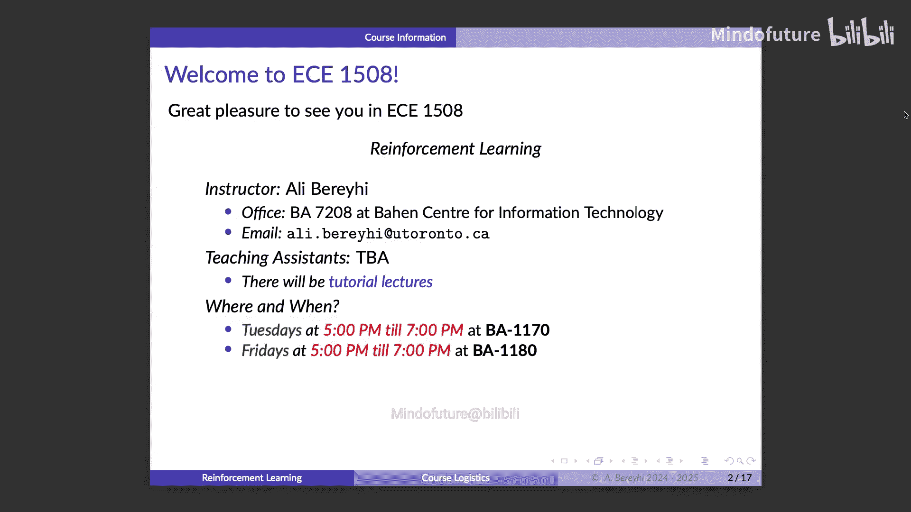

So now。I'm pretty sure all of you already know about the details and how to get control。

 but just as a kind of， you know。That a kind of。Heads up for those who might be for the first time if you have key once you get enrolled。

 you're going get enrolled in the Curs page and this means that you have this opportunity to just get the materials of the course through that you have access to Piazza always the best place to ask me questions or the T because the a is a kind of platform you cannot miss easily the questions of the students and also the materials of the course we used to have it always on Cur but since this summer I started to just migrate the courses to their own course page so you have access to the course page if you log into Curus page I mean I sent you a message but you can check it also on the Curs page so if you click there you're gonna get access to the original course page and I'm going share all the documents through that so that going be easier to maintain for the next years。

啊。Feel free always to ask question on those platforms。

 And that's pretty much about the you know basic logistic of the course。

 And then what the course is about， the course is about briefal learning。

 So it might be that some people who are already here a bit idea of what blood reinforceal learning is but if you don't have any idea that's totally fine you just heard if it and it sounds good cool that's really cool。

 and then we're going find it out through this semester。

 So how we are going to do with this semester， we're going to do it in three main steps。

 The first step that we're going to do。 we're going to get the idea after anal learning framework。

 So it is a kind of online optimization framework in the nutshe okay so there are a bunch of definitions there。

 what is， for example， agent， what is environment how you can what is the interaction and what kind of information you are given the kind of。

Data that you have access through the process into and what you want to do， what is the policy。

 what is the optimal policy， things like this， So we're going to get a bit of idea of all that So we understand what is the R framework。

 This is a total very intuitive framework。Where you eventually do your。呃。

Where you basically formulate the online optimization problem there and then once you understand this you're pretty much able to describe an online optimization and control problem in that framework so this is something。

Pretty much statistical， so you're not going to get too much of those fancy learning on the terms。

AndBut this is quite important to get into the main idea qua reinforcement learning gates。

 So once you get this one， this is a kind of warm welcome to to the course and this board。

 then we are going to get into the step2， which is essentially the tab law reinforcement learning part。

 So what is now law reinforcement learning， it means that you look at data and you try to solve that online optimization problem。

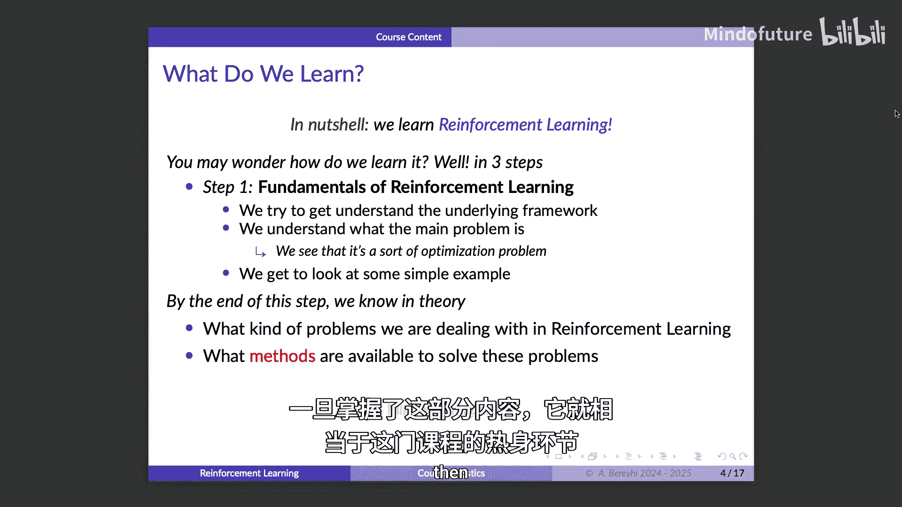

对对。And the point is that at this point， you're not using any neural effort。

And you model nothing like that right you're going to make a table you're just cal advanced numbers and calculating those numbers you're going to get an idea of the right action to do and this is what had been like the trend for a very long time till the deep learning became a kind of thing in 2010。

So we are going to go through the approaches there I you might tell me that this is TR nowadays everybody's talking about deep reinforcement learning。

 but if you want to do computer reinforcement learning。

 there is no way to do it if you don't know what is tableid reinforcement learning because it eventually what you' doing the reinforcement learning。

 you do tablear but instead of using the table， you just replace that table by neural effort that's it Okay so this is the most important theoretical part of reinforcement learning course and compared to other kind of machine learning courses reinforcement learning is。

Better established and terms of the mathematical background because it had been there and in the control theory for a long time and before。

If learning begun a thing， now this had been eventually there are people that will hold those the algorithms and use them and sell some all out of that。

So in this form if you're eventually going to learn reinforcement learning in download form。

 you pretty much present everything that you need to know about reinforcement learning at this part。

 but when I give you a problem in reinforcement learning I'll have control problem。

 you are able to formulate that one you are able to tell me in the algorithm or write down the algorithm。

 which is going to solve that problem the statistical for you。

 but the point is that once you implemented it to let it rot for a practical problem is going to get for aver because that table that I told you you can see that but if you want to fill it out。

 probably you need to wait more than the age of this universe。

 if the problem is something like chest plane。And this is where the deep learning is going to get So the third board is the deep reinforcement learning board where we are doing to revisit whatever we had for too。

 but this time we said if this table， we cannot now build it。

 we can just build it for simple examples but now that we have a real estate example what we're going do with that Okay。

 let's replace a new right so we're going to we can an idea of all like things like function approximation by a neural network things that you have had course just a machine learning or deep learning and then。

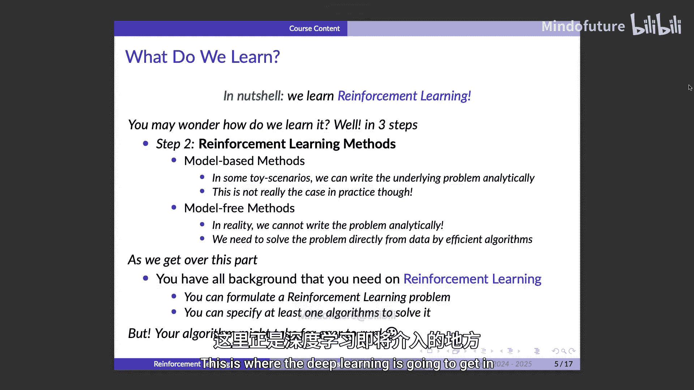

That one is establishing that We are going to revisit those threes this time using the neural inference。

 And this is going to end us up end us up with different approaches。

 So there are particular approaches that we're interested on in this course。

 So one of them is teach learning。Do QF， for instance， if you have heard of them。

 the other one is the policy gradient methods where you try to learn the policy。

 what is the right policy to move to play， for instance reinforce algorithm。

 if you have heard of it or more sophisticated ones like PPO to RPO and then we we finally get to the most practical one which are active pretty approaches work which use both you know QF and also the policy now I do not expect you some understanding of these terms right now。

 just to give you a hint what we are going to explore in this course。

 but definitely're going to get crystal clear of all these terms through the sector。Okay， a score。

Cool， so for this form， you really need to have some background in the learning。

Or at least have a very clear idea how neural networks work and how you can implement that。

So if you have the other course。1513， it's a bit tricky 153 introduction to machine learning。

 because I guess by the time we get here， you either have not started or just started in your network center。

Okay now I'm not sure by the time that you need to do the assignments of this course。

 you are totally capable of doing it given the information you get there。

 If you are very interested and you want to just challenge yourself by educating yourself that' totally fine butm just want to give you this hint here that you really need to have a good understanding of neural networks if you have the other course the appliedli learning course。

 that might be a bit easier because by that time you have a very good understanding of the neural networks。

 but again， by the time you are doing the assignment。

 you might need to put a bit of more efforts there so again。

 this is still well you it's not like I want to threaten you for anything。

 I would be more than happy that you take both courses at the same time。

 but just to give you a hint heads up regarding that okay so at this point。

 I can't get a bit of idea from deep learning， but I'm not。

Stick there because we have of courses of that right we are not here to discuss deep learning we are here to talk of already course learning Okay。

 so with this one knowing near all that Bruce knowing。

Basics of deep learning is a must and this board is roughly 50% of the course because as you're going to see the theoretical part is quite easy to grasp the ideas are quite neat and clean。

 but when you get here you're got to get into practical challenges and we always need to come up with some。

Trees to somehow get over those challenges， so there are lots of algorithms here。

 so this is roughly half of the course we should need to have which we focus on the endorsement line。

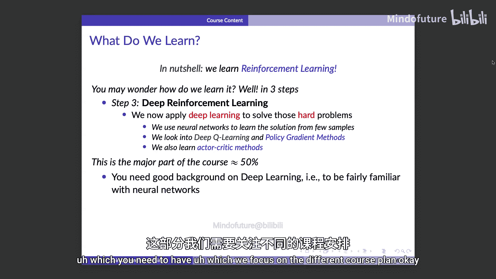

Okay now this is a kind of high charge of what we are going to do in the course。

 so again I don't expect it to seem to understand any of this。

 we're going to have this chart a couple of times through some serve till the end of the R2 what we are going to do。

 we' are going to basically look first into these two diagrams which both are about CaR in personalal learning so if you're doing reinforcement learning and you have your agent and your environment then there possible cases where for instance。

 you know the model which is describing the whole interaction like how the agent is interacting with the environment when it does some action how does the environment react。

You might have such a case， This is what we call it model based reinforceal learning and there are a bunch of theory for developing the optimal strategy here which are basically development optimalphthimmology constraint and how you can I mean using that to find the optimal approach and in that sense you're going end up with two basic algorithms which are value aration or model average so this is what we call it modelbased table or。

 you could have model free table one which is the case where you do not have any idea how the environment works is like you just can try the environment you can just play around the environment and get a feedback from the environment but you don't have any concrete understanding for mathematicalematic model of the environment this is what develop model free reinforcement learning so the whole process is free of the model and the only thing left is data and interaction。

So in that sense that there are different approaches to deal with such such scenario you can go on policy again。

 you're not supposed to have a challenge saying just continue a heads up， you might go on policy。

 you might go off policy。You might use approaches like temporal difference。

 you might use approaches like Monte Carlo to do bit some estimation here and all of them are going to end up with different algorithms。

 couple of known ones like Q learning or SArsa like state action rewards。

 state action and then these algorithm， all of them are local free。Good learning。

 There's no good learning here， right， So once we are able with part two of the course。

 you basically have a very clear idea of both。Pros of this chart Okay。

 and now the point is that if you want to really use any of these ideas that you have seen in these genres for a practical scenario。

 like， for example， playing a real board game with your computer， then you'm going to see that。

Computationally， they're invisible physical input。And this is where the deep learning is going to show all right so you're going somehow apply you neural all networks on the same algorithm on the same approaches in order to just get an approximate of those approaches right and we can't develop deep reinforcement learning algorithm for both cases。

 model based and model free， but in this words we are going to mainly focus on model free because this is the one which is real estate and practical like model based in just a theory iss not really happening in practice。

Okay so this is a very， very very high level summary of what you're going to do in this course。

 I totally to understand that many things here in this chart is not clear。

 I don't expect it to be if they are totally clear probably you should not be here。

 you should be on my place but anyways， don't worry we're going to get totally clear about that okay。

要 school。So this chart we're going to see it a couple of times so each time we just finished with one part I'm going to reamp this I'm going to give it to you again hey guys we did this and you're going to gradually get completely clear upon that okay。

Cool， so any questions， any concerns？No question Okay cool so if you got no question like any courses we have three major components assignments exam and final projects so there is no final exam just one meterm exam the final exams replaced by the final project so the assignments we have we have around 13 weeks right so plus one extra week we're going have 14 assignments okay joking just three assignments。

So we have three sets of assignments， the pretty much each of them is just covering one of the words。

 so the assignments， I made them less here because the project is a bit more serious of this course so you have only three sets and the first one is basically going through the fundamental of like formulaize。

 shame understand， I mean you just apply those definition that you have for some simple examples and just get some you know rough inclusion out of that。

Not going to be the first assignment Also there I try to give you few you know question by which you can use them。

 I mean they optional questions but you can use them to just real what you need to know as background But then after that we're going to get one assignment on T law one。

 So there you get a chance to implement a couple of the algorithms to do a bunch of experiments you're going to get to know the gymnasium environment where you can actually implement under pretty fine environments or you can get your own environment implement there and you can use that know run your algorithm in the environment simulate environment。

 And then finally you're going to get the last one which is basically on the deep enforcement line。

 So one thing here is that。Derement learning could be computationally very， very complicated。

 very high， like you need to have access to good GPUs if you want to see like physical results so the designs or design side that you can do it with your own computers or the facilities available at easy。

 but somewhere of the course， I mean we discuss it， but if you really want to try it。

 you really need to have access to more sophisticated computational resources。

 so I do not put it as a kind of mandatory part of the course。

 but I will give it as an idea how you can try it so。

For this this course this is not you're not supposed you're not learning to give my animal right so we are not going to accept anything like oh well I forgot this final activation or I don't know this code is not running because dimension is done magic such a thing is not accepting and it's not running。

To trying to complete。 Sorry for that。 So pay attention， I mean。

 its supposed that you have a good practice。 you had't had it good practice on on implementation。

 That one thing。 So for the assignments， you always have a deadline。

 the deadline is always two weeks loss after the the assignment is uploaded and then by the time of the deadline。

 you're going get the full credit， you again have two days of D for each D youre gonna get the10 percent deduction from your fine upgrade Okay so that's it three days here I'm sorry two days when it was revising。

 I forgot to fix it Okay， two days and you understand that in the first version of the course it three days。

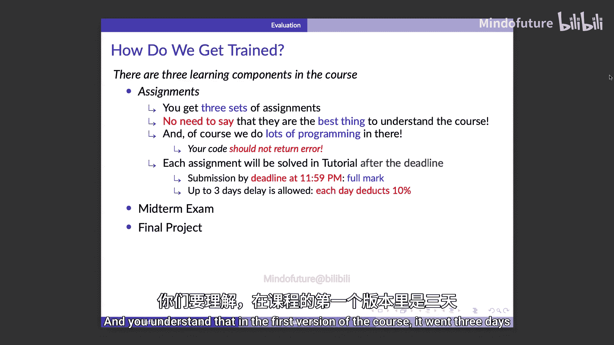

But now let's do this okay。Now regarding the midter， the midterm is going to be on Tuesday。

 so we have Tuesday and Friday so the Friday to reserved for the midtermmaotic course。

 so since some student might have both courses and also it's hard for me to take two exams on one。

 so we're gonna have it on the Tuesday so going to mean the Tuesday of the week exactly before the leading week in the semester week eight。

And。That'm going be pretty much covering the first two parts So the deal learning that are part is not going convene the exam just the table R one and in the exam。

 you're not going to get any question on programming you're not supposed to write down an algorithm things like that you're basically doing just you know a question that you can do it by hand okay so that is a 25% of the whole more and here the exams my exams are always super easy everybody knows So you really need to just get the idea right and then you can simply answer the questions we're not going completely life super complicated question this is just that you try your your understanding of the main concepts and the course and then it comes to the final project and for the final project this guy is going to replace your final exam So when don't have a final exam work we have a final project and this means that I'm going to be。

Barry， thank you with that so I'm going to go over your。

GitHub repository I'm going to check your report with very much details and it takes me a lot of time。

 but I always do it because this is the one which is trying to evaluate your complete understanding of the course so。

How the how it works， I mean， given the horse size right now， I believe the。

Groups should be of size 4， but we're going to see。 Okay， but right now with hundred20 students。

 So 30 groups make sense。 So we're going have groups of size 4。 So you're going to make groups。

 And then once you make the group， you are going to define your。Your topics， So for the topics。

 I'm going to share with you by roughly which phrase。

 I mean two weeks most I'm going to give you some pifying。

Projects so these predefined projects have their own milestones have their own target the tasks that you're supposed to do and you can take one of those predefined projects but if you have any idea you want to do any openended project you're totally welcome to do that but if you want to do that then you need to I mean just check those you know reference projects and your project should be put in the form that is somehow consistent with that that kind of that level of the project being proposed Okay so if anyone has any idea already in mind that I want to build this kind of agent that's okay。

 you're more than welcome to do that but just wait till we have the proposals out and then take a look to prepare your proposal like that and then you submit it by week5 okay。

So that's about the project definition then you're going to have one progress briefing on week 10 so on week 10 you are going to just write down what you have done what is your conclusion probably you have done some research on the kind of implementation the kind of environment you are going for your maybe option A option B option C。

 whatever that is you're going to write it down in a very short briefing in in the template of your report and you're going to submit it just as a kind of hint that we have started working right and we have some rough conclusion of what we were going to do because on week 10 you have only one month left at the end of the semester and then by the last week you were supposed to finish your your project which includes a final paper。

Your slides， which you are going to present in five minutes and also your key repository。

 So we used to have this option that you just submit the code。

 maybe the zip file or something like that。 But now we are just suggesting that you the group makes a key repository the public key repository if you don't have any。

诶你啊。Like I been sure but。If you have， you can just make your group private and then include us into the repository and then you start working on that。

That way we can at least track your comments， we can at least track develop off your project。

 and that is the easiest way for us to know access your project when you're over and evaluatedd。Okay。

Any questions？Everybody's school about the final graduate。

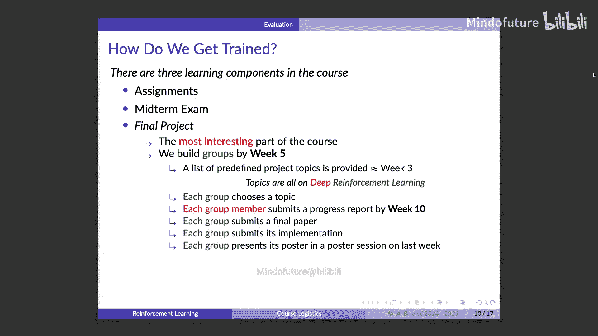

O。So now regarding the programming， I mean you can guess Py is the main language that we are going to use here。

 so we are going to use gymnasium here as well， but you're not supposed to know gymnasium so were the T is going to just explain you I mean gonna give some examples for you in the materials and you're going to get familiar with the gymnasium as well。

 you're going to get some assignment with some draft goess that you can use them to just get practice in gymnasium that large is not really needed to to be now but you need to know why right if you don't know it if you're used to all the platform that's totally fine describe。

To， you know， tune yourself with a course， I mean， the assignments are。Considering T。

 if you are happier with another library， you can use your own library。

 but then this means that you need to write your code from a script。啊。Now， as I mentioned before。

 knowing deep learning， having some experience in that is a quite important thing。

 I mean this is what we have it as a prequisite here。

 but you are not going to directly use deep learning up to the midterm。

 basically you're going to use it in the last part for if get Ukraine enforcement learning okay。

我ions。No question。 Okay， yeah， this is about the gymium。

 So we're going to talk about it quite a lot in this portion of that assignment。

 So you're going to get。

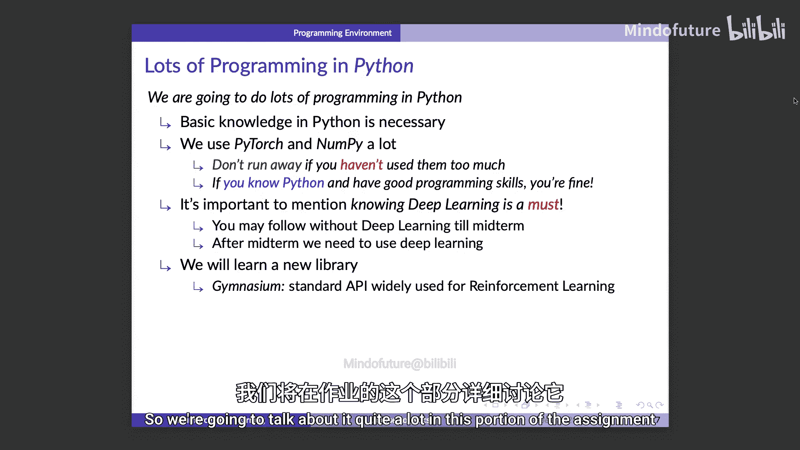

The understanding about that and that going to be the overall calendar of the course。

 this is how the whole course is going to get Congress so we're going to have reassignments and then we're going to have three particular items for your project and then that's it。

我先。No question。Okay great， so one thing I forgot to put in I usually put in in the logisticist slides。

 I don't know why I forgot to put it here is about the use of chat GT you do know that I have this power to understand who has used chat G didn't know that so anyone use the chat find out Im I do not do it so if you give this assignment to chat GT and ask you to just sold it for me it Den always perfectly。

 I do know that and I'm not going to lie I do not find out So that being said the scientists are supposed to be done by you because they are going to help you along you understand the concepts right so they are not there for you to just give you some extra r they are there for you to just we can have the course contents and you get understanding very well So instantly finally use chat GT totally find a the in your code。

You see errors you asset what is happening here and it' going to help you but just blindly copying it there and getting the result is not a good idea。

 but I'm not going lie I'm not going follow I cannot really track it so that's only your choice but my suggestion is that you rely on yourself and then you just get it as a kind of useful help for accomplishing that items。

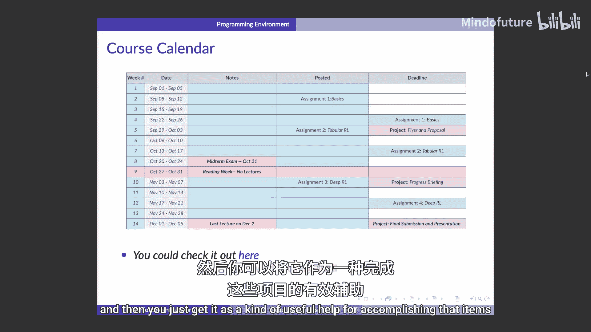

O， so啊。Any questions？No question yeah do all the assignments have equal weightage they're all worth 14 percentage sir do all of the assignments yes。

 yes they are no。Yeah for the assignments due dates are you still finalizing those just a general week right now or is there just a big date like I mean this is a rough like at the end of each to me from'm then upload it but you know I'll wait till I get to the course where the course is over right so it might be a bit are back and forth but yeah and roughly the same。

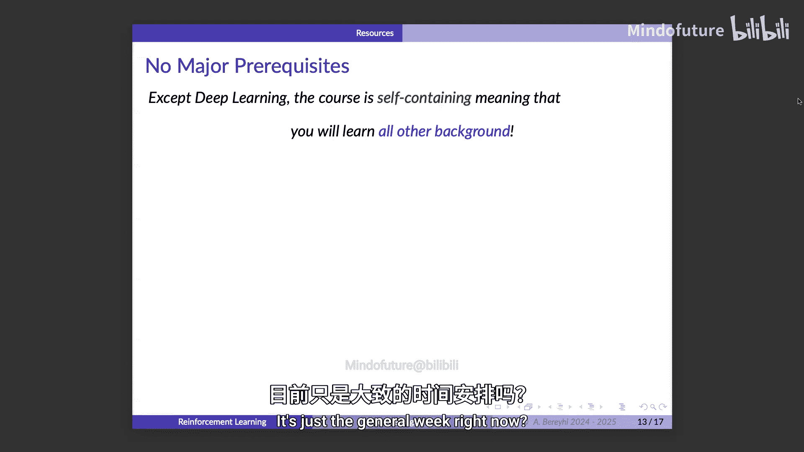

Anyall， yes， you prayer about I can done with repeatedly。So and sign is independent， of course， yes。

 the project was a group submission， of course。Other questions， yeah。

 in the midterm we cover like weak beats10 week yes， of course we said。It's on weekday。

 so then be have to be so。嗯。Yes， when you save for the project submission。

 you're going to go through our get is like very very personally going to。Yes。

 I personally go your gift did the pause period and I click on that like 20 comments and I read first what kind of comments you have done then I compared to friend comments like how want to those this。

Tll you spoil what I need yeah but yeah， I mean， of course definitely you can run away from my eye and it's not like detective and。

 but take a look I see the amount of headquarters you have put and I don't care really about the final product I just care about how well you have tried your best the devil that result so don't be afraid to just go over something very big if you rely on yourself it doesn't work again it's not going too major after your。

They questions。No question。

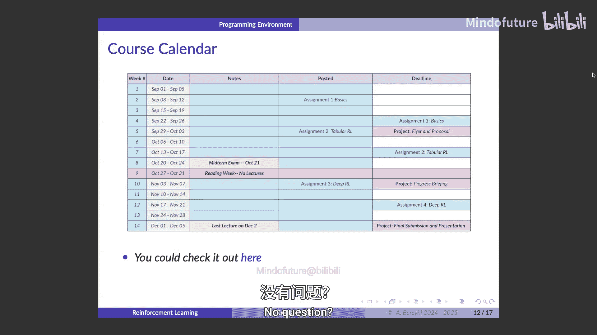

Okay， so if you got a question then。Yeah， regarding the。The prerequisite for the course。

 So you do know that you learning is a prerequisite。 I said it couple times， but rather than that。

 you don't to know anything else。 Anything else we're going to build it here in the course。

 So I do know reinforceal learning is compared to many other machine learning course that it has more math。

 but math with me is very fun。 So you don't need to run away from that。

 So I'm going make it as funny as possible。 and other backgrounds gonna be contained the course。

 So linear algebra cs for all the theory， I expect you to know， but very。

 very basic a bit anything new。 I'm gonna explain it in the course。

 and youre always welcome to ask question or not， you should not be afraid of asking even very basic questions。

So。

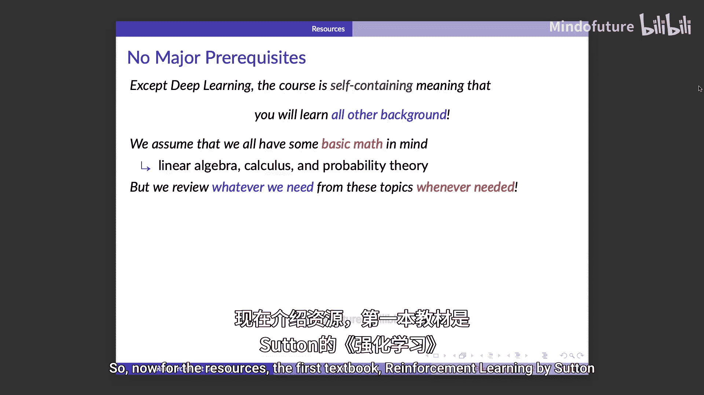

Now for the resources， the first textbook reinforcement learning by Sutton that one is Su andt brought to okay the first textbook by Sutton that one is quiet you know very。

 very well on textbook so pretty much reinforcement learning became a kind of framework after this text so after this Spanish so he is done like he spend most of his live there will be a framework or reinforcement learning very pretty and the。

Two board of the course are very well in line with the corresponding chapters of this book。

 I'm going to tell you after every single chapter， which course you can take a look at the reinforce at the textbook。

 but at the end of the day I'm going to contain all the things you need inside the lecture know So if you want to prepare for the exam if you want to do a science or the project you really don't need to read the book。

 but if you really want to know more or get a better understanding。

 I really suggest that you go ahead and take a look at this one。

 the good thing about it is that it's available freedom of line So you always download it take a look there So there are other textbooks as well。

 there are this second one is actually one quite old but well known preprint or algorithm。

 So good is a kind of good summary if you want to take a look and the Labanon textbook is actually。

One of those hands on textbooks， which are bill received in the community。

 so if you want to know some coding stuff or some sample implementation you might take a look at this one。

 but I guess this was worth it。You know。The era before Cha to Caino there is Cha to Caina Albert right。

 so but this one is quite well known textbook in that sense。

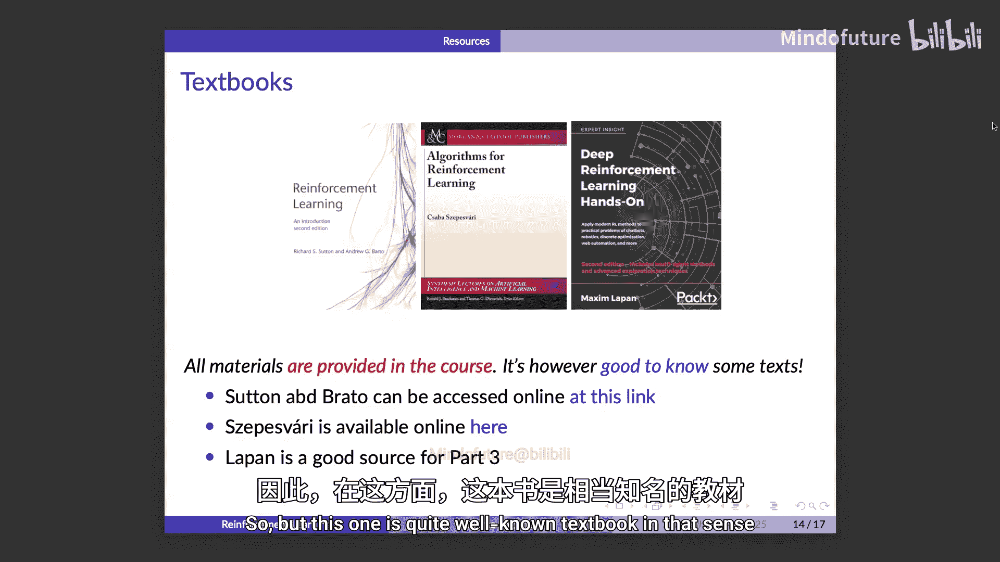

So any questions， no questions I will lock every other course so we're going to make the contract right so the contract is between the instructor ask me with you。

 all of you and I'm going to reserve this right for myself to modify the slides。

Last minute before the course， this is always happening。 I'm sorry。

 but fine high right and it might even happen after the course。

 Like if I find some type which is very very bad like you can name something wrong。

 I'm going to fix it later on， but I'm going give you heads up that So that being said the best idea with P is always that download the corresponding lecture right before the course because if you just download it like two days ago。

 it might be that I have changed it Okay there is one thing and the other thing is that I'm going to just deliver them in in the meaning dash form like section by section if I'm very generous some chapter one chapter right so not going give you all lecture notes because I'm going have lots of title and it might be that at some point I just want to revise the lecture note given what happened with the lecture right。

So， yeah。But you always get what you need for every single lecture before the lecture。

 definitely not going to be。有oseible。No problem， so could you sign it？ and we are good to go Yeah。

 I think some of you are tired of bloomom right， but for those who don't know him。

 anyone by any chance， I mean all the lecture know what in knew anyone by any chance。

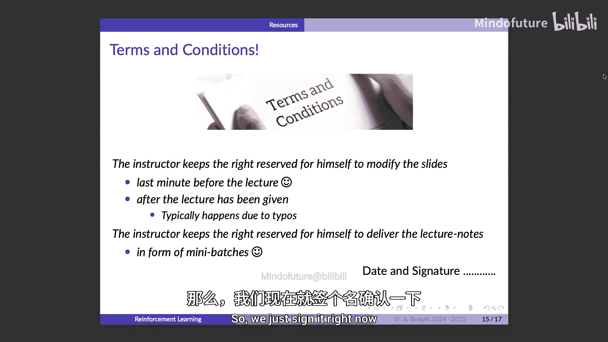

No who will me is。Okay， so there was one series when I was a kid。

 adventureures of Gullive and this was was these guys were the tiny people that series and each of them had a characteristic and this guy was bloomom who was like always like negative about everything so asking question does not buying anything and he is going to be with us through the whole semester So I am going to take bloom as the reference when I'm teaching that being said it means that I always think about the people who have zero information on the topic who have a very you know moderate rate of learning exactly like myself when I was student so。

This means that some of you who have a bit of background might find some specific force a bit boring。

 but that's okay， please be a bit patient because this going to help everybody to capture the for the hum right and if we want to just finish all together we need to just be patient for everybody on way okay？

So it's already in advanced if sometimes I do word explanation。

 but I want to just make sure that everybody is on the same page。

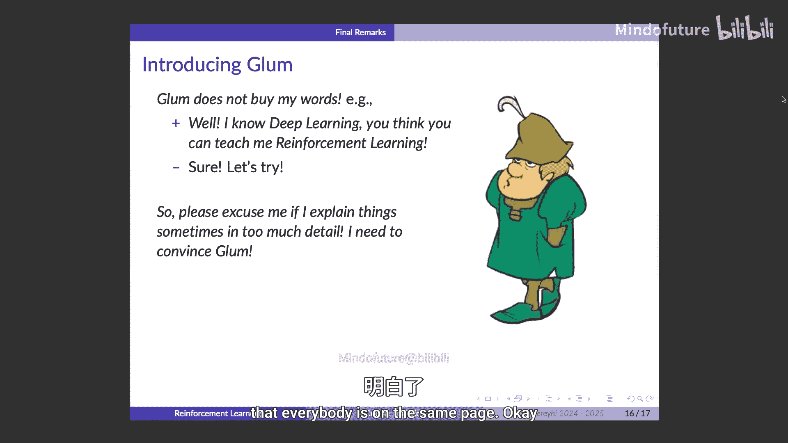

Okay， so that's it and final thing， y。As I said also morning， no such thing is a stupid question。

 and this it is not something that I said， you can check the Wikiped get page of this particular sentence。

 So there is nothing that you can ask me and it sounds stupid right the only stupid thing that you might hear is that this is a stupid question right is this is a stupid right because if this question is a stupid then you need to be able to answer it right you cannot do it。

 then you're gonna say it's a stupid because we cannot answer it and I'm not that person So you don't really need to be afraid you can always ask question。

 even if it's very basic。 that's totally understandable many people like get lost at some point right So don't be shy don't feel like。

And this is very silly I shouldn't ask so always ask and this is very important that you feel that you're understanding what is going on because if you don't understand it then it's going to be just me talking that you listening and nothing happening okay so it's very important is also important for me because that can can help and just interact with you through the lecture。

Any questions？

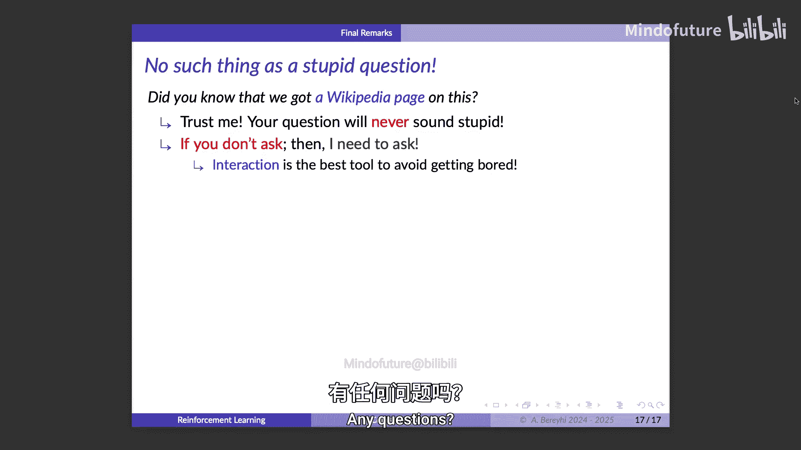