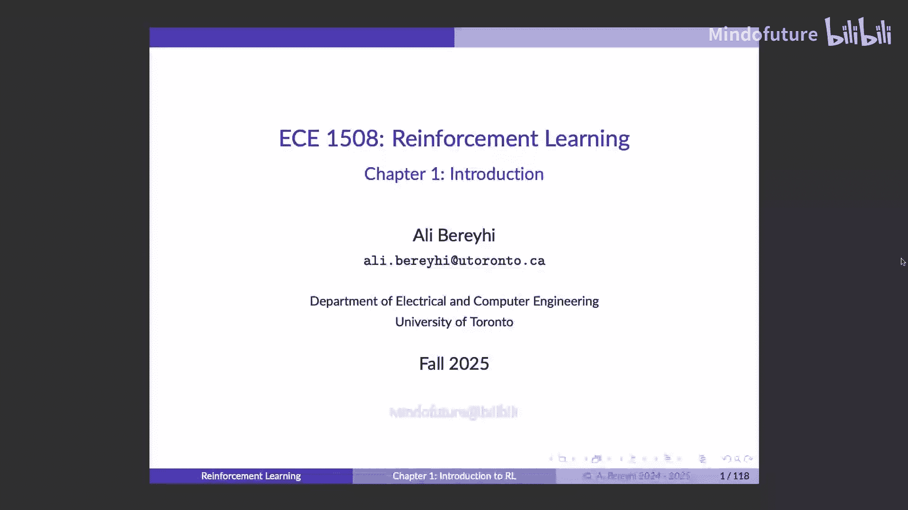
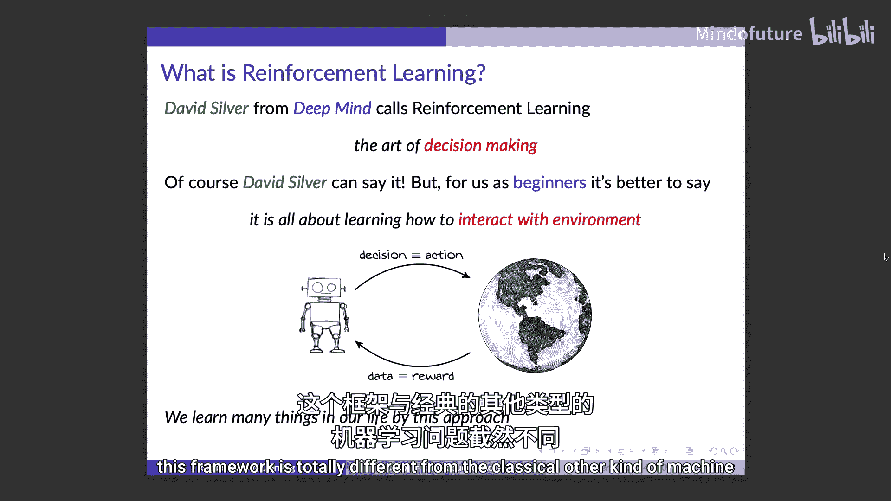
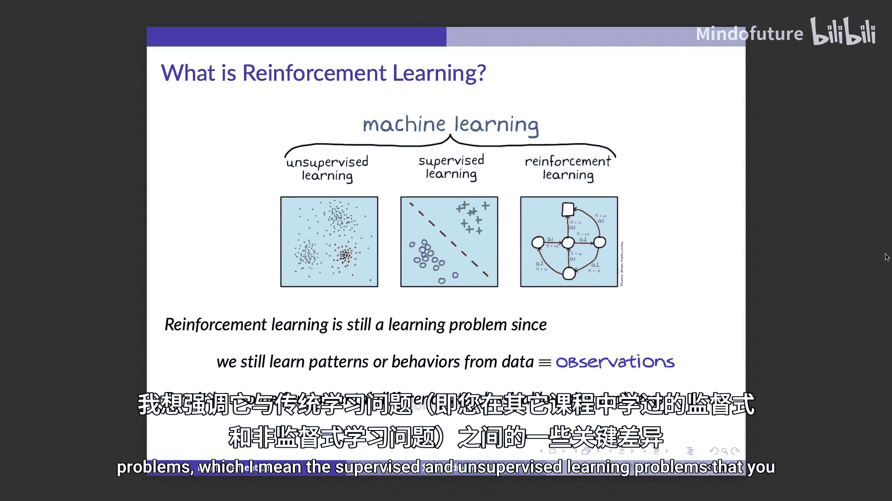
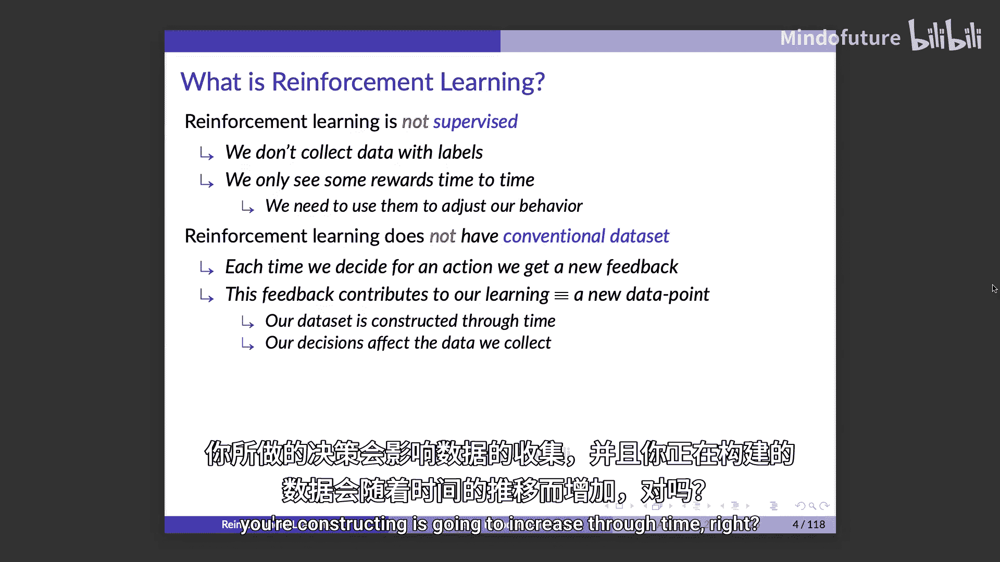
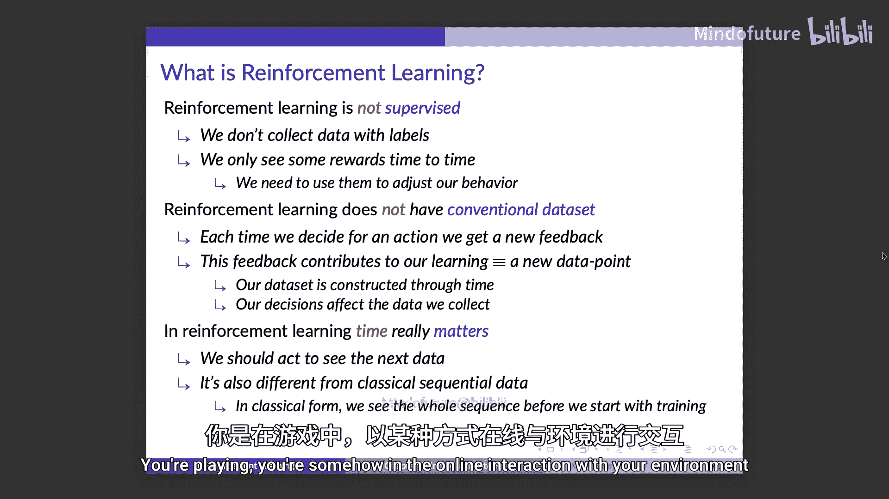
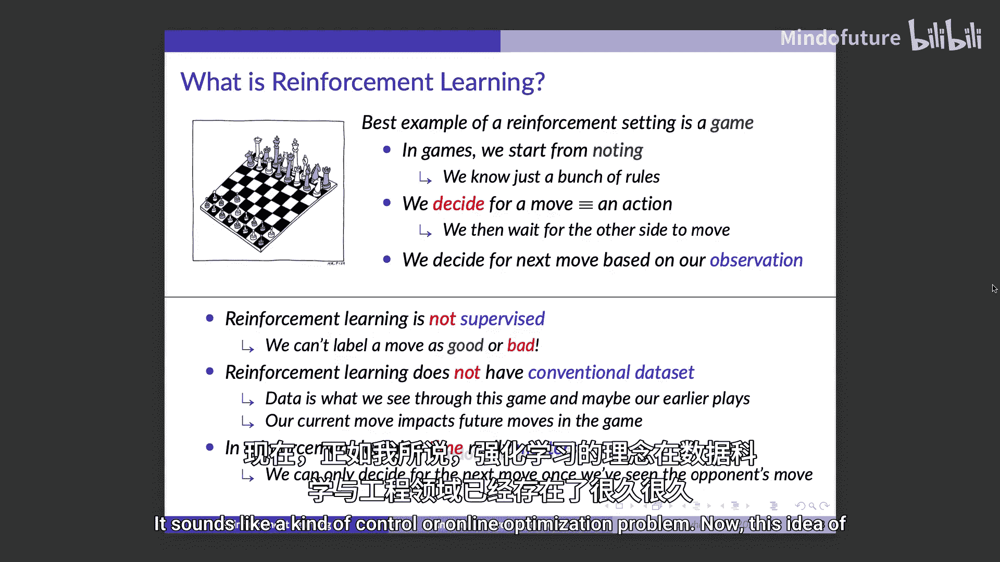
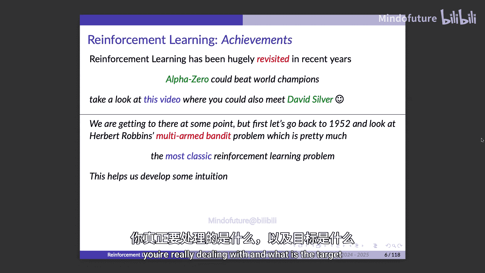

# 【多伦多大学】强化学习 2025 ｜ Uoft   Reinforcement Learning   Fall 2025 p02 P02_讲座_1_强化学习作为学习问题 -BV1D3F2zhEry_p2-

So the result would be the first part， the first first chapter， chapter 1 production。

 so this in this chapter we basically want to understand what is the Colorado of framework for today we don't do anything but no definition we basically try one example。

Which is on Maldi arm bandit， and that one is kind of very famous old example in this domain。

So let me just。Let me just start with a bit of Liinations， you know， David Silver。

Onward next session everybody should know then summer is the guy who was the head of the team one of the head of the team in giveemia who have developed Al zero you know this is a kind of breakthrough in giving reinforce learning so the machine which can play chess and go right and that one is。

The one， sorry， that one is the one we use if learning to do re personal learning。

He inifies reinforcement learning to mean the art of decision making。 Okay。

 and that totally makes sense。 Of course， you can say anything here。

 and I'm going to put it there because that's the silver， right so。That's literally okay。

 but if you want to just define it from the eyes of a beginner like me， I would call it this is。

呃 all about。Now as you learn。How to interact with the environment so。

What do I mean by that in the problem of reinforcement learning in this framework。

 you always think of such scenario。 there is one one guy which is the agent right you can think of it as a robot you can think of it as a human animal and that agent is interacting with something that we call it environment This means that there is something else that is not under outdoor control。

 it has its only physics， it has its own rules， and then the only thing that the agent is able to do is to interact with this one so it're going to make something actions。

 this is what David so called decision So you're going do some some action。

 the agent does the action once it does the action that decide size of the particular action to do。

 that action is going to impact the environment right。If I， I don't know if I throw some some。

Dies on the the sky and it going rotate and then it gets turned down right so the whole thing that is happening there is not really under remote control this is the gravity and other things in the environment right so once it does its decision it does the action the action going to impact the environment and the environment is going to give it back some reward right so if you to it dull the agent you need that action this is the kind of。

Pse and get your action， right so。That diagram you see here is the whole diagram that we are going to deal with through the sensor。

 So why again trying to track with this environment and what does it want。

 It wants to make this reward as。Best as possible。So you're going to collect as much rewards as it can now。

If you look at this problem， some of you might come with this question that this is not the typical sort of machine learning thing that we had in mind。

 especially if some of you have had you know supervised learning right now in your mind。

 So supervised learning we always have a bunch of inputs that want to output and want to find out what is the function connecting these two together。

 but here the problem is quite different and that youre totally right， as I told you before。

 this framework is totally different from the bicycle other kind of machine learning problems。

 So many people want to want to somehow give a very know high level anization of the topics we had in machine learning they are somehow breaking it into the supervised unsupervised and reinforcement learning。

So there are lots of problems in machine learning for instance geneative AI， and that one。

 for example， is somehow lying under the Or law on supervised learning。

By the emotionalal learning it has its own category because this is not very as similar to many things that we we have in machine learning so what are the key differences here。

I'm going to explain them but why we call them why we call it learning。

 why we call it reinforcement learning because what we are doing at the end of the day。

 we're still trying to learn something or the kind of pattern out of the data that we're collecting from that environment right so the best example is always playing some game and then when youre playing the game you always have the environment in that environment could be your an opponent or if you're playing the computer is the computer whatever the game is the other side of the game is actually the environment right and then you decide your moves you do your moves and each time you do you're going to get some know reward。

applause or negative。 And then the thing that you want。

 you want to just maximize that applause right， you want to gl as much of work as you can。

 And typically when you start playing， you first don't have any idea right So you just play around with that game。

 you just get familiar with the rules of the game and you start to build kind of strategy。

 you play the game and you see that your strategy is not working。 So you prove it。

 and you aren doing like that right So you're still trying to learn some pattern from the environment and that particular pattern that you are trying to understand from that environment is supposed to somehow give you serve you well in your vote。

 which is you know getting the most reward right So since we are doing the sort of observation from the environment。

And we are trying to do the best use。You use the best out of it or learn some sort of a pattern out of it。

 this is still a learning problem， but this is not a classical learning problem now。

So there some what are the key differences between this one and the classical learning problems。

 which I mean the supervised and unsupervised learning problems that you had in other courses。

 just let me just highlight them。

One thing is that in reinforcement learning you don't have a supervised problem。

 the supervision doesn't make really sense because what does supervision mean。

 it means that you have a label right， So you have a data and that data has been label。

 but in reinforcement learning， defining the notion of playbo is quite hard right if you're playing chess。

 what is a good move like I move， This is one data that I'm collecting right and I do that move。

 is it a good move or a bad， I mean nobody can say right please at the beginning right at some point。

 maybe towards very end someone who is expert can say， but very beginning or in the middle。

Many moves are unclear false right could be a good move。 We don't know what the guy has in mind。

 it could be a good move， it could be a bad move right so the notion of of supervision is not having any any definition here because the only thing that you have is not you really don't have a true label you just have a reward from an environment right。

Now reward to the extremely sparse like you play with the the chess and you wait for work， you know。

 many， many until you get your final reward which is go win or your looks， right？即。

That is one thing here。 The other thing is that the notion of data set here。

 So the kind of data that you have in reinforcement learning is not the kind of conventional data that you have in other learning problem So in a classical say supervised learning problems you always have a data collecting a bunch of inputs and their corresponding label you get that and you try to train your model right but when you are' doing your reinforcement learning。

 you eventually can build your data out of you track with the environment right So I'm going to decide on my move I move。

 I'm going to get a reward and now this reward is the feedback that I get and that one is going to be again semi my data and then out of this new data and whatever I have before I'm supposed to just build my next mode right So in that sense。

 the data that you have here is essentially somehow spanning through time。

 you can think of it like this。 So your data set。And on give this sense and the move that you're doing。

 the decision that you' are doing is going to impact the kind of data that you access right you decide to do this move。

 you're going to get one sample if you decide to do another move you're going to get another sample right so。

This is value you make impacts the collection of the data and also data that you're constructing is going to increase through time right so this is again your friends to the conventional approach that you have。

And one other thing that is very important here is that the time really matters getting reinforceable learning。

 right， why， why because for instance。四啊。You are playing in the chess right you really need to do the move and then need to wait to see your opponent and then you decide right you cannot decide for the whole strategy right before the start of the game right？

这这真大事。Because if you stick to one strategy lightlyly。

 then definitely people are going to find it out and they're going to meet you right。

 so this is not possible like time is a very important component of the whole process。

When you're interact with the environment， you always need I mean this order of the time really matters you need to just move。

 you do your action and you wait for their work and out of that will build your next action so one thing is that for instance。

 we have some data dependent data in sorry time dependent data in bicycle machine learning。

 but this one is totally different to them so in classical machine learning data dependent data is fine for example。

 a time sequence right but this is not that one because you don't have access to the whole trajectory you words that your end right you're applying you're somehow in the online interaction with your environment。

Okay， so。

As I said， the best example that you can always have in mind if you want the thing about reinforcement learning is to play a board game。

 the best one， very complicated is the chestes game。So in the chess scan。

 you essentially start from nothing and I do know that you can play a couple of times to collect some experience but let's think it very simple if I start with chess playing the first time I'm playing with some new opponent Im playing I'm starting from nothing right so I don't know what is the strategy the other side is going to play I don't know their kind of level of experience。

 I'm going to just do my first move right and then they are going to do their own move and will keep on going。

Yeah， justregarding the data set because we are collecting the data well we play the game and that's essentially wherere just。

You know our best， best the best effort we at have is that we just obtain a subset of possible state or possible boost。

 but in that is how you really guarantee the quality of learning。we are' going to I mean， as I said。

 you don't really need if you think like that， just think about a very simple game okay think about a very simple game with a very limited stay and actionss where you can actually cover all the cases through time but if you're thinking that way then of course we can bold experience but we are going to talk about this I mean this is the whole thing that you move to gold through the semester but my main idea is that if you think about one episode of playing into the game you eventually through that episode you're actually increasing the amount of data that you have right so that one is going a gain to impact your policy。

Potentially it can right you think optim and then this is the key difference to the classical machine learning where you just get those previous episodes and you don't think about anything that you are doing combined with the environment right so you can of course I mean in practice you can of course do those approaches on your experience that is what you call it implementation learning but that is not public that were doing here I'm going mention it towards where and then you're going to see the difference right now but don't confuse yourself right now the key difference that while we are playing or collecting more different right？

我ions。你过先。Okay， so blame Jeess。When I pledge this， I start from nothing if I'm thinking of one episode of planning checks。

 right？And。The only thing that I do know is a bunch of rules， right。

 Those bunch of rules are eventually。The part of my environment， those rules， the board。

 the other side， all of them together are the environment， right？

And the agent is me who is playing this game right now when I start playing that game。

 I start from total nothing right， I have nothing no information about the other side。

 I start doing a move and once I do the move。The other side is going to do the the move as well right now given the new state of this whole game I'm going to decide for my next move and next move and next move and every single move that I do in this episode is going to be somehow impacted by the previous results right so this is one point here。

 the other point is that。Okay， the action I already defined it for you so the action is basically the move that I do in the game and every single move that I do is based on the observation I do right so this observation they're important might not be exactly the whole thing on the environment right and really cannot read the mind of the opponent but the only thing that I have access to is the chessboard right。

So I can see that the last news of the opponent， and based on that I can decide whether optimal approach or best thing to do next right？

Now， if you think about the jazz。And you try to somehow match this guy what I already told you in the other other slide。

 you can now explain the key differences to the classical on machine machine learning approach。

 So the three differences was， first of all， it was no supervision here。

 you cannot willing to the notion of supervision because if you do one move。

 there is no clear whether this it you cannot say nobody can say in chess that this is really a good move or a bad right because that totally depends on the other side if you're towards towards very。

 very， very end of the game。 you might say， okay， this move is not very good because obviously after doing this move。

 this is getting the chance to the opponent into easily。

Finished the game right but it again depends on the other side。

 Maybe you conclude that the other side is not going through that right then this is right so you cannot really call something good or bad here right This notion is not available anymore This is different from image classificationr where one image is really cat or dog right This is a different thing。

 the other thing is that data set is different。 So as you keep on playing with the other side。

 you start to build some mindset above the other side。

 you're gonna to see some transend the other side playing and this is going to increase your information and then improve your policy or strategy in playing that game right So this is not a conventional one that you have collected bunch of samples and that that's it。

And。The time really matters。Of course because when you want to play that board the chess you each timeami move。

 you really need to wait for the other side right so for example。

 like when you play with a kid the kids usually do one you know very downmmy move and they think that in the next move you're not understanding what they are doing so they get the chance to you know but you in a very bad position but yeah you can understand right so they are not having the notion of time but that time really matters in that sense so。

This example I just wanted to give you this idea that reinforceal learning is。

Like conceptually different from the classical machine learning things that you've had before and for many people。

 this sounds more than the machine learning it sounds like a kind of control or online optimization problem。

Now啊。This idea of reinforcement learning as I told you had been for a very。

 very long time in the community of you know data science and engineering and one of the very most you know big or one of the very sophisticated breakthroughs of the recent time is Al the zero so put you this video you can click on it and you can take a look at that one and then you're going to meet also data Silver and magnitude here and you're going to see these。

All does in case that it don't happen and you have not seen it before I guess maybe you have already seen it。

 but if you have not seen it just take a look at that give you So this store target。

 we wanted at the end of the day to be able to do that basically to play ch with the computer very efficiently。

 but for the moment I'm not going to start at that point I'm going to somehow7 years ago。

 when the idea of multi or banded problem was there okay so I'm going to start with this very basic example。

 which I mean we're going to do it together you can actually do it home easily by yourself。

 but this is going to somehow give you take you into into the environment of reinforcement learning what you're really dealing with and what is the target。

