# 【多伦多大学】强化学习 2025 ｜ Uoft   Reinforcement Learning   Fall 2025 p03 P03_讲座_2_多臂老虎机-最优策略与随机策略 -BV1D3F2zhEry_p3-

So there are like thousands of versions as your friend said， there are thousands of the version。

 thousands versions of this this problem， I'm giving you a very silly one。

 but this silly one should be enough that we start with getting into the environment of their resourceal learning。

So say that you have developed some a programming robot in your first project， for example。

 some of you have had it on generatingative AI in summer so that lot is a goal to just do the coding right so you ask it just do this job write this for me in Python or Java or whatever andm going give you a clean code right。

All days， nobody it was paying consumption nowadays， it's charging with your hand。

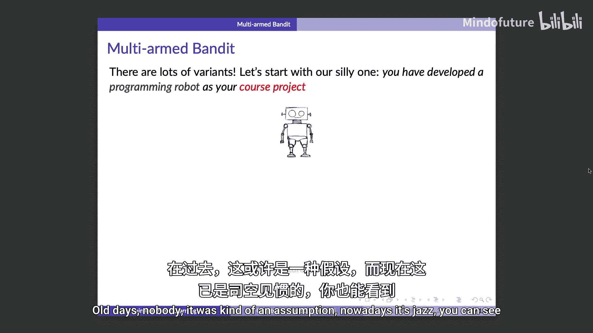

Say I have this robot。 And then after building this。

 you came up with this very brilliant idea that well， I want to just make money out of my project。

 So the thing that I'm gonna to do next is that I am going to rent it right So there are a bunch of companies that are looking for programmer and every single day I'm going to wake up look at one company and I'm going send my robot there is's going do the programming the whole day going to get paid and bring me back the money okay。

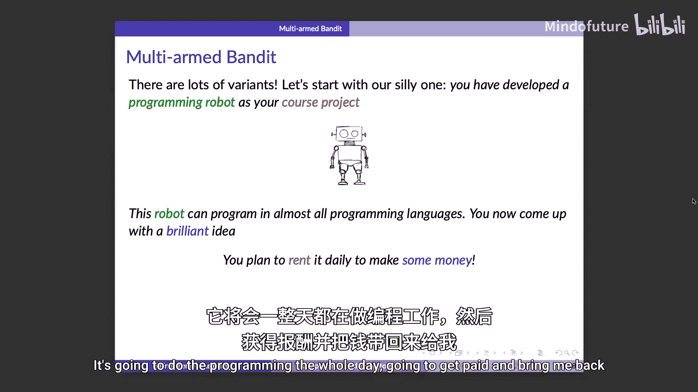

That's the idea。 Okay， very good。 and now。Due to the very bad situation of the job market。

 there are only two companies left company company one of them is working in Java。

 the other one is working in Pyon and I want to rent your your。Robot do wasnt then right。

 So you have this option every day， you just decide one of the companies and you're sayingang a robot there cool now。

The key point of all these companies is that none of these two companies are really having a fixed payment。

Means that they are not going to tell you really at the beginning of the day how much they are going to pay you today。

 so it totally depends on the demand of the market and maybe at the end of the day they pay you something right now。

I am going to give you some background information。

 but this information is not known to the to the agent， the robot。 What is the information here。

 The information is that company A， the payment of this company is looking like a Gasian distribution。

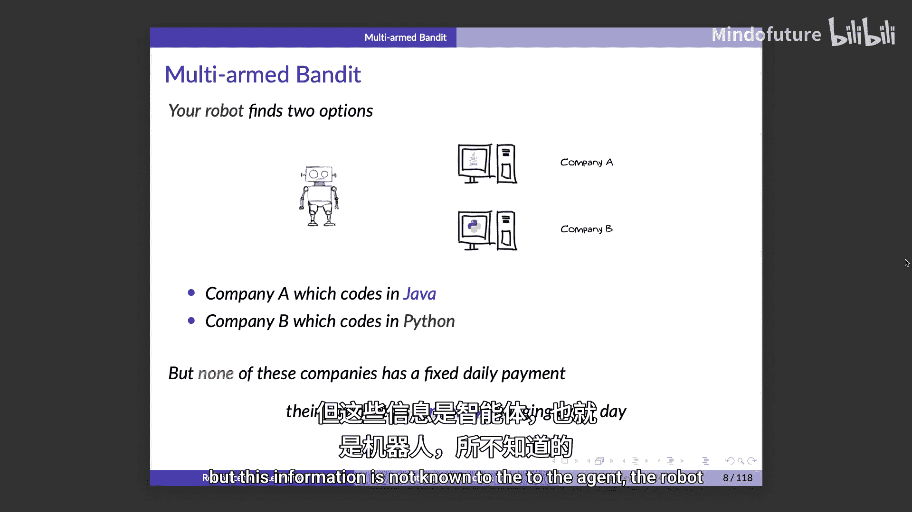

It means that it has some bill density， bill shape density and then。

The center of the bill is somewhere at the mean value of 600。

 and then the storm deviation of that bill is 100， okay？

So that is the way that the company is paying。 So it means that somebody else has take has taken a look at a very long sequence of。

Paance by that company says that in average is's paying something around $600 every day。

 but some days is paying too much。 No I like say typically you can take a kind of interval 600 plus minus3 times the summer deviation right So some days is paying actually 900 some other days is paying 300 right So all of them are possible but the average when you look at the whole payments through time you're going to be roughly 600 okay。

That's about the company A and then company B has a different case。

 The company B is game looking like negotiate payment。 but now this one has a different meaning。

 So the mean is 400， which is smaller than this 600。 but the summer deviation is higher。

 So what does that mean， that means again， if you work there in average， you're going to get 400。

 but there even this is possible that one day you get 400 plus  three times that summer deviation。

 which is 1000 right。 So on some occasions， you get 1000 here and some occasions you get。

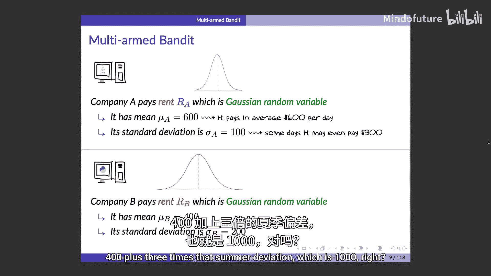

30 around the other one， but an average a is giving paying better than B， okay。

 but none of these things are known to you， so this is something that I want to both as a kind of you know environment。

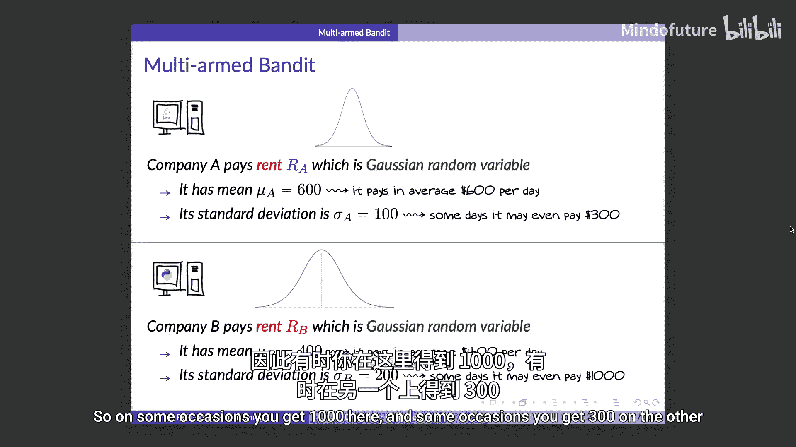

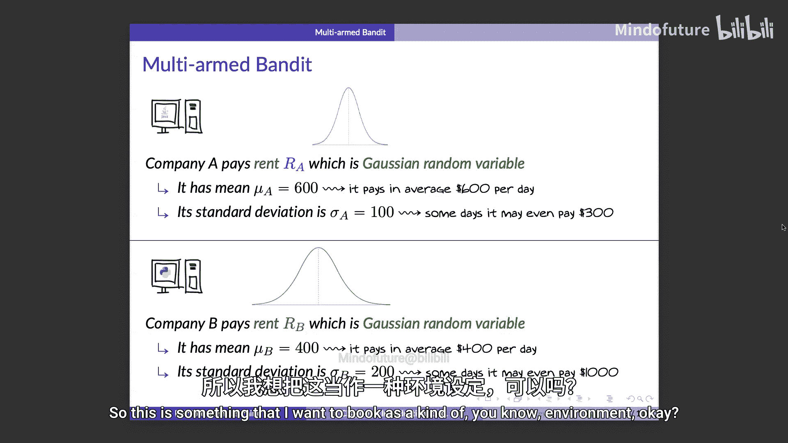

Okay， now。你好。What you want to do you want to just rent that robot and that robot is your agent this is going to go on board every day at the end of every day going to get into a reward。

 which is essentially the payment and the thing you want to do is you just keep it for what a month。

 you want to collect the most possible payment right within the month。Right。

 so that is your target and。In order to do that， you are going to design a policy right In no worries。

 this is not the way that I'm going to define define agent environment policy。

 which we're going to have the company going on Friday it。

 but just to give you the example you have the particular policy， what is your policy。

 this is the strategy that you are going to rent this this robot power right so then every single day you decide to send it company A or company B。

 and then I of T date T is actually either A or B。 So when you decide on the T to send it into company A then the policy is A when you decide to send into company B。

 the policy is B So that is the policy here and now。

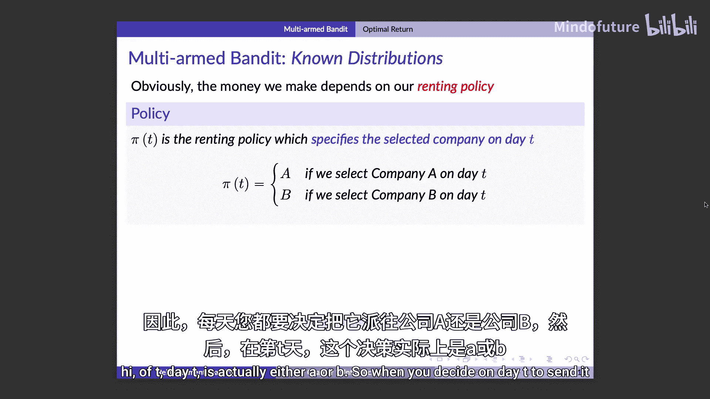

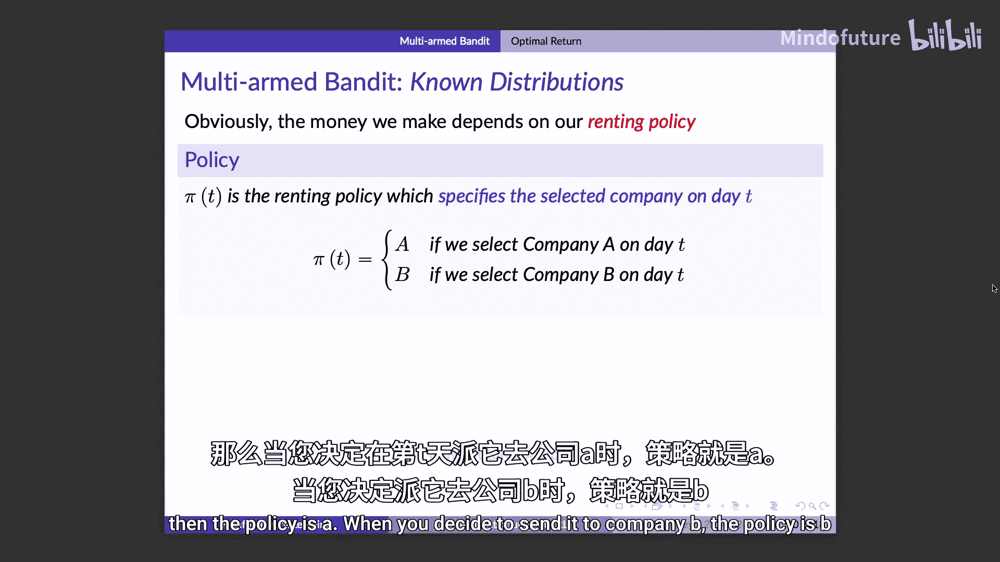

The question here is that what is the optimal approach for renting out your robot？

How do you find the optimal。I mean obviouslyre we want to have the maximum reward right the maximum money we have collected how to print right but the whole issue here is that this rewarding system is random right so the company is waiting till the end of the day looking at the job market and then it's going to pay your so before you send your robot there you're not going to have any idea what you're going to collect at the end of the day right。

That is。Some sort of challenge here to define the optimalalology。 So the whole process is stochastic。

 What do we mean by optimal。 And， this is the classical question happening in many statistical problems。

 And what is the best solution to that， If you want to define the optimal approach。

 how do you define it。

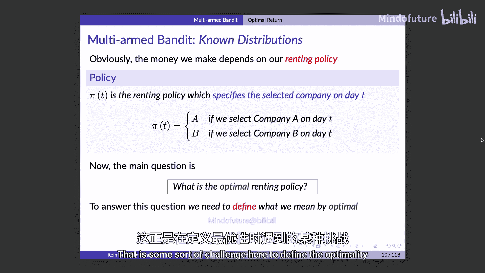

Optimal expected return。In expectation right in so you would say， okay。

 I don't care about one particular sample that is happening right so then just one day I hope that this is going to work very fine when it goes over time right so in。

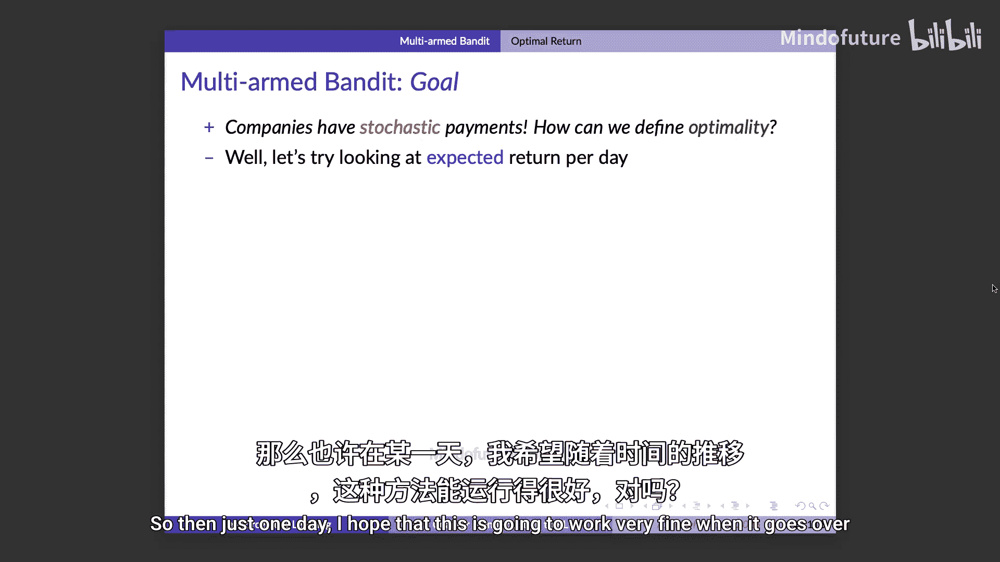

This is the way that you're not9ively p on collecting money so you would say okay maybere going lose a bit today。

 but it soon as that's tomorrow I'm going to get more and then I'm going to compensate for that right so this is the way that you usually do it so you want to have your average return and what is the average return I could define mathematically as the expectation so this is the mathematical expectation of this particular report so what is this R this R is the payment that you have given。

At the end of 18 right so it depends on your policy obviously depends whether you're going to send your agent to the company A or B。

 but depending on the company youre going to get one reward right and that reward is essentially arranged right now say I've done is for two different days。

The best way to define it is that you average all of your payments over those two days。

 but it's still they are ran okay so you' going of take an expectation of that if you don't take the expectation you're dealing with a random logic。

 you cannot optimize。Every by school。Yeah。我先。So the target is that I want to get this average average return in a period of T dayss maximum。

 yes this expectation taken forward return policy or return I is。

Now only over the policy and also over the companies of their payments。

 because the company is also paying to random rent， so of course。

 I mean the policy is going to impact as well definitely we can see。Other questions？

I was wondering why we use a the instead of the sum of going term， the same thing。

 just I wanted to keep it one okay。That fine， yeah， above your're rights you。Questions。啊不。Cool。

 so if you got no question now， my final target is that if I'm renting note or two days。

 then this average return is going to be maximum。 So I want to get the maximum average。

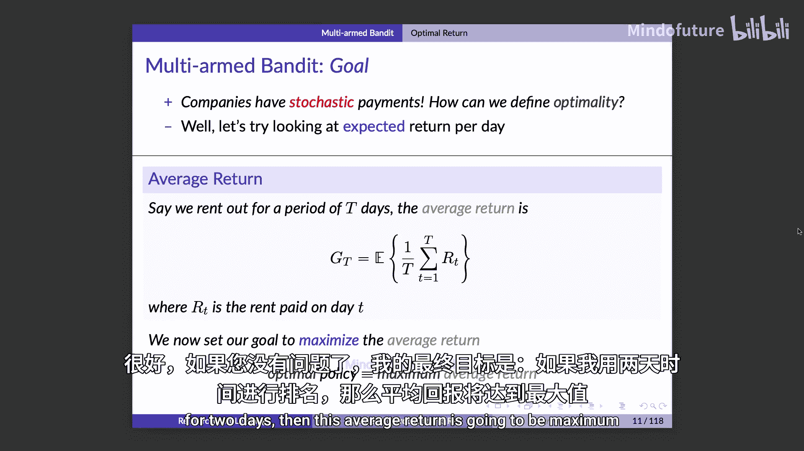

M that I could get paid， okay now。

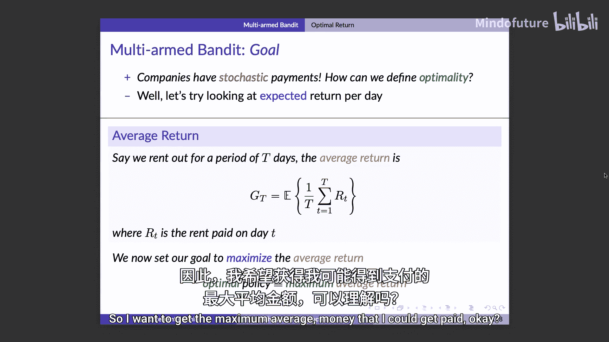

One question here， expectation， the marginal expectation and the conditional expectation。

 do you have a clear idea what they are， if you don't have I can write down on the board。

case I write it Okay， no worries， so how many you say I have first let me just define。

So first just the expectation of more random rival。

 so if I have x and say this x this is a random rival I'll show it in capital so if it is distributed with some density PX。

 how do you define the expectation。So what is the expectation of acts？

So it's going to be if it's if it's this great you're going to write a sumation。

 but since were working with the continuous random models' it's going to be integralpl right and then anything inside the expectation going to be x your sorry P of x d x right so this is your your expectation right now if instead of x I replace it with anything else so say I have f of x what going to happen here。

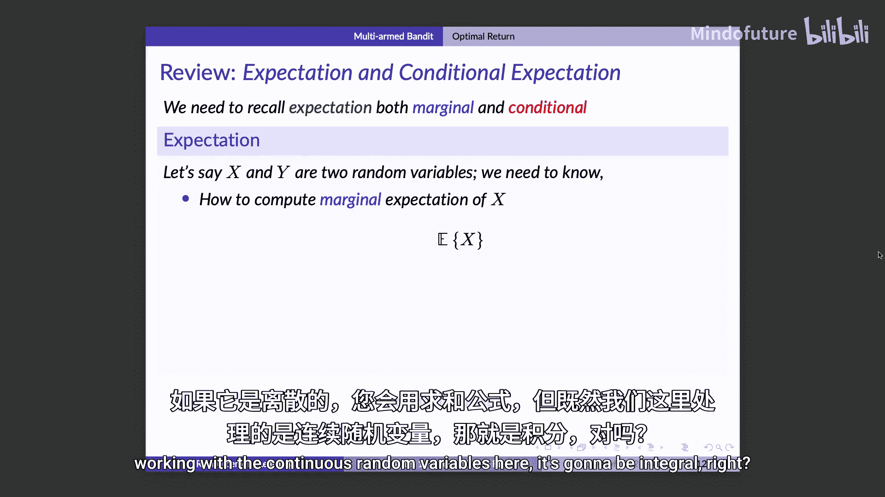

This x going to be f of x right so you're going to write it down of x okay so that is a marginal expectation the marginal on x there is nothing else involved right but you can have conditional distribution as well right。

So what is the conditional distribution so I can write it down as P acts given1？

So this P of x given y when y is something fixed for you right So I tell you y is then and once you know y。

 you can write down the distribution of x right now for the given y。

 you have a distribution Now how do you define the expectation of x， given that y equals by y。

 how do you define this？When y is fixed to particular value of y。

 then your distribution is going to be accident。W， right and then you want to just average x over that distribution。

 What should you do， you've got to multi the atmosphere here， you integrate into the ver。Ex， right？

Everybody's clear now can I also go ahead and average you over why？Yes。😊，How should I do that？嗯。Okay。

 along to now， if you another the form， do we want to do it， build the expectation。

Now with respect to why， okay？Here the expectation was with respect to x X was the variable I just take the I took the expectation now if I want to take the expectation with respect to why。

 what should I do。This guy is a function of what right so multiply it with P y right and then this is the function of y So this y is the guy which is the arrival here getting it multiply and then take the integrals perspective what。

 right。Everybody's clear。Aise call。Now， this guide here。

 I took first expectation with respect to x or in particular y， and then I average it over y right。

 So I could write it down as this expectation of the x itself right with respect to anything there right。

Everybody's cool， right everybody's。Reappbbing this notation， right？Cool。

 so if you have that one now clear， then let's go for the。Example， so yeah。

 already look at the board so we don't need to look at it anymore and。

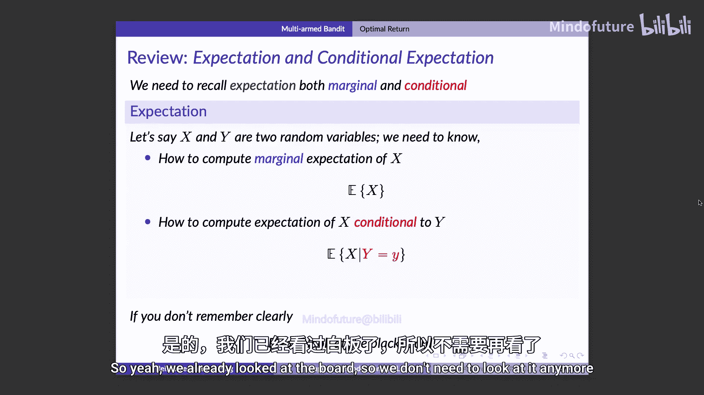

First of all， if I do know the distribution of the companies。Company A and D。

 I do know that they are paying go with those moon and errands。 What is the optimal strategy， don。

You don't know it， of course， but if you know it， what is the optimal strategy？😡。

You want to maximize your， yep， go ahead。average， exactly so you're going to go over that right all the time If I do know that I' always going to send it to company a who goes paying more average right now it' obvious and you can simply see it mathematically so I want to maximize this expectation of this average。

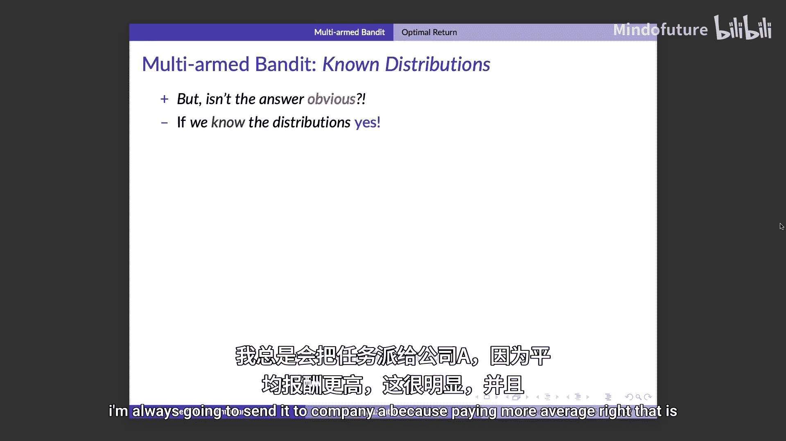

This expectation can simply go inside the sum， right， So that's easy。

 I'm going to go inside this one here。 Now， let's say that。I don't know exactly what I should do。

 so I'm going to decide that I'm going to send it for T A days to company A。

Then and TV days to company what' going to happen。 Well， I'm going to have T。

And in all of those TA days， the expectation of this reward is the average of company A， right。

 so it's going to be newA right so that is going to show up here then company B。

 I'm sending TV different days and for every single now I'm getting in average new B right Tv times new B right。

So this is the total thing I collected within the two days I divided by tea。

 that is going to be the average return， right？Al right说。Now。First of all， if I add up TA to T。

 what's going to happen？It're going be T， right， If I have 100 days。

 Maybe I send 20 days to a the remaining 80 days， I' send it to B， right。

 So T plus T is going to be T。 so I can write T to be T minus TB， right。

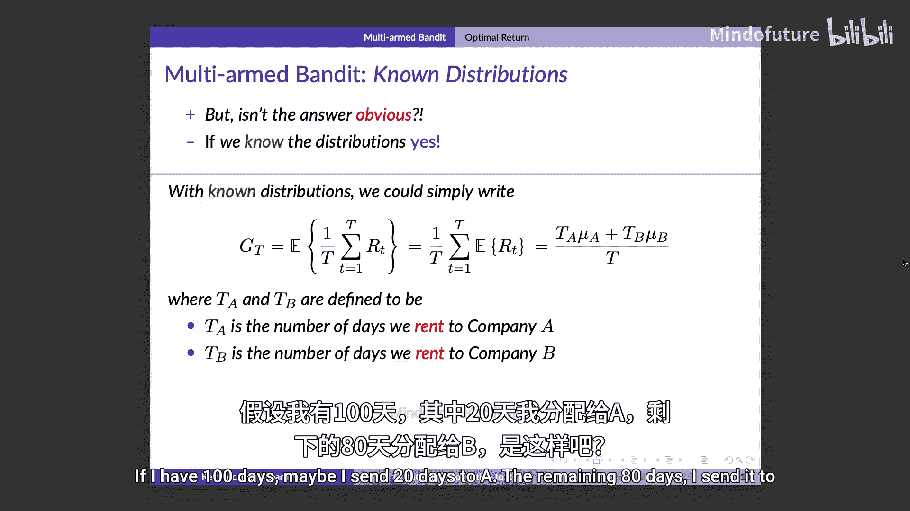

And both TA and TB， both of them are smaller than T， right。

 less number of days in the total number of。Das at work so if I do that simple notation here。

 so I'm going to say that my average mat is this term now instead of T。

 I'm going to replace it with T minus Tb okay。

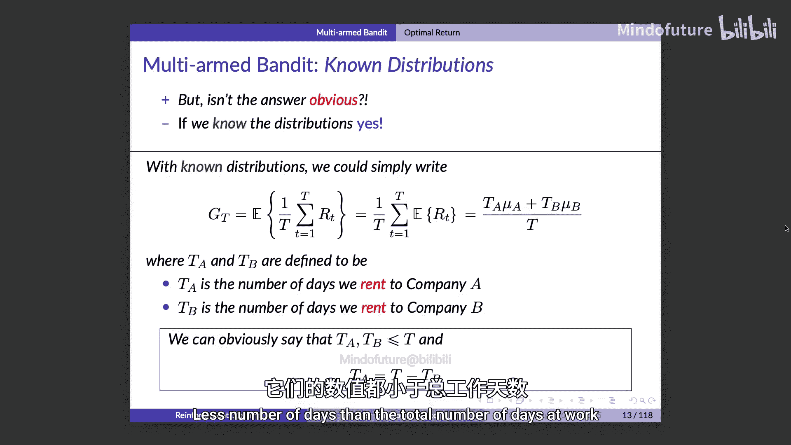

プそね。The first T here， this day divided by this day is going to be one， right？

So I'm going to keep that line outside。Then I have mu N times TB over over T。

 I have mu V times T over over T right， so I can just factor out TB over over T right？

So I can write it down in this one first。 So this term here is going to be one minus t over t。

 This other thing we be a remains here T over T right Alright go Now I can factor out T B or T right abstract。

 and this is going to be。I'm going to remain with meal A first and then Tb over T times。

Someone tellss me。U B minus V， right？I wrote you minus， sorry， minus。New eight right。

 so everybody sees that basic a。P school。我先。No question。 Okay， now TV over team， that guy。

It can be zero when I never send my agent to company B， right？

It can be one when I always send it to company B right so that guy is always in these two values and if I want。

 if I just replace those values of mu A and U be into that。

 this is going to be the case right So the reward that I'm going to collect in average is going to be the 600。

 this is the higher payments， the one， the company A。

 which is paying me higher in average minus that difference between the two mu values。

 which is in our case 200 times t B over T can this guy get anything more than 600。

Never right if you choose to do anything， this fraction is going to be some positive number between zero and one and then this means that I'm going to get paid less than 60 right？

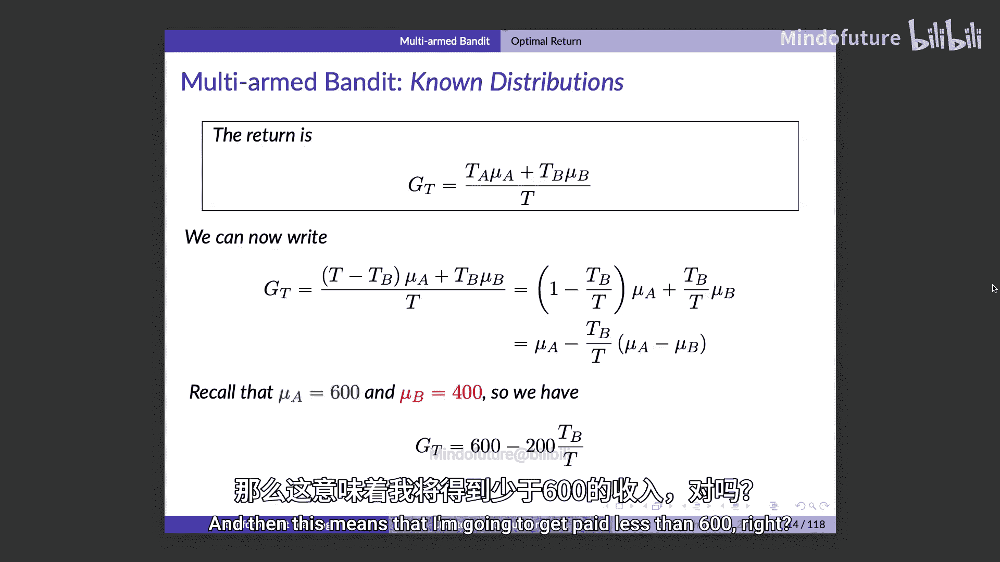

So more of a story TB over T as I said， it means you're in1， this is when you always work at A。

 this is when you always work at B， and the best idea is that you put this guy to be zero。

 then you're going get the best payment ever， which is average payment。

 which is 600 means that even though it might be two days where a company and you get 1000 but the right strategy even though you don't have any idea about the exact payment every day is that you always go with the guy which is paying you more in average right。

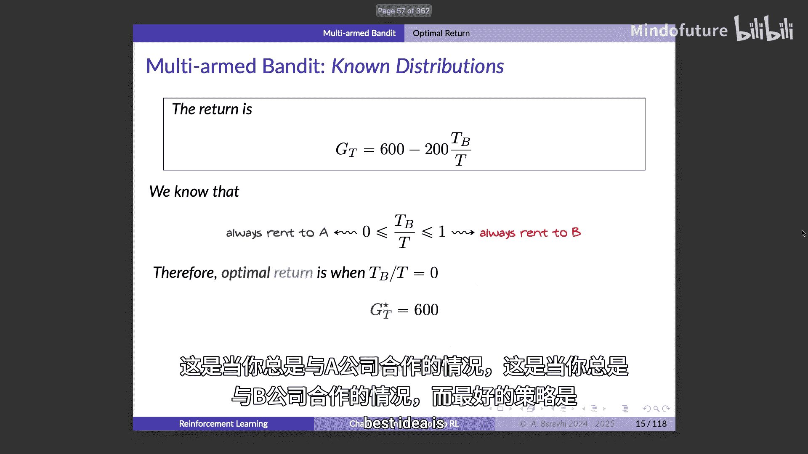

That makes sense， right？嗯。Pvis school。O。That's cool。

 so this is the best return average return and then you can't imagine if you're worried for teammate。

 right？You can never go above that right But the point here is that when I wanted to compute this。

 I assume that I do know the distribution I do know how is our behavior of opinions for every single company。

 which is not the case in practice right So in realistic case。

 we don't have really an understanding of that distribution if we do know that distribution then we're always going to send or。

Agent to company and this means that the best policy that we can play with is that at every single day。

 the choice of the company is a right this is the best policy but we cannot do it because we don't know the distribution right and this is what happens in practice in practice you don't know what is the distribution of the payments right。

So I gave you this as a kind of side information， which is inside the environment。

 but in reality youre just going to send your agent and that is your words and you see some sample payments。

 right？Today you've got 600 tomorrow you get 300 and so on， right？

So it might be that the first day you go to company A。

 this is one of the bad days for company A' going to pay you 300 and then the day after you say。

 okay yeah I'm going to go to company B right and then this is one good day for company B and then're going to pay you 1000 right and then you keep on playing company B right but an average you're getting pay less。

It was a very obvious thing， but this going to happen in practice， right？

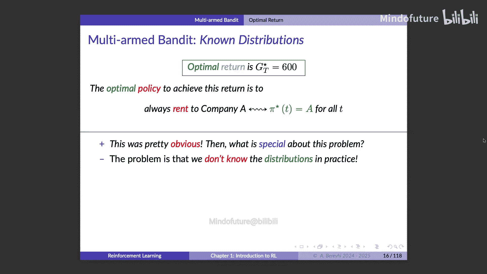

O质量。In practice， what we can do， we can eventually do some observation。

 we can have some simple observation by going and breaking at those companies a bit and all of those samples that would sample payments that we get from theno。

 we start to conclude。Which company is the right one to go for， right now？

This is what is going to happen in practice。 So in practice。

 you're going to have a kind of rent policy and you build that rating policy based on the observation that you have down from the environment。

 And you can see here that this observation is totally random this is one sample coming out with your your environment。

 So if you keep on working forever， you're gonna to get maybe conclude to a play different strategy。

 right So now let's take one simple case where we we are just doing one you know。

 kind of media approach to just design a policy。 let's see how far away we can get from this optimal policy。

 So the best sorry， optimal work。 the best return that we can get is 600。

 This is when you do some gene told us that company A is being better and average。

 we'll keep on working there。 what。Happ if we are going to deal with in practice by the greed project just rule so what do I mean by that let's think of this down policy so I'm going to flip bit coin oh oh sorry yeah I did want to say my policy first sorry this is the greedy policy of you know random play so first let's let's let's discuss this one then we're going to get it to my creative。

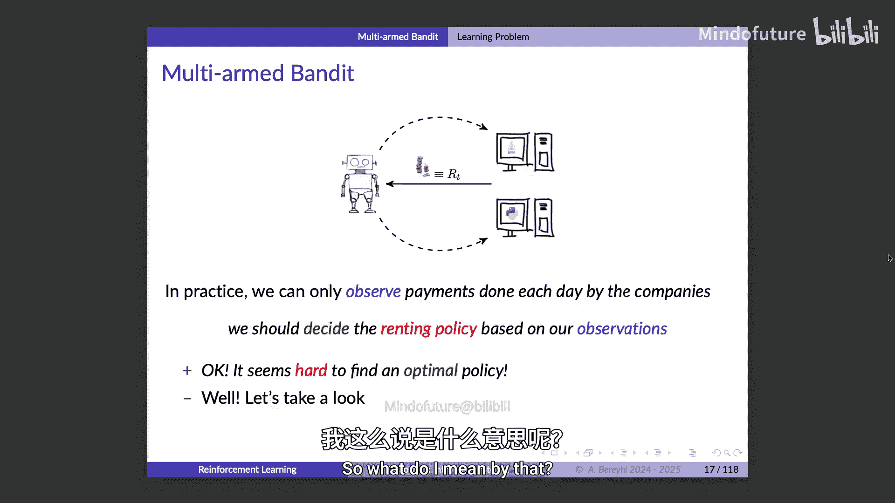

So let's just consider this down man policy and this policy I'm going to just get a coin every single day。

 I'm going to flip it。If it's not， I'm going to go to company A。

 if it's fail all I'm going to go with company Okay， so on the coin is very fair。

 so' got to be 50% of the chance I go to A and 50% of the chance to go to B。

 and now I want to see out of this random policy。How much I'm going to get the average now what do you think。

 what can an even be average thing in the space？嗯。500 so 400 is company D600 company A half of time here half a time or third average you're going get 500 right So you can do it simply by right and you't those equations again so if you write it down this way then I just want to do it to give you the idea implementation right so I want to just take this expectation when I want to take this expectation my R I reward it the particular A T that I don't know what the that one right because it depends on what the policy says and the policy is totally rent right I'm going to flip the coin right。

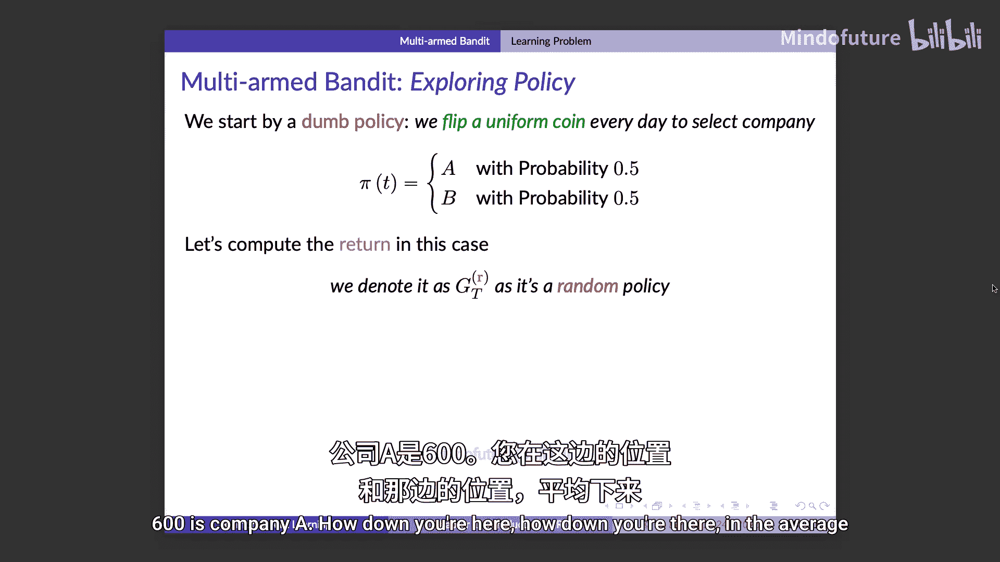

So now let's say that I've split the coin and that coin shows me a。

 then that Rt going be R that I get from company A。

 if that coin tells me me then that Rt going the reward I get from company need， right？The right。

 So what I can do， I can fix the policy first， and then I average the。你诶。

Reward and once I average the word for the policy， then I average this average reward for all the policies now what would it be in our case？

What are the possible outcomes for P Northea？What could be your pie， what could be your policy on AT？

Can it become very same？You know it's going to be either a or B right these are the only possible cases you can do right So what you can say you can say okay。

 let's say that pi my policy on day is to go to company A So this means that now this R T is eventually dependent by company A right and then you're going to take the expectation of that right。

Again， your policy is to play B， then this means that our R is going to be the reward that we're going to get paid on company many B。

So you take the average down， right。These are the two possible outcomes of your policy now each of them is happening with in half。

 you multiply them with deathal loyalty， you sum them off。

 this is the average with respect upon everybody's school。

This is exactly the five0 that you set right so if I put the first term here。

 this first expectation is going to be six on red， this is the average payment of the company egg。

This one is going to be 400 and then half 600 and half 400 is going to add to 500， right？

What youly already said right， just wanted to be just clarify by this additional youlature。

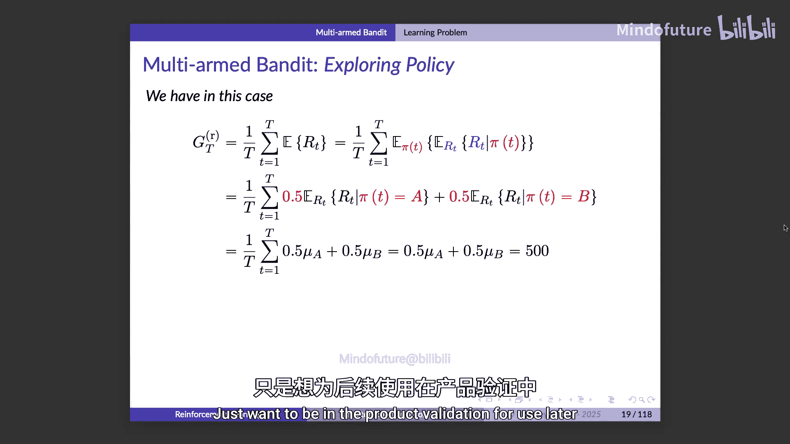

Okay， so now here if you play this random strategy， random policy。

 the thing that is going to happen is that you are going to get paid the average 500 and you're going to get。

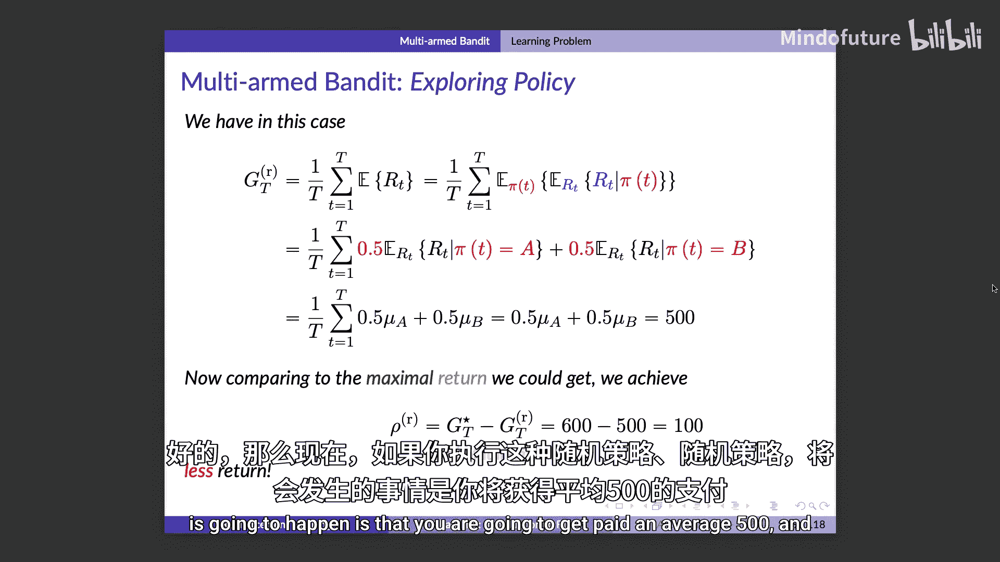

The loss of 100 and this loss is as compared to the best you could get right sometimes people call it regret and you might say okay。

 there was no way to get rid of that because eventually I have no idea about the distribution so I ran which is this guy or that。

But actually this is not a case， I mean you can actually do better than that。

 you can play in a way that this average return that you get is not exactly 600。

 but you can make it as low as you want to 600。Now you can do it， let's start with this。

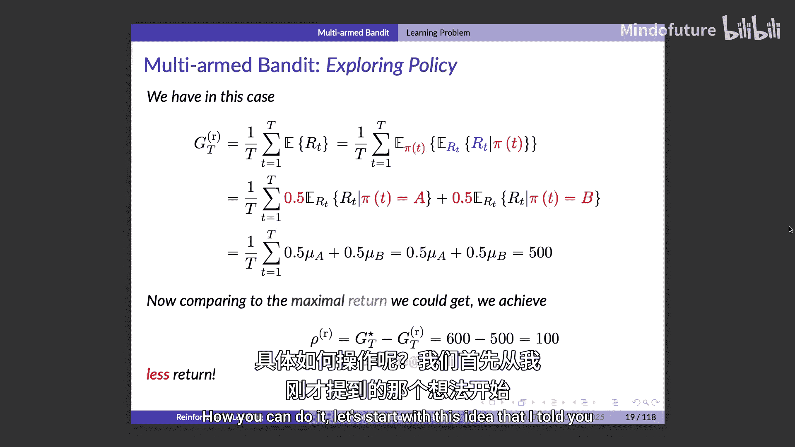

ideaa that I told you， so once you have already done you have done exploration right。

 so you have gone in company A， you have work there half of the time you have gone to company B worried there half of the time out of those data。

 you can get a bit of sense of all the， right。

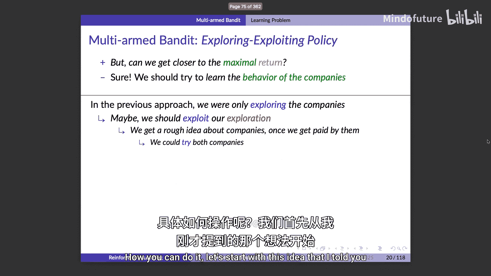

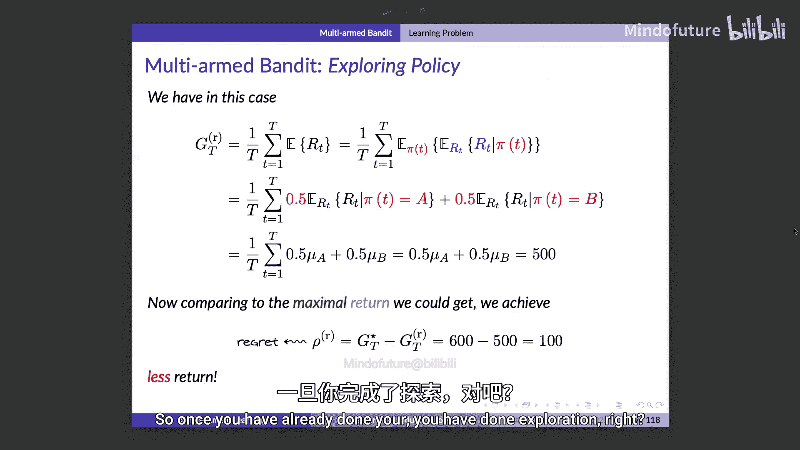

If you as a person want to do that， you're gonna work a couple of days here and a couple of days there and you say。

 okay， these guys seem to pay better in average right， sure that the first day they paid no less。

 but I worked 10 days and it seems to pay better as compared to other one。

 So you' going to stick the rest of the days there right So what you have done eventually is that you first got some sort of exploration right So you have done to these companies。

 we have collected a bunch of samples although that those samples somewhere in your mind。

 you started bought that bill curve and the center of that adult curve or company a is a bit better right and then at that point you start to exploit what you have already concluded out of your exploration right started to conclude that is better that you go ahead and work for a company。

And this is the right way of playing this particular game。So。

Yeah so let me just yeah so when we do that this is eventually what we call it a learning procedure because you start to collect some data and then you start to estimate the behavior of the companies and out of that you try to build your your own behavior right so it is a kind of limit process but let's just try this particular policy and then see how this policy work。

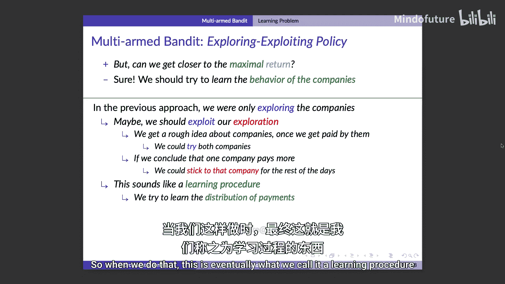

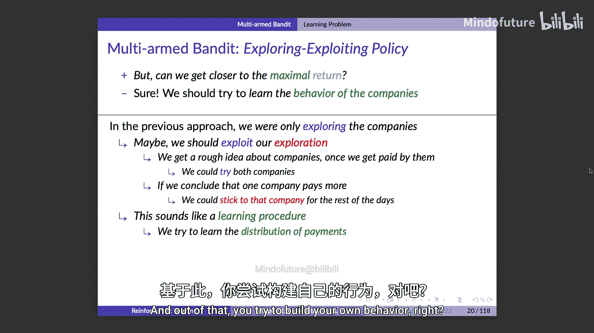

I have a few minutes and so how this policy works as compared to the other one so what I'm going to do I'm going to do the most really one so I'm not going to work I'm not patient or not going to work for a couple of days in every company I just work for one thing right。

I'm going to work for one day at company A， one day at companyas B。

 and then after that I'm going to compare the payments。

They want I am and A if A pays me more than day two， which is I am at E。

 then I'm going to keep working at A。

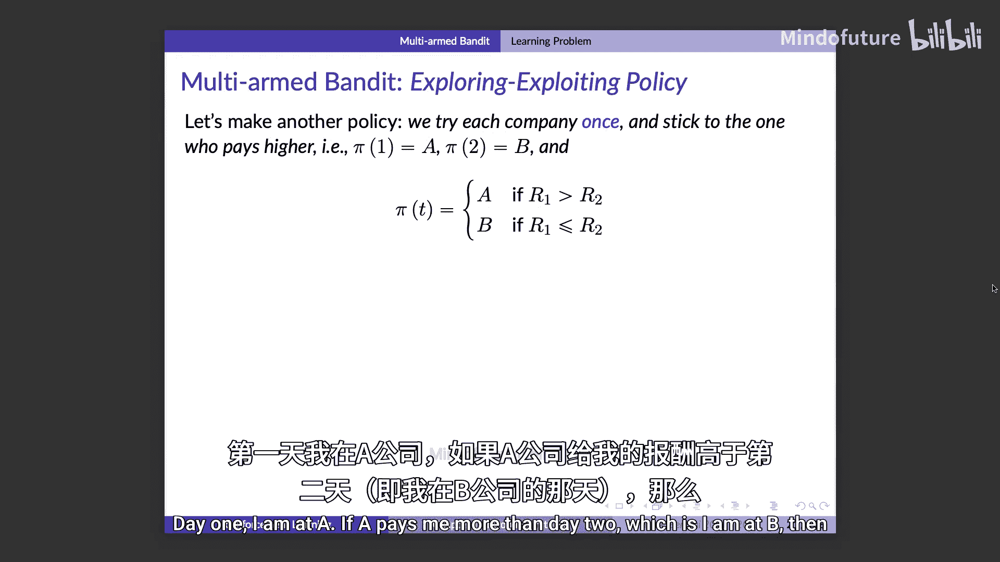

If I work at if on day two， I get better then and then I'm going to keep working at something okay。

 this is the most greedty way of playing， but it turns out that this quantity is better of than playing1。

じゃあ。Now let me just show the return that you get out of this policy by GW。

 so variety don't want this one is simply because I tried every company forte just a single day okay。

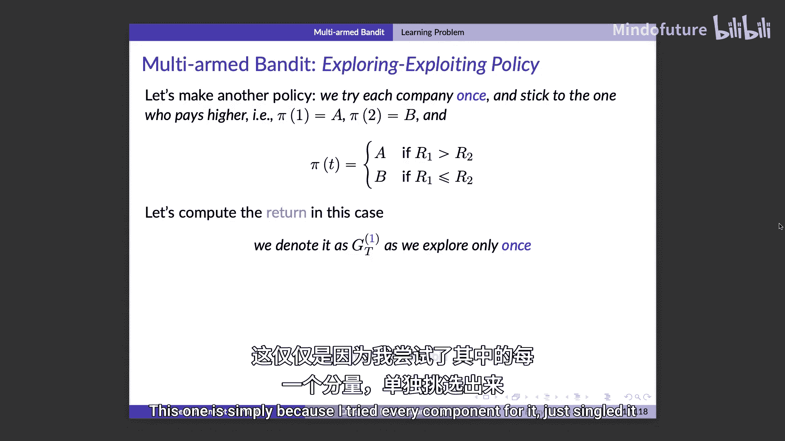

Yeah。Everybody's cool of all the Gosion distribution， it's Q mon。

 and also the property of assigning multiple randomrs。

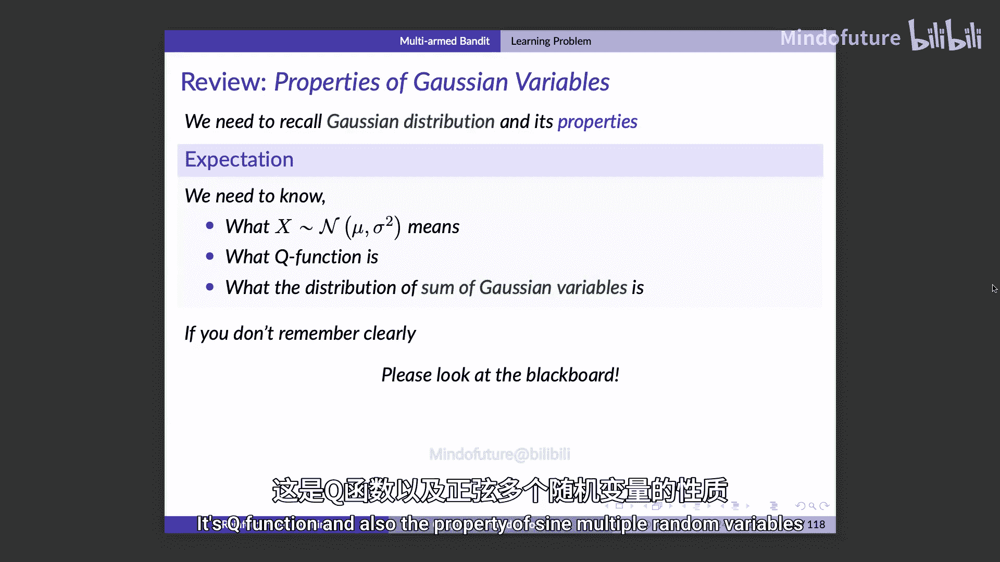

Or you want me to be explain。