# 【多伦多大学】强化学习 2025 ｜ Uoft   Reinforcement Learning   Fall 2025 p04 P04_讲座_3_多臂老虎机的混合方法 -BV1D3F2zhEry_p4-

We have this example where you have a。

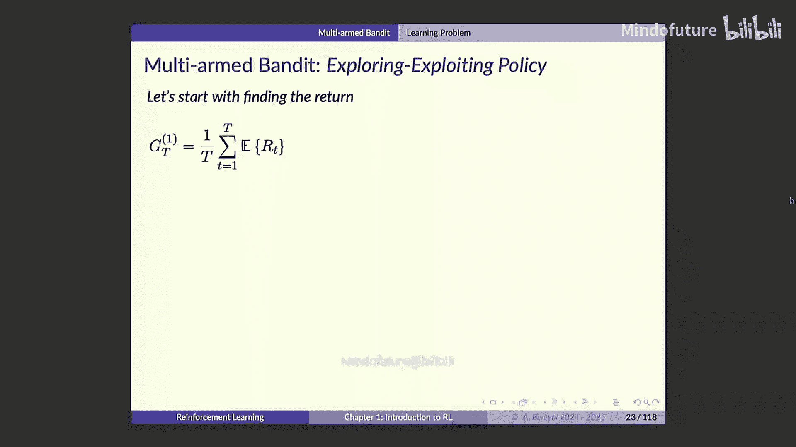

A robot。 And then this guy is able to do the coding。 And now you want to just choose the company。

 which is paying you the best， right？ And then we had two companies， Company A and company B。

 Company A was paying more。 It was 600 in average。With 100 variants。

 And then the other one was 400 with 200 variants， right。So meaning that this other company。

 like company A is in average paying more than company B。

 but it could be that for one sample payment， company B is doing better than company A， right。So。

Then we wanted to just send this。Robot to the， to work for us。 And what was the optimal strategy。

If you want to send in for two days， what was the optimal strategy。我还。Alway go to， right。Exactly。

 always go to。He害。啊为嗯。Other approach that we had was that we do。Random。Random selection。

 like every day that we want to work， we just randomly just flip it quiet。

50% of the time we're ending up working for a，50% of the time we work for B， and then。

We just collect whatever is given by those companies， right。

 What was the payment we get in this case。It was the。Average of the two payments， right。

 which was one of them is paying in average 600。 The other one is paying in average 400。

 So in average， we expect to get 500 payment， right。

 which is 100 loss as compared to the case where we work always for the good company， right。Now。

 we came up with this idea。 maybe we don't need to be， we cannot be optimal。

 but maybe we we we could。Do the exploration only for few times， right。

 so we don't go randomly working for each company。 We keep on randomly working for the companies。

 And based on what we see， we then decide， maybe I can keep on going only with this company， right。

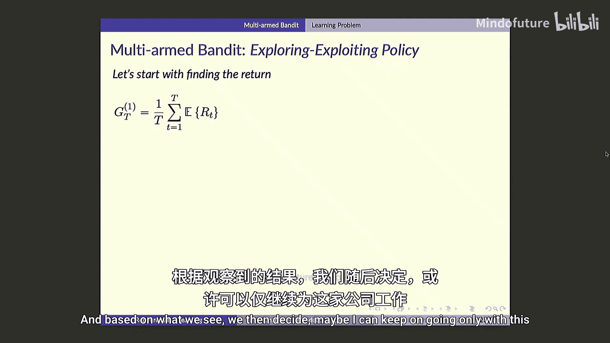

That we came up with what this idea。 So we are going to work for day one。 So pie tea is the。

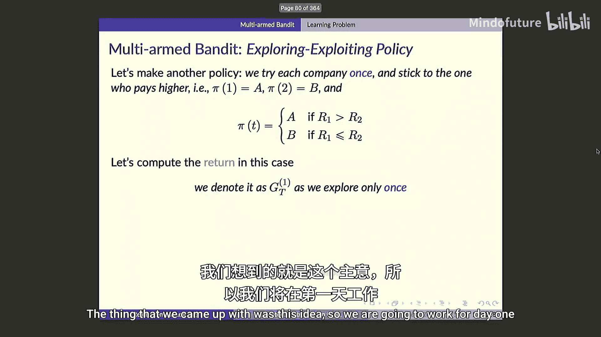

The strategy that we are building。 and this piety is going to be either A or B， the company， right。

 at day T T is the day， right， So we are going to just work for the day1 at a， day  two at B。

 And then were gonna compare the rewards that we are getting we just pay the the payments， right。

 A pays something on day1， B pays something on day 2， we compare them If a pays more。

 we keep on working for a， If not， we go for B， right， So that was the idea。

 And now we wanted to just。I don't to see what happens。

 What gonna be the average payment that we're gonna get。 Okay， Everybody's cool。

 Everybody remembers what we did。 Okay， so you remember last time that we discussed the Gaussian random rivals。

 right？ If you have multiple Gasian random rivals independent， we said that if you add them up。

 it's going to still be Gaussian， right， and。

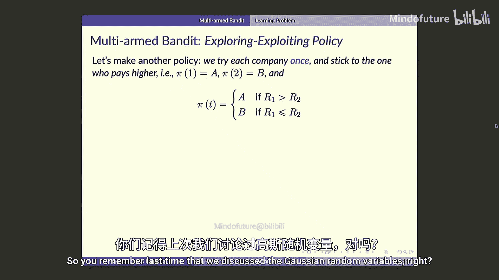

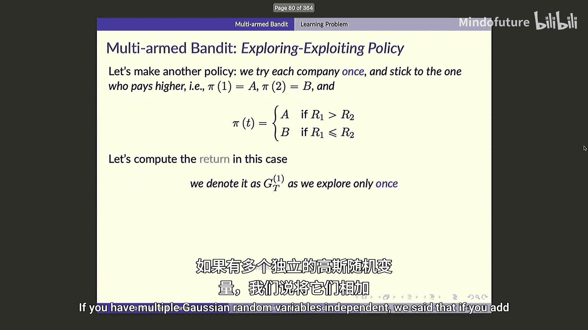

Well， the Q function。 So essentially， Q function was the one which was computing the provolti of Gosm being more than something。

 right。That's it， and。Just keep these in mind。 And now lets start doing the the analysis。

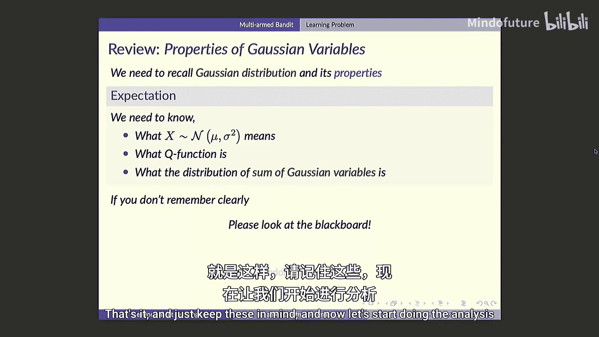

I know what is average payment。 So average return that I'm getting。 So I'm showing it by G T1。

 Once again， this one here is just referring to the fact that we are trying each company only for one day。

 right now。I'm just trying it for one day。 And then based on that， I'm going to decide。

 And this is the payment that I'm going to get。 So R 1， R2 till R capital T。

 these are the payments I get in all the T days。 And I want to open up this， this particular sum。

 So I'm going expand it。 It' gonna be in this form now。In day 1， I am going to get R1。

Where do I work in day one？Company A， and what's going to be the expectation。

 the average value of R1。😡，600 is mu A， right。What about day two？

It's going to be company B and it's going to be 400 or mu B， right？Correct。

 so I can replace them here right？ So expectation of R1 is definitely mu a expectation of R2 is mu B。

 so I can write it down。 But the next thing that I need to calculate is this guy right。

 I need to calculate the expectation of R 3 and R 4 R 5 till the last payment I get right。😊。

What is that expectation， What do you think。Can I says meU A？No。

 it depends whether my policy tells me work for a or not， right？I can now say it's either A or B。

 So what I'm going do， we discussed it before we can do conditional expectation， right。

 So what I'm going to do， I'm going to first fix the policy。 So I'm going to say。

 say I'm working for a。 If I work for a， the average payment that I'm gonna get is going be mu a。

 right。If I work for B， now， say policy is B。The average payment that I'm going to get is going to be mubi。

 I now if I want to just calculate the average payment。For unknown company that I'm going to work。

 it's going to be the chance that I work for a times mu a。Plus。

 the chance that I work for B times mu B， right， So this is what I'm going to do。

 I'm going to fix the first， I calculate the expectation。Or the given policy。 And then I average it。

See right， Everybody's cool。So going to write it down this form。 So if I work for company A。

 if my policy says that work for company A， then the expectation is going。If I work for a company。

Now。of working for company A is the chance of my policy being a， right？

And whatever this green probabilityvolty here is the chance of working company B is going un minus that one。

 right？😡，Everybody's clear。😮，Yes。O， so。This is going to be the average return that I'm going to get if I follow this policy。

 right。In average， I'm going to get this payment， this amount of payment， right。A rise go。Great。

 so now I am going to do something here。 I am going to call this green provolti， the provol。😊。

The probability that my policy tells me work for company A at dayAT T， I'm going to call it P。

Fish payment that I'm going to get。 Now， the question is， what is P1。

 Can you tell me what is the probability P1。Provolty P1 is the provolty that I am going to work for company A on the third day on from the third day towards the end。

When do I work there， yes？😡，Exactly， so my policy says that I'm going to work for a if R1 is more than r2 right so I can say that the probabilityvolty that my policy is a on day t right the policy the provolty that I decide working for a is the chance that payment on day one is more than payment on day two right if a pays me more than2 B。

 then I'm going to work for him right so。

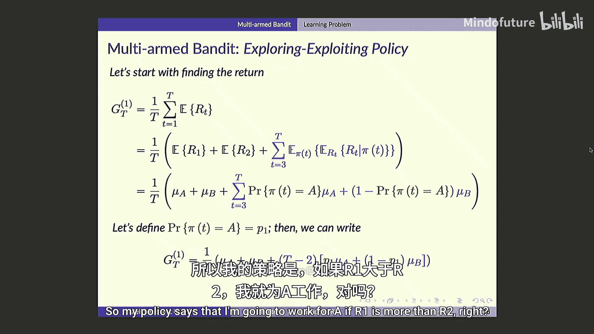

I want to calculate this guy。 Now I just do a bit of modification。 So I'm going write I take。

Want to know what is the chance of the difference between payment on day  one。Right。

 now I want to do that。diifference between。Okay， now one question， what is the distribution of R1。

We talked about it before。In the problem， we say is Scotsian， right？What is R2？Gusshen。

 they are independent because they are independent companies paying you on independent days， right。

 Now， what is the distribution of R 1 minus R2 then。It's a Ga Oceanatian， right。

 What is the mean value？The difference of means， what is the variance？Some variances， right？

 Everybody's cool， right？ So I can say that Delta is definitely a gotian variable。

 The mean value of Delta is difference between the mean value of the payments。

 It means that I have mu a， which was 600 minus muu B 400。 You're gonna be 200。

 So I'm gonna get 200 payments， right。😊，And the variance is some of the variances， right。

 So one of them had stone deviation 100， The other one had 200。 just a square of them。

 sum them This is going to be the variance， right。right is cool。O， so。这。

The that I'm looking for is the par that deta is more than 0。 Do you remember。

 how can I compute that。Q function。 It' going to be。Q。For all to that。Delta is positive。

Is going to be the Q function。 Which point I should compute the Q function at。

0 is the point that I have in the this provolty term。 Yes， and then what should I do here， I choose。

 I should center it， so I should。D subtracted from the mean value。

 And then I should divide it by the。Sunner deviation， right， So I should write mu delta here。

And sigma delta here， right。Otherwise clear， right。You remember that。够这。

This is going to be Q minus the mean value 200 divided by this non or deviation， right。

 And this is just a numerical thing， right？ So if you put it in the equation， I mean。

 just use Python or mathlab or something， you can get the Q function to be。0。81 at that point。

Everybody's clear。And it makes sense。 I mean， the chance that a pays you more than B。

Is 81% makes sense， right， A in average pays more。 So you expect that you see this， right。

 So there is still some change。第二结。By average， you expect to see that R 1 minus R2 is positive。

 right。Okay， cool， so I have P1。 I could calculate P1。

 and I can just replace P1 in the expression we found， right， So I'm going replace here。

 So the return that I'm going get is going to be。 So this is the first term that we had day  one。

 day two， this one over t is still there。 And then everything left here。 So t-2 divided by T。

 I just wrote it down in this form，1-2 over t times。😊。

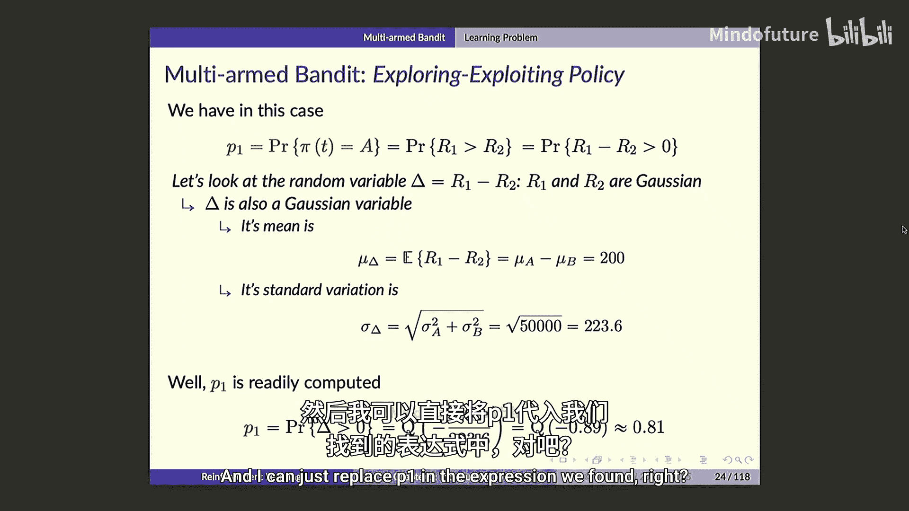

Right。You can go ahead do a bit of， you know， modification。

 So you take this expression times1 out and then you just factorize1 over t there and then finally you end up with this expression。

 okay。Everybody's go。Now， a 600 mu is 400。 Just put it inside this expression。 Do the calculation。

 You're gonna end up with this expression right this， this particular number。

 So you're gonna get 562 minus-124 over T， the number of days that you are working in average as the return。

Everybody's clear。Yeah， questions。No question。So if you go。Let's just go ahead and calculate。

Of that we're going to get。 So we said the rig is the difference between what we get doing that policy as compared to the optimal  one and the optimal one was that we had this gene information that a is the better one。

 We always work for that， right。Now600 was there minus this expression。

 This is going to be the amount of regret that we have is always positive that makes sense because we're not ever going to beat the optimal strategy。

 But pointer is that compare case where we play random。 it could eventually。Smaller， right？

If we work for enough number of days， if capital T is large enough， say if we work for 100 days。

 then eventual term is roughly one and then we're going to get significantly less regret， right。

Everybody is clear。So this is because we have done a sort of thoughtful decision。

 We at least work one day here and one day there。 And out of those statistics。

 we somehow concluded that a is the better company， right。So we did not do it randomly。 And。

 of course， we were getting less regret， right， We are getting closer to the optimal。Right。Questions。

你国清。O。If you got no question， then's just。Go one step further。 So this policy that we design。

 it tells us that in average， we are going to get better return。

 But the point is that it's a bit less reliable because if we are just doing this policy once。Then。

There is a good chance that for that single day that we are working in each of the companies。

 B is going to pay us。More right。 And once this happens。

 then everything in the future is going to get impacted， right。

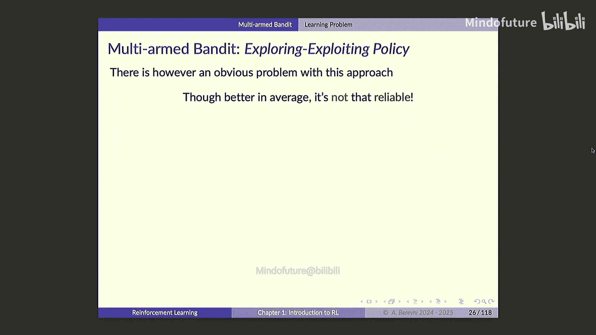

So this term that we found here， this is average， correct。 This means that if I want to like。

 I want to play multiple episodes。 So I want to just work for A or B。For this month， again。

 I want to do it next month。 again， I want to do it next month。 And in the beginning of every month。

 I am doing the， the same the same policy。 So I check A and B and then the rest of month， right。

YouFor many times， many months， then at the end， in average， I'm going to get this one， right。

 But if you think about one single month， the whole month is going to be impacted by the。

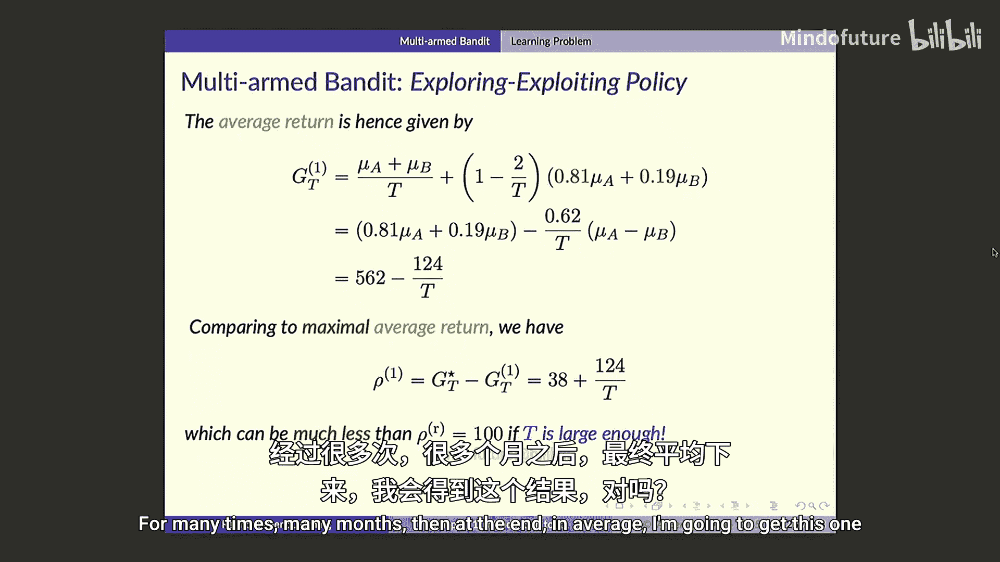

First two days， right？ So this is less reliable。 And if we want to talk about it statistically。

 we could say that in average， we are getting better payment， but this payment has a high variance。

 right？ So the it has a good chance that is around the thing that we said it has also a good chance that is somewhere。

 you know， far less， right。😊。

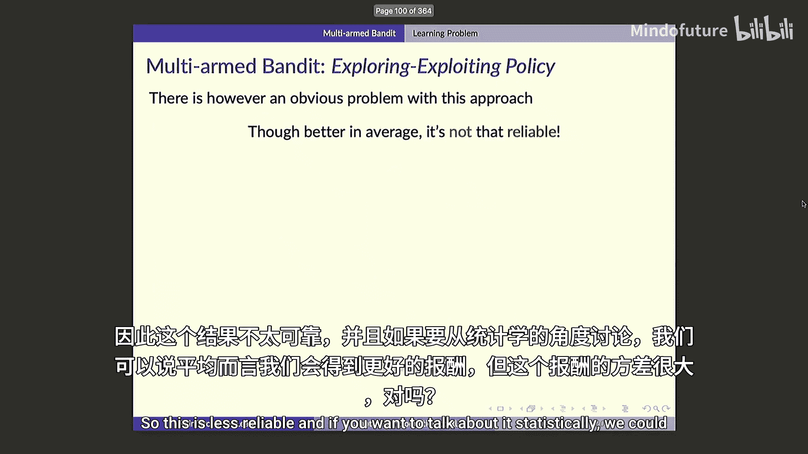

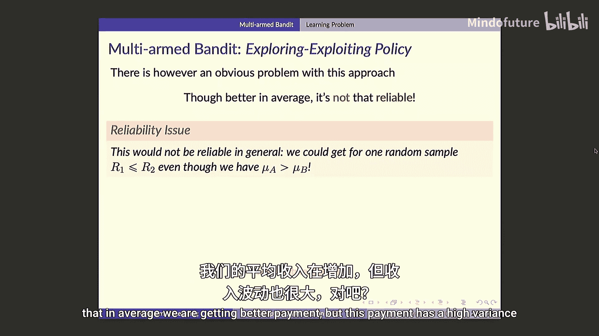

Now， in order to avoid this issue， what can we do， How can we reduce the variance in our decision。

Any suggestion。Exactly， explore more days， right。Want to decide for one complete year。

 Maybe it's better to work 10 days for each company。 right， When you work for 10 days。

 then you're going to get 10 different samples from each company。Make your decision more reliable。

 right？Makes sense。Now，So the thing that we can do， we can maybe go ahead and explore a bit more。

 right。 And now the thing that I want to do， I want to do the policy with D days now。

 right So when we I want to decide， I first work for D days in company A。

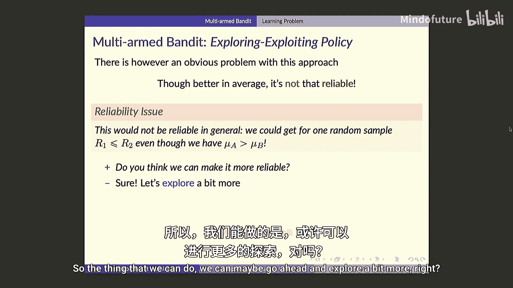

Then I am going to add up whatever I got from company A， right， So this is the。

Cumulative income from company A， right， Then I go ahead and work the other days for company B。Again。

I add whatever I got from company B。 And then I compare these two， right， I said 10 days here。

10 days there in total， I got more from a。 So it says that a is the better one， right。

So at the end of the day， when I want to do my policy， I just look at this sum that I have collected。

 right， So the D days sum payment， I'm going to compare these to for company A and B。

 And then I decide based on that。 the one which gives me more。

 is going to be selected for the rest of the days。Everybody's cool。Questions。No question。

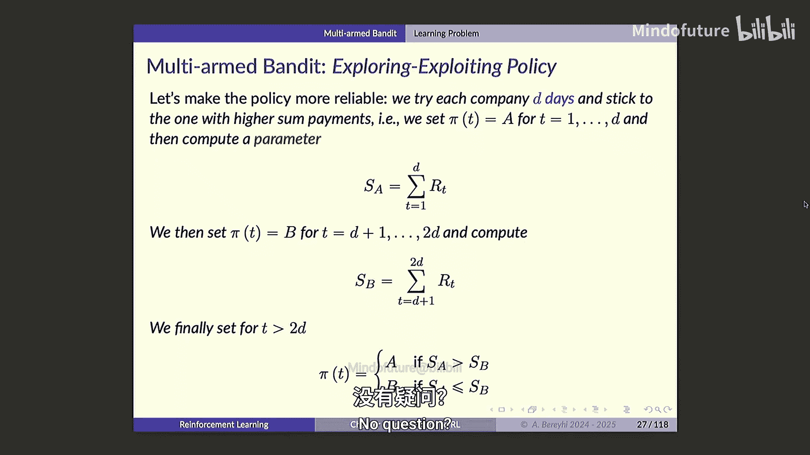

Okay， if you got any question， then。Go ahead and calculate the average return that would get in。

I'm showing it now by G TD D here。 It means that I am doing D days of exploration in each company。

 right。And again， I can write it down in this form， right， So it's the average of everyday payment。

 right。Now， if you open up this term。Again， you have something like this， right， the first。Company A。

 right？ So the average for those payments is mu A times D。 D is the number of days， right。

The second D days is I'm working for a company B， So it' gonna be deep。Policy， right， the policy。

 the decision I make。And and2。Okay， so we can again write it down in that form。

 So I say again that is the expectation of R， given the policy。

 and then I average it over the policy。 So it means that if I work for a， it's gonna be mu A。

 If I work for B， it' gonna be mu B。 and then I'm going write it down the provolti of a happening1 minus provol of。

Yeah， big， right。Same thing as before。 The only difference is that now I'm working for D days， right。

And I can again， define this probability to be PD D， right， I show it now with D， because。

I am consider I am comparing the sum income of the first D days to the sum income of the second to D days。

 right， second D days， right。没。Yes。啊。Yes， exactly， exactly， exactly。Sure， sure。

 you can give a value to it。You can give a value。 That's definitely the case， right。

 when we just formulate the concrete form。 I mean， the whole problem here is eventually with the definition of the average reward。

 right， So I can give this average reward to be proportional to the mean or average payment and also somehow reversely proportional to the variance。

 right， So I would say if the variance is high， I don't want it， right， So I am doing it here simple。

 but。Consider general reward。 And that should definitely include this thing that you said。

 That's definitely the case。Questions。No question。OK so now。Let's， let's consider this case。

 So we want to compute PD D。 again， what we say， we say that PD D is eventually the probability of a happening。

 It means that S A， the sum income from a is more than sum income from B。

 So we can again define delta， which is the difference of the both sums， right。

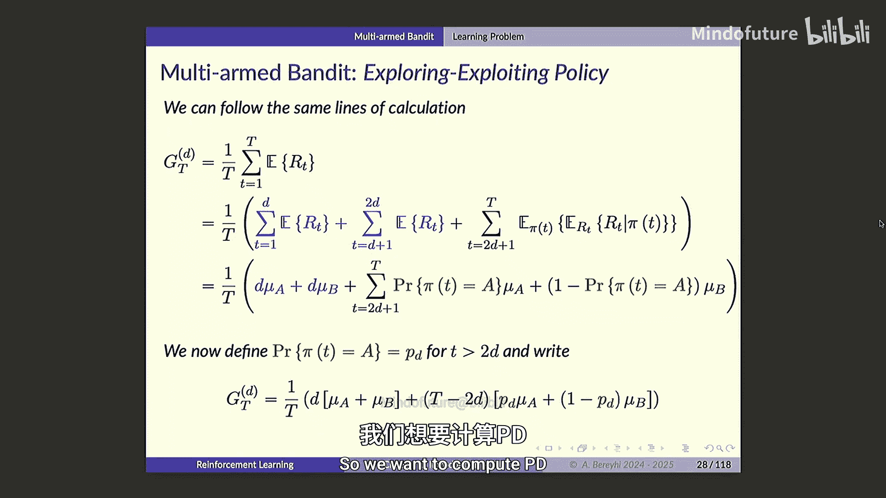

SoIf you look at this S minus S， first of all。About S。 What is S。

 S A is some of independent payments by company A， right， All of those payments are Gaussian， right。

 If you add a D Gasians， it gonna be again Gasian， right。

 So it gonna be a Gasian random arrival again。 Can you tell me what is the mean value。D times mu A。

 What is the variance。D times the variance， exactly。

 So the mean value is going to be D times the mean value of a。

 The standard deviation is going to be a square root of D times the standard deviation of a， right。

 Because the variance is D times variance， right。A rally school。Same thing happens for SB， right。

Egotian rival， the mean is d times the mean of B mubi and the stone deviation。With the score ofD。

Everybody's cool。Okay， so I have S A， Gosian， S B， Goshen， they are independent。 I know the mean。

 I know the。if I want to。Specify the distribution of Delta that should be again。

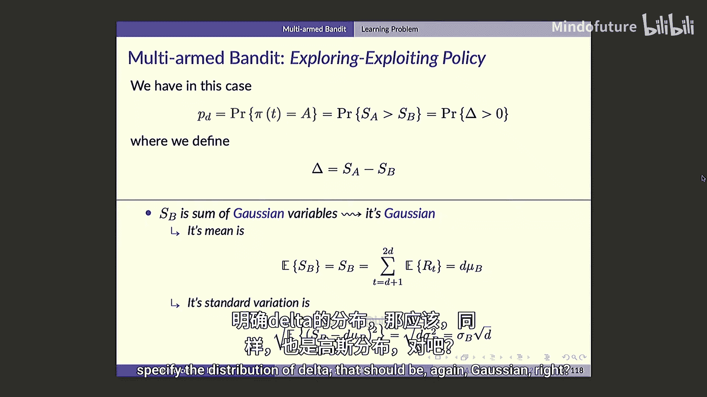

Gsian， right， So this guy is again， Gosian。 The mean value is the difference of the mean value。

 So it's gonna be the difference of the muse times D， right。And this standard deviation is， again。

Given in this form， which is eventually the， the one we had with one day of exploration times is Kruta D。

 right， Everything is scales with D， right。Everybodys school。没。So one thing， just in braas。

 as your friend said， here as d increases， the mean value is increasing with D。

 the standardar deviation is increasing with the square root of the right。right。And this makes sense。

 right， when you work enough number of days， then you have a very clear about that company， right。

Okay， cool now。This， and we can just replace it inside the expression。

 So we want to know what is the chance of Dlta being more than0 in this case。

 So it it's going to be eventually this term， right， So is as before。

 exactly the the same term as before just。Multiply with a square root of D， right now。

If I increase D here， what gonna happen to this expression。If D is very large， say it's 1000。

What do you expect for this probability to be。Is going to be。So it's getting higher。 Yes。

 but if D is very， very large， what would be that value1， right。

 So it's going to be close to one when D is large And D actually does not need to be that large。

 right， Just a few days， if you give to it is going to just converge to one。

 So it's not hard to see this。 So you can see that this is PD D that I'm showing right now here。

 So this is PD D， The expression we calculate it here。 I'm going to plot it from D equal by 0。

 And I increase day by day。

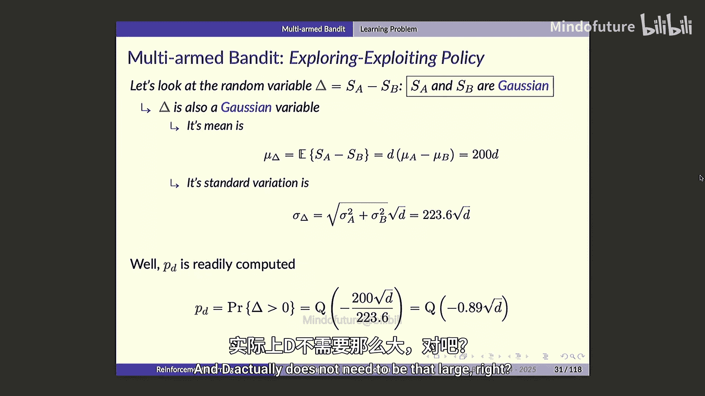

Okay， at d equal by 0。 Look at it。 at d equal by 0。 What gonna be P D， P 0。 What is it。

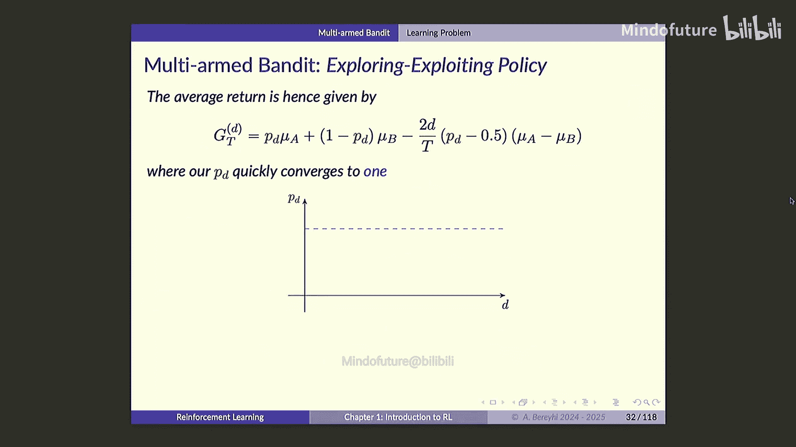

Saad d equal by0。The the argument is going to be 0， right， Q at 00 is。Half， right。

 we talked about this Q at 00。 Just look at the bill exactly in the middle， right。

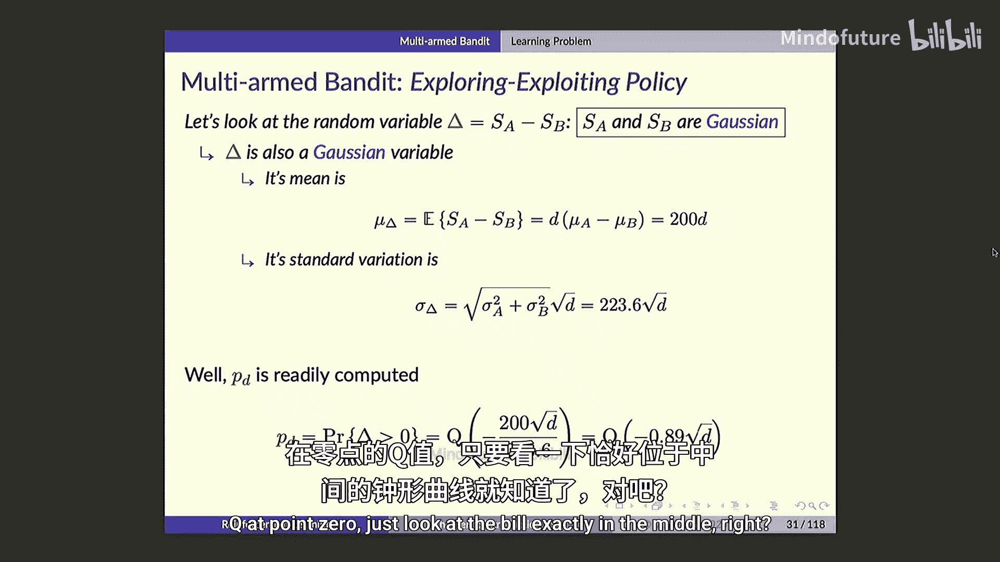

The integral gonna be half。So at  point0， it's gonna be half when I have zero days of exploration。

 What am I doing then。we， we are just doing random a random strategy， right。

You remember that right so if I any exploration d equals by zero。

 it means that I do not look at the payments of the company。 I just randomly choose either A and B。

 This is indeed the random policy that we talked first right now if we said d equal by 1。

 this is going to be 0。81 that we had in the previous case right if you start increasing D。

 this is going to get very， very close to 1 right。So you just need to give it a few days。

And enough number of days， actually， to， to get a sensing a feeling about the both companies。

 And then out of that， you can just。Decide which company you want to work for， right。

Everybody's cool。Okay， now， if you set TD inside the expression that we found， right。

And you do a bit of calculation。 You're going to end up with this average return to be in this form。

 Okay， I don't expect you to just immediately see it， but that is not important。

 The key point here is that。We have muu a。 you see it right？ mu a is the higher one。

 the company which pays us more， right？ We have mu B， which is paying us less。

 and mu B is showing up with factor 1 minus Pd right Now if D is large enough。 and by large enough。

 I mean simply say4 or5 or even more right then this PDd is eventually very close to1 right So I can say the first term is Pd here is approximately1。

 This term is approximately0。 The only thing that is left is this guy right and this Pd here minus half is half。

 So it' gonna cancel out with this two here right and you can approximately write it down in this form。

 this is easier to。

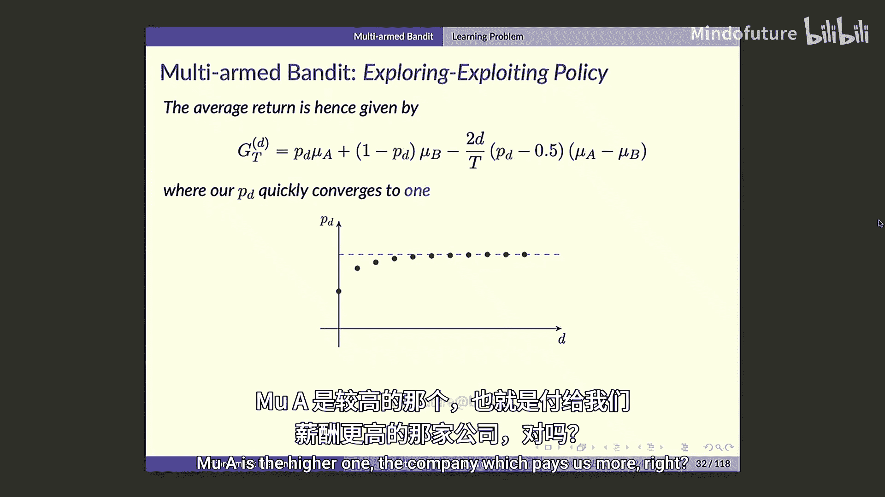

To to investigate， right。 So if this is large enough， say iss more than5。

 then the return that we get is mu a。 mu a was the optimal return that we we expect， right。

 If we play perfectly， then mu a is going to be the return that we get， right。

 We always work for a because the gen E total loss a is good， right。

 And then you're gonna get a bit of deduction， which is d over T times the difference between the two companies。

😊，A tiny bit of deduction， correct。And this deduction is proportional to D makes sense， right。

 because you somehow stack at the first2 D days to just explore find out which one is better， right。

Yeah， but you can do nothing about this because you don't know the statistics really， right。

Everybody's cool。啊。Okay， so that is going to be the case。 So if you just replace the number here。

 you're going to get this expression。 And then if you。

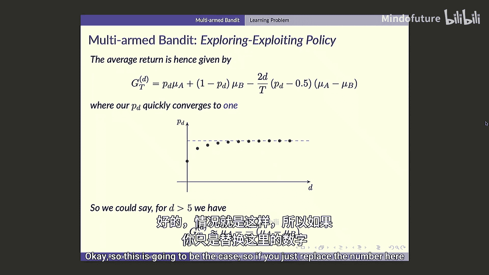

Calculate the amount of regret that youre gonna get is going to be roughly this expression。 200。

 the difference in the two company payments。Over T， right， now。

 if you are going to work so many days for one of these companies。For the the chosen company， right。

 And D is significant。And after that， you want to work for the， the whole year， right， So 365 days。

 then this fraction， D GT is。喂。And then this。Amount of brick that you're going have is going to be very small。

 right。So don't be greedy。 Don't be onpatient。 Just explore each company for enough number of days。

 and they enjoy the rest of your life， right， That's the moral of a story。 So you。

 you can simply say that if you really want to stay there for a very， very long time。

 eventually the amount of days that you're spending on exploration is going to be nothing right。

 It's going to give leave you with no regret， right because that D over T is going to just disappear at that point。

 right。OK so。Any questions， everybody is clear。So you got the idea。Now。

 this is the most dummy example that I can think about in R， right， So。

 but this is a kind of decision making that you do also in your life， right？ So if you want to。

 if I want to just work for a company for a few days， I don't give。

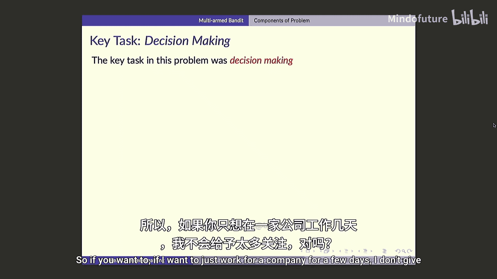

That much。Attention， right。 But if I really want to work for rest of my life。

 then probably I use as much as possible。To explore it， right？ And this is going to be nothing。

 But the key point here is that I am making my decision based on what I get out of interaction with both companies。

 right， If you don't work for any of them， you have no clue about that。You cannot decide， right。

Everybody's clear。So this is what we I told you in the first slide that the whole reinforcement learning is the problem of decision making。

 Here is the decision right， So our agent or robot was just working for those companies。

 collecting samples from them based on that， it was coming with some strategy right and out of those data strategy。

 just made a policy which helped it to work， decide how it works for each of the companies， right。啊。

We， we do not have the whole data available。 so we don't have lots of samples from the companies。

 Eventually， we don't have any samples at the beginning。

 And the only way that we can collect data is that we go and work for those companies， right？

 So it's different from the classical machine learning problems where you have data from each company。

 right， So in。Classical machine learning problems。 you have some sample payments from each of them and out of them。

 you want to decide which company is paying better， right， This is not the case here， right。

 You're interact with the companies。 You have to go there， get the payment and out of that。

 You can decide you need to get the reward， right， so。

You need to work a bit in order to get the payment distribution。

 and we are observing data while we're doing the decision make so。Even if you keep on going。

 let's say you work for five days each， and then you decideci for one。 and you keep on going。

 you still have this。Opportunity to look at the payments given by every by the company you decided and correct your earlier decision。

 right， maybe out of the first five or 10 days， you conclude that the first guy is paying around 600。

 The second guy is paying around 500。 but you keep on working for the first guy and through time you see that oh。

00 was a bad estimate actually paying me 400 right and then maybe you can revise your your decision right So your your data is getting complete over time。

 even when you just so policy making decision making is actually impacting the kind of data that you' are getting right。

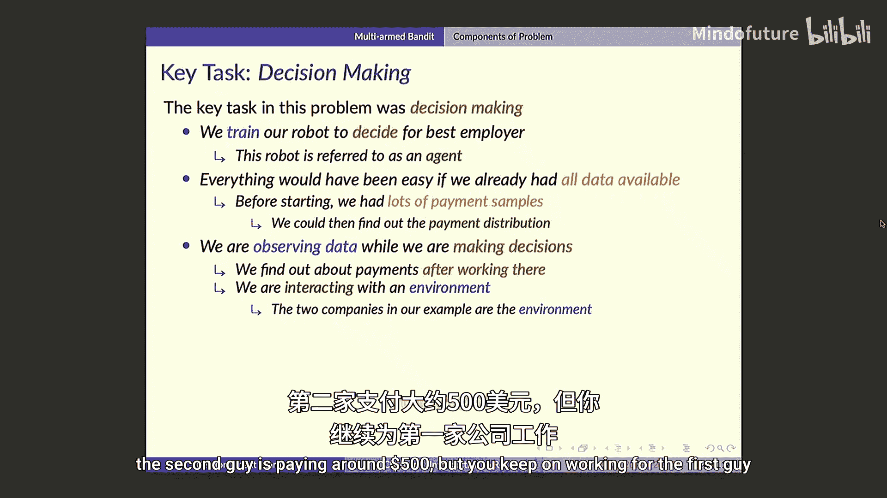

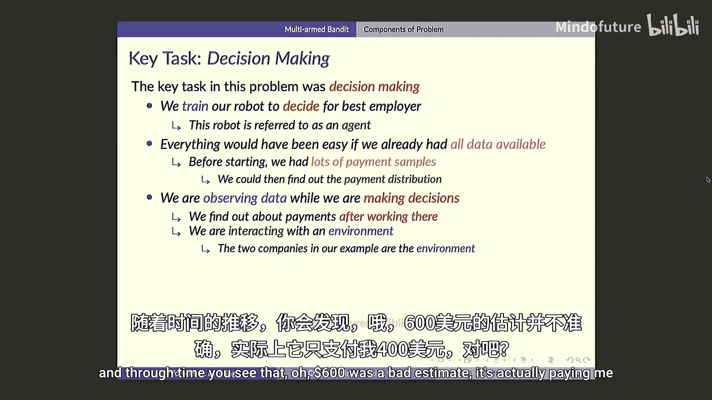

So this is different again from the classical machine learning problem。

 And I just wanted to make it clear for you so that yeah。

 you should say a bit of bye bye to the classical machine learning problems that you had in like。

M L or deep learning。 And we should get into such environment now。

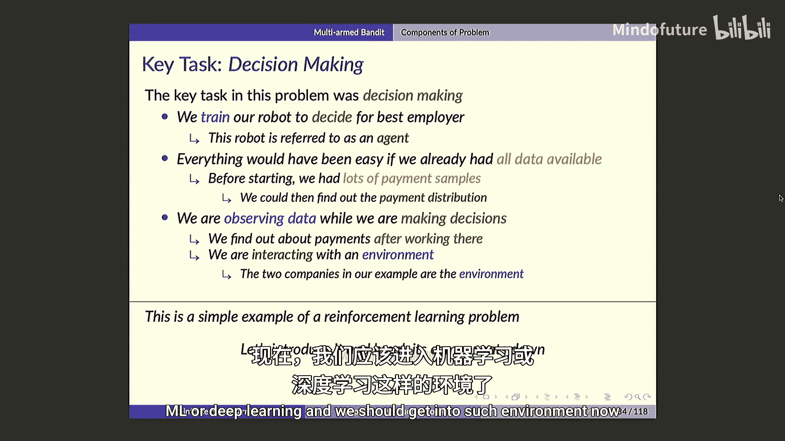