# 【多伦多大学】强化学习 2025 ｜ Uoft   Reinforcement Learning   Fall 2025 p05 P05_讲座_4_强化学习基本问题 -BV1D3F2zhEry_p5-

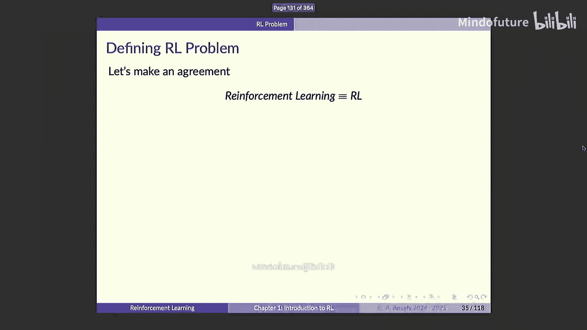

So，好 start with you。Framework R L is working again。 So from no one， I'm gonna say R L。

 So definitely that means reinforcement learning。 Everybody could agree， right。

 And that reinforcement learning in R framework。 we have three major components that we need to somehow model or represent。

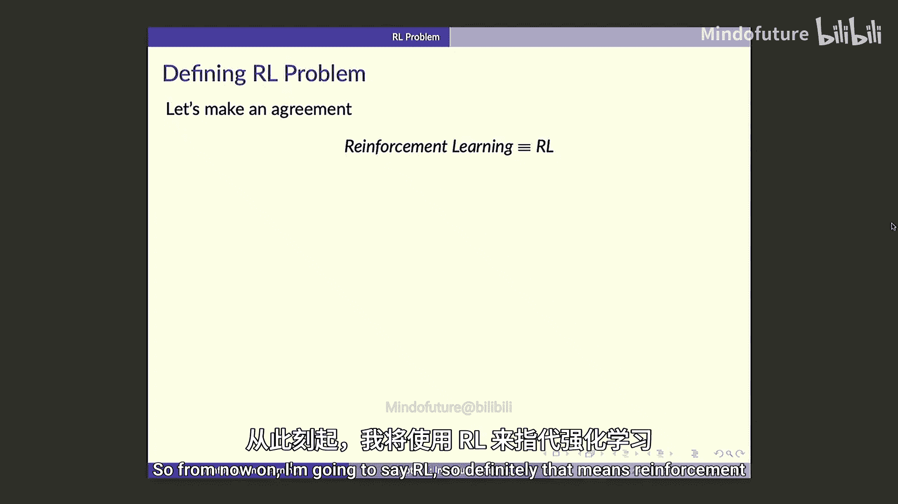

The first one is the agent。 The agent is the one who is doing the actions， right， It' gonna act。

On the information that it has， right， There is one environment。 The environment is the， the entity。

 which is responding。To the action of the agents， right， and。Its sort of interaction。

 some interaction means then the interaction means like the way that the action is going to impact the environment and the way that the environment is going to return some sort of reward or responses to the agent。

 right So these are the three main components， entities that we need to define here。

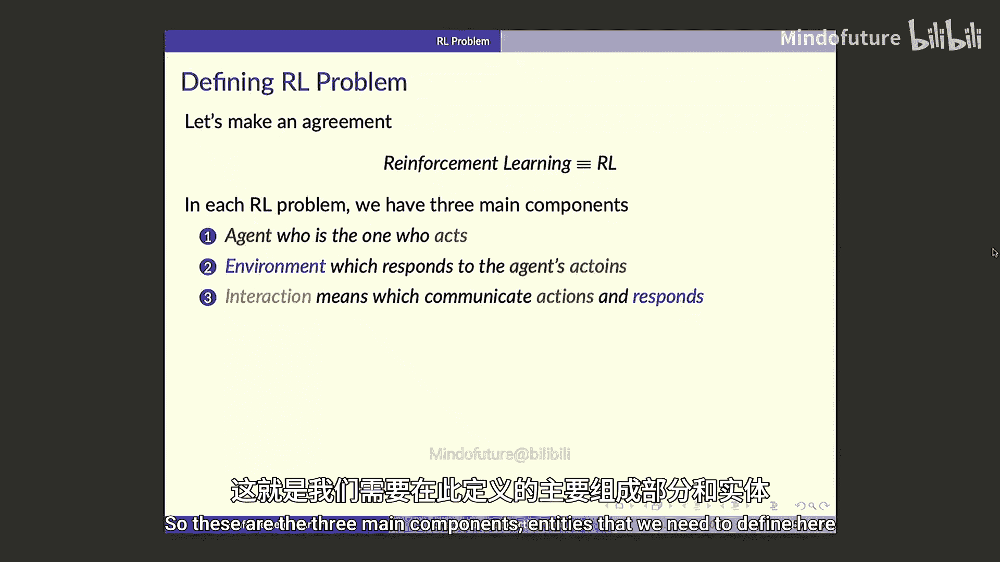

And we need to just develop a bit of mathematical formulation for every single of them so that we get like。

 like what we did in that dummy example so that we can start studying that。 Okay， now， first thing。

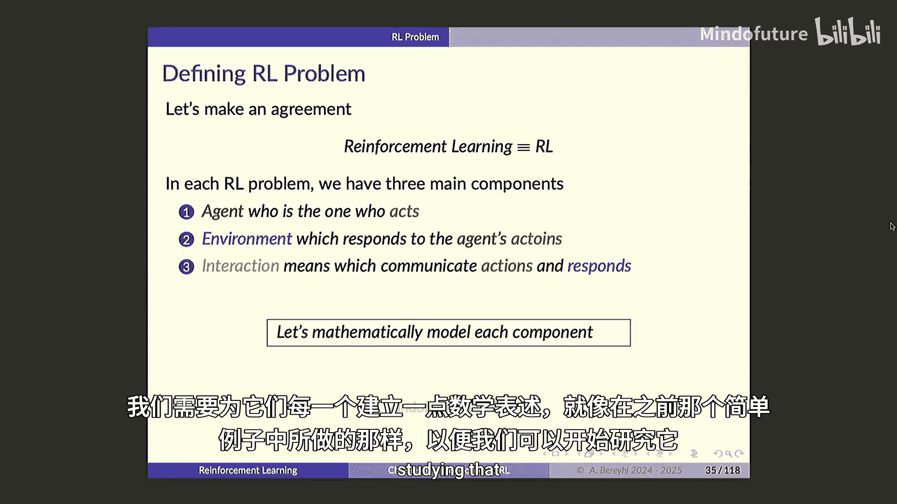

Let's start with the interaction， because the interaction is the most important entity here。 I have。

 as we said， we， I have the。The agent， I have the environment。

 This agent is going to do some sort of actions when it does the action。 So it's one。

Part of the interaction， then this environment is going to return it with two things。

 One of them is observation。 So it's gonna tell to the agent yeah。

 this is the situation right now and also going give a reward， right， so。

Anytime you want to think about this， you can think about a board game for me。

 that is the easiest way to imagine everything。 So action of the agent is the move you do in your your board game。

 right。And then once you do your move。So you can see， I mean， the opponent can also does the move。

 right。The opponent does the move。 You look at the board。 There is one situation。

 There is one configuration on this board。 right， This is the observation that you have right and there is reward。

 The reward is that， okay， the game has not ended yet， yeah。You， you have not lost。

 or maybe the game got ended and you won or you lost， right， So you can get plus。 You can get minus。

 you lost。 You can be 0。 Nothing happened， right？ So this is the kind of reward that you get。Okay。

 now， let's just break them down one by one。

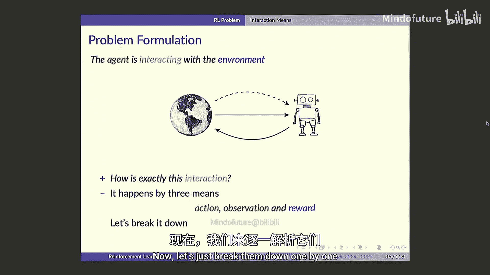

AThe agent is the entity which is doing the actions。

 And in order to show the action at the particular time T， we show it by A T， right。

AT T is the action that is doing at time T now。80 is coming from one set。 This is the action set。

 right。This is a1 to AM M。 I'm showing it by A script here。

 And the reason that I'm doing it is to just avoid confusion。Index。

This is the number of actions that you have example， if it is a name， you can move， for example。

 up down left right right， yeah， so you have four different possible actions up down left right。

 but you can keep playing for 10000 time steps， right。Right。

 each time you can move up down left right， right， So A T is the action that you do in time T and it's coming from one set。

 right。

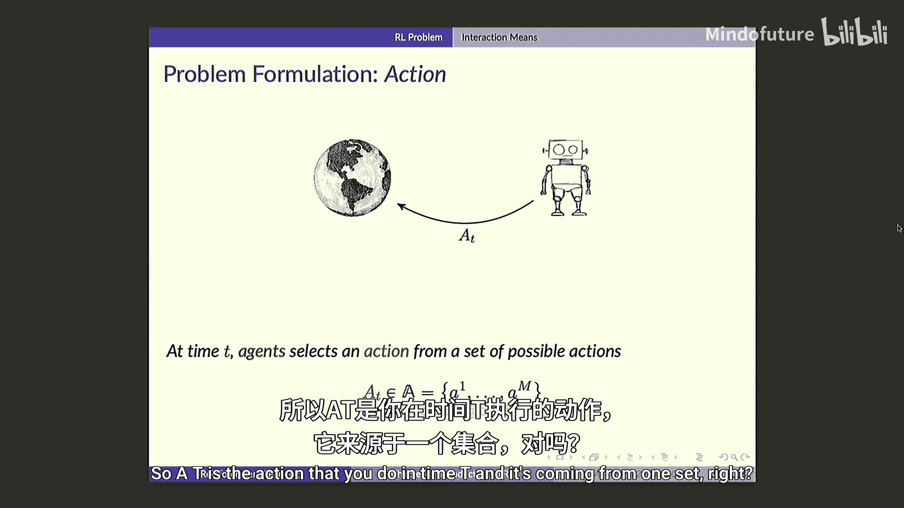

Now， the thing that you might ask me here is that is this set necessarily disc great。

So I can easily think about games that I have continuous action set， right。

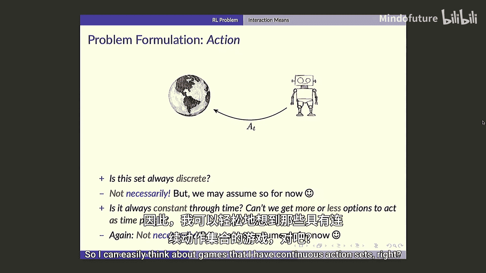

For example， if I think about a robot arm， then it can move， right。And then the when I decide to。

 for the next action， I eventually decide how much I am supposed to move it， right。

 And this is a continuous variable。 It's not going to be just discrete one， right。Correct。

 so you can't have this。 There is no necessity to have this great one。 but right now。

 since it's going to make the formulation much， much easier for us。

 we are going to think always about this great。Then when we get into this， you know， serious case。

 deep reinforcement learning， you're gonna see that you can easily replace it with a continuous set。

 right， So one thing， like a bit of spo in advance， if you want to do tableau reinforcement learning。

 most of the times working with continuous action is roughly impossible。 So you need to monize it。

 right。

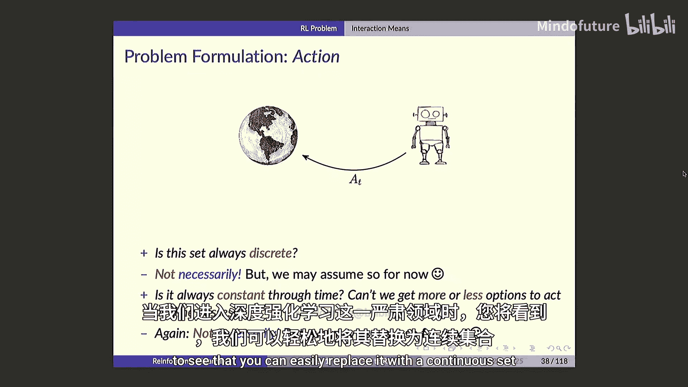

Is going to be exponentially large， right， But when we get into deep reinforcement learning。

 then we can have it， right。No necessity to have the discrete one。

 The reason that I'm showing it here by discrete is because this is going to make the formulation much easier for you。

 And once you understand the formulation， you can easily extend it in your mind to that continuous case。

 Okay， so discrete case is not a necessity just for simplicity。 This is the first thing。

 One other thing that you might ask me is that。Is this said supposed to be always fixed for all the time intervals。

 So am I supposed to have always the four options of up down left right for every single time step。

 Well， now， I mean， many board games when you get to the edges。

 you have fewer number of actions right So this set。Into this one， right。So， for example。

 I can say even in the case where I edge， right， I could say still that my possible actions are up down left right。

 but eventually the right one is now。Not happening。 So I would never choose it， right。

 but this is still in the set， right？ So this is not a complicated thing to do that。

 And because of this， I am not going to show it by A T， right。

 So I'm gonna keep it constant over time。 And gradually， you're gonna see that it's not important。

 Actually， you're gonna drop this， this kind of question。

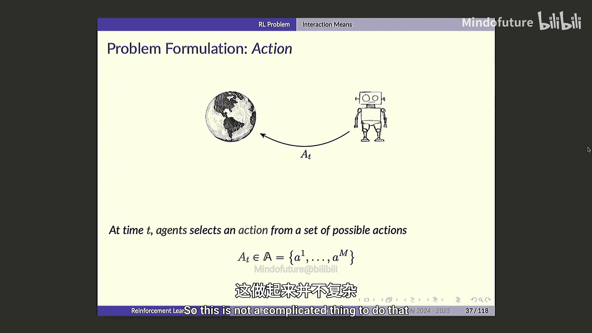

Every cool。Okay， so now you have your agent， your agent can do an action。

 This action comes from an action set。 and every time it does one action， right。

 Now it does the action， the action goes and impacts the environment。

 The environment is now returning some reward， right。

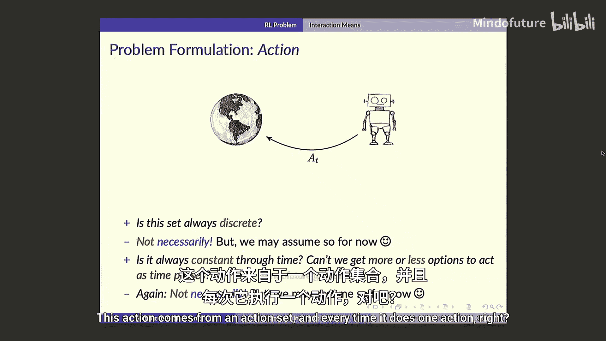

The reward is coming again， from a reward set。So， it means that。

This environment is going to tell you， okay， game is not finished。 reward0， right。

 Game finish you lost-1 game finish1 plus one， right。Third some specific possible rewards， right Now。

 again， you might ask same。It's supposed to be discrete。 No， of course not。

 but you're going to see that assuming discrete is not going to impact the formulation。

 you can easily extend it to the continuous case。 keep it like this and you're going appreciate it when we get into formulations okay。

This is the first thing。 The other thing is that I am going to show it by T plus1。When I do action A。

Then I'm going to get a reward，80 plus one。I know at the beginning， it's a bit confusing。

 but trust me， you're gonna appreciate it later when we writing down the trajectories and other things。

 I do know there are some text where they show this by R T or of time T。

 but I am going to be consistent with this notation， okay。And just be careful。

 I guess I guess Saton's textbook in some chapters， it has this in some other chapters。

 it it is missing that。 like it's the other notation。 I guess in the second edition。

 they try to fix it， but probably there are still some few places where the notation is not completely consistent。

 okay， but I， I'm pretty sure that I am consistent in the course， okay。Everybody's clear。Okay。

 so this means that I do say we kick up with some action a 0 and then。

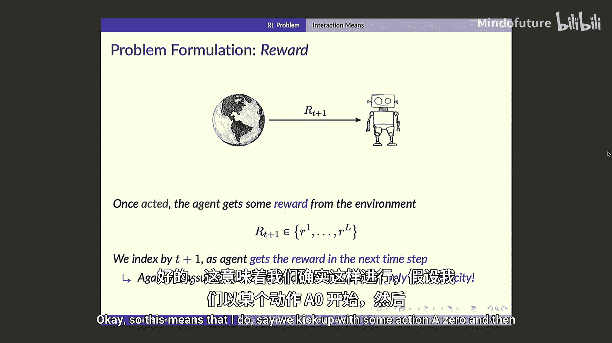

We're gonna get some reward one， and then we do action 1。 We're gonna get reward 2。 We do action 2。

 We're gonna get reward 3 and so on， right， Okay， cool now。

One question you might say is that do we always have reward。 Well， no， like playing chess。

 you're just gonna get the reward at the very， very end when the game is over。

 But that is not a very crucial thing， because you eventually can say that at every。have reward。

 There is one specific。For example，0 or maybe some value， some specific value inside that。

Is representing new reward， right？ So you can think that reward exists every single time。

 but it might be most of the times0， right。

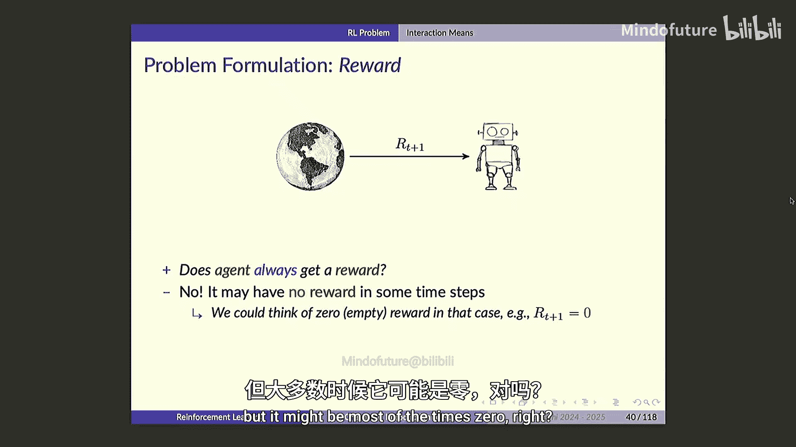

Okay， that's it。 Now the last thing is the observation。

 So what gonna happen when the engine does the action the reward comes。

 but it's not the only thing that it gets， right， It's going to also see some observation， right？

 So when you are playing a board game。I'm going to move。Game is not over。 the reward is0。

 but its still you see the new setting on the on the board right So this is the observation that you can make right So the single you can get particular observation to be consistent again with the notation I'm going to call it Y t plus1 So you do action 1。

 you get reward2 an observation of time2。 then up on reward to an observation2。

 you are going to decide for your action 2 and so on right。

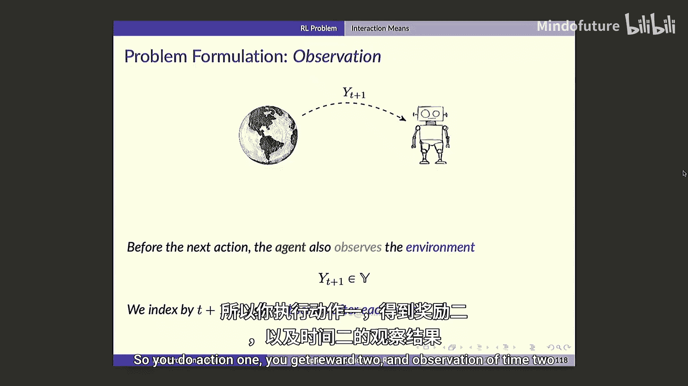

Everybody's clear。Questions。No question。Great。If you got a question。那就。

To this is exactly this thing that I told you regarding the timing index。

 So we assume that we start at time 1。 So the agent observe some initial observation。

 Y 1 gets some initial reward。 R 1。 These observations and rewards could be totally。

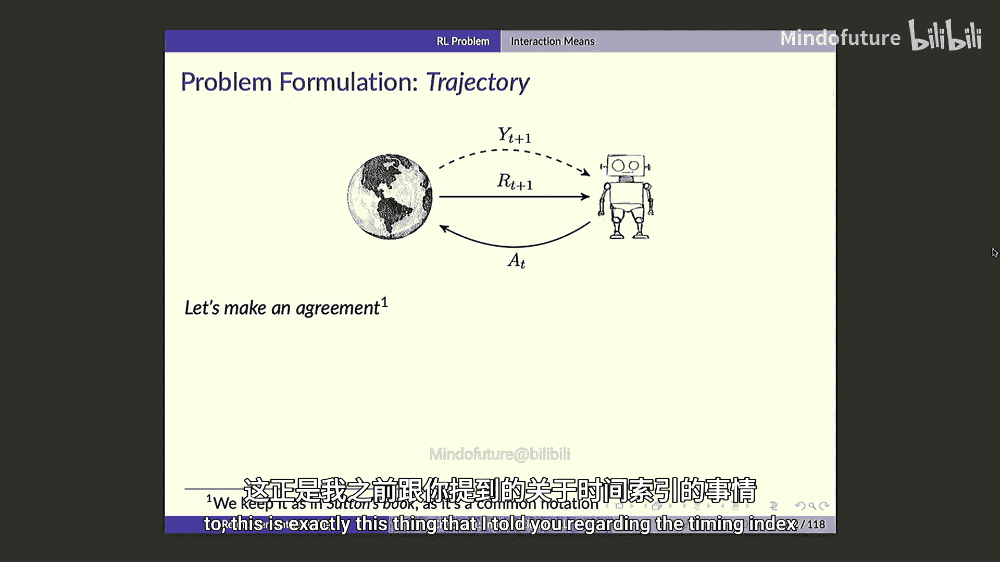

嗯。Empty observation， empty reward。 And then you're gonna do action a1， right。

 This is your first action， right， And then up on this action。

 then you are going to see the next observation and the next reward。

 And you're gonna decide for your next action。 And you keep on going like this， okay。

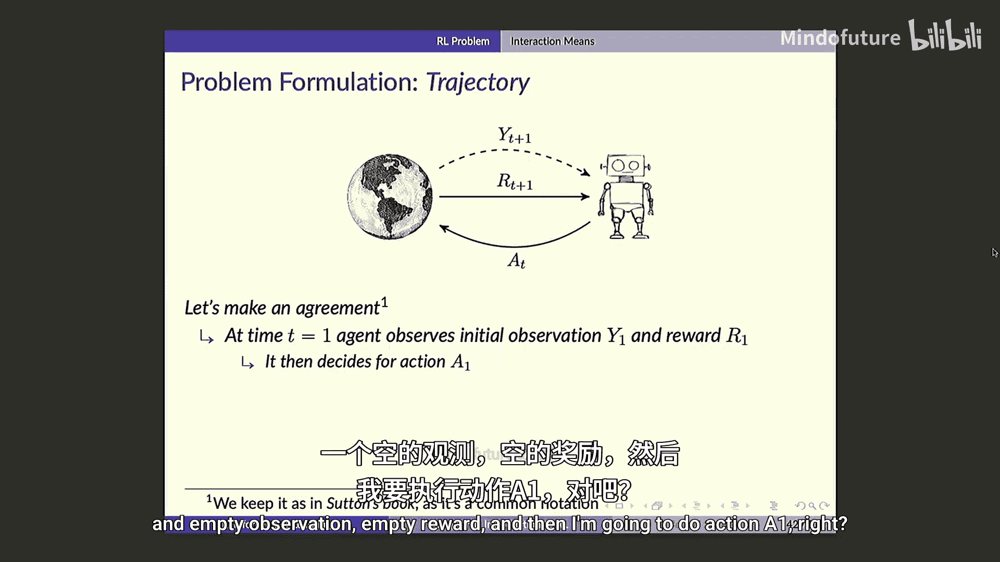

Questions。No question。 Okay， great。 So if you got no question， then that is the。

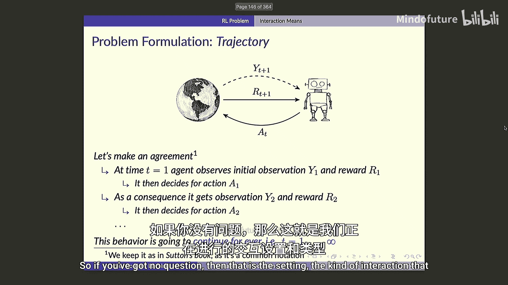

That is the setting， the kind of interaction that we are doing。

 So A R and Y are three different variables。 They are coming from a specific sets。

 Then one question that you might ask me is that any game has an end， right。

Should we put one stop here。 Well， we don't need to。

 We're going to replace that observation quickly with something called state and using the notion of state。

 we actually can model the end of the game by or end of the whole interaction by going kind of recurringing。

So mathematically， that T is going for infinity， right？So it's not going to end。

 You you can play forever， right， But this means that when you get to the end of the game。

 that end game， we are going to define the notion of state。

 And this is one state which you remain in it， right， It doesn't matter what you do after that。

 You can always be there。 And this means that practically， you are going to terminate。Every is go。

Questions。

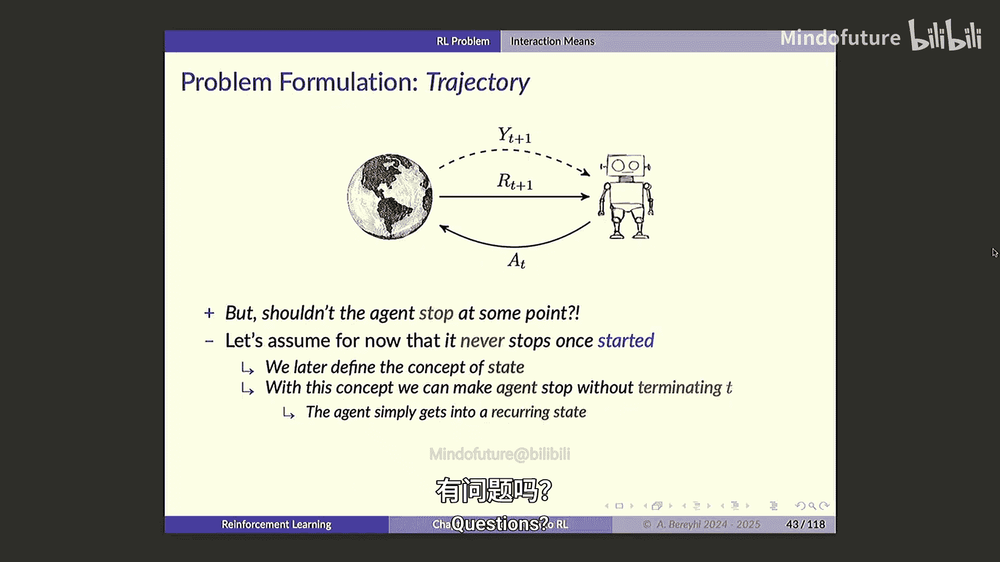

梁国清。Great， so if you got no question， let me define history quickly and then we we we're gonna have short break。

 So this is going to be the case。 So you are going to have some initial observation。

 maybe some initial reward and then you on based on these things which could be eventually empty you could do action a1 right once you do action a1。

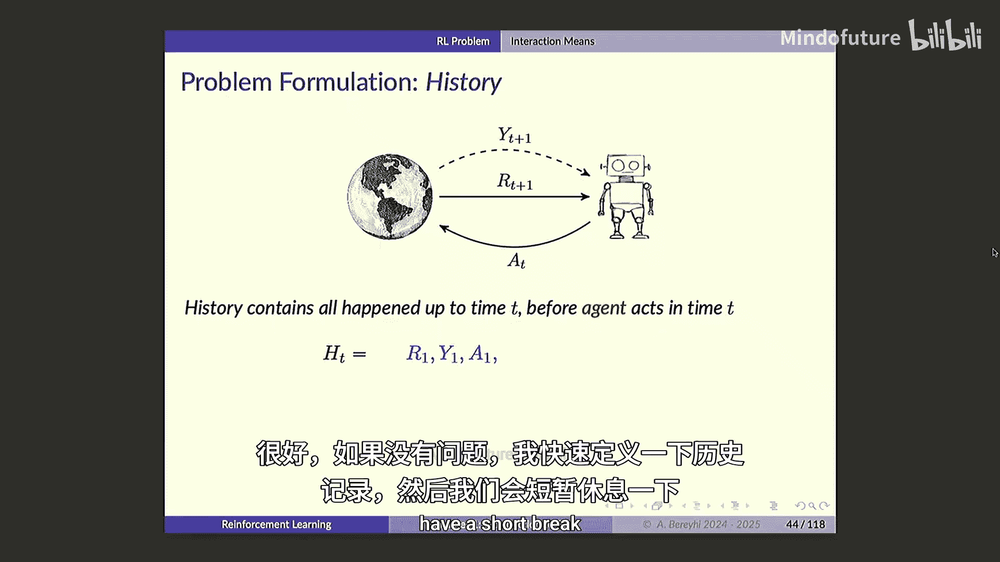

Then you're going to get reward R2。're going to see observation Y。

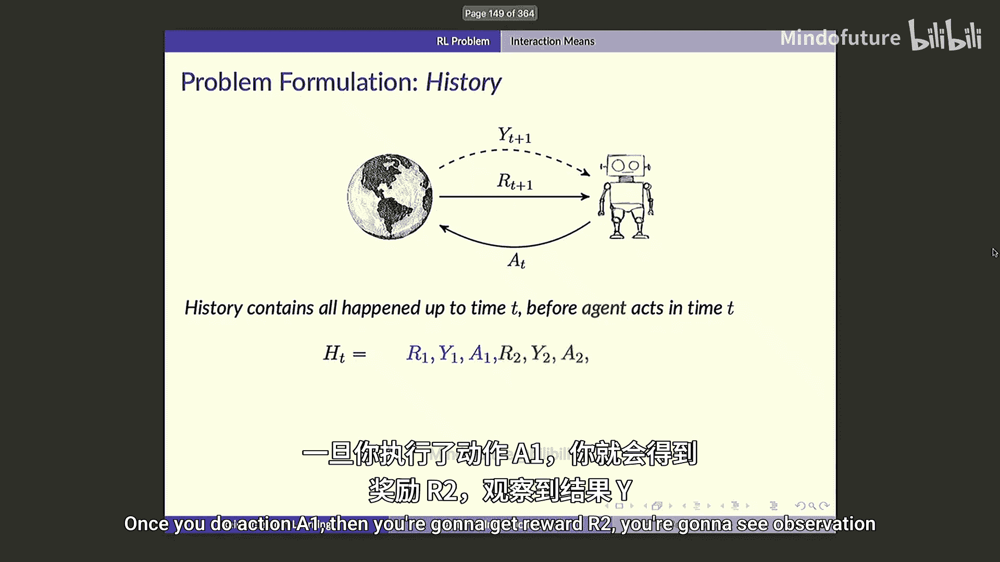

Then do actionate you， right， and you keep on going till you get to time P， right。At time T。

 you already have done in the。you got reward R T observation， Y T。 No sign for your next action。

 theoretically， you can use whatever you had inside this trajectory。To desire next action， right。

 So you don't need to only on the last observation， right。This is usually the case， right？

 So you're gonna to look at all the observations coming out of the out of the game。

 and then like all the moves the other side has done。 And then based on the moves， you。

 you start to make a mindset， right。I can do this move or that move。

 but I'm gonna go for this because I guess that guy。

 based on what I've seen through the time from the other side。

 that guy is going to just not be like say say more vulnerable to this action， right。

 something like that。 So eventually you can use everything here to just decide for your next action。

 This is what we call it history at time T。 So history at the particular time T is the collection of everything coming from the agent and the environment through time right。

Now， one thing that you can't imagine for some people who have a bit of hard time understanding。

 what does it mean， initial reward and initial observation。

 you can think that there exists one imaginary initial action， which is always happening。 Like。

 let's start the game， right， something like this， right？ And then once that happens。

 there is one reward and one observation happening。Like， you just set the board of the game， right。

 Everybody put put its pieces in the on the chessboard， right， So this is the initial action。

 You get the initial observation， Y 1 R 1， And then the game goes on， right。

 You can think like this as well。Questions。呀。Exactly， when you start your。

Your chess game with someone totally new， the only thing that you have is the board is set， right。

 Nothing else you have。Questions。

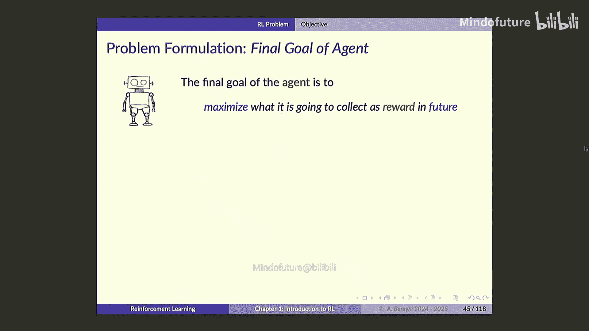

No question。OK。