# 【多伦多大学】强化学习 2025 ｜ Uoft   Reinforcement Learning   Fall 2025 p06 P06_讲座_5_环境作为状态依赖系统 -BV1D3F2zhEry_p6-

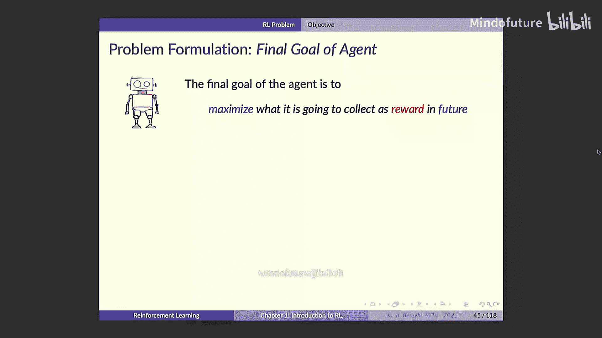

啊。So啊。What is the final goal of the agent So the agent starts to play， It' going to do an action。

 It a reward， get some observation based on them and decide for the next action。

 And it keeps on going like that。 Now， the point is they wants to probably maximize。

What it gets from time Ti on， right now。

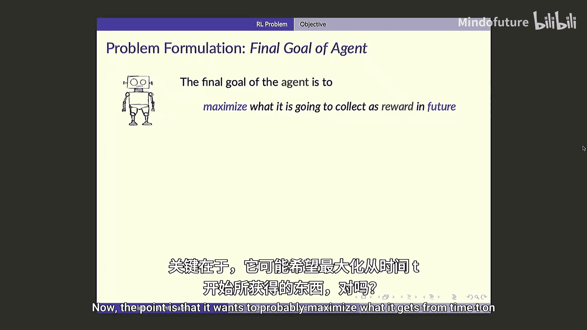

This is what we call it the。Future return。 So it means that when we are playing when the agent is playing at every single time。

 it just cares about making whatever comes after that maximum， right， Now。

 you might tell me why we define this future return。 And well。

 it' is a bit of philosophical question。 So I cannot answer you for sure。But there are a bunch of。

 you know。Invational answers。 So， first of all， I mean， reward is the only thing that thinks of。

 right？ So it's a machine。 And we think that reward is a good thing， right？

 So nothing not money is not everything。 of course， but reward includes everything， right。

 maybe money and a bit of morality and a bit of you know， flexibility and a bit of other thing。哦。

We think that it is defined well enough that motivates the agent to just， you know。

 just do maximize it for with for any， for any cost， right， And this is the first thing。

 And the other thing is that。Why is looking for the future only？ I mean， that。

 I guess it makes sense for you， because whatever has been before is over， right。

 So you cannot do anything for the rewards you collected already。

 You want to just improve the rewards toward the future。

 And one other thing is that sometimes in many board games and other things that you do。

 you gradually start to get this idea that。If you want to get a very good reward towards the end。

 maybe you should compensate a few steps next， right。So maybe you are not。

 you're not always looking only for the next award， right。When you start playing chess。

 you do not do these， you know， crazy moves。 Like you take the bishop and just， you know， hit the。

Itit the queen right away， right， because you know that there are gonna be consequences， yeah。You。

 you give it infinitefinity。 right。 This is the point that I told you。

 about that we are going to shortly define this state。 And once we define state。

 this confusion is going。So but as I said， this is a bit of philosophy。

 So you have all the right not to take is say this is not a very good behavior by the agent。

 Then youre just from then on， you should accept that were investigating a kind of bad creature called agent and devil crger agent who only cares about the future return。

 But given that， we are going to define future return。

 So future return is what the agent cares about， this is going to be this one。

 So G is the return that I'm gonna get from time T on right， So when I move my action in time T。

 when I do A T， I start to collect rewards， right。

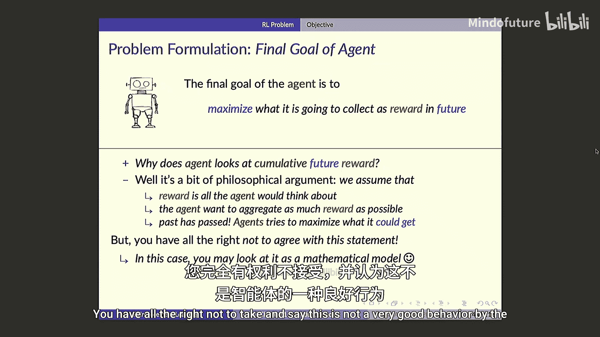

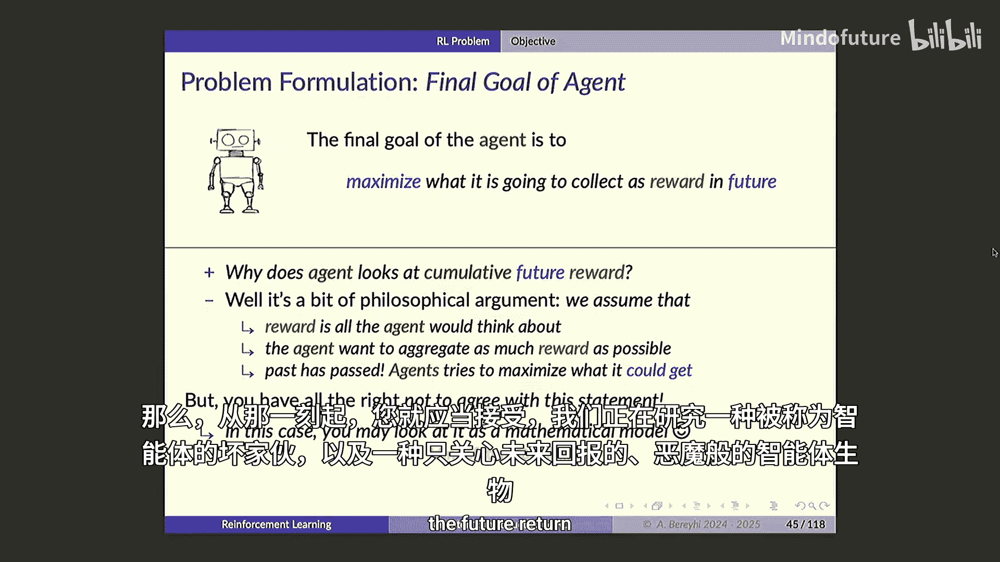

嗯。From then on， whatever the reward is， I'm going to keep it inside this sum。

 and this is going to give me the future return。 Now， here， first of all。

 let's take a look at the the index here。 So if I do action at time T。

 the next reward that I'm gonna get is our。T plus  one， right， And then I go and do the action。

 A T plus 1， I'm gonna get R T plus 2 and so on。So I'm going to have R T plus I plus。Infinity。

 so it' gonna be R plus 1 R plus sorry， T plus 2， R T plus 3 and so on， right。So， this is the。

Time sequence， right， now I have another factor here。 I show you by gamma。 And this factor。

 gamma is something between 0 and1， which。co。Okay， now， if you put it one。

 it gonna simply be that you're just collecting everything in the future， right。

 but you can get give less。Value to the future as well， right， This is why。

main reason we need it is because in some games or sorry， some environments with。Very dense reward。

 like every time you get reward， then in order to make this sum to converge。

 you need gama to be smaller than one。 Like you put it exactly one。 and then you sum of 1，1，1，1，1。

 Its not going to converge， right， You need to make the series converge。

 This is the main mathematical reason to put it， but it also makes sense in many applications。 Okay。

 now let's just break down this discount factor first a bit。

 just get a bit of feeling about the future return。 And then we're gonna go for the next step。

 So if I open up the future return。 the future return is going to look like this。

 So look at this term， the first term， this sum。 The first term is going to be when I said I equal by0。

 right， when I put I equal by 0， it doesn't matter what is my discount factor， right。

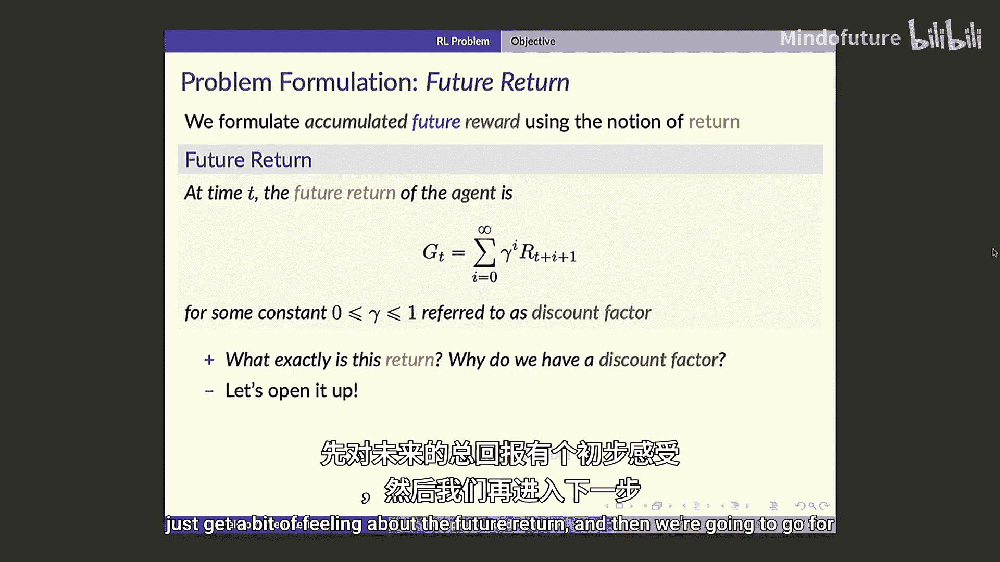

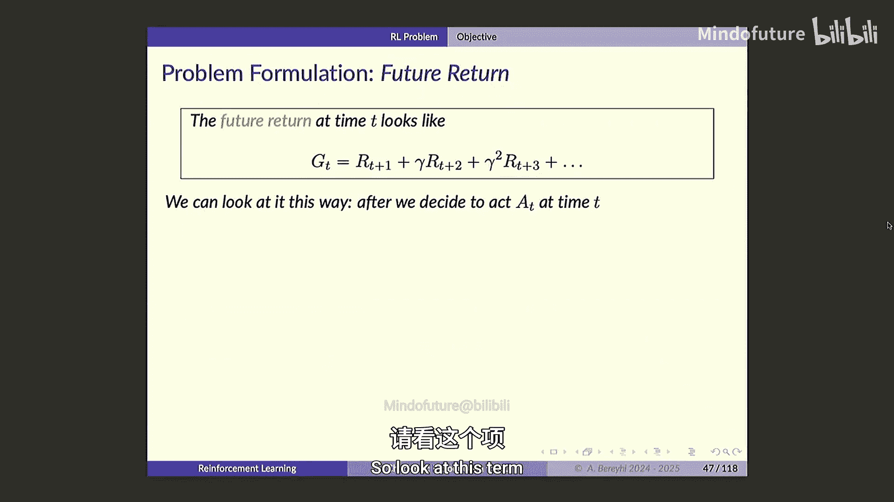

This is always going to be one， right？ Anything to 0 is  one。 It going to be 1。 R T plus1。

 Next one is R2 plus two times Gamma。R T plus  three times gammin squared and so on。

 So it gonna be like this， right。

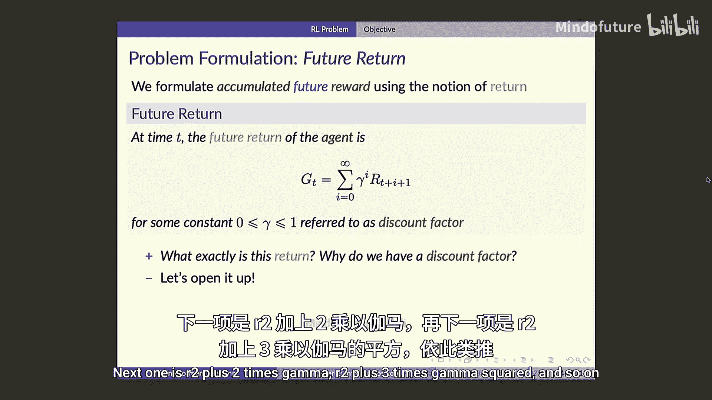

Next return。Read the second next return times the discount factor。

 The third next return times the discount factor is squared and so on， right。那。

Thing is that this R T plus one， we usually call it immediate reward。

 This is the thing that we immediately see after we do the action， right。

And in this formulation that you see， if I set gamma to be smaller than one。

 then I am actually giving the immediate reward more weight as compared to the。😊。

You heard to have your profit or money right now rather than a few years later， right。

 There is inflation， many other things that makes the same amount of money in future less valuable for you。

 right？ So this is the philosophy of this discount factor there。 I mean， it makes total sense。

 But some people might say that， I mean， there are some application where this is not really working。

 right， In that case， you can simply set gamma to be one， Okay， So。

You usually consider a discount factor。 As I said， this is。You prefer to have。Stoner than later。

 right。Now， there are two different two different kind of look here。 So two extreme choices for。

 for discount factor。 you can set discount factor to be 0。 If you said it 0。

 Then any term from the second towards the end， it's going to be 0。

 This means that you're going to just look for your immediate reward。

 This is what we call it short sided agent。 This is like you just look for the next time， right。

 You don't think for the future。 And then you could be a bit。

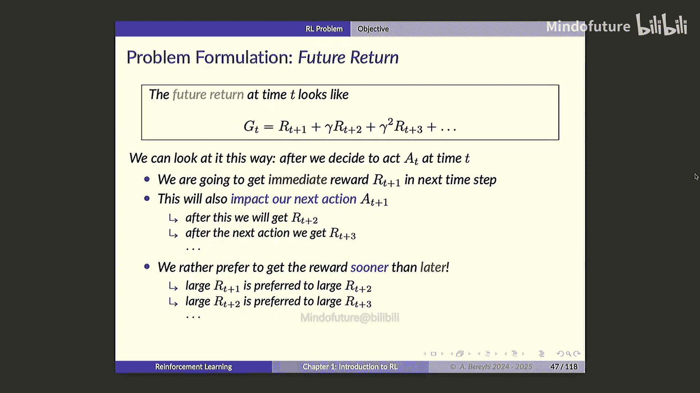

Thats why you give it more time， right， So you can。因为别的。From the future。Very extreme case。

 you might be super conservative and you equal by one。

 meaning that you just care about the very future as as you care about your immediate reward， okay。

Everybody is clear。 So this is the return that we this is the thing that we expect or we sorry。

 we we care about and we want to somehow play in a way that this future is going to be maximized。

 right。

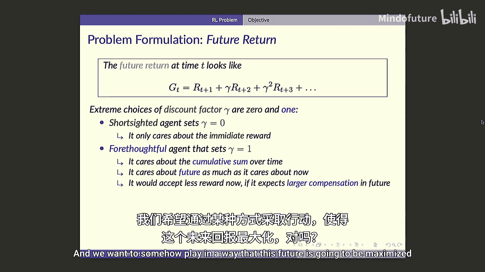

We want to maximize the future every single time when we want to decide for action。

 the thing that we are going to do， we have a history behind us。

 We look at everything in the history， and we decide to take the action from the action set。

 which is going to give us or we expect that it's going to give us the highest future return， right。

O。Now啊。The key point here is that。If you want to do this。

 if you want to do it in this framework that we have here。

 if you don't add any sort of formulation of the observation that you have。

 you're gonna get into a trouble and the trouble is that say I can describe this environment with some weird logics right So say this is is actually a robot arm or a robot real robot and then you're just designing the action of the you know joints and the movement and all of them。

 I mean， depending on the action that you do， you can explain what's gonna to happen if you do know all the physics of the environment right it' gonna be a super complicated thing。

 not practical theoretically you can do But even if that is the case。

 still you're gonna have a big problem And the problem is that if you want to really do this at every single time you need to have the whole history your buffer right So you need to know what does the robot。

what kind of move the robot has done on the very first time step towards the care and time step。

 And if you want to leave the robot in the nature， this is pretty much impossible， right。

 So theoretically， you cannot collect all of those returns forever。

 you cannot keep all of the history forever。 And this is also something that is not happening in in practice。

 And because of that， this is why we are going to just model everything with the random object random formulation。

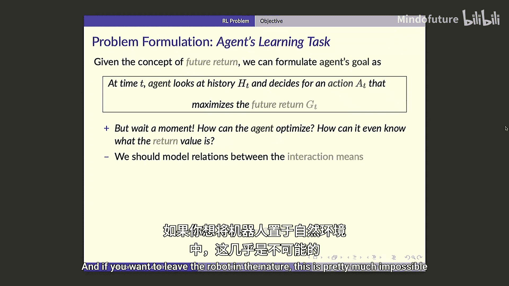

Analysis is hard。 and also， we do not have theoretically。

 we do not have infinite memory to keep all the history， everything。

 So we are going to look at this environment to be a kind of random object。

 So I do understand that some of you might say many environments that we are working with。

 it's not theoretically a random， because if we have a huge computational power。

 We can explain that environment perfectly。 That's correct。 in the robot example， that's the case。

 But at the end of the day， this is computational inible for us， right。

 This is why thinking about the environment to be a random object is actually a very。

Concre mathematical form。 And the point is that even if the environment is really deterministic or random formulation is going to reduce into that deterministic form by setting everything properly。

 Okay， so is a kind of more general formulation。 Now。

 what we are going to say that depending on the action that the agent does。

 then there is going to be a reward and an observation。

 And this reward is an observation are coming from some distribution， right。

 So you can think of the environment to be a kind of random generator。

 It's going look at your action and then going generate some。Random reward and observation， clear。O。

 so。Agent。Is the agent again， looks at that things coming from the environment and tries to do it。

The agent itself can again do the action randomly right。

 It's going see whatever it has through the history。

 And based on that is going to just act maybe randomly。 For example。

 in the multi case multior banded case， we had the the random strategy as well， right？

 So I told you you work first day A， second day B。 And then from then on。

 you're going to work for a if a is paying more B， if B is paying more right， But can you tell。

Where are you playing on day 3 from very beginning。 No， is it still random， right。

 It depends on the payments coming from the company itself， right， They are random。

 Your action is random as well。 right， So no， the thing that I want you to start gradually feel is that this agent and environment。

 the best way that you can explain their interaction means is to just describe everything by random processes。

So you have your agent looking at a few observations。

 these are realizations of random things based on that is's going to just decipher something。

 this could be potentially a random， so it sees something and given that its going to generate some action。

 which is potentially a random and then based on that action again。

 the environment looks at the action and given that action is going to generate a reward and observation okay。

是。Now， yeah， so this is eventually what I said。 So I forgot the。

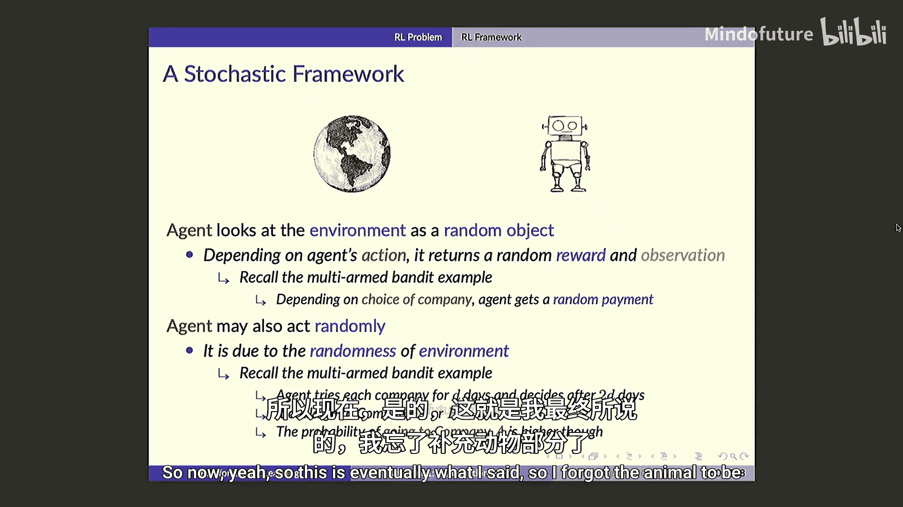

两案。To be completed。 So now。If we wanted to formulate the way that I told you， yes。

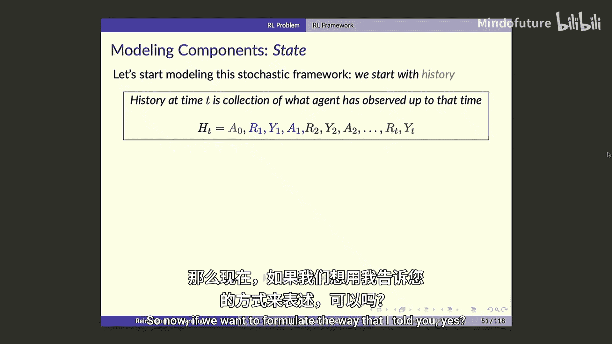

Yes， yes。Yes。Definitely， yeah。Yes。You can add， like， for example， the。On exploration。也。

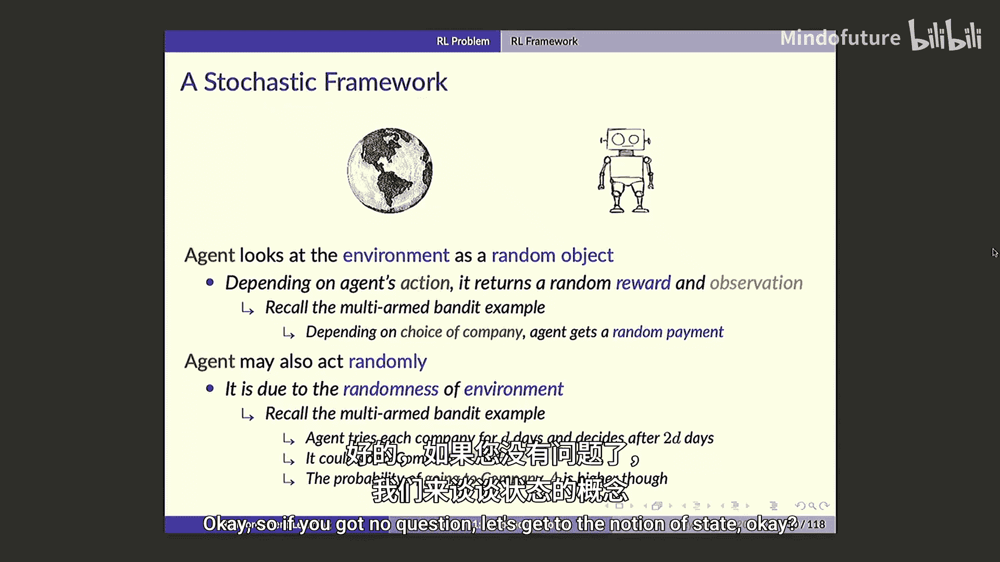

那关。So if you got a no question， and let's get to the notion of state。 Okay。

 now we are gradually getting there。 So this is the final formulation now。The environment。As we said。

 it's going to be a kind of random object， right， This guy looks at your action and gives you some reward and some sort of。

Observation now， if we really want to think about it that we have this whole history forever。

 And then at every single time， the thing coming out of the environment is somehow depending on this whole history。

 then the memory of this environment should be infinity， right， because， I mean， eventually。

 at some point in time。Any， any environment with limited memory， which is the case in the nature。

 right， Nothing in the nature has infinite memory。 So anything on this nature at some point of time is going to get full in the memory and。

Nothing is going to， yeah， I mean， you cannot keep the whole history in there， right？

 So because of that。 So as t goes to infinity， the memory that is collecting all of this history is going to get infinite。

 And this means that the environment is going to get full in the memory。

 One thing that I want to just give you give you a bit of attention here， a remark here。

 I'm not talking about the memory on your computer simply， because that is， of course。

 one kind of memory， But when I talk about the memory， I really mean like the the nature， right。

 So for example， the the weather right， the weather。Has a limited memory again， right。

 you cannot say that today weather is really depending significantly on the weather。2000 years ago。

 at some particular day， right。This is not happening， right？ Do you get my idea off memory here。

So I'm just talking a bit abstract here。 So by memory， I mean that anything in nature， whatever you。

Fith iss going to depend on a few things before， right。

 That few could be very large for some natural things， right， But at the end of the day。

 it's limited。 It's not really dramatically going to infinity， right， It could be very large。

 but it's not infinity， right， So because of that， we cant find something that we call it state。

 okay。I'm sorry if it was a bit confusing。 but once the state is there。

 then everything gonna get clear， okay。But I found it the best way to justify that we need in state here。

 so。嗯。So this is the moral story that I want to say。 Like。

 if I have this very long history at some point of time， it's going。In this nation。

 going to collect all of those infinite information， because that is eventually not the case。 right。

 we， we don't have infinite information in this nature。

 So this is why we need to just define something which is。Carrying information。

 a finite amount of information， infinite in time。 And do you have any idea what kind of thing that could be。

If you have one，1 environment， say you have the weather， right， And then you want to talk about the。

Whether today or tomorrow， Okay， then you typically do know that it。

 it's getting like you are not going to say， like， this is the last day of this universe， right。

This is not going to happen。 So the days is go go forever， right。

 But every day that you want to decide what you're gonna say。

You are going to look at a finite number of days before， right。

 And you're gonna say these are the days which are going to impact anything before it。

 It's eventually having so much tiny impact or maybe nothing that I can simply ignore it， right？

 So now when you go the next day， what gonna happen to that memory。

The last data that was in the memory going out， the new day replaces， right。

 If you're looking at the last 10 days。😊，Today， you're looking at the last 10 days tomorrow。

 you're looking at the last nine days plus tomorrow， right。Yeah， you see it。

So you're gonna to carry this finite memory infinitely over time。 And this is the notion of。State。

 right， I don't know if you had the course deep learning， but indeed。Get into analysis of sequences。

 We're going talk about the same thing， right， state dependent system。

 So any system that has a finite amount of memory which can carry over time for infinite。

 then you can represent it as a state dependent system， right？

 So there is one state that could be giant by it again finite， right。

And then everything in the future depends on that。 The current state， right。Everybody's cool。

Questions。No question。Yes， because it's not like they are not relevant at all。

 but they have some impact on your current state and all of the information that you need about them is available in your current state。

 right， So you can just look at your current state， right？ So it's true that。Was。

 I don't know last summer， right， not this summer， last summer， right as well。

 But the key point is that the temperature in the last couple of days were also impacted。

You need to predict the temperature tomorrow is within them， right。So， yeah， that day is。

Implicitly impacting your decision。 But you really don't need to just look at all of them like from beginning of history。

 from big bang to today to the temperature。 right， You don't do it， right， You get my， my idea。

So yesterday， temperature depended on the previous day， right and the previous day and so on。

 But if you want to just talk about tomorrow， you just look at yesterday， right。

 And then you would say， okay， if yesterday was warm， this is because the day before was warm right。

 and the day before was warmer than usual and so on， right。

 But you don't expect that tomorrow is now going to be very cold right， because yesterday was warm。

 I don't expect the temperature change more than something。 And that it's not going to happen right？

 So did you get idea this， I mean。So this is the idea of a state。 Me that the nature has is limited。

 right， because of that， you only need the current state。

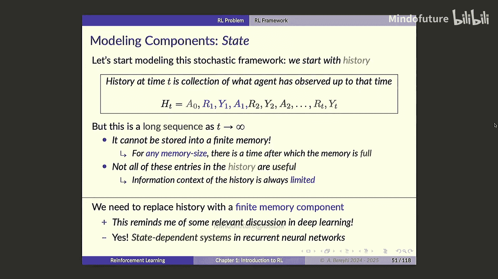

Okay， so if you got one question， then。I hope all of this philosophical discussion we had convince you that we can model this the environment as a kind of state dependent system。

 Okay， and this system has a bit of randomness inside it。

 So it's random because we don't know all the physics。

 and it's a state dependent system because it does not have infinite memory， right。

 And then you can think of it。For inform form of one system with one stay。

 which is just changing this day through now。Let me first define the state， so。

The state dependent environment is one environment which at every single time that you are going to do your action。

 it has Now， again， like the action reward， other things。

 I'm assuming that the state is coming from a finite discrete set。 I it necessarily the case。 No。

 when we get into deep R， we're gonna get rid of this decision， right。

 But now we're going consider it because it makes the formulation rigorous。 Now。

 I have this state at every single time， which could be one of the possible and stays， right。

And then I， each time that the other side does in action。

 my estate is going to change from one estate to another， right， Now， when next time I want。

 I look at the action coming from the agent， I don't need to go back and check the previous estates。

 Whatever the estate is， that action is going to make that estate to change again to another value。

Everybody's clear。O， cool， so。This is the set of possible states。 And as I said。

 it's not necessarily discreet， and it's not necessarily finite。

 but we keep on assuming that because that are going make the this the life much easier for us。Okay。

 now， given this， given this stay dependent formulation of the environment。

 now we can concretely represent everything。 So I have the agent。 I have the environment。

 And now this environment is going to be represented only by the state。

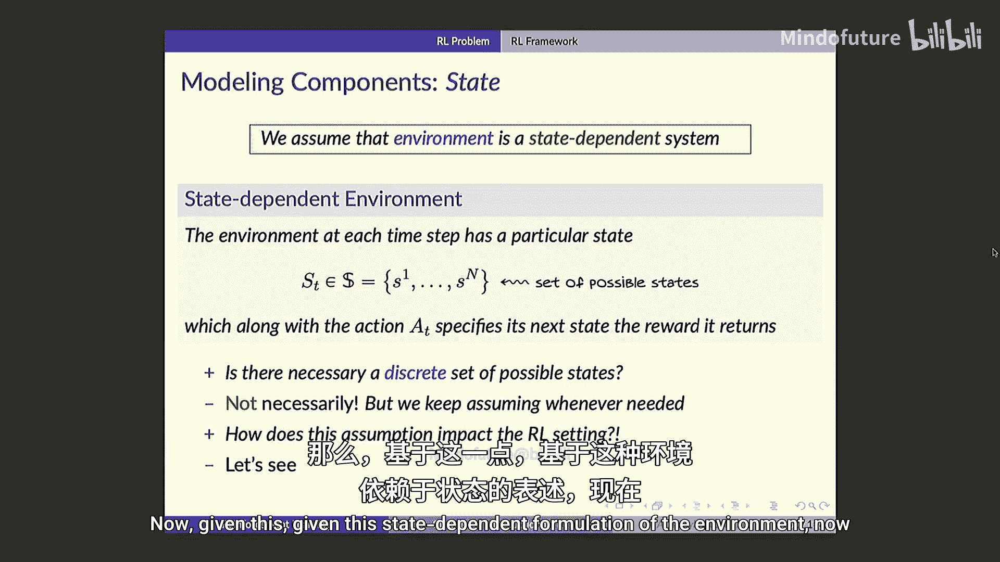

O。That's only the state， which is going to represent this virus。 Now。

 this guy is going to look at this state。 Now， you could see the completed state。

 This is the ideal case。 This is the thing that we are going to consider when we are formulating everything。

 But in practice， you might see a part of state。 And what I a part of state。

 because when we talk about the the example of。Can you。

Kind of state that you can see like the temperature in the last 10 days。

 Can you conclude that this is enough enough state。 No， there is one state。

 Maybe that that is the temperature of the last 5000 days。 You don't know， right。

 Maybe in addition to that is the amount of moisture you have in the weather。

 And now a lot of other things， right， You don't know what is this state。

 But you can imagine that state exists， right， And looking at that estate。

The next estate after doing any action is going to just change that estate。 Okay。

 but you might not see all of it。 The best example is the example of chess， right。Like。

 there is one state that you're seeing， right。 And this is exactly the， the。Board of the。

 of the chest that you see， right， Now， it might be that you include the mindset of the other side into this stage。

 right。Like the guy who is playing with you has a specific mindset in one specific is going to do the。

Its only specific move， right。But you don't see it because you are not inside the mind of that person。

 right， You just see a part of this state， which is un visible to you， right， so you。

We have incomplete version of it， but I told you in most example， I mean。

 in formulation that we we consider we always we have access to them please。

 when we don't have access to， we， we could say that， okay。

 the amount of things that we don't see is going to somehow be added into the randomness of the environment。

 okay。Now， based on this observation of this state that it does， it's going to do one action， right。

Moves。 and once it does the move， the environment see change is going to change the state right。

 So it's going to get from state S T into a state S T plus one right Now once it change this this state。

 it' gonna give you1 well。 So you're gonna get this guy was a state S T it's going to change to S T plus one S T plus one and going to give you the reward R T plus one right And now this time you are going to see S T plus one。

 This is the observation that you are going to do， right。Everybody's cool。Questions。Now question。

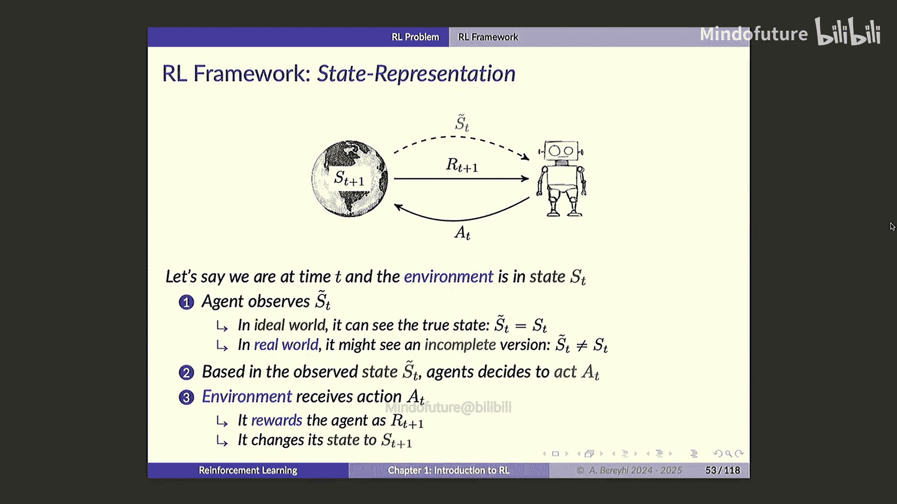

Great， so question。 then let me just do one simple state re of the system that probably makes the story much clearer for you。

 say the environment has the initial state0， right。Wd。Ths said first start， right？ So you have a 0。

 then you see an observation of that based on that you're gonna do action a 0， right。

 Once you do action a 0， you move your， your Ps， right， And once you move your P。

 the thing that is going to happen at this state is going to change because the board is now change。

 right。呃呃，确。Right， maybe your first move， you win。 You are massive， right。

But you are going to get one reward。 Maybe nothing happens。 You get reward 0， right， That happened。

 Now， the environment is going to change， but the state that is going to change also， of course。

 depends on the move of the other side， right。The opponent is going to change。

 now you have a new estate。 This whole new estate is going to be S1。 Now。

 you look at this new estate S1。 you're going to do your next action， right。

Look at the board and your move， the other side move。And then based on that。

 you're gonna decideci for your next move， right？ So you see the new state of the board。

 and then you're gonna decide for your move。 Once you move， the state is going to change。

 You are going to get the reward， right。And you keep on going like this till time T。

 right So you keep on going like this till time T。 Now。

 at every single time when you look at this state， the only thing inside the environment。

 which is going to impact the caring environment is going to be the previous estate， right？

 So if you want to know what is happening at time T plus1。

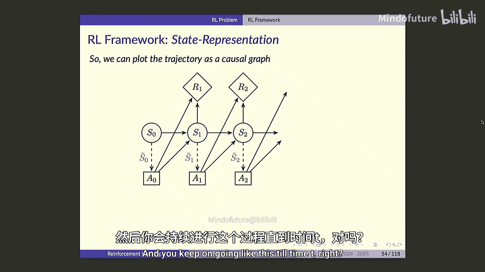

You look at the action at time T and the state at time key， right。

 And then the environment is going to just transit from。State S T interest state S T plus。

Everybodys here。Questions。Now question。It can impact their， because。You mean yeah。

 you can think like that as well。 You can think like that as well。

 It depends how you think about the state。 But the yeah。

 you can say that the impact of or the kind of R1 you get is directly coming only from the transit state。

 but if you want to be mathematically concrete that that line could exist because。

Your R could depend on S， mean， like conditional distribution S。Of next Karen time and the。

It could be。 but yeah， I mean， if you want to think about like ches。

 it's quite fair to say that this is only like this direct line is not necessary。Yes。Yes， sure。

But I didn't want to make it too much mess。 I just wanted to show the evolution of this state。

 But you're right。 that or I mean， I'm not showing how this A is， is taken， yeah。That is， of course。

 impacted by that。Questions。No question。Okay， great。 So now。

If all of these discussions makes sense to you now， based on this discussion。

 we can assume that this state is showing the property of。Markovity。 So what is Mark Markov process。

 So what do I mean， I simply mean that the reward in the next time and the next stage。

 which should be S T plus 1。 Sorry， here， this guy is a typo， S T plus1。

So the reward of the next at every single time， the reward of the next time and the state of the next time only depends on the last stage。

 right， So it depends which state you are in。 And then based on that。

 the next word and the next state is somehow specified。Okay， so moral of。

 when you act with the environment， the environment is in some situation， you act。

 it's going to change situation， but this change it does not depend on what was inside the environment many times ago。

 right it only depends in the on the situation that the environment is on， right。OK。扣那嗯。

One question that you might ask me is that， can we guarantee that for any environment。

 we're gonna have such a state， Like there is a simple answer， hard answer， simple answer， Yes。

 you can。 Okay， so harder answer is that， well。Under some very mild assumptions。

 any side sort of process can be eventually modeled as a markov process。

 and it only depends how you define the state of that markov process。 And we don't care about that。

啊So。Any process that you see， like random process that you have。

 you can somehow collect it into into a form that is actually order one mark of process。

 but the state of that process could be giant。 And we don't care about this because at the end of the day。

 we want to get rid of。 this is like complete a state and we want to work with this state that we can see okay so theoretically。

 this is a kind of correct mathematical formulation。 But if you don't see it immediately。

 that's totally fine。 Just take it from Mesa and trust me， I didn't make it by myself。

 I just took it from the literature okay。

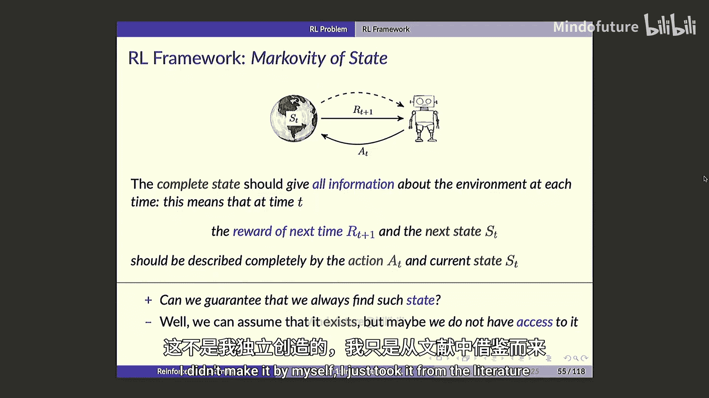

库销。哦哦。The idea of Mark of process。Process。Marup process is a random process。

AndThings exactly like the or environment were。The state at every single time is depending only on the state in the previous time。

 if you want to know what is the chance of your next estate being something specific。Then given that。

 you do know that your first state is S1， your second state is S2 as state was S。

You only need to know last day。 You need only need to take into account your last。

Anything before that is somehow encoded， captured inside the state。Okay。Questions。Yes。😊，F badly。Yes。

 yes。然后你又让来。Right， and then you， I mean， it's hard to say that you are getting the neural network to estimate this state。

 But you can say that this state goes as a kind of input to your neural network， right。

 that is correct。 Yes， is is still valid。 This is still the thing that we do， yes。嗯识。So。

 I have question。Sa。This X plus one。toldold you， I just hope that is not confusing。

 I told you that S state， this capital guy， which is this random b。

 is something between from the set S1 S to so1 till S N， right。Right。

 now this is small guys S T plus1， S T S S1， all of them is one of these guys， right。

Everybody's cool， right？ So if your estate is one and two only， right。

 So your first estate could be either one or two， right。😊，Like。A povertyy， right。

Then your first estate S1 could be on。 The second one could be on or off。

 third one could be on or off or so， right。Everybody is cool。 You get， you get the notation， right。

 I do know one of the messiest topics to make slides on， but I did my best to just make， make that。😊。

Consistent notation。Okay， cool， so。More of a story。

 whatever you want from the past is somehow encoded in your last estate。 And what you do always。

 you always think of your。

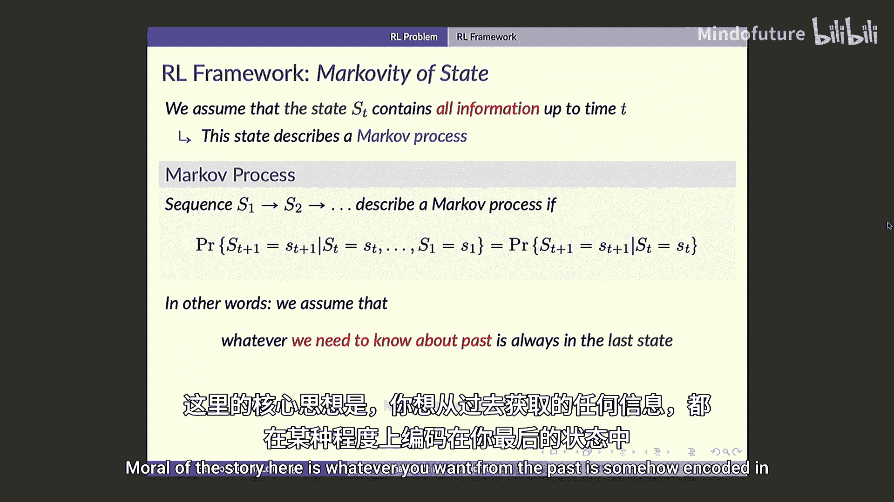

The kind of state dependent entity。 And then this entity is actually described by a kind of mark of process。

 Okay， now， once again， you might have access to this state。

We have the complete observation and the other thing is that you are in one particular current state。

 you' are going to do one action， and then the environment is going to look only on that estate and the action is going to give you the next word and is going to change its estate okay。

Everybody's cool， right？

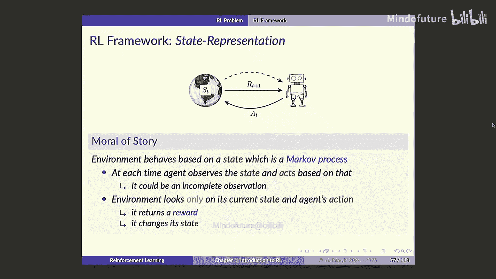

OK cool now。Yeah， this is just the indicator of what says。 So we could have the full observation。

 This is optimal case。 we could have partial when they are not the same the observation that you do in the true state。

 But to keep everything easy from now1 going to full observation is going to make life much easier。

 And as you're gonna see at the very end， when we do D R。

 we actually do so much approximation that this one is actually nothing is compared to what happens there okay。

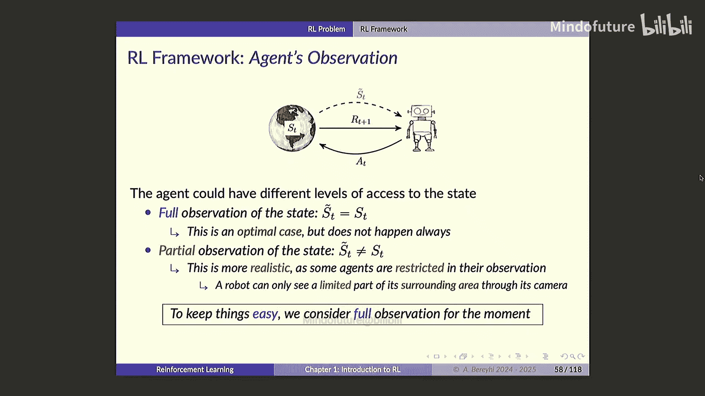

够那啊。Let me just quickly finish this modeling of the environment。 So right now。

 what I have as the model for my environment is they're gonna look at the actions that I do。

 and it's going to change this state and give me some reward。

 if I want to write it down mathematically concrete The way that I can do it。

 I can do it by two functions。 So one of them is rewarding function。

 This definition is a bit made up by me。 But I just want to give it as a kind of con concrete formulation。

 Then when we get into M piece。 Then we're gonna。Show that this reward function is eventually just a distribution。

 Okay， but right now， we have this reward function。 What is the reward function。

 This is going to look at the current state as。Your current action is going to give you one reward from the reward set。

 right。About this function is that this function is not necessarily deterministic， right。

 It could be random。For example， it looks at this state and， and the action that you have done。

 And based on this action， it decides to give you either one or two。

1 with chance half2 with ches chance half， right。This is one reward function， right。

So the reward is a kind of random。 In general， this is random function。

 which is looking at this state in action is going to give you the next reward。

 You have a transition function as well。 So the transition function。Is the function again。

 random in general， which is looking at your current state and action。

 and it's going to decide what is going to be the next state。 And it could be random again， right。

 So you can randomly choose between couple of states， right。Everybody's cool。Okay。

 so now that I have the transition function。 I have the reward function。

 Everything is actually formulated。 Now I can throw away all this story。

 and I can just work with these components， right。Now。啊。Depend， I mean。

 how you can specify the rewarding function and the trans transition function。 I mean。

 they depend on the problem that you have。If， for example， you do have some sort of say， for example。

 chess game， right， it depends on the rules of the game， right， If you do some move。

 then there are some specific kind of states that the the chess word can get into right。

 not every stage right And for some other case there there are sometimes a bit of randomness。

 obviously there like when you're playing chess， this transition depends on the move of the opponent as well right So that opponent is the random component there as well。

 And also。In some other cases， it might depends on the physical dynamics of the system， right。

 In the robot arm example I told you， it depends on physics right。

 So you just do one action and then you want to change the angle of this this particular joint。

 right， that depends on the resistance of the the air around it。

 the friction that you have many other things， right， physics are going to。sation for us and。

Many in most actually practical cases， we don't know that transition。

 And we typically do two approaches。 One of the approaches is we just simply do modeling do model that。

 This is what we have in the model based approach。 And one other thing is that we forget about the model as well。

 We just look at the data that we see from the environment。 and we try to do some estimation。 Okay。

 This is the model free approach， which is the。Main thing we want to do。

 because modeling is gonna be a nightmare in practical scenarios， Okay， now。

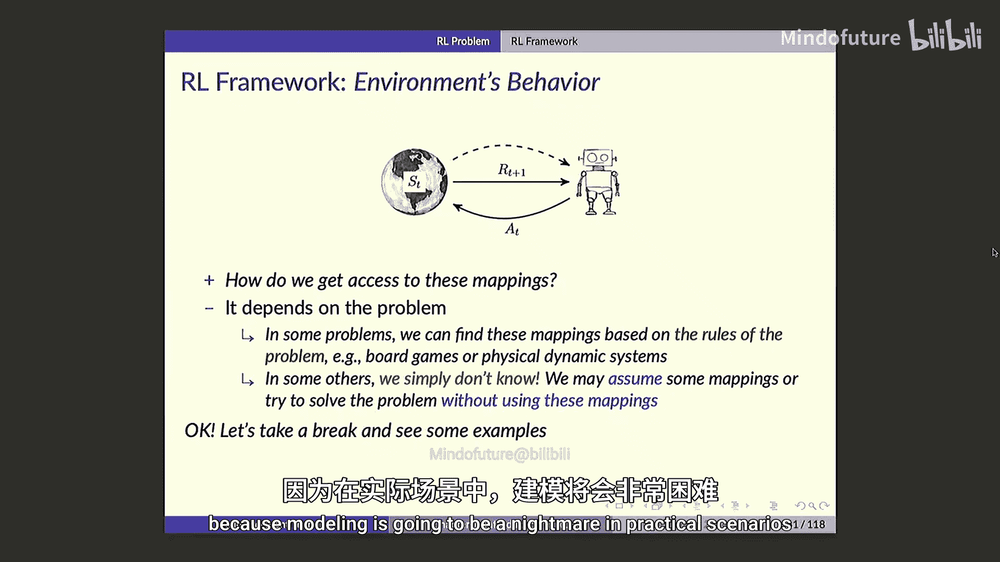