# 【多伦多大学】强化学习 2025 ｜ Uoft   Reinforcement Learning   Fall 2025 p07 P07_讲座_6_强化学习场景示例 -BV1D3F2zhEry_p7-

Just to recap what we are doing here， we have the agent。 We have the environment。

 So the environment could be anything。 in this example， this was tick taactile， right， So what I do。

 I am the agent。 I am going to act。 My action is going to be which， which cell I'm going to。

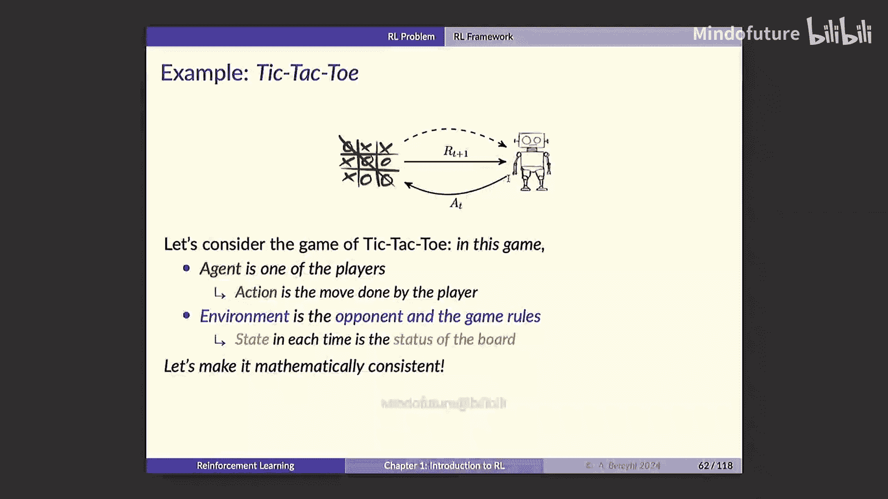

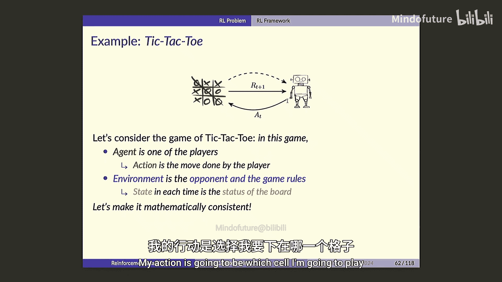

Sorry。

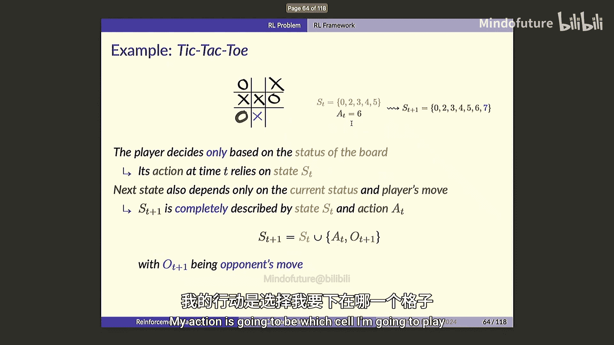

Wch cell I am going to play。 and then the environment is the collection of the game rule and the opponent who is playing the game with me。

 So that is the environment and the state is eventually what we have on the board when we are playing。

 So we talk about this particular case。 So we say like you can call the I mean。

 we can number the cells on the on the game war， So0 to a。

 and then each time that we play each time that we act。

 we are just doing one particular action which is just choosing one of the cells for us right And then the state the game is going to be basically the cells that have anything left is going to be left as possible choice of the action right So we had this particular example here。

 So I have we have played both with the opponent we have。😊。

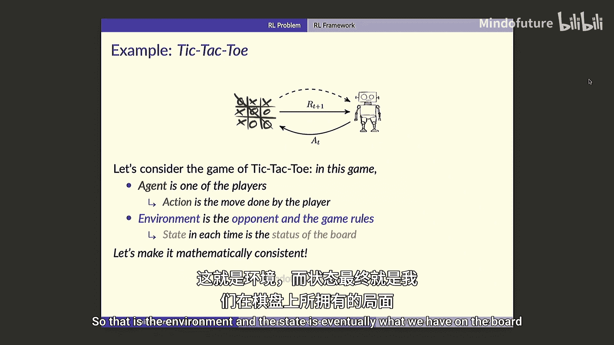

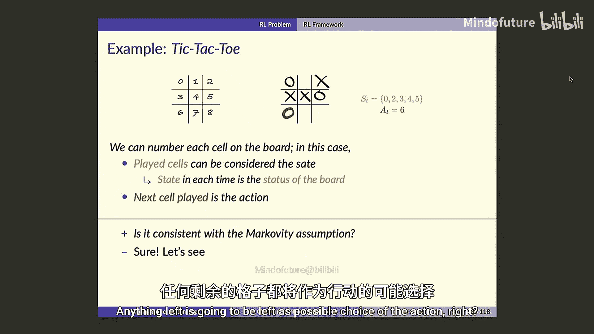

Played 0，2，3，4，5。 and then the agent decides to play 6。

 So this state is actually whatever had been played before。 So it's going to be0 to，3，4，5。

 and then the action that the agent does is eventually this action 6， So it's gonna play cell 6。

 So the next estate， what gonna be the next estate。

 the next state is going to be whatever we have played already the action of the agent and the action of the opponent after that right So say the opponent is going to play the cell X。

 So cell 7， then the state S T plus 1， after you do your action。

 the newest estate is going to be this guy right and then the key point here is that whatever the next state is。

 this can be always written as the previous estate union with your action。

 the agent action and the action of the。

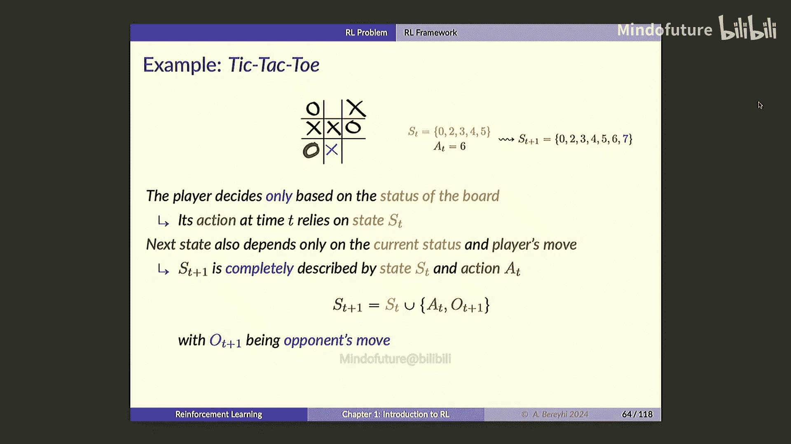

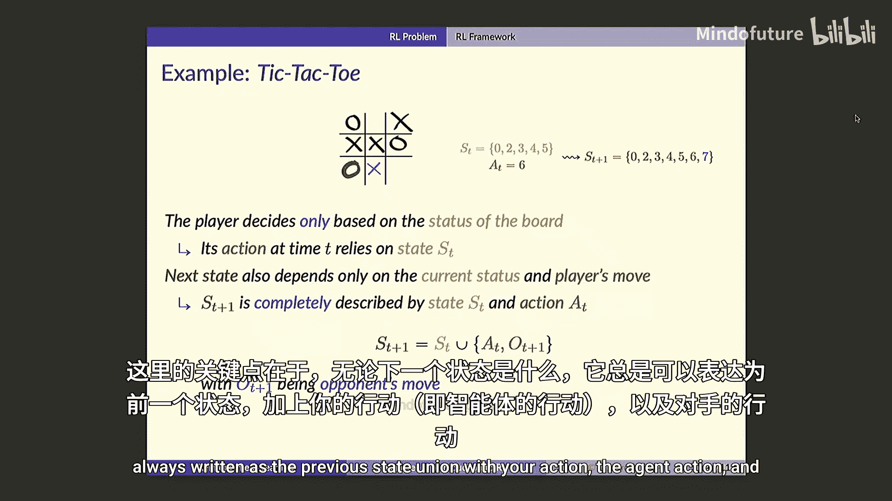

Opponent right so is that the next estate is only given or only depending on your parent state。

 you don't really need to know what was the very first estate， right？So here。

 this is a state dependent problem。 We talked about the transition and rewarding function。

 So the transition function was potentially a random function。

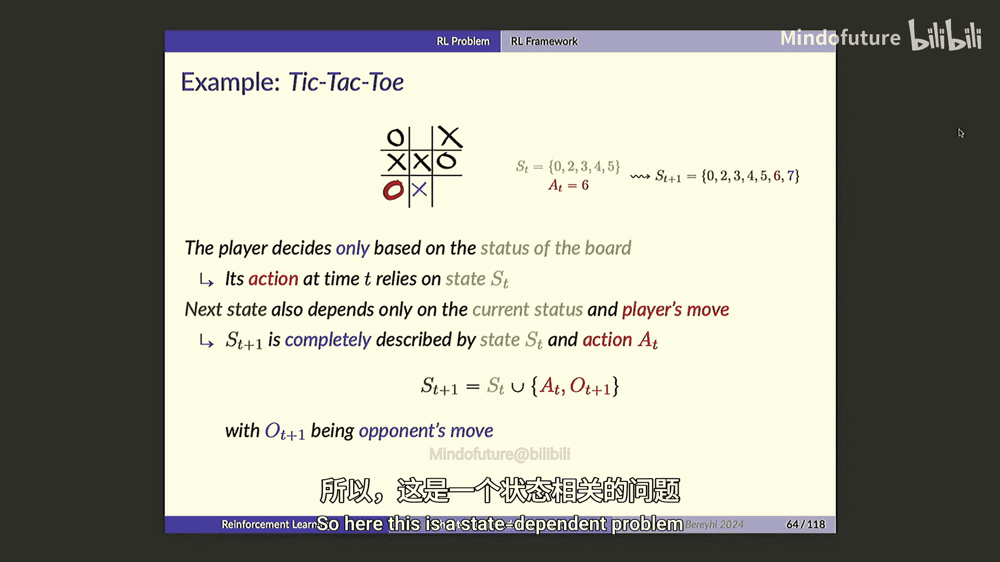

Which was describing if you're in one particular state。Say state S T。 and then you play action A T。

 What' gonna be the next state， right？ So in this particular case。

 you look at this board and the state that youre playing is all of those， you know other marks。

 The red mark is going to be the action No， the next estate could be anything of this form。

 like everybody here plus either cell 1 or cell 7 or cell 8 right。

 Any of them could be the next state and it totally depends on the action of the opponent right。

 So you could say that the transition from S to the next is going to be of this form。

 This probabilistic form， right， with some chance it' gonna go one。

 It depends on the chance of opponent playing one。 It going is going to be this one with some other chance which is depending on the action the chance of opponent playing 7 and so。

 right So this was the transition。Fun we also have the rewarding function。

 So the rewarding function is a game potentially a random function。

 looking at your state and your action。 And that is going to give you a reward， right so。

Here in this particular one， this is pretty pretty standard。

 but you can again say that this is random because it depends on the action of the other side as well。

 But say that you act A T。 And once you act A T， you're gonna either win or lose or you stay you keep playing。

 And for each of them， you can just put one particular reward， right， plus one， if you win-1。

 if you lose0， if you if nothing happens。 So again， this is a transform function， it depends sorry。

 it the rewarding function， it depends on the rules of the game。 And of course。

 in some situation the the move of the opponent， right。Everybody's cool。

 everybody recaps what we did last night。So now you can send this framework to many other problems。

 right， One famous example is this cardpool problem。 So this is one of the very famous problems in R。

 So what is the problem， You have this hanging pull on top of one car and then you have this option that you either push car right or left。

 right。

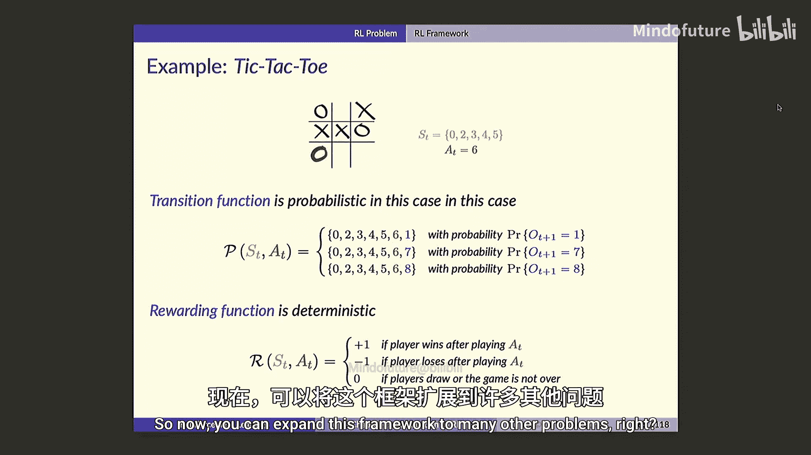

Now。You are going to keep getting rewards when you push that。😡，Hanging poll is not getting。

Far away from the central line from the vertical line with angle more than theta and your cart is not is not moving from the center point with a distance more than x。

 Like if I can keep it very close like I plague like this， right， Left right， left right。

 So this pole is just not dropping right， So it's just。Varying around the central line， right。

 and the， the cord itself is not getting far away， right， So it's just around the central point。

 I keep gaining， right， But once it just happens that the the pole just goes down or the cord is just moving far away。

 then you're gonna to lose， right， and this is a physical problem， right， There is no random。

Or inside this， if you think of physical。Dynamics， right， but it's hard to describe it in formulas。

 right， because you need to really know what is the force that you're like using here and what is the friction of that surface and so many other physical things。

 right， we don't know them， But if hypothetically， we know it， then then we could compute。

We could determin deterministically evaluate the way we can always gain something， right？ So this is。

 again the same kind of problem。 So for this problem， the agent is the guy who is playing。

 who is trying to avoid the pole falling， right and the action that it can do is just plus 1-1。

 right， you can either push right or left， right。

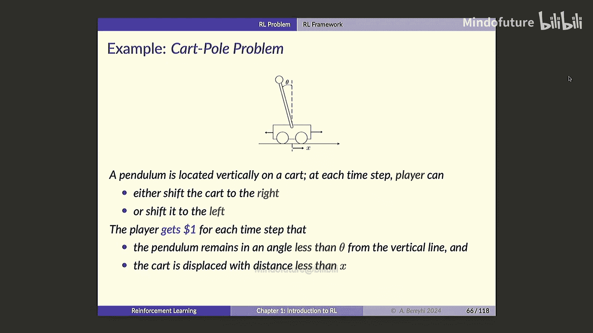

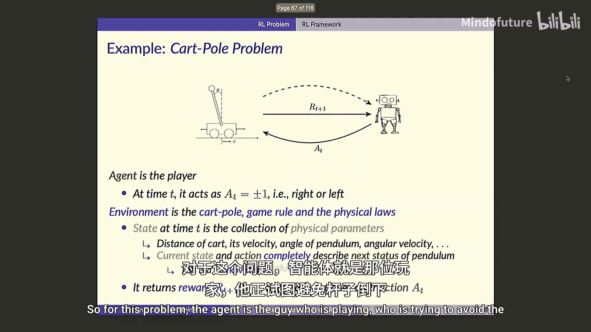

This is the actions that you have。And then the environment is essentially。The carpo， right。

 the car itself on the pole hanging on top of it and the physical rules。Or again。

Part of the environment right And this environment can be described with one particular state right What is this state like if you think about the high school physics problem then you have this chord pole and somebody could just describe this completely for you。

 So the surface under has this friction constant and then the force that you using here is that and then the angle of the pole is this and then the angleular velocity is that and the velocity of the ch is that So you can write down bunch of physical parameters and once you know all of those physical parameters。

 then you can say if you push it right or left， what' going to happen right and once you know those physical parameters。

 you don't really need to know what was the physical parameters at the very beginning of time right So you only need to know what is the physical parameters right now to be able to write down the dynamics。

Of the problem for the next time interval。Everybody' is clear。Everybody's cool。So here again。

 the state that you have all all of all of those physical parameters。

 and you can again say that this is a mark of process because every time the next estate。

 the next angle， the next distance， the next velocity。

 everything depends on what had been before plus the first day you have used， right。

 and the return every time is going to be one， as long as you're not violating those limits。

 if you violate the limits， then it' gonna be 0， right。And you again， want to maximize your reward。

 You want to keep playing as much as you could。 meaningan each time you want to get reward one。

 you don't want to fall into reward 0， right。Okay， so that is， again， kind of。

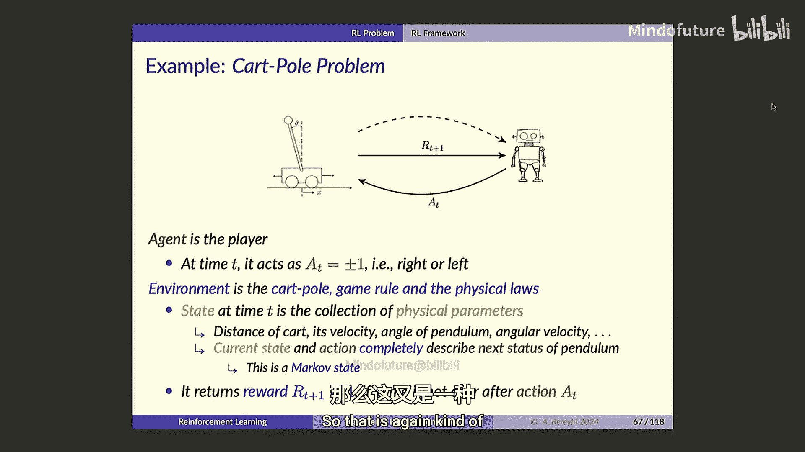

Oral environment。 What is the transition function。 Again， as I told you， basically。

 this is solution to the dynamics， right， So you write down the Newton's laws。

 and then you just find out what is the next angle and what is the next distance， right。

 So you can say what is the next state。 given that， you know。

 what is the Karenes state and what is the action that you're doing and the reward is going to be obvious。

 I mean， if you。

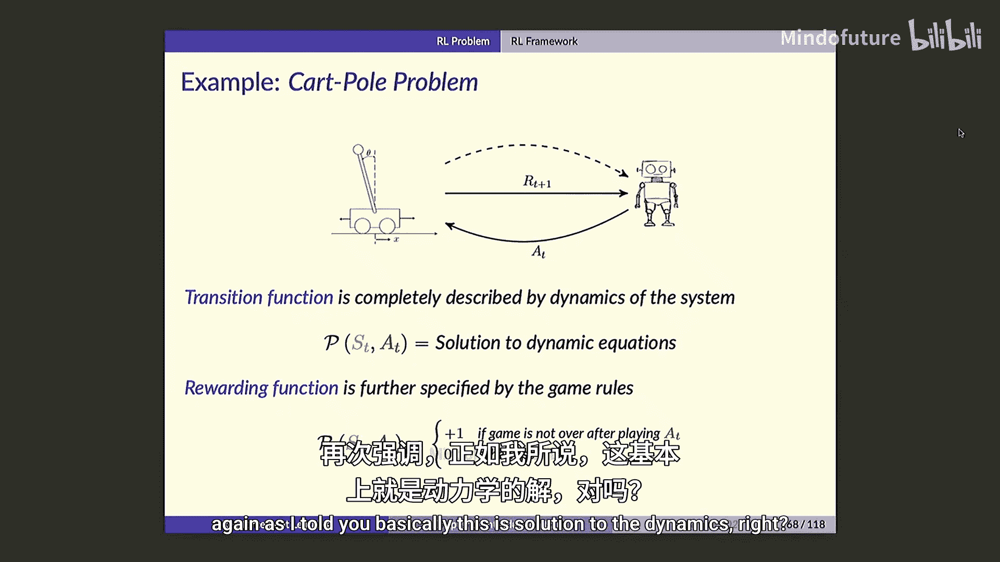

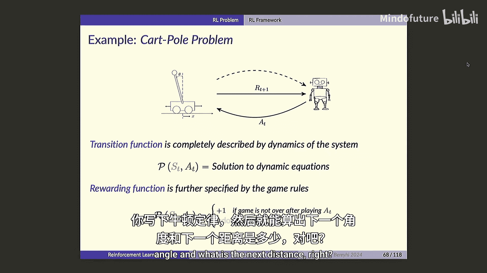

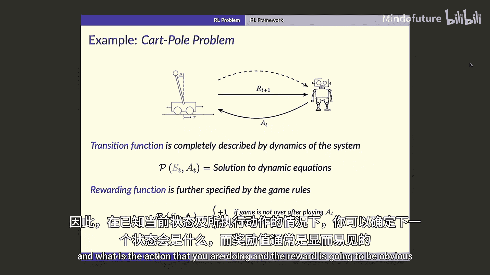

Say that the next state is going to be the case where you're violating， then the reward is 0。

 If the next state is supposed to be the one which you are still in the limits。

 then you are going to get reward  one， right， So this is the reward function。

 This is the transition function。 And you can again see that this is a very hard thing to write。

 right， because you need to know exact。Details of the dynamics， right。Everybody's cool？

And we can have even more complicated form of problem。 for example， the stock market， right。

 something that people are always happy to investigate。

 but they're gonna get disappointed when they do it， right， because nothing can really describe it。

 So again， the stock market， the interaction that you are doing with the stock market is going to be formulated。

 can be formulated in the same framework。 So you could say the agent is the guy who is trying to buy or sell。

 right So in a very simple form。 It has two actions by sell， right。

 So it has two different actions that you can do every single amount a time。

 then the environment is eventually the market maybe lots of other information with it。

 right the soft information that could impact the market。

 It's hard to explain what is exactly the environment in this case。

 but you can think of anything impacting the prices。

 right So that is that is the environment and then you can say this state is any piece of information。

 which。😊。

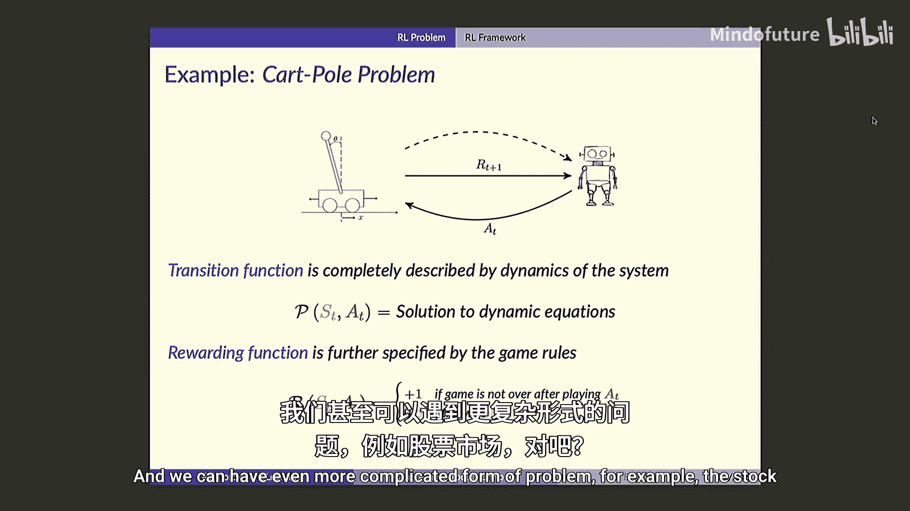

evaluate the price， right Well， this is very abstract kind of describing it in practice。

 what is that estate exactly if we could have known， then would have been rich。

 Nobody would sit here。 We just were doing our trades。

 but the problem is that you don't know really but you can always think that that that estate exists you don't have access to。

 But anything that is going to impact the market is going to be inside the state right and then you would say。

 okay， each time that I'm in one particular state， then the environment sorry is in one particular state。

 I'm going do one action， So the agent could buy or sell and by doing that。

 you're impacting the environment maybe the price goes up or down right and there are also some other bunch of parameters there to impact the the market。

 But the end of the day， the state is going。To change from one point to another。

 right and and the the reward function is， again， the kind of profit you make out of that particular action。

 right， So obviously here， this is not even that easy to imagine what that thing is。

 but you can abstractly think about that， right， whereas in the physical case， The cardppo。

 you could imagine it， right， You could say that there are dynamics， it's too messy to solve， right。

 in the very first one in Tit O， you could simply write it down， right。

 because it's a very simple game。Everybody's clear。

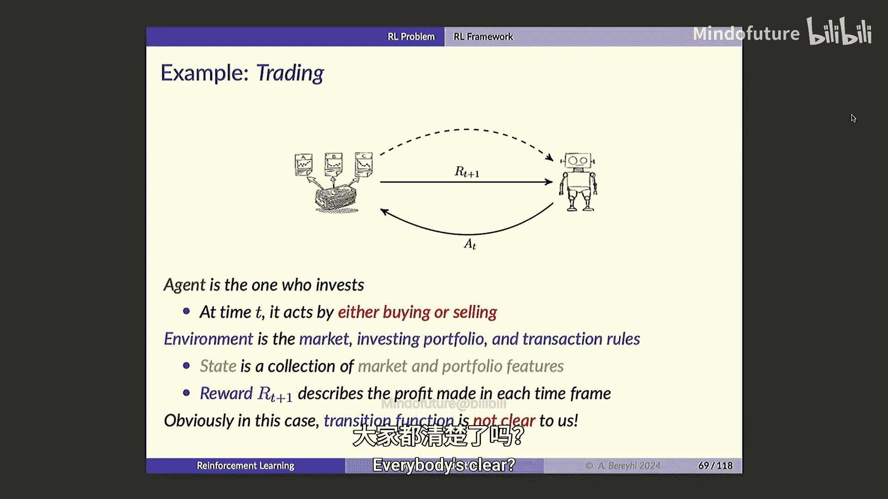