# 【多伦多大学】强化学习 2025 ｜ Uoft   Reinforcement Learning   Fall 2025 p08 P08_讲座_7_策略及其价值 -BV1D3F2zhEry_p8-

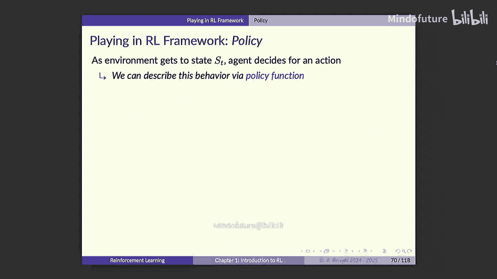

So。いや。Now， let's get to the now the way that we can somehow deal with this environment。

 So the environment is quite simple。 sorry， the framework is quite simple， right。

 But the question is that how we can start building a kind of strategy for the agent and how we can define the kind of best strategy。

 things like this。 And this is what I want to do now。

 So I want to define the components that we are actually looking for。

 So the first one is what we call it the policy function。

 So policy is basically the strategy that the agent is going to play with， right？ So。

How can I define it mathematically， Well， the environment gonna have state， right？

 And I am going to do an action upon seeing that state， right？

 So I can say this is a provolted distribution。 conditional distribution。

 which is looking at this state。 So state is given S and then going to decide and the provolty of each possible action。

 right， So it's gonna be the probabilityvolty of action at time T being the particular action A。

 right， So that once again， that is small a， this is coming from a finite alphabet， right。

 So we think like we can only go right and left， right。

 And then this small a is either right or left。 Now we want to look at this state that the system is in right now。

 the system。 the environment is in state S。 Now， upon seeing that we want to decide。😊。

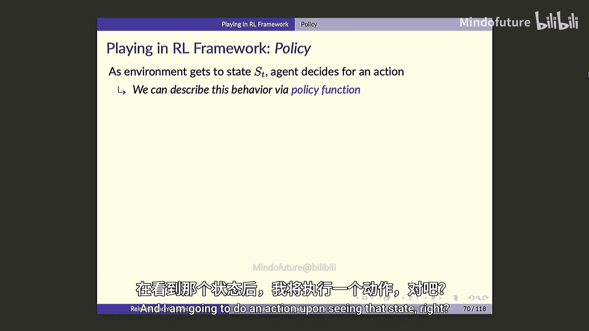

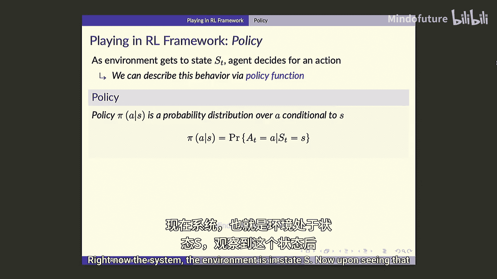

What is the chance that we do action right， What is the chance we do action left， right。

Everybody's clear。So this is a conditional distribution。

 One thing that you might tell me is that why you define a distribution is it supposed that we always play randomly。

 Well， you cant play randomly right， So you are not obligated that in any situation when you are playing a game。

 given the game board， you're not supposed to always decide on one particular action right。

 you might have a couple of different actions and you randomly choose among them right So this is first thing。

 but the other thing that might comes to your mind is that。Well。

 what if I want to play deterministically， it means that when I see the the game board。

 I just do want to do one particular action。 Well， that is， again。

 in special case of the general probaistic policy， right， So for instance。

 I have M different possible actions。 So for example。

 I'm playing the I don't know the board game or whatever， left， right， up down。

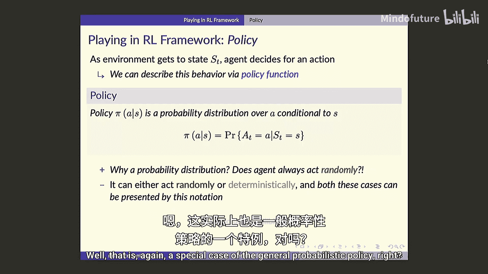

Yeah， still things like this， right？ So I have different possible actions that every time at every single time I can do。

 right， And now the things that I might look at this state of the system。 And then I would say， okay。

 among the actions that I have a1 and A2 sound like feasible or good actions。

 given the care in the state of the system， right， and I'm gonna play a1 with chance 80%。

 the other one with chance 20%， right。

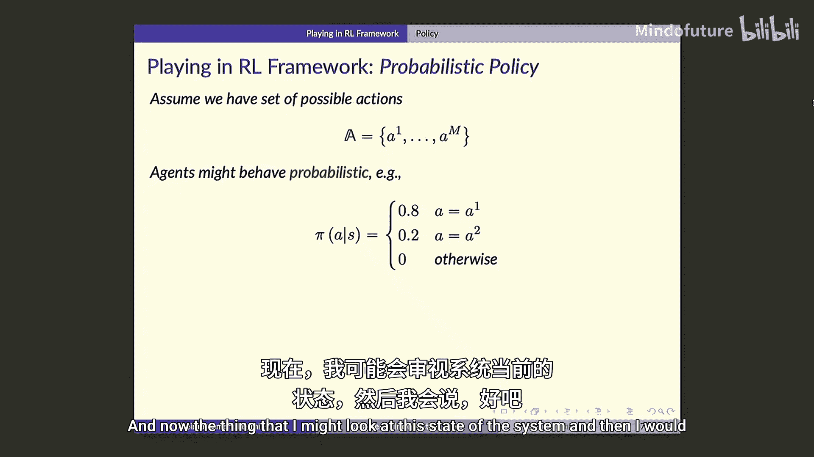

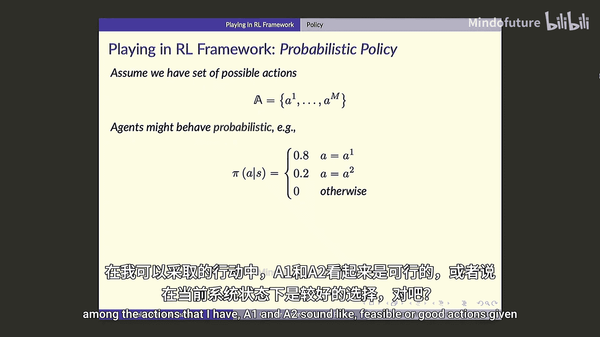

I can do this。 This is what we call it a probabilistic policy， right。

 but I can be also deterministic， right， So here I do it 80%， A 1，20% A2。 what it means。

 it means like if I play that game。Thousands of times， say， I played hundred times and。

Each time I get into the specific situation that is described by state S。

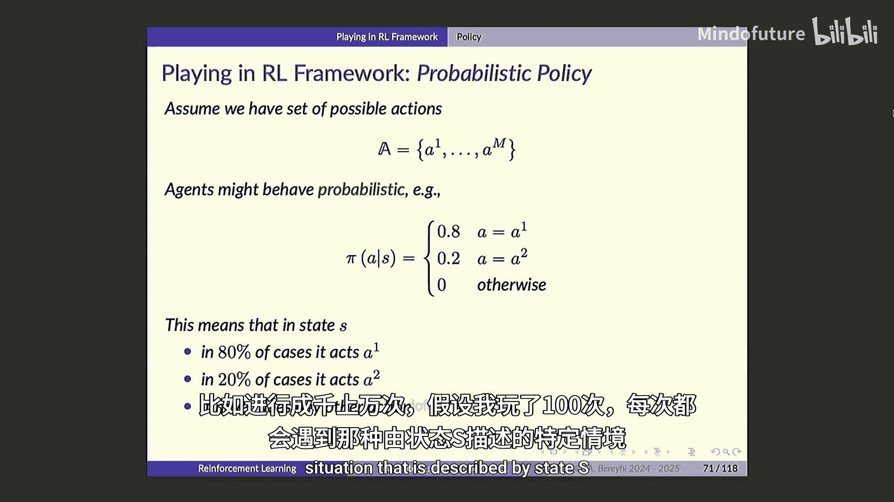

If I play10 times and each time I see that estate at that estate80 times in average。

 I'm gonna play a1，20 times in average， I'm gonna play a2， right。 But again。

 at one particular game that I'm playing， it's random， it could be a1 or a2， right。Everybody's clear。

 right。 So this is provolistic policy。 you can do deterministic， right。

 you might say that given this state， I only play a1， right， When I see that board。

 my next action gonna be a1， right then this is one special case of that， right。

 That action is happening with provolty1。 Anything else is happening with provolti 0。😊，Everybody's。

Questions。No question。Great， so。Here what I'm gonna do 100% of the times I'm gonna play a1。

0% of the time I'm going to do any other action。 This is my policy， right。

 I can mathematically write it down now。 Now， say I want to play Ti tato。

 I told you today is a very interesting lecture because we play lots oftic taacts。 So say。

 for example， we have this particular state in thetic taactau game。

 So the opponent store with this cell0， right？ Now the policy is going to describe that given this Karen situation。

 I see this state opponent has played cell 0。 What would be the next move that I'm going do which cell I'm going to play right？

 And obviously here what I have， I have nine different choices。 But of course， I cannot take choice0。

 right， because already has been played by the opponent。😊。

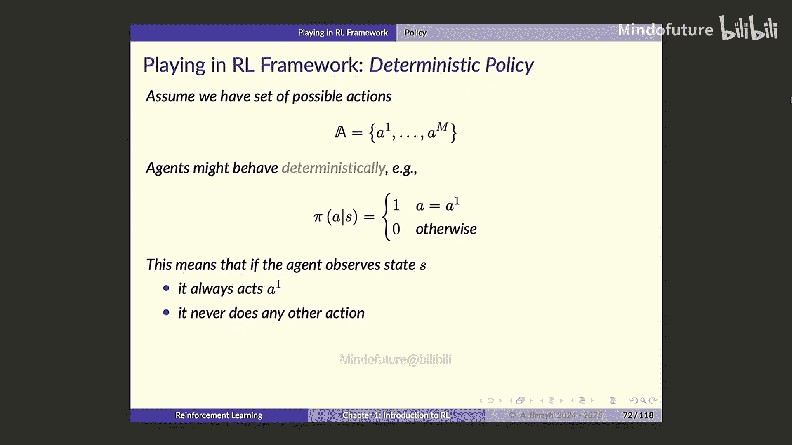

So the chance of that one playing is zero， obviously right， but anything else can be placed。

 So the state is0 when the opponents are to play， right， So it plays0。 The state is 0。

 The next thing that I'm going do。 I am going to specify what is the chance of me playing any action。

 And this action is small A， the action that I'm going to do after seeing the state of the game。

 That guy could be anything from one to a right Now， you might guess there are some choices。

 which are good choices， There are some choices， which are bad choices。 and then。😊，Given that。

 youre probably gonna choose randomly in between those good choices， right， But in general。

 you can write this policy down to be something like P for any action from one to a。

 So any of the available actions， you， you might play it P。 And then the action a for a equal sorry。

 the pro voltage for action 0 is going to be 0， right， And obviously。

 the sum of this per voltage is going to be one because this is a pro voltage distribution is supposed to add up to one。

 right。Everybody's clear。So this is the policy a you have。

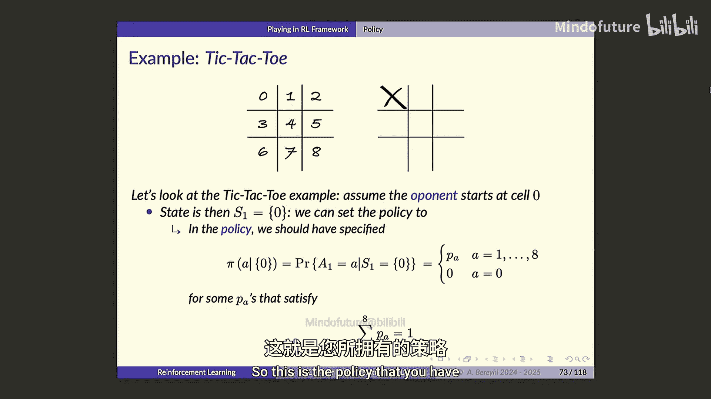

Okay， cool now。You can also play deterministically。 Of course， you might say that， okay。

 the opponent has play that cell zero。 So what I'm going do， whenever he plays0， I'm going play one。

 right， whenever play0， I'm going play。3 and so on， right。 And for every single of them。

 you could simply say that the policy is going to be pro to one at the particular action that you want to do and going to be0 at any other action。

 right， Again， you can describe it by this formulation， right。So， by here。Policy。

 this is going to describe what you're going to do next， that could be deterministic or proolistic。

 right？Okay， yeah， this is again one example。 So I don't know why I have so much examples here。

 So you might say that you have cell 0， and then you want to play any of the cells like one。

 then it gonna be4 and 5， any of them at random。 Oh， no，1， sorry，3，4。

 So you play any of them at random。 So you could say that the probability of any of them happening is going to be one third and any other cell is going to be 0。

 It's a again in policy， right， And you can write down so many other policies， right。

But policy is going to describe what's going to happen next， at least per balllistic screen， right？

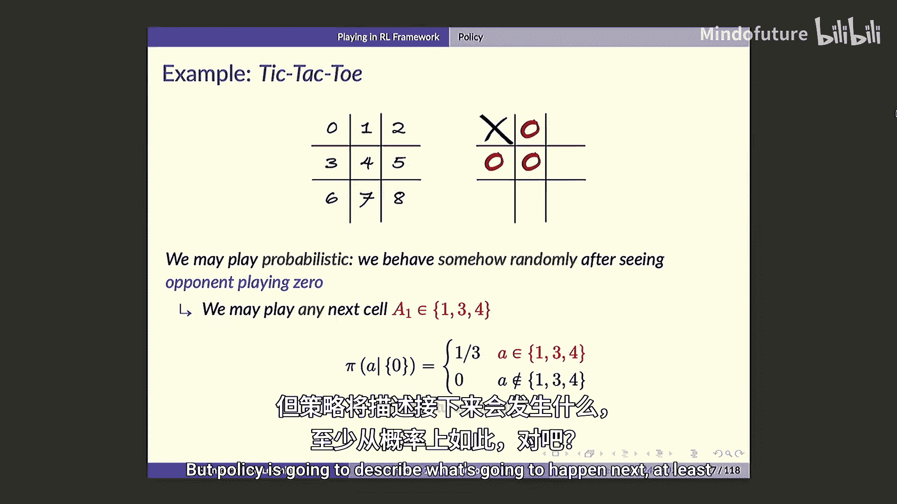

Okay， cool now。Say that you have played one， right？ So this is your next action。

 The first the opponent played 0。 you played one。 No， the opponent goes ahead and play3。 Yeah Now。

 after this one， the policy。Can tell you what is your next action right now。

 but the key point here is that the state is now going to change， right？😡，So here。

 what was this state I put it here very first， right， the state was zero right。

 so your policy was looking at this state zero， looking at the board right。

 and then decide for the next action。

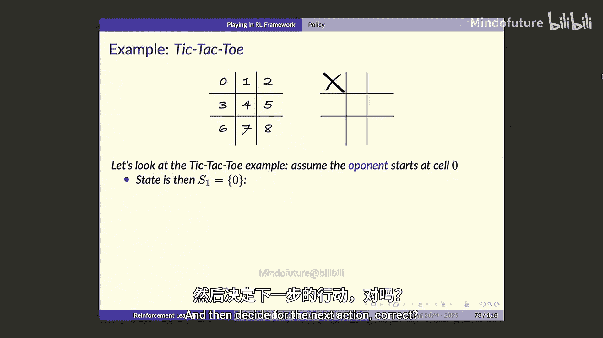

Right， now， when you play this， you did this。Action and the opponent played cell 3。 No。

 this state got changed， right？Everybody's clear。 So stay got changed。

 You have a new probability voltage distribution， right When the first guy the other side plays0。

 I always play one。 But if I see on the board that this combination，0，1，3。

 No I'm gonna play something else， right？ So there is no reason that I keep on the same policy。

 and it makes sense because the policy is written in this form。 So it's pi of a given s right。

 So the first estate was only0， the next estate that you have is 0，1，3。Right， so S change。

 this distribution can change， right？ Everybody's cool， right， You understand the notation。

 So in this case， your policy should say what is the next action。 So again， you're gonna say， okay。

 this is now the new stay。 and this newest day， whatever that is。

 it' gonna give me a provol distribution on the actions that I have。 obviously， in this case。

 I can now play these three guys， But anything rather than that could be an option right。

 and it could potentially have a provolti nonzero and nonzero provol value， right。😊，Here。

Everybodys cool。 So one thing if I want you to just have in your mind。

 policy is not one distribution， right， iss actually a family of distributions， right。

 When this state is something， then it gives you one distribution。 If this state changes。

 then it gives you a new distribution， right。And it makes sense， depending on this stage。

 youre going to decide to react， right？ So it's not one function with。

Number of actions that the output as the provolive function is actually a class of them， right。

 And how many of them you have， you have as much as a state that you have， right。Everybody's cool。O。

So， for instance， one thing that you could say， okay， this is the newest state。

 and for this newest state， action 6 is going to happen with Provolti1。

 I'm going to play deterministically an action。 Any other action is going to happen with Provolti0。

 right， So this guy。😊，Pi of a， given this estate is different from pi of a given 0， right。Clear。

It doesn't matter， right， because this state got changed， right？😡。

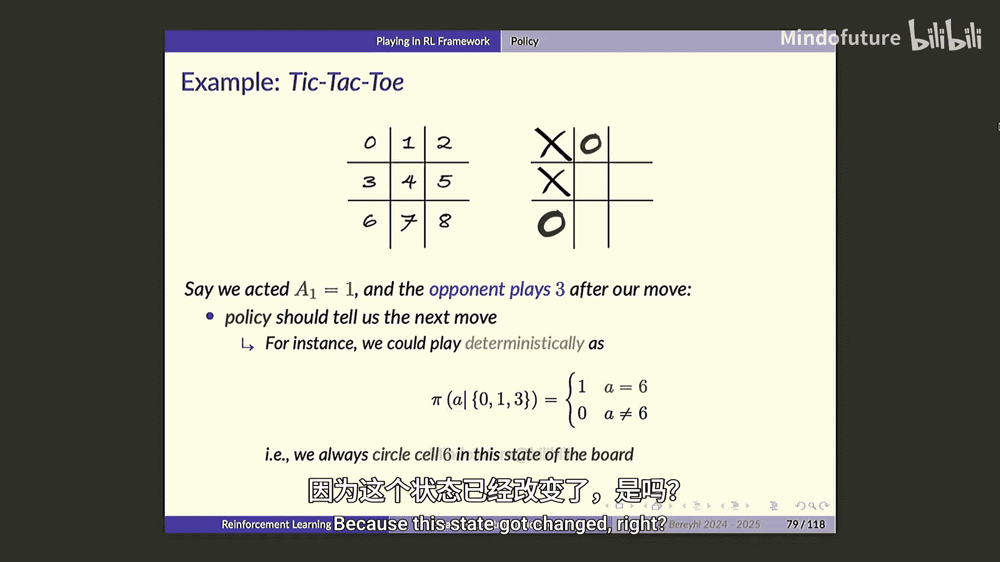

Great，啊嗯。Now。When you have the policy， essentially what you have is that you can say how the game is going to process it in future。

 right， how the interaction is going to process it in the future。

 why because you look at this stage your policy is going to tell you， okay， do that。 I mean。

 of course， it might be proistic， that's fine， but it's going to describe that distribution for you right。

 that now you're gonna to move and do one action。

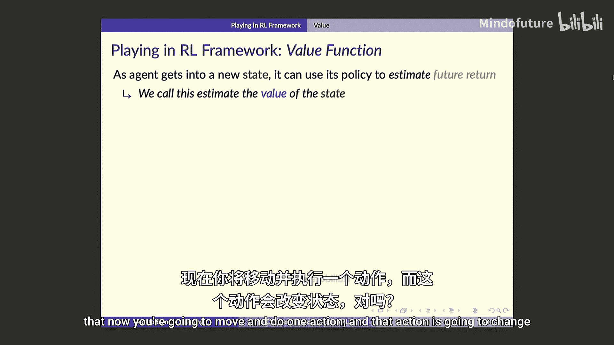

And that action is going to change the state right and new state， again。

 your policy is going to be okay， the state you know this action right， and you keep on going。

 So when you you know the policy， if you know the environment as well。

 then you can describe what's going to be the trajectory towards end， right。

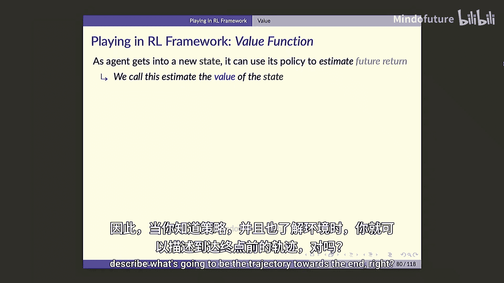

And if this is the case， then you now can describe what's going to be the return that you are going to get。

I mean， of course， you can say it for sure， you can only say it。Statistically， right？Now。

 this is what we call it the value function。 and no worries。 I'm not going to just leave it here。

 I'm going to open it up， but just want to give you the big picture。

 What is the value function for every state that you are in。

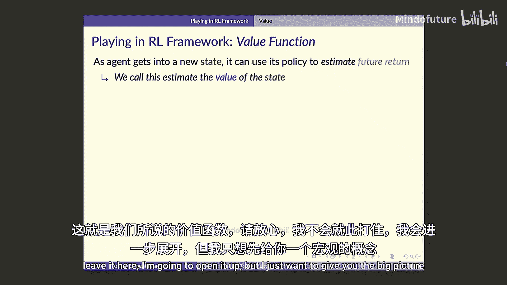

IIn one particular state。 So say I am at this this estate at the very beginning， right。

 now my action would say， okay， play that right， And now you can say somewhere in your mind， okay。

 if I play that then the other side might likely play this right and after playing this Im going to play that right and after playing that。

😊。

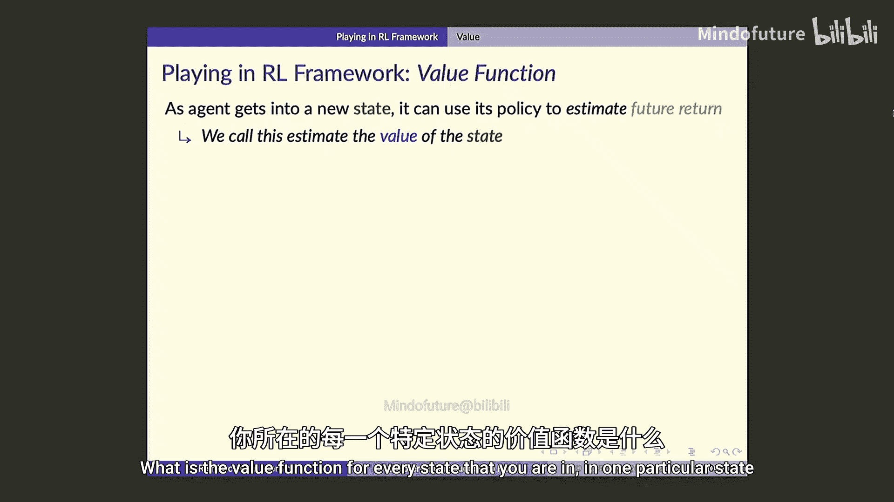

The other side plays this and so on and at the end， I'm going to win， right？

So you could see from very beginning that maybe with some high probability。

 you are going to get reward one， right？Or you might say that if I do this action。

 then the other side is going to do this and that and so on。

 I'm going to end up losing so from very beginning I could say okay， this state。sorry。

 doing this action， I'm gonna at this stage， if I follow this policy。

 I'm going to end up losing getting reward-1， right。

 So policy plus your understanding from the other side is going to give you the estimate or kind of expectation of what you're going get。

 And this is what we call it the value function。 So what is the value function。

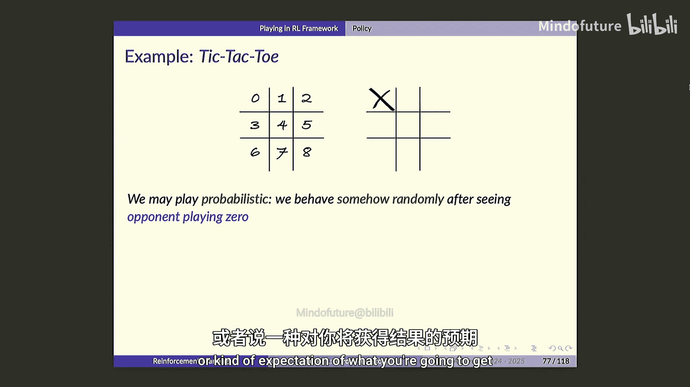

You remember G， right， what was G？It was the return， right， it was the return and future return。

 and how did we define it？It was the immediate next reward plus some discount factor times the next reward plus some discount factor to power2。

 the second next reward and so on， right， So this is a return。

 this is the sum of the rewards that youre supposedly getting towards the end。

 and then you would say if I am at this particular stay， What is the expected value of this return。

 given that I am playing with the policy pie。Everybody's clear。Questions。So if I'm in state yes。

I have policy pi， right。 that policy is going to describe how I am going to play in that going to describe the statistics of the next actions。

 Those actions are going to describe how the environment is going to change。

 So this means that they're gonna explain the statistics of the next estates。 and out of that。

 I can expect a bunch of rewards。 And I can say how much in average I can collect。 right？

 This is what I' I going to call it the value of the state S。

 And I'm going to put this pi here in as an index。 And the reason is that this value depends on the。

Policy， everybody's clear。To know your policy， because you need to talk about your next action。

 right So here this pi is going to be with us。 So the value function is depending on pi and it's different for any state。

 right。Pi comes from the fact that it depends on the policy。 I mean， if you do one sort of actions。

 you can end up winning， if you do some other actions， you can end up losing， right。

 So the value that you expect to get at the very end is depending on your policy。

 That's the first thing。 The second thing is that it also depends on this stage， right。

If I start from this point in the game， I might lose， if I change my cell， I might win， yes。😡。

Re location。The mutation。digital5イです。Bye。Yes， yes。 Why does the value not words。And then price。

Pi slashes， or you mean S as a slash pie。 I mean， that was just a choice。 I mean。

 it's the typical notation。 So if you check the su word。 But yeah， you can do it， Yeah。

 but but that is also correct。 I mean， you would say pi is fixed then at every single state。

 I'm gonna have a value。 That's correct。 Yeah，Questions。

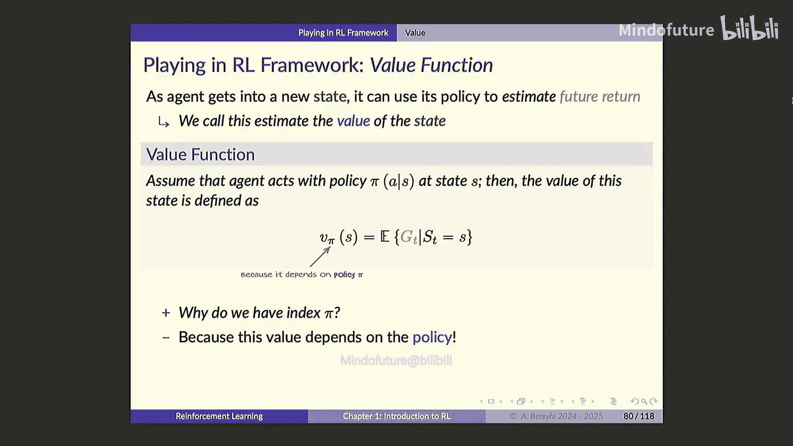

No question。 Okay， So if you got no question， let me break it down for you to see how really this value function can be computed just by writing down the the the expected return。

 So this guy is the future return， right， The reward that I'm gonna get in the next time。 I mean。

 I do this action。 There is one immediate reward， right， This is the next guy， right。

 plus discount factor， the reward after that plus discount the reward after that and so on， right。

 towards the variant， right， So this is going to be what I'm gonna get in the in future。 in general。

 this guy is random。 You agree with me or not。Do you agree with me that in general。

 this G is a random variable？Your state， I mean， your action could be random given the stage， right。

The rewarding system of the environment could be random， right？

 You might do one action in one estate。 You get different rewards， right？

 Just remember the bandit problem that we had， right， the payment you get is random， right？

 So the reward itself could be random and also the transition from one estate to another could be random。

 right。In the Ti， it depends on the other side， right， So all things here are random。

 So these are values are all random。 And then what we are going to look into is the expected one。

 right， But the expectation can be computed if I fix the policy， okay。Now， as I said。

 rewarding function is going to determine the next word。

 So if you are in one particular state S and then you do one particular action。

 this is going to tell you what is the reward that you're going get and that is potentially a random And the other thing is the transition。

 the transition is going to tell you if you are in one particular state and you do one particular action。

 what going be the next state But again， the next state could be a random right。

 you could say with some chance you're gonna have a state one with some other chance you're gonna get a state2 right。

Everybody's cool。Questions。

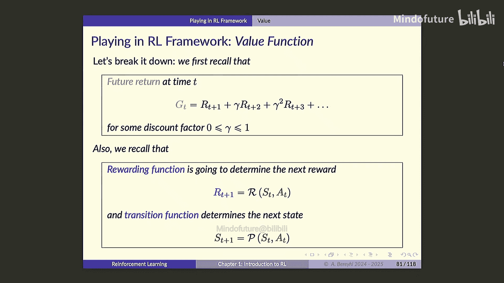

Okay， so if that is clear， then let's start computing the expectation。 Okay。

 what I want to compute is the value function。 So I told you the value function for a given policy pi is going to be the expectation of this return。

 given that I am in the particular state S， right， So I'm going to keep this given this condition。

 So given that a state is the particular green state S。

 it could be any of the states that your system can take。 And now you in this particular state。

 you want to take the expectation of these guys， right。You want to see what is the average of this。

 this sum and the average of this sum is essential the sum of the averages， right。

 If I do know what is the average of the first term， second term and so on， I can sum them up， right。

Good， now let's just focus on the first one since I'm in state。Right， then I can say。

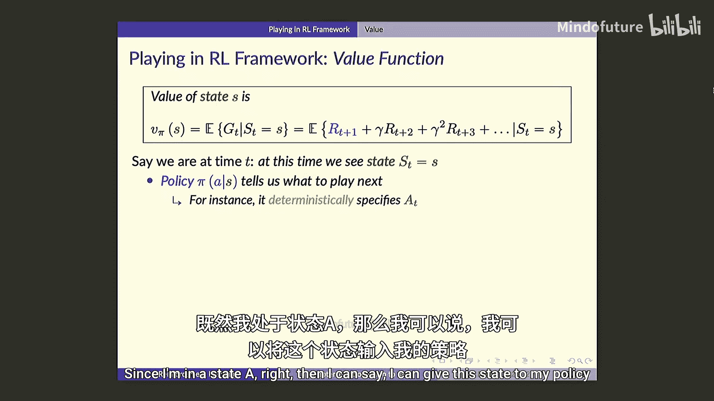

I can give this estate to my policy， it's going to give me the chance of every single action that I'm going to do next。

 right？So I have this policy pi of a given S， And that policy pi is going to give me the distribution of the action。

When I am in the state S。Everybody's cool。Okay， now I am going to define it。 Okay， for instance。

 what， what it could be。 It could be that a is eventually something deterministic。 For example。

 it's gonna say your state is given this a say you're gonna play action to， right。

Or it could be proistic， right now， given that I have。

 I have this action so I can explain what is the next action A T and out of that。

 I can give this A T to my rewarding system， right， I would say， okay， I was in state S。

 I did action A T。 And now what is the reward again， this could be deterministic。

 This could be random， right， But then I have this R， which is a random variable。

 and I do know the distribution if I do know the rewarding system and my policy， right。

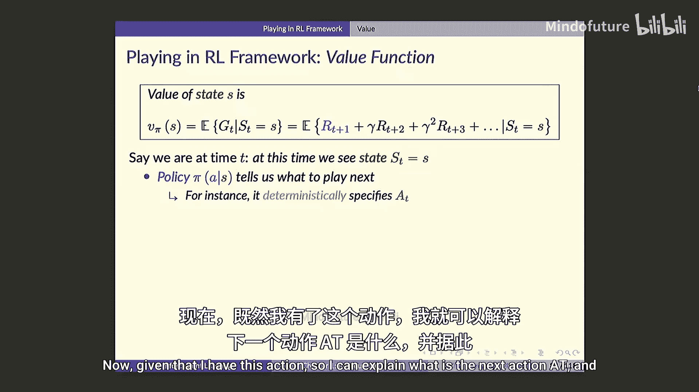

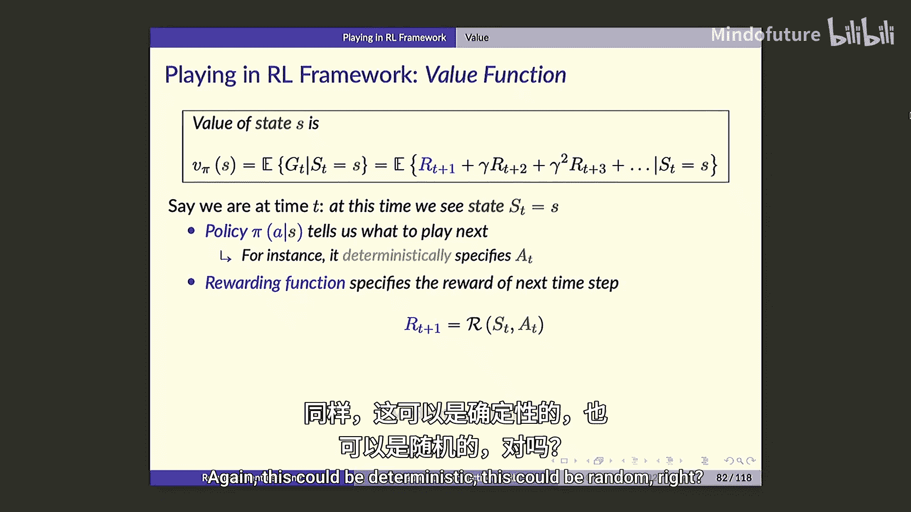

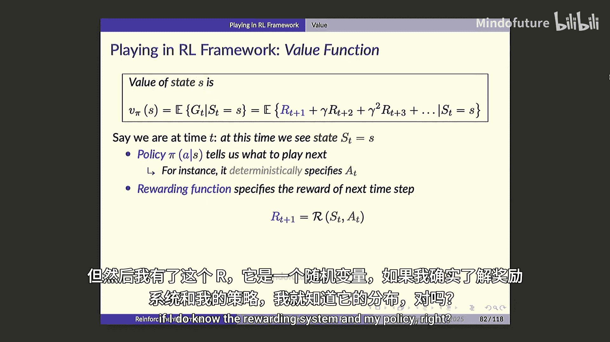

And then after that I am going to give this state s an action A into the transition function。

 so it's going to tell me what is the chance of every other state happening as the next state so I do have the description of S plus1 and I can repeat this procedure to compute the expectation of Rt plus 2 Rt plus 3 and so1 you see it right。

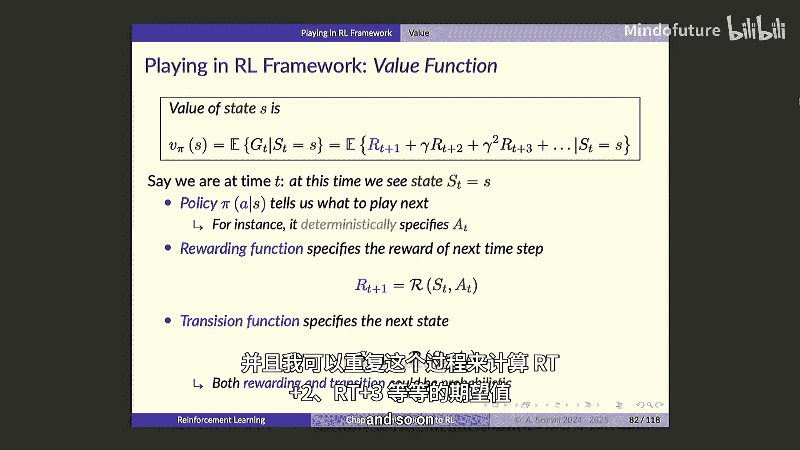

Okay， now let me just formula a bit more concretely here， so。Let's start with the。

 with the rewarding system， okay。Now。I told you that for everything in this framework right now。

 we always think about the finite alphabet。 This is going to make life easier。

 This is especially exactly the point where this is happening。

 So what I assume I assume that the reward that I'm gonna get next is going to come from finite set。

 right， So it's either plus 1-1 or 0， for example， right， or it's like-10 plus 10 and plus 5 and 0。

 something like this， right， So you could have multiple levels of reward， right now。

When you do know the rewarding system， this means that you do know what is the chance。

Every single reward or L you would get， right？ So you say you have three different rewards，0-1 plus1。

 Then you know that what is the chance of getting plus1， What is the chance of getting -1。

 What is the chance of getting 0， right。So this is a probability all function， but then。😊。

What is happening here is that you do know that you are in the particular state S right so you want to know that what is the probabilityty of every single reward。

 given that you are in the particular state S right so that one is a bit hard to describe。

 but if I do know this state S， and I do know the action， Can I tell what is the reward。

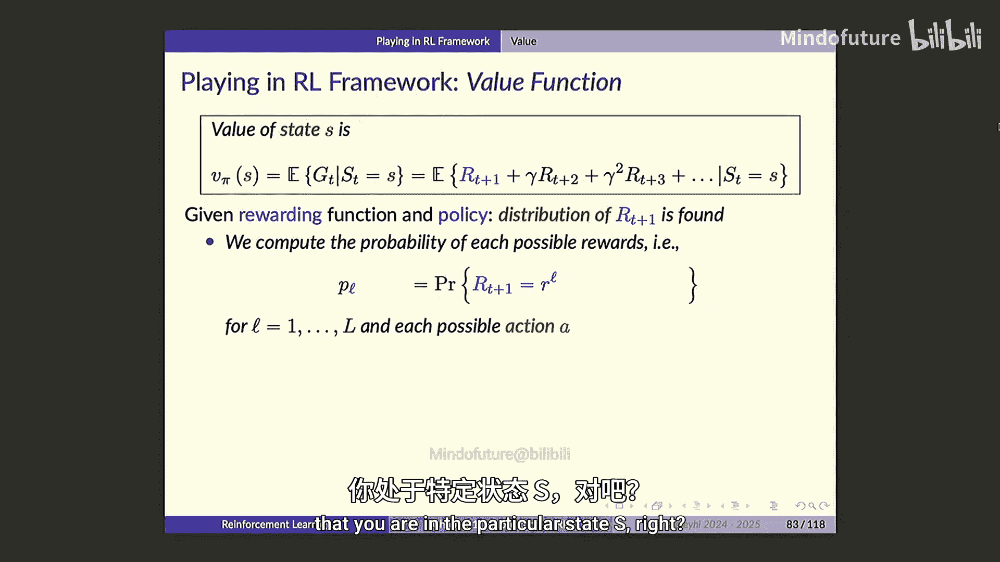

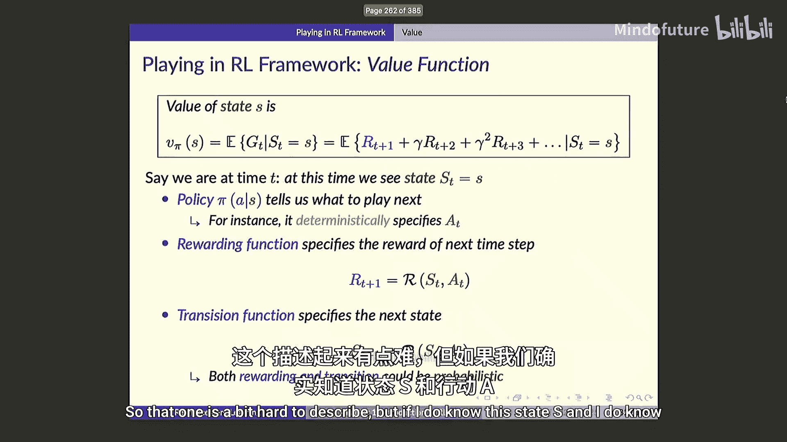

I can tell it right If I do know what is my action on the given stay， then I can say， okay。

 the reward is probably this one with chance half and chance half the other one right。

 So the thing that I'm going to do I'm going to condition it to this state S and action A right So I'm going to say that I am in a state S。

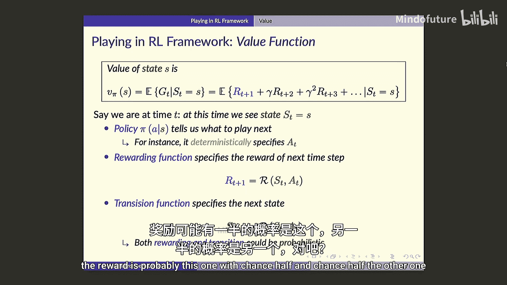

Say that I do action A that these two guys go inside the rewarding system。

 and this is going to explain me what is the chance of every single reward that I could get。

Everybodys clear。So this guy is a provolty on R。 It's not a provolty on S and A。 You see it， right。

 So S and A are given to you。 So you just put it inside the rewarding system。

 It're gonna tell you what is the probabilityty of every single reward， right。Okay。

 now you have this。 Now the thing that you want to compute is the expectation of this next reward that you get right Now。

 what is the expectation of the next reward， So if I am at a state S， which I started with。

 and I do the particular action A M。 So it is one of the actions that I can do Okay if I do that action。

 then I only need to put S to be S here and this a to be A M。

 then this is going to be the probability of getting reward or L， right？ everybody agrees。Yes。Now。

 if you multiply those per with the possible rewards and you sum them up what you're going to end with。

 it' going be the expectation of your rewards， your next reward， right。

 given that you have been in state S and you have done action A M right。

 but what is your next action， What is A。When you are in state S。Who tells you what is the action？

Policy， great。 So how can I do this？ Okay， I could say I want， I don't want this expectation。

 I want this guy， right。I want the expectation of the reward。

 given that I am a data state and I don't care about the action。

 action is being specified by the policy， right？Correct， so how can I do this？ Well， I could say。

 okay， this policy pi is going to tell me what is the chance of every single action being done。

 right， Im multiply that probabilityvol t with this expectation this is going to take the expectation of that conditional expectation inside the brackets。

 right， and it'm going to potentially get me rid of this this is going to get me rid of this conditional A right。

 So I'm going to say if I am in state S， if I do action1， I'm going to get this reward。

 if I action do action2 is going be this reward。 And now the chance of doing this is given by pi。

 the chance of doing that is given by pi。 So I'm average with those。Chances given by pi。

 this is going to be the average reward I would get if I play with pi， right？😡，Everybody's cool。

You see it？So the expected reward given this state is given in this four and the next line is just simply replacing。

 I mean adding this pi into the equation， right， So what I'm doing。

 I'm just putting pi also here and sum it up over possible action that I have in this in the policy。

😊，Clear。Obviously this expectation depends on pi。 if I change pi。

 this expectation is going to change。 this is why I have this pi here right？

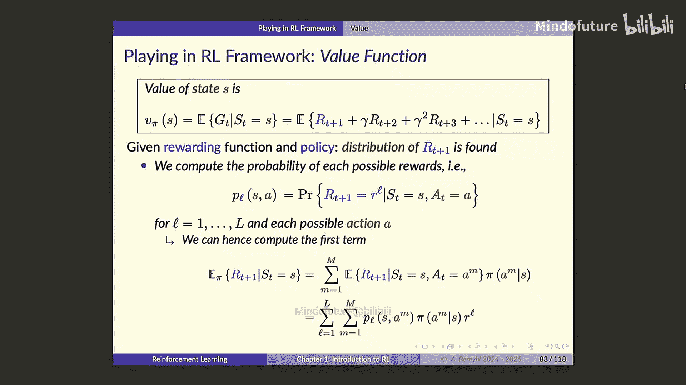

And now you can keep on going like this。

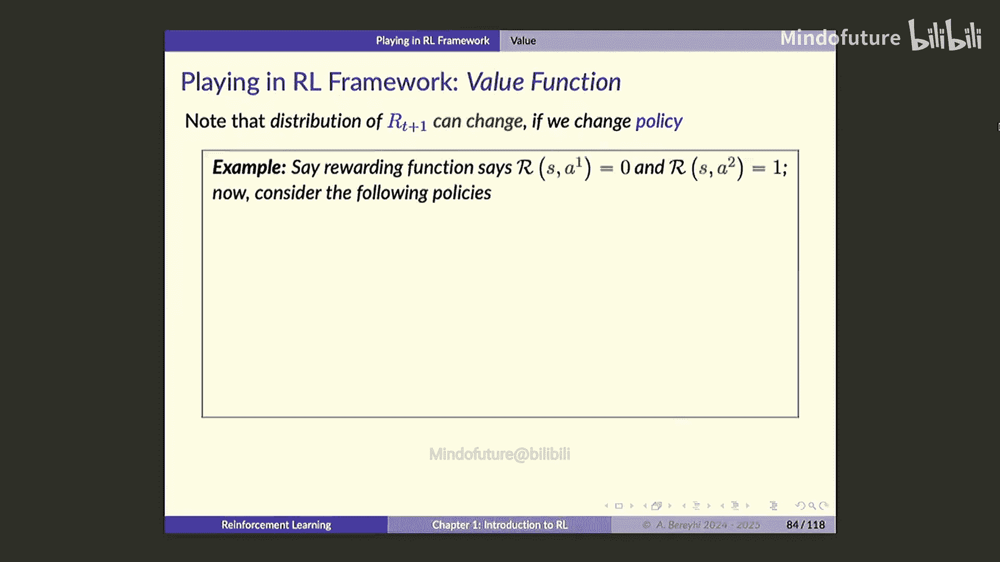

okay， this is just an illustration of why this is depending on pi。

 So you can obviously see that if you change the policy， this reward function。

 expected reward is going to change。 But I just gave you one du example here as well。 say。

 for example， your rewarding system is in this form。 So if youre in a state S and you do action a1。

 then you're gonna get reward0。 Okay， and if you're in in a state S and you do action A 2。

 then you're gonna reward1。 Now， if you play with this policy。 So what is this policy。

 it's gonna tell you， it tells you that if youre in state S， then always play a1。

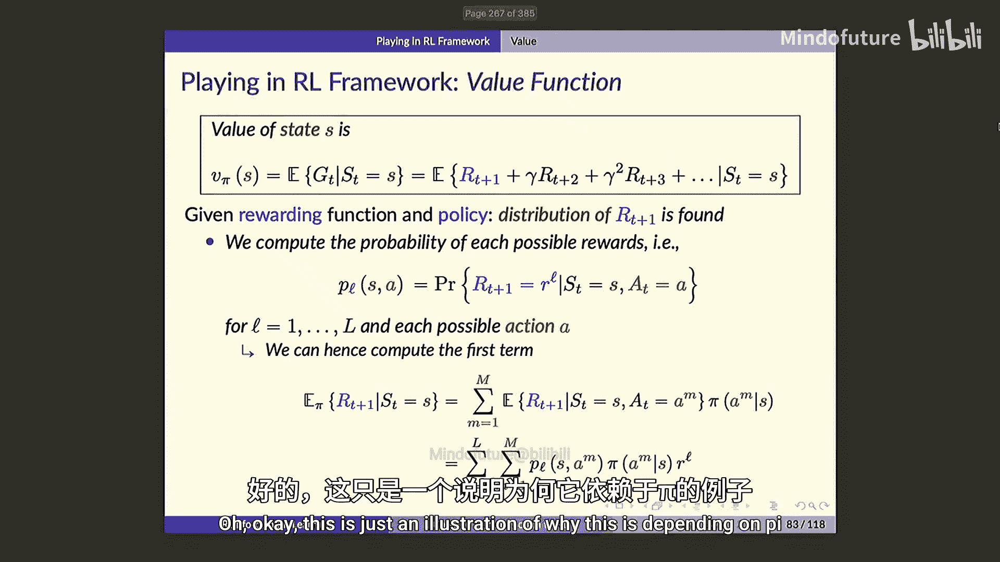

Okay。And the other in this case， this expectation is going to be0 right because when you are in this state。

 you're always going to play a1。 And then when you put that state and a1 into the rewarding system。

 you always get0 right So in average， you're always getting zero But if you play the other one。

 then when you're in if you're in state S and you do action A2。

 then obviously the expectation is going to be1 because you're going to get into this state。

 you always play a2， these two guys go inside the reward system and the reward system gives you back reward1 right So whenever you're in state S。

 you always play a2 and you always get reward1 So the expected value of the immediate reward you're going get is going to be1 right So changing policy is going to change this average in in the reward。

 this is why we have it a function of pi right。Questions。So you got the idea right。

 why this depends on your policy。 Now， you can keep on going for the next guys， right。

 For the next guys， the story is the same。 Like if you want to talk about this R T plus2。

 what you're gonna do you would say， okay， I want to first know what is the next estate。 Well。

 I can use the transition right now that I know like I give my my previous action A8 and the state Sd into the transition system。

 and then the transition is going to tell me what is the next estate right。

 once that I have the next estate， then I'm going put that next estate into my policy right。

 maybe next estate could be a state 2 or3 randomly， any of them， right， and then you would say， okay。

 if it is2， then I'm going play with a policy like this if it is3。

 I'm going to play with a policy like that， right。

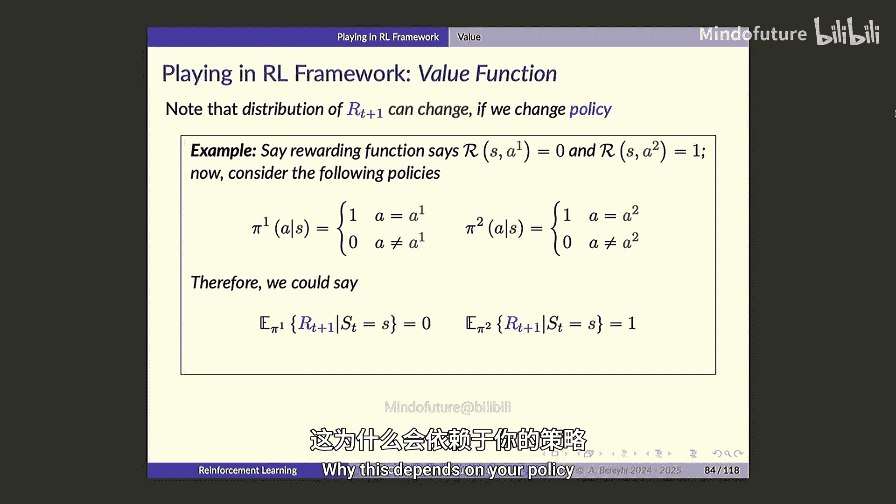

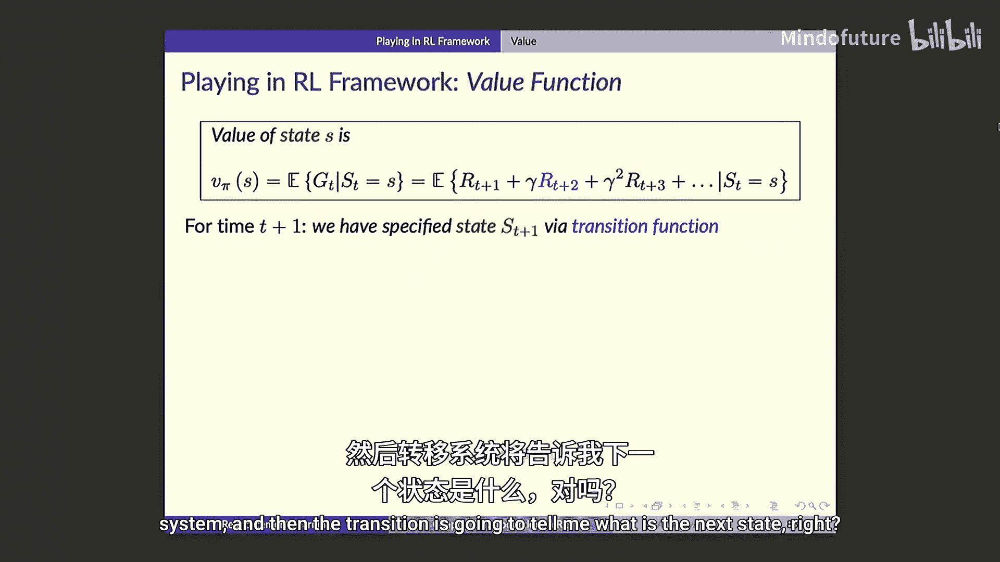

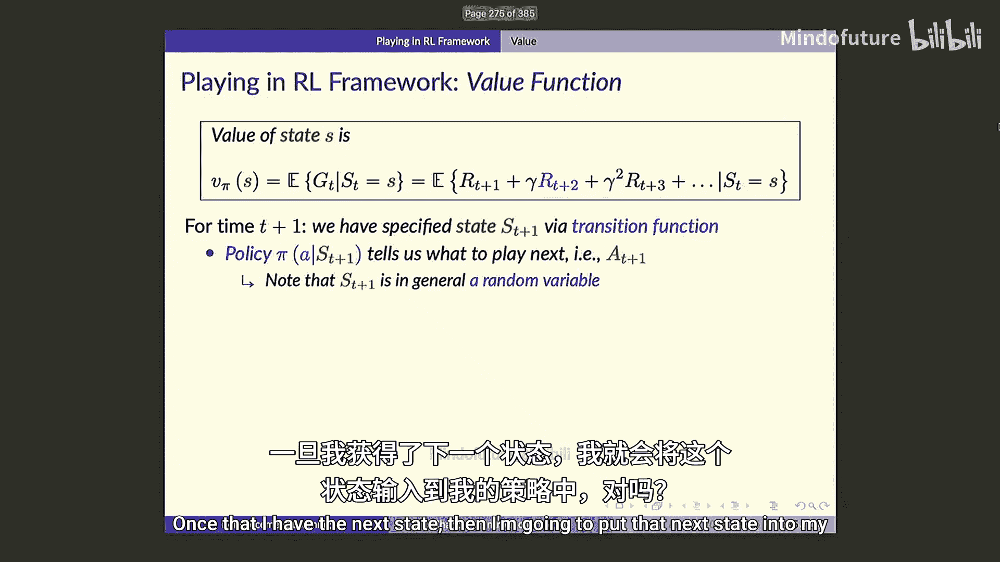

Clear。And that this is going to explain what is the next action。 So here S plus one。

 the next stage is in general， a random variable and then your next action is， of course。

 a random variable depending on that function and your policy and the rewarding system is again available So you're gonna say that okay this is the next action that I can do and this is the next state I put it inside the rewarding function。

 this is going to give me a reward and that reward Rt plus2 is again a random variable。

 you can redo whatever we have done before right but you're going to get more complicated now but one thing that you might see it and don't worry。

 we're gonna to see it in very much details through the course is that you are seeing a sort of tree like behavior right So when you are here at time1。

 you just need to care about the next one but then we want to。Talk about R T plus2。 Well。

 this sounds first that you need to talk about the second two right。

 but the second two is the next of the next right？ So if you could have gone to the next time interval。

 then you just mimic exactly what you did before right So it's a kind of treelike behavior。

 And don't worry you're going to see it gradually through semester。

 And this is going to be the key point that is going to help us a lot in developing algorithms because this property is like making the whole story much。

 much， much simpler。Okay， questions？No question。Great， so if you' got no question。

 so you can see this that every single time。 I mean。

 when when you know the policy and you know those systems。

 how the transition and rewarding is happening， then each time you can talk about the probability of every single next reward right the deeper you go in time。

 the harder the more complicated the description gonna be。

 but it's not impossible is theoretically possible right And once you all of them you can take the average and then this average is going to tell you what you expect at this particular stage to see in the future if you play with policy pi right and this is the value of policy pi questions。

😊。

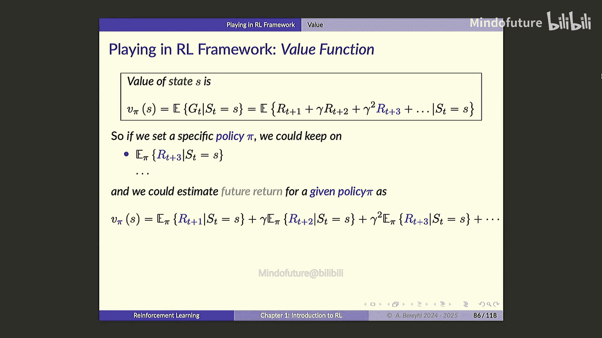